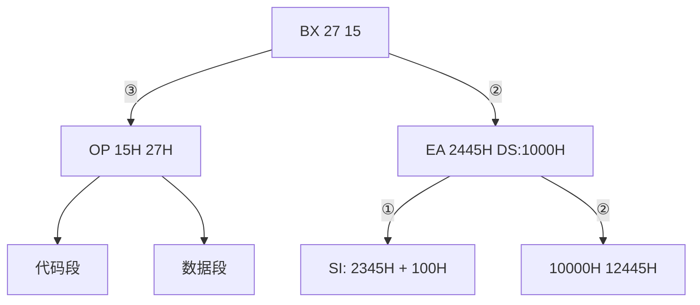
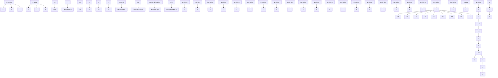
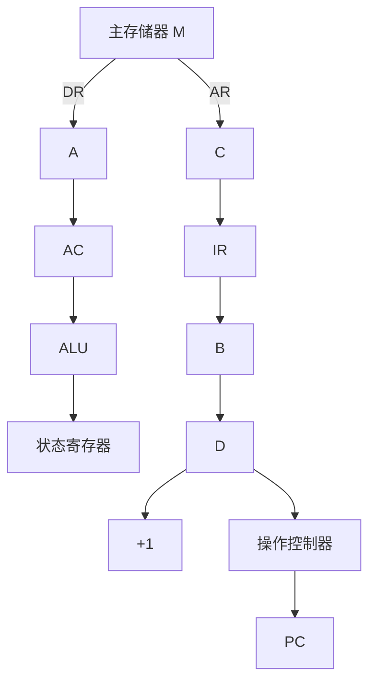

# 部分作业题-习题课-指令系统-Spring-2021

## 来源

- 分类：`作业`
- 原始文件：`习题课--指令系统--Spring.2021.pdf`
- 原始相对路径：`资料/部分作业题/习题课--指令系统--Spring.2021.pdf`
- 原始绝对路径：`D:\wzb\计算机组成原理\资料\部分作业题\习题课--指令系统--Spring.2021.pdf`

## 后续处理建议

- 从本整理稿中提取稳定知识点
- 检查公式、表格、结构图的提取效果
- 必要时补单独图像解读稿
- 如发现资料错误，转入勘误或分歧

## 提取结果

# 计算机组成与结构 - 指令系统/CPU设计习题课题

李瑞 副教授

蒋志平 讲师

计算机科学与技术学院

# 4.4

$$
1 6 - c e i C (m / 6 4)
$$

\- 指令字长16位；支持1/2个操作数；操作数地址长6位；2操作数指令m条，求：操作数指令最多多少条？

text_image

4
6
6
←支撑
←1摆
允许可靠度ceil(m/64)
(16-m)
64
与的指数和m的速度
32
64 65 129 3
2

# 4.4

\- 指令字长16位；支持1/2个操作数；操作数地址长6位；2操作数指令m条，求：1操作数指令最多多少条？

text_image

4
6
6
m
∈ 20p synds
≤1sprend
(2⁴-m) x 2⁶

1. 每一段自己的编的之间。  
2. 向上层侵与的个数 4.1 > cell(m/2^n)  
3. 下层侵害的微ceil(m/2^n)

\- 指令字长16位；支持0/1/2个操作数；操作数地址长6位；操作数指令K条，0操作数指令L条，求：操作数指令最多

text_image

多少条？
4
6
6
10
2
16
1
↓ 6
ceil(L/64)
ceil [K + ceil(L/64))

# 4.1

\- 指令字长16位；支持0/1/2个操作数；操作数地址长6位；2操作数指令K条，0操作数指令L条，求：1操作数指令最多

text_image

多少条?
(2⁴-k)
k
64
ceil (L-64)

# 4.6

\- 给出寻址方式名称

$E = D \Leftrightarrow [100]^{-1}$

z=4001173 直好

$$
E = (P C) + D
$$

$$
E = (R) + D
$$

$$
E = (R 1) + D
$$

$$
E = (D)
$$

$$
E = ((R 1) + D)
$$

# 数据寻址方式 — 总结

■ 加起来！！！把右边的地址值全加起来！！！  
- BX找DS! ! ! !   
■ BP找SS！！！  
- “直接” v.s “间接”   
- “相对” v.s “变址”

<table><tr><td>源操作数</td><td>指令的变形</td><td>源操作数的寻址方式</td></tr><tr><td>只有偏移量</td><td>MOV AX, [100H]</td><td>直接寻址方式</td></tr><tr><td>只有一个寄存器</td><td>MOV AX, [BX] 或 MOV AX, [SI]</td><td>寄存器间接寻址方式</td></tr><tr><td>有一个寄存器和偏移量</td><td>MOV AX, [BX+100H] 或 MOV AX, [SI+100H]</td><td>寄存器相对寻址方式</td></tr><tr><td>有二个寄存器</td><td>MOV AX, [BX+SI]</td><td>基址加变址寻址方式</td></tr><tr><td>有二个寄存器和偏移量</td><td>MOV AX, [BX+SI+100H]</td><td>相对基址加变址寻址方式</td></tr></table>

# 4.6

\- 给出寻址方式名称

$$
E = D \leftarrow D = 1 0 0 H ^ {2} \mathrm{直好}
$$

$$
E = (P C) + D \leftarrow P C \mathrm{相对}
$$

$$
E = (R) + D \Leftrightarrow \mathrm{多相对}
$$

$$
E = (R 1) + D \leqslant \mathrm{基址相对}
$$

$$
E = (D) \leftarrow i n ^ {\prime}
$$

$$
E = ((R 1) + D)
$$

$$
\mathrm{基十相十问}
$$

$$
* a
$$

$$
x a = 1 0 0
$$

$$
\boxed {\frac {1 0 0}{2}} \leftarrow a
$$

$$
\begin{array}{c} \text {   Voo   } \\ \text {   *xa   } \end{array} \quad \begin{array}{c} \text {   *a   } \\ \text {   *fa   } \\ \text {   *xa   } \end{array} \quad \text {   直接   }
$$

# 4.10

\- (BX)=0100H, (SI)=0002H, (0100H)=12H, (0101H)=34H, (0102H)=56H, (0103H)=78H, (1200H)=2AH, (1201H)=4CH, (1202H)=B7H, (1203H)=65H, 求以下指令执行后AX的结果

MOV AX 1200H ${AX} = {1200H}$

MOV AX BX

Ax = 0.100

MOV AX [1200H]

MOV AX [BX]

MOV AX 1100H[BX]

MOV AX [BX][SI]

MOV AX 1100H[BX][SI]

Sos6
↓
x86 $\frac{littlecondien}{小动画}$

1234 567817

78561341127

4c28

# 寻址方式 - 寄存器相对寻址

例: 假设指令: MOV BX, [SI+100H], 在执行它时, (DS)=1000H, (SI)=2345H, 内存单元12445H的内容为2715H, 问该指令执行后, BX的值是什么?

解：根据寄存器相对寻址方式的规则，在执行本例指令时，源操作数的有效地址EA为：

$$
\mathrm{EA} = (\mathrm{SI}) + 1 0 0 \mathrm{H} = 2 3 4 5 \mathrm{H} + 1 0 0 \mathrm{H} = 2 4 4 5 \mathrm{H}
$$

该操作数的物理地址应由DS和EA的值形成，即：PA=(DS)\*16+EA=1000H\*16+2445H=12445H。

所以，该指令的执行效果是：把从物理地址为12445H开始的一个字的值传送给BX。

flowchart

# 4.10

\- (BX)=0100H, (SI) = 0002H, (0100H) = 12H, (0101H) = 34H, (0102H) = 56H, (0103H) = 78H, (1200H) = 2AH, (1201H) = 4CH, (1202H) = B7H, (1203H) = 65H, 求以下指令执行后AX的结果

MOV AX 1200H

MOV AX BX

MOV AX [1200H]

4C2A

MOV AX [BX]

MOV AX 1100H[BX]

MOV AX [BX][SI]

MOV AX 1100H[BX][SI]

# 4.12

STO, Θ, 551

$$
E S = 4 0 0 0
$$

$$
D I = 0
$$

$$
c \lfloor D
$$

$$
\underline {{R E P}} \underline {{S T O S B}}, 5 5 t
$$

\- 将40000H\~4BFFFFH填写55H;

meet (↑↑↑)

\- 读取40000H\~4BFFFFH，检查是否全是55H；如果是

# AL=7E；如果不是AL=81H

for(a=40000)H; a<4BFF; a++)
≠a=55H;
{DS=

${cx} = 0 < \infty$

STQ S B
↑
6h8 g B-142

${100} \times  {3x},{4000}$

mov DS.DX

mV SI,0

→hov cx, 0c00%

start.
win [81], 55.

JNC SI

loop start

# 4.12

- 将40000H\~4BFFFH填写55H;   
- 读取40000H\~4BFFFFH，检查是否全是55H；如果是

text_image

AL=7E; 如果不是AL=81H
check = true;
for(a = 4000 - 4BZZ - a1t + ) {
    if (xA ≠ 5SH) {
        check = false;
        break,
    }
    }
    :if(check)
        nL = pZ
        dse B(.8l
    }
}
DS=4000
SZ=0
CX=0COO, BX=1
cmp [SI], SSH
JNC ( )
SZ+↑
loop silent
jump exit-loop
BX=0
exit-loop
cmp BX, 1
jZ
nor AC,8l
hit
wwAC,2Z
hit

# 4.12

- 将40000H\~4BFFFH填写55H;   
- 读取40000H\~4BFFFFH，检查是否全是55H；如果是

# AL=7E；如果不是AL=81H

text_image

3s ∈ 4500
ln ∈ 0
CLD ← cx = 0x < 5000
Rep 6705B, 5 > H
PSE: 4500
SI ∈ 0
cx = 0x < 5000
hsv < 511, 5 > H
ZNC SI
loop strut

# 4.15

text_image

1 |D | 1 |1' | 1 |1
2 4
s f 2 1 D
244

- 02E0H的bit-2和bit-5同时为1时，02E7H有8位数据；  
- 连续读取32个数据，写到A0100H

$$
\begin{array}{l} \text { while (fine) } \\ a = \text { read } (0 2 8 0 H) \\ \text { if } (a \geq 2 4 H = = 2 4 H) \varepsilon \\ s \quad \text { read } (0 2 8 7 H; \\ s \end{array}
$$

text_image

in A( , 0224y)/
Dx = 0224y
read in A( , Dx)
AMD A( , 24y)
cmp A( , 24y)
O E ( )
loop read
Dx = 0224y
in A( , Dx)

- 02E0H的bit-2和bit-5同时为1时，02E7H有8位数据；  
- 连续读取32个数据，写到A0100H

$$
\begin{array}{r l} & {\mathrm{fn} (c x = 0; c x <   3, c + f) \left\{ \begin{array}{l l} & \\ & {\mathrm{while(true)}} \\ & {a = \mathrm{read(235H)}} \\ & {\mathrm{if(a8f24f==24h)}} \\ & {[ S I + f ] = a;} \\ & {> 3} \end{array} \right.} \\ & {\mathrm{break};} \end{array}
$$

$$
D S = A O P O
$$

$$
S I = 0
$$

$$
C X = 3 2
$$

$$
D X = 0. 2 2 0
$$

$$
\rightarrow \text { in } A l, D X \in B l = A l
$$

$$
\mathrm{ANDAL,24H}
$$

$$
\text { cmp } A l, 2 4
$$

$$
j z ^ {\prime} (\cdot)
$$

$$
\text { loop   read }
$$

$$
[ S I ] = B l
$$

$$
s _ {2} + t;
$$

$$
\text { loop   read }
$$

3

# 4.15

- 02E0H的bit-2和bit-5同时为1时，02E7H有8位数据；  
- 连续读取32个数据，写到A0100H

# 4.18

\- 统计40000H开始的16K内存中'A'的个数，存在DX里

text_image

SI = 0
DS = 4000; ← mn AS, 400011
DS, AS

CX = 16384 ← DX = 0
→ cmp [SI], 65+1
JNE (next)
DX + f
J SI + f
loop -stm
hit

[UG]
[JAG]
{UL
{ULZ}
JBE
JIB
JZ
ONZ
JZ
JNB
UC
JNC

# 4.18

\- 统计40000H开始的16K内存中'A'的个数，存在DX里

# 4.21

# - 对比CISC和RISC

人们将具有复杂指令系统的计算机称为复杂指令集计算机（CISC）。

复杂指令集计算机的主要特点是：

(1) 指令系统复杂，指令数目多达 200～3000 条。  
(2) 指令长度不固定，有更多的指令格式和更多的寻址方式。  
(3) CPU 内部的通用寄存器比较少。  
(4) 有更多的可以访问主存的指令。  
(5) 指令种类繁多，但各种指令的使用频度差别很大。  
(6) 不同的指令执行时间相差很大，一般都需要多个时钟周期才能完成。  
(7) 控制器大多采用微程序控制器来实现。  
(8) 难以用优化编译的方法获得高效率的目的代码。

精减指令集计算机（RISC）精减指令集计算机的主要特点罗列如下：

(1) 只设置使用频度高的一些简单指令，复杂指令的功能由多条简单指令的组合来实现。  
(2) 指令长度固定，指令种类少，寻址方式种类少。  
(3) 访存指令很少, 有的 RISC 只有 LDA (读内存) 和 STA (写内存) 两条指令。多数指令的操作在速度快的内部通用寄存器间进行。

(4) CPU 中设置大量的通用寄存器，一般有几十个甚至几百个。

(5) 控制器用硬件实现，采用组合逻辑控制器。

(6) 采用流水线技术，大多数指令 1 个时钟周期即可完成。

(7) 有利用优化编译程序。

(8) 可简化硬件设计，降低设计成本。

确实是要将 CPU 的指令系统精减, 只采用最经常使用的指令系统中 20% 的指令。同时, 通过指令的减化可以使 CPU 的结构更加简单、更加合理, 从而提高执行速度。

# 5.8

\- 微指令产生控制信号的方法有哪些？分别如何产生信号？

# 一．水平型微指令

# (1) 直接表示法

在微指令的控制域字段中，直接表示法就是直接用一个二进制位表示一种微命令。

# (2) 字段译码法（字段编码）

一种性能良好而普遍使用的控制域编码方法是字段译码法，它是不译码法和译码法的结合。它将控制域分为若干字段。若各字段的编码相互独立，则通过各字段独立译码就可以获得计算机系统的全部控制信号，这被称作直接译码方式。若某些字段的编码相互关联，则关联字段要通过两级译码才能获得相关的控制信号，这被称作间接译码方式。

# 二．垂直型微指令

垂直型微指令的控制域变得非常紧凑、短小，是减小微指令长度的有效设计方法。垂直型微指令的控制字段一种极端情况是：如果CPU执行机器指令只需50余种微命令，则可用6位二进制编码构成微指令的控制字段。

# 5.13

\- 微指令字长24位; 生成部分4个字段各字段包括互斥微命令5, 8, 14, 3个; 控制生成次地址条件有3个; 求最多可用几位表示次地址? 控制存储器容量为?

$$
\frac {\sqrt {q ! \cdots \cdots !}}{\sqrt {q !} \cdots \sqrt {q !}} \left| \begin{array}{c c c c} q & 1 & 4 & q \\ \underline {{5}} & \underline {{8}} & \underline {{1 4}} & \underline {{1 3}} \\ 3 & 4 & 4 & 2 & 1 3 \end{array} \right.
$$

四个字段加上空操作分别需要3、4、4、2位表示而条件地址需2位，共15位。因而，次地址最多为 $24 - 15 = 9$ 位。叫控制存储器的容量为 $2^{9} = 512$ 个单元，每个单元24位

# 5.14

- 手写Add AX (BX)的微流程  
- 手写ADD AX DISP(SI)的微流程  
- 手写SUB BX 100(DI)的微流程

P-BC

$PC \rightarrow \partial R$ $DR \rightarrow \partial B$ $RD, PC + 1$ $DR \rightarrow DR$ $DR \rightarrow IR$

C
βx→AR
AR→DR
RD
DB→AR
DR→S

3x8
AX→AXW
and: AW→T
T→AX

- 计算机简单框图  

flowchart

FEC

$\therefore {AD} = 1$

$A x \rightarrow A C D$ $A B O N, A C W \rightarrow$ $T \rightarrow A X$

# 5.17

- A/B/C/D各是什么功能的寄存器?  
- 写出LDA X的微操作流程(x) -> AC   
- 写出STA Y的流程(AC) - (Y)

$$
\begin{array}{l} \angle D X X \\ x \rightarrow 1 0 0 3 \\ 6 7 \times x \\ A R - i n B \\ c l x x \\ A D \\ D B \rightarrow D B \\ D R \rightarrow D C \\ \end{array}
$$

flowchart

