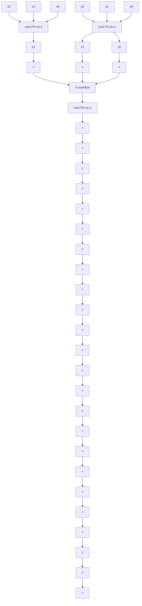

# 部分作业题-习题课-运算方法-Spring-2020

## 来源

- 分类：`作业`
- 原始文件：`习题课--运算方法--Spring.2020.pdf`
- 原始相对路径：`资料/部分作业题/习题课--运算方法--Spring.2020.pdf`
- 原始绝对路径：`D:\wzb\计算机组成原理\资料\部分作业题\习题课--运算方法--Spring.2020.pdf`

## 后续处理建议

- 从本整理稿中提取稳定知识点
- 检查公式、表格、结构图的提取效果
- 必要时补单独图像解读稿
- 如发现资料错误，转入勘误或分歧

## 提取结果

# 计算机组成与结构

# 一运算方法习题课

李瑞 副教授

蒋志平 讲师

计算机科学与技术学院

# 题3.2 / 3.3 / 3.9

说明单符号号位检测溢出的方法？

说明双符号位检测举出的方法？

当两个同符号的数相加或异符号的数相减，结果的SF和CF进行啥运算为1时，表示运算的结果产生溢出？

# 定点数运算一加减法

# - 进位判别法

- “其实就是双符号位法的变形”  
- 设 $C_{n - 1}$ 为最高数值位向符号位的进位, $C_{n}$ 是符号位向更高位的进位, 则溢出判断条件:

$$
O F = C _ {n - 1} \oplus C _ {n}
$$

$$
\left\{ \begin{array}{l} C _ {n - 1} C _ {n} = 0 0, \text {Non - Overflow} \\ C _ {n - 1} C _ {n} = 0 0, \text {Non - Overflow} \\ C _ {n - 1} C _ {n} = 1 0, \text {Negative Overflow} \\ C _ {n - 1} C _ {n} = 0 1, \text {Positive Overflow} \end{array} \right.
$$

向更高进位

# 定点数运算一加减法

\- 符号位与进位标志判别法

\- CPU的处理器状态字（Processor State Word, PSW）描述众多运算状态，如溢出标志(Overflow Flag, OF)，进位标志(Carrier Flag, CF)，符号标志(Sign Flag)等...

- 当运算发生进位时，CF置1  
- “把CF，SF纳入计算”   
- 溢出判断条件: $OF = CF \oplus SF$

$$
\left\{ \begin{array}{l} C F S F = 0 0, \text {Non - Overflow} \\ C F S F = 0 0, \text {Non - Overflow} \\ C F S F = 1 0, \text {Negative Overflow} \\ C F S F = 0 1, \text {Positive Overflow} \end{array} \right.
$$

# CPU符号标志SF

text_image

SF
0 1 0 0 0 0 0 1 | 65 | 0 0 1 1 1 1 1 1 | 63
+ 0 1 0 0 0 0 1 1 | 67 | + 0 1 0 1 0 1 0 1 | 85
0 1 0 0 0 0 1 0 0 | 溢出 | 0 1 0 0 1 0 1 0 0 | 溢出
CPU进位标志CF
正溢出

text_image

-65 + -67
1 0 1 1 1 1 1 1 | -65
+ 1 0 1 1 1 1 0 1 | -67
+ 1 0 1 0 1 0 1 1 | -65 + -85
10 0 1 1 1 1 0 0 | 溢出
10 1 1 0 1 0 1 0 | 溢出

# 负溢出

other

|  | 65 + 16 | -65 - 5 |
|---|---|---|
| 0 | 1 0 0 0 0 0 1 | 65 |
| + 0 | 0 0 0 1 0 0 0 | 16 |
| 00 | 1 0 0 1 0 0 1 | 81 |
| -65 - 5 | -65 | -5 |
| + | 1 | -70 |
| 11 | 0 1 1 1 0 1 0 | -70 |
The green arrow labeled '无溢出' indicates the absence of a single value in the diagram. The number '4' is shown below the diagram.

# 定点数运算一加减法

# - 双符号位法

- “一个符号不够，两个来凑”  
- 符号位S变成 $S_{2}S_{1}$

\- 正数->00

\- 负数->11

\- 溢出判断条件: $OF = S_{1} \oplus S_{2}$

$$
\left\{ \begin{array}{l} S _ {1} S _ {2} = 0 0, \text {Non - Overflow} \\ S _ {1} S _ {2} = 1 1, \text {Non - Overflow} \\ S _ {1} S _ {2} = 1 0, \text {Negative Overflow} \\ S _ {1} S _ {2} = 0 1, \text {Positive Overflow} \end{array} \right.
$$

# 双符号位

<table><tr><td colspan="4">65 + 67</td><td colspan="4">65 + 85</td></tr><tr><td>00</td><td>1 0 0 0 0 0 1</td><td>65</td><td>00</td><td>0 1 1 1 1 1 1</td><td>63</td><td></td><td></td></tr><tr><td>+00</td><td>1 0 0 0 0 1 1</td><td>67</td><td>+00</td><td>1 0 1 0 1 0 1</td><td>85</td><td></td><td></td></tr><tr><td>01</td><td>0 0 0 0 1 0 0</td><td>溢出</td><td>01</td><td>0 0 1 0 1 0 0</td><td>溢出</td><td></td><td></td></tr></table>

# 正溢出

<table><tr><td colspan="9">-65 + -67</td><td colspan="9">-65 + -85</td></tr><tr><td>1 1</td><td>0</td><td>1</td><td>1</td><td>1</td><td>1</td><td>1</td><td>1</td><td>-65</td><td>1 1</td><td>0</td><td>1</td><td>1</td><td>1</td><td>1</td><td>1</td><td>1</td><td>-65</td></tr><tr><td>+ 1 1</td><td>0</td><td>1</td><td>1</td><td>1</td><td>1</td><td>0</td><td>1</td><td>-67</td><td>+ 1 1</td><td>0</td><td>1</td><td>0</td><td>1</td><td>0</td><td>1</td><td>1</td><td>-85</td></tr><tr><td>1 0</td><td>0</td><td>1</td><td>1</td><td>1</td><td>1</td><td>0</td><td>0</td><td>溢出</td><td>1 0</td><td>1</td><td>1</td><td>0</td><td>1</td><td>0</td><td>1</td><td>0</td><td>溢出</td></tr></table>

# 负溢出

<table><tr><td colspan="101">65 + 16</td><td></td><td></td><td></td><td></td><td></td><td></td><td></td><td></td><td></td><td></td><td></td><td></td><td></td><td></td><td></td><td></td><td></td><td></td><td></td><td></td><td></td><td></td><td></td><td></td><td></td><td></td><td></td><td></td><td></td><td></td><td></td><td></td><td></td><td></td><td></td><td></td><td></td><td></td><td></td><td></td><td></td><td></td><td></td><td></td><td></td><td></td><td></td><td></td><td></td><td></td><td></td><td></td><td></td><td></td><td></td><td></td><td></td><td></td><td></td><td></td><td></td><td></td><td></td><td></td><td></td><td></td><td></td><td></td><td></td><td></td><td></td><td></td><td></td><td></td><td></td><td></td><td></td><td></td><td></td><td></td><td></td><td></td><td></td><td></td><td></td><td></td><td></td><td></td><td></td><td></td><td></td><td></td><td></td><td></td><td></td><td></td><td></td><td></td><td></td><td></td><td></td><td></td><td></td><td></td><td></td><td></td><td></td><td></td><td></td><td></td><td></td><td></td><td></td><td></td><td></td><td></td><td></td><td></td><td></td><td></td><td></td><td></td><td></td><td></td><td></td><td></td><td></td><td></td><td></td><td></td><td></td><td></td><td></td><td></td><td></td><td></td><td></td><td></td><td></td><td></td><td></td><td></td><td></td><td></td><td></td><td></td><td></td><td></td><td></td><td></td><td></td><td></td><td></td><td></td><td></td><td></td><td></td><td></td><td></td><td></td><td></td><td></td><td></td><td></td><td></td><td></td><td></td><td></td><td></td><td></td><td></td><td></td><td></td><td></td><td></td><td></td><td></td><td></td><td></td><td></td><td></td><td></td><td></td><td></td><td></td><td></td><td></td><td></td><td></td><td></td><td></td><td></td><td></td><td></td><td></td><td></td><td></td><td></td><td></td><td></td><td></td><td></td><td></td><td></td><td></td><td></td><td></td></tr><tr><td colspan="2">00</td><td>1</td><td>0</td><td>0</td><td>0</td><td>0</td><td>0</td><td colspan="100">1</td><td rowspan="2" colspan="100">-65 - 5</td><td rowspan="2"></td><td></td><td></td><td></td><td></td><td></td><td></td><td></td><td></td><td></td><td></td><td></td><td></td><td></td><td></td><td></td><td></td><td></td><td></td><td></td><td></td><td></td><td></td><td></td><td></td><td></td><td></td><td></td><td></td><td></td><td></td><td></td><td></td><td></td><td></td><td></td><td></td><td></td><td></td><td></td><td></td><td></td><td></td><td></td><td></td><td></td><td></td><td></td><td></td><td></td><td></td><td></td><td></td><td></td><td></td><td></td><td></td><td></td><td></td><td></td><td></td><td></td><td></td><td></td><td></td><td></td><td></td><td></td><td></td><td></td><td></td><td></td><td></td><td></td><td></td><td></td><td></td><td></td><td></td><td></td><td></td><td></td><td></td><td></td><td></td><td></td><td></td><td></td><td></td><td></td><td></td><td></td><td></td><td></td><td></td><td></td><td></td><td></td><td></td><td></td></tr><tr><td colspan="2">+00</td><td>0</td><td>0</td><td>0</td><td>1</td><td>0</td><td>0</td><td colspan="100">0</td><td colspan="99">-65</td></tr></table>

# 无溢出

# 定点数运算一加减法

\- 那么CPU实际是怎么做的？

\- SF和CF输入组合逻辑电路判断出来的\~

\- Then ?

- 溢出标志OF = On   
• [maybe]产生溢出中断

flowchart

3个全加器级联

# 题3.17

计算下面的加法结果，并判断溢出

1. x=0.01001 y = -0.10111   
2. x=0.10010 y=0.11000   
3. x=-0.01101 y=0.00101  
4. x=-0.11011 y=-0.10010

# 题3.20

分别用原码1位乘法和booth法计算下面乘法

1. x=-0.1101 y=0.0110   
2. x=-0.1110 y=-0.1101

# “表格式计算”一乘法

\- 以原码一位乘法为例：竖式是直观的，步骤步骤累加是可理解的，表格式是一眼看上去懵逼的...

通过部分积D累加逐层结果

<table><tr><td rowspan="2">第一层加1101</td><td rowspan="2">0 0 0 0+ 1 1 0 11 1 0 1</td><td colspan="2">&lt;-部分积D,初值为0</td></tr><tr><td colspan="2">D = D + X</td></tr><tr><td rowspan="2">第二层加1101</td><td rowspan="2">0 1 1 0 1+ 1 1 0 1 01 0 0 1 1 1</td><td colspan="2">D右移</td></tr><tr><td colspan="2">D = D&gt;&gt;1 + X</td></tr><tr><td>第三层加0000</td><td>1 0 0 1 1 1+ 0 0 0 0 0 01 0 0 1 1 1</td><td colspan="2">D右移D = D&gt;&gt;1 + X</td></tr><tr><td>第四层加1101</td><td>0 1 0 0 1 1 1+ 1 1 0 1 0 0 01 0 0 0 1 1 1 1</td><td colspan="2">D右移D = D&gt;&gt;1 + X</td></tr></table>

部分积D的符号

(建议至少2位)

部分积D

粗线分隔D和Y

乘数Y

Y总是顶格对齐，D总右移，等效于竖式中X左移

2位符号，防止溢出时右移出现负数

<table><tr><td colspan="2">符号</td><td colspan="4">D</td><td colspan="3">Y</td><td> $Y_0$ </td><td>操作说明</td></tr><tr><td>0</td><td>0</td><td>0</td><td>0</td><td>0</td><td>0</td><td>1</td><td>0</td><td>1</td><td>1</td><td>D/Y初始化</td></tr><tr><td>0</td><td>0</td><td>1</td><td>1</td><td>0</td><td>1</td><td>1</td><td>0</td><td>1</td><td>1</td><td rowspan="2">+ [X] $_{原}$ </td></tr><tr><td>0</td><td>0</td><td>1</td><td>1</td><td>0</td><td>1</td><td>1</td><td>0</td><td>1</td><td>1</td></tr><tr><td>0</td><td>0</td><td>0</td><td>1</td><td>1</td><td>0</td><td>1</td><td>1</td><td>0</td><td>1</td><td>D/Y右移1位</td></tr><tr><td>0</td><td>0</td><td>1</td><td>1</td><td>0</td><td>1</td><td>0</td><td>1</td><td>0</td><td>1</td><td rowspan="2">+ [X] $_{原}$ </td></tr><tr><td>0</td><td>1</td><td>0</td><td>0</td><td>1</td><td>1</td><td>1</td><td>1</td><td>0</td><td>1</td></tr><tr><td>0</td><td>0</td><td>1</td><td>0</td><td>0</td><td>1</td><td>1</td><td>1</td><td>1</td><td>0</td><td>D/Y右移1位</td></tr><tr><td>0</td><td>0</td><td>0</td><td>0</td><td>0</td><td>0</td><td></td><td></td><td>1</td><td>0</td><td rowspan="2">+0</td></tr><tr><td>0</td><td>0</td><td>1</td><td>0</td><td>0</td><td>1</td><td>1</td><td>1</td><td>1</td><td>0</td></tr><tr><td>0</td><td>0</td><td>0</td><td>1</td><td>0</td><td>0</td><td>1</td><td>1</td><td>1</td><td>1</td><td>D/Y右移1位</td></tr><tr><td>0</td><td>0</td><td>1</td><td>1</td><td>0</td><td>1</td><td></td><td></td><td></td><td>1</td><td rowspan="2">+ [X] $_{原}$ </td></tr><tr><td>0</td><td>1</td><td>0</td><td>0</td><td>0</td><td>1</td><td>1</td><td>1</td><td>1</td><td>1</td></tr><tr><td>0</td><td>0</td><td>1</td><td>0</td><td>0</td><td>0</td><td>1</td><td>1</td><td>1</td><td>1</td><td>D/Y右移1位</td></tr></table>

# Booth乘法 (补码乘法)

text_image

0 0 1 1 0 1
0 0 1 1 1 0
×
0 0 0 1 1 0 1
0 0 1 1 0 1
0 0 1 1 0 1
0 0 1 1 0 1
0 0 0 1 0 1 1 0 1 1 0

<-略用心机需要3步

v.s

运用技巧只需2步一>

text_image

在此处加 |X|
0 0 1 1 0 1
0 0 1 1 1 0
1 1 1 1 1 0 0 1 1
0 0 1 1 0 1
0 0 1 0 1 1 0 1 1 0

问题来了：如何高效地识别“一串1”的开始和结束？

# Booth算法:

- 从右向左，遇到“10”就是“一串1”的开始，在1的位置减 $|X|$ ；  
- 从右向左，遇到“0 1”就是“一串1”的结束，在0的位置加 $|X|$ ；  
- 中间的“00”和“11”都不管！

<table><tr><td> $y_i$   $y_{i-1}$ </td><td>操作</td></tr><tr><td>0 0</td><td>部分积+0,右移1位</td></tr><tr><td>0 1</td><td>部分积+[X] $_{补}$ ,右移1</td></tr><tr><td>1 0</td><td>部分积+[-X] $_{补}$ ,右移1</td></tr><tr><td>1 1</td><td>部分积+0,右移1位</td></tr></table>

# Booth乘法 (补码乘法)

# Booth算法:

- 从右向左，遇到“10”就是“一串1”的开始，在1的位置减 $|X|$ ；  
- 从右向左，遇到“0 1”就是“一串1”的结束，在0的位置加 $|X|$ ；  
- 中间的“00”和“11”都不管！

【例】X=0.1010，Y=-0.1101，利用Booth法求积。

【解】：

$$
[ \mathbf {X} ] _ {\text {补}} = 0 0. 1 0 1 0
$$

$$
[ - X ] _ {\text {补}} = 1 1. 0 1 1 0
$$

$$
[ \mathrm{Y} ] _ {\text {补}} = 1 1. 0 0 1 1
$$

∴ [X·Y]补 = 1.01111110

[Y]补含1位符号

-1位置尾数

<table><tr><td colspan="2">符号</td><td colspan="4">D</td><td colspan="4">Y</td><td> $Y_0$ </td><td> $Y_{-1}$ </td><td>操作说明</td></tr><tr><td>0</td><td>0</td><td>0</td><td>0</td><td>0</td><td>0</td><td>1</td><td>0</td><td>0</td><td>1</td><td>1</td><td>0</td><td>D/Y初始化</td></tr><tr><td>1</td><td>1</td><td>0</td><td>1</td><td>1</td><td>0</td><td>1</td><td>0</td><td>0</td><td>1</td><td>1</td><td>0</td><td rowspan="2">尾数10,“串头”,-X</td></tr><tr><td>1</td><td>1</td><td>0</td><td>1</td><td>1</td><td>0</td><td>1</td><td>0</td><td>0</td><td>1</td><td>1</td><td>0</td></tr><tr><td>1</td><td>1</td><td>1</td><td>0</td><td>1</td><td>1</td><td>0</td><td>1</td><td>0</td><td>0</td><td>1</td><td>1</td><td>尾数11,跳过</td></tr><tr><td>1</td><td>1</td><td>1</td><td>1</td><td>0</td><td>1</td><td>1</td><td>0</td><td>1</td><td>0</td><td>0</td><td>1</td><td>D/Y右移1位</td></tr><tr><td>0</td><td>0</td><td>1</td><td>0</td><td>1</td><td>0</td><td>0</td><td>0</td><td>1</td><td>0</td><td>0</td><td>1</td><td rowspan="2">尾数01,“串尾”,+X</td></tr><tr><td>0</td><td>0</td><td>0</td><td>1</td><td>1</td><td>1</td><td>1</td><td>0</td><td>1</td><td>0</td><td>0</td><td>1</td></tr><tr><td>0</td><td>0</td><td>0</td><td>0</td><td>1</td><td>1</td><td>1</td><td>1</td><td>0</td><td>1</td><td>0</td><td>0</td><td>尾数00,跳过</td></tr><tr><td>0</td><td>0</td><td>0</td><td>0</td><td>0</td><td>1</td><td>1</td><td>1</td><td>1</td><td>0</td><td>1</td><td>0</td><td>D/Y右移1位</td></tr><tr><td>1</td><td>1</td><td>0</td><td>1</td><td>1</td><td>0</td><td>0</td><td>0</td><td>0</td><td>0</td><td>1</td><td>0</td><td rowspan="2">尾数10,“串头”,-X</td></tr><tr><td>1</td><td>1</td><td>0</td><td>1</td><td>1</td><td>1</td><td>1</td><td>1</td><td>1</td><td>0</td><td>1</td><td>0</td></tr><tr><td>1</td><td>1</td><td>1.</td><td>0</td><td>1</td><td>1</td><td>1</td><td>1</td><td>1</td><td>1</td><td>0</td><td>1</td><td>D/Y右移2位</td></tr></table>

结束首位为符号

乘数用尽，计算结束

# 题3.22

用原码加减交替法计算下面除法

1. x=-0.10101 y=-0.11011   
2. x=0.1001110001 y = -0.10101

# 关于除法的“表格式计算”

解决方案二：无脑直减，减多了原地不恢复（加减交替法）

例，[X]原=0.1011, [Y]原=1.1101，求商/余数

<table><tr><td colspan="2">符号</td><td colspan="4">余数(R)</td><td>商</td><td>操作说明</td></tr><tr><td>0</td><td>0</td><td>1</td><td>0</td><td>1</td><td>1</td><td></td><td>R初始化</td></tr><tr><td>1</td><td>1</td><td>0</td><td>0</td><td>1</td><td>1</td><td></td><td rowspan="2">无脑直减,负了商0</td></tr><tr><td>1</td><td>1</td><td>1</td><td>1</td><td>1</td><td>0</td><td>0</td></tr><tr><td>1</td><td>1</td><td>1</td><td>1</td><td>0</td><td>0</td><td></td><td>R左移1位</td></tr><tr><td>0</td><td>0</td><td>1</td><td>1</td><td>0</td><td>1</td><td></td><td rowspan="2">+D,正了商1</td></tr><tr><td>0</td><td>0</td><td>1</td><td>0</td><td>0</td><td>1</td><td>1</td></tr><tr><td>0</td><td>1</td><td>0</td><td>0</td><td>1</td><td>0</td><td rowspan="3">1</td><td>R左移1位</td></tr><tr><td>1</td><td>1</td><td>0</td><td>0</td><td>1</td><td>1</td><td rowspan="2">无脑直减,正了商1</td></tr><tr><td>0</td><td>0</td><td>0</td><td>1</td><td>0</td><td>1</td></tr><tr><td>0</td><td>0</td><td>1</td><td>0</td><td>1</td><td>0</td><td></td><td>R左移1位</td></tr><tr><td>1</td><td>1</td><td>0</td><td>0</td><td>1</td><td>1</td><td></td><td rowspan="2">无脑直减,负了商0</td></tr><tr><td>1</td><td>1</td><td>1</td><td>1</td><td>0</td><td>1</td><td>0</td></tr><tr><td>1</td><td>1</td><td>1</td><td>0</td><td>1</td><td>0</td><td></td><td>R左移1位</td></tr><tr><td>0</td><td>0</td><td>1</td><td>1</td><td>0</td><td>1</td><td>1</td><td rowspan="2">,正了商1</td></tr><tr><td>0</td><td>0</td><td>0</td><td>1</td><td>1</td><td>1</td><td></td></tr></table>

# 定点数运算一除法

# 解决方案三：补码交替加减法

例，[X]=-0.10001011, [Y]=0.1110，求

商及余数

【解】

$$
[ X ] \text {补} = 1. 0 1 1 1 0 1 0 1
$$

$$
[ Y ] \text {补} = 0. 1 1 1 0
$$

$$
[ - Y ] \text {补} = 1. 0 0 1 0
$$

1. R与D同号，-D   
2. R与D异号，+D   
3. 当新余数R与D相同时，商1  
4. 当新余数R与D不同时，商0；  
5. R左移1位，下一轮回到1  
6. 除不尽时，商恒置1

$$
[ X \div Y ] \text {补} = 1. 0 1 1 0 1
$$

$$
\mathrm{余数} = 1. 0 0 1 1 \times 2 ^ {- 4}
$$

<table><tr><td colspan="2">符号</td><td colspan="8">余数(R)</td><td>商</td><td>操作说明</td></tr><tr><td>1</td><td>1</td><td>0</td><td>1</td><td>1</td><td>1</td><td>0</td><td>1</td><td>0</td><td>1</td><td></td><td>R初始化</td></tr><tr><td>0</td><td>0</td><td>1</td><td>1</td><td>1</td><td>0</td><td>0</td><td>0</td><td>0</td><td>0</td><td></td><td>R与D异号,+D</td></tr><tr><td>0</td><td>0</td><td>0</td><td>1</td><td>0</td><td>1</td><td>0</td><td>1</td><td>0</td><td>1</td><td>1</td><td>R与D同号,商1</td></tr><tr><td>0</td><td>0</td><td>1</td><td>0</td><td>1</td><td>0</td><td>1</td><td>0</td><td>1</td><td>0</td><td></td><td>R左移1位</td></tr><tr><td>1</td><td>1</td><td>0</td><td>0</td><td>1</td><td>0</td><td>0</td><td>0</td><td>0</td><td>0</td><td></td><td>R与D同号,-D</td></tr><tr><td>1</td><td>1</td><td>1</td><td>1</td><td>0</td><td>0</td><td>1</td><td>0</td><td>1</td><td>0</td><td>0</td><td>R与D异号,商0</td></tr><tr><td>1</td><td>1</td><td>1</td><td>0</td><td>0</td><td>1</td><td>0</td><td>1</td><td>0</td><td>0</td><td></td><td>R左移1位</td></tr><tr><td>0</td><td>0</td><td>1</td><td>1</td><td>1</td><td>0</td><td>0</td><td>0</td><td>0</td><td>0</td><td></td><td>R与D异号,+D</td></tr><tr><td>0</td><td>0</td><td>0</td><td>1</td><td>1</td><td>1</td><td>0</td><td>1</td><td>0</td><td>0</td><td>1</td><td>R与D同号,商1</td></tr><tr><td>0</td><td>0</td><td>1</td><td>1</td><td>1</td><td>0</td><td>1</td><td>0</td><td>0</td><td>0</td><td></td><td>R左移1位</td></tr><tr><td>1</td><td>1</td><td>0</td><td>0</td><td>1</td><td>0</td><td>0</td><td>0</td><td>0</td><td>0</td><td></td><td>R与D同号,-D</td></tr><tr><td>0</td><td>0</td><td>0</td><td>0</td><td>0</td><td>0</td><td>1</td><td>0</td><td>0</td><td>0</td><td>1</td><td>R与D同号,商1</td></tr><tr><td>0</td><td>0</td><td>0</td><td>0</td><td>0</td><td>1</td><td>0</td><td>0</td><td>0</td><td>0</td><td></td><td>R左移1位</td></tr><tr><td>1</td><td>1</td><td>0</td><td>0</td><td>1</td><td>0</td><td>0</td><td>0</td><td>0</td><td>0</td><td></td><td>R与D同号,-D</td></tr><tr><td>1</td><td>1</td><td>0</td><td>0</td><td>1</td><td>1</td><td>0</td><td>0</td><td>0</td><td>0</td><td>0</td><td>R与D异号,商0</td></tr><tr><td>1</td><td>1</td><td>0</td><td>0</td><td>1</td><td>1</td><td>0</td><td>0</td><td>0</td><td>0</td><td>1</td><td>末尾恒1</td></tr></table>

# 题3.26

浮点字长12位，阶码5位（移码表示），尾数7位（补码表示），计算下面数字的加减法

$$
\begin{array}{l} 1. x = 1 1 / 1 6 ^ {*} 2 ^ {\wedge} - 4 \quad y = 3 5 / 6 4 ^ {*} 2 ^ {\wedge} - 3 \\ 2. x = 0. 1 0 1 1 0 1 ^ {*} 2 ^ {\wedge} - 1 1 B \quad y = - 0. 1 0 0 1 0 1 ^ {*} 2 ^ {\wedge} - 1 B \\ \end{array}
$$

# 浮点运算－加减法

\- So,浮点加减法4步操作：

- 对阶（低阶对齐到高阶）  
- 运算（补码+/-法）  
- 规格化（左/右移）  
- 舍入处理（截断法/恒置1/四舍五入）
