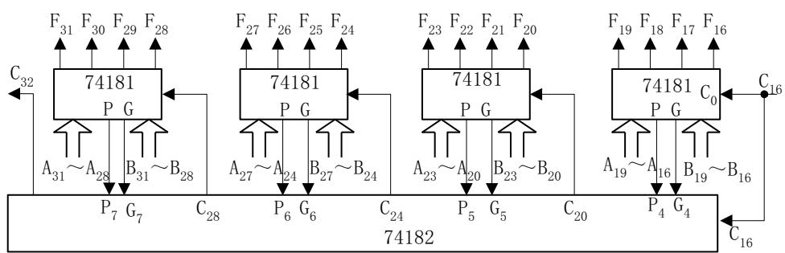
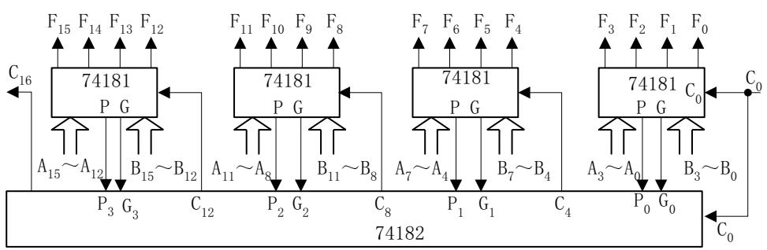
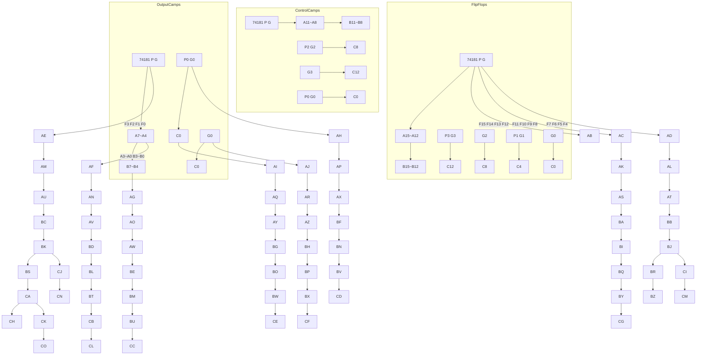

# 第一章

$1 . 1 0 \quad \ddagger \boxed { \overrightarrow { + } } \ d \boxed { \overrightarrow { + } } \boxed { \overrightarrow { + } } \boxed { \overrightarrow { + } } \boxed { \overrightarrow { \mathbf { k } } } = 5 0 0 0 0 \times 1 + 8 0 0 0 0 \times 2 + 1 0 0 0 0 \times 4 + 5 0 0 0 \times 2$

$$
= 2 6 0 0 0 0 \text {(时钟周期)}
$$

$$
= 2 6 0 0 0 0 \times 2 n S = 5 2 0 \mu S
$$

$$
\mathrm{CPI} = [ 5 2 0 0 0 0 \mathrm{nS} \div (5 0 0 0 0 + 8 0 0 0 0 + 1 0 0 0 0 + 5 0 0 0) ] \div 2 = 1. 7 9
$$

$$
\text { 速度 } = 2 7 8. 8 \mathrm{MIPS}
$$

# 1.13 解：

因为总加速比为：

$$
\mathrm{S} _ {\mathrm{p}} = \frac {1}{(1 - \sum \mathrm{f} _ {\mathrm{e}}) + (\sum \mathrm{f} _ {\mathrm{e}} / \mathrm{r} _ {\mathrm{e}})} \tag {1-12}
$$

$$
1 / [ (1 - 0. 6 - X) + (0. 0 1 + 0. 0 1 + 0. 0 5 X) ] = 1 0
$$

$$
1 = 4. 2 - 9. 5 X
$$

$$
9. 5 X = 3. 2
$$

$$
X = 3 3. 7
$$

计算结果要求C部件的执行时间为33.7％

# 第二章

2.5

⑴ 6=0 , 5 4 3 2 1 0 任意； 6 5 4 3 2 1 0＜1000000  
⑵ 6=1 5 =0, 4 3 2 1 0 任意；1100000＞ 6 5 4 3 2 1 0≥1000000

2.9

${ ( 1 ) } \ [ W ] _ { ^ { \ast } } = [ X ] _ { ^ { \ast } } = [ Y ] _ { ^ { \ast } } = [ Z ] _ { ^ { \ast } } = 0 0 1 $

$$
W = 0, \quad X = + 0, \quad Y = + 0, \quad Z = - 1 2 8
$$

$( 2 ) \ [ W ] _ { \ast } = [ X ] _ { \ast } = [ Y ] _ { \ast } = [ Z ] _ { \ast } = 8 0 1 $

$$
W = - 1 2 8, \quad X = - 0, \quad Y = - 1 2 7, \quad Z = 0
$$

(3) $[ W ] _ { \ast } = [ X ] _ { \ast } = [ Y ] _ { \ast } = [ Z ] _ { \ast } = F F \mathsf { H }$

$$
W = - 1, \quad X = - 1 2 7, \quad Y = - 0, \quad Z = + 1 2 7
$$

2.21

设浮点数字长16位，基值为2（以2为底）。其中阶码6位（含一位阶符），用移码表示；尾数10位（含一位数符），用补码表示。

(1) 求能表示的规格化浮点数的范围，填写下表，并与 16 位定点补码整数和定点补码小数的表示范围进行比较。

习题 2.21 附表

<table><tr><td></td><td>阶码(十六进制)</td><td>尾数(十六进制)</td><td>真值(十进制)</td></tr><tr><td>最大正数</td><td>3F</td><td>7FC</td><td> $(1-2^{-9})\cdot2^{31}$ </td></tr><tr><td>最小正数</td><td>00</td><td>400</td><td> $2^{-33}$ </td></tr><tr><td>最大负数</td><td>00</td><td>BFC</td><td> $-(0.5+2^{-9})\cdot2^{-32}$ </td></tr><tr><td>最小负数</td><td>3F</td><td>800</td><td> $-1\cdot2^{31}$ </td></tr></table>

(2) 判断下列十进制数能否表示成此格式的规格化浮点数，若可以，请写出对应的码值。

①3.14

$3 . 1 4 = 1 1 . 0 0 1 0 0 0 1 1 1 \cdot 2 ^ { 0 } = 0 . 1 1 0 0 1 0 0 0 1 \cdot 2 ^ { 2 } = 1 0 0 0 1 0 0 1 0 1 1 0 0 1 0 0 0 1 \quad \ddag \Re \mathcal { H } \overline { { \cdot \uparrow \sharp } } \overline { { | \mathbb { R } | } } ^ { \sharp }$

$\begin{array} { r c l } { { \scriptstyle ( \mathcal { Q } ) \ - 1 9 1 7 = - 1 1 1 0 1 1 1 1 1 1 0 1 . 0 \ \cdot \ 2 ^ { \circ } \ = \ - 1 1 1 0 1 1 1 1 1 \cdot \ 2 ^ { \circ } \ = \ 1 0 0 0 1 0 0 0 0 1 \cdot \ 2 ^ { \mathrm { { 1 1 } } } \ = \ 1 0 1 0 1 1 1 1 \cdot \ 2 ^ { \circ } \ = \ 1 1 1 1 0 1 1 1 } } & { { \scriptstyle ( \mathcal { Q } ) \ - \ 1 0 1 0 1 0 0 0 0 1 \cdot \ 2 ^ { \circ } \ = \ 1 0 1 0 1 1 1 \cdot \ 2 ^ { \circ } \ = \ 1 1 1 0 1 1 1 } } & { { \scriptstyle ( \mathcal { Q } ) \ - \ 1 0 1 0 0 0 0 1 0 0 1 \cdot \ 2 ^ { \circ } \ = \ 1 0 1 0 1 0 1 1 \cdot \ 2 ^ { \circ } \ . } } \\ { { \scriptstyle 1 0 0 0 1 0 0 0 0 0 1 } } & { { \scriptstyle ( \mathcal { Q } ) \ } } & { { \scriptstyle ( \mathcal { Q } ) \ } } \end{array}$

由于尾数而损失了精度

③ 105/512=0.001101001·20 =0.110100100·2-2 =011110 0110100100 能准确表示   
④- $\boldsymbol { - 1 0 } ^ { - 6 } \boldsymbol { = }$ 可以表示，会损失精度  
⑤ ${ \boldsymbol { 1 0 } } ^ { 1 0 }$ 超出规定浮点数的范围，无法表示。

2.22.

$$
\begin{array}{l} 5. 3 1 2 5 = 1 0 1. 0 1 0 1 \cdot 2 ^ {0} = 1. 0 1 0 1 0 1 \cdot 2 ^ {2} \\ S = 0 \quad 1 0 0 0 0 0 0 1 \quad 0 1 0 1 0 1 0 0 0 0 0 0 0 0 0 0 0 0 0 0 0 \\ - 3 6 5. 5 9 3 7 5 = - 1 0 1 1 0 1 1 0 1. 1 0 0 1 1 \cdot 2 ^ {0} = - 1. 0 1 1 0 1 1 0 1 1 0 0 1 1 \cdot 2 ^ {8} \\ S = 1 \quad 1 0 0 0 0 1 1 1 \quad 0 1 1 0 1 1 0 1 1 0 0 1 1 0 0 0 0 0 0 0 0 0 \\ \end{array}
$$

# 第 3 章

3.17.⑴

$$
X = 0. 0 1 0 0 1 \quad Y = - 0. 1 0 1 1 1
$$

$$
[ X ] _ {\text {补}} = 0. 0 1 0 0 1 0 0 \quad [ Y ] _ {\text {补}} = 1. 0 1 0 0 1 0 0
$$

$$
[ X ] _ {\text {补}} + [ Y ] _ {\text {补}} = 1. 1 0 0 1 0 0 0 \quad \text {无溢出}
$$

⑵

$$
X = 0. 1 0 0 1 0 \quad Y = 0. 1 1 0 0 0
$$

$$
[ X ] _ {\text {补}} = 0. 1 0 0 1 0 0 0 \quad [ Y ] _ {\text {补}} = 0. 1 1 0 0 0 0 0
$$

$$
[ X ] _ {\text {补}} + [ Y ] _ {\text {补}} = 1. 0 1 0 1 0 0 0 \quad \text {溢出}
$$

3.20.⑴ X=－0.1101 Y=＋0.0110

$$
[ X ] _ {\text {补}} = 1 1. 0 0 1 1 \quad [ - X ] _ {\text {补}} = 0 0. 1 1 0 1
$$

<table><tr><td colspan="2">符号</td><td colspan="4">D</td><td colspan="5">A</td><td> $A_{-1}$ </td><td>操作</td></tr><tr><td>0</td><td>0</td><td>0</td><td>0</td><td>0</td><td>0</td><td>0</td><td>0</td><td>1</td><td>1</td><td>0</td><td>0</td><td rowspan="2">+0</td></tr><tr><td>0</td><td>0</td><td>0</td><td>0</td><td>0</td><td>0</td><td></td><td></td><td></td><td></td><td></td><td></td></tr><tr><td>0</td><td>0</td><td>0</td><td>0</td><td>0</td><td>0</td><td></td><td></td><td></td><td></td><td></td><td></td><td rowspan="3">右移一位 $+[-X]_{补}$ </td></tr><tr><td>0</td><td>0</td><td>0</td><td>0</td><td>0</td><td>0</td><td>0</td><td>0</td><td>0</td><td>1</td><td>1</td><td>0</td></tr><tr><td>0</td><td>0</td><td>1</td><td>1</td><td>0</td><td>1</td><td></td><td></td><td></td><td></td><td></td><td></td></tr><tr><td>0</td><td>0</td><td>1</td><td>1</td><td>0</td><td>1</td><td></td><td></td><td></td><td></td><td></td><td></td><td rowspan="3">右移一位+0</td></tr><tr><td>0</td><td>0</td><td>0</td><td>1</td><td>1</td><td>0</td><td>1</td><td>0</td><td>0</td><td>0</td><td>1</td><td>1</td></tr><tr><td>0</td><td>0</td><td>0</td><td>0</td><td>0</td><td>0</td><td></td><td></td><td></td><td></td><td></td><td></td></tr><tr><td>0</td><td>0</td><td>0</td><td>1</td><td>1</td><td>0</td><td></td><td></td><td></td><td></td><td></td><td></td><td rowspan="3">右移一位 $+[X]_{补}$ </td></tr><tr><td>0</td><td>0</td><td>0</td><td>0</td><td>1</td><td>1</td><td>0</td><td>1</td><td>0</td><td>0</td><td>0</td><td>1</td></tr><tr><td>1</td><td>1</td><td>0</td><td>0</td><td>1</td><td>1</td><td></td><td></td><td></td><td></td><td></td><td></td></tr><tr><td>1</td><td>1</td><td>0</td><td>1</td><td>1</td><td>0</td><td></td><td></td><td></td><td></td><td></td><td></td><td rowspan="3">右移一位0</td></tr><tr><td>1</td><td>1</td><td>1</td><td>0</td><td>1</td><td>1</td><td>0</td><td>0</td><td>1</td><td>0</td><td>0</td><td>0</td></tr><tr><td>0</td><td>0</td><td>0</td><td>0</td><td>0</td><td>0</td><td></td><td></td><td></td><td></td><td></td><td></td></tr><tr><td>1</td><td>1</td><td>1</td><td>0</td><td>1</td><td>1</td><td></td><td></td><td></td><td></td><td></td><td></td><td rowspan="2">右移一位</td></tr><tr><td>1</td><td>1</td><td>1</td><td>1</td><td>0</td><td>1</td><td>1</td><td>0</td><td>0</td><td>1</td><td>0</td><td></td></tr></table>

$$
[ \mathrm{X} \bullet \mathrm{Y} ] _ {\text {补}} = 1. 1 0 1 1 0 0 1 0
$$

$$
[ Y ] _ {\text {补}} = 0 0. 0 1 1 0
$$

3.21.



<details>
<summary>flowchart</summary>

```mermaid
graph TD
    subgraph_Chip_1["74181 P G"]
        F31 --> A31
        F30 --> A28
        F29 --> B31
        F28 --> C28
        A31 --> P7
        A28 --> G7
        B31 --> C28
    end
    subgraph_Chip_2["74181 P G"]
        F27 --> A27
        F26 --> A24
        F25 --> B27
        F24 --> C24
        A27 --> P6
        A24 --> G6
        B27 --> C24
    end
    subgraph_Chip_3["74181 P G"]
        F23 --> A23
        F22 --> A20
        F21 --> B23
        F20 --> C20
        A23 --> P5
        A20 --> G5
        B23 --> C20
    end
    subgraph_Chip_C["74181 C0 P G"]
        F19 --> A19
        F18 --> A16
        F17 --> B19
        F16 --> C16
    end
    A31 --> P7
    A28 --> G7
    B31 --> C28
    C28 --> P6
    C24 --> P5
    C20 --> P4
    P5 --> G5
    P4 --> G4
    P3 --> C16
```
</details>



<details>
<summary>flowchart</summary>


</details>

$$
3. 2 2. (1) X = - 0. 1 0 1 0 1 \quad Y = + 0. 1 1 0 1 1
$$

$$
[ X ] _ {\text {补}} = 1 1. 0 1 0 1 1 \quad [ - Y ] _ {\text {补}} = 1 1. 0 0 1 0 1
$$

$$
[ Y ] _ {\text {补}} = 0 0. 1 1 0 1 1
$$

<table><tr><td colspan="2">符号</td><td colspan="9">被除数(余数)</td><td>商</td><td>操作</td></tr><tr><td>0</td><td>0</td><td>1</td><td>0</td><td>1</td><td>0</td><td>1</td><td>0</td><td>0</td><td>0</td><td>0</td><td rowspan="3">0</td><td rowspan="3">左移一位 $-\left|Y\right|$ </td></tr><tr><td>0</td><td>1</td><td>0</td><td>1</td><td>0</td><td>1</td><td>0</td><td>0</td><td>0</td><td>0</td><td>0</td></tr><tr><td>1</td><td>1</td><td>0</td><td>0</td><td>1</td><td>0</td><td>1</td><td></td><td></td><td></td><td></td></tr><tr><td>0</td><td>0</td><td>0</td><td>1</td><td>1</td><td>1</td><td>1</td><td>0</td><td>0</td><td>0</td><td>0</td><td rowspan="3">1</td><td rowspan="3">R $\geqslant$ 0,商为1左移一位 $-\left|Y\right|$ </td></tr><tr><td>0</td><td>0</td><td>1</td><td>1</td><td>1</td><td>1</td><td>0</td><td>0</td><td>0</td><td>0</td><td>1</td></tr><tr><td>1</td><td>1</td><td>0</td><td>0</td><td>1</td><td>0</td><td>1</td><td></td><td></td><td></td><td></td></tr><tr><td>0</td><td>0</td><td>0</td><td>0</td><td>0</td><td>1</td><td>1</td><td>0</td><td>0</td><td>0</td><td>1</td><td rowspan="3">1</td><td rowspan="3">R $\geqslant$ 0,商为1左移一位 $-\left|Y\right|$ </td></tr><tr><td>0</td><td>0</td><td>0</td><td>0</td><td>1</td><td>1</td><td>0</td><td>0</td><td>0</td><td>1</td><td>1</td></tr><tr><td>1</td><td>1</td><td>0</td><td>0</td><td>1</td><td>0</td><td>1</td><td></td><td></td><td></td><td></td></tr><tr><td>1</td><td>1</td><td>0</td><td>1</td><td>0</td><td>1</td><td>1</td><td>0</td><td>0</td><td>1</td><td>1</td><td rowspan="3">0</td><td rowspan="3">R&lt;0,商为0左移一位+|Y|</td></tr><tr><td>1</td><td>0</td><td>1</td><td>0</td><td>1</td><td>1</td><td>0</td><td>0</td><td>1</td><td>1</td><td>0</td></tr><tr><td>0</td><td>0</td><td>1</td><td>1</td><td>0</td><td>1</td><td>1</td><td></td><td></td><td></td><td></td></tr><tr><td>1</td><td>1</td><td>1</td><td>0</td><td>0</td><td>0</td><td>1</td><td>0</td><td>1</td><td>1</td><td>0</td><td>0</td><td>R&lt;0,商为0</td></tr></table>

Z＝－0.110001；Z=－0.1100，余=－0.10001×2-4

# 3.25.

规格化浮点数：

非规格化浮点数：

<table><tr><td> $(1-2^{-8})\cdot2^{63}$ </td></tr><tr><td> $2^{-65}$ </td></tr><tr><td> $-(0.5+2^{-8})\cdot2^{-64}$ </td></tr><tr><td> $-1\cdot2^{63}$ </td></tr></table>

<table><tr><td> $(1-2^{-8})\cdot2^{63}$ </td></tr><tr><td> $2^{-8}\cdot2^{-64}$ </td></tr><tr><td> $-2^{-8}\cdot2^{-64}$ </td></tr><tr><td> $-1\cdot2^{63}$ </td></tr></table>

3.26.⑴

$$
X = 1 1 / 1 6 \times 2 ^ {- 4} \quad Y = 3 5 / 6 4 \times 2 ^ {- 3}
$$

$$
X = 0. 1 0 1 1 0 0 \times 2 ^ {- 4} = 0 1 1 0 0 \quad 0 1 0 1 1 0 0
$$

$$
Y = 0. 1 0 0 0 1 1 \times 2 ^ {- 3} = 0 1 1 0 1
$$

X 规格化表示为：01100 0101100

Y 规格化表示为：01101 0100011

对阶 X 表示为：01101 0010110

求 X+Y＝01101 0111001 此为规格化浮点数。

对阶后求差，对补码可用加法实现［X-Y

$$
[ - \mathrm{Y} ] _ {\text {补}} = 1 0 1 1 1 0 1
$$

差的尾数＝1110011，可见尾数不是规格化浮点数，需左规两次：＝1001100

此时阶码应减 2，为 01011。

$$
\mathrm{X} - \mathrm{Y} = 0 1 0 1 1 \quad 1 0 0 1 1 0 0
$$

# 第 4 章

1. 双地址指令最多为 $2 ^ { 4 }$ 条。因此，m必须小于 $2 ^ { 4 }$ 。

单地址指令最多为 $( 2 ^ { 4 } - \mathsf { m } ) \times 2 ^ { 6 } - \mathsf { \Gamma } \lceil \mathsf { L } / 6 4 \mid$ 取整

4. $( 2 ^ { 4 } - \mathsf { m } ) \ \times 2 ^ { 6 }$

4.6.

<table><tr><td>I</td><td>X</td><td>E</td><td>寻址方式</td></tr><tr><td>0</td><td>00</td><td>E=D</td><td>直接寻址</td></tr><tr><td>0</td><td>01</td><td>E=(PC)+D</td><td>程序计数器相对寻址</td></tr><tr><td>0</td><td>10</td><td>E=(R)+D</td><td>寄存器相对(变址)寻址</td></tr><tr><td>0</td><td>11</td><td>E=(R1)+D</td><td>基址相对(变址)寻址</td></tr><tr><td>1</td><td>00</td><td>E=(D)</td><td>间接寻址</td></tr><tr><td>1</td><td>11</td><td>E=((R1)+D)</td><td>基址相对间接寻址</td></tr></table>

4.10.⑴AX=1200H

⑵AX=0100H   
⑶AX=4C2AH   
⑷ $) A X = 3 4 1 2 1$   
⑸AX=4C2AH   
⑹AX=7856H   
⑺AX=65B7H

4.12. 参考程序如下：

START： MOV DI，4000H

MOV DS，DI

MOV SI，0000H

MOV CX，0C000H

NEXT0：MOV AL，55H

MOV [SI]，AL

INC SI

LOOP NEXT0

MOV SI，0000H

MOV CX，0C000H

NEXT3：MOV AL，[SI]

CMP AL，55H

JNE NEXT5

INC SI

DEC CX

JNZ NEXT3

MOV AL，7EH

HLT

NEXT5：MOV AL，81H

HLT

START： MOV DI，4000H

MOV ES，DI

MOV DI，0000H

MOV CX，0C000H

NEXT0：MOV AL，55H

CLD

REP SCASB

JCXZ NEXT7

MOV AL，7EH

HLT

NEXT7：MOV AL，81H

HLT

# 15. 参考程序如下：

START： MOV DI，0A000H

MOV DS，DI

MOV SI，0100H

MOV CX，32

MOV DX，02E0H

GOON： IN AL，DX

AND AL，24H

CMP AL，24H

JNE GOON

MOV DX，02E7H

IN AL，DX

MOV [SI]，AL

INC SI

LOOP GOON

HLT

# 18. 参考程序如下：

START： MOV DI，4000H

MOV DS，DI

MOV SI，0000H

MOV CX，4000H

MOV DX，0000H

GOON: MOV AL，[SI]

CMP AL，‘A

JNE NEXT

INC DX

NEXT： INC SI

DEC CX

JNZ GOON

# HLT

# 4.21.

人们将具有复杂指令系统的计算机称为复杂指令集计算机（CISC）。

复杂指令集计算机的主要特点是：

⑴ 指令系统复杂，指令数目多达 200～3000 条。  
⑵ 指令长度不固定，有更多的指令格式和更多的寻址方式。  
⑶ CPU 内部的通用寄存器比较少。  
⑷ 有更多的可以访问主存的指令。  
⑸ 指令种类繁多，但各种指令的使用频度差别很大。  
⑹ 不同的指令执行时间相差很大，一般都需要多个时钟周期才能完成。  
⑺ 控制器大多采用微程序控制器来实现。  
⑻ 难以用优化编译的方法获得高效率的目的代码。

精减指令集计算机（RISC）精减指令集计算机的主要特点罗列如下：

⑴ 只设置使用频度高的一些简单指令，复杂指令的功能由多条简单指令的组合来实现。  
⑵ 指令长度固定，指令种类少，寻址方式种类少。  
⑶ 访存指令很少，有的 RISC 只有 LDA（读内存）和 STA（写内存）两条指令。多数指令的操作在速度快的内部通用寄存器间进行。  
⑷ CPU中设置大量的通用寄存器，一般有几十个甚至几百个。   
⑸ 控制器用硬件实现，采用组合逻辑控制器。  
⑹ 采用流水线技术，大多数指令 1 个时钟周期即可完成。  
⑺ 有利用优化编译程序。  
⑻ 可简化硬件设计，降低设计成本。  
确实是要将CPU的指令系统精减，只采用最经常使用的指令系统中20％的指令。同时，通过指令的减化可以使CPU的结构更加简单、更加合理，从而提高执行速度。

# 第 5 章

# 5.8.

# 一．水平型微指令

# （1）直接表示法

在微指令的控制域字段中，直接表示法就是直接用一个二进制位表示一种微命令。

# ⑵ 字段译码法（字段编码）

一种性能良好而普遍使用的控制域编码方法是字段译码法，它是不译码法和译码法的结合。它将控制域分为若干字段。若各字段的编码相互独立，则通过各字段独立译码就可以获得计算机系统的全部控制信号，这被称作直接译码方式。若某些字段的编码相互关联，则关联字段要通过两级译码才能获得相关的控制信号，这被称作间接译码方式。

# 二．垂直型微指令

垂直型微指令的控制域变得非常紧凑、短小，是减小微指令长度的有效设计方法。垂直型微指令的控制字段一种极端情况是：如果CPU执行机器指令只需50余种微命令，则可用 6 位二进制编码构成微指令的控制字段。

垂直型微指令的控制域变得非常紧凑、短小，是减小微指令长度的有效设计方法。垂直型微指令的控制字段一种极端情况是：如果CPU执行机器指令只需50余种微命令，则可用 6 位二进制编码构成微指令的控制字段。

# 5.13.

四个字段加上空操作分别需要 3、4、4、2 位表示而条件地址需 2 位，共 15 位。因而，次地址最多为 24－15=9 位。叫控制存储器的容量为 $2 ^ { \circ } { = } 5 1 2$ 个单元，每个单元 24位

# 5.14. ⑴ 实现加法指令 ADD AX, (BX)的微流程：

① $\mathsf { P C } _ { \mathsf { o u t } } , \mathsf { A R } _ { \mathsf { i n } }$   
② $\mathsf { A R {  } A B } , \mathsf { R D } , \mathsf { P C } + 1$   
③ $\mathsf { M D { \to } D B } , \mathsf { D R } _ { \mathsf { i n } }$   
④ $\mathsf { D R } _ { \mathsf { o u t } } , \mathsf { I R } _ { \mathsf { i n } }$

⑤ $\mathsf { B X } _ { \mathsf { o u t } } , \mathsf { A R } _ { \mathsf { i n } }$

⑥ $\mathsf { A R {  } A B } , \mathsf { R D }$

⑦ $\mathsf { M D { \to } D B } , \mathsf { D R } _ { \mathsf { i n } }$

⑧ $\mathsf { D } \mathsf { R } _ { \mathsf { o u t } } , \mathsf { S } _ { \mathsf { i n } }$

⑨ $\mathsf { S } ^ { \lnot \mathbf { A l U } }$

⑩ $\mathsf { A X } _ { \mathsf { o u t } } { \to } \mathsf { A L U }$

11. $\mathsf { A D D { \vec { \Pi } } { \vec { \Pi } } \Psi } , \mathsf { T } _ { \mathrm { i n } }$

12 ${ \sf T } _ { \sf o u t } , \sf A X _ { \mathrm { i n } }$

⑵加法指令 ADD AX，DISP(SI)的微流程：

① $\mathsf { P C } _ { \mathsf { o u t } } , \mathsf { A R } _ { \mathsf { i n } }$

② $\mathsf { A R {  } A B } , \mathsf { R D } , \mathsf { P C } + 1$

③ $\mathsf { M D { \to } D B } , \mathsf { D R } _ { \mathsf { i n } }$

④ $\mathsf { D R } _ { \mathsf { o u t } } , \mathsf { I R } _ { \mathsf { i n } }$

⑤ $P C _ { \mathrm { o u t } } , ~ A R _ { \mathrm { i n } }$

⑥ $\mathsf { A R {  } A B } , \mathsf { R D } , \mathsf { P C } + 1$

⑦ $\mathsf { M D { \to } D B } , \mathsf { D R } _ { \mathsf { i n } }$

⑧ $\mathsf { D } \mathsf { R } _ { \mathsf { o u t } } , \mathsf { S } _ { \mathsf { i n } }$

⑨ $\mathsf { S l } _ { \mathsf { o u t } } { \to } \mathsf { A L U }$

⑩ $\mathsf { A D D { \vec { \Pi } } { \vec { \Pi } } \Psi } , \mathsf { T } _ { \mathsf { i n } }$

11 ${ \mathsf { T } } _ { \mathsf { o u t } } , \ \mathsf { A R } _ { \mathsf { i n } }$

12 $\mathsf { A R {  } A B } , \mathsf { R D } ,$

13 $\mathsf { M D { \to } D B } , \mathsf { D R } _ { \mathsf { i n } }$

14 $\mathsf { D } \mathsf { R } _ { \mathsf { o u t } } , \mathsf { S } _ { \mathsf { i n } }$

15 $\mathsf { S } ^ { \lnot \mathsf { A L U } }$

16 $\mathsf { A X } _ { \mathsf { o u t } } { \to } \mathsf { A L U }$

17 $\mathsf { A D D { \vec { \Pi } } { \vec { \Pi } } { \vec { \Pi } } , \Pi _ { i n } }$

18 ${ \sf T } _ { \sf o u t } , \sf A X _ { \mathrm { i n } }$

⑶减法指令 SUB BX,100(DI)的指令微流程：

① $\mathsf { P C } _ { \mathsf { o u t } } , \mathsf { A R } _ { \mathsf { i n } }$

② $\mathsf { A R {  } A B } , \mathsf { R D } , \mathsf { P C } + 1$

③ $\mathsf { M D { \to } D B } , \mathsf { D R } _ { \mathsf { i n } }$

④ $\mathsf { D R } _ { \mathsf { o u t } } , \mathsf { I R } _ { \mathsf { i n } }$

⑤ $P C _ { \mathrm { o u t } } , ~ \mathsf { A R } _ { \mathrm { i n } }$

⑥ $A R  A B , R D , P C + 1$

⑦ $\mathsf { M D { \to } D B } , \mathsf { D R } _ { \mathsf { i n } }$

⑧ $\mathsf { D R } _ { \mathsf { o u t } } , \mathsf { S } _ { \mathsf { i n } }$

⑨ $\mathbf { \partial } \mathsf { D } \mathsf { I } _ { \mathsf { o u t } } \to \mathbf { A } \mathbf { L } \mathbf { U }$

10 $\mathsf { A D D { \vec { \Pi } } { \vec { \Pi } } \Psi } , \mathsf { T } _ { \mathrm { i n } }$

11 ${ \mathsf { T } } _ { \mathsf { o u t } } , \ \mathsf { A R } _ { \mathsf { i n } }$

12 $\mathsf { A R {  } A B } , \mathsf { R D } ,$

13 $\mathsf { M D { \to } D B } , \mathsf { D R } _ { \mathsf { i n } }$

14 $\mathsf { D } \mathsf { R } _ { \mathsf { o u t } } , \mathsf { S } _ { \mathsf { i n } }$

15 $\mathsf { S } ^ { \lnot \mathsf { A L U } }$

16 $\mathsf { B X } _ { \mathsf { o u t } } \to \mathsf { A L U }$

17 $s \cup B  T , T _ { \mathrm { i n } }$

18 ${ \sf T } _ { \sf o u t } , ~ { \sf B } { \sf X } _ { \sf i n }$

# 5.17.

⑴ A 为数据寄存器 ；B 为指令寄存器；C 为地址寄存器；D 为程序计数器  
⑵ LDA X 指令执行阶段的微操作流程：

$$
\begin{array}{l} \mathrm{X} \rightarrow \mathrm{C} \\ \mathrm{C} \rightarrow \mathrm{MM}, \quad \mathrm{RD} \\ \mathsf {M M} \rightarrow \mathsf {A} \\ \mathrm{A} \rightarrow \mathrm{ALU} \rightarrow \mathrm{AC} \\ \end{array}
$$

⑶STA Y 指令执行阶段的微操作流程

$$
\begin{array}{l} \mathbf {Y} \rightarrow \mathbf {C} \\ \mathsf {A C} \rightarrow \mathsf {A} \\ \mathrm{A} \rightarrow \mathrm{MM}, \quad \mathrm{WR} \\ \end{array}
$$