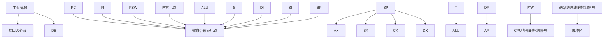

# 部分作业题-计组一457章随堂测验

## 来源

- 分类：`作业`
- 原始文件：`计组一457章随堂测验.pdf`
- 原始相对路径：`资料/部分作业题/计组一457章随堂测验.pdf`
- 原始绝对路径：`D:\wzb\计算机组成原理\资料\部分作业题\计组一457章随堂测验.pdf`

## 后续处理建议

- 从本整理稿中提取稳定知识点
- 检查公式、表格、结构图的提取效果
- 必要时补单独图像解读稿
- 如发现资料错误，转入勘误或分歧

## 提取结果

# 计组I 三、四、五章随堂测验 （开卷，90分钟）

1. 简述SRAM和DRAM的⼯作原理，并分别分析他们的优劣势。  
2. 某计算机指令字24位，定长格式，指令类型有双操作数指令、单操作数指令和⽆操作数指令，每个操作数地址字段均⽤8位表⽰，采⽤扩展操作码。若该指令系统已设计出M条双操作数指令，N条⽆操作数指令（其中0<M<28，0<N<216），那么最多还可设计出多少条单操作数指令？

3. 现需要将多⽚6264芯⽚接⼊8086芯⽚作为系统内存，要求其⽬标内存范围为0x70000H\~0x77FFFH，请画出连接图。

4. 8088CPU中，设（DS）=2000H,（BX）=0100H,（SI）=0002H,（20100H）=12H,（20101H）=34H,（20102H）=56H,（20103H）=78H,（21200H）=2AH,（21201H）=4CH,（21202H）=B7H,（21203H）=65H，试分别说明下列各条指令执⾏完后AX寄存器中的内容是多少?

① MOV AX，1200H  
② MOV AX，[1200H]   
③ MOV AX，[BX]   
④ MOV AX，1100H[BX]  
⑤ MOV AX，[BX][SI]   
⑥ MOV AX，1100H[BX][SI]  
⑦ LEA AX，1100H[BX][SI]

5. 内存按字节编址，从50000H单元开始，顺序8K个单元存放着8位补码表⽰的定点纯整数。编程序统计该8K数据中负数的个数，并放在BX中。

6. 某微程序控制器采⽤的微指令字长为24位。微命令⽣成部分由4个字段构成，各字段所包括的互斥微命令分别为5个、8个、14个和3个。另外控制产⽣后继（次）地址的条件有3种。试设计该微指令的格式，说明各个字段（包括次地址等字段）的划分⽅法，并指出控制存储器的最⼤容量为多少？

7. 某CPU构成的计算机框图如下。其內部总线及內部寄存器均为16位；主存储器按16位编址。采⽤数据通路描述⽅式、控制信号描述⽅式或两者混合的描述⽅式，写出在该计算 机上，指令 OR [1500H],AX 的取指令、指令执⾏的微操作流程。(假设该指令由⼆个 16 位的字构成，主存中占⼆个地址)

flowchart

8. 某计算机指令对应的微操作表如下所⽰，根据表可知I→IND的触发逻辑为： $\mathrm { I { \to } I N D = F E \cdot T 2 \cdot ( A D D + S A T + L D A + J M P + B A N ) }$ 请参照该形式，写出M(MAR) →MDR的触发逻辑表达式。

<table><tr><td>工作周期标记</td><td>节拍</td><td>状态条件</td><td>微操作命令信号</td><td>CAL</td><td>COM</td><td>SHR</td><td>CSL</td><td>STP</td><td>ADD.</td><td>SAT</td><td>LDA</td><td>JMP</td><td>BAN</td></tr><tr><td rowspan="8">FE(取指)</td><td rowspan="2">To</td><td rowspan="2"></td><td>PC→MAR</td><td>1</td><td>1</td><td>1</td><td>1</td><td>1</td><td>1</td><td>1</td><td>1</td><td>1</td><td>1</td></tr><tr><td>1→R</td><td>1</td><td>1</td><td>1</td><td>1</td><td>1</td><td>1</td><td>1</td><td>1</td><td>1</td><td>1</td></tr><tr><td rowspan="2">T1</td><td rowspan="2"></td><td>M(MAR)→MDR</td><td>1</td><td>1</td><td>1</td><td>1</td><td>1</td><td>1</td><td>1</td><td>1</td><td>1</td><td>1</td></tr><tr><td>(PC)+1→PC</td><td>1</td><td>1</td><td>1</td><td>1</td><td>1</td><td>1</td><td>1</td><td>1</td><td>1</td><td>1</td></tr><tr><td rowspan="4">T2</td><td rowspan="2"></td><td>MDR→IR</td><td>1</td><td>1</td><td>1</td><td>1</td><td>1</td><td>1</td><td>1</td><td>1</td><td>1</td><td>1</td></tr><tr><td>OP(IR)→ID</td><td>1</td><td>1</td><td>1</td><td>1</td><td>1</td><td>1</td><td>1</td><td>1</td><td>1</td><td>1</td></tr><tr><td>I</td><td>1→IND</td><td></td><td></td><td></td><td></td><td></td><td>1</td><td>1</td><td>1</td><td>1</td><td>1</td></tr><tr><td>I</td><td>1→EX</td><td>1</td><td>1</td><td>1</td><td>1</td><td>1</td><td>1</td><td>1</td><td>1</td><td>1</td><td>1</td></tr><tr><td rowspan="5">IND(间址)</td><td rowspan="2">To</td><td rowspan="2"></td><td>Ad(IR)→MAR</td><td></td><td></td><td></td><td></td><td></td><td>1</td><td>1</td><td>1</td><td>1</td><td>1</td></tr><tr><td>1→R</td><td></td><td></td><td></td><td></td><td></td><td>1</td><td>1</td><td>1</td><td>1</td><td>1</td></tr><tr><td>T1</td><td></td><td>M(MAR)→MDR</td><td></td><td></td><td></td><td></td><td></td><td>1</td><td>1</td><td>1</td><td>1</td><td>1</td></tr><tr><td rowspan="2">T2</td><td></td><td>MDR→Ad(IR)</td><td></td><td></td><td></td><td></td><td></td><td>1</td><td>1</td><td>1</td><td>1</td><td>1</td></tr><tr><td>IND</td><td>1→EX</td><td></td><td></td><td></td><td></td><td></td><td>1</td><td>1</td><td>1</td><td>1</td><td>1</td></tr><tr><td rowspan="15">EX(执行)</td><td rowspan="3">To</td><td rowspan="3"></td><td>Ad(IR)→MAR</td><td></td><td></td><td></td><td></td><td></td><td>1</td><td>1</td><td>1</td><td></td><td></td></tr><tr><td>1→R</td><td></td><td></td><td></td><td></td><td></td><td>1</td><td></td><td>1</td><td></td><td></td></tr><tr><td>1→W</td><td></td><td></td><td></td><td></td><td></td><td></td><td>1</td><td></td><td></td><td></td></tr><tr><td rowspan="2">T1</td><td rowspan="2"></td><td>M(MAR)→MDR</td><td></td><td></td><td></td><td></td><td></td><td>1</td><td></td><td>1</td><td></td><td></td></tr><tr><td>AC→MDR</td><td></td><td></td><td></td><td></td><td></td><td></td><td>1</td><td></td><td></td><td></td></tr><tr><td rowspan="10">T2</td><td rowspan="8"></td><td>(AC)+(MDR)→AC</td><td></td><td></td><td></td><td></td><td></td><td>1</td><td></td><td></td><td></td><td></td></tr><tr><td>MDR→M(MAR)</td><td></td><td></td><td></td><td></td><td></td><td></td><td>1</td><td></td><td></td><td></td></tr><tr><td>MDR→AC</td><td></td><td></td><td></td><td></td><td></td><td></td><td></td><td>1</td><td></td><td></td></tr><tr><td>0→AC</td><td>1</td><td></td><td></td><td></td><td></td><td></td><td></td><td></td><td></td><td></td></tr><tr><td>AC→AC</td><td></td><td>1</td><td></td><td></td><td></td><td></td><td></td><td></td><td></td><td></td></tr><tr><td>R(AC)→L(AC), ACq不变</td><td></td><td></td><td>1</td><td></td><td></td><td></td><td></td><td></td><td></td><td></td></tr><tr><td>ρ&#x27;(AC)</td><td></td><td></td><td></td><td>1</td><td></td><td></td><td></td><td></td><td></td><td></td></tr><tr><td>Ad(IR)→PC</td><td></td><td></td><td></td><td></td><td></td><td></td><td></td><td></td><td>1</td><td></td></tr><tr><td>A0</td><td>Ad(IR)→PC</td><td></td><td></td><td></td><td></td><td></td><td></td><td></td><td></td><td></td><td>1</td></tr><tr><td></td><td>0→G</td><td></td><td></td><td></td><td></td><td>1</td><td></td><td></td><td></td><td></td><td></td></tr></table>
