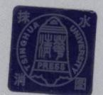
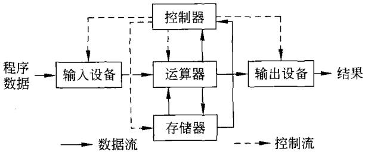
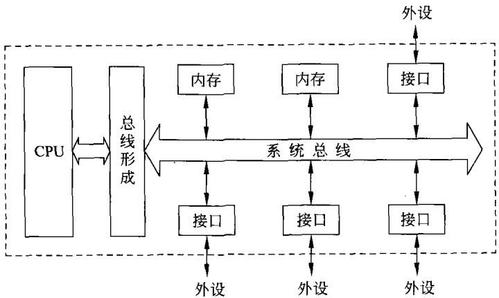
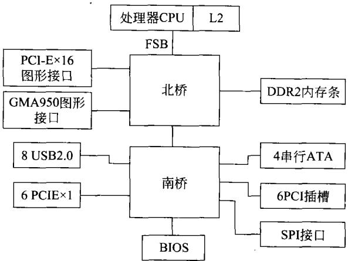
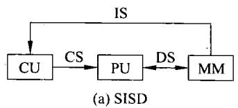
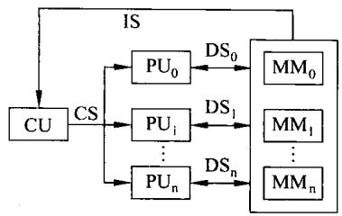
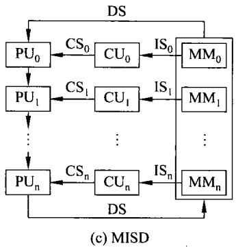
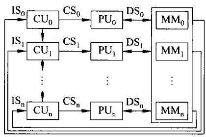

# 计算机组成与设计-第1章-1-28

## 来源

- 原始文件：`计算机组成与设计-第1章-1-28.pdf`
- 对应章节：`第1章`
- 原始 PDF：`D:\wzb\计算机组成原理\资料\教材\计算机组成与设计-第1章-1-28.pdf`
- 抽取任务：``

## 后续处理建议

- 从本整理稿中抽取稳定知识点
- 检查公式、表格、结构图抽取质量
- 对复杂图页补单独图像解读稿
- 如发现错误，转入勘误或分歧

## MinerU 抽取结果

## 计算机组成与设计

$$
\begin{array} { r c l } { { ( 3 ) } } & { { ( 5 ) } } & { { ( 6 ) } } & { { ( 8 ) } } \\ { { ( 6 ) } } & { { ( 6 ) } } & { { ( 7 ) } } \\ { { ( 6 ) } } & { { ( 6 ) } } & { { ( 6 ) } } \\ { { ( 6 ) } } & { { ( 6 ) } } & { { ( 6 ) } } \\ { { ( 7 ) } } & { { ( 8 ) } } & { { ( 6 ) } } \\ { { ( 8 ) } } & { { ( 8 ) } } & { { ( 6 ) } } \\ { { ( 6 ) } } & { { ( 7 ) } } & { { ( 6 ) } } \\ { { ( 7 ) } } & { { ( 8 ) } } & { { ( 6 ) } } \\ { { ( 8 ) } } & { { ( 8 ) } } & { { ( 6 ) } } \\ { { ( 9 ) } } & { { ( 8 ) } } & { { ( 6 ) } } \\ { { ( 9 ) } } & { { ( 8 ) } } & { { ( 6 ) } } \\ { { ( 9 ) } } & { { ( 8 ) } } & { { ( 6 ) } } \\ { { ( 9 ) } } & { { ( 8 ) } } & { { ( 6 ) } } \end{array}
$$

李伯成顾新编著

  
清华大学出版社

$$
\cdot
$$

李伯成顾新编著

# 计算机组成与设计

0000000   
。 O 000000   
○   
0。0。   
0000 0000   
。。0o   
。。0。   
..。.

清华大学出版社北京

## 内容简介

本书系统地介绍计算机系统的基本组成及基本的工作原理、计算机的运算原理及构成计算机的各组成部分的工作过程与设计。内容包括计算机中数据的表示，基本的运算方法与运算器的构成，处理器的指令系统、寻址方式及控制器的构成等基础知识，阐述构成计算机的各组成部件：处理器、总线、存储器、输人/输出技术与设备。书中还讲述了流水线技术，多处理机系统及如何设计计算机等内容。同时，本书的内容还涵盖了全国硕士研究生人学考试大纲要求的内容。

本书内容充实、简明扼要、重点突出。可作为高校理工科专业"计算机组成原理"或"计算机组成与系统结构"课程的教科书，也可为从事计算机行业的一般工程技术人员提供参考。

本书封面贴有清华大学出版社防伪标签，无标签者不得销售。

版权所有，侵权必究。侵权举报电话：010-6278298913701121933

图书在版编目（CIP）数据

计算机组成与设计/李伯成，顾新编著．一北京：清华大学出版社，2011.3

（计算机系列教材）

ISBN 978-7-302-24463-9

I.①计…ⅡI.①李…②顾…Ⅲ.①计算机体系结构—高等学校一教材V．①TP303

中国版本图书馆CIP数据核字(2010)第264692号

责任编辑：张民薛阳

责任校对：焦丽丽

责任印制：何芊

出版发行：清华大学出版社

地址：北京清华大学学研大厦A座

http:// www. tup.com.cn

邮 编：100084

社 总 机：010-62770175

邮 购：010-62786544

投稿与读者服务：010-62795954,jsjjc@tup:tsinghua.edu.cn

质量反馈：010-62772015,zhiliang@tup.tsinghua.edu.cn

印装者：北京鑫海金澳胶印有限公司

经 销：全国新华书店

开 本：185×260 印张：31.25

字数：761千字

版 次：2011年3月第1版

印次：2011年3月第1次印刷

印 数：1～4000

定 价：45.00元

产品编号：039879-01

第1章绪论 /1  
1.1计算机的发展史/1  
1.1.1发展经历/1  
1.1.2摩尔定律 /2  
1.2计算机的基本组成/4  
1.2.1硬件系统/4  
1.2.2软件系统/7  
1.3计算机的分类及性能描述/8  
1.3.1计算机的分类/8  
1.3.2计算机的性能描述/10  
习题/18  
第2章计算机中的数据表示/19  
2.1数据编码/19  
2.1.1数值数据的编码/19  
2.1.2数据的浮点表示/26  
2.1.3BCD码/32  
2.2非数值数据的编码/34  
2.2.1 ASCII码/34  
2.2.2汉字编码 /35  
2.3检错与纠错编码/38  
2.3.1奇偶校验码 /39  
2.3.2海明码/40  
2.3.3循环冗余校验码(CRC码）/43  
习题/45  
第3章运算方法与运算器/49  
3.1定点数运算/49  
3.1.1加减运算/49  
3.1.2乘法运算/57  
3.1.3除法运算/65  
3.2算术逻辑单元/71

3.2.1单元电路/713.2.2 算术逻辑单元ALU /733.2.3运算器的结构/743.3浮点运算/763.3.1加减运算/763.3.2浮点乘除运算/793.3.3浮点数运算的实现/81习题/82：4章指令系统与汇编语言/864.1指令格式/864.1.1概述/864.1.2指令格式的描述/874.1.3指令设计/894.2寻址方式/924.2.18086 处理器中的内部寄存器/924.2.2 8086CPU的寻址方式 /954.38086(88)的指令系统/994:3.1传送指令/994.3.2算术运算指令/1044.3.3逻辑运算和移位循环指令/1094.3.4串操作指令/1134.3.5程序控制指令/1154.3.6处理器控制指令 /1184.3.7输入/输出指令/1194.3.8位操作指令/1204.3.9其他指令 /1214.4汇编语言及其程序设计/1214.4.1汇编语言的语句格式/1214.4.2 常数/1234.4.3伪指令/1234.4.4汇编语言的运算符 /1284.4.5汇编语言源程序的结构/129

4.4.6汇编语言程序设计/130  
4.5精减指令集计算机（RISC）/136  
4.5.1指令系统的从简到繁/136  
4.5.2精减指令集计算机的特点 /13  
习题/138  
第5章 处理器(CPU)设计 /141  
5.1CPU的结构/141  
5.1.1 CPU的功能/141  
5.1.2构成CPU的主要部件 /142  
5.2指令系统设计/144  
5.2.1设计寻址方式/144  
5.2.2指令的设计/145  
5.3CPU执行指令的过程 /149  
5.3.1指令时序/149  
5.3.2指令执行过程分析/152  
5.4 CPU的部件设计 /158  
5.4.1熟悉部件的回顾 /158  
5.4.2指令执行的详细说明 /160  
5.4.3组合逻辑控制器设计 /164  
5.4.4微程序控制器设计/166  
习题/178  
第6章流水线技术/182  
6.1概述/182  
6.1.1流水线概述/182  
6.1.2流水线的分类/184  
6.2流水线的性能分析/187  
6.2.1吞吐率/187  
6.2.2加速比/190  
6.2.3效率/191  
6.3流水线中的相关/193  
6.3.1概述/193  
6.3.2结构相关/194  
6.3.3数据相关/196  
6.3.4控制相关 /198  
6.3.5流水线的中断处理/203  
6.3.6带成功开销的流水线性能/206  
6.4指令级并行/206  
6.4.1指令级并行概述/206  
6.4.2提高指令级并行的方法/208  
6.5其他有关技术/217  
6.5.1超标量处理机/217  
6.5.2超流水线处理机/218  
6.5.3超标量超流水线处理机/219  
6.5.4超长指令字处理机 /220  
习题/221  
官7章存储系统/222  
7.1存储系统概述/222  
7.1.1存储系统的层次结构/222  
7.1.2存储器分类 /222  
7.1.3存储器的性能指标 /223  
7.2内部存储器（主存储器）/225  
7.2.1随机读写存储器 RAM /225  
7.2.2只读存储器 ROM /235  
7.2.3 动态读写存储器DRAM /239  
7.2.4其他存储器 /241  
7.3高速缓冲存储器 /245  
7.3.1 工作原理 /245  
7.3.2替换算法/251  
7.3.3主存——cache 内容的一致性问题 /252  
7.3.4cache性能分析/253  
7.4虚拟存储器/255  
7.4.1虚拟存储器的概念/255  
7.4.2虚拟存储器的管理/255

## 7.4.3几点说明/259

习题/260

第8章 输入/输出系统/2648.1总线/2648.1.1概述/2648.1.2总线的信息传送/2668.1.3典型总线介绍/2708.2输入/输出基本原理 /2788.2.1 外部设备/2788.2.2程序控制输入/输出技术/2998.3 中断方式/3038.3.1中断的基本概念/3048.3.2中断优先级控制/3068.3.38086(88)的中断系统/3088.3.4中断控制器8259/3128.4直接存储器存取（DMA）/3238.4.1 DMA概述/3238.4.2常用的方法/3248.4.3DMA的一般过程 /3258.5通道方式/3268.5.1通道方式的特点/3268.5.2通道的类型/3278.5.3通道的发展/3288.6几种常见的接口芯片/3288.6.1可编程并行接口8255/3288.6.2可编程定时器8253/3378.6.3可编程串行接口8250/344习题/355

## 第9章多机系统/358

9.1概述/358

9.1.1并行处理/358

## 目录 《计算机组成与设计》

9.1.2并行计算机分类/359  
9.2多机互联网络/363  
9.2.1互连函数/363  
9.2.2静态互联网络/367  
9.2.3动态互联网络/370  
9.3对称多处理机系统/383  
9.3.1 对称多处理机(SMP)构成/383  
9.3.2多机系统的性能分析/385  
9.3.3对称多处理机系统cache一致性/388  
9.3.4多处理机系统的调度与负载平衡/394  
9.4分布式共享存储器多机系统/400  
9.4.1分布式共享存储器多机系统结构/400  
9.4.2 CC-NUMA系统 /401  
9.5多机系统其他结构形式/403  
9.5.1大规模并行处理(MPP)系统/403  
9.5.2 集群(Cluster)系统 /405  
9.5.3向量处理机/407  
9.5.4高性能计算机的发展/410  
习题/413  
「10章基于EDA的计算机设计/415  
10.1概述/415  
10.1.1数字系统设计的发展/415  
10.1.2数字系统的设计方法/416  
10.2 设计语言与工具/417  
10.2.1 EDA工具软件分类/417  
10.2.2 硬件描述语言HDL /418  
10.2.3 System C /428  
10.2.4 QUARTUS I/430  
10.3基于VHDL的CPU设计/431  
10.3.1单元电路的设计/431  
10.3.2 CPU设计概要/443  
10.4 SOC设计 /455

10.4.1概述/455

10.4.2 SOC片内总线/460

10.4.3 IP核设计与复用/468

10.4.4 SOC设计举例 /474

10.5基于可配置处理器的 SOC设计/477

10.5.1问题的由来/477

10.5.2 Tensilica Xtensa 可配置处理器 /478

习题/485

参考文献/486

## 第1章绪 论

在本章中，主要描述计算机的构成及性能，使读者在开始了解全书的内容之前，首先对计算机有一概念上的认识。

## 1.1计算机的发展史

电子计算机的发明，无疑是人类社会科学技术发展史上最伟大的发明之一。计算机的出现，深刻地影响着人类的精神文明和物质文明的发展。

在20世纪70年代前，电子计算机包括电子模拟计算机和电子数字计算机。前者是由模拟电子器件(如模拟加法器、减法器、乘法器、除法器等)构成，现已完成了它的历史史命，再无人提及。因此，本书中所描述的就是电子数字计算机，并简称为计算机。电子数字计算机，是指能对由离散逻辑符号表示的数据或信息进行自动处理的电子装置。

## 1.1.1发展经历

## 1.第0代：机械计算器

早在两千多年前，我们的祖先就发明了算盘，这是最简单实用的机械计算器。在这漫长的历史中，算盘传遍了全世界，为人类社会做出了巨大的贡献。

近代，人们又发明了计算尺及手摇机械计算器。在电子计算器(机)普及之后，它们也逐步退出了历史的舞台。

## 2．第1代：电子管计算机

第1代计算机从1946年到1954年。这一代计算机是由电子管、电磁继电器等器件构成。软件主要使用机器语言进行编程。典型机器有ENIAC、IBM701等。

## 3．第2代：晶体管计算机

第2代计算机从1955年到1964年。这一代计算机由晶体管、磁芯存储器等器件构成。软件上有监控程序对计算机进行管理，并且开始使用高级语言。这个时期的计算机有很多种，如IBM 7030、Univac LARC等。

## 4．第3代：集成电路计算机

这一代计算机从1965年到1974年。这一代计算机由小规模及中规模集成电路芯片、多层印刷电路板及磁芯存储器等器件构成。在软件上，高级语言迅速发展并出现了分时操作系统。在这个时期里，计算机的应用领域不断扩展，开始向国民经济的各部门及军事领域

渗透。典型机器如IBM360、IBM370,DEC PDP-8等。

## 5．第4代：超大规模集成电路计算机

从1975年到1990年出现的是第4代计算机，这些计算机是利用大规模、超大规模集成电路构成，其主存也是由超大规模集成电路构成的半导体存储器来实现的。这一代计算机在结构上有了很大的发展，在性能上有了很大的提高。

同时，在这一时期由于微细加工技术的发展，超净环境的实现，超纯材料的研制成功，都推动了超大规模集成技术的发展。于是，出现了依赖于这种技术的微型计算机、单片微型计算机等。

硬件发展的同时，这一代计算机的软件也飞速发展。出现了许多著名的操作系统，如DOS、Windows、UNIX 等。

这一时期出现了一些典型的计算机，如IBM3090、VAX9000等。而这一时期应用最多、最广的还是个人微型计算机，诸如PC、苹果机等。

## 6．第5代：高性能智能计算机

从1991年开始，进入了计算机发展的第5代，采用超大规模、超高速集成电路来构成计算机。在结构上，计算机的构成已从单处理器向多处理器发展。即使微型机的构成也采用多核处理器，目前常见的是双核处理器、4核处理器及更多核的处理器。用这样的多核处理器来构成计算机可获得更高的性能。此前，Intel公司已可以做出一块芯片，内含80个核的处理器，用这样的一块80核处理器芯片构成的计算机，其速度已超过10000亿次。

可以想象，若用几百、几千、甚至上万块双核(或更多核)处理器芯片构成一台计算机，如集群系统。那么，该计算机系统的性能将是非常高的。例如，目前用这种思路做出来的计算机系统，其速度可达到2000万亿次。

第5代计算机不仅在速度等性能上不断提高，而且希望计算机更加人性化、智能化，包括能听、会看、会说、有感情等功能。

第5代计算机的发展必定对软件提出更高的要求，因此也必然会促使包括操作系统、应用软件等各种软件的快速发展。

## 1.1.2摩尔定律

## 1．摩尔定律的由来

1965年4月，《电子学》杂志刊登了戈登·摩尔(Gordon Moore)撰写的一篇文章。戈登·摩尔当时是飞兆半导体公司研发部门的主管。文章中讲述了他将50个晶体管集成在一块芯片中。并且他预言，到1975年，就可能将6.5万只这样的元件密植在一块芯片上，制成高度复杂的集成电路。

当时，集成电路问世才6年，摩尔的预测听起来不可思议。但那篇文章的核心思想-即预测集成电路芯片内可集成的元件数量差不多每年可增加一倍。在后来的技术发展过程中证明了这一预测是正确的。现在人们根据几十年走过的技术历程将摩尔定律描述为：集成电路芯片的集成度每18个月翻一番。经过了四十多年，到今天摩尔定律依然有效，而且许多人确信该定律在未来很多年内仍将成立。

摩尔的预言不仅对他本人，而且对整个社会而言都是意义深远的。后来摩尔与他人共同成立了英特尔公司，并通过他所开创的技术创造了无数的财富。

摩尔定律并不是一个物理定律，而是一种预言。但它鞭策着工业界不断地改进，并努力去实现它。从根本上讲摩尔定律是一种自我激励的机制，它让人们无法抗拒，并努力追赶。从人们认识摩尔定律开始，无论是英特尔公司、摩托罗拉公司还是其他的半导体器件公司，无一不在不断地努力实现摩尔定律，并促使各厂家不断地推出集成度更高的产品。在20世纪90年代中期，英特尔利用350nm技术制造出集成度达120万的80486。但很快，线宽就实现了250nm、180nm、130nm、90nm和65nm。今天，已经可以用45nm的生产线制造处理器、DRAM等器件。今天的处理器的集成度已超过10亿。根据摩尔定律，芯片的集成度还会迅速提高。有人曾经说过，集成度提高100倍，则相对价格可以降低100倍，性能可提高100倍，可靠性也可以提高100倍。当然，也许不一定是100倍，但是，随着集成度的提高，性能及可靠性都会大大提高，而价格会大大降低将是毋庸置疑的。正是摩尔定律使得计算机日新月异地发展。

归根结底，40多年的实践证明了摩尔定律有利于工业的发展及人类的需求。直至今日，半导体工业还是按照DRAM每18个月、微处理器每24个月集成度翻倍的规律发展着。

如果按照旧有方式制造电路，即将晶体管、电阻器和电容器安装在电路板上构成电子设备，那么个人电脑、移动电话、计算机辅助设计等都不可能问世。

## 2．摩尔定律的未来

2004年以后，半导体工业无论从技术上还是成本上的挑战都越来越激烈，各种关键问题都综合在一起，而且几乎要同时解决。如硅片尺寸的继续扩大，新材料、新工艺和新电路结构的采用都使得工业制造难度显著提高。同时为了实现以上的要求，固定资产的投人必然加大，这就导致电路成本急剧增加且工业的风险程度也明显上升。

晶体管是处理数字信号的微电子开关。栅极介质是用来将栅极从电流通道隔离出来的绝缘体底层。过去数十年来，芯片厂商一直采用二氧化硅来做栅极的介质，采用多晶硅做栅电极。但是，使用现有的材料，晶体管的尺寸缩小几乎已达到极限，如Intel在其65nm制程技术中，已经成功地将二氧化硅栅介质的厚度缩小至1.2nm(相当于5个原子的厚度)，但是栅介质的漏电流也随之迅速增加，这就导致功耗和发热等问题日益严重，这让芯片厂商头痛不已。

在现在的处理器中，随着刻蚀线宽从45nm过渡到32nm，晶体管的尺寸也愈来愈小，其漏电及功耗问题越来越严重，性能和功耗之间的平衡也越来越困难。这是过去近十年里摩尔定律遇到的最大的技术难题，这就引起了人们的疑虑，芯片的集成度还能继续增加吗？摩尔定律是否已走到了尽头？

为了顺利地实现处理器制程由现在的65nm向45nm再到32nm的转变，Intel采用了新的基于铪的高-K绝缘体材料，用以取代二氧化硅和多晶硅两种化合物，从而可以最大程度地减少电流的泄漏。Intel认为，新材料和新技术的使用可以提升处理器芯片的性能，并能达到降低功耗、减小噪声和降低成本的要求。由于32nm晶体管远小于上一代晶体管，因此，晶体管开关所需电量也大为减少，使晶体管功耗大约降低了30%，栅漏电流减少至1/10以上。随着晶体管新材料的改进，既可以通过大幅提升CPU主频来实现更高性能，也可以通过降低主频来提升能源效率。

同时，微细加工技术的线宽仍在不断的减小，目前生产线上所用的是45nm 和30nm。据报道当前实验室所能做到的最小线宽为9nm。

最新发展的纳米技术使得制造性能更佳的计算机成为可能，而这已经突破了硅技术所能达到的极限。这项新技术通过以碳为成分的纳米管来制造元件，而纳米管的直径只有10个原子直径那么大，其体积是现在的基于硅成分的晶体管体积的.1/500。该技术的出现向制造分子级电子设备的目标迈进了一大步。研究显示碳纳米管在性能上不会逊色于硅晶体管，因为它们的体积要小得多，所以有很大希望成为将来纳米电子技术的基础。纳米技术的前景是非常广阔的，这样的技术会使摩尔定律得以延续。

可以看到，新技术、新材料的出现，使芯片的集成度进一步提高成为可能。尽管集成度不可能无限地增加下去，但人们预计今后10年、20年甚至30年，芯片的制造依旧会继续遵循摩尔定律。摩尔定律将会继续激励人们向更高的高度攀登。

## 1.2计算机的基本组成

## 1.2.1硬件系统

## 1．早期的冯·诺依曼计算机

计算机是由两大部分：硬件系统和软件系统组成。硬件系统是指计算机中那些看得见摸得着的物理实体。

## （1）硬件组成

早期的计算机硬件结构如图1-1所示。图1-1所示的计算机结构最早是在1946 年由冯·诺依曼提出的。同时，在此硬件结构的基础上，还提出了计算机是依据存储程序、程序控制的方式工作。这就是冯·诺依曼的计算机设计思想。

  
图1-1早期计算机(硬件)的组成

当时的计算机由运算器、控制器、存储器、输入设备和输出设备5大部分构成。运算器用以实现算术运算和逻辑运算；控制器根据指令的功能产生相应的控制信号，控制其他部分的工作以便实现指令的功能;存储器用来存放数据和程序；输人设备可将外部的信息输入到计算机中；输出设备可将结果显示或记录下来。

## （2）冯·诺依曼计算机的特点

冯·诺依曼计算机工作的基本思想，就是将计算机要处理的问题用指令编成程序，并将程序存放在存储器中。而后，在控制器的控制下，从存储器中取出逐条指令并执行指令。通过执行程序最终解决计算机所要处理的问题。尽管经历了几十年的发展，出现了新的设计思想，但冯·诺依曼的这种思路直到今天仍然还在广泛地应用。

在冯·诺依曼计算机工作的过程中，总是一条指令接一条指令地执行，执行指令会产生控制流，在控制流的驱动下完成指令的功能。在此过程中，数据(流)则是被动地调用。

冯·诺依曼计算机的另一特点就是计算机的指令、数据及其他信息均是用二进制编码来表示的。用二进制不仅使电路简单、使用方便而且抗干扰性强。因此，二进制一直沿用至今。

## 2.PC的结构

计算机的发展已走过了六十多年，尤其是最近三十年，其发展更是日新月异。

本书的后面将会介绍一系列的计算机结构形式。从中可以看到，在过去的年代里计算机从最简单的冯·诺依曼计算机到现在都有哪些发展与改变，这些发展和改变是由什么原因引起的，是如何实现这些发展的，实现的依据又是怎样的。这些问题及其答案正是本书要呈现给读者的内容。

另外，应当特别提及的就是个人计算机—PC。从1981年PC诞生以来，由于其规模小、结构简单，人们称其为微型计算机。在二十多年的时间里，PC一代接一代地发展。现在，PC已遍布全世界。尽管今天的PC的功能已十分强大，但人们仍然称之为微型计算机。目前读者所使用的、所看到的绝大多数都是PC。

早期的PC结构非常简单，其框图可以简化为如图1-2所示。该框图也是那个年代微型计算机的基本结构形式。

  
图1-2微型计算机结构框图

由图1-2可以看到，中央处理单元CPU是将图1-1中的运算器(算术逻辑单元ALU)和控制器(还有一些寄存器)集成在一块集成电路芯片中。在执行指令的过程中，它可以产生地址信号、数据信号和一系列控制信号，从而形成系统总线信号。图1-2中的存储器也采用大规模集成的半导体存储器芯片构成。外设，包括输入设备、输出设备及外部存储器均经过接口与系统总线相连接。因此，图1-2与图1-1已有很大的不同，它们是不同时代的计算机。同时，处理器厂家将图1-2中用虚线框起的部分集成在一块芯片中，这就是单片机。

在摩尔定律的激励下，半导体集成电路，包括CPU、半导体存储器、接口芯片以及外设所用到的芯片的集成度均以每18～24个月翻1倍的速度飞速发展。尤其值得说明的是CPU，它也被简称为处理器。各处理器厂家不遗余力地、一代接一代、一种型号接一种型号地开发研制出来。在这里仅将英特尔（Intel)公司的80x86系列处理器的发展历程列于表1-1中。由于本书篇幅的限制，表中并未列出各处理器的集成度及性能指标。表1-1只列到2006年，已可以看到处理器的更新速度，每年都会开发出多种芯片。今天的Corei7处理器的集成度已达到6核，8.2亿个晶体管，3.2GHz频率。

表1-1英特尔微处理器发展历程
<table><tr><td>年份</td><td>产 品</td><td>年份</td><td>产 品</td></tr><tr><td>1971年</td><td>4004微处理器</td><td>1999年</td><td>Celeron处理器</td></tr><tr><td>1972年</td><td>8008微处理器</td><td>1999年</td><td>Pentium Ⅲ处理器</td></tr><tr><td>1974年</td><td>8080微处理器</td><td>1999年</td><td>Pentium IⅢI  Xeon处理器</td></tr><tr><td>1978年</td><td>8086～8088微处理器</td><td>2000年</td><td>Pentium4处理器</td></tr><tr><td>1982年</td><td>80286微处理器</td><td>2001年</td><td>Xeon处理器</td></tr><tr><td>1985年</td><td>80386微处理器</td><td>2001年</td><td>Itanium处理器</td></tr><tr><td>1989年</td><td>80486DX微处理器</td><td>2002年</td><td>Itanium2处理器</td></tr><tr><td>1993年</td><td>Pentium处理器</td><td>2003年</td><td>PentiumM处理器</td></tr><tr><td>1995年</td><td>Pentium Pro 处理器</td><td>2005年</td><td>PentiumD处理器</td></tr><tr><td>1997年</td><td>Pentium Ⅱ处理器</td><td>2006年</td><td>Core 2Duo 处理器(酷睿）</td></tr><tr><td>1998年</td><td>Pentium Pro Xeon 处理器</td><td></td><td></td></tr></table>

在处理器的开发过程中，过去用于大型计算机的许多技术，在摩尔定律的支持下不断地运用到处理器的开发过程中。例如，超标量、超流水、多级cache、虚拟技术、RISC、多机系统概念下的多核处理器等技术均已应用在近几年的处理器中。这些技术正是本书中所要讨论的重要内容。

随着处理器性能的不断提高，从20世纪90年代开始，PC的结构发生了很大的变化。基本上是以主板芯片组为基础构成主板，而后插上相关的部件构成PC。主板芯片组有1到3块芯片，经常采用2块，分别称为北桥和南桥。随着处理器的不断更新换代，芯片组也在不断地更新换代。一般是每开发出一种新的处理器，就会开发出与之相对应的芯片组。目前常见的PC主板框图如图1-3所示。

在图1-3中，北桥芯片是主板芯片组中起主导作用的最重要的组成部分，也称为主桥。北桥芯片主要决定主板的规格、对硬件的支持以及系统的性能，它连接着CPU、内存和AGP总线。主板支持哪种处理器，支持何种显卡，支持什么频率的内存条，都是由北桥芯片决定的。北桥芯片往往有较高的工作频率，所以发热量较大，故需要为北桥加一个散热器。

南桥芯片主要决定主板的接口，该芯片所提供的各种接口（如串口、USB）、PCI总线、串行ATA（接硬盘、光驱）、PCIE 总线(接声卡、RAID卡、网卡等),都归南桥芯片控制。

南北桥之间随时进行数据传递，需要一条通道，这条通道就是南北桥总线。南北桥总线越宽，数据传输越便捷。

  
图1-3 PC 主板结构

目前的北桥都支持双核、4核甚至更多核性能更高的处理器。

随着技术的发展和摩尔定律的继续有效，PC这种双桥结构形式可望在不久的将来就会消失。到那时,处理器、北桥、南桥以至于内存条会集成在一块集成芯片中，构成人们所谓的片上系统(SOC),也有人称之为系统芯片。届时,PC 可能只需要一块 SOC,并在此芯片上接上外设就可以构成。为此，在本书的最后一章将向读者介绍如何设计处理器及SOC。

## 1.2.2软件系统

对计算机而言，只有上面提到的硬件系统，计算机是不能工作的，还必须配上软件才能工作。

计算机软件通常是指计算机所配置的各类程序和文件，由于它们是存放在内存或外存中的二进制编码信息，是不能直接触摸而且修改相对比较容易的，故称之为软件。在计算机系统中，各种软件相互配合，很好地支持计算机有条不紊地工作，这一系列软件就构成了计算机的软件系统。软件系统一般包括两大部分：系统软件和应用软件。

## 1．系统软件

系统软件是一系列保障计算机良好运行的程序的集合。它们的功能是对系统的各种资源(硬件和软件)进行管理和调度，使计算机能有条不紊地工作，为用户提供有效的服务，充分发挥其效能。系统软件包括以下几种。

## （1）操作系统

操作系统是最重要的系统软件，它是管理计算机硬、软件资源、控制程序运行、改善人机交互并为应用软件提供支持的一种软件。通常，操作系统包括5大功能：处理器管理、存储管理、文件管理、设备管理及作业管理。

## （2）语言处理程序

每一台计算机都会配置多种语言以利于用户使用。从各种高级语言到汇编语言均会涉及。当用户使用某种语言编写程序后，在该语言编译程序的支持下，可将用户的源程序转换

为目标程序。

## （3）通用程序

在操作系统下提供给用户使用的一些通用程序。最常见的如在Windows下的Word、PSW、Excel 等程序。

## （4）各种服务支持软件

这是一些帮助用户使用和维护计算机的软件。例如，各种调试程序、诊断程序、提示警告程序等。

## 2.应用软件

应用软件是指用户在各自的应用中，为解决自己的有关问题而编写的程序。这是一类直接以用户的需求为目标的程序。由于用户的多样性(各行各业、各种部门)和用户需求的多样性，使得这类软件也非常多样性。例如，用于科学计算、信息管理、过程控制、武器装备等方面的应用软件。

## 1.3计算机的分类及性能描述

## 1.3.1计算机的分类

了解计算机的分类，有助于理解计算机的结构及工作原理。不同的时期，不同的角度，产生不同的分类方法。

## 1．早期的计算机分类方法

在20世纪80年代前，人们根据计算机的字长、规模、价格等指标，将计算机分为：微型机、小型机、中型机、大型机和巨型机。随着计算机的发展，现在，它们的界限已十分模糊。那一时期的小型机、中型机、大型机已经见不到了，而且很少再有人提到这些机型。这种分类方法基本上已不再使用。今天，人们经常提到的是PC、服务器或高性能计算机。尽管它们在性能上有差别，但并没有人做出严格的界定。而且，今天性能好的PC也许比前些年的某些服务器性能还要好。

## 2．以用途分类

（1）按照用途计算机可分为通用计算机和嵌人式计算机(专用计算机）。

通用计算机的硬件系统及系统软件均由有关的计算机公司设计制造，其用途不是针对某一个或某一类用户的，而是可以满足许多用户的。例如，目前国内外广泛使用的台式PC或笔记本计算机，用户可直接在市场上购买，在厂家提供的软件支持下工作。也许用户只需要配上少量的软件或硬件，即可满足用户的需求。

对于各种服务器或高性能计算机，它们具有更高的性能，可以适用于许多领域或部门的需求。它们也可以看成是通用计算机。

嵌入式计算机系统的定义可表述如下：以应用为目标，以计算机技术为基础，软硬件可裁剪，适应对功能、实时性、可靠性、安全、体积、重量、成本、功耗、环境、安装方式等方面有严格要求的专用计算机系统。

可见，嵌入式计算机是一种专用计算机，它广泛应用于工业企业、军事装备的测量与控制。这类计算机通常采用系统集成，即利用一些工业控制机部件的提供商所提供的部件，进行硬件系统和软件系统集成来构成嵌入式计算机。对某些特殊要求的计算机，如要求体积特别小、工作温度特别高、振动将特别剧烈等无法进行系统集成时，则需要由设计者从元器件开始设计嵌人式系统或者采用SOC进行嵌人式系统的设计。

（2）按照计算机的用途，通用计算机还可分为PC和服务器。

现在，许多计算机都在联网工作，甚至有人提出网络才是计算机。在联网工作中经常有两种结构：客户机/服务器(C/S)结构和浏览器/服务器(B/S)结构。

网络中，用做客户机或浏览器的多是各种型号的个人计算机，通常它们性能要低一些，满足用户要求即可。

服务器是用于实现某种服务的。例如，目前常见的有WEB服务器、FTP服务器、MAIL服务器、文件共享服务器、数据库应用服务器、域名服务器、网站的网关服务器、DNS服务器、流媒体服务器等。一般而言，对服务器的性能要求是很高的，但也要根据服务器服务对象的要求来设计，目前高档的服务器是由多达千个处理器构成的集群系统来实现的，其速度超过万亿次。同时也有用性能好的PC来充当最简单的服务器。

## 3.Flynn分类法

Flynn分类法是按照计算机在执行程序的过程中信息流的特征进行分类的。在程序执行过程中存在三种信息流。

指令流(IS)-机器执行的指令序列，它由存储器流入控制单元(CU)。

数据流(DS)—由指令流所使用的数据，包括输人数据、中间数据和结果。数据在处理单元(PU)中进行处理。

控制流(CS)一—指令流进入CU,由CU产生一系列的控制流(信号),在控制流的控制下完成指令的功能。

Flynn将计算机分为4类，如图1-4所示。

(1）单指令流单数据流(SISD)计算机

图1-4(a)所示的就是单指令流单数据流计算机的示意图。该计算机是由一个控制单元，一个处理单元和一主存储器组成的。每次从存储器取一条指令到控制器，由控制器对指令译码产生控制信号，控制处理单元完成指令规定的功能。这是最简单的一类计算机，本书后面的章节将予以说明。

## (2）单指令流多数据流(SIMD)计算机

单指令流多数据流(SIMD)计算机的结构示意图如图1-4(b)所示。它是由一个控制单元、多个处理单元和多个存储器模块组成。每次从存储器取一条指令到控制器，由控制器对指令译码产生多种相同控制信号，并将相同的控制命令分别下到多个处理单元上，控制多个处理单元执行相同的操作，完成这条指令对多个数据的处理。最终实现一条指令所规定的功能。由于该计算机是能够通过执行一条指令实现对多个数据的处理，这就是单指令流多数据流的由来。这类计算机在本书后面的章节将予以描述。

  
(b) SIMD

  
(d) MIMD  
CU一控制单元;PU一处理单元;MM一主存储器;IS一指令流;CS一控制流  
图1-4Flynn分类法各类计算机示意图

## (3）多指令流单数据流(MISD)计算机

这种计算机的含义是由多个控制单元同时执行多条指令对同一数据进行处理，其结构示意图如图1-4(c)所示。但这种方式尚无实例。

## （4）多指令流多数据流(MIMD)计算机

多指令流多数据流计算机的结构示意图如图1-4(d)所示。它是由多个控制单元、多个处理单元和多个存储模块构成，实际上是由多处理机由某种方式连在一起构成的计算机系统，通常称为多处理机系统。这类计算机是各个处理机分别执行多条指令、处理多个数据，并行工作而实现某种功能。目前性能好的多核处理器、多计算机的集群系统都属于这一类计算机,本书后面的章节将予以描述。

计算机的分类方法还有诸如以并行度为准则的冯氏分类法，以并行度和流水线为准则的 Handler分类法等，本书不再说明。

## 1.3.2计算机的性能描述

每一处理器都有自己的性能指标，例如，某处理器是32位或64位处理器，时钟频率为多少GHz,一级cache和二级cache各为多少，是否采用超流水、超标量技术，引出脚为多少，封装形式，集成度为多少亿个晶体管，工作电压及功耗，制造工艺多少纳米等。利用这些性能参数，人们可以大致了解这种处理器的性能。

由处理器(CPU)构成的计算机系统的性能，与所采用的处理器有很大关系。但是，并不完全由处理器来决定。计算机系统的性能还与构成计算机的系统总线、主存容量、外存容量、接口总线、外设以及系统软件的配置均有密切关系。因此，计算机性能应取决于该系统

的硬、软件的配置。

人们所关心的计算机的性能包括速度、存储容量（内存及外存）、外设的配置、软件的配置、接口的配置、可靠性、可操作性、功耗、体积、重量、价格等。其中最重要的当属速度。

## 1．计算机系统配置描述

通过计算机系统的配置，可以知道计算机系统的基本性能。下面从PC和服务器分别做简单说明。

## （1）个人计算机配置

个人计算机最常见到的是台式(桌面)计算机和笔记本(便携式)计算机，它们包括多个厂家和多种型号。在这里随便列出一种台式机的配置，从配置中可以了解该机的大致性能。

·处理器：英特尔酷睿2双核处理器E6300（处理器速度1.86GHz,2MB二级高速缓存，1.066GHz前端总线，硬件防病毒,65nm，节能技术）；

·正版 WindowsVista Home Premium 简体中文版；

·支持英特尔64位内存扩展技术；

·采用英特尔LGA775封装技术；

·内存：2GBDDRⅡ533；

·硬盘：SATA250GB(7200转）;

·显卡：NV7950256MBPCI-E高性能显示卡；

·19"宽屏液晶显示器；

·SATADVDRW光驱；

·集成100M网卡；

·集成5.1声卡；

·防水抗菌键盘；

·光电鼠标；

·MTBF6万小时。

对于台式PC而言，尽管在配置上还有一些配置没有说明，但就上述配置已经可以为用户提供该计算机的性能。该计算机采用的是高性能32位英特尔公司的双核Core处理器。内存比较大，达到2GB。显存256MB也较大，显示控制器性能比较好。具有串行ATA接口、容量达500GB的硬盘，平均故障间隔时间(MTBF)高达60000小时等。可以想象，该计算机一定会有多个USB、1394接口，还可以在这些接口上接上其他用户所需要的外设。上面所列出的个人计算机的配置，就是该计算机的主要性能参数。作为个人计算机，上述配置使整个计算机的性能相对比较好。

## （2）服务器的配置

前面已经提到，不同用途服务器的性能相差非常多，最简单的服务器可用一台一般的PC配上相应的应用软件就可以实现，功能强的服务器可能需要成百上千个处理器构成集群系统来实现。表1-2同样是随便列出一种服务器的配置，从配置中可以了解该服务器的大致性能。

表1-2某服务器的基本配置
<table><tr><td colspan="3" rowspan="1">基本类别</td></tr><tr><td colspan="2" rowspan="1">类型</td><td colspan="1" rowspan="1">企业级</td></tr><tr><td></td><td colspan="1" rowspan="1">类别</td><td colspan="1" rowspan="1">机架式</td></tr><tr><td></td><td colspan="1" rowspan="1">结构</td><td colspan="1" rowspan="1">4U</td></tr><tr><td></td><td colspan="2" rowspan="1">处理器</td></tr><tr><td></td><td colspan="1" rowspan="1">CPU类型</td><td colspan="1" rowspan="1">Xeon MP E7430</td></tr><tr><td></td><td colspan="1" rowspan="1">CPU频率</td><td colspan="1" rowspan="1">2130MHz</td></tr><tr><td></td><td colspan="1" rowspan="1">处理器描述</td><td colspan="1" rowspan="1">标配2个Xeon MP E7430处理器</td></tr><tr><td></td><td colspan="1" rowspan="1">最大处理器数量</td><td colspan="1" rowspan="1">4</td></tr><tr><td></td><td colspan="1" rowspan="1">制程工艺</td><td colspan="1" rowspan="1">45mm</td></tr><tr><td></td><td colspan="1" rowspan="1">CPU核心</td><td colspan="1" rowspan="1">4核(Dunnington)</td></tr><tr><td></td><td colspan="2" rowspan="1">主板</td></tr><tr><td></td><td colspan="1" rowspan="1">FSB(总线）</td><td colspan="1" rowspan="1">1066MHz</td></tr><tr><td></td><td colspan="1" rowspan="1">扩展槽</td><td colspan="1" rowspan="1">7个PCI-Express插槽(4个 x8,3个 x4)</td></tr><tr><td></td><td colspan="2" rowspan="1">内存</td></tr><tr><td></td><td colspan="1" rowspan="1">内存类型</td><td colspan="1" rowspan="1">FB-DIMM</td></tr><tr><td></td><td colspan="1" rowspan="1">内存大小</td><td colspan="1" rowspan="1">2GBX16</td></tr><tr><td></td><td colspan="1" rowspan="1">最大内存容量</td><td colspan="1" rowspan="1">256GB</td></tr><tr><td></td><td colspan="2" rowspan="1">存储</td></tr><tr><td colspan="1" rowspan="10"></td><td colspan="1" rowspan="1">硬盘大小</td><td colspan="1" rowspan="1">3X300GB</td></tr><tr><td colspan="1" rowspan="1">硬盘类型</td><td colspan="1" rowspan="1">SAS</td></tr><tr><td colspan="1" rowspan="1">硬盘最大容量</td><td colspan="1" rowspan="1">1.5TB×5</td></tr><tr><td colspan="1" rowspan="1">内部硬盘架数</td><td colspan="1" rowspan="1">内置硬盘托架可支持5块3.5英寸 SAS 热插拔硬盘、内置硬盘托架可支持8块2.5英寸 SAS热插拔硬盘</td></tr><tr><td colspan="1" rowspan="1">磁盘阵列卡</td><td colspan="1" rowspan="1">PERC 6/iR 支持RAID0、1、5、6、10</td></tr><tr><td colspan="1" rowspan="1">光驱</td><td colspan="1" rowspan="1">DVD-ROM</td></tr><tr><td colspan="2" rowspan="1">网络</td></tr><tr><td colspan="1" rowspan="1">网络控制器</td><td colspan="1" rowspan="1">4个嵌入式 Broadcom NetXtreme IITM5708 Gigabit5以太网卡,具有故障恢复和负载平衡功能</td></tr><tr><td colspan="2" rowspan="1">显示性能</td></tr><tr><td colspan="1" rowspan="1">显示芯片</td><td colspan="1" rowspan="1">ATI-Radeon ES1000集成显卡,含 32MB SDRAM</td></tr><tr><td colspan="3" rowspan="1">接口类型</td></tr><tr><td colspan="1" rowspan="1">标准接口</td><td colspan="2" rowspan="1">后部：2个通用串行总线(USB)2.0端口,9针串行端口，视频接口，适合DRAC的千兆以太网接口,带有蓝/橙色LED指示灯的ID按钮；前部：2个通用串行总线(USB）2.0端口，带有系统警报滚动显示屏的LCD面板，15针视频接口，系统电源开/关按钮；内部：1个通用串行总线(USB)2.0端口</td></tr><tr><td colspan="3" rowspan="1">其他参数</td></tr><tr><td colspan="1" rowspan="1">散热系统</td><td colspan="2" rowspan="1">热插拔冗余冷却风扇</td></tr><tr><td colspan="3" rowspan="1">电源性能</td></tr><tr><td colspan="1" rowspan="1">电源</td><td colspan="2" rowspan="1">热插拔冗余电源</td></tr><tr><td colspan="1" rowspan="1">电源数量</td><td colspan="2" rowspan="1">2</td></tr><tr><td colspan="1" rowspan="1">电压</td><td colspan="2" rowspan="1">180-240 VAC/90V-180 VAC</td></tr><tr><td colspan="1" rowspan="1">功率(W)</td><td colspan="2" rowspan="1">1570/1030</td></tr><tr><td colspan="3" rowspan="1">外观特征</td></tr><tr><td colspan="1" rowspan="1">尺寸</td><td colspan="2" rowspan="1">172.7×447×701mm</td></tr><tr><td colspan="1" rowspan="1">重量</td><td colspan="2" rowspan="1">41.73kg</td></tr><tr><td colspan="3" rowspan="1">软件系统</td></tr><tr><td colspan="1" rowspan="1">系统支持</td><td colspan="2" rowspan="1">Microsoft Windows Server 2003 R2 SP2 企业版Microsoft Windows Server 2003 R2 SP2 标准版Red Hat Linux Enterprise v5,高级平台SUSE Linux Enterprise Server 10 EM64T SP2</td></tr><tr><td colspan="3" rowspan="1">适用环境</td></tr><tr><td colspan="1" rowspan="1">工作温度</td><td colspan="2" rowspan="1">10℃~35℃</td></tr><tr><td colspan="1" rowspan="1">工作湿度</td><td colspan="2" rowspan="1">8%～85%(无冷凝）</td></tr><tr><td colspan="1" rowspan="1">储存温度</td><td colspan="2" rowspan="1">-40℃~65℃</td></tr><tr><td colspan="1" rowspan="1">储存湿度</td><td colspan="2" rowspan="1">5%～95%(无冷凝)</td></tr></table>

接口类型

根据上述服务器的配置信息，可以想象，其处理速度和处理能力要比上面的个人计算机高出很多。

## （3）高性能计算机

不同时期，对高性能计算机有不同的解释。目前，一般认为速度超过万亿次的计算机为高性能计算机。例如，天河一号的一些配置如下。

这套系统采用了混合异构的环境：主计算系统为Intel至强5500CPU和ATI的GPU。CPU和GPU数目分别为6144个和5120个，峰值性能可以达到1.206pF。内存总容量98TB,点点通信带宽每秒40Gb,共享磁盘容量为1PB。该机由103个机柜组成、占地面积近于平方米、总重量达155吨。

## 2.每秒钟执行指令的百万条数MIPS

用计算机平均每秒钟能执行多少百万条指令来衡量计算机的性能，对于一个给定的程序，其定义如式(1-1)所示。

$$
\mathrm { M I P S } = { \frac { f _ { \mathrm { E } } ^ { \mathrm { E } } \underset { \forall } { \sim } \underset { \mathrm { M I P S } } { \sim } { \mathrm { k g } } } { \pm \mathrm { k } ( \underset { \mathrm { M } } { \uparrow } \underset { \mathrm { J } } { \top } \mathrm { H } \cdot \mathbf { j } \left. \overset { \mathrm { A } } { \mathrm { H } } \right. \times 1 0 ^ { 6 } } } \tag{1-1}
$$

可以看到，计算机执行指令的速度愈快，其MIPS 就愈大。同时可以想象，同一计算机执行不同的程序(指令)，可能会得到不同的MIPS。尽管如此，该指标仍经常用来描述计算机的性能。如某计算机的速度达到2000MIPS。

## 3.每秒钟执行浮点数的百万次操作的数量MFLOPS

另一种描述计算机性能的指标就是每秒钟执行浮点数的百万次操作的数量MFLOPS,定义如式(1-2)所示。

$$
\mathrm { \sf M F L O P S } = \frac { \sharp _ { \mathrm { \mathcal { F } } } ^ { \mathrm { a g } } \varLambda ^ { \mathrm { t } } } { \sharp _ { \mathrm { \mathcal { K } } } ^ { \mathrm { a f f } } \sharp _ { \mathrm { \mathcal { F } } } ^ { \mathrm { a f f } } \sharp _ { \mathrm { \mathcal { H } } } \varLambda ^ { \mathrm { t } } }\tag{1-2}
$$

显然，式(1-2)所示的标准是用来描述计算机执行浮点操作的能力的，它可从这一侧面来描述计算机的性能，必然也带有一定的局限性。但在现实中也会看到有人用MFLOPS来说明计算机的性能。

## 4.用测试程序来测评计算机的性能

（1）关于基准测试程序

以往对计算机的测试采用过如下几种程序。

① 实际应用程序，也就是计算机工作的真实程序。

② 修正的实际应用程序，即对上面真实程序进行一些修改构成测试程序。

③ 核心程序，提取真实程序中的核心部分构成测试程序。

④ 小测试程序，具有特定目的的、100行以内的测试程序。

③合成测试程序,就是选择具有各种代表性的一系列测试程序,将它们组合在一起。这种测试程序的集合称为测试程序组件，或称合成测试程序，或称基准测试程序。

利用基准测试程序的优点可以避免单个测试程序的片面性，可以更加全面地测试计算机的性能。因此，目前利用合成测试程序进行计算机性能评估已广泛被采用。

目前常见的基准测试程序有如下几种。

TPC-C：对系统在线处理事务的能力进行评价。以每分钟处理订单个数为衡量标准。

TPC-H：对系统在线数据库资料的查询能力进行评价。以每小时完成查询的数量为衡量标准。

SPECWeb 2005：用于评价系统同时响应http连接的最大数量。

SPECjApp Server 2O04：用于评价系统基于Java平台每秒钟所完成的Java操作的最大数量。

SPECCPU2000：用于对特定程序包执行时的评估。

Linpack：在每秒钟内，利用高斯消元法求解一元N次线性方程组的次数来评价系统的

性能。

HPCC：利用双精度矩阵乘法、傅立叶变换、并行矩阵转置等7个子项全面评价系统的性能。

SAPSD：测试系统的响应时间及每小时完成的定单数，用以衡量系统同时执行应用程序及数据库的能力。

限于篇幅，上述基准测试程序不再详细说明。下面就SPECCPU2000基准测试程序予以说明。

## （2）SPECCPU2000基准测试程序

SPEC成立于1988年,全称最初是System Performance Evaluation Cooperative(系统性能评估合作社），现在已经更名为Standard PerformanceEvaluationCorporation(系统性能评估公司）。先后开发出一系列的测试程序，其主要版本有：SPECCPU89、SPECCPU92、SPEC CPU 95、SPEC CPU 2000 等。

CPU2000是SPEC提供的CPU性能评估测试包，测试的源程序包含了整数和浮点两大部分，即CINT 200O 和CFP 2000。

## ·（3）PC性能测试

上面提到的基准测试程序，在过去多用于测试大型的计算机的性能。今天，也可以用这些基准测试程序测试PC。但是，在测试PC时人们常用另外一些基准程序。

对PC的测试分为三部分；第一部分是CPU基本性能测试，通过测试软件对CPU的性能做一个基本了解；第二部分是基准测试软件测试。使用的测试工具大多是模拟了真实的软件工作环境，所以测试得分客观地反映CPU在实际应用中的性能差异；第三部分是实际应用软件性能测试，通过使用现实生活中常用的软件，记录在实际应用中的测试结果，以最直接的方式体现CPU的处理速度。

## ① CPU基本性能测试

对CPU基本性能测试采用如下一些程序。

·PCMark2002；整机综合性能测试软件，其中包含对CPU、内存、硬盘等子系统的性能测试。

·Super pi(104万位)：将圆周率计算到104万位。这-科学计算软件不但对CPU处理能力要求很高，而且测试结果受内存带宽和处理速度影响很大，是检验CPU、内存和主板北桥芯片内存控制器的常用基准测试工具。

②基准测试软件测试

a）办公应用

·Business Winstone 2001。.

b）网络/多媒体创作

· CC Winstone 2002。

c）3D游戏处理性能

·3D Mark 2001 SE(330 版）。

·Quake3 1.17Ver。

· Serious Sam-second Encounter。

d）3D图形性能

· Cinema 4D XL V6.103。

③实际应用软件测试

a）MPEG4编码

· FlasK MPEG0.594+DivX5.0.2。

b）MP3编码

· Lame3.89 alpha。

c）文件压缩

· Winzip 8.1。

## 5．与CPU性能有关的几个问题

在这里还要讨论涉及CPU性能的几个问题。

## （1）响应时间

响应时间是指计算机完成某一任务所耗费的全部时间。显然，响应时间里包括为完成任务对磁盘的访问、内存的访问、I/O操作、操作系统的开销等。两台计算机A和B，如果说A 比B快，就是说对于给定的任务，A的响应时间比B的响应时间短。通常，计算机A比计算机B快n倍可用式(1-3)表示。

$$
\mathrm { n } = \frac { \mathrm { i } + \sum \limits _ { j = 1 } ^ { \infty } \mathrm { k } \pi \mathrm { ~ B ~ } \mathbb { H } \left[ \mathrm { q } \right] \prod _ { i = 1 } ^ { n } \mathrm { H } \left[ \mathrm { H } \right] } { \mathrm { i } + \sum \limits _ { j = 1 } ^ { \infty } \mathrm { k } \prod \mathrm { ~ A ~ } \mathbb { H } \left[ \mathrm { q } \right] \prod _ { i = 1 } ^ { n } \mathrm { H } \left[ \mathrm { H } \right] }\tag{1-3}
$$

## （2）CPU时间

CPU时间表示CPU工作的时间，不包括I/O等待时间。因为，在多任务系统中当某一任务进人等待状态时，CPU可以运行其他的任务。

通常，计算机的时钟频率是固定的，CPU执行某一程序共用多少时钟周期是可以测出来的(不包括I/O等待时间)。因此，CPU时间可以用如下两种形式表示。

$$
\mathrm { C P U \ U H | \ U } = \not { k _ { \mathrm { B } } } { \dot { \sharp } } \langle \not { \exists } \rangle \not { \exists } \not { \Psi } \not { \vdash } \not { \exists } \not { \exists } \not { \exists } \not { \ Z } \times \emptyset \not {  } \not { \exists } \not { \Psi } \not { \vdash } \not { \exists } \not { \Psi } \not { \vdash } \not { \Psi }
$$

或

$$
\mathrm { C P U \ H \Sigma } \iint \left| \boxtimes \right. = \big \langle \big | \tilde { \Sigma } \ H \big \rangle \ H \big \rangle \ \mathrm { \Sigma } \hbar \big \rangle \ H \big \rangle \ H \big \rangle \mathcal { H } \big \rangle \ \mathrm { \Sigma } \big / \ H \big > \ H \mathrm { \Sigma } \ H \big > \ H \mathrm { \Sigma } \big > \ H \big > \mathrm { \Sigma } \ H \big > \mathrm { \Sigma } ,\tag{1-4}
$$

另外，能够知道上面某一程序有多少条指令，假定上面的程序有IC条指令，执行用的总时钟周期数也是知道的，则就可以计算出一条指令从头到尾处理完的平均时钟周期数CPI。

$$
\mathrm { C P I } { = } \textstyle \operatorname { \operatorname { \textmu } } \operatorname { \operatorname { \textmu } } [ \operatorname { \dot { \mu } } ] \operatorname { \textmu } [ \operatorname { \dot { \mu } } ] \operatorname { \textmu } [ \operatorname { \dot { \mu } } ] \operatorname { \dot { \mu } } [ \operatorname { \dot { \mu } } ] \operatorname { \dot { \mu } } [ \operatorname { \dot { \mu } } ] \operatorname { \dot { \mu } } [ \operatorname { \dot { \mu } } ] \operatorname { \dot { \mu } } [ \operatorname { \dot { \mu } } ] \operatorname { \dot { \mu } } [ \operatorname { \dot { \mu } } ] \operatorname { \dot { \mu } }\tag{1-5}
$$

将式(1-5)代人式(1-4)还可以得到CPU时间的另外的表达式。

$$
\mathrm { C P U \ i H | \ i H = I C \times C P I \times H i f \ i H \ j H \ i \ k \ = I A ^ { \cdot } }
$$

或

$$
\operatorname { C P U } \ y \ y \operatorname { \boxplus } \ z = \operatorname { I C } \times \operatorname { C P I } / \ y \ y \operatorname { \boxplus } \ z \operatorname { \boxplus } \ z\tag{1-6}
$$

从式(1-6)可以看到,影响CPU的性能的因素是：①CPU的时钟频率，它受CPU硬件工艺及结构的影响。②完成某任务所需要的指令条数，这与CPU的指令集和编译技术有关。③每条指令执行所需时钟周期数，它主要由CPU的组织结构来决定。因此，为提高CPU的性能，可以从改进和提高上述三种因素入手，提高它们的性能指标，达到改进CPU性能的目的。

假定在计算机系统中有n种指令，其中第i种指令的处理时间为CPI，在程序中第i种 $\mathrm { C P I _ { i } }$

指令的出现次数为 $\mathrm { I C _ { i } }$ ，则程序执行的CPU 时间可用式(1-7)计算。

$$
\mathrm { C P U \ p i f { \ddot { \mathbb H } } } = { \frac { \sum _ { i = 1 } ^ { n } { ( \mathrm { C P I } _ { i } \times \mathrm { I C } _ { i } ) } } { \mathbb H \sharp \mathbb H { \sharp } \mathbb H { \sharp } \mathbb E ^ { \sharp } } } = \sum _ { i = 1 } ^ { n } { ( \mathrm { C P I } _ { i } \times \mathrm { I C } _ { i } ) } \times \mathbb H \sharp \mathbb H \mathbb H \mathbb H \mathbb H \lVert \lVert \lVert \lVert \lVert \lVert \lVert \lVert \lVert \lVert \lVert \lVert \lVert \lVert \lVert \lVert \lVert \lVert \lVert \lVert \lVert \lVert \lVert \lVert \lVert \lVert \lVert \lVert \lVert \lVert \lVert \lVert \lVert \lVert \lVert \lVert \lVert \lVert \lVert \lVert \lVert \lVert \lVert \lVert \lVert \lVert \lVert \lVert \lVert \lVert \lVert \lVert \lVert \lVert \lVert \lVert \lVert \lVert \lVert \lVert \lVert \lVert \lVert \lVert \lVert \lVert \lVert \lVert \lVert \lVert \lVert \lVert \lVert \lVert \lVert \lVert \lVert \lVert \lVert \lVert \lVert \lVert \lVert \lVert \lVert \lVert \lVert \lVert \lVert \lVert \lVert \lVert \lVert \lVert \lVert \lVert \lVert \lVert \lVert \lVert \lVert \lVert \lVert \lVert \lVert \lVert \lVert \lVert \lVert \lVert \lVert \lVert \lVert \lVert \lVert \lVert \lVert \lVert \lVert \lVert \lVert \lVert \lVert \lVert \lVert \lVert \lVert \lVert \lVert \lVert \lVert \lVert \lVert \lVert \lVert \lVert \lVert \lVert \lVert \lVert \lVert \lVert \lVert \lVert \lVert \lVert \lVert \lVert \lVert \lVert \lVert \lVert \lVert \lVert \lVert \lVert \lVert \lVert \lVert \lVert \lVert \lVert \lVert \lVert \lVert \lVert \lVert \lVert \lVert \lVert \lVert \lVert \lVert \lVert \lVert \lVert \lVert \lVert \lVert \lVert \lVert \lVert \lVert \lVert \lVert \lVert \lVert \lVert \lVert \lVert \lVert \lVert \lVert \lVert \lVert \lVert \lVert \lVert \lVert \lVert \lVert \lVert \lVert \lVert \lVert \lVert \lVert \lVert \lVert \lVert \lVert \lVert \lVert \lVert \lVert \lVert \lVert \lVert \lVert \lVert \lVert \lVert \lVert \lVert \lVert \lVert \lVert \lVert \lVert \lVert \lVert \lVert \lVert \lVert \lVert \lVert \lVert \lVert \lVert \lVert \lVert \lVert \lVert \lVert \lVert \lVert \lVert \lVert \lVert \lVert \lVert \lVert \lVert \lVert \lVert \lVert \lVert \lVert \lVert \lVert \lVert \lVert \lVert \lVert \lVert \lVert \lVert \lVert \lVert \lVert \lVert \lVert \lVert \lVert \lVert \lVert \lVert \lVert \lVert \lVert \lVert \lVert \lVert \lVert \lVert \lVert \lVert \lVert \lVert \lVert \lVert \lVert \lVert \lVert \lVert \lVert \lVert \lVert \lVert \lVert \lVert \tag{1-7}
$$

将式(1-6)和式(1-7)合并，可以得到：

$$
\mathrm { { C P I } = \frac { \displaystyle \sum _ { i = 1 } ^ { n } ( C P I _ { i } \times I C _ { i } ) } { I C } = \sum _ { i = 1 } ^ { n } \Big ( C P I _ { i } \times \frac { I C _ { i } } { I C } \Big ) } \tag{1-8}
$$

在式(1-8)中， $\mathrm { { I C } _ { \mathrm { { i } } } / \mathrm { { I C } } }$ 表示第i种指令在程序中所占的比例。

利用上面所描述的概念及算式，可以描述CPU的性能。

通常认为系统性能指的是响应时间，而CPU性能对应于CPU时间。

## （3）Amdahl定律

Amdahl定律是20世纪60年代由IBM360系列计算机的主要设计者Amdahl提出来的。其内容为：计算机系统中某一部件由于采用某种更快的执行方式后，整个系统性能的提高与这种执行方式的使用频率或占总执行时间的比例有关。Amdahl定律给出了加速比的定义如式(1-9)所示。

$$
\begin{array} { r }  \mathbf { j } \mathbf { \eta } \mathbf { \updownarrow } \mathbf { \updownarrow } \mathbf { \updownarrow } \mathbf { k } ( \mathbf { S } _ { \mathbf { p } } ) = \frac { \mathbf { j } \mathbf { \updownarrow } \mathbf { \updownarrow } \mathbf { j } \mathbf { \updownarrow } \mathbf { \updownarrow } \mathbf { \updownarrow } \mathbf { \updownarrow } \mathbf { \emptyset } _ { \mathbf { \updownarrow } } ^ { \mathbf { \updownarrow } } \mathbf { \emptyset } _ { \mathbf { \updownarrow } } ^ { \mathbf { \updownarrow } \mathbf { \updownarrow } } \mathbf { \emptyset } _ { \mathbf { \updownarrow } } ^ { \mathbf { \updownarrow } \mathbf { \updownarrow } \mathbf { \updownarrow } } \mathbf { \emptyset } _ { \mathbf { \updownarrow } } ^ { \mathbf { \updownarrow } \mathbf { \updownarrow } } } { \mathbf { j } \mathbf { k } \mathbf { \updownarrow } \mathbf { \updownarrow } \mathbf { \updownarrow } \mathbf { \updownarrow } \mathbf { \emptyset } _ { \mathbf { \updownarrow } } ^ { \mathbf { \updownarrow } \mathbf { \updownarrow } } \mathbf { \emptyset } _ { \mathbf { \updownarrow } } ^ { \mathbf { \updownarrow } \mathbf { \updownarrow } } \mathbf { \emptyset } _ { \mathbf { \updownarrow } } ^ { \mathbf { \updownarrow } \mathbf { \updownarrow } } \mathbf { \emptyset } _ { \mathbf { \updownarrow } } ^ { \mathbf { \updownarrow } \mathbf { \updownarrow } } \mathbf { \emptyset } _ { \mathbf { \updownarrow } } ^ { \mathbf { \updownarrow } \mathbf { \updownarrow } } \mathbf { \emptyset } _ { \mathbf { \updownarrow } } ^ { \mathbf { \updownarrow } \mathbf { \updownarrow } } \mathbf { \emptyset } _ { \mathbf { \updownarrow } } ^ { \mathbf { \updownarrow } \mathbf { \updownarrow } } \mathbf { \emptyset } _ { \mathbf { \updownarrow } } ^ { \mathbf { \updownarrow } \mathbf { \updownarrow } } } = \frac  \mathbf { \updownarrow } \mathbf { \updownarrow } \mathbf { \updownarrow } \mathbf { \updownarrow } \mathbf { \updownarrow } \mathbf { \updownarrow } \mathbf { \updownarrow } \mathbf { \updownarrow } \mathbf { \updownarrow } \mathbf { \emptyset } _ { \mathbf { \updownarrow } } ^  \mathbf { \updownarrow } \mathbf { \updownarrow } \mathbf { \updownarrow } \mathbf { \updownarrow } \mathbf { \emptyset } _ { \mathbf { \updownarrow } } ^  \mathbf { \updownarrow } \mathbf { \updownarrow } \mathbf  \end{array}\tag{1-9}
$$

从Amdah1定律所描述的内容可以看到，通过对计算机某一部分的改进，计算机比改进前快了多少倍，即加速比。计算机系统的加速比取决于下面两个因素。

①可改进部分在原系统总执行时间中所占的比，称为可改进比例，用 $\ S _ { \mathrm { e } }$ 表示。

例如,程序的总执行时间为100s,可改进的部分是其中的 $2 0 \mathrm { s }$ ，则 $\mathrm { f } _ { \mathrm { e } } = 0 , 2$ 。可见， $\mathbf { f _ { e } }$ 总是小于或等于1的。

②可改进部分改进后性能提高的程度，通常用部件加速比 $\mathbf { r _ { e } }$ 来表示某部件改进后性能提高的比例。例如，某部件改进后，执行时间由原来的20s减少到 $5 \thinspace \mathbf { s }$ ，则部件加速比 $\tt r _ { e } =$ $2 0 / 5 = 4$ 。可见， $\cdot \mathtt { r _ { e } } ^ { - }$ 一般是大于1的。

根据上述分析，若假设改进前的系统总执行时间为 $\mathrm { T } _ { 0 }$ ，可以得出改进后的系统总执行时间 $\mathrm { T } _ { \mathrm { n } }$ □

$$
\mathrm { { T } _ { n } = \mathrm { { T } _ { 0 } \left( 1 - f _ { e } + \frac { f _ { e } } { r _ { e } } \right) } }\tag{1-10}
$$

若加速比用 $\mathrm { S } _ { \mathrm { p } }$ 表示，根据式(1-9)和式(1-10)，则加速比 $\mathsf { S } _ { \mathtt { p } }$ 可表示为如下。

$$
\mathrm { S _ { p } = \frac { 1 } { ( 1 - f _ { e } ) + \frac { f _ { e } } { r _ { e } } } }\tag{1-11}
$$

在式（1-11)中， $( 1 - \mathfrak { f } _ { \mathrm { e } } )$ 为不可改进的部分，当可改进部分为0时，那没有可改进的了，则系统的加速比S.就是1。随着可改进部分的增加(f加大)和改进效果的提高(re增加)，系统 $\mathsf { S } _ { \mathsf { p } }$ $( \mathrm { f _ { e } }$ ${ \left( { \pmb { \tau } } _ { e } \right. }$ 的加速比S就会增加。当系统可改进的部分f确定后，即使这一部分改进后不再需要时 $\mathsf { S } _ { \mathsf { p } }$ 间，即 $\tt r _ { e } \to \infty$ ，则 $\mathbf { S } _ { \mathrm { p } } { = } 1 / ( 1 { - } \mathbf { f } _ { \mathrm { e } } )$ 。从而可见，系统性能的改善受可改进部分 $\mathbf { f _ { e } }$ 的限制。

【例1-1】某计算机系统的某一部件的处理时间为总处理时间的40%，该部件改进后部件加速比为10，试计算改进后系统的加速比 $\mathrm { S } _ { \mathrm { p } }$ 为多少。

解：由上述题意可知， $\mathrm { f _ { e } } = 0 . 4 , \mathrm { r _ { e } } = 1 0$ ，则

$$
\mathrm { S _ { p } } = 1 / [ ( 1 - 0 . 4 ) + 0 . 4 / 1 0 ] \approx 1 . 5 6
$$

由计算可见，即使某一部件的部件加速比已达到10倍，但该部件仅影响到总执行时间的小部分，对整个计算机系统的贡献是有限的。所以，改进后系统的加速比只有1.5倍左右。

【例1-2】若计算机系统有三个部件a、b、c是可改进的，它们的部件加速比分别为 30、30、20。它们在总执行时间中所占的比例分别是30%、30%、20%。试计算这三部件同时改进后系统的加速比。

解：多个部件可同时改进的情况下，Amdahl定律可表示为：

$$
\mathrm { S _ { p } } = { \frac { 1 } { ( 1 - \sum \mathrm { f _ { e } } ) + ( \sum \mathrm { f _ { e } } / \mathrm { r _ { e } } ) } }\tag{1-12}
$$

将已知条件代入式(1-12)，计算出 $\mathrm { S } _ { \mathrm { p } } { \approx } 4 . 3 5$

## 习 题

1．第1代计算机所采用器件是 ；第2代计算机所采用器件是 ；第3代计算机所采用器件是 ；第4代计算机所采用器件是 。

2．参见图1-1，在计算机中有两种信息在流动。一种是 ，即操作命令，它是由 产生流向各个部件。另一种是 ,它在计算机中被加工处理。

3．计算机的软件通常分为两大类：一类是 ；另一类是 。操作系统属于

4．描述摩尔定律并说明在最近的一二十年里摩尔定律得以延续的理由。

5．早期的冯·诺依曼计算机硬件系统主要由哪几部分组成？各部分的功能是什么？

6．叙述冯·诺依曼计算机的基本工作过程。

7．说明Flynn 对计算机分类的依据，并描述不同类型计算机的特点。

8．为大致了解某种处理器(CPU)的性能，人们应注意哪些性能参数？

9．描述一台计算机的性能主要从哪些方面来说明？

10．某500MHz计算机，执行标准测试程序，程序中的指令类型、数量及指令执行的平均周期数如表1-3所示。

表1-3题10所用表
<table><tr><td>指令类型</td><td>指令数量</td><td>指令执行周期数</td><td>指令类型</td><td>指令数量</td><td>指令执行周期数</td></tr><tr><td>整数</td><td>50000</td><td>1</td><td>浮点</td><td>10000</td><td>4</td></tr><tr><td>数据传送</td><td>80000</td><td>2</td><td>控制传送</td><td>5000</td><td>2</td></tr></table>

求该计算机的有效CPI,MIPS及程序的执行时间。

11．目前常见的基准测试程序有哪些？

12．用于对PC的性能测试分为哪三部分？

13．若计算机系统有三个部件a、b、c是可改进的，它们的部件加速比分别为30、30、20。若部件a和b在总执行时间中所占的比例分别是30%、30%。若要使整个系统的加速比达到10，部件c在总执行时间中所占的比例应为多少？
