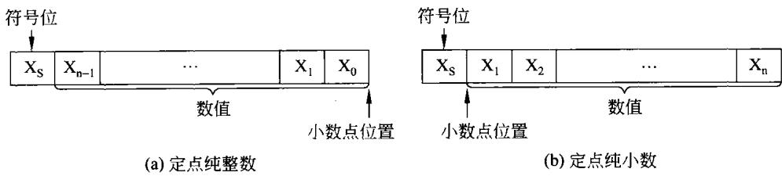
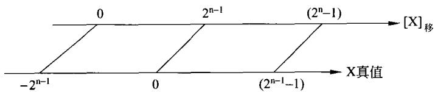
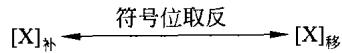
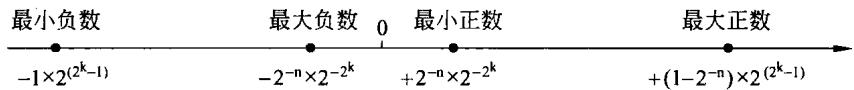
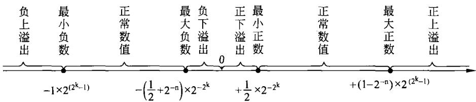
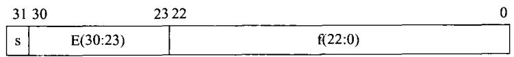
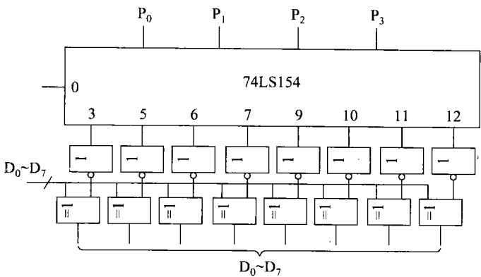

## 第2章 计算机中的数据表示

计算机只认识二进制编码所表示的数据，也只能对二进制表示的数据进行加工和处理。为了使计算机更方便地对数据进行处理，首先必须弄清楚各种各样的数据在计算机中是如何表示的，进而明了计算机硬件是如何对这些数据进行各种运算和加工的。本章将作为本书的基础知识，描述计算机中数据——包括数值数据和非数值数据的表示方法。

## 2.1数据编码

## 2.1.1数值数据的编码

## 1．概述

## （1）进位计数制及其转换

常见的进位计数制有十进制、二进制、八进制和十六进制。

十进制数中共有0～910个数码，其计数特点及进位原则为“逢十进一”。十进制的基数为10,位权为 $1 0 ^ { \mathrm { I } } ( \mathrm { I }$ 是整数)。十进制数后面常用字母D标记或者默认。

计算机中常用的计数制还有二进制、八进制、十六进制。

二进制数中只有0和1两个数码，其计数特点及进位原则为"逢二进一”。二进制的基数为2,位权为 $2 ^ { 1 } \mathrm { ( I }$ 是整数)。二进制数的后面常用字母B标记。

八进制数中共有 $0 \sim 7 ~ 8$ 个数码，其计数特点及进位原则为“逢八进一”。八进制的基数为8,位权为 $8 ^ { 1 } \mathrm { { ( } I }$ 是整数)。八进制数的后面常用字母O标记。

十六进制数中共有0～9、A、B、C、D、E、F16 个数码,其计数特点及进位原则为"逢十六进-”。十六进制的基数为16,位权为 $1 6 ^ { 1 } ( \mathrm { I }$ 是整数)。十六进制数的后面常用字母H标记。

任何一种进位计数制表示的数都可以写成按权展开的多项式之和，即任意一个r进制数N可表示为：

$$
{ \sf N } _ { \sf r } = \sum _ { { \sf i } = { \sf m } - 1 } ^ { - { \sf k } } { \sf D } _ { \sf i } \times { \sf r } ^ { \sf i }\tag{2-1}
$$

其中， $\mathrm { D } _ { \mathrm { i } }$ 为该数制采用的基本数符，r'是权,r是基数。

数值数据是表示数量多少和数值大小的数据，即在数轴上能找到其对应的点。

各种数值数据在计算机中表示的形式称为机器数。机器数对应的实际数值称为数的真值。

小数点位置固定的数称为定点数，又有无符号数和有符号数之分。

（2）无符号数及有符号数

①无符号数

所谓无符号数即没有符号的数，数中的每一位均用来表示数值。所以，8位二进制无符

号数所表示的数值范围是0～255。而16位无符号数的表示范围为0～65 535。

## ②有符号数

对有符号数而言，由于机器是无法直接识别“十”“一”（即正、负)符号，但由于“正”、“负"恰好是两种截然不同的状态,若用"0"表示"正”,用"1"表示“负”,则符号也被数字化了。并且规定将符号放在有效数字的前面，这样就组成了有符号数。

## （3）定点数与浮点数

## ①定点数

在数据的机器表示中，若约定小数点的位置固定不变，则称为定点数。有两种形式的定点数：定点整数(纯整数，小数点定在最低有效数值位之后)和定点小数(纯小数，小数点在最高有效数值位之前)。具体表示形式如图2-1所示。

  
图2-1有符号定点数的表示形式

## ②浮点数

基数为2的数F的浮点表示为：

$$
\mathrm { F } = \mathbf { M } \times 2 ^ { \mathtt { E } }\tag{2-2}
$$

其中，M称为尾数，E称为阶码。

尾数为带符号的纯小数，阶码通常为带符号的纯整数。计算机中浮点数的一般表示格式如图2-2所示。

<table><tr><td>数符</td><td>阶符</td><td>阶码</td><td>尾数</td></tr></table>

图2-2浮点数的一般表示形式

有关有符号的定点数及浮点数的详细讨论将放在本章的后面讲解。

## 2.原码

原码是机器数中最简单的一种表示形式，其符号位为0表示正数。符号位为1表示负数，数值位即真值的绝对值。

## （1）整数原码的定义

根据图2-1(a)，若整数用二进制n位表示，则整数原码的定义为：

$$
[ \mathbf { X } ] _ { \mathbb { H } ^ { 1 } } = \left\{ { \begin{array} { l l } { \mathbf { X } } & { 2 ^ { { \mathfrak { n } } - 1 } > \mathbf { X } \geqslant 0 } \\ { 2 ^ { { \mathfrak { n } } - 1 } - \mathbf { X } } & { 0 \geqslant \mathbf { X } > - 2 ^ { { \mathfrak { n } } - 1 } } \end{array} } \right.\tag{2~3}
$$

式中，X为真值，n一1为整数数值位的位数。

原码的构成可直接用定义实现，也可用符号位后面跟数的绝对值的方法实现。

【例2-1】当 ${ \bf X } = + 3 5$ 时，若用8位二进制编码的原码表示，则

$$
[ \mathbf { X } ] _ { \mathbb { R } } = 0 0 1 0 0 0 1 1
$$

若X=-35,同样用8位编码表示，则

$$
[ \mathbf { X } ] _ { \scriptscriptstyle \{ \sharp ^ { * } \} } = 1 0 1 0 0 0 1 1
$$

从上面的定义可以看到，符号位总是放在最高位的。同时，原码表示又称做带符号的绝对值表示，即在符号的后面跟着的就是该数据的绝对值。

## （2）小数原码的定义

根据图2-2(b)，若小数用二进制n位表示，则小数原码的定义为：

$$
[ \mathbf { X } ] _ { \mathbb { H } } = { \left\{ \begin{array} { l l } { \mathbf { X } } & { 1 > \mathbf { X } \geqslant 0 } \\ { 1 - \mathbf { X } } & { 0 \geqslant \mathbf { X } > - 1 } \end{array} \right. }\tag{2-4}
$$

根据式(2-4)，纯小数的原码表示可以表示如下。

对于正数： $[ \mathrm { X } ] _ { \mathbb { H } } = 0 . \mathrm { X } _ { 1 } \mathrm { X } _ { 2 } \cdots \mathrm { X } _ { \mathrm { n } - 1 }$

对于负数： $[ \mathrm { X } ] _ { \mathbb { H } } = 1 . \mathrm { X } _ { 1 } \mathrm { X } _ { 2 } \cdots \mathrm { X } _ { n - 1 }$

值得注意的是，在计算机中小数点是隐含的，也是不用表示的。上面表示式中的小数点纯属强调小数点的位置。

【例2-2】若纯小数 $\mathrm { X = 0 } , \ 4 6 8 \ 7 5$ ，用包括符号位为8位的定点原码表示，则可表示为：

$$
[ \mathbf { X } ] _ { \mathbb { X } } = 0 . 0 1 1 1 1 0 0
$$

若纯小数X=一0.46875，用包括符号位的定点原码表示，则可表示为：

$$
[ \mathbf { X } ] _ { \mathbb { A } } = 1 . 0 1 1 1 1 0 0
$$

数值原码表示法简单直观，但加减运算却很麻烦。同时，对于数值0，用原码表示则不是唯一的，有两种表示形式，以8位原码表示的0为：

$$
[ + 0 ] _ { B _ { 1 } ^ { n } } = 0 . 0 0 0 0 0 0 0 \ { \overline { { { \bf g } } } } { \tilde { \bf g } } [ + 0 ] _ { B _ { 1 } ^ { n } } = 0 0 0 0 0 0 0 0
$$

$$
[ - 0 ] _ { B R } = 1 . 0 0 0 0 0 0 0 \ { \overline { { { \mathfrak { x } } } } } [ - 0 ] _ { B { \mathfrak { x } } } = 1 0 0 0 0 0 0 0
$$

可见 $[ + 0 ] _ { 5 3 }$ 不等于 $\left[ - 0 \right] _ { \xi \bar { x } }$ ，这就是原码中的“零"有两种表示形式。

利用上述定义，原码n位(包括一位符号位)整数及纯小数所能表示的数值范围分别为：

$$
- ( 2 ^ { { \mathrm { n } } - 1 } - 1 ) { \sim } + ( 2 ^ { { \mathrm { n } } - 1 } - 1 ) \# \mathbb { I } - ( 1 - 2 ^ { - ( { \mathrm { n } } - 1 ) } ) { \sim } + ( 1 - 2 ^ { - ( { \mathrm { n } } - 1 ) } )
$$

## 3.补码

## （1）补数的概念

在日常生活中，常会遇到"补数"的概念。如时钟指示6点，欲使它指示3点，既可按顺时针方向将分针转9圈，也可按逆时针方向将分针转3圈，结果是一致的。假设顺时针方向转为正，逆时针方向转为负，则有

$$
\frac { - 3 } { 3 } - \frac { + 9 } { 1 5 }
$$

由于时钟的时针转一圈能指示12个小时，这“12"在时钟里是不被显示而自动丢失的，即 $1 5 - 1 2 = 3$ ，故15点和3点均显示3点。这样一3和十9对时钟而言其作用是一致的。在数学上称12为模，写做mod12，而称十9是一3以12为模的补数。

将补数的概念用到计算机中，便出现了补码这种机器数。

## （2）补码的定义

## ①整数补码的定义

同样根据图2-1(a)，若整数用二进制n位表示，则整数补码的定义为：

$$
[ \mathbf { X } ] _ { * } = { \left\{ \begin{array} { l l } { \mathbf { X } } & { 2 ^ { n - 1 } > \mathbf { X } \geqslant 0 } \\ { 2 ^ { \mathsf { n } } + \mathbf { X } } & { 0 > \mathbf { X } \geqslant - 2 ^ { \mathsf { n - 1 } } } \end{array} \right. } { \pmod { 2 ^ { \mathsf { n } } } }\tag{2-5}
$$

由式(2-5)可以看到，对正数来说，补码与原码的定义完全一样。同样的例子，假定 $\mathbf { X } =$ 十35时，若用8位二进制编码的补码表示，则

$$
[ \mathbf { X } ] _ { * \mathrm { k } } = 0 0 1 0 0 0 1 1
$$

但是，对负数而言，两者是不同的。现仍以 $\mathbf { X } = - 3 5$ 为例，可以利用式(2-5)的定义来求得该数的8位补码表示。但这种方法相对比较麻烦。简单的方法有如下几种。

a）将X=十35的原码表示，包括符号位在内各位取反，再在最低位上加1。

b）将X=一35的原码表示，不包括符号位各位取反，再在最低位上加1。

c）将X=十35的原码表示，从最低位逐位向高位找起，找到第一个1不变，以后各位1变0、0变1直至符号位。

## ②小数补码的定义

小数用二进制n位表示，则小数补码的定义为

$$
[ \mathbf { X } ] _ { * } = \{ { \begin{array} { l l } { \mathbf { X } } & { 1 > \mathbf { X } \geqslant 0 } \\ { 2 + \mathbf { X } } & { 0 > \mathbf { X } \geqslant - 1 } \end{array} } { \mathrm { ~ ( m o d ~ } } 2 \}\tag{2-6}
$$

根据式(2-6)，纯小数的补码同样可以表示如下。

$$
\mathbb { X } \mathbb { 1 } \mathbb { 1 } \mathbb { E } \mathbb { X } \mathbb { 1 } : \ [ \mathbb { X } ] _ { \mathbb { 1 } \mathbb { 1 } } = 0 . \mathbb { X } _ { 1 } \mathbb { X } _ { 2 } \cdots \mathbb { X } _ { \mathrm { n } - 1 }
$$

$$
\Vec { x } \colon \mp \infty \Leftrightarrow \Vec { x } \colon [ \mathrm { X } ] _ { * } = 1 , \mathrm { X } _ { 1 } \mathrm { X } _ { 2 } \cdots \mathrm { X } _ { n - 1 }
$$

同样，小数点是隐含的。

【例2-3】若纯小数X=0.46875，用包括符号位的8位定点补码表示，则可表示为：

$$
[ \mathbf { X } ] _ { \mathfrak { X } } = 0 . 0 1 1 1 1 0 0
$$

可以看到，对于正数，补码纯小数表示与原码是一样的。对于负数纯小数，构成其补码表示形式所采用的方法与整数一样。也就是说，上面所提到的4种方法均可使用。因此，当$\mathrm { X } = - 0 . 4 6 8 7 5$ 时，用包括符号位的8位定点补码表示，则可表示为：

$$
[ \mathrm { X } ] _  \ast \} = 1 . 1 0 0 0 1 0 0
$$

通过上述说明，n位补码表示的整数数值范围为 $- 2 ^ { { \mathrm { n - 1 } } } \sim + ( 2 ^ { { \mathrm { n - 1 } } } - 1 )$ 。n位补码表示的小数数值范围为 $- 1 { \sim } + ( 1 { - } 2 ^ { - { \mathfrak { n } } + 1 } )$

## （3）补码的特点

①0的表示是唯一的

$$
{ \begin{array} { l } { [ + 0 ] _ { * } = 0 . 0 0 0 0 0 0 0 } \\ { [ - 0 ] _ { * } = 2 + ( - 0 . 0 0 0 0 0 0 0 ) = 1 0 . 0 0 0 0 0 0 0 - 0 . 0 0 0 0 0 0 0 = 0 . \ 0 0 0 0 0 0 0 } \end{array} }
$$

显然 $[ + 0 ] _ { 4 4 } = [ - 0 ] _ { 4 4 } = 0 . 0 0 0 0$ ，即补码中的“零”只有一种表示形式。

## ②变形码

当模数为4时，形成了双符号位的补码，如 $\mathrm { X } = - 0 . 1 0 0 1$ ,对（mod $2 ^ { 2 } )$ 而言。

$$
[ \mathbf { X } ] _ { * * } = 2 ^ { 2 } + \mathbf { X } { } = 1 0 0 . 0 0 0 0 0 0 0 - 0 . 1 0 0 1 0 0 0 = 1 1 . 0 1 1 1 0 0 0
$$

这种双符号位的补码又叫做变形补码，它在阶码运算和溢出判断中，有其特殊作用。

## ③求补运算

在许多处理器中都设置求补指令，即对操作数求其补码。具体运算就是将操作数，包括符号位在内，各位取反再在最低位上加上1。注意到一个正数求补就变做负数，例如，对十68求补，其结果必为一68。就如同上面对十35求补就得到一35的结果一样。同样，对－68求补，其结果必为十68。

求补运算可用上面所描述的4种方法的任一种来实现，当然以简单快速为好，下章中将有具体的实现方案。

## ④简化加减法

利用补码实现两数相加是很方便的，补码加法的运算法则为：

$$
\begin{array} { r } { [ \mathbf { X } + \mathbf { Y } ] _ { * \mathbb { h } } = [ \mathbf { X } ] _ { * \mathbb { h } } + [ \mathbf { Y } ] _ { * \mathbb { h } } } \end{array}\tag{2-7}
$$

由式(2-7)可以看到，两数和的补码就等于两数补码之和。

对于减法，正如上面所描述的，对补码求补就相当于在其前面加了一个负号。也就是说$[ [ \mathbf { X } ] _ { \mathfrak { X } } ] _ { \mathfrak { X } \mathfrak { X } } = [ - \mathbf { X } ] _ { \mathfrak { X } } , [ [ - \mathbf { X } ] _ { \mathfrak { X } } ] _ { \mathfrak { X } \mathfrak { X } } = [ \mathbf { X } ] _ { \mathfrak { X } }$ 。有了这样的特性，就使得减法运算完全可以用加法来实现，即

$$
\begin{array} { r } { [ \mathbf { X } - \mathbf { Y } ] _ { * * } = [ \mathbf { X } ] _ { * * } + [ - \mathbf { Y } ] _ { * * } } \\ { = [ \mathbf { X } ] _ { * * } + [ [ \mathbf { Y } ] _ { * * } ] _ { * * } } \end{array}\tag{2-8}
$$

可见，利用补码，减法运算可用加法来实现。这也是所有常见的处理器中只设置加法器不设置减法器的原因。从而简化了处理器的结构，现举例说明。

## 【例2-4】 欲求68－35=？

可以将上式写做： $6 8 + ( - 3 5 ) = Z$ ，则

$$
[ Z ] _ { \ast } = [ 6 8 ] _ { \ast } + [ ( - 3 5 ) ] _ { \ast } = 0 1 0 0 0 1 0 0 + 1 1 0 1 1 1 0 1 = 0 0 1 0 0 0 0 1
$$

所获得的结果正是33。

## ③算术或逻辑左移

对于用补码表示的数据，只要没有超出所规定的数值范围，每算术或逻辑左移一次，即各位顺序向左移一位，最高位移出，最低位补进一个0。相当于该数据乘2。但必须注意前提条件。

## ⑥算术右移

算术右移规定保持最高位(即符号位)不变，并将包括最高位的数据顺序右移一位，最低位移出。补码表示的数据，每算术右移一次相当于除2。

## 4.反码·

反码通常用来作为由原码求补码或者由补码求原码的中间过渡。

## （1）反码的定义

①整数反码的定义

整数反码的定义为：

$$
[ \mathbf { X } ] _ { \ E } = { \left\{ \begin{array} { l l } { \mathbf { X } } & { 2 ^ { \mathbf { n } - 1 } > \mathbf { X } \geqslant 0 } \\ { ( 2 ^ { \mathbf { n } } - 1 ) + \mathbf { X } } & { 0 \geqslant \mathbf { X } > - 2 ^ { \mathbf { n } - 1 } } \end{array} \right. } { \pmod { \ ( 2 ^ { \mathbf { n } } - 1 ) } }\tag{2-9}
$$

由式(2-9)可以看到，正整数的反码表示与原码及补码表示是相同的。对于负数可直接利用式(2-9)来获得，也可以将该负数绝对值相同的正数原码包据符号位各位取反获得。还

可以用该负数的原码表示，保持符号位不变，其余各位取反来获得。也许这就是反码的由来。

【例2-5】若X=35，其8位反码表示为：

$$
[ \mathbf { X } ] _ { \ E } = 0 0 1 0 0 0 1 1
$$

若X=-35,其反码表示为：

$$
[ \mathbf { X } ] _ { \scriptscriptstyle \perp } = 1 1 0 1 1 1 0 0
$$

## ②小数反码的定义

小数反码的定义为：

$$
[ \mathbf { X } ] _ { \ E } = { \left\{ \begin{array} { l l } { \mathbf { X } } & { 1 > \mathbf { X } \geqslant 0 } \\ { ( 2 - 2 ^ { - \ n + 1 } ) + \mathbf { X } } & { 0 \geqslant \mathbf { X } > - 1 } \end{array} \right. } { \pmod { \ } } ~ ( 2 - 2 ^ { - \ n + 1 } ) )\tag{2-10}
$$

## （2）特点

## ①0的表示

在数值的反码表示中，0同样有两种表示形式，用8位表示如下：

$$
[ + 0 ] _ { \vec { \kappa } } = 0 . 0 0 0 0 0 0 0 = 0 0 0 0 0 0 0
$$

$$
[ - 0 ] _ { \vec { \mathbf { x } } } = 1 . 1 1 1 1 1 1 1 1 = 1 1 1 1 1 1 1 1
$$

## ②反码与补码的关系

从反码及补码的定义可以看到：

$$
\begin{array} { l } { { [ \mathrm { X } ] _ { \bar { \mathbb { x } } } = 2 - 2 ^ { - { \mathfrak { n } } + 1 } + \mathrm { X } } } \\ { { [ \mathrm { X } ] _ { \# \mathbb { x } } = 2 + \mathrm { X } } } \end{array}
$$

可见，

$$
[ \mathrm { X } ] _ { * \mathrm { i } } = [ \mathrm { X } ] _ { \Xi } + 2 ^ { - \mathrm { n } + 1 }\tag{2-11}
$$

式(2-11)进一步验证了前面的结论：只要在某数值的反码的最低位上加1即可获得该数值的补码。

## ③数值范围

n位反码表示的整数数值范围为一 $\cdot ( 2 ^ { ( \mathfrak { n } - 1 ) } - 1 ) \sim + ( 2 ^ { ( \mathfrak { n } - 1 ) } - 1 )$

n位反码表示的小数数值范围为一 $( 1 - 2 ^ { - ( n ^ { - 1 } ) } ) \sim + ( 1 - 2 ^ { - ( n ^ { - 1 } ) } )$ Q

## 5.移码

## （1）移码的由来

有符号数在计算机中除了用原码、补码和反码表示外，还用另一种机器数—-移码表示，由于它的一些突出的优点，目前已被广泛采用。

当真值用补码表示时，由于符号位和数值部分一起编码，与习惯上的表示法不同，因此人们很难从补码的形式上直接判断其真值的大小，例如：

十进制数X=十31,对应的二进制数为+11111,若用8位表示，则 $[ \mathbf { X } ] _ { * \mathrm { h } } = 0 0 0 1 1 1 1 1$

十进制数X=－31,对应的二进制数为－11111,若用8位表示，则 $[ \mathbf { X } ] _ { \ast \vert } = 1 1 1 0 0 0 0 1$

上述补码表示中，从代码形式看，符号位也是一位二进制数。按这8位二进制代码比较其大小,会得出 $1 1 1 0 0 0 0 1 { > } 0 0 0 1 1 1 1 1$ ，其实恰恰相反。

如果对每个真值加上一个 $2 ^ { \mathfrak { n } - 1 } \left( \mathfrak { n } \right.$ 为整数的位数，此处可为7,即8一1)，情况就发生了变化，如：

X=00011111加上 $2 ^ { 7 }$ 可得10011111;

$\mathbf { X } { = } 1 1 1 0 0 0 0 1$ 加上 $2 ^ { 7 }$ 可得01100001。

比较它们的结果可见,10011111>01100001。这样一来,从8位代码本身就可看出真值的实际大小。

在上面的例子中，实际上是在原来补码表示的编码上加上一个偏移量。例子中，由于编码长度为8位，使用的偏移量为 $2 ^ { 7 }$ 。这或许是移码的由来。

## （2）移码的定义

由于移码多在浮点数中表示阶码，均为整数，因此只介绍定点整数的移码表示。当用包括符号位为n位字长时，整数移码的定义为：

$$
[ \mathbf { X } ] _ { \mathfrak { H } } = 2 ^ { { \mathfrak { n } } - 1 } + \mathbf { X } \quad ( 2 ^ { { \mathfrak { n } } - 1 } > \mathbf { X } \geqslant - 2 ^ { { \mathfrak { n } } - 1 } ) \quad ( \mathrm { m o d } \ 2 ^ { \mathfrak { n } } )\tag{2-12}
$$

要获得整数的移码，可以利用定义来实现，也可以先求出该数的补码表示，而后将符号位取反。仍使用前面的例子，当 $\mathbf { X } = 3 5$ ,其8位字长移码表示为：

先求出 $[ \mathbf { X } ] _ { \ast \vert } = 0 0 1 0 0 0 1 1$ ，再将其符号位取反，即 $[ \mathbf { X } ] _ { \# \# } = 1 0 1 0 0 0 1 1$

也可以直接用定义，此时的 $2 ^ { { \mathrm { n } } - 1 } = 1 0 0 0 0 0 0 0 , \mathbf { X } = 0 0 1 0 0 0 1 1$ ，则 $[ \mathbf { X } ] _ { \# } = 2 ^ { { \mathfrak { n } } - 1 } + \mathbf { X } =$ 10100011。

若 $\mathbf { X } = - 3 5$ ,先求出 $[ \mathbf { X } ] _ { \ast \mathrm { b } } = 1 1 0 1 1 1 0 1$ ，则 $[ \mathbf { X } ] _ { \ast \ast } = 0 1 0 1 1 1 0 1$

用定义求，则 $\mathbf { \bar { X } } ] _ { \mathfrak { H } } = 2 ^ { { \mathbf { n } } - 1 } + \mathbf { X } = 1 0 0 0 0 0 0 0 0 + 1 1 0 1 1 1 0 1 = 0 1 0 1 1 1 0 1 ,$

## （3）特点

① 移码就是在真值上加一个常数 $2 ^ { { \mathfrak { n } } - 1 }$ 。在数轴上移码所表示的范围恰好对应与真值在数轴上的范围向轴的正方向移动 $2 ^ { { \mathfrak { n } } - 1 }$ 个单元，如图2-3所示。

  
图2-3移码在数轴上的表示

## ②移码与补码的关系

移码与补码的关系可用图2-4表示。

要将图2-4可以看到，补码与移码间的关系应分密切， [X]补 符号位取反 [X]移样，只要将移码的符号位取反，则移码就转换成了相应的 图2-4补码与移码的关系补码。

进而可以想到，只要字长相同，补码与移码所能表示的数值范围是相同的。

③在这里再强调说明，移码码值的大小就反映了数值的大小。因此，正数移码的码值一定大于负数移码的码值。也就是说，移码大码值所表示的数值一定大于小码值所表示的数值。

## 6.不同编码比较

原码表示很直观。若采用原码做乘除运算，可取其绝对值(原码的数值部分)直接运算，并按同号相乘除取正、异号相乘除取负的原则，单独处理符号位，比较方便。但原码加减运算时，其运算比较复杂。例如，当两个操作数符号不同且要做加法运算时，先要判断两数的绝对值大小，然后将绝对值大的数减去绝对值小的数，结果的符号以绝对值大的数为准。运算步骤既复杂又费时，而且本来是加法运算却要用减法器实现。而机器数采用补码时，就能找到一个与负数等价的正数来代替该负数，就可把减法操作用加法代替，这样在计算机中就可以只设加法器，但是根据补码的定义，在负数形成补码的过程中需要取反，因此，引入了反码，作为由原码求补码或者由补码求原码的中间过渡，这样由真值通过原码求补码就可避免减法运算。

因此，原、反、补码三种机器数的特点可归纳如下。

（1）当真值为正时，原码、补码和反码的表示形式均相同，即符号位用"0"表示，数值部分与真值相同。

（2）当真值为负时，原码、补码和反码的表示形式不同，但其符号位都用"1"表示，而数值部分有如下关系，即补码是原码的“求反加1”，反码是原码的“每位取反”。

表2-1列出了8位字长中所有二进制代码组合与无符号数及定点整数原码、补码和反码所代表真值的对应关系。

表2-18位不同编码对应的真值范围
<table><tr><td>二进制代码</td><td>无符号数对应的真值</td><td>原码对应的真值</td><td>补码对应的真值</td><td>反码对应的真值</td></tr><tr><td>00000000</td><td>0</td><td>+0</td><td>+0</td><td>+0</td></tr><tr><td>00000001</td><td>1</td><td>+1</td><td>+1</td><td>+1</td></tr><tr><td>00000010</td><td>2</td><td>+2</td><td>+2</td><td>+2</td></tr><tr><td>：</td><td>：</td><td>：</td><td>：</td><td>：</td></tr><tr><td>01111110</td><td>126</td><td>+126</td><td>+126</td><td>+126</td></tr><tr><td>01111111</td><td>127</td><td>+127</td><td>+127</td><td>+127</td></tr><tr><td>10000000</td><td>128</td><td>10</td><td>-128</td><td>-127</td></tr><tr><td>10000001</td><td>129</td><td>-1</td><td>-127</td><td>－126</td></tr><tr><td>10000010</td><td>130</td><td>12</td><td>--126</td><td>-125</td></tr><tr><td>：</td><td>：</td><td>：</td><td>：</td><td>：</td></tr><tr><td>11111101</td><td>253</td><td>-125</td><td>.-3</td><td>12</td></tr><tr><td>11111110</td><td>254</td><td>-126</td><td>12</td><td>-1</td></tr><tr><td>11111111</td><td>255</td><td>-127</td><td>-1</td><td>10</td></tr></table>

## 2.1.2数据的浮点表示

在前一小节中,已经详细地讨论了有关定点数的编码问题，本小节将说明浮点数的表示方法。有关定点数和浮点数的运算将在下一章讨论。

## 1．浮点数的表示方法

## （1）概述

实际上，计算机中处理的数不一定是纯小数或纯整数，而且有些数据的数值范围相差很

大（如电子的质量 $9 \times 1 0 ^ { - 2 8 }$ 克，太阳的质量 $2 \times 1 0 ^ { 3 3 }$ 克)，它们都不能直接用定点小数或定点整数表示，但均可用浮点数表示。浮点数即小数点的位置可以浮动的数，如：

$$
3 5 2 . 4 7 = 3 . 5 2 4 7 \times 1 0 ^ { 2 } = 3 5 2 4 . 7 \times 1 0 ^ { - 1 } = 0 . 3 5 2 4 7 \times 1 0 ^ { 3 }
$$

显然，这里小数点的位置是变化的，但因为分别乘上了不同的10的幂方，故其值不变。浮点数被表示成一般形式为：

$$
\mathrm { F } = \mathrm { M } \times \mathrm { R } ^ { \mathrm { E } }\tag{2-13}
$$

式中,M为尾数(可正可负),E为阶码(可正可负),R是基数(或基值)。在计算机中，基数可取2、4、8或16等。

当基数R=2时，式(2-13)就变成了式(2-2)。此时，数F可写成下列不同形式：

$$
{ \mathrm { F } } = 1 1 . \ 0 1 0 1 \ = 0 . 1 1 0 1 0 1 \times 2 ^ { 1 0 } = 1 . \ 1 0 1 0 1 \times 2 ^ { 1 } = 1 1 0 1 . \ 0 1 \times 2 ^ { - 1 0 } = 0 . \ 0 0 1 1 0 1 0 1 \times 2 ^ { 1 0 0 } = \cdots
$$

## （2）浮点数的表示

浮点数在机器中的形式有两种：①如图2-2所示的形式。②如图2-5所示的形式。至 浮点数在机器中的形式有两种：①如图2-2

于采用哪种形式，是由计算机的设计人员所决定的。能够对浮点数进行处理的处理器称为浮点处理器。

<table><tr><td>阶符</td><td>阶码</td><td>数符</td><td>尾数</td></tr></table>

图 2-5浮点数的另一种表示形式

可以看到，浮点数的两种表示形式本质上是

一样的。不同的仅仅是规定数值的符号位规定的位置不同。

## 2.浮点数所表示的数值范围

浮点数可分为非规格化浮点数和规格化浮点数，它们有一些不同，下面分别讨论。

## （1）非规格化浮点数

由浮点数的表示可以看到，浮点数由阶码E和尾数M两部分组成。需要强调的是：①阶码是整数，阶符和阶码的位数k合起来决定浮点数的表示数值范围也就是决定了所表示的数值的大小。阶符决定阶码的正负。②尾数是小数，其位数n主要用于决定浮点数的精度。③尾数的符号表示浮点数的正负。

浮点数的表示范围如下。

以通式 $\mathbf { F } { = } \mathbf { M } { \times } \mathbf { R } ^ { \mathbf { E } }$ 为例，设浮点数的基值R=2;阶码的数值位取k位，阶符1位且采用补码表示;尾数的数值位取n位，数符1位，同样采用补码表示。当浮点数为非规格化数时，可先分别求出阶码和尾数的表示范围。

阶码的最小值为－2,阶码的最大值为 $( 2 ^ { \tt k } - 1 )$ 。

尾数的最小负值为一1，尾数的最大负值为 $- 2 ^ { - n }$ ；

尾数的最小正值为 $+ 2 ^ { - \mathtt { n } }$ ,尾数的最大正值为 $+ ( 1 - 2 ^ { - \mathtt { n } } )$

根据上面的分析，此非规格化浮点数在数轴上的表示范围如图2-6所示。

  
图2-6非规格化浮点数的数值范围

## （2）规格化浮点数

在计算机中，为了充分利用尾数的二进制编码表示更多的有效数字，为了使浮点数有统一的表示形式，也为了使浮点保持更高的精度。通常，浮点数采用规格化形式来表示。

对浮点数的规格化，就是将尾数的绝对值限定在一个规定的数值范围内。当基值为2时，规格化浮点数尾数的绝对值应在 $1 / 2 { \sim } 1$ 之间。使尾数的绝对值在此范围内是可以通过改变小数点的位置(相应地改变阶码)来做到的。

当尾数M用补码表示，且当 $\mathbf { M } { \geqslant } 0$ 时，规格化尾数的形式必须为：

$$
\mathbf { M } = 0 . 1 \mathrm { { X X X X \cdots X } }\tag{2-14}
$$

在式(2-14)中，X为任意二进制值，0 或1皆可。

当 $\mathbf { M } { < } 0$ 时，规格化尾数的形式必须为：

$$
\mathbf { M } = 1 . 0 \mathbf { X } \mathbf { X } \mathbf { X } \mathbf { X } \mathbf { \cdots } \mathbf { X }\tag{2-15}
$$

同样，式(2-15)中，X为任意二进制值,0或1皆可。

根据上面对规格化浮点数的定义，可以得到规格化尾数的数值范围。

尾数的最小负值为一1，尾数的最大负值为 $- ( 1 / 2 + 2 ^ { - n } )$

尾数的最小正值为十1/2，尾数的最大正值为 $+ ( 1 - 2 ^ { - n } )$

对于规格化浮点数来说，其阶码所表示的数值范围与非规格化浮点数是一样的。因此，可以确定规格化浮点数所能表示的数值范围如图2-7所示。

  
图2-7规格化浮点数的数值范围

比较图2-7和图2-6，可以发现非规格化浮点数和规格化浮点数所能表示的数值范围主要不同是最小绝对值的有效数值。

由图2-7可见，规格化浮点数的数值范围如下。

$$
\begin{array} { l l } { { } } & { { { \begin{array} { l } { { \displaystyle \operatorname { \mathbb { E } } \lambda \operatorname { \mathbb { E } } \lambda \operatorname { \mathbb { E } } \lambda \operatorname { \mathbb { X } } ^ { 3 } \lambda ^ { * } } : } \end{array} } } } & { { \begin{array} { l } { { } } \\ { { } } \\ { } \\ { { \operatorname { \mathbb { E } } \lambda ^ { * } / { \widetilde { \lambda } } \operatorname { \mathbb { X } } \lambda ^ { * } \operatorname { \mathbb { X } } ^ { 3 } : } } \\ { { } } \\ { { \operatorname { \mathbb { E } } \lambda \operatorname { \mathbb { X } } \operatorname { \mathbb { H } } \lambda ^ { * } \lambda ^ { * } } : } \\ { { } } \\ { { \operatorname { \mathbb { H } } \lambda ^ { * } \operatorname { \mathbb { X } } \operatorname { \mathbb { H } } \lambda ^ { * } \lambda ^ { * } } : } \\ { { } } \\ { { \operatorname { \mathbb { H } } \lambda ^ { * } \operatorname { \mathbb { Z } } \lambda ^ { * } \operatorname { \mathbb { X } } ^ { 3 } \lambda ^ { * } \lambda ^ { * } } } \end{array} } } & { { \begin{array} { l } { { } } \\ { { } } \\ { { + { \frac { 1 } { 2 } } \times 2 ^ { - 2 ^ { \mathbf { k } } } } } \\ { { } } \\ { { } } \\ { { } } \\ { { - \left( { \frac { 1 } { 2 } } + 2 ^ { - n } \right) \times 2 ^ { - 2 ^ { \mathbf { k } } } } } \\ { { } } \\ { { - 1 \times 2 ^ { ( 2 ^ { \mathbf { k } } - 1 ) } } } \end{array} } } \end{array}
$$

当浮点数阶码大于最大阶码时，称为"上溢”,此时机器停止运算，进行中断溢出处理；当浮点数阶码小于最小阶码时，称为“下溢”,此时"溢出"的数绝对值很小，通常将尾数各位强置为零，按机器零处理，此时机器可以继续运行。图2-7中表示了浮点数所能表示的数值范围及溢出的情况。

一旦浮点数的位数确定后，合理分配阶码和尾数的位数，会直接影响浮点数的表示范围和精度。

从上面的讨论可以看到，利用数值的浮点数表示，可将有限字长的二进制编码表示更大的数值范围。例如，16位二进制编码不同表示形式的表示范围如下。

无符号数的范围为0～65535。

补码定点整数的范围为一32768～十32.767。

对于浮点数，有多种方案。假定阶符1位、阶码6位，数符1位、尾数8位。若阶码用移码表示，尾数用补码表示。则该浮点数所能表示的数值范围是 $- 2 ^ { 6 3 } \sim + ( 1 - 2 ^ { - 8 } ) \times 2 ^ { 6 3 }$ □

可见，同样字长的浮点数所能表示的数值范围要大得多。

## （3）规格化

浮点数在进行运算前和运算后，必须对其尾数规格化，使其成为规格化数。当尾数不是规格化数时，就要通过修改阶码并同时左右移尾数的办法，使其变成规格化数。将非规格化数转换成规格化数的过程叫做规格化。对于基数不同的浮点数，因其规格化数的形式不同，规格化过程也不同。

当基数为2时，规格化数依据式(2-14)和式（2-15)。规格化时，尾数左移一位，阶码减1,(这种规格化叫做向左规格化,简称左规);尾数右移一位，阶码加1(这种规格化叫做向右规格化，简称右规)。

其他基数的规格化过程不做说明。

（4）定点数和浮点数的比较

定点数和浮点数可从如下几个方面进行比较。

① 当浮点机和定点机中的数其位数相同时，浮点数的表示范围比定点数大得多。

② 当浮点数为规格化数时，其精度远比定点数高。

③浮点数运算要分阶码部分和尾数部分，而且运算结果都要求规格化，故浮点运算步骤比定点运算步骤多，运算速度比定点低，运算线路比定点复杂。

④ 在溢出的判断方法上,浮点数是对规格化数的阶码进行判断，而定点数是对数值本身进行判断。如定点小数其绝对值必须小于1,否则即“溢出”，此时要求机器停止运算，进行处理。为防止溢出，运算前必须选择好合适的比例因子，但这项工作做起来比较麻烦，给编程带来不便。而浮点数的表示范围远比定点数大，仅当"上溢"时机器才停止运算，故一般不必考虑比例因子的选择。

总之，浮点数在数的表示范围、数的精度、溢出处理和程序编程方面(不取比例因子)均优于定点数。但在运算规则、运算速度及硬件成本方面又不如定点数。因此，究竟选用定点数还是浮点数，应根据具体应用综合考虑。一般来说，通用的大型计算机大多采用浮点数，或同时采用定、浮点数；小型、微型及某些专用机、控制机则大多采用定点数。当需要做浮点运算时，可通过软件实现，也可通过外加浮点扩展硬件(如协处理器)来实现。现举例说明。

【例2-6】将十进制数X=+13/128写成二进制定点数和浮点数（尾数部分取7位，阶码部分取7位，阶符和数符各取1位，阶码采用移码，尾数用补码表示),分别写出该数的定点数和浮点数的表示形式。

解：令X=+13/128

其二进制形式： X=0.0001101

定点数表示： X=0.0001101

浮点数规格化表示： $\mathrm { X } { = } 0 . 1 1 0 1 0 0 0 \times 2 ^ { \cdot { \mathrm { ~ 1 1 } } }$

定点表示： [X]原=[X]=[X]==0.00011011

浮点表示形式如图2-8所示。

【例2-7】设浮点数字长为16位，其中阶码为6位(含一位阶符),尾数为10位(含一位数符)，写出X=-(53/512)对应的浮点规格化数阶码用移码，尾数用补码的形式。

解： $\mathbf { X } { = } - ( 5 3 / 5 1 2 ) { = } { - } 0 . 0 0 0 1 1 0 1 0 1 { = } 2 ^ { - 1 1 } \times ( - 0 . 1 1 0 1 0 1 0 0 0 )$

尾数的规格化补码形式为：1.001011000

阶码的移码表示为：011101

该数用另一种浮点表示形式来表示如图2-9所示。

<table><tr><td colspan="4">数阶 符符 阶码 尾数</td></tr><tr><td></td><td></td><td>111101</td><td>1101000</td></tr></table>

<table><tr><td>阶符</td><td>阶码</td><td>数符</td><td>尾数</td></tr><tr><td>0</td><td>11101</td><td>1</td><td>001011000</td></tr></table>

图2-8例2-6中浮点数的表示形式  
图2-9例2-7浮点数的表示形式

值得注意的是，当一个浮点数尾数为0时，不论其阶码为何值，或阶码等于或小于它所能表示的最小数时，不管其尾数为何值，机器都把浮点数当做零看待，并称为“机器零”。如果浮点数的阶码用移码表示，尾数用补码表示，则当阶码为它所能表示的最小数为－2（式中k为阶码的位数)且尾数为0时，其阶码(移码)全为0，尾数(补码)也全为0，这样的机器零为全零表示，有利于简化机器中的判"0"电路。

## 3.IEEE754标准

## （1）工业标准754概述

1985年，IEEE发表了一份关于单精度和双精度浮点数的浮点表示标准，这个标准官方称为IEEE754（1985)。以后又不断加以发展，Sun公司于2005年推出《数值计算指南》（中译本名)，对该标准进行了更加详细和深入的讨论，给出了多种格式及程序。因此，《数值计算指南》更加全面也非常实用。IEEE754标准已获得了广泛的认可，并已用于当前所有各类处理器和浮点协处理器中。

IEEE754规定了单精度和双精度两种基本的浮点格式，以及双精度扩展等多种浮点格式。常用的IEEE754格式参数如表2-2所示。

表2-2常用的IEEE754格式
<table><tr><td>参数</td><td>单精度浮点数</td><td>双精度浮点数</td><td>双精度扩展浮点数</td></tr><tr><td>浮点数长度(b)</td><td>32</td><td>64</td><td>80</td></tr><tr><td>尾数长度p(b)</td><td>23</td><td>52</td><td>64</td></tr><tr><td>符号位s</td><td>1</td><td>1</td><td>1</td></tr><tr><td>指数E的长度(b)</td><td>8</td><td>11</td><td>15</td></tr><tr><td>最大指数Emax</td><td>+127</td><td>+1023</td><td>+16 383</td></tr><tr><td>最小指数Emin</td><td>-126</td><td>-1022</td><td>-16382</td></tr><tr><td>指数偏移量</td><td>+127</td><td>+1023</td><td>+16 383</td></tr><tr><td>可表示的实数范围</td><td> $1 0 ^ { - 3 8 } \sim 1 0 ^ { + 3 8 }$ </td><td> $1 0 ^ { - 3 0 8 } \sim 1 0 ^ { + 3 0 8 }$ </td><td>10-4932~10+4932</td></tr></table>

需要说明的是，在IEEE754标准的具体规定中，还有多种形式。在本小节中只对该标准做最简单地介绍，读者欲了解更详细的细节，可查阅相关文献资料。

IEEE754标准的表示形式如下：

$$
( - 1 ) ^ { \mathrm { s } } 2 ^ { \mathrm { s } } ( \mathrm { b } _ { \scriptscriptstyle 0 } \bullet \mathrm { b } _ { \scriptscriptstyle 1 } \mathrm { b } _ { \scriptscriptstyle 2 } \mathrm { b } _ { \scriptscriptstyle 3 } \cdots \mathrm { b } _ { \scriptscriptstyle \mathrm { p } - 1 } )\tag{2-16}
$$

其中， $( - 1 ) ^ { \mathrm { s } }$ 表示该浮点数的数符，当s为0时表示为正数,s为1时为负数；

E为指数，用移码表示； $( \mathbf { b } _ { 0 } \bullet \mathbf { b } _ { 1 } \mathbf { b } _ { 2 } \mathbf { b } _ { 3 } \cdots \mathbf { b } _ { \scriptscriptstyle \mathrm { p } - 1 } )$ 为尾数，共P位，用原码表示。

在IEEE754标准中，特别要说明的就是尾数在规格化时的处理。也就是说在规格化的过程中必须使 ${ \bf b } _ { 0 }$ 为1,而且小数点应当在+位置上，是隐含的。规格化时将 ${ \bf b } _ { 0 }$ 去掉，也是隐含的。这相当于使尾数增加了一位，在使用时应注意到这种情况。

## （2）单精度格式

## ①格式

在这里仅介绍最基本的IEEE754标准的单精度格式，其格式如图2-10所示。

  
图2-10IEEE754单精度浮点数的格式

由图2-10可以看到，IEEE754所定义的浮点数由三个字段构成：s表示数符为1位，f表示尾数为23位，阶码E为8位（含1位阶符）。

值得强调的是，IEEE754中的阶码采用移码，正如表2-2所示，对单精度浮点数来说，移码的偏移量不是前面所提到的 $2 ^ { 7 } ( + 1 2 8 )$ 而是 $( 2 ^ { 7 } - 1 )$ 即（十127)。同时，规定尾数用原码表示，规格化时b必须为1而且隐去。有关IEEE754标准的单精度格式的详细规定如 ${ \bf b } _ { 0 }$ 表2-3所示。

表2-3IEEE754单精度格式位模式表示的值
<table><tr><td>单精度格式位模式</td><td>IEEE浮点数的值</td></tr><tr><td> $0 { < } \mathrm { e } { < } 2 5 5$ </td><td> $( - 1 ) ^ { \textrm { s } } { \times } 2 ^ { \textrm { e } - 1 2 7 } { \times } 1 . \textrm { f }$  （正规数）</td></tr><tr><td> $\mathbf { e } { = } 0 ; \mathbf { f } { \neq } 0 ( \mathbf { f }$  中至少有一位不为零)</td><td> $( - 1 ) ^ { \mathrm { s } } \times 2 ^ { - 1 2 6 } \times 0 . \mathrm { ~ f ~ }$  （次正规数）</td></tr><tr><td> $\mathbf { e } { = } 0 ; \mathrm { f } { = } 0 ( \mathrm { f }$  的所有位均为零)</td><td> $( - 1 ) ^ { \ast } \times 0 . 0$  (有符号的零)</td></tr><tr><td> $\mathbf { s } = 0 ; \mathrm { e } = 2 5 5 ; \mathrm { f } = 0 ( \mathrm { f }$  的所有位均为零)</td><td> $+ \mathrm { I N F }$  （正无穷大）</td></tr><tr><td> $\mathbf { s } = 1 ; \mathbf { e } = 2 5 5 ; \mathrm { f } = 0 ( \mathrm { f }$  的所有位均为零)</td><td> $- \operatorname { I N F }$  (负无穷大）</td></tr><tr><td> $\mathbf { s } = \mathbf { u } ; \mathbf { e } = 2 5 5 , \mathbf { f } \neq 0 ( \mathbf { f }$  中至少有一位不为零)</td><td> ${ \tt N a N }$  （非数值）</td></tr></table>

由表2-3可以看到，正规数尾数有效数字的前导位（小数点左侧的位 $\mathbf { b } _ { 0 } )$ 为1，与23位尾数一起提供了24位的精度。u为无关。

次正规数有效数字的前导位为0。在IEEE754标准中，单精度格式次正规数也称为单精度格式非规格化数。

## ②说明

根据上述描述，可以得到IEEE754标准的单精度浮点数的结论如下。

a）阶码E的正常值应为其真值－126～十127，偏移量为十127，即e为十1～+254。

b）规格化数为：

$$
\mathbf { N } = ( - 1 ) ^ { \mathrm { s } } \times 2 ^ { \mathrm { e } - 1 2 7 } \times ( 1 . \mathrm { f } )\tag{2-17}
$$

c）所能表示的正数范围： $\mathrm { N } { = } { + } 2 ^ { + 1 2 7 } \times ( 1 { + } 1 { - } 2 ^ { - 2 3 } ) { \sim } { + } 2 ^ { - 1 2 6 } \times ( 1 { + } 0 )$

所能表示的负数范围： $\mathrm { N } { = } { - 2 ^ { + 1 2 7 } \times ( 1 { + } 1 { - } 2 ^ { - 2 3 } ) { \sim } { - } 2 ^ { - 1 2 6 } \times ( 1 { + } 0 ) }$

d）当e=0或e=255时，在IEEE754 标准中表示特殊的数。

③举例

为了说朋IEEE754浮点数的应用，现举例如下。

【例2-8】现欲利用IEEE754标准将数176.0625表示为单精度浮点数。

首先将该十进制来转换成二进制数：

$$
( 1 7 6 . 0 6 2 5 ) _ { 1 0 } { = } ( 1 0 1 1 0 0 0 0 . 0 0 0 1 ) _ { 2 }
$$

对上面二进制数规格化： $1 0 1 1 0 0 0 0 , 0 0 0 1 = 1 \bullet 0 1 1 0 0 0 0 0 0 0 1 \times 2 ^ { \prime }$

这就保证了使 ${ \bf b } _ { 0 }$ 为1，而且小数点在•位置上。将 ${ \bf b } _ { 0 }$ 去掉并扩展为单精度浮点数所规定的23位尾数：01100000001000000000000。

现在，再来求取阶码。现指数为7，而单精度浮点数规定指数的偏移量为127（请注意不是前面移码描述中所提到的128)，即在指数7上加127，也就是 $7 + 1 2 7 = 1 3 4$ 。即在00000111上加01111111，从而得到指数的移码为10000110。

最后，将（176.0625）表示为IEEE754标准的单精度浮点数：

$$
\begin{array} { r l } { 0 } &  { } 1 0 0 0 0 1 1 0 \quad 0 1 1 0 0 0 0 0 0 0 1 0 0 0 0 0 0 0 0 0 0 0 0 0 0 0 0 0 0 0 0 0 0 0 0 0 0 0 0 0 0 0 0 0 0 0 0 0 0 0 0 0 0 0 0 0 0 0 0 0 0 0 0 0 0 0 0 0 0 0 0 0 0 0 0 0 0 0 0 0 0 0 0 0 0 0 0 0 0 0 0 0 0 0 0 0 0 0 0 0 0 0 0 0 0 0 0 0 0 0 0 0 0 0 0 0 0 0 0 0 0 0 0 0 0 0 0 0 0 0 0 0 0 0 0 0 0 0 0 0 0 0 0 0 0 0 0 0 0 0 0 0 0 0 0 0 0 0 0 0 0 0 0 0 0 0 0 0 0 0 0 0 0 0 0 0 0 0 0 0 0 0 0 0 0 0 0 0 0 0 0 0 0 0 0 0 0 0 0 0 0 0 0 0 0 0 0 0 0 0 0 0 0 0 0 0 0 0 0 0 0 0 0 0 0 0 0 0 0 0 0 0 0 0 0 0 0 0 0 0 0 0 0 0 0 0 0 0 0 0 0 0 0 0 0 0 0 0 0 0 0 0 0 0 0 0 0 0 0 0 0 0 0 0 0 0 0 0 0 0 0 0 0 0 0 0 0 0 0 0 0 0 0 0 0 0 0 0 0 0 0 0 0 0 0 0 0 0 0 0 0 0 0 0 0 0 0 0 0 0 0 0 0 0 0 0 0 0 0 0 0 0 0 0 0 0 0 0 0 0 0 0 0 0 0 0 0 0 0 0 0 0 0 0 0 0 0 0 0 0 0 0 0 0 0 0 0 0 0 0 0 0 0 0 0 0 0 0 0 0 0 0 0 0 0 0 0 0 0 0 0 0 0 0 0 0 0 0 0 0 0 0 0 0 0 0 0 0 0 0 0 0 0 0 0 0 0 0 0 0 0 0 0 0 0 0 0 0 0 0 0 0 0 0 0 0 0 0 0 0 0 0 0 0 0 0 0 0 0 0 0 0 0 0 0 0 0 0 0 0 0 0 0 0 0 0 0 0 0 0 0 0 0 0 0 0 0 0 0 0 0 0 0 0 0 0 0 0 0 0 0 0 0 0 0 0 0 0 0 0 0 0 0 0 0 0 0 0 0 0 0 0 0 0 0 0 0 0 0 0 0 0 0 0 0 0 0 0 0 0 0 0 0 0 0 0 0 0 0 0 0 0 0 0 0 0 0 0 0 0 0 0 0  \end{array}
$$

④IEEE754标准双精度浮点数的说明

在这里将IEEE754标准双精度浮点数做最简单的说明，不再涉及更多的细节。

a）阶码E的正常值应为其真值－1022～十1023,偏移量为十1023,即.e为+1～+2043。

b）规格化数为：

$$
\mathbf { N } = ( - 1 ) ^ { \mathrm { s } } \times 2 ^ { \mathrm { e } - 1 0 2 3 } \times ( 1 . \mathrm { f } )\tag{2-18}
$$

c）所能表示的正数范围： $\mathrm { N } { = } { } { + } 2 ^ { + 1 0 2 3 } \times ( 1 { + } 1 { - } 2 ^ { - 5 2 } ) { \sim } { + } 2 ^ { - 1 0 2 2 } \times ( 1 { + } 0 )$

所能表示的负数范围： ${ \mathrm { N } } { \mathrm { = } { \mathrm { - } } 2 ^ { \textnormal { \scriptsize { 1 } } 0 2 3 } \times ( 1 { + } 1 { - } 2 ^ { - 5 2 } ) { \sim } { - } 2 ^ { - 1 0 2 2 } \times ( 1 { + } 0 ) , }$

d）当 $\mathrm { e } { = } 0$ 或 $e { = } 2 0 4 7$ 时，在IEEE754标准中表示特殊的数。

## 2.1.3 BCD码

前面已经提到，计算机只能识别处理二进制数据，上面所描述的定点数、浮点数均是用二进制编码来表示的。但在人们的日常生活中更习惯地是使用十进制数。因此，也就希望将十进制数引入计算机中。

在计算机中，采用4位二进制编码来表示1位十进制数。4位编码有16种形式，从中取出10种来表示十进制数的0～9这10个数字，因而有多种编码方案。下面简单说明常见的几种。

## 1．有权码

（1）定义

在这种实现方案中，1位十进制数对应4位二进制编码，每一位都有确定的权值。例如，在8421码的方案中，表示1位十进制数对应的4位二进制编码，从最高位到最低位的权值依次为8、4、2、1。因此，可用0000、0001、0010、、1001这10 种编码分别表示十进制数0、1、2、、9。这就是用二进制编码来表示十进制数的一种编码，简称 BCD码。而4位二进制编码16种编码中只用10种定义十进制数，剩下的6种编码对BCD而言是非法的，是不允许出现的。

有确定权值的 BCD编码有多种方案，如表2-4所示。

表2-4有权码的BCD编码
<table><tr><td>十进制数</td><td>8421码</td><td>2421码</td><td>5211码</td><td>4311码</td><td>十进制数</td><td>8421码</td><td>2421码</td><td>5211码</td><td>4311码</td></tr><tr><td>0</td><td>0000</td><td>0000</td><td>0000</td><td>0000</td><td>5</td><td>0101</td><td>1011</td><td>1000</td><td>0111</td></tr><tr><td>1</td><td>0001</td><td>0001</td><td>0001</td><td>0001</td><td>6</td><td>0110</td><td>1100</td><td>1001</td><td>1011</td></tr><tr><td>2</td><td>0010</td><td>0010</td><td>0011</td><td>0011</td><td>7</td><td>0111</td><td>1101</td><td>1100</td><td>1100</td></tr><tr><td>3</td><td>0011</td><td>0011</td><td>0101</td><td>0100</td><td>8</td><td>1000</td><td>1110</td><td>1110</td><td>1110</td></tr><tr><td>4</td><td>0100</td><td>0100</td><td>0111</td><td>1000</td><td>9</td><td>1001</td><td>1111</td><td>1111</td><td>1111</td></tr></table>

在表2-4中所列出的有权BCD码中，用得最多的是8421码。

## （2）运算

由于计算机中是以二进制进行运算的，当在进行BCD数运算时，运算的结果有可能出现未定义的非法数据，这必然导致结果的错误。要保证结果正确，则需要对运算的结果进行校正。

## 【例2-9】求两个8421BCD数49十24=？

列出式子如下：

$$
\frac { 0 1 0 0 } { 0 1 0 } \frac { 1 0 0 1 } { 0 1 0 0 }
$$

从上面两位BCD加法可以看到，在计算机中，处理器确实对2位的8421BCD码数相加，但相加的结果是错误的，必须进行校正。此处只需加06H即00000110就可获得正确的BCD结果。有关校正的细节此处不再说明，只是希望记得BCD数的算术运算后需要进行校正，方能保证结果总是正确的。

## 2.无权码

在1位十进制数对应4位二进制的编码中，二进制各位没有确定的权值，这种BCD码称为无权码。常见的无权码如表2-5所示。

表2-5无权码的BCD编码
<table><tr><td>十进制数</td><td>余3码</td><td>格雷码(1)</td><td>格雷码(2）</td><td>十进制数</td><td>余3码</td><td>格雷码(1)</td><td>格雷码(2)</td></tr><tr><td>0</td><td>0011</td><td>0000</td><td>0000</td><td>5</td><td>1000</td><td>1110</td><td>1011</td></tr><tr><td>1</td><td>0100</td><td>0001</td><td>0100</td><td>6</td><td>1001</td><td>1010</td><td>0011</td></tr><tr><td>2</td><td>0101</td><td>0011</td><td>0110</td><td>7</td><td>1010</td><td>1000</td><td>0001</td></tr><tr><td>3</td><td>0110</td><td>0010</td><td>0010</td><td>8</td><td>1011</td><td>1100</td><td>1001</td></tr><tr><td>4</td><td>0111</td><td>0110</td><td>1010</td><td>9</td><td>1100</td><td>0100</td><td>1000</td></tr></table>

表中的余3码实际上是在有权的8421码的基础上，在每位编码上加3(0011)构成的。同样，利用余3码进行算术运算时，也需要进行校正，此处不再说明。

从表2-5中可以发现格雷码的编码规则，任何两位相邻十进制数的格雷码只有1位二

进制位不相同，其余3位是相同的。当十进制数从某一个数变为其相邻的数时，其相应的格雷码只需改变1位。可以想象，格雷码有多种方案，表2-5中仅列出常用的两种方案。

## 2.2非数值数据的编码

## 2.2.1 ASCII码

现代计算机不仅处理数值领域的问题，而且大量处理非数值领域的问题。这样一来，必然要引人文字、字母以及某些专用符号，以便表示文字语言、逻辑语言等信息。例如，人机交互信息时使用英文字母、标点符号、十进制数以及诸如“\$”“%”“十"等符号。然而，计算机只能处理二进制数据，上述信息应用到计算机中时，都必须编写成二进制格式的代码，也就是字符信息用数据表示，称为符号数据。

目前国际上普遍采用的一种字符系统是7位的ASCII码（美国国家信息交换标准码），它包括10个十进制数码，大小写26个英文字母和一定数量的专用符号、控制命令等总共128个元素。因此，用二进制编码表示只需要7位。若加上一个奇(偶)校验位，共8位，刚好可用一个字节来表示。

ASCII码尽管是美国信息交换的一种标准，但该编码已被国际标准化组织ISO采纳，已经成为一种国际通用的信息交换标准代码。

ASCII码采用7个二进制位对字符进行编码，可表示128个符号。低4位组 $\mathbf { d } _ { 3 } \mathbf { d } _ { 2 } \mathbf { d } _ { 1 } \mathbf { d } _ { 0 }$ 用做行编码,高3位组 $\mathbf { d } _ { 6 } \mathbf { d } _ { 5 } \mathbf { d } _ { 4 }$ 用做列编码，其格式如图2-11所示。

<table><tr><td colspan="4">高3位组 人</td><td colspan="3">低4位组</td></tr><tr><td> ${ \bf d } _ { 6 }$ </td><td> ${ \bf d } _ { 5 }$ </td><td> ${ \mathrm { d } } _ { 4 }$ </td><td> ${ \bf d } _ { 3 }$ </td><td> ${ \bf d } _ { 2 }$ </td><td> ${ \bf d } _ { \imath }$ </td><td> ${ \bf d } _ { 0 }$ </td></tr></table>

图2-11 ASCII码的构成格式

表2-6列出了ASCII码，是美国国家信息交换标准委员会制定的7位二进制码，共有128 种元素。

表2-6 ASCII编码表
<table><tr><td colspan="1" rowspan="1">高3位低4位</td><td colspan="1" rowspan="1">000</td><td colspan="1" rowspan="1">001</td><td colspan="1" rowspan="1">010</td><td colspan="1" rowspan="1">011</td><td colspan="1" rowspan="1">100</td><td colspan="1" rowspan="1">101</td><td colspan="1" rowspan="1">110</td><td colspan="1" rowspan="1">111</td></tr><tr><td colspan="1" rowspan="1">0000</td><td colspan="1" rowspan="1">NUL</td><td colspan="1" rowspan="1">DEL</td><td colspan="1" rowspan="1">SP</td><td colspan="1" rowspan="1">0</td><td colspan="1" rowspan="1">@</td><td colspan="1" rowspan="1">P</td><td colspan="1" rowspan="1">、</td><td colspan="1" rowspan="1">P</td></tr><tr><td colspan="1" rowspan="1">0001</td><td colspan="1" rowspan="1">SOH</td><td colspan="1" rowspan="1">DC1</td><td colspan="1" rowspan="1">！</td><td colspan="1" rowspan="1">1</td><td colspan="1" rowspan="1">A</td><td colspan="1" rowspan="1">Q</td><td colspan="1" rowspan="1">a</td><td colspan="1" rowspan="1">q</td></tr><tr><td colspan="1" rowspan="2">00100011</td><td colspan="1" rowspan="1">STX</td><td colspan="1" rowspan="1">DC2</td><td colspan="1" rowspan="1">“</td><td colspan="1" rowspan="1">2</td><td colspan="1" rowspan="1">B</td><td colspan="1" rowspan="1">R</td><td colspan="1" rowspan="1">b</td><td colspan="1" rowspan="2">rS</td></tr><tr><td colspan="1" rowspan="1">ETX</td><td colspan="1" rowspan="1">DC3</td><td colspan="1" rowspan="1">#</td><td colspan="1" rowspan="1">3</td><td colspan="1" rowspan="1">C</td><td colspan="1" rowspan="1">S</td><td colspan="1" rowspan="1">c</td></tr><tr><td colspan="1" rowspan="1">0100</td><td colspan="1" rowspan="1">EOT</td><td colspan="1" rowspan="1">DC4</td><td colspan="1" rowspan="1">$</td><td colspan="1" rowspan="1">4</td><td colspan="1" rowspan="1">D</td><td colspan="1" rowspan="1">T</td><td colspan="1" rowspan="1">d</td><td colspan="1" rowspan="4">tuVw</td></tr><tr><td colspan="1" rowspan="1">0101</td><td colspan="1" rowspan="1">ENQ</td><td colspan="1" rowspan="1">NAK</td><td colspan="1" rowspan="1">%</td><td colspan="1" rowspan="1">5</td><td colspan="1" rowspan="1">E</td><td colspan="1" rowspan="1">U</td><td colspan="1" rowspan="1">e</td></tr><tr><td colspan="1" rowspan="1">0110</td><td colspan="1" rowspan="1">ACK</td><td colspan="1" rowspan="1">SYN</td><td colspan="1" rowspan="1">&amp;</td><td colspan="1" rowspan="1">6</td><td colspan="1" rowspan="1">F</td><td colspan="1" rowspan="1">V</td><td colspan="1" rowspan="1">f</td></tr><tr><td colspan="1" rowspan="1">0111</td><td colspan="1" rowspan="1">BEL</td><td colspan="1" rowspan="1">ETB</td><td colspan="1" rowspan="1">：</td><td colspan="1" rowspan="1">7</td><td colspan="1" rowspan="1">G</td><td colspan="1" rowspan="1">W</td><td colspan="1" rowspan="1">g</td></tr><tr><td colspan="1" rowspan="1">1000</td><td colspan="1" rowspan="1">BS</td><td colspan="1" rowspan="1">CAN</td><td colspan="1" rowspan="1">（</td><td colspan="1" rowspan="1">8</td><td colspan="1" rowspan="1">H</td><td colspan="1" rowspan="1">X</td><td colspan="1" rowspan="1">h</td><td colspan="1" rowspan="1">X</td></tr><tr><td colspan="1" rowspan="1">1001</td><td colspan="1" rowspan="1">HT</td><td colspan="1" rowspan="1">EM</td><td colspan="1" rowspan="1">）</td><td colspan="1" rowspan="1">9</td><td colspan="1" rowspan="1">1</td><td colspan="1" rowspan="1">Y</td><td colspan="1" rowspan="1">i</td><td colspan="1" rowspan="1">y</td></tr><tr><td colspan="1" rowspan="1">1010</td><td colspan="1" rowspan="1">LF</td><td colspan="1" rowspan="1">SUB</td><td colspan="1" rowspan="1">*</td><td colspan="1" rowspan="1">：</td><td colspan="1" rowspan="1">J</td><td colspan="1" rowspan="1">Z</td><td colspan="1" rowspan="1">j</td><td colspan="1" rowspan="1">Z</td></tr><tr><td colspan="1" rowspan="1">1011</td><td colspan="1" rowspan="1">VT</td><td colspan="1" rowspan="1">ESC</td><td colspan="1" rowspan="1">+</td><td colspan="1" rowspan="1">；</td><td colspan="1" rowspan="1">K</td><td colspan="1" rowspan="1">[</td><td colspan="1" rowspan="1">k</td><td colspan="1" rowspan="1">{</td></tr><tr><td colspan="1" rowspan="1">1100</td><td colspan="1" rowspan="1">FF</td><td colspan="1" rowspan="1">FS</td><td colspan="1" rowspan="1">，</td><td colspan="1" rowspan="1">Λ</td><td colspan="1" rowspan="1">L</td><td colspan="1" rowspan="1">一</td><td colspan="1" rowspan="1">1</td><td colspan="1" rowspan="1">一</td></tr><tr><td>1101</td><td>CR</td><td>GS</td><td>1</td><td>二</td><td>M</td><td>丁</td><td>m</td><td>）</td></tr><tr><td>1110</td><td>So</td><td>RS</td><td>·</td><td> $>$ </td><td>N</td><td>^</td><td>n</td><td>~</td></tr><tr><td>1111</td><td>SI</td><td>US</td><td>/</td><td>？</td><td>0</td><td>1</td><td>0</td><td>DEL</td></tr></table>

注：表2-6中的控制字符如下。

<table><tr><td>LF</td><td>换行</td><td>NAK</td><td colspan="3">否定回答</td></tr><tr><td>NUL</td><td>空行</td><td>VT</td><td>纵向制表</td><td>SYN</td><td>同步空转</td></tr><tr><td>SOH</td><td>标题开始</td><td>FF</td><td>改换格式</td><td>ETB</td><td>信息组传送结束</td></tr><tr><td>STX</td><td>文件开始</td><td>CR</td><td>回车</td><td>CAN</td><td>作废</td></tr><tr><td>ETX</td><td>文件结束</td><td>SO</td><td>移出</td><td>EM</td><td>记录媒体结束</td></tr><tr><td>EOT</td><td>传送结束</td><td>SI</td><td>移入</td><td>SUB</td><td>代替</td></tr><tr><td>ENQ</td><td>询问</td><td>DEL</td><td>删除</td><td>ESC</td><td>脱离</td></tr><tr><td>ACK</td><td>回答</td><td>DC1</td><td>设备控制1</td><td>FS</td><td>字段分隔</td></tr><tr><td>BEL</td><td>报警</td><td>DC2</td><td>设备控制2</td><td>GS</td><td>字组分隔</td></tr></table>

ASCII码规定8个二进制位的最高一位为0，余下的7位可以给出128个编码，表示128个不同的字符。其中的95个编码，对应着计算机终端能输入并且可以显示的95个字符，打印设备也能打印出这95个字符，如大小写各26个英文字母，0～9这10个数字符，通用的运算符和标点符号 $^ { 4 } + ^ { 9 } \cdot ^ { 4 } - ^ { 9 } \cdot ^ { 4 } \ast ^ { 9 } \cdot ^ { 4 } \times ^ { 9 } \cdot ^ { 4 } \times ^ { 4 } \times ^ { 9 } \cdot ^ { 4 } = ^ { 9 } \cdot ^ { 4 } < ^ { 9 } \cdot ^ { 4 } \ast ^ { 9 } \cdot ^ { 4 } \ast ^ { 9 } \cdot ^ { 4 } \ast ^ { 9 } \cdot ^ { 4 } \ast ^ { 9 } \cdot ^ { 4 } \ast ^ { 9 } \cdot ^ { 4 } \ast ^ { 9 } \cdot ^ { 4 } \ast ^ { 9 } \cdot ^ { 9 } \cdot ^ { 9 }$ $^ { 6 4 } ! ^ { 3 9 } , ^ { 4 4 } ( ^ { 3 3 } , ^ { 4 4 } ) ^ { 3 9 } , ^ { 4 } [ ^ { 3 3 } , ^ { 4 } ]$ "等。另外的33个字符，其编码值为0～31和127（即（0000000）至（0011111)和(1111111)），则不对应任何一个可以显示或打印的实际字符，它们被用做控制码，控制计算机的某些外围设备的工作特性和某些计算机软件的运行情况。

ASCII编码和128个字符的对应关系如表2-6所示。表中编码符号的排列次序为$\mathrm { d } _ { 7 } \mathrm { d } _ { 6 } \mathrm { d } _ { 5 } \mathrm { d } _ { 4 } \mathrm { d } _ { 3 } \mathrm { d } _ { 2 } \mathrm { d } _ { 1 }$ ,其中 ${ \dot { \mathrm { d } } } _ { 8 }$ ,恒为0，表中未给出， $\mathbf { d } _ { 7 } \mathbf { d } _ { 6 } \mathbf { d } _ { 5 }$ 为高位部分， $\mathrm { d } _ { 4 } \mathrm { d } _ { 3 } \mathrm { d } _ { 2 } \mathrm { d } _ { 1 }$ 为低位部分。可以看出，十进制的8421码可以去掉 $\mathrm { d } _ { 7 } \mathrm { d } _ { 6 } \mathrm { d } _ { 5 } ( = 0 1 1 )$ 而得到。

字符串是指连续的一串字符，通常方式下，它们占用主存中连续的多个字节，每个字节存放一个字符。当主存字由2个或4个字节组成时，在同一个主存字中，既可按从低位字节向高位字节的顺序存放字符串内容，也可按从高位字节向低位字节的次序存放字符串内容。这两种存放方式都是常用的方式。

最后要提及的是，有的厂家制定了8位的字符编码方案。例如，IBM公司使用EBCDIC码（扩充二进制编码的十进制交换码）。它采用8位码，有256个编码状态，是ASCII码的两倍，但只选用了其中一部分。0～9这10个数字符的高4位编码为1111，低4位仍为0000～1001。大小写英文字母的编码同样满足正常的排序要求，而且有简单的对应关系，有关细节不再说明。

## 2.2.2 汉字编码

汉字的计算机处理技术远比拼音文字要复杂，英文是一种拼音文字，只需要配备26个字母键，并规定26个字母的编码(比如通用的ASCII码)就能方便地输人英文信息了。但汉字是象形文字，字数很多，如果每一个汉字规定一个编码，就要有成千上万种编码。另外

汉字字形结构复杂。仅是汉字的部首笔划就有数百种,汉字的同音字、同形字、同义字也很多。汉字的上述特点使得汉字的编码方案种类繁多，根据其用途可将这些编码分为三类：汉字输入编码、国标码及汉字内码和汉字字模码。

## 1．汉字输入编码

汉字输人编码是研究最多的，方案有数百种之多。根据其特点，这些方案可以归结为下列几种类型。

## （1）汉字拼音编码

这是一类以汉语拼音为基础的汉字输入编码。可在汉语拼音键盘或经过处理的西文键盘上，根据汉字读音直接输入拼音。只要会汉语拼音，就能使用，当遇到同音异形字时，屏幕将显示若干同音汉字，再输入序号，选定一个汉字，送到计算机中。这是非专业汉字输入人员常用的一种简便的汉字输入方法。

## （2）汉字字形编码

所有的汉字都由横、竖、撇、点、折、弯等有限的几种笔画构成，并且又都可分为“左右”、“上下”、“包围”、“单体"等有限的几种构架，每种笔画都赋予了一个编码并规定选取字形构架的顺序，不同的汉字因为组成的笔画和字形构架顺序的不同，能获得一组不同的编码，来表达一个特定的汉字，广泛使用的"五笔字型"就属这一种编码。

首尾码是另一种根据字形进行的输人方式，它将汉字的左上部笔画约定为字首码，右下部笔画约定为字尾码，由一个首码和一个尾码描述一个汉字，当有重码时再送入附加信息。

一般字形编码表示法的字形基本部件与输人键的对应关系都比较复杂，这种类型的输入方法多为专业汉字输人人员所用。

## ·（3）汉字直接数字编码

直接利用一串数字表示一个汉字，电报码就属这一种。另外国标码、区位码、机内码也是每个汉字对应一组唯一的数据，因此也可把它们归于这一类，这一类的共同特点是只需数字键盘即可输入，缺点是其编码难以记忆。

## （4）整字编码

设置汉字整字大键盘，每个汉字占一个键，类似中文打字机，操作人员选取汉字，机器根据所选汉字在盘面上的位置将其对应的编码送入计算机。

## （5）手写输人

一块插在USB接口上的汉字手写板，再配上厂家所提供的专用软件，使用者便可以很方便地输人汉字。本书及作者的其他几本书全都是利用手写输入完成的。有多个厂家提供这种形式的汉字手写输入。显然，识别规整的印刷体汉字要容易得多。

## （6）语音输入

每台计算机上都配有用于语音输入的麦克风，在此基础上配上专门的语音识别软件，就可以实现汉字的语音输人。届时，使用者要对着麦克风将汉字文件念一遍，便可方便地输人。而且，技术发展到今天，无论是识别率还是响应时间，早已达到实用的水平。

上面所介绍的几种汉字输入方式有的是手工输入，手写要求字体规范，而其他方法需要一定的时间才能熟练掌握。最理想的输入方式是语音输人。

## 2．国标码和汉字内码

## （1）国标码

为了使汉字信息交换有一个通用的标准，1981年我国制定推行了GB2312-80 国家标准《信息交换用汉字编码字符集（基本集)》，简称国标码。

在该国家标准中，挑选常用的汉字3755个，次常用汉字3008个，共6763个汉字，以及俄文字母、日语假名、拉丁字母、希腊字母、汉语拼音以及一般符号、数字等共682个非汉字符号。这些常用汉字和非汉字符加在一起共7445个字符，国标码规定了它们的标准编码。

## （2）汉字内码

汉字内部码(简称汉字内码)是汉字在设备或信息处理系统内部最基本的表达形式。汉字内码也是汉字在计算机内用于存储、检索、交换的信息代码，汉字内码的设计要求与西文信息处理有较好的兼容性，同时与国标码有简单的转换关系。下面的例子可以看出，如果给国标码的每字节最高位加1，作为汉字标识符，就成为一种汉字内码。只要从最高位标识符就能区分这两种代码。标识符是0，即是ASCII码，标识符是1，则是汉字内码。

汉字内码大多数采用两字节长的代码，也有3字节长、4字节长的汉字内码。

## （3）汉字区位码

GB2312-80国标字符集构成一个二维平面，分成94行和94列，并将行号称做区号，将列号称为位号。因此，在此字符集中的每一个汉字或符号对应唯一的一个区号和位号。而且，区位号最大是94，故区号和位号均用7位二进制编码来表示（区号编码在前，位号编码在后），这14位二进制编码就称为汉字的区位码。区位码常用于汉字输入。

## （4）编码间的关系

区位码并不是国标码，但由区位码可以构成国标码（又称国标交换码）。在汉字区位码上分别各加上20H，则区位码就变成国标码。例如，汉字“大"字的区位号分别是20和83，其区位码可表示为1453H(14位二进制编码)。在区号及位号上分别加20H，则汉字“大"字的国标码3473H。但请注意，34H和73H均为7位二进制编码，即01101001110011。

在计算机内部，为了存储和处理上的方便，上述每个7位二进制编码均用一个字节来表示。上述汉字“大"字的国标码在计算机中表示为：0011010001110011。这样做又带来了新的问题：汉字国标码的每一个字节都有可能与ASCII码重到一起，以至于会产生混淆而无法识别。于是，就规定国标码的每个7位二进制编码的前面必须再加一位1，构成一个字节，这就解决了上述矛盾。因此，汉字"大"字的编码就变成了1011010011110011。这时一个汉字字符就用2个字节(16位)来表示，且每个字节的最高位必须为1。汉字的这种编码就叫做汉字的机内码，简称汉字内码。

综上所述，弄清了上面三种编码之间的关系如下。

区位码（14位区位各7位），区位分别加20H变成国标码（仍为14位），国标码的每个7位编码的前面再加一位1，变成8位，从而构成两个字节的内码。

## （5）其他标准

为了统一地表示世界各国的文字，1993年国际标准化组织公布《通用多八位编码字符集》的国际标准ISO/IEC10646，简称UCS。UCS包含了中、日、韩等国的文字。这一标准为包括汉字在内的各种正在使用的文字规定了统一的编码方案。我国相应的国家标准

为GB13000。

UCS-4 规定每一字符用4个字节来表示，可构成多达13亿的字符空间。但这也给字符的存储、传输及处理带来很大的麻烦。于是，便从UCS中选出一个子集，用2个字节表示一个字符，这就是UCS-2，又称Unicod。

Unicod用两个字节共定义了49194个符号及数字，其中包括中、日、韩、越、新加坡及中国台湾地区所使用的27484个汉字。

## 3.汉字输出

当汉字需要在屏幕上显示或需要在打印机上打印时，需要将机内码转换成汉字字形码。它是表示汉字字形的字模数据，通常用点阵、矢量函数等方式来表示。

## （1）点阵字模

用点阵表示字形时，汉字字形码指的就是这个汉字字形点阵的代码，字形码也称字模码。汉字字模就是用0、1表示汉字的字形，将汉字放入n行×n列的正方形内，该正方形共有n个小方格，每个小方格用一位二进制表示，凡是笔画经过的方格值为1，未经过的值为0。简易型汉字为16×16点阵，高精度型汉字为24×24点阵、32×32点阵或48×48点阵。上述每个汉字字模分别需要32、72、128或288个字节存放。显然，点数越多，输出的汉字越美观。将每一个汉字的点阵信息集中存储在一起，就构成了汉字字形库。

## （2）矢量字模

汉字的矢量表示法是将汉字看做是由笔画组成的图形，提取每个笔画的坐标值，这些坐标值就可以决定每一笔画的位置，将每一个汉字的所有坐标值信息组合起来就是该汉字字形的矢量信息。同样，将每一个汉字的矢量信息集中在一起也可以构成汉字字库。

对于同样数量的汉字来说，点阵信息构成的汉字字形库比矢量汉字字形库需要更大的存储空间。对于一个48×48点阵的汉字，就需要 288个字节的存储空间。而矢量汉字所需存储空间要小一些。但是，从显示的汉字来看，点阵方式所显示的汉字更逼真一些，除非对矢量字模进行更复杂的处理。

当需要汉字输出时，可利用汉字字形检索程序根据汉字内码从字形库中找到相应的字形码，再由输出设备输出。

存放在磁盘上的字模库称为软字库。存放在ROM中的字模库称为硬字库，也称为“汉卡”。

## 2.3检错与纠错编码

元件故障、噪声干扰等各种因素常常导致计算机在传输、存储或处理信息的过程中出现错误。例如，将一位1从部件A传送到部件B,可能由于传送信道中的噪声干扰而受到破坏，以至于在接收部件B收到的是0而不是1。为了防止这种错误，可将信号采用专门的逻辑线路进行编码以检测错误，甚至校正错误。本节将介绍常用的几种检错及纠错方法。

## 2.3.1 奇偶校验码

最简单且应用广泛的检错码是采用一位校验位的奇偶校验。

## 1．水平奇偶校验

水平奇偶校验就是对每一个数据的编码添加校验位，使信息位与校验位处于同一行上。

## （1）水平奇校验

设数据 $\mathbf { X } { = } ( \mathbf { \sigma } _ { \mathbf { X } _ { 0 } } \mathbf { x } _ { 1 } \mathbf { \cdots } \mathbf { x } _ { \mathrm { n - 1 } } )$ 是一个n位字，若在其高位前增加1位奇校验位c,则包括奇校验位在内的数据就变成了 $\mathbf { X } ^ { \prime } { = } ( \mathbf { c x } _ { 0 } \mathbf { x } _ { 1 } { \cdots } \mathbf { x } _ { n - 1 } )$ 。则奇校验定义为：

$$
\mathbf { c } \oplus \mathbf { x } _ { 0 } \oplus \mathbf { x } _ { 1 } \oplus \cdots \oplus \mathbf { x } _ { \mathrm { n - 1 } } = 1\tag{2-19}
$$

式中“"代表按位加。之所以称为奇校验，是因为必须保证数据(包括奇校验位在内）的n十1位中，1的个数为奇数。在将数据加上奇校验时可做如下运算：

$$
{ \overline { { \mathbf { c } } } } = \mathbf { x } _ { 0 } \oplus \mathbf { x } _ { 1 } \oplus \cdots \oplus \mathbf { x } _ { \mathrm { n ^ { - 1 } } }\tag{2-20}
$$

就是说，奇校验位应为数据 $\mathbf { X } { = } ( \mathbf { x } _ { 0 } \mathbf { x } _ { 1 } { \cdots } \mathbf { x } _ {  n - 1 } )$ 各位模2加的结果取反。

例如，X=01010100，采用奇校验时，奇校验位c必须为0，则加了奇校验的数据 $\mathbf { X } ^ { \prime } =$ 001010100。

当数据X=01010101，采用奇校验时，奇校验位c必须为1,则加了奇校验的数据 $\mathrm { X } ^ { \prime } =$ 101010101。

当数据加上奇校验后，便可以存储或传送到通信的另一方。在从存储器读出或通信对方收到该数据后，可利用式(2-19)进行计算，若式(2-19)成立，则认为在存储或传输过程中，未发生1位出错。

## （2）水平偶校验

偶校验的概念与奇校验是一样的，定义就是加上偶校验后，必须保证数据（包括偶校验位在内)的n十1位中，1的个数为偶数。也就是必须保证：

$$
{ \mathfrak { c } } \oplus { \mathbf { x } } _ { 0 } \oplus { \mathbf { x } } _ { 1 } \oplus \cdots \oplus { \mathbf { x } } _ { { \mathfrak { n } } - 1 } = 0\tag{2-21}
$$

在将数据 $\mathbf { X } { = } ( \mathbf { x } _ { 0 } \mathbf { x } _ { 1 } { \cdots } \mathbf { x } _ { \mathrm { n - 1 } } )$ 加上偶校验时，可利用下式求出偶校验位c：

$$
\mathbf { c } = \mathbf { x } _ { 0 } \oplus \mathbf { x } _ { 1 } \oplus \cdots \oplus \mathbf { x } _ { n - 1 }\tag{2-22}
$$

也就是说，偶校验位就等于数据各位的模2加。

例如,X=01010100,采用偶校验时，偶校验位c必须为1，则加了偶校验的数据 $\mathbf { X } ^ { \prime } =$ 101010100。

当数据X=01010101,采用偶校验时，偶校验位c必须为0，则加了偶校验的数据 $\mathrm { X } ^ { \prime } =$ 001010101。

同样，当数据加上偶校验后，便可以存储或传送到通信的另一方。在从存储器读出或通信对方收到该数据后，可利用式(2-21)进行计算，若式(2-21)成立，则认为在存储或传输过程中，未发生1位出错。

从上面的描述中可以想到，奇偶校验可以检测出1位错误(或奇数位错误，但多于1位错的概率很小)。但无法检测出2位或偶数位错，也无法识别错误信息的位置。但是，由于奇偶校验原理简单，实现起来非常容易。因此，这种方法得到广泛的应用。

## 2.垂直奇偶校验码

这种校验码把数据分成若干组，一组数据占一行，排列整齐，针对每一列采用奇校验或是偶校验，再加上一行校验码。

【例2-10】 对于32位数据1010010100110110 1100110010101011,其垂直奇校验和垂直偶校验如图2-12所示。

<table><tr><td rowspan=1 colspan=1></td><td rowspan=1 colspan=2>垂直奇校验码</td><td rowspan=1 colspan=2>垂直偶校验码</td></tr><tr><td rowspan=2 colspan=1>数据</td><td rowspan=2 colspan=2>1 0 1 0 0 10 0 1 1 0 1 1 01 1 0 0 1 1 0 01 0 1 0 1 0 1 1</td><td rowspan=1 colspan=1></td><td rowspan=1 colspan=1>1 0 1 0 0 1</td></tr><tr><td rowspan=1 colspan=2>1 01 1 0 0 1 1 0 01 0 1 0 1 0 1 1</td></tr><tr><td rowspan=1 colspan=1>校验位</td><td rowspan=1 colspan=2>0 0 0 0 1 0 1 1</td><td rowspan=1 colspan=1>1 1 1 1 0 1</td><td rowspan=1 colspan=1>0 0</td></tr></table>

图2-12垂直校验的数据

## 3.水平垂直校验码

在垂直校验码的基础上，对每个数据再增加一位水平校验位，便构成水平垂直校验码。

【例2-11】 对于32位数据101001010011011011001100 10101011,其水平垂直奇校验和偶校验如图2-13所示。

<table><tr><td></td><td colspan="4">水平垂直奇校验码</td></tr><tr><td></td><td>水平 校验位</td><td>数据</td><td>水平</td><td>数据</td><td></td><td></td><td></td></tr><tr><td></td><td>1</td><td>1 0 0101 0 0 1 1</td><td>校验位 0 0</td><td>1010</td><td></td><td></td><td>01</td></tr><tr><td rowspan="3"></td><td>1</td><td>0 10</td><td></td><td></td><td></td><td></td><td></td><td>0</td></tr><tr><td>1 1 0</td><td>0 0 1100 1</td><td>0 1</td><td>1 1100</td><td></td><td>110</td><td></td><td>0</td></tr><tr><td></td><td>01011</td><td>1</td><td></td><td>10 1</td><td></td><td></td><td>1</td></tr><tr><td>垂直校验位</td><td>0</td><td>00001011</td><td>1</td><td></td><td>11110100</td><td></td><td></td><td></td></tr></table>

图2-13二维校验的数据

## 2.3.2海明码

在计算机运行过程中，由于种种原因致使数据在存储过程中可能出现差错。为了能及时发现错误并及时纠正错误，通常将原数据配成海明编码。

海明码具有一位纠错能力。由编码纠错理论得知，任何一种编码是否具有检错能力和纠错能力，都与编码的最小距离有关。所谓编码最小距离是指在一种编码系统中，任意两组合法代码之间的最少二进制位数的差异。根据纠错理论得：

$$
\mathsf { L } - 1 = \mathsf { D } + \mathsf { C } \quad \mathsf { \ " { H } } \quad \mathsf { D } \geqslant \mathsf { C }\tag{2-23}
$$

即编码最小距离L越大，则其检测错误的位数D也越大,纠正错误的位数C也越大，且纠错

能力恒小于或等于检错能力。如当编码最小距离L=3时，这种编码可视为最多能检错二位，或能检错一位、纠错一位。可见,倘若能在信息编码中增加几位检测位，增大L,显然能提高检错和纠错能力。海明码就是根据这一理论提出的具有一位纠错能力的编码。

设欲检测的二进制代码为n位，为使其具有纠错能力，须增添k位检测位，组成n十k位的代码。为了能准确对错误定位以及指出代码没错，新增添的检测位数k应满足：

$$
2 ^ { \mathbf { k } } \geqslant \mathbf { n } + \mathbf { k } + 1\tag{2-24}
$$

由此关系可求得不同代码长度n所需检测位的位数k，如表2-7所示。

表2-7代码长度与检测位位数的关系
<table><tr><td>n</td><td>k（最小）</td><td>m</td><td>k（最小）</td></tr><tr><td>1</td><td>2</td><td>12~26</td><td>5</td></tr><tr><td> $2 \sim 4$ </td><td>3</td><td>27~57</td><td>6</td></tr><tr><td>5~11</td><td>4</td><td>58~120</td><td>7</td></tr></table>

k的位数确定后，便可由它们承担检测任务，设定它们被传送代码中的位置及它们的取值。

在说明海明码在工程上如何编码、如何译码的具体应用之前，首先解释海明码的产生及译码过程。

下面表2-8表示海明码及其校验方程。

表2-8海明码及其校验方程
<table><tr><td>bit内容</td><td>D  $\mathrm { D } _ { 1 5 }$   $\mathrm { D } _ { 1 4 }$   $\mathbf { D } _ { 1 3 }$   $\mathrm { D } _ { 1 2 }$   $\mathrm { D } _ { \mathrm { { 3 3 } } }$   $\mathrm { { H _ { 4 } } }$   $\mathrm { D } _ { 1 0 }$   $\mathrm { D } _ { 9 }$   $\mathrm { D } _ { 8 }$ </td><td colspan="6"> $\mathrm { D } _ { 5 }$   $\mathrm { D } _ { 5 }$   $\mathrm { D } _ { 4 }$   $\mathrm { H } _ { 3 }$   $\mathrm { D } _ { 3 }$   $\mathrm { D } _ { 2 }$   $\mathrm { D } _ { 1 }$   $\mathrm { H } _ { 2 }$   $\mathrm { D } _ { 0 }$   $\mathrm { H } _ { \mathfrak { I } }$   $\mathrm { \check { H } } _ { \mathfrak { d } }$ </td></tr><tr><td>bit位置</td><td>212019181516151413121110987654321</td><td colspan="6"></td></tr><tr><td rowspan="4">校验方程</td><td> $\mathrm { P _ { 0 } = D _ { 1 5 } \bigoplus D _ { 1 3 } \bigoplus D _ { 1 1 } \bigoplus D _ { 1 0 } \bigoplus D _ { 8 } \bigoplus D _ { 8 } \bigoplus D _ { 4 } \bigoplus D _ { 4 } \bigoplus D _ { 3 } \bigoplus D _ { 1 } \bigoplus D _ { 0 } \bigoplus H _ { 0 } }$ </td><td></td><td></td><td></td><td></td><td></td><td></td><td></td><td></td></tr><tr><td></td><td></td><td> $\mathrm { P _ { 1 } = D _ { 1 3 } \oplus \ D _ { 1 2 } \oplus \ D _ { 1 0 } \oplus \ D _ { 9 } \oplus \underline { { { \ O \cdot \oplus } } } _ { 1 } } _ { 6 } \oplus \underline { { { \ O \cdot \oplus } } } \mathrm { D } _ { 5 } \oplus \mathrm { D } _ { 3 } \oplus \mathrm { D } _ { 2 } \oplus \mathrm { D } _ { 0 } \oplus \mathrm { H } _ { 1 }$ </td><td></td><td></td><td></td><td></td><td></td><td></td></tr><tr><td> $\mathrm { P _ { 2 } } = \mathrm { D _ { 1 5 } } \oplus \mathrm { D _ { 1 4 } } \oplus \mathrm { D _ { 1 0 } } \oplus \mathrm { D _ { 9 } } \oplus \mathrm { D _ { 8 } } \oplus \mathrm { D _ { 9 } } ; \mathrm { D _ { 7 } } \oplus \mathrm { D _ { 3 } } \oplus \mathrm { D _ { 2 } } \oplus \mathrm { D _ { 1 } } \oplus \mathrm { H _ { 2 } }$ </td><td></td><td></td><td></td><td></td><td></td><td></td><td></td><td></td></tr><tr><td> $\mathrm { \bf P _ { 3 } = D _ { 1 0 } \oplus \ D _ { 9 } \oplus \ D _ { 8 } \oplus \vdots D _ { 7 } \oplus \ D _ { 6 } \oplus D _ { 5 } \oplus \ D _ { 4 } }$ </td><td></td><td>④  $\mathrm { { H } } _ { 3 }$ </td><td></td><td></td><td></td><td></td><td></td><td></td></tr></table>

在表2-8中，bit内容是指16位数据和相应的5位海明码构成的编码中，各位所处的位置。下一行bit位置则指出各位的位置编号。请注意每一位的位置编号，这在纠错时会用到。

$\mathrm { { P } } _ { 0 }$ 到P4是对应16位信息位的校验方程。而表2-8中H。到H4为海明硬码的bit[0]到 $\mathrm { P _ { 4 } }$ $\mathrm { H } _ { 0 }$ $\mathrm { H } _ { 4 }$ $\mathsf { b i t } [ 4 ]$ 。对于一个字节(8位)信息而言只要利用4位海明码 $\mathrm { { H } } _ { 0 } \sim \mathrm { { H } } _ { 3 }$ 就够了。校验方程只需表中的 $\mathrm { P } _ { 0 } \sim \mathrm { P } _ { 3 }$ ，其计算公式只需表2-8中虚线右边部分即可。

在应用中，需要产生海明码，海明码是在已知信息(8位或16位)的基础上，假定所有的校验位H均为0的条件下，利用表2-8中的校验方程计算出 $\mathbf { P } _ { 0 } , \mathbf { P } _ { 1 } , \cdots$ 当把信息写入内存单元时，同时将计算出来的 $\mathrm { P _ { i } }$ 看成相应的 $\mathrm { H _ { i } }$ 一并写人，这就是海明校验码。

当读出校验时，存人内存单元的信息位和海明码校验位同时读出。这时，数据各位和海明校验方各位均为校验方程所利用，通过它们计算校验方程的值。若各校验方程的计算结果均为0，则说明数据正确。若计算结果不为0,则它们的编码值就表示出错的位置编号。

根据出错的位置编号，便可知是哪一位出了错，也就很容易将出错位纠正过来。

现在以8位数据为例，说明海明码的产生及纠错过程。

【例2-12】假如8位数据如下：

$$
\begin{array} { r l } { \mathrm { D } _ { 7 } \quad \mathrm { D } _ { 6 } \quad \mathrm { D } _ { 5 } \quad \mathrm { D } _ { 4 } \quad \mathrm { D } _ { 3 } \quad \mathrm { D } _ { 2 } \quad \mathrm { D } _ { 1 } \quad \mathrm { D } _ { 0 } } \\ { \mathrm { 1 } \quad \mathrm { ~ 0 } \quad \cdot \mathrm { ~ 1 } \quad \mathrm { ~ 0 } \quad \mathrm { ~ 1 } \quad \mathrm { ~ 1 } \quad \mathrm { ~ 1 } \quad \mathrm { ~ 0 } } \end{array}
$$

为计算 $\mathrm { P _ { i } }$ ，首先假定 $\mathrm { H } _ { 0 } \sim \mathrm { H } _ { 3 }$ 均设为0，利用表2-8所给出的校验方程的右边部分计算出 $\mathrm { P } _ { 0 } \sim \mathrm { P } _ { 3 }$ 如下。

$$
\begin{array} { r l } & { \mathbf { P } _ { \mathfrak { \mathfrak { o } } } = \mathrm { D } _ { \mathfrak { 6 } } \bigoplus \mathrm { D } _ { \mathfrak { 4 } } \bigoplus \mathrm { D } _ { \mathfrak { 3 } } \bigoplus \mathrm { D } _ { \mathfrak { 1 } } \bigoplus \mathrm { D } _ { \mathfrak { 0 } } \bigoplus \mathrm { H } _ { \mathfrak { \mathfrak { o } } } = 0 \bigoplus \mathfrak { o } \bigoplus \mathrm { 1 } \bigoplus \mathrm { 0 } \ @ \bigoplus \mathfrak { 0 } = 0 } \\ & { \mathbf { P } _ { \mathfrak { 1 } } = \mathrm { D } _ { \mathfrak { 6 } } \bigoplus \mathrm { D } _ { \mathfrak { 5 } } \bigoplus \mathrm { D } _ { \mathfrak { 3 } } \bigoplus \mathrm { D } _ { \mathfrak { 2 } } \bigoplus \mathrm { D } _ { \mathfrak { 0 } } \bigoplus \mathrm { H } _ { \mathfrak { 1 } } = 0 \bigoplus \mathrm { 1 } \bigoplus \mathrm { 1 } \bigoplus \mathrm { 0 } \ @ \bigoplus \mathfrak { 0 } = 1 } \\ & { \mathbf { P } _ { \mathfrak { 2 } } = \mathrm { D } _ { \mathfrak { 7 } } \bigoplus \mathrm { D } _ { \mathfrak { 3 } } \bigoplus \mathrm { D } _ { \mathfrak { 2 } } \bigoplus \mathrm { D } _ { \mathfrak { 1 } } \bigoplus \mathrm { H } _ { \mathfrak { 2 } } = 1 \bigoplus \mathrm { 1 } \bigoplus \mathrm { 1 } \bigoplus \mathrm { 0 } = 0 } \\ & { \mathbf { P } _ { \mathfrak { 3 } } = \mathrm { D } _ { \mathfrak { 7 } } \bigoplus \mathrm { D } _ { \mathfrak { 6 } } \bigoplus \mathrm { D } _ { \mathfrak { 5 } } \bigoplus \mathrm { D } _ { \mathfrak { 4 } } \bigoplus \mathrm { H } _ { \mathfrak { 3 } } = 1 \bigoplus \mathrm { 0 } \bigoplus \mathrm { 1 } \bigoplus \mathrm { 0 } \bigoplus \mathrm { 0 } = 0 } \end{array}
$$

这样，就求出了 $\mathrm { P } _ { 0 } \sim \mathrm { P } _ { 3 }$ 的值。用 $\mathrm { H } _ { 0 } \ 、 \mathrm { H } _ { 1 } \ 、 \mathrm { H } _ { 2 } \ 、 \mathrm { H } _ { 3 }$ 代替刚求出的P值，则海明码就得到了，它们分别为：

$$
\begin{array} { r } { { \mathrm { H } } _ { \mathfrak { o } } = { \mathrm { P } } _ { \mathfrak { o } } = 0 } \\ { { \mathrm { H } } _ { \mathfrak { n } } = { \mathrm { P } } _ { \mathfrak { n } } = 1 } \\ { { \mathrm { H } } _ { \mathfrak { a } } = { \mathrm { P } } _ { \mathfrak { a } } = 0 } \\ { { \mathrm { H } } _ { \mathfrak { a } } = { \mathrm { P } } _ { \mathfrak { a } } = 0 } \end{array}
$$

在存储上面的8位数据时，同时将上述 $\mathrm { H } _ { 0 } \ 、 \mathrm { H } _ { 1 } \ 、 \mathrm { H } _ { 2 } \ 、 \mathrm { H } _ { 3 }$ 一并存入内存单元，此时每一内存单元存储12位。在存储数据和海明码时，可以按照表2-8的格式将它们混合为12位编码： $\mathrm { D _ { 7 } D _ { 6 } D _ { 5 } D _ { 4 } H _ { 3 } D _ { 3 } D _ { 2 } D _ { 1 } H _ { 2 } D _ { 0 } H _ { 1 } H _ { 0 } }$ 进行存储，也可以不混在一起分别进行存储，即将 $\mathrm { D } _ { 7 } \mathrm { D } _ { 6 }$ $\mathrm { D } _ { 5 } \mathrm { D } _ { 4 } \mathrm { D } _ { 3 } \mathrm { D } _ { 2 } \mathrm { D } _ { 1 } \mathrm { D } _ { 0 } \mathrm { H } _ { 3 } \mathrm { H } _ { 2 } \mathrm { H } _ { 1 } \mathrm { H } _ { 0 }$ 进行存储。

当数据由此存储单元读出时，8位数据和4位海明校验码一并读出。这时所读出的$\mathrm { H } _ { 0 } \sim \mathrm { H } _ { 3 }$ 就是原先写人的0100。在读出的数据和海明码均已知的情况下，同样使用表2-8给出的校验方程计算P;的值。若读出的12位均正确，则所计算的校验方程的值均为0。 $\mathrm { P _ { i } }$ $0 .$

假如，读出的数据D出错，由原先的1变为0,则校验方程的计算值 $\mathrm { D } _ { 2 }$ $\mathbf { P } _ { 0 } \ldots \mathbf { P } _ { 1 } \ldots \mathbf { P } _ { 2 }$ 和 $\mathbf { P } _ { 3 }$ 分别为0、1、1和0。此时， $\mathrm { { P } _ { 3 } \sim \mathrm { { P } _ { 0 } } }$ 的编码十进制值为6,它表示在位置6上的那一位数出错。请注意表2-8中的bit位置一栏，在位置6上对应的是数据位Dz，这就是说D出错。可见，读 $\mathrm { D } _ { 2 }$ $\mathrm { D } _ { 2 }$ 出后，计算出的 $\mathrm { P } _ { 3 } \sim \mathrm { P } _ { \ell }$ 的编码值就是出错bit的位置。

知道了在数据存取过程中哪一位出错，就能够把错误纠正过来。利用硬件电路实现纠错是比较简单的。正如前面所提到的， $\mathrm { P } _ { 3 } \sim \mathrm { P } _ { \circ }$ 的编码十进制值就是出错bit的序号。可以利用常见的4-16译码器芯片，将译码器的输出与相应的数据位相连接，从而可达到纠正8位数据中任何一位错的目的。纠错电路原理框图如图2-14所示。

在图2-14中，译码器选用74LS154,在它的4个译码输人端上加上 $\mathrm { P } _ { 3 } \sim \mathrm { P } _ { 0 }$ ，它可以有16个译码输出。选择对应8位数据的输出端，与相应的数据位相异或，从而达到纠错的目的。由图2-14可以看到，当4个输入全为0时，即数据正确时，译码器输出端0的输出有效（低电平)。即该端输出为低电平时，表示数据没错；而当该端输出不为低电平时，表示数据有错。

  
图2-14纠错电路原理图

海明码不仅用于存储器的校验，在通信传输、磁盘记录中同样可用。

## 2.3.3循环冗余校验码(CRC码）

## 1.概述

循环冗余校验码(CRC码)可以发现并纠正信息在存储或传送过程中出现的错误。因此,CRC校验码在磁介质存储器和计算机之间的通信得到了广泛应用。

CRC码是基于模2运算而建立编码规律的校验码。模2运算的特点是不考虑进位和借位的运算，其规律如下。

模2加法：按位加,不考虑进位： $0 + 0 = 0 , 0 + 1 = 1 , 1 + 0 = 1 , 1 + 1 = 0$ 。例如1101十$1 0 1 1 { = } 0 1 1 0$ □

模2减法：按位减，不考虑借位： $0 - 0 = 0 , 0 - 1 = 1 , 1 - 0 = 1 , 1 - 1 = 0 .$ 例如1101一$1 0 1 1 { = } 0 1 1 0$

可见模2减法与模2加法运算结果相同，因此可用模2加法代替模2减法。

模2乘法：按模2加求部分积之和,不考虑进位。例如 $1 0 1 0 \times 1 1 0 1 = 1 1 1 0 0 1 0$

模2 除法：按模2减求部分余数，不借位，每求一位商应使部分余数减少一位。进商的规则是余数首位为1商取1,余数首位为0商取0。当余数位数小于除数位数时即为最后余数。上述这些法则，在后面求CRC校验码时将会用到。

例如10000÷101=101+01/101,商为101,余数为01。

## 2.CRC码的编码方法

循环冗余校验码是这样构成的：将n位的信源二进制代码M(x)左移k位后，被二进制长度为k十1位的生成多项式G(x)相除所得的k位余数就是校验位。将此k位校验位接在原信源代码M(x)之后，就构成了长度为n十k位的循环冗余校验码CRC。其格式如图 2-15所示。

## （1）左移构成一个多项式

利用生成多项式可为n个数据位产生k个校验位，构成编码长度为k十n编码。

<table><tr><td rowspan=1 colspan=1>n-1</td><td rowspan=1 colspan=1>n-2</td><td rowspan=1 colspan=1></td><td rowspan=1 colspan=1>1</td><td rowspan=1 colspan=1>0</td><td rowspan=1 colspan=1>k-1</td><td rowspan=1 colspan=1> $\mathbf { k } - 2$ </td><td rowspan=1 colspan=1>·</td><td rowspan=1 colspan=1>1</td><td rowspan=1 colspan=1>0</td></tr></table>

图 2-15CRC的构成格式

设待编的信息码组用多项式 $\mathbf { M } ( \mathbf { x } )$ 表示：

$$
\mathbf { M } ( \mathbf { x } ) = \mathrm { D } _ { \mathfrak { n } - 1 } \mathbf { x } ^ { \mathfrak { n } - 1 } + \mathrm { D } _ { \mathfrak { n } - 2 } \mathbf { x } ^ { \mathfrak { n } - 2 } + \cdots + \mathrm { D } _ { 1 } \mathbf { x } ^ { \mathrm { 1 } } + \mathrm { D } _ { 0 } \mathbf { x } ^ { \mathrm { 0 } }\tag{2-25}
$$

式中D为1或0。

将信息码组左移k位，移空处补0,则得 $\mathbf { M } ( \mathbf { x } ) \cdot \mathbf { x ^ { k } }$ ,即成n+k位多项式：

$$
\mathrm { D } _ { \mathfrak { n } - 1 + \mathtt { k } } \mathrm { ~ D } _ { \mathfrak { n } - 2 + \mathtt { k } } \bullet \cdots \mathrm { D } _ { 2 + \mathtt { k } } \mathrm { ~ D } _ { 1 + \mathtt { k } } \mathrm { D } _ { 0 + \mathtt { k } }
$$

空出的k位将来用来拼接k位校验码。

## （2）求余数

CRC码就是用多项式 $\mathbf { M } ( \mathbf { \theta _ { x } } ) \cdot \mathbf { \theta _ { x } } ^ { \mathbf { k } }$ 除以生成多项式G(x)（即产生校验码的多项式),所得余数作为校验位。

为了得到k位余数(校验位),G(x)必须是k十1位。

在进行除法的过程中，利用概述中所提到的法则。因此，在这里要特别强调这些法则是非常重要的。利用模2除法即可得到余数R和商。

将余数拼接在左移了k位后的信息位后面，就构成了这个有效信息的CRC码。

因此，所得CRC码是一个可被生成多项式G(x)除尽的数码。如果CRC码在传输过程中不出错，其余数必为0;如果传输过程中出错，则余数不为0,再由该余数指出哪一位出错，即可纠正。

## (3）举例

【例2-13】已知有效信息为1100,试用生成多项式 $\mathrm { G } ( \mathbf { x } ) = 1 0 1 1$ 将其构成 CRC码。解：

$$
\begin{array} { r } { \overrightarrow { \vert \mathbfit { j } \vert } \overrightarrow { \vert \mathbfit { k } \vert } \overrightarrow { \vert \mathbfit { i } \vert } \overrightarrow { \mathbfit { e } } \overrightarrow { \vert \mathbfit { e } } \mathbfit { \vert } \mathbfit { j } \mathbfit { M } ( \mathbf { x } ) = 1 1 0 0 = \mathbf { x } ^ { 3 } + \mathbf { x } ^ { 2 } \quad ( \mathbf { n = 4 } ) } \end{array}
$$

由 $\operatorname { G } ( \mathbf { x } ) = 1 0 1 1 = \mathbf { x } ^ { 3 } + \mathbf { x } + 1$ 。生成多项式为4位，即 $\mathbf { k } + 1 = 4$ ，所以 ${ \bf k } = 3$

将有效信息左移k位后得：1100000。再被G(x)模2除，过程如下：

$$
\begin{array} { r } { 1 0 1 1 \ \textrm { } } \\ { 1 0 1 1 \ \textrm { } } \\ { \frac { 1 0 1 1 } { 1 1 1 0 } } \\ { \frac { 1 0 1 1 } { 1 0 1 0 } } \\ { \frac { 1 0 1 1 } { 0 0 1 1 } } \\ { \frac { 1 0 1 1 } { 0 0 1 0 } } \end{array}
$$

将余数010放在前面信息位左移3次所空出的位置上，即将余数与信息拼接在一起就构成了CRC码如下：

$$
\mathbf { M } ( \mathbf { x } ) \bullet \mathbf { x } ^ { 3 } + \mathbf { R } ( \mathbf { x } ) = 1 1 0 0 0 0 0 + 0 1 0 = 1 1 0 0 0 1 0 \rlap / v \mathbf { \mathrm { R C } } \mathbb { G } \mathbb { \frac { \eta } { 4 } }
$$

总的CRC编码为7位，有效信息位为4位，故上述1100010码又称(7,4)码。这里的(7,4)码，即为码制，还可以有(7,3)码制和(7,6)码制等。

## 3.CRC码的译码和纠错

将收到(或从存储介质中读出)的循环校验码用约定的生成多项式G(x)去除，如果无错，则余数应为0，如果某一位出错，则余数不为0，不同的出错位其余数也不同，表2-9列出了对应 $\mathrm { G } ( \mathbf { x } ) = 1 0 1 1$ 的出错模式。

表2-9对应 $\mathbf { G } ( \mathbf { x } ) = \mathbf { 1 0 1 1 }$ 的(7,4)循环的出错模式
<table><tr><td>序号</td><td> $\mathbf { N _ { 1 } }$ </td><td> ${ \bf N } _ { 2 }$ </td><td> $\mathbf { N _ { 3 } }$ </td><td> $\mathbf { N _ { 4 } }$ </td><td> $\mathbf { N _ { 5 } }$ </td><td> $\mathbf { N _ { 6 } }$ </td><td> $\mathbf { N } _ { \tau }$ </td><td>余数</td><td>出错位</td></tr><tr><td>正确</td><td>1</td><td>1</td><td>0</td><td>0</td><td>0</td><td>1</td><td>0</td><td>000</td><td>无</td></tr><tr><td rowspan="6">错 误</td><td>1</td><td>1</td><td>0</td><td>0</td><td>0</td><td>1</td><td>1</td><td>001</td><td>7</td></tr><tr><td>1</td><td>1</td><td>0</td><td>0</td><td>0</td><td>0</td><td>0</td><td>010</td><td>6</td></tr><tr><td>1</td><td>1</td><td>0</td><td>0</td><td>1</td><td>1</td><td>0</td><td>100</td><td>5</td></tr><tr><td>1</td><td>1</td><td>0</td><td>1</td><td>0</td><td>1</td><td>0</td><td>011</td><td>4</td></tr><tr><td>1</td><td>1</td><td>1</td><td>0</td><td>0</td><td>1</td><td>0</td><td>110</td><td>3</td></tr><tr><td>1</td><td>0</td><td>0</td><td>0</td><td>0</td><td>1</td><td>0</td><td>111</td><td>2</td></tr><tr><td></td><td>0</td><td>1</td><td>0</td><td>0</td><td>0</td><td>1</td><td>0</td><td>101</td><td>1</td></tr></table>

可以证明，更换不同的待测码字，余数和出错位的对应关系不变，只与码制和生成多项式有关。表2-9给出的关系只对应 $\mathrm { G } ( \mathbf { x } ) = 1 0 1 1$ 的（7，4)码，对于其他的码制或选择用其他的生成多项式，出错模式将发生变化。

如果循环码有一位出借，用G(x)做模2除将得到一个不为0的余数。如果对余数补0继续除下去，将发现各次所得余数将按表2-9顺序循环。例如第7位出错，其余数为001,补0后再除，第二次余数为010，以后依次为100,011反复循环，这就是“循环码"的名称由来。这个特点正好用来纠错，即当出现不为零的余数后，一方面对余数补0继续做模2除，另一方面将被检测的校验码字循环左移。由表2-9可见，当出现余数为101时，出错位也移到了N位置。可通过异或门将它纠正后在下一次移位时送回 $\mathrm { N } _ { 7 }$ 。这样当移满一个循环（对7，4码共移7次)后，就得到一个纠正后的码字。

值得指出的是，并不是任何一个(k十1)位多项式都可以作为生成多项式。从检错和纠错的要求出发，生成多项式应满足以下要求。

（1）任何一位发生错误，都应该使余数不为零。

（2）不同位发生错误应使余数不同。

（3）对余数继续做模2除，应使余数循环。

好在前人已为我们提供了多种检纠错性能很好的生成多项式。例如，国际电联推荐了多种不同长度的生成多项式，其中长度为17位的生成多项式为： $\mathrm { G } ( \mathbf { x } ) = \mathbf { X } ^ { 1 6 } + \mathbf { X } ^ { 1 2 } + \mathbf { X } ^ { 5 } + 1$

当需要使用生成多项式时可查找有关资料。

## 习 题

1．实现下列各数的转换。

(1) $( 9 7 , 8 1 2 5 ) _ { 1 0 } = ( ) \quad \quad ) _ { 2 } = ( ) \quad \quad ) _ { 8 } = ( ) \quad \quad ) _ { 1 6 }$

(2） $( 1 1 0 1 0 1 . 0 1 1 ) _ { 2 } = ( \mathrm { ~  ~ { ~ \pi ~ } ~ } ) _ { 1 0 } = ( \mathrm { ~  ~ { ~ \pi ~ } ~ } ) _ { 8 } = ( \mathrm { ~  ~ { ~ \pi ~ } ~ } ) _ { 1 6 } = ( \mathrm { ~  ~ { ~ \pi ~ } ~ } ) _ { 8 4 2 1 8 \mathrm { C D } }$

(3） $( 0 0 1 1 ~ 0 1 1 0 ~ 1 0 0 1 . ~ 0 1 0 1 ) _ { 8 4 2 1 8 \mathrm { c o } } = ( ) _ { 1 0 } = ( ) _ { 2 } = ( ) _ { 1 6 }$

(4） $\begin{array} { r } { ( 2 \mathrm { A } 7 \mathrm { C } , 5 \mathrm { E } ) _ { 1 6 } = ( \mathrm { ~ \qquad ~ } ) _ { 1 0 } = ( \mathrm { ~ \qquad ~ } ) _ { 2 } } \end{array}$

2.已知 $[ \mathbf { X } ] _ { \mathfrak { X } }$ ,求[X]补和[X]反。

(1) $[ \mathbf { X } ] _ { \mathfrak { M } } = 0 . 1 0 1 0 1 1 0$ (2) $[ \mathbf { X } ] _ { \mathbb { B } } = 1 . 0 0 1 0 1 1 0$

(3） $[ \mathbf { X } ] _ { \mathbb { R } } = 0 1 0 1 0 1 1 0$ (4) $[ \mathbf { X } ] _ { \mathtt { B A } } = 1 1 0 1 0 0 1 0$

3.已知 $[ \mathbf { X } ] _ { * * }$ ,求X。(1） $[ \mathbf { X } ] _ { \ast \vert } = 1 . 1 1 0 1 1 0 1$ (2) $[ \mathrm { X } ] _ { \ast \vert } = 0 . 1 0 1 0 1 1 0$ (3） $[ \mathbf { X } ] _ { * * } = 1 0 0 0 0 0 0 0$ （4） $[ \mathbf { X } ] _ { \ast \vert } = 1 1 0 1 0 0 1 0$

4．假设机器字长为8位，求下列补码所对应X的十进制真值。

(1） $[ 2 \mathrm { X } ] _ { * \mathrm { i } } = 9 0 \mathrm { H }$

(2） $\left[ { \frac { 1 } { 2 } } \mathrm { X } \right] _ { * \mathrm { t } } = \mathrm { C } 2 \mathrm { H }$

(3） $[ - \mathrm { X } ] _ { \ast \mathrm { h } } = \mathrm { F E H }$

5．设X为定点小数， $[ \mathbf { X } ] _ { * } = 1 . \mathbf { X } _ { 6 } \mathbf { X } _ { 5 } \mathbf { X } _ { 4 } \mathbf { X } _ { 3 } \mathbf { X } _ { 2 } \mathbf { X } _ { 1 } \mathbf { X } _ { 0 }$ ，最高位为符号位。

（1）若要 $\mathbf { X } { < } { - } \frac { 1 } { 2 } , \mathbf { X } _ { 6 } \mathbf { X } _ { 5 } \mathbf { X } _ { 4 } \mathbf { X } _ { 3 } \mathbf { X } _ { 2 } \mathbf { X } _ { 1 } \mathbf { X } _ { 0 }$ 应满足什么条件？

(2）若要 $- \frac { 1 } { 2 } \leqslant \mathbf { X } < - \frac { 1 } { 4 } , \mathbf { X } _ { 6 } \mathbf { X } _ { 5 } \mathbf { X } _ { 4 } \mathbf { X } _ { 3 } \mathbf { X } _ { 2 } \mathbf { X } _ { 1 } \mathbf { X } _ { 0 }$ 应满足什么条件？

6．假设机器字长为8位，已知 $[ \mathrm { X } ] _ { \mathfrak { X } } = 3 \mathrm { A H } , [ \mathrm { Y } ] _ { \mathfrak { X } } = \mathrm { C } 5 \mathrm { H }$ ,求：

$[ 2 \mathbf { X } ] _ { 4 } , [ 2 \mathbf { Y } ] _ { 4 } , [ \frac { 1 } { 2 } \mathbf { X } ] _ { 4 } , [ \frac { 1 } { 4 } \mathbf { Y } ] _ { 4 } , [ - \mathbf { X } ] _ { 4 } , [ - \mathbf { Y } ] _ { 4 } , [ - \mathbf { Y } ] _ { 4 } , [ \mathbf { X } ] _ { 1 8 } , [ \mathbf { Y } ] _ { 1 8 } , [ \mathbf { X } ] _ { 1 8 } , [ \mathbf { Y } ] _ { 1 8 } . [ \mathbf { Y } ] _ { 1 8 }$ $[ \mathbf { X } ] _ { \# } , [ \mathbf { Y } ] _ { \# }$

7．若机器字长为32位，问整数补码和小数补码可表示数的个数为多少？可表示的真值范围各是多少？

8．分别写出下列各十进制数的原码、反码和补码，并用8位二进制数表示（最高位为符号位)。如果是小数，小数点在最高位(符号位)之后；如果是整数，小数点在最低位之后，并写出其对应的移码。

（1）用整数表示的－1 （2）用小数表示的一1 （3）用整数表示的十0

（4）用小数表示的一0 (5）45/64 (6）-1/128

（7）+128 (8）-128 （9）+127

（10）-127 (11）89 (12）-32

9．若约定小数点在8位二进制数的最右端(定点整数)，试分别写出下列各种情况下W、X、Y、Z的真值。

(1） $[ \mathbf { W } ] _ { \mathfrak { W } } = [ \mathbf { X } ] _ { \mathfrak { W } } = [ \mathbf { Y } ] _ { \ E } = [ \mathbf { Z } ] _ { \mathfrak { W } } = 0 0 \mathrm { H }$

(2） $[ \mathbf { W } ] _ { \# \mathbb { N } } = [ \mathbf { X } ] _ { \# } = [ \mathbf { Y } ] _ { \# } = [ \mathbf { Z } ] _ { \# } = 8 0 \mathrm { H }$

(3） $[ \mathbf { W } ] _ { \mathfrak { H } } = [ \mathbf { X } ] _ { \mathbb { H } } = [ \mathbf { Y } ] _ { \ E } = [ \mathbf { Z } ] _ { \mathfrak { H } } = \mathrm { F F H }$

10．多项选择题。可供选择的答案：A．原码B．反码C．补码D．移码。

（1）在数值数据的编码表示中,0有唯一表示的编码有（ ）。

（2）符号位用0表示正、用1表示负的编码有（ ）。

（3）满足若真值大，则码值大的编码是（ ）。

（4）存在负数的真值越大，则码值越小现象的编码是（ ）。

（5）负数的码值大于正数的码值的编码有（ ）。

11．假设机器字长为8位，分别求下列几种情况。

（1）码值为80H：若表示真值0,则为（）码；若表示真值－128,则为（ ）码；若表示真值一127,则为（）码;若表示真值一0,则为（）码。

（2）码值为FFH：若表示真值127，则为（ ）码;若表示真值－127，则为（ ）码；若表示真值－1,则为（ )码;若表示真值一0,则为（）码。

12．X在什么范围内，有 $[ \mathbf { X } ] _ { \# \mathbb { N } } { > } [ \mathbf { X } ] _ { \# } ?$ 在什么范围内，有 $[ \mathbf { X } ] _ { \# \mathbb { N } } = [ \mathbf { X } ] _ { \# } ?$ 当X<0时，试求出满足 $[ \mathbf { X } ] _ { * \mathrm { h } } = [ \mathbf { X } ] _ { \mathbb { H } }$ 的真值X。

13．一个用8位二进制表示的整数补码，如何判断其正负？如何判断其有无十进制的百位？如何判断其奇偶？如何判断其能否被8整除？

14．若机器字长为n位二进制，可用来表示多少个不同的数？就下列三种情况，分别写出所能表示的最大值和最小值。

（1）无符号数。

（2）用原码表示的整数。

（3）用补码表示的小数。

15．试写出下列各种情况下用16位二进制所能表示的数的范围(用十进制表示)以及对应的二进制代码。

（1）无符号的整数。

（2）补码表示的有符号整数。

（3）补码表示的有符号小数。

（4）移码表示的有符号整数。

（5）原码表示的有符号小数。

16．已知字母A的ASCII编码为1000001,字母a的ASCII编码为1100001,数字"0”的ASCII编码为0110000。求字符D、K、f、h、5、7的7位ASCII编码,并在最高位加入奇偶校验位（偶校验），形成带奇偶校验位的8位ASCII编码。

17．下列代码若看做ASCII码、整数补码、BCD码时分别代表什么？

(1）78H （2）39H

18．汉字的编码分为哪几类？各有什么用途？

19．汉字字模码采用 $3 2 \times 3 2$ 点阵，一个汉字占多少字节？如果该点阵字库要包含GB2312收录的所有7445个图形字符（包括简化汉字及符号、字母、日文假名等)，试计算该字库需要多大的存储容量？

20，假设计算机使用的是24位字，试在如下情况下，利用24位来表示365。

（1）如果计算机使用原码表示定点整数，如何表示十进制数365？

（2）如果计算机使用8位ASCII编码和偶校验，如何表示字符串"365"？

（3）如果计算机使用压缩的BCD编码，如何表示数字十365？

21．设浮点数字长16位，基值为2（以2为底)。其中阶码6位(含一位阶符)，用移码表示；尾数10位（含一位数符)，用补码表示。

（1）求能表示的规格化浮点数的范围，填写表2-10,并与16位定点补码整数和定点补码小数的表示范围进行比较。

表2-10习题21附表
<table><tr><td></td><td>阶码(十六进制)</td><td>尾数(十六进制)</td><td>真值(十进制)</td></tr><tr><td>最大正数</td><td></td><td></td><td></td></tr><tr><td>最小正数</td><td></td><td></td><td></td></tr><tr><td>最大负数 最小负数</td><td></td><td></td><td></td></tr></table>

（2）判断下列十进制数能否表示成此格式的规格化浮点数，若可以，请写出对应的码值。① 3.14; ②-1917； ③105/512； ④ $- 1 0 ^ { - 6 }$ ； ③ $1 0 ^ { 1 0 }$

22．以IEEE754短浮点数格式(32位)表示下列十进制数。(1) $+ 5 . 3 1 2 5$ (2)-365.593 75 (3）+21(4） $- 3 5 / 8$ (5）324 (6)56 789.25

23．约定生成多项式为 $\operatorname { G } ( \mathbf { x } ) = \mathbf { x } ^ { 3 } + \mathbf { x } + 1$ ，试计算下述信息字的CRC编码字，并在接收端进行除法校验。

（1）1010110 (2）01011001

24．假设正在使用的一种纠错码可以校正长度为8的存储字的全部单位错误。计算结果表明，需要4位校验位，编码字的全部长度为12位。编码字的产生方式采用本章介绍的海明码算法。现在接收器收到如下代码字：010111010110，假定采用偶校验，请问收到的这个字是否为合法的编码字？如果不是，根据纠错编码，指出错误发生在哪一位？