## 第3章 运算方法与运算器

在计算机中，运算器用于数值运算及加工处理数据，它是由CPU中的算术逻辑单元、通用寄存器等部件构成。运算器的结构取决于指令系统、数据的表示方法、运算方法及所选用的硬件。本章的主要内容就是讨论数值运算的方法及其具体实现。

## 3.1定点数运算

如第2章所述，计算机中常用定点数或浮点数这两种形式来表示数值。它们的运算方法也有所不同，下面将分别予以讨论。本节将描述定点数的四则运算的法则及实现方法。

## 3.1.1加减运算

## 1．加减运算方法

在第2章中，已经描述了数值的编码，它们可以用原码、反码、补码、移码等形式来表示。原则上讲，对数值的加减运算可以用上述任何一种编码来实现，但是，用得最多最普遍的还是采用补码来实现加减法。下面将说明补码加减运算法则及有关问题。

补码加减运算过程中，参加运算的操作数及运算结果均用补码表示。

## （1）补码加法

补码加法的运算法则为：

$$
[ \mathbf { X } + \mathbf { Y } ] _ { * \mathrm { h } } = [ \mathbf { X } ] _ { * \mathrm { h } } + [ \mathbf { Y } ] _ { * \mathrm { h } }\tag{3-1}
$$

由式(3-1)可以看到，两数和的补码就等于两数的补码之和。利用补码求两数之和就变得十分方便。

【例3-1】若两个定点整数63和35,利用补码加法求 $6 3 + 3 5 = ?$

解：根据题意，用8位二进制补码表示63和35。

$$
\begin{array} { l } { { [ 6 3 ] _ { * \nmid } = 0 0 1 1 1 1 1 } } \\ { { [ 3 5 ] _ { * \nmid } = 0 0 1 0 0 0 1 1 } } \end{array}
$$

则 $[ 6 3 + 3 5 ] _ { \# \sf h } = 0 1 1 0 0 0 1 0 _ { \sf \sf \sf { q } }$

【例3-2】若两个定点整数一63和—35，利用补码加法求 $- 6 3 + ( - 3 5 ) = ?$

解：根据题意，用8位二进制补码表示一63和一35。

$$
\begin{array} { l } { { [ - 6 3 ] _ { \# \mathbb { h } } = 1 1 0 0 0 0 0 1 } } \\ { { [ - 3 5 ] _ { \# \mathbb { h } } = 1 1 0 1 1 1 0 1 } } \end{array}
$$

则 $[ - 6 3 + ( - 3 5 ) ] _ { * \mathrm { h } } = 1 0 0 1 1 1 1 0 .$

（2）补码减法

在数值的补码表示法中，对一个正数求补——即对该数包括符号位在内各位取反再加1,

即可得到该数的负数；若对该负数再求补又可得到原来的正数。也就是说 $[ [ \mathbf { X } ] _ { \ast \mathfrak { h } } ] _ { \ast \mathfrak { k } } =$ $[ - \mathbf { X } ] _ { * } , [ [ - \mathbf { X } ] _ { * } ] _ { * * } = [ \mathbf { X } ] _ { \# }$ 。

补码减法的运算法则为：

$$
[ \mathbf { X } - \mathbf { Y } ] _ { \ast } = [ \mathbf { X } ] _ { \ast } + [ - \mathbf { Y } ] _ { \ast } = [ \mathbf { X } ] _ { \ast } + [ [ \mathbf { Y } ] _ { \ast } ] _ { \ast } \tag{3-2}
$$

式(3-2)给予一个最重要的启示就是用补码做减法时，可用加法来实现；被减数减去减数可化做被减数加上减数求补来完成。这一特征就使得CPU的设计者不必在CPU中设置减法器，只要设置一个加法器，就既能实现加法运算又能完成减法运算。这也是计算机中普遍的是采用补码来实现加减法的缘由。

【例3-3】若两个定点整数63和35,利用补码减法求 $6 3 - 3 5 = ?$

解：根据题意，用8位二进制补码表示63和35。

$$
\begin{array} { c } { { [ 6 3 ] _ { * \rrangle } = 0 0 1 1 1 1 1 1 } } \\ { { \lbrack 3 5 ] _ { * \rrangle } = 0 0 1 0 0 0 1 1 } } \end{array}
$$

$\begin{array} { c } { { \mathbb { M } [ 6 3 - 3 5 ] _ { * } = [ 6 3 ] _ { * } + [ - 3 5 ] _ { * } ~ ; \boxed { \exists } \mathbb { H } \mathbf { f } ~ , [ - 3 5 ] _ { * } = [ [ 3 5 ] _ { * } ] _ { * * } = 1 1 0 1 1 1 0 1 } } \\ { { 0 0 1 1 1 1 1 } } \\ { { \hfill \qquad \left. \qquad \frac { \quad + 1 1 0 1 1 1 0 1 } { 1 ~ 0 0 0 1 1 1 0 0 } \right. } } \end{array}$ ，从而求出：

得到 $[ 6 3 - 3 5 ] _ { * * } = 0 0 0 1 1 1 0 0$ 。由于是8位二进制运算，在上面的相加过程中有一进位1丢弃不用，所得的结果仍是正确的。

综上所述，补码加减运算的规则如下。

①参加运算的操作数用补码表示。

②符号位参加运算。

③若相加，则两个数的补码直接相加;若进行相减运算，则将减数连同符号位一起变反加1后与被减数相加。

④运算结果用补码表示。

## 2.溢出判断

## （1）溢出的概念

从上面的描述中已经明确，只用加法器就可以实现补码加法和补码减法。但在运算的过程中有可能会产生溢出。为了说明溢出的概念及其判别方法，首先来看下面的例子。

【例3-4】若两个定点整数63和85，利用补码加法求63十85=？

解：根据题意，若用8位二进制补码表示63和85。

$$
\begin{array} { c } { { [ 6 3 ] _ { \ast \ast } = 0 0 1 1 1 1 1 1 1 } } \\ { { { [ 8 5 ] _ { \ast \ast } = 0 1 0 1 0 1 0 1 } } } \\ { { { 0 0 1 1 1 1 1 1 } } } \\ { { { + 0 1 0 1 0 1 0 1 } } } \\ { { { 1 0 0 1 0 1 0 0 } } } \end{array}
$$

由上面的计算可以看到，两个正数(63和85)相加的结果变成一个负数(符号位为1)，这显然是荒谬的。出现这种错误结果是由于在相加的过程中产生了溢出。原因就在于运算的结果已超出所规定的数值范围。如上所述，规定用8位二进制补码来表示带符号的整数，它所能表示的数值范围是－128～十127。如果运算的结果超出了十127则称为上溢出；若

超出－128称为下溢出。

一旦确定了运算的字长和数据的表示方法后，数据的范围也就确定了。只要运算结果超出所能表示的数据范围，就会发生溢出。发生溢出时，运算结果肯定是错误的。只要发现运算结果产生溢出，就必须采取措施防止溢出发生。最简单有效的方法就是增加补码的二进制编码长度。在上面的例子中，只要将数值编码位数增加，如采用16位编码，就能防止溢出的发生。

值得注意的是，只有当两个同符号的数相加(或者是相异符号数相减)时，运算结果才有可能溢出。而在异符号的数相加(或者是同符号数相减)时，永远不会产生溢出。下面再举两例说明。

【例3-5】设正整数 $\mathbf { X } = + 1 0 0 0 0 0 1 , \mathbf { Y } = + 1 0 0 0 0 1 1$ ，若用8位补码表示，则 $[ \mathbf { X } ] _ { \mathsf { X } } =$ $0 1 0 0 0 0 0 1 , [ \mathrm { Y } ] _ { \# } = 0 1 0 0 0 0 1 1$ ，求 $[ \mathrm { X } + \mathrm { Y } ] _ { \ast \mathrm { h } }$

解：计算 $[ \mathrm { X } ] _ { \ast \mathrm { h } } + [ \mathrm { Y } ] _ { \ast \mathrm { h } }$

$$
\frac { \phantom { - } 0 ~ 1 0 0 0 0 1 } { 1 ~ 0 0 0 0 1 0 }
$$

两个正数相加的结果为一个负数，结果显然是错误的。产生错误的原因就是溢出。

【例3-6】设负整数 $\mathrm { X } = - 1 1 1 1 0 0 0 , \mathrm { Y } = - 1 0 0 1 0$ ,若用8位补码表示，则 $[ \mathbf { X } ] _ { \mathsf { X } } =$ $1 0 0 0 1 0 0 0 , [ \mathrm { Y } ] _ { \# } = 1 1 1 0 1 1 1 0$ ，求 $[ \mathrm { X } + \mathrm { Y } ] _ { \mathfrak { X } }$

解：计算 $[ \mathbf { X } ] _ { * \mathfrak { h } } + [ \mathbf { Y } ] _ { * \mathfrak { h } }$

$$
\begin{array} { c } { \begin{array} { c } { 1 0 0 0 1 0 0 0 } \\ { + \frac { 1 1 1 0 1 1 1 0 } { 0 1 1 1 0 1 1 0 } } \end{array} } \end{array}
$$

两个负数相加，结果为一个正数，显然也是错误的。

在上面的举例中，所用的数据都是定点整数。上面的概念和结论对于定点纯小数也是完全适用的。但需注意所规定的定点纯小数的数值范围。

## （2）溢出的判定

常用的溢出检测机制主要有进位判决法和双符号位判决法等如下几种方法。

## ① 双符号位(变形码)判决法

第2章中曾提到变形码，采用两位表示符号，即00表示正号、11表示负号，一旦发生溢出，则两个符号位就一定不一致，利用判别两个符号位是否一致便可以判定是否发生了溢出。

若运算结果两符号位分别用 ${ \sf S } _ { 2 } { \sf S } _ { 1 }$ 表示，则判别溢出的逻辑表示式为：

$$
\mathrm { V F } { = } \mathbf { S } _ { 2 } \ @ \mathbf { S } _ { 1 }\tag{3-3}
$$

【例3-7】设两正整数 $\mathbf { X } { = } { + } 1 0 0 0 0 0 1 , \mathbf { Y } { = } { + } 1 0 0 0 0 1 1$ ,若用双符号位的8位补码表示，则 $[ \mathbf { X } ] _ { * } = 0 0 ~ 1 0 0 0 0 0 1 , [ \mathbf { Y } ] _ { \sharp ^ { * } } = 0 0 ~ 1 0 0 0 0 1 1$ ，求 $[ \mathbf { X } + \mathbf { Y } ] _ { \sharp \mathfrak { h } }$

解：计算 $[ \mathbf { X } ] _ { \# \vdash } + [ \mathbf { Y } ] _ { \# \vdash }$

$$
\frac { \ 0 0 \ 1 0 0 0 0 0 1 } { \ + \ 0 0 \ 1 0 0 0 0 1 1 }
$$

式中，由于结果的 $S _ { 2 }$ 和 $S _ { \mathfrak { i } }$ 不一致， $\mathrm { V F } = \mathbf { S } _ { 2 } \ @ \mathbf { S } _ { 1 } = 1$ ，溢出发生。

## ②进位判决法

若 $\mathrm { C } _ { \mathfrak { n } ^ { - } }$ 1为最高数值位向最高位(符号位)的进位， $\mathrm { C } _ { \mathfrak { n } }$ 表示符号位的进位，则判别溢出的逻辑表示式为：

$$
\mathrm { V F } = \mathbf { C } _ { \mathrm { n } - 1 } \oplus \mathbf { C } _ { \mathrm { n } }\tag{3-4}
$$

溢出判别表如表3-1所示。

表3-1溢出判定表
<table><tr><td> $\bf { C } _ { n - 1 }$ </td><td> $\mathbf { C _ { \overline { { n } } } }$ </td><td> $\mathbf { C _ { n - 1 } } \bigoplus \mathbf { C _ { n } }$ </td><td> $\bf { C _ { a - 1 } }$ </td><td> $\mathbf { C } _ { \mathbf { n } }$ </td><td> $\mathbf { C } _ { \mathbf { n } - 1 } \ @ \mathbf { C } _ { \mathbf { n } }$ </td></tr><tr><td>0</td><td>0</td><td>0</td><td>1</td><td>0</td><td>1</td></tr><tr><td>0</td><td>1</td><td>1</td><td>1</td><td>1</td><td>0</td></tr></table>

在例3-6的运算过程中， $\mathrm { C } _ { \mathfrak { n } - 1 }$ 为0而 $C _ { n }$ 为1，故 $\mathrm { C _ { n - 1 } } \bigoplus \mathrm { C _ { n } } = 1$ ，表示运算结果有溢出。

## ③根据运算结果的符号位和进位标志判别

该方法适用于两同号数求和或异号数求差时判别溢出。溢出的逻辑表达式为：

$$
\mathrm { V F } = \mathrm { S F } \bigcirc \mathrm { C F }\tag{3-5}
$$

式(3-5)中 SF和CF分别是运算结果的符号标志和进位标志。

在使用式(3-5)判别溢出时，一定要注意该判别方法的适用条件,否则,将会出错。

## ④根据运算前后的符号位进行判别

若用 ${ \bf X  s } , { \bf Y s } , { Z \bf s }$ 分别表示两个操作数及运算结果的符号位，当两同号数求和或异号数求差时，就有可能发生溢出。溢出是否发生可根据运算前后的符号位进行判别，其逻辑表达式为：

$$
\mathrm { V F } = \mathrm { X s } \cdot \mathrm { Y s } \cdot \overline { { \mathrm { Z s } } } + \overline { { \mathrm { X s } } } \cdot \overline { { \mathrm { Y s } } } \cdot \mathrm { Z s }\tag{3-6}
$$

在CPU中，进行定点算术运算是否发生溢出，通常是由CPU中的硬件逻辑电路进行检测。一旦溢出发生，则会在CPU中的标志寄存器中建立溢出标志，或者产生溢出中断。

## 3．一位全加器的实现

设一位全加器的输人分别为 $\mathbf { X _ { i } }$ 和 $\mathrm { Y _ { i } }$ ,低一位对该位的进位为 $\mathrm { C _ { i } }$ 。全加器的结果和向高一位的进位分别用 $Z _ { \mathrm { i } }$ 和 $\mathrm { C } _ { \mathrm { i } + 1 }$ 表示。则一位全加器所实现的逻辑表达式如下：

$$
Z _ { \mathrm { i } } = \mathrm { X } _ { \mathrm { i } } \oplus \mathrm { Y } _ { \mathrm { i } } \oplus \mathrm { C } _ { \mathrm { i } }\tag{3-7}
$$

$$
\mathrm { C _ { i + 1 } = ( X _ { i } \bullet \nabla Y _ { i } ) + ( X _ { i } + Y _ { i } ) \bullet C _ { i } }\tag{3-8}
$$

实现上述逻辑功能的一位全加器的逻辑电路及其框图分别如图3-1(a)和(b)所示。

若令 $\mathrm { G _ { i } = X _ { i } \ \bullet \ Y _ { i } , P _ { i } = X _ { i } + Y _ { i } }$ ，则式(3-8)可写为：

$$
\mathrm { C _ { i + 1 } = G _ { i } + P _ { i } \cdot C _ { i } }\tag{3-9}
$$

人们将 $\mathrm { G _ { i } }$ 称为生成进位的产生函数，而将Pi称为进位的传递函数。

## 4.n位加法器的实现

## （1）行波进位加法器

利用上述n个全加器串联在一起工作，使可以构成n位加法器。同时，前面已经提到，补码加减运算，用加法器便可实现。下面图3-2所给出的就是用n个一位全加器及门电路构成n位补码加法/减法器的框图。

(b)

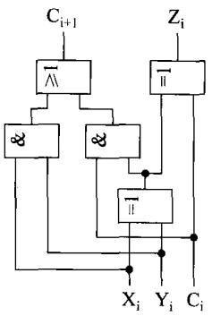  
(a)

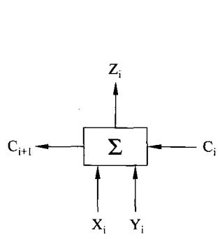  
图3-1一位全加器逻辑及其框图

根据图3-2，注意到如下几点。

① 在此加法器中，进位是逐位形成的。如图3-1所看到的那样，进位的产生是由三级门电路形成的，是需要花时间的。因为，任何一级门电路必定有延时。而图3-2所示的n位加法器中，高位运算必须等低运算的进位产生后方能进行。进位是由低到高逐位产生，一位接一位向高位传递。故这种加法器通常称为行波进位加法器。若一位全加器的进位延时为△t,则上述n位加法器的延时就是n△t。也就是说完成n位加法的时间需要n△t。应当明确，设计运算器(或CPU)所追求的最重要的指标之一是速度。显然，行波进位加法器的速度是难以令人满意的。

②在图3-2中，利用增加异或门和控制信号M；当M为0时，实现加法器的功能;当M为1时，可将操作数Y的各位取反并在 $\mathrm { C } _ { 0 }$ (最低位)上加上M(此时是1)，从而实现求补功能。然后再做加法——完成减法的功能。

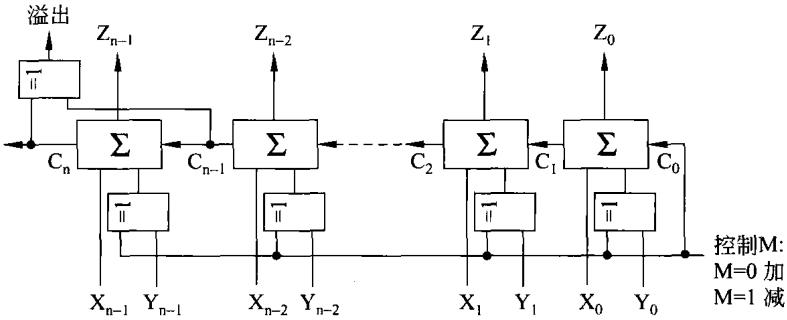  
图3-2行波进位的n位加法/减法器

③在图3-2中，利用异或门完成式(3-4)所示的溢出判别功能。该异或门的输人刚好是$\mathrm { C } _ { \mathfrak { n } ^ { - 1 } }$ 和 $\mathrm { C } _ { \mathfrak { n } }$

## （2）先行进位加法器

综上所述，行波进位加法器尽管简单，但其致命的缺点就在于当加法器的位数增加时，由于进位而造成的加法速度的降低使人不能忍受。是否有加快进位速度的方法呢？答案是肯定的。

首先,分析式(3-9)，其表示式为： $\mathrm { C } _ { \mathrm { i } + 1 } = \mathrm { G } _ { \mathrm { i } } + \mathrm { P } _ { \mathrm { i } } \cdot \mathrm { C } _ { \mathrm { i } }$ 。从式中可知，只要有输入 $\mathbf { X } _ { \mathrm { i } }$ 和 $\mathrm { Y _ { i } }$ 就能求出 $\mathrm { G } _ { \mathrm { i } }$ 和 $\mathrm { \bf P _ { i } }$ ,在已知输人 $\mathrm { C _ { i } }$ 的情况下，便可以获得 $\mathrm { C } _ { \mathrm { i } + 1 }$

那么，在有输人 $\Chi _ { \mathrm { i + 1 } } \setminus \Upsilon _ { \mathrm { r + 1 } }$ 和 $\mathrm { C } _ { \mathrm { i } + }$ 1的情况下，便可以获得 $\mathrm { C } _ { \mathrm { i } + 2 }$ 。以此类推,在输入存在的情况下，便可以求出 $\mathrm { C _ { i + 3 } , C _ { i + 4 } } \cdots$ 下面仅将4个进位的产生逻辑表示式写出。

$$
\mathrm { C } _ { \mathrm { i + 1 } } = \mathrm { G } _ { \mathrm { i } } + \mathrm { P } _ { \mathrm { i } } \mathrm { C } _ { \mathrm { i } }\tag{3-10}
$$

$$
\mathrm { C _ { i + 2 } } = \mathrm { G _ { i + 1 } } + \mathrm { P _ { i + 1 } } \mathrm { C _ { i + 1 } } = \mathrm { G _ { i + 1 } } + \mathrm { P _ { i + 1 } } \mathrm { G _ { i } } + \mathrm { P _ { i + 1 } } \mathrm { P _ { i } } \mathrm { C _ { i } }\tag{3-11}
$$

$$
\mathrm { C _ { i + 3 } = G _ { i + 2 } + P _ { i + 2 } C _ { i + 2 } = G _ { i + 2 } + P _ { i + 2 } G _ { i + 1 } + P _ { i + 2 } P _ { i + 1 } G _ { i } + P _ { i + 2 } P _ { i + 1 } P _ { i } C _ { i } }\tag{3-12}
$$

$$
\begin{array} { r l } & { \mathrm { C } _ { i + 4 } = \mathrm { G } _ { \mathrm { i } + 3 } + \mathrm { P } _ { \mathrm { i } + 3 } \mathrm { C } _ { \mathrm { i } + 3 } = \mathrm { G } _ { \mathrm { i } + 3 } + \mathrm { P } _ { \mathrm { i } + 3 } \mathrm { G } _ { \mathrm { i } + 2 } + \mathrm { P } _ { \mathrm { i } + 3 } \mathrm { P } _ { \mathrm { i } + 2 } \mathrm { G } _ { \mathrm { i } + 1 } + \mathrm { P } _ { \mathrm { i } + 3 } \mathrm { P } _ { \mathrm { i } + 2 } \mathrm { P } _ { \mathrm { i } + 1 } \mathrm { G } _ { \mathrm { i } } } \\ & { \qquad + \mathrm { P } _ { \mathrm { i } + 3 } \mathrm { P } _ { \mathrm { i } + 2 } \mathrm { P } _ { \mathrm { i } + 1 } \mathrm { P } _ { \mathrm { i } } \mathrm { C } _ { \mathrm { i } } = \mathrm { G } _ { \mathrm { i } + 3 } ^ { \ast } + \mathrm { P } _ { \mathrm { i } + 3 } ^ { \ast } \mathrm { C } _ { \mathrm { i } } } \end{array}\tag{3-13}
$$

式(3-13)中，

$$
\begin{array} { r l } & { \mathrm { G } _ { \mathrm { { i } } } ^ { \ast } = \mathrm { G } _ { \mathrm { { i } } + 3 } + \mathrm { P } _ { \mathrm { { i } } + 3 } \mathrm { G } _ { \mathrm { { i } } + 2 } + \mathrm { P } _ { \mathrm { { i } } + 3 } \mathrm { P } _ { \mathrm { { i } } + 2 } \mathrm { G } _ { \mathrm { { i } } + 1 } + \mathrm { P } _ { \mathrm { { i } } + 3 } \mathrm { P } _ { \mathrm { { i } } + 2 } \mathrm { P } _ { \mathrm { { i } } + 1 } \mathrm { G } _ { \mathrm { { i } } } } \\ & { \mathrm { P } _ { \mathrm { { i } } } ^ { \ast } = \mathrm { P } _ { \mathrm { { i } } + 3 } \mathrm { P } _ { \mathrm { { i } } + 2 } \mathrm { P } _ { \mathrm { { i } } + 1 } \mathrm { P } _ { \mathrm { { i } } \circ } } \end{array}
$$

由上面的逻辑表达式(3-10)到式(3-13)可以看到，利用输入信号 $\mathrm { X _ { i } \setminus X _ { i + 1 } \setminus X _ { i + 2 } \setminus X _ { i + 3 } }$ 和$\mathrm { Y _ { i } \setminus Y _ { i + 1 } \setminus Y _ { i + 2 } \setminus Y _ { i + 3 } }$ 以及 $\mathrm { C _ { i } }$ ，通过与或逻辑电路的组合就可以同时将上面4个信号产生出来。然后，将这些先行形成的进位信号并行地加到加法器上，则加法器就不必等待进位产生，从而大大地提高了加法器的速度。也就是说在进行加法运算之前，各位加法器所需要的进位都已经产生出来。这将加快加法运算的速度，这就是先行进位的由来。

根据上面的分析，具体用与或组合逻辑构成的4位先行进位产生电路如图3-3所示。

由图3-3的逻辑图可以看到，图3-3的下方是输入信号 $\mathrm { X } _ { \mathrm { i } } \ 、 \mathrm { X } _ { \mathrm { i + 1 } } \ 、 \mathrm { X } _ { \mathrm { i + 2 } } \ 、 \mathrm { X } _ { \mathrm { i + 3 } }$ 和 $\mathrm { Y } _ { \mathrm { i } } , \mathrm { Y } _ { \mathrm { i } \cdot + 1 }$ 1$\mathrm { Y } _ { \mathrm { i } + 2 } \mathrm { , } \mathrm { Y } _ { \mathrm { i } + 3 }$ 以及 $\mathrm { C _ { i } }$ 。这些信号经过三级门电路便可以得到所有4位加法器所需要的进位信号 $\mathrm { C _ { i + 1 } \setminus C _ { i + 2 } \setminus C _ { i + 3 } \setminus C _ { i + 4 } }$ 。三级门电路的延时要比多级行波进位的延时小得多。

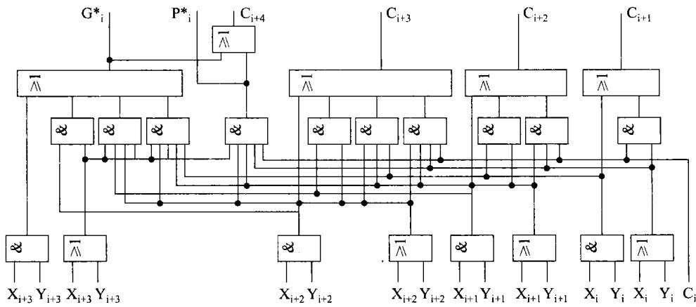  
图3-34位先行进位链电路

以上分析了4位先行进位的产生电路。显然，随着位数的增加，这种电路会越来越复杂。因此，在设计加法器时会将多位加法分组，例如以4位为一组。将各组串联在一起，即组内采用先行进位方式而组与组之间采用行波进位。这时还会用到前面已经出现的G和P信号。有关此问题的细节将在后面讨论。

## 5．BCD数加法器

## （1）8421BCD码

在第2章中已详细地介绍了BCD码。在所描述的几种BCD码中，计算机应用最广泛的是8421BCD码。8421BCD码只利用了4位二进制编码的0000至1001这10种来表示十进制数的0至9。剩余的6种：1010、1011、1100、1101、1110、1111对用于表示十进制数来说是非法的。一旦在定义的BCD运算中出现这6种编码，结果一定是错误的。

在使用BCD码时，若用一个字节(8位二进制数)表示两位BCD数，即高4位表示一位BCD数，低4位表示一位BCD数。则此字节所表示的数称为压缩BCD数；若一个字节只表示一位BCD数，即高4位全为0，只用低4位表示一位BCD数，则此字节所表示的数称为非压缩BCD数。

## （2）加法运算

8421BCD码加法运算也可以用多位全加器来实现，在运算过程中有可能产生上面提到的错误结果。为了说明这一问题，请看下面的举例。

## 【例3-8】a.计算压缩 BCD数46+32=？

b.计算压缩BCD数46+67=?

解：两题分别相加如下：

$$
{ \begin{array} { r l r l r l } { a \colon } & { } & & { \mathbf { b } \colon } & & { } \\ & { \begin{array} { r l r l } & { 0 1 0 0 0 1 1 0 } & { } & & { } \\ & { + } & { 0 0 1 1 \ 0 0 1 0 } \\ & { 0 1 1 1 \ 1 0 0 0 } \end{array} } } & & { \qquad } & { { \begin{array} { r l r l } & { \mathbf { b } \colon } & { } & { } \\ & { } & { 0 1 0 0 \ 0 1 1 0 } \\ & { } & { \qquad \quad + } & { 0 1 1 0 \ 0 1 1 1 } \\ & { } & { 1 0 1 0 \ 1 1 0 1 } \end{array} } } \end{array} 
$$

由该例可以看到，在a的情况下，两BCD数相加结果是正确的。在b的情况下，两BCD数相加结果是错误的。

## （3）校正

为了保证BCD数加法运算结果的正确，就必须进行校正。对于一个字节的压缩 BCD数加法进行校正的法则如下。

①运算中低4位相加的结果>9或有由bit[3]向bit[4]的进位，则结果加06H。

②运算中高4位相加(包括由bit[3]向bit[4]的进位)的结果>9或有由bit[7]向更高位的进位，则结果加60H，同时进位为1且应看做是相加结果的最高位。

③若高低4位均不满足上述条件，如例3-8中的a式，则在校正时加00H;若同时满足①②两项条件，则在校正时结果加66H。

以上讨论的是一个字节的压缩BCD数加法进行校正的法则。其他运算（减法、乘法、除法)同样需要校正，才能保证结果总是正确的。同样，非压缩BCD的运算也需要校正。

上面讨论的是8421BCD码的校正问题，而其他类型的 BCD码也同样会存在类似的问题。所有这一切此处不再说明。

在设计CPU的时候，会在其指令系统中设置一些BCD数的各种运算的校正指令，CPU执行指令时会检测上述法则，根据不同的状态在结果上加上应加的数值。

8421BCD加法器及其校正也可以用硬件实现，图3-4(a)所示的就是带有硬件校正电路的一位8421BCD加法器。图3-4(b)所示便是一位BCD加法器的框图。

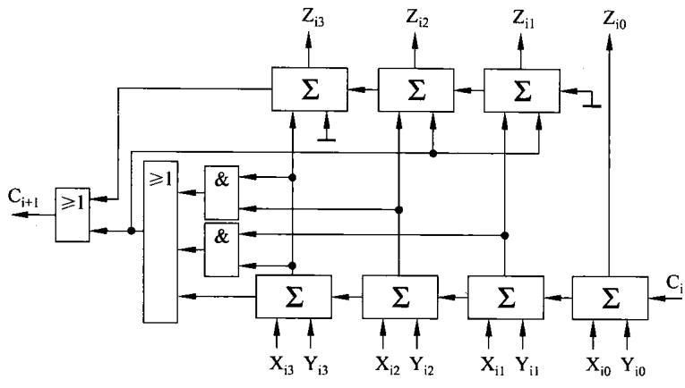  
(a)

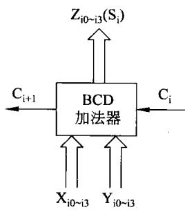  
(b)  
图3-4一位8421码BCD加法器

同样,将多个一位BCD加法器串联起来，构成多位行波进位的BCD加法器,其框图如图3-5所示。

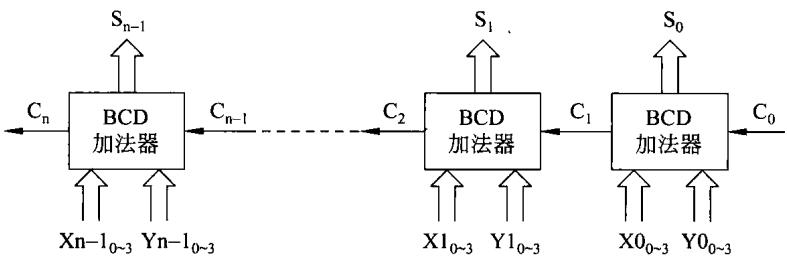  
图3-5n位行波进位BCD加法器的框图

有关其他类型BCD码运算器的硬件实现，这里不再说明。

## 6.移码加减运算

## （1）运算法则

关于移码的定义及其特点，在第2章中已经做了介绍。由于移码多用在浮点数中表示阶码，因此，在这里仅就定点整数移码的加减运算予以说明。

定点整数移码的加减运算的法则是：①对两移码数求和/差时，首先对这两移码求和/差；②然后，对结果进行修正—将结果的符号位取反。这样，就可以得到正确的结果。下面举例说明：

【例3-9】用8位二移码表示十进制数的57和一35,并且求移码的和与差。

解：十进制数的57和一35用移码表示如下。

$$
\begin{array} { l } { { [ 5 7 ] _ { \# } = 1 0 1 1 1 0 0 1 } } \\ { { [ - 3 5 ] _ { \# } = 0 1 0 1 1 1 0 1 } } \end{array}
$$

求两者之和：

①首先求[ ${ \scriptstyle 5 7 ] _ { \mathfrak { H } } } + [ - 3 5 ] _ { \mathfrak { H } } = 1 0 1 1 1 0 0 1 + 0 1 0 1 1 1 0 1 = 0 0 0 1 0 1 1 0 ,$

②再将符号位取反，从而得到 $[ 5 7 + ( - 3 5 ) ] _ { \mathfrak { H } } = 1 0 0 1 0 1 1 0 .$

求两者之差：

①首先求 $[ 5 7 ] _ { \mathfrak { R } } - [ - 3 5 ] _ { \mathfrak { R } } = [ 5 7 ] _ { \mathfrak { R } } + [ [ - 3 5 ] _ { \mathfrak { R } } ] _ { \mathfrak { R } } = 1 0 1 1 0 0 1 + 1 0 1 0 0 0 1 1 =$ 01011100;

② 再将符号位取反，从而得到 $[ 5 7 - ( - 3 5 ) ] _ { \mathfrak { W } } = 1 1 0 1 1 1 0 0$

（2）移码运算应注意的问题

① 对移码运算的结果需要加以修正，修正量为2"，即对结果的符号位取反后才是移码形式的正确结果。

② 移码表示中，0有唯一的编码为 $1 0 0 0 \ldots 0 0$

当出现000...00时（表示： $- 2 ^ { { \mathfrak { n } } } )$ ，属于浮点数下溢，下溢按机器零处理。

## 3.1.2乘法运算

在一些简单的计算机中，乘法运算可以完全用软件来实现。利用计算机所设置加法、移位等指令，编写一段程序完成两数相乘。这样做CPU的硬件结构简单，但实现乘法所用的时间很长，速度很慢。另一种情况是在ALU等硬件的基础上，再适当增加一些硬件构成乘法器。依据这种思路实现乘法，硬件要复杂一些，但速度也比较快。速度最快的是全部由硬件来实现的阵列乘法器。这种方法硬件就更加复杂。可见，可以用硬件来换取速度。前一种方法是软件设计问题，这里不再说明。本小节将讨论后面两种实现乘法的方法。

## 1．原码一位乘法运算

## （1）原码一位乘法的法则

假定被乘数X和乘数Y为用原码表示的纯小数（下面的讨论同样适合于纯整数），分别为：

$$
\begin{array} { l l } { { \ [ \mathbf { X } ] _ { \mathbb { R } } = \mathbf { X } _ { 0 } . ~ \mathbf { X } _ { - 1 } \mathbf { X } _ { - 2 } \dots \mathbf { X } _ { - ( { \mathfrak { n } } - 1 ) } } } \\ { { \ [ \mathbf { Y } ] _ { \mathbb { R } } = \mathbf { Y } _ { 0 } . ~ \mathbf { Y } _ { - 1 } \mathbf { Y } _ { - 2 } \dots \mathbf { Y } _ { - ( { \mathfrak { n } } - 1 ) } } } \end{array}
$$

其中 ${ \bf X } _ { 0 } , { \bf Y } _ { 0 }$ 是它们的符号位。

同时，假定乘积为： $[ \mathsf { Z } ] _ { \mathbb { R } } = \mathsf { Z } _ { 0 } , \mathsf { Z } _ { - 1 } \mathsf { Z } _ { - 2 } \cdots \mathsf { Z } _ { - ( 2 { \mathsf { n } } - 1 ) }$

原码一位乘法的法则如下。

①乘积的符号为被乘数的符号位与乘数的符号位相异或。

②乘积的绝对值为被乘数的绝对值与乘数的绝对值之积。即

$$
\left[ \mathbf { X } \right] _ { \mathbb { R } } \times \left[ \mathbf { Y } \right] _ { \mathbb { R } } = ( \mathbf { X } _ { 0 } \oplus \mathbf { Y } _ { 0 } ) ( \mid \mathbf { X } \mid \times \mid \mathbf { Y } \mid )\tag{3-14}
$$

可见，原码一位乘法可以分别求出积的符号和两乘数绝对值之积，然后拼接在一起，构成乘积。

## （2）原码一位乘法的实现思路

①手工乘法运算

为了求得绝对值之积，先举例来讨论用手算的过程。

【例3-10】若 $[ \mathbf { X } ] _ { \mathbb { H } } = 0 . 1 1 0 1$

$[ \mathbf { Y } ] _ { \mathbb { B } } = 1 . 1 0 1 1$ ,求两者之积。

解：乘积的符号为 $0 \bigoplus 1 = 1$

手算过程如下：

在上面计算结果小数点左边加上乘积的符号1,即为两者原码积。

在上面的算式中，由于是手算，一次即可把经过左移的4个被乘数加起来，立即获得结果。但在CPU 中，由于其内部只有-个ALU,一次只能加一个经左移的(最低位时不左移)被乘数。要加4次才能获得结果。将每次相加的结果称为部分积。

另外，还需要强调的是在上面的手算过程中，根据乘数各位权值不同，每一次使被乘数左移一位加到部分积上。但在实际构成乘法器时，这样做比较麻烦。因此，可以采用被乘数

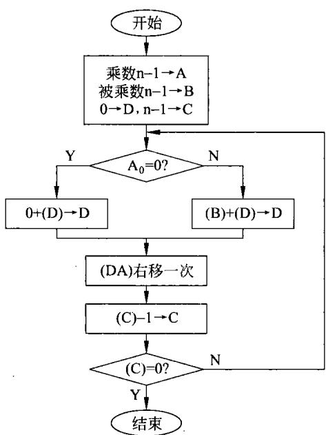  
图3-6绝对值乘法思路框图

位置不动而使部分积右移。这样做实现起来就更加容易。

## ②思路流程

根据上面的分析，可将求绝对值之积的思路‘描述为如图3-6所示。

设置一个寄存器D,开始置0,运算的中间过程放部分积，最后放结果。用一个寄存器A，开始放乘数，并与D连在一起在运算中间放部分积，最后放结果。从乘数的最低位开始，若为1，则加被乘数到部分积(D连A)。若为0，则部分积加0。部分积右移1位。再检测乘数的次低位，若为1，则加被乘数到部分积(D连A)。若为0,则部分积加0。部分积再右移1位。以此类推，直到乘数各位检测完毕。为了更加明确地描述这种思路，可用图3-6的思路流程图来说明。

## （3）原码一位乘法的具体过程

说明原码一位乘法的运算过程，现仍以

例3-10的数据举例。

【例 3-11】 $[ \mathbf { X } ] _ { \mathbb { H } } = 0 . 1 1 0 1 , [ \mathbf { Y } ] _ { \mathbb { H } } = 1 . 1 0 1 1$ ,求两者之积。

首先，利用被乘数与乘数的符号，求出乘积的符号为 $0 \not \in 1 1 = 1$

第二步求两乘数绝对值之积，求乘积的过程如图3-7所示。

第三步是将乘积的符号与绝对值之积拼接在一起，得到利用原码一位乘法法则所形成的乘积。

## （4）原码一位乘法器框图

根据以上对原码一位乘法的描述，可以相应地画出原码一位乘法器框图，如图3-8所示。

<table><tr><td rowspan=1 colspan=1></td><td rowspan=1 colspan=1>D</td><td rowspan=1 colspan=2>A</td><td rowspan=1 colspan=1>A</td><td rowspan=1 colspan=1>操作</td></tr><tr><td rowspan=1 colspan=1>0+0</td><td rowspan=1 colspan=1>0 00 01 1 0 1</td><td rowspan=1 colspan=1>1 0-</td><td rowspan=1 colspan=2>1 1</td><td rowspan=1 colspan=1>A=1,+X</td></tr><tr><td rowspan=1 colspan=1>00+0</td><td rowspan=1 colspan=1>1 1 0 10 1 1 01 1 0 1</td><td rowspan=1 colspan=1>111 1L  1</td><td rowspan=1 colspan=2>0 1</td><td rowspan=1 colspan=1>→右移一次A=1,+X</td></tr><tr><td rowspan=1 colspan=1>1</td><td rowspan=3 colspan=1>0 0 1 11 00 1000 0</td><td rowspan=3 colspan=1>1 11 1！11</td><td rowspan=3 colspan=2>10 11 0</td><td rowspan=3 colspan=1>→右移一次A0=0,+0</td></tr><tr><td rowspan=1 colspan=1>0</td></tr><tr><td rowspan=1 colspan=1>0</td></tr><tr><td rowspan=1 colspan=1>0</td><td rowspan=3 colspan=1>1 00 10 1 0 01 10 1</td><td rowspan=3 colspan=1>1 1i1 1</td><td rowspan=3 colspan=2>01111-</td><td rowspan=3 colspan=1>→右移一次A=1.+X</td></tr><tr><td rowspan=1 colspan=1>0</td></tr><tr><td rowspan=1 colspan=1>+0</td></tr><tr><td rowspan=1 colspan=1>10</td><td rowspan=1 colspan=1>0 0 0 11 00 0</td><td rowspan=1 colspan=1>1 11 1</td><td rowspan=1 colspan=2>1-i111</td><td rowspan=3 colspan=1>→右移一次1111</td></tr><tr><td rowspan=2 colspan=2>拼接符号后积为：1.</td><td rowspan=2 colspan=1>10</td><td></td><td></td></tr><tr><td rowspan=1 colspan=2>00</td></tr></table>

图 3-7例3-11的乘法过程

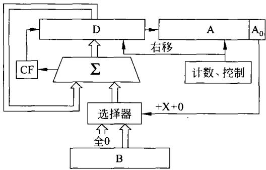  
图3-8原码一位乘法器框图

由图3-8可以看到，当进行乘法运算时，要将寄存器D清0，将被乘数放寄存器B,乘数放在寄存器A中。在运算过程中由寄存器A的最低位的状态控制是将0还是被乘数加到部分积上。每加一次，在计数和控制电路控制下，将D、A两寄存器连在一起右移一次，直到计数为0，便得到要计算的乘积。

## （5）原码二位乘法

在上述一位乘法中，每次只考虑一位乘数位，对于n位乘数(包括一位符号)，则需进行(n一1)次加法和右移。为了提高运算速度，可以一次考虑二位乘数位，每次右移两位。原码二位乘法的法则描述如下。

仍假定被乘数X和乘数Y为用原码表示的纯小数(下面的讨论同样适合于纯整数)，分别为：

$$
\begin{array} { l } { { [ \mathrm { X } ] _ { | \sharp | } = \mathrm { X } _ { 0 \cdot } \mathrm { X } _ { - 1 } \mathrm { X } _ { - 2 } \cdots \mathrm { X } _ { - ( { \mathfrak { n } } - 1 ) } } } \\ { { [ \mathrm { Y } ] _ { \sharp \sharp } = \mathrm { Y } _ { 0 \cdot } \mathrm { Y } _ { - 1 } \mathrm { Y } _ { - 2 } \cdots \mathrm { Y } _ { \cdot - ( { \mathfrak { n } } - 1 ) } } } \end{array}
$$

其中 ${ \mathrm { X } } _ { 0 } \setminus { \mathrm { Y } } _ { 0 }$ 是它们的符号位。

两位乘数位有4种组合：

$$
{ \begin{array} { r l r l } & { \mathbf { Y } _ { \mathrm { i + 1 } } , \mathbf { Y } _ { \mathrm { i } } = 0 0 } & & { \quad \mathbb { X } \mathbf { f } \mathbf { f } { \frac { \mathrm { M } } { \mathrm { M } } } + 0 } \\ & { \mathbf { Y } _ { \mathrm { i + 1 } } , \mathbf { Y } _ { \mathrm { i } } = 0 1 } & & { \quad \mathbb { X } \mathbf { f } \mathbf { f } { \frac { \mathrm { M } } { \mathrm { M } } } + | \mathbf { X } | } \\ & { \mathbf { Y } _ { \mathrm { i + 1 } } , \mathbf { Y } _ { \mathrm { i } } = 1 0 } & & { \quad \mathbb { X } \mathbf { f } \mathbf { f } { \frac { \mathrm { M } } { \mathrm { M } } } + 2 | \mathbf { X } | } \\ & { \mathbf { Y } _ { \mathrm { i + 1 } } , \mathbf { Y } _ { \mathrm { i } } = 1 1 } & & { \quad \mathbb { X } \mathbf { f } \mathbf { f } { \frac { \mathrm { M } } { \mathrm { M } } } + 3 | \mathbf { X } | } \end{array} }
$$

可以看到，每次考虑二位乘数位与一位乘法相比，多出 $\vec { \bf \ j } + 2 \left| \mathbf { X } \right| \vec { \pmb { \mathscr { H } } } + 3 \left| \mathbf { X } \right|$ 这两种情况。对于前者，只要将|X|左移一位就是2|X|，在机器内部实现起来很容易，一次即可完成。但是，十3|X|就需两次完成。如果两次操作才能完成 $+ 3 | \mathbf { X } |$ 运算势必要花更多的时间，这也就失去了二位乘法的意义。

解决问题的办法是：①由于二位乘法的运算过程中部分积每次右移两位，右移后十「XI相当于右移两位前 $+ 4 | \mathbf { X } |$ 。②在二位乘法的运算过程中，若遇到 $\mathbf { Y } _ { \mathrm { { i + 1 } } } , \mathbf { Y } _ { \mathrm { { i } } } = 1 1$ 时，可在部分积中减去|X|，并使一个触发器C=1。而后，部分积右移两次，若发现触发器C=1，则需在部分积上加|X|(相当右移前+4|X|)。而右移前已先减去|X|,与右移后加上|X|综合在一起，实现了 $4 | \mathbf { X } | - | \mathbf { X } | = 3 | \mathbf { X } |$ 的目的。

经上述分析，现将原码二位乘法的法则列于表3-2中。

表3-2原码二位乘法的法则表
<table><tr><td> $\mathbf { Y _ { i + 1 } }$ </td><td> $\mathbf { Y _ { 1 } }$ </td><td>C</td><td>操 作</td></tr><tr><td>0</td><td>0</td><td>0</td><td>+0，右移2次，C=0</td></tr><tr><td>0</td><td>0</td><td>1</td><td>+|X|，右移2次,C=0</td></tr><tr><td>0</td><td>1</td><td>0</td><td>+|X|，右移2次,C=0</td></tr><tr><td>0</td><td>1</td><td>1</td><td>+2|X|,右移2次,C=0</td></tr><tr><td>1</td><td>0</td><td>0</td><td>+2|X|,右移2次,C=0</td></tr><tr><td>1</td><td>0</td><td>1</td><td>-|X|,右移2次,C=1</td></tr><tr><td>1</td><td>1</td><td>0</td><td>-|X|,右移2次,C=1</td></tr><tr><td>1</td><td>1</td><td>1</td><td>+0，右移2次,C=1</td></tr></table>

为了说明原码二位乘法的运算过程，举例如下。

【例3-12】 设X=+0.100111,Y=一0.100111,利用原码求积。

解：写出 $[ \mathbf { X } ] _ { \mathbb { R } } = 0 . 1 0 0 1 1 1 , [ \mathbf { Y } ] _ { \mathbb { R } } = 1 . 1 0 0 1 1 1$ 。同时，需要注意尽管是绝对值乘，但在实现中是用加减来完成的。为了实现减法，在过程中需用补码做加法。由于一次右移两位，则需用三个符号位。具体过程如图3-9所示。

<table><tr><td colspan="2">符号位</td><td colspan="5">D</td><td colspan="4">A 操作</td></tr><tr><td>0</td><td>0 0</td><td>0 0 0</td><td>0 1</td><td>0 0</td><td>0 0</td><td>0 1 1</td><td colspan="2">0 0 1</td><td>11</td><td rowspan="2">C=0 -X</td></tr><tr><td>1 1</td><td>1</td><td>1 1 0</td><td>1 1</td><td>1</td><td>0 0</td><td>1</td><td colspan="2"></td><td></td></tr><tr><td>1</td><td></td><td>1 1</td><td>1</td><td>0</td><td>1</td><td>10</td><td>0</td><td>1 1</td><td>0 01</td><td rowspan="2">C-1 →右移二次 C=1,+2X</td></tr><tr><td>0</td><td>0</td><td>1 0</td><td>0</td><td>1</td><td>1</td><td>1 0</td><td></td><td></td></tr><tr><td>0</td><td>0</td><td>1</td><td>0 0</td><td>0</td><td>1</td><td>0</td><td>0 1</td><td rowspan="3">0</td><td>0 1</td><td rowspan="3">10</td><td rowspan="3">C-0 →右移二次 C=0+2X</td></tr><tr><td>0</td><td>0</td><td>0</td><td>0 1</td><td>0</td><td>0</td><td>0</td><td>0</td></tr><tr><td>0</td><td>0</td><td>1</td><td>0 0</td><td>1</td><td>1</td><td></td><td>0</td></tr><tr><td>0</td><td>0</td><td>1</td><td>0 1</td><td>1</td><td>1</td><td>1</td><td>1</td><td></td><td></td><td colspan="2"></td></tr><tr><td>0</td><td>00</td><td>0</td><td>1</td><td>0</td><td>1</td><td>1</td><td>1</td><td>11 0</td><td>0</td><td colspan="2">C=0 01 →右移二次</td></tr></table>

图 3-9例3-12的二位乘法的运算过程

乘积之符号=0+1=1

$$
[ \mathbf { X } \bullet \mathbf { \ Y } ] _ { \scriptscriptstyle \mathbb { H } } = 1 . 0 \ 1 \ 0 \ 1 \ 1 \ 1 \ 1 \ 0 \ 0 \ 0 \ 1
$$

乘积的符号位单独处理。而在运算过程中， $- | \mathbf { X } | = 1 1 1 . 0 1 1 0 0 1$

## 2．补码一位乘法运算

机器中经常采用补码的形式表示数据，这时用原码乘法进行乘法运算就很不方便。因此，不少计算机采取补码乘法器进行乘法运算。通常有两种常用的补码一位乘法的方法：校正法和布斯法。下面仅介绍布斯(Booth)法。

校正法实现补码一位乘法存在的问题在于乘法的最后需要根据乘数的符号位进行校正，显得不够方便。补码一位乘法的另一种运算方法是由布斯(Booth)夫妇首先提出，称为

布斯法。

## （1）算法法则

布斯法的运算法则描述如下。

假定被乘数X和乘数Y均为用补码表示的纯小数，分别为：

$$
\begin{array} { l } { { [ \mathrm { X } ] _ { * \mathrm { h } } = \mathrm { X } _ { \mathrm { 0 } \cdot } \mathrm { X } _ { - 1 } \mathrm { X } _ { - 2 } \cdots \mathrm { X } _ { - ( \mathrm { n } - 1 ) } } } \\ { { [ \mathrm { Y } ] _ { * \mathrm { h } } = \mathrm { Y } _ { \mathrm { 0 } \cdot } \mathrm { Y } _ { - 1 } \mathrm { Y } _ { - 2 } \cdots \mathrm { Y } _ { - ( \mathrm { n } - 1 ) } } } \end{array}
$$

其中， ${ \tt X } _ { 0 } \mathrm { , Y } _ { \tt S }$ 是它们的符号位。则布斯法补码一位乘法的算法公式为：

$$
\begin{array} { r l } & { [ \mathbf { X } \bullet \mathbf { Y } ] _ { \ast } = [ \mathbf { X } ] _ { \ast } [ ( \mathbf { Y } _ { - 1 } - \mathbf { Y } _ { 0 } ) 2 ^ { 0 } + ( \mathbf { Y } _ { - 2 } - \mathbf { Y } _ { - 1 } ) 2 ^ { - 1 } + ( \mathbf { Y } _ { - 3 } - \mathbf { Y } _ { - 2 } ) 2 ^ { - 2 } + \cdots } \\ & { \qquad + ( \mathbf { Y } _ { - ( \mathbf { n } - 1 ) } - \mathbf { Y } _ { - ( \mathbf { n } - 2 ) } ) 2 ^ { - ( \mathbf { n } - 2 ) } + ( 0 - \mathbf { Y } _ { - ( \mathbf { n } - 1 ) } ) 2 ^ { - ( \mathbf { n } - 1 ) } ] } \end{array}\tag{3-15}
$$

在这里同样是只给出结论，不做推导。由式(3-15)可以看到，两补码之积可用多项积之和来实现，而每一项中包含用补码表示的乘数相邻两位之差，即需要求出 $\mathrm { Y } _ { \mathrm { i } - 1 } - \mathrm { Y } _ { \mathrm { i } }$ 的值。同时，在最后一项中需要附加一个0。此种补码一位乘法方法中，被乘数和乘数连同它们的符号位一并参加运算。

乘数的相邻两位之差会有4种情况，再根据乘数位所对应的权值，从而导出运算过程中的4种操作如表3-3所示。

表3-3乘数的相邻两位的操作规律
<table><tr><td> $\mathbf { Y _ { i } }$ </td><td> $\bf { Y } _ { i - 1 }$ </td><td> $\bf Y _ { i - 1 } - \bf Y _ { i }$ </td><td>操作</td></tr><tr><td>0</td><td>0</td><td>0</td><td>十0,右移一次</td></tr><tr><td>0</td><td>1</td><td>1</td><td> $+ \left[ \mathbf { X } \right] _ { \ast \mathsf { h } }$  ,右移一次</td></tr><tr><td>1</td><td>0</td><td>-1</td><td> $+ [ - \mathbf { X } ] _ { * \mathrm { h } }$  ,右移一次</td></tr><tr><td>1</td><td>1</td><td>0</td><td>十0,右移一次</td></tr></table>

根据以上分析，布斯法的运算法则描述如下。

①乘数与被乘数均用补码表示，连同符号位一起参加运算。

②乘数最低位后增加一个附加位（可用 $\mathsf { A } _ { - 1 }$ 表示），初始设定为0。

③从附加位开始，依据表3-3所示的操作规律，完成式(3-15)的运算。

实现上述算法的布斯法补码一位乘法的思路框图如图3-10所示。

## （2）运算过程

为了说明布斯法补码一位乘法运算的法则，下面通过举例说明运算中运用法则的过程。

【例3-13】已知 $\mathrm { X } = 0 . \ 1 0 1 0 , \ \mathrm { Y } = - 0 . \ 1 1 0 1$ 利用布斯法补码一位乘法求积。

解：首先将两数用补码表示。

$[ \mathbf { X } ] _ { \ast } = 0 0 . 1 0 1 0 , [ \mathbf { Y } ] _ { \ast } = 1 1 . 0 0 1 1$ ，而 $[ - \mathbf { X } ] _ { * \mathbf { h } } =$ 11.0110。下面是布斯法求解的过程，如图3-11所示。

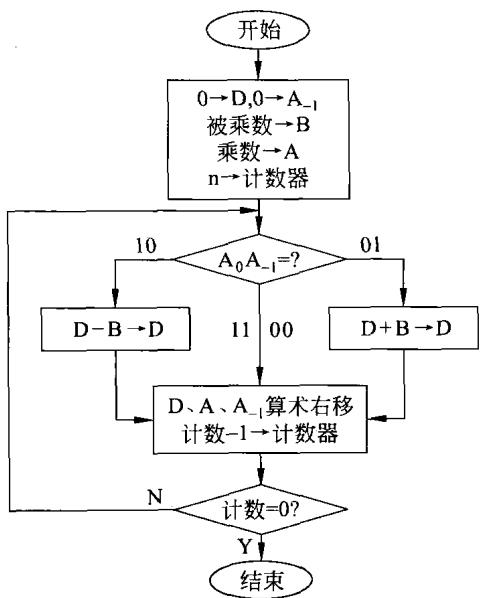  
图3-10布斯法补码一位乘法流程图

<table><tr><td colspan="2">符号</td><td colspan="2"></td><td colspan="2">D</td><td colspan="2">A</td><td> $\mathbf { A } _ { - 1 }$ </td><td></td><td>操作</td></tr><tr><td>0</td><td>0</td><td>0</td><td>0</td><td>0</td><td colspan="2">0 1</td><td colspan="2">0 0 1</td><td>0</td><td colspan="2"></td></tr><tr><td>1</td><td>1</td><td>0</td><td>1</td><td>1</td><td colspan="2" rowspan="3">0</td><td rowspan="3">1 0 0</td><td rowspan="3"></td><td rowspan="3"></td><td rowspan="3"> $^ { + } [ - { \mathbf { X } } ] _ { \mathfrak { X } }$ </td><td rowspan="3">右移一位</td></tr><tr><td>1</td><td>1</td><td>0</td><td>1</td><td>1 0</td></tr><tr><td>1</td><td>1</td><td>1</td><td>0 1</td><td>1 0</td></tr><tr><td>0</td><td>0</td><td>0</td><td>0</td><td>0</td><td>0 1</td><td rowspan="2"></td><td rowspan="2"></td><td rowspan="2"></td><td rowspan="2">1 1</td><td rowspan="2"></td><td rowspan="2">+0</td></tr><tr><td>1</td><td>1</td><td>1</td><td>0</td><td>1</td></tr><tr><td>1</td><td>1</td><td>1</td><td>1</td><td>0</td><td>1 0</td><td colspan="2">1 0</td><td>1 0</td><td>0</td><td>1</td><td>右移一位 +[X]</td></tr><tr><td>0</td><td>0</td><td>1 0</td><td>0</td><td>1</td><td>1</td><td rowspan="2">1 1</td><td rowspan="2"></td><td rowspan="2"></td><td rowspan="2"></td><td rowspan="2"></td><td rowspan="2">右移一位</td></tr><tr><td>0 0</td><td>0</td><td>0</td><td>1 0</td><td>1</td></tr><tr><td></td><td>0</td><td></td><td></td><td>1</td><td>1 0</td><td rowspan="2"></td><td rowspan="2">0</td><td rowspan="2">1 0</td><td rowspan="2">0</td><td rowspan="2">+0</td></tr><tr><td>0</td><td>0</td><td>0</td><td>0</td><td>0</td><td></td></tr><tr><td>0</td><td>0</td><td>0</td><td>0</td><td>1</td><td>1 1</td><td rowspan="2">1</td><td rowspan="2"></td><td rowspan="2">0</td><td rowspan="2">1 0 1</td><td rowspan="2">右移一位</td></tr><tr><td>0</td><td>0</td><td>0</td><td>0</td><td>0</td><td>1 1</td></tr><tr><td>1</td><td>1</td><td>0</td><td>1</td><td>1</td><td>0</td><td rowspan="2"></td><td rowspan="2"></td><td></td><td></td><td rowspan="2"> $^ { + } [ - X ] _  \tilde { \ast } \{ $ </td></tr><tr><td>1</td><td></td><td>0</td><td>1</td><td></td><td></td><td></td></tr><tr><td></td><td>1</td><td></td><td></td><td>1</td><td>1 1</td><td rowspan="2">1 1</td><td rowspan="2">1</td><td rowspan="2"></td><td rowspan="2">0</td><td rowspan="2">右移一位</td></tr><tr><td>1</td><td>1</td><td>1</td><td>0</td><td>1</td></tr></table>

图3-11例3-13 的布斯法补码一位乘法过程

$$
[ \mathbf { X } \cdot \mathbf { Y } ] _ { \mathfrak { X } } = 1 . 0 1 1 1 1 1 0
$$

从上述过程可以看到，两补码乘法运算是连同它们的符号位放在一起进行运算的。经过最后一次右移,所要求得的乘积，包括符号位在内就在DA 连在一起的寄存器中。

## (3）补码一位乘法器(布斯法)框图

根据以上对布斯法补码一位乘法的描述，可以相应的画出乘法器框图，如图3-12所示。

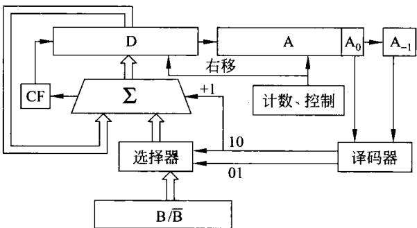  
图 3-12补码一位乘法器(布斯法)框图

由图3-12可以看到，运算开始前被乘数放在B中（被乘数还可以对各位取反为 $\overline { { \mathtt { B } } } )$ ，乘数放A中,附加位 $\mathsf { A } _ { - 1 }$ 和寄存器D中放0。

运算中根据 $\mathbf { A } _ { 0 }$ 和 $\mathbf { A } _ { - 1 }$ 的状态决定十0(不加）、 $+ [ \mathbf { X } ] _ { * \mathbb { N } }$ 还是 $+ [ - \mathbf { X } ] _ { * \mathbf { h } }$ 。对于 $[ - \mathbf { X } ] _ { \ast \mathrm { h } }$ ，就可以如图3-12所示，通过被乘数各位取反为B再加1来获得。

## （4）补码二位乘法

为了提高速度，补码也可以采用二位乘。根据前面补码一位乘法的法则，运算过程中将对 $\mathbf { Y } _ { \mathrm { i } }$ 与 $\mathrm { Y } _ { \mathrm { i } - 1 }$ 的状态比较。而二位乘法是将 $\mathrm { Y } _ { \mathrm { i } }$ 与 $\mathrm { Y } _ { \mathrm { i } - 1 }$ 的状态比较和 $\mathrm { Y } _ { \mathrm { i } \cdots 1 }$ 与 $\mathbf { Y } _ { \mathrm { i } - 2 }$ 的状态比较合在一起进行。由于乘数各位权值不一样，将一位乘法的两步合成一步：

$$
2 ( \mathbf { Y } _ { i - 1 } - \mathbf { Y } _ { i } ) + ( \mathbf { Y } _ { i - 2 } - \mathbf { Y } _ { i - 1 } ) = \mathbf { Y } _ { i - 1 } + \mathbf { Y } _ { i - 2 } - 2 \mathbf { Y _ { i } }\tag{3-16}
$$

根据式(3-16)，可以得出补码二位乘法的运算规律，如表3-4所示。

表3-4补码二位乘法的运算规律
<table><tr><td> $\mathbf { Y _ { i } }$ </td><td> $\mathbf { Y _ { i - 1 } }$ </td><td> $\mathbf { Y } _ { \mathfrak { i } - 2 }$ </td><td> $\mathrm { Y _ { i - 1 } } + \mathrm { Y _ { i - 2 } } - 2 \mathrm { Y _ { i } }$ </td><td>操 作</td></tr><tr><td>0</td><td>0</td><td>0</td><td>0</td><td>十0,右移2位</td></tr><tr><td>0</td><td>0</td><td>1</td><td>1</td><td> $+ [ \mathbf { X } ] _ { \mathfrak { X } }$  ,右移2位</td></tr><tr><td>0</td><td>1</td><td>0</td><td>1</td><td> $+ [ \mathbf { X } ] _ { \ast \mathrm { h } }$  ,右移2位</td></tr><tr><td>0</td><td>1</td><td>1</td><td>2</td><td> $+ 2 [ \mathbf { X } ] _ { \ast \mathbf { h } }$  ,右移2位</td></tr><tr><td>1</td><td>0</td><td>0</td><td>12</td><td> $+ 2 [ - \mathbf { X } ] _ { * \mathbb { N } }$  ，右移2位</td></tr><tr><td>1</td><td>0</td><td>1</td><td>11</td><td> $+ [ - \mathbf { X } ] _ { 4 1 }$  ,右移2位</td></tr><tr><td>1</td><td>1</td><td>0</td><td>-1</td><td> $+ [ - \mathbf { X } ] _ { * \mathrm { h } }$  ，右移2位</td></tr><tr><td>1</td><td>1</td><td>1</td><td>0</td><td>十0,右移2位</td></tr></table>

由上述分析可以得出补码二位乘法的法则如下。

①乘数与被乘数均用补码表示，连同符号位一起参加运算。

②乘数最低位后增加一个附加位（可用 $\mathrm { A } _ { - 1 }$ 表示），初始设定为0。

③从附加位开始，依据表3-4所示的操作规律，一次检测相邻3位决定具体的操作，并每次乘数右移2位。

④当乘数(包括符号位)为偶数n时，右移2位的次数为 $\mathtt { n } / 2$ 次，最后一次只右移1位。当乘数(包括符号位)为奇数n时，可在乘数最后一位之后添加一个0，使乘数变为偶数n十1，右移次数为 $( { \mathfrak { n } } + 1 ) / 2$ ，且最后一次只右移1位;此时，也可以将乘数增加一个符号位，使乘数变为偶数n十1，右移次数为 $[ ( { \bf n } + 1 ) / 2 - 1 ]$ 0

## 3.阵列乘法器

## （1）手算及单元电路

在上述乘法运算中，是通过简单的硬件进行多次加法和多次移位来实现乘法。显然，这将难以获得高的运算速度。为了提高运算速度，可以采取类似人工手算的方法。为说明问题，这里列出手算式如下。

设 $\mathrm { X } { = } \mathrm { X } _ { 3 } \mathrm { X } _ { 2 } \mathrm { X } _ { 1 } \mathrm { X } _ { \circ } \mathrm { , Y } { = } \mathrm { Y } _ { 3 } \mathrm { Y } _ { 2 } \mathrm { Y } _ { 1 } \mathrm { Y } _ { \circ }$ ，计算 $\mathbf { \nabla } \mathrm { X } \cdot \mathbf { \nabla } \mathbf { Y } = ? \mathrm { \Gamma }$ 列式如下：

$$
\begin{array} { r } { \frac { \mathrm { X } _ { 3 } \mathrm { ~ } \mathrm { ~ } \mathrm { ~ } \mathrm { ~ } \mathrm { ~ } \mathrm { ~ } \mathrm { ~ } \mathrm { ~ } \mathrm { ~ } \mathrm { ~ } \mathrm { ~ } \mathrm { ~ } \mathrm { ~ } \mathrm { ~ } \mathrm { ~ } \mathrm { ~ } \mathrm { ~ } \mathrm { ~ } \mathrm { ~ } \mathrm { ~ } \mathrm { ~ } \mathrm { ~ } \mathrm { ~ } \mathrm { ~ } \mathrm { ~ } \mathrm { ~ } \mathrm { ~ } \mathrm { ~ } \mathrm { ~ } \mathrm { ~ } \mathrm { ~ } \mathrm { ~ } \mathrm { ~ } \mathrm { ~ } \mathrm { ~ } \mathrm { ~ } \mathrm { ~ } \mathrm { ~ } \mathrm { ~ } \mathrm { ~ } \mathrm { ~ } \mathrm { ~ } \mathrm { ~ } \mathrm { ~ } \mathrm { ~ } \mathrm { ~ } \mathrm { ~ } \mathrm { ~ } \mathrm { ~ } \mathrm { ~ } \mathrm { ~ } \mathrm { ~ } \mathrm { ~ } \mathrm { ~ } \mathrm { ~ } \mathrm { ~ } } } \\  \times \mathrm { ~ } \mathrm { ~ } \mathrm { ~ } \mathrm { ~ } \mathrm { ~ } \mathrm { ~ } \mathrm { ~ } \mathrm { ~ } \mathrm { ~ } \mathrm { ~ } \mathrm { ~ } \mathrm { ~ } \mathrm { ~ } \mathrm { ~ } \mathrm { ~ } \mathrm { ~ } \mathrm { ~ } \mathrm { ~ } \mathrm { ~ } \mathrm { ~ } \mathrm { ~ } \mathrm { ~ } \mathrm { ~ } \mathrm { ~ } \mathrm { ~ } \mathrm { ~ } \mathrm { ~ } \mathrm { ~ } \mathrm { ~ } \mathrm { ~ } \mathrm { ~ } \mathrm { ~ } \mathrm { ~ } \mathrm { ~ } \mathrm { ~ } \mathrm { ~ } \mathrm { ~ } \mathrm { ~ } \mathrm { ~ } \mathrm { ~ } \mathrm { ~ } \mathrm { ~ } \mathrm { ~ } \mathrm { ~ } \mathrm { ~ } \mathrm { ~ } \mathrm { ~ } \mathrm { ~ } \mathrm { ~ } \mathrm { ~ } \mathrm { ~ } \mathrm { ~ } \mathrm { ~ } \mathrm { ~ } \mathrm { ~ } \mathrm { ~ } \mathrm { ~ } \mathrm { ~ } \mathrm { ~ } \mathrm { ~ } \mathrm { ~ } \mathrm { ~ } \mathrm { ~ } \mathrm { ~ } \mathrm { ~ } \mathrm { ~ } \mathrm { ~ } \end{array}
$$

从上式中可以看到，其中 X $\mathrm { Y _ { i } }$ 是与运算，而结果 $Z _ { \mathrm { i } }$ 则是与的结果求和。每一个相与求和操作可以用一个如图3-13所示的称为基本乘加单元的电路来实现。

为了求得某一位乘积，基本乘加单元需对本单元上的XiY;进行与运算，再加上上一单元给出的部分积，将相加的结果作为部分积加到下一单元，而将进位传至其前面的单元。

## (2）绝对值(无符号数)阵列乘法器

利用上面的手算式的结构及乘加单元电路可以方便地实现绝对值(无符号数)阵列乘法器，这种阵列乘法器的结构框图如图3-14所示。 部分积 X

在图3-14中，每一个小框即为一个基本的乘加单元，这些基本单元按照图上所示的方式连接，结构上非常类似手算算式的结构，能够完成上面手算算式中的那些乘加功能，获得两数的乘积。

## （3）带符号数的阵列乘法器

在绝对值阵列乘法器的基础上，很容易实现带符号数的阵列乘法器，其基本思路是先求被乘数与乘数的绝对值，然后进行绝对值乘法，最后再根据被乘数与乘数的符号，决定最后乘积的符号。

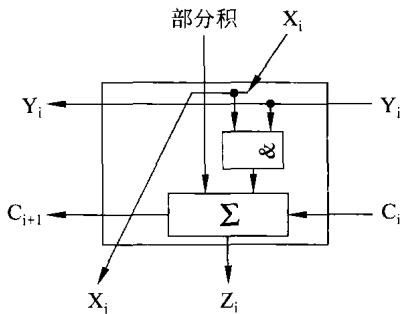  
图3-13基本乘加单元框图

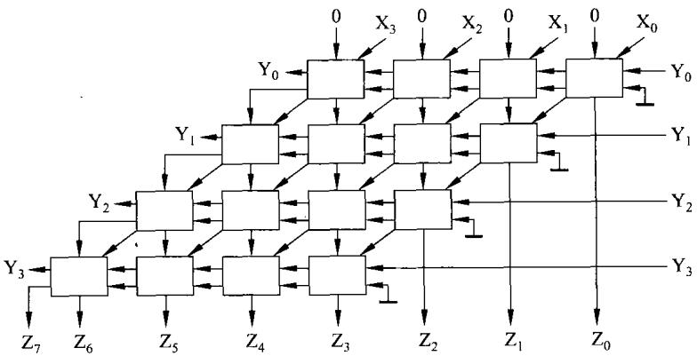  
图3-14定点无符号数阵列乘法器

为了说明带符号数的阵列乘法器，将一个简单求补电路画在图3-15上。

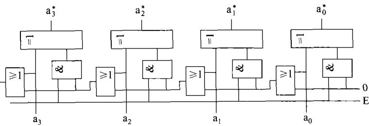  
图3-15求补电路

由图3-15可以看到，当控制端E为低电平时，输出与输入相同；当E=1时,实现求补。可见，只要用带符号数的符号位加到控制端E上，即可求得该符号数的绝对值。

框图3-16表示，在进行带符号数乘法之前，先将被乘数和乘数求绝对值（也就是对负数求补)，再进行绝对值阵列乘，最后要利用被乘数和乘数的符号位，对绝对值乘积求补。这样，便可获得正确的结果。

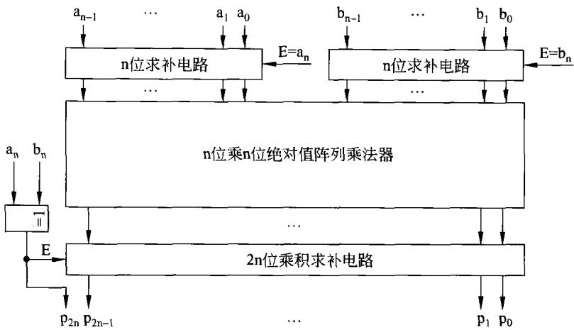  
图3-16n十1位带符号数阵列乘法器框图

## 3.1.3除法运算

定点除法运算同样可用原码实现也可以用补码实现。在实现除法过程中，应注意除数不能为0，而且还要保证相除所得的商是可以表示的。

## 1．原码除法运算

（1）原码除法的法则

原码除法的法则应包括如下几点。

① 除数≠0。定点纯小数时，|被除数|<|除数|;定点纯整数时，|被除数|>|除数丨。

②与原码乘法类似的是原码除法商的符号和商的值也是分别处理的，商的符号等于被除数的符号与除数的符号相异或。

③商的值就等于被除数的绝对值除以除数的绝对值。

④最后将商的符号与商的值拼接在一起就得到原码除法的商。

下面先以手算绝对值除法为例，观察除法的过程,从而导出原码除法的运算方法。

【例3-14】设 $\mathbf { X } { = } 0 . 1 0 1 1 , \mathbf { Y } { = } 0 . 1 1 0 1$ ，求 $\mathbf { \Delta } \mathbf { X } \div \mathbf { Y } = ?$

解：由题意可知，假定被除数X和除数Y均为正数。商的符号也为正。

两数绝对值除法的手算过程如下。

在上述手算过程中，需注意如下几点。

①除法是通过逐次减除数来实现的，也就是被除数(或是余数)每次减去右移一次后的除数，然后决定上商。但在实际构成除法器时，采用的是保持除数的位置不动，而每次余数左移一次。

②在手工运算过程中，是通过人的眼晴和大脑来判断余数是否够减除数（不需要减过之后进行判断)，以决定商上0还是上1。而在CPU中，则必须减过之后方能判断余数是否够减，当发现不够减时，余数已经减掉了除数。因此，在下次操作之前必须恢复余数。这就有下面要介绍的恢复余数法。

$$
\begin{array}{c} \begin{array} { r } { \begin{array} { c c } { 0 . 1 1 0 1 } \\ { 1 1 0 1 } \end{array} \qquad \begin{array} { c c } { 1 0 1 1 0 1 } \\ { 1 0 1 1 0 } \\ { \cdot } \\ { \cdot } \\ { \frac { 1 1 0 1 1 } { 1 0 0 1 0 } } \end{array} } & { \qquad \mathrm { X } / \mathrm { Y } = 0 . 1 1 0 1 } \\ { \frac { 1 1 0 1 } { \sin { \mathrm { ~ 0 ~ 1 ~ 0 ~ 1 ~ } } } \qquad \end{array} . } \end{array}
$$

## （2）恢复余数法

如上所述，利用恢复余数法实现原码除法遵从前面提到的法则。对于定点纯小数，其过程是符号位单独处理。被除数左移一位，减除数，若够减，上商为1；若不够减，上商为0,同时加除数一一恢复余数。余数左移一位,减除数，若够减，上商为1;若不够减，上商为0，同时加除数—一恢复余数。重复上面的过程直到除尽或精度达到要求。最后，拼接商符得到商，即可获得除法的结果。下面举例说明恢复余数法做除法的过程。

【例3-15】若被除数 $\mathrm { X } = - 0 . 1 0 0 0 1 0 1 1$ ，除数 $\mathrm { Y } = 0 . 1 1 1 0$ 试利用原码恢复余数法求商及余数。

解：该例满足 $| \mathbf { X } | < | \mathbf { Y } |$ ，且 $| \mathrm { \Delta Y } | \ne 0$

写出 $[ \mathbf { X } ] _ { \scriptscriptstyle \mathbb { B } } = 1 . 1 0 0 0 1 0 1 1 , [ \mathbf { Y } ] _ { \scriptscriptstyle \mathbb { B } } = 0 . 1 1 1 0 ,$

商符 $= 1 \textcircled { + } \dot { 0 } = 1$ 。绝对值除法过程如图3-17所示。

<table><tr><td colspan="2">符号</td><td colspan="7">被除数(余数)</td><td>商</td><td></td><td>操作</td></tr><tr><td>0</td><td>0</td><td>1</td><td>0</td><td>0</td><td>0</td><td>1</td><td>0</td><td></td><td>1</td><td>1</td><td>0</td><td>左移一位</td></tr><tr><td>0</td><td>1</td><td>0 0</td><td>0 0</td><td>0 1</td><td>1 0</td><td></td><td>0</td><td>1</td><td>1</td><td>0</td><td></td><td></td></tr><tr><td>1 0</td><td>1 0</td><td>0</td><td>0</td><td>1</td><td>1</td><td></td><td>0</td><td>1</td><td>1</td><td>0</td><td>1</td><td>-|Y1 够减，商为1</td></tr><tr><td>0</td><td>0</td><td>0</td><td>1</td><td>1</td><td>0</td><td></td><td>1</td><td>1</td><td>0</td><td>1</td><td></td><td>左移一位</td></tr><tr><td>1</td><td>1</td><td>0</td><td>0</td><td>1</td><td>0</td><td></td><td></td><td></td><td></td><td></td><td></td><td>-|Y</td></tr><tr><td>1</td><td>1</td><td>1</td><td>0</td><td>0</td><td>0</td><td></td><td>1</td><td>1</td><td>0</td><td>1</td><td>0</td><td>不够减，商为0</td></tr><tr><td>0</td><td>0</td><td>1</td><td>1</td><td>1</td><td>0</td><td></td><td></td><td></td><td></td><td></td><td></td><td>+|Y</td></tr><tr><td>0</td><td>0</td><td>0</td><td>1</td><td>1</td><td>0</td><td></td><td>1</td><td>1</td><td>0</td><td>1</td><td>0</td><td>恢复余数</td></tr><tr><td>0</td><td>0</td><td>1</td><td>1</td><td>0</td><td>1</td><td></td><td>1</td><td>0</td><td>1</td><td>0</td><td></td><td>左移一位</td></tr><tr><td>1</td><td>1</td><td>0</td><td>0</td><td>1</td><td>0</td><td></td><td></td><td></td><td></td><td></td><td></td><td>-|Y|</td></tr><tr><td>1</td><td>1</td><td>1</td><td>1</td><td>1</td><td></td><td>1</td><td>1</td><td>0</td><td>1</td><td>0</td><td>0</td><td>不够减，商为0</td></tr><tr><td>0</td><td>0</td><td>1</td><td>1</td><td>1</td><td></td><td>0</td><td></td><td></td><td></td><td></td><td></td><td>+|Y1</td></tr><tr><td>0</td><td>0</td><td>1</td><td>1</td><td>0</td><td></td><td>1</td><td>1</td><td>0</td><td>1</td><td>0</td><td>0</td><td>恢复余数</td></tr><tr><td>0</td><td>1</td><td>1</td><td>0</td><td>1</td><td></td><td>1</td><td>0</td><td>1</td><td>0</td><td>0</td><td></td><td>左移一位 -|YI</td></tr><tr><td>1</td><td>1</td><td>0</td><td>0</td><td>1</td><td></td><td>0</td><td></td><td></td><td></td><td></td><td></td><td></td></tr><tr><td>0</td><td></td><td>1</td><td>1</td><td>0</td><td></td><td>√ 1</td><td>0</td><td>1</td><td>0</td><td>0</td><td>1</td><td>够减，商为1</td></tr></table>

图3-17例3-15 的恢复余数法过程

在除的过程中， $- \mid \mathrm { Y } \mid$ 是利用补码加法来实现的。所得的商为商符与绝对值除所得的结果拼接在一起，即商=1.1001;余数的符号与被除数一致，过程中所得余数为绝对值，需将被除数的符号加上去，余数 $= 1 . 1 1 0 1 \times 2 ^ { - 4 }$ □

恢复余数法做除法最大的缺点是不同的被除数和除数，其除的过程不规范，何时需恢复余数是不相同的，实现起来不便于控制。因此，恢复余数法在计算机中并不常用，而由此法可演变出另一种更方便的计算方法，这就是加减交替法。

（3）加减交替法

## ①加减交替法的运算法则

为了说明加减交替法的原理，再来回顾恢复余数法做除法。假定第i次余数减除数（用B表示)得的余数为R，当R<O 时，应恢复余数，即(R十B)。然后左移一次，即2(R十B)。接下来进行下一次(第i十1次)余数减除数，也就是 $2 ( \mathrm { R } + \mathrm { B } ) - \mathrm { B } = 2 \mathrm { R } + \mathrm { B }$

从上面的分析可以看到，若第i次余数减除数的余数R<0，这时不再加除数来恢复余数，而只是将其左移一次，变为2R，到下次，即第i十1次运算时将其加上除数，也就是2R十B即可。这就可以不再用加除数的方法来恢复余数，若发现哪次余数减除数不够减，只需在下次加上除数即可。加减交替法的运算法则描述如下。

a）若余数 $\mathrm { R } \geqslant 0$ ，则商上1,左移一次，减除数。

b）若余数 $\mathbf R { < } 0$ ，则商上0,左移一次，加除数。

②加减交替法的运算过程

下面通过具体的例子说明加减交替法的运算过程。

【例3-16】若 $\mathrm { X } { = } { - } 0 . 1 0 0 0 1 0 1 1 , \mathrm { Y } { = } 0 . 1 1 1 0$ 试利用原码加减交替法求商及余数。解：写出 $[ \mathbf { X } ] _ { \mathbb { B } } = 1 . 1 0 0 0 1 0 1 1 , [ \mathbf { Y } ] _ { \mathbb { B } } = 0 . 1 1 1 0$ 。商符 $= 1 \textcircled { + } 0 = 1$

绝对值除的过程如图3-18所示。

<table><tr><td colspan="2">符号</td><td colspan="6">被除数(余数)</td><td rowspan="2"></td><td rowspan="2">商</td><td colspan="2">操作</td></tr><tr><td>0</td><td>0</td><td>1</td><td>0</td><td>0</td><td>0 1</td><td>0</td><td>1</td><td>1</td><td>0</td></tr><tr><td>0</td><td>1</td><td>0</td><td>0</td><td>0</td><td>1</td><td>0</td><td>1</td><td>1</td><td>0</td><td></td><td>左移一位 -|Y</td></tr><tr><td>1</td><td>1</td><td>0</td><td>0</td><td>1</td><td>0</td><td></td><td></td><td></td><td></td><td></td><td></td></tr><tr><td>0</td><td>0</td><td>0</td><td>0</td><td>1</td><td>1</td><td>0</td><td>1</td><td>1</td><td>0</td><td>1</td><td>R≥0，商为1 左移一位</td></tr><tr><td>0</td><td>0</td><td>0</td><td>1</td><td>1</td><td>0</td><td>1</td><td>1</td><td>0</td><td>1</td><td></td><td>-|Y</td></tr><tr><td>1</td><td>1</td><td>0</td><td>0</td><td>1</td><td>0</td><td></td><td></td><td>0</td><td>1</td><td>0</td><td>R&lt;0，商为0</td></tr><tr><td>1 1</td><td>1 1</td><td>1 0</td><td>0 0</td><td>0 0</td><td>0 1</td><td>1 1 厂</td><td>1 0</td><td>1</td><td>0</td><td></td><td>左移一位</td></tr><tr><td>0</td><td>0</td><td>1</td><td>1</td><td>1</td><td>0</td><td></td><td></td><td></td><td></td><td></td><td>+|Y</td></tr><tr><td></td><td>1</td><td>1</td><td>1</td><td></td><td></td><td>1</td><td>0</td><td>1</td><td>0</td><td>0</td><td>R&lt;0.商为0</td></tr><tr><td>1 1</td><td>1</td><td>1</td><td>1</td><td>1</td><td>1</td><td>0</td><td>1</td><td>0</td><td>0</td><td></td><td>左移一位</td></tr><tr><td>0</td><td>0</td><td>1</td><td>1</td><td>1 1</td><td>1 0</td><td></td><td></td><td></td><td></td><td></td><td>+|Y</td></tr><tr><td>0</td><td>0</td><td>1</td><td>1</td><td>0</td><td>1</td><td>0</td><td>1</td><td>0</td><td>0</td><td>1</td><td>R≥0，商为1</td></tr></table>

图 3-18例3-16 的加减交替法过程

通过上面的运算过程，可以得到 $[ \mathrm { X } \div \mathrm { Y } ] _ { \mathrm { f f } } = 1 . \ 1 0 0 1$ ，余数 $= 1 . 1 1 0 1 \times 2 ^ { - 4 }$ 。显然，利用加减交替法所得的结果与恢复余数法是一致的。

## ③加减交替法除法器框图

如前所述，原码加减交替法做除法是符号与数值运算分别进行。下面图3-19给出了绝对值(或无符号数)除法的硬件框图。

利用图3-19所示的框图，将被除数(绝对值)放在D、A寄存器中，将除数放在B寄存器中。在进行加减交替做减法时，要用到补码加运算。实际上就是将除数取反加1再加到余数上。够减时符号为0;不够减时符号为1;符号取反即为商。由此，可大致了解加减交替法除法器的硬件构成。

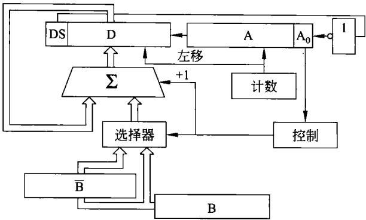  
图3-19加减交替法除法器框图

## 2.补码除法运算

与乘法运算的情况类似，有时也会遇到补码除法。

## （1）补码除法法则

同样，假定进行定点纯小数的补码除法运算，其先决条件是除数≠0，且被除数的绝对值<除数的绝对值。

补码除法的法则相对要复杂一些，现描述如下。

①首先，如果被除数与除数同号，被除数减除数;如果被除数与除数异号，被除数加除数。运算的结果均称为余数。

② 若余数与除数同号，上商为1,余数左移一次，下次用余数减除数操作求商；若余数与除数异号，上商为0，余数左移一次，下次用余数加除数操作求商。

③重复②直至除尽或达到精度要求。

④ 商修正。在除不尽时，通常可用商的最低位恒置1进行修正来保证精度。

## （2）补码除法的思路框图

补码除法的思路框图如图3-20所示。

由图3-20可以看到，该流程图很好地体现了前面提到的运算法则。从比较被除数及除数开始，利用加减交替的方法求得余数，通过余数与除数符号的比较来决定上商为0还是为1。

最后将末位置1进行商的修正。

## 3.阵列除法器

前面所提到的除法器都是在加法器的基础上，通过多次加减来实现除法，其运算速度必然受到限制。为了提高速度，可以利用硬件来完成除法运算。下面将介绍最简单的无符号数(绝对值)阵列除法器。

## （1）基本概念

在介绍阵列除法器之前，首先说明两个问题。

## ①补码运算的进位

在前面已提到，在无符号数做减法时，为了方便是用被减数加上减数的补码来实现的。

这就存在着当被减数小而减数大时，没有进位(或者说没有借位)；而当被减数大而减数小时，反而有进位(或者说有借位)。

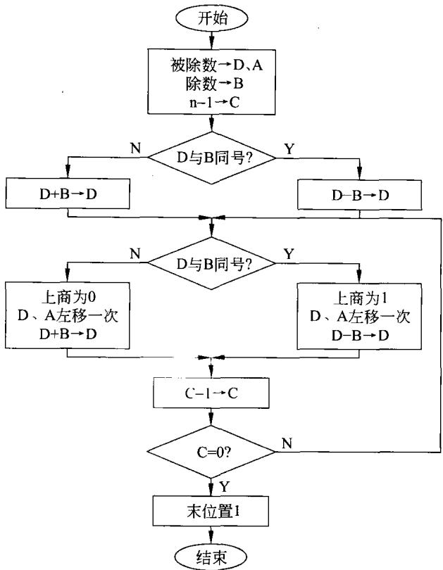  
图3-20补码除法流程框图

为了说明这种情况，下面举例。

【例3-17】无符号数65－32和32－65两者运算结果的进位情况。

解：无符号数65和32用8位二进制数表示，分别为：

$$
\begin{array} { c } { 6 5 = 0 1 0 0 0 0 0 1 } \\ { 3 2 = 0 0 1 0 0 0 0 0 } \end{array}
$$

在进行减法运算时，可用加补码的方法来实现，它们的补码为：

$$
\begin{array} { c } { { [ 6 5 ] _ { * \rrangle } = 1 0 1 1 1 1 1 1 } } \\ { { \lbrack 3 2 ] _ { * \rrangle } = 1 1 1 0 0 0 0 0 } } \end{array}
$$

当65－32及32－65分别列于下：

$$
\begin{array} { l l }   \begin{array} { l l }  { \begin{array} { l l } { { 0 } . 1 \ 0 \ 0 \ 0 \ 0 \ 0 \ 0 \ 1 } } \\  { + \frac { 1 } { \ 1 \ 1 \ 1 \ 0 \ 0 \ 0 \ 0 \ 0 } } \\   \begin{array} { l }   \begin{array} { l }   \begin{array} { l }   \begin{array} { l }   \begin{array} { l }  { \begin{array} { l } { { \begin{array} { l } { { \begin{array} { l } { 1 } \end{array} } } \end{array} } } } \\   \begin{array}   \begin{array} { l }  { \begin{array} { l } { \begin{array} { l } { { \begin{array} { l } { \begin{array} { l } { { \begin{array} { l } { 0 } \end{array} } } \end{array} } } \\ { { \begin{array} { l { \begin{array} { l } { 1 } \end{array} } { 0 } \ } \end{array} } 1 \ 1 \ 1 \ 1 \ 1 \ 1 \ 1 } } } } \\  { \begin{ { \begin{array} { l {array} { \begin{array} { l } { 1 } } { { \begin{ l } { 1 } \end{array} } { 1 } \end{array} } } \end{array} } 1 } } \\   \begin {array}  \begin{array} { l }  { \begin{array} { l } { } { \begin{array} { l } { { \begin{array} { l } { } { \end{array} } } \end{array} } \end{array} } } \\   \begin{array}  l {array}  \begin{array} { l }   \begin{array} { l } { } { \begin{array} { l } { { \begin{array} { l } { \begin{array} { l } { { \begin{array} { l } { \begin{ l } { \begin{array} { l } { \begin{array} { l } { \begin{ l } { \begin{array} { 1 } } \end{array} } { 0 } \end{array} } } \\ { 1 } \end{array} } \begin{array} { l } { 1 \ } \end{array} } \end{array} } } \end{array} } } \end{ \begin{array} {array} } } \\   \begin{array}  l  \begin{array} {array} { l }   \begin{array} { l }  \begin{array} { l }   \begin{array} { l }  \begin{array} { l }  \begin{ l }  \begin{array} { l }  \begin{array} { l } { \begin{ \begin{array} } { 1 } \end{array} } { 0 } \end \end{array} \end{array} \end{array} \end{array} \end{array} \end{array} \end{array} \end{array} \end{array} \end{array} \end{array} \end{array} \end{array} \end{array} \end{array} \end{array} \end{array} \end{array} \end{array} \end{array} \end{array} \end{array} \end{array} \end{array} \end{array} \end{array} \end{array} \end{array}
$$

从上面的运算中可以看到，够减时(没有借位)，进位为1;而不够减时进位为0。在不同的CPU中，这个标志的定义是不一样的，例如8086、MCS-51等没有借位进位标

志为0；有借位进位标志为1。而有的则刚好相反，如凌阳16位单片机、ARM处理器等。前者是在做减法时将进位取反后作为进位标志的。在后面的阵列除法器中将用够减时（没有借位），进位为1;而不够减时进位为0这一结论。

## ②可控加减单元CAS

可控加减单元如图3-21所示。

由图3-21可以看到，可控加减单元CAS主要由两部分硬件组成。

一是异或电路，在外部控制信号P的控制下，当$\mathtt { P } = 0$ 时，其输出为Y;当P=1时，其输出为Y（将输人Y取反）。在下面阵列除法器中，Y作为除数，若将其取反再加1，即可对其求补。

二是一个一位的全加器，实现输入Y、X及前级进位C的全加。

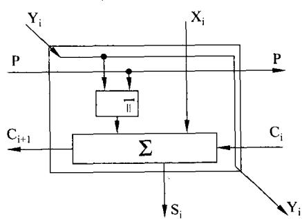

在可控加减单元中，信号Y和控制信号P还直接从本单元中输出加到下一级上。

图3-21可控加减单元CAS

## （2）无符号数阵列除法器

无符号数阵列除法器如图3-22所示。

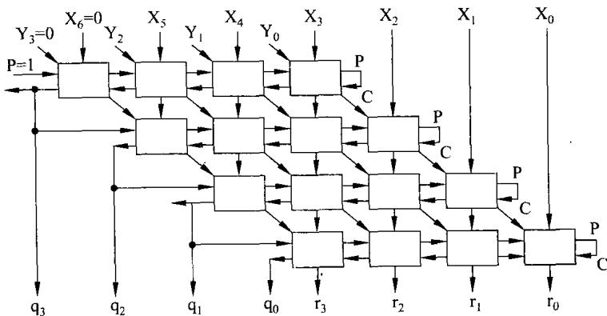  
图3-22由可控加减单元CAS构成的阵列除法器

由图3-22可以看到除法器的基本工作原理。该除法器的被除数加在 $\mathbf { X } _ { 6 } \sim \mathbf { X } _ { 0 }$ 上，并使${ \mathrm { X } } _ { 6 } = 0$ 以保证结果正确。除数加在 $\mathrm { Y } _ { 3 } \sim \mathrm { Y } _ { \circ }$ 上，且使 $\mathrm { Y } _ { 3 }$ 为0。

开始第一行的 $\mathrm { P } { = } 1$ ，保证将除数取反， $\mathrm { P } = 1$ 又加在第一行最后一个CAS的进位输人端，从而实现了对除数的求补。因此，阵列的第一行就实现了被除数减除数。若够减，则进位为1,商应为1。根据上面的分析，此进位即可为商，即 ${ \sf q } _ { 3 } = 1$ 。相反，若被除数减除数。不够减，则进位为0，商应为0，故 $\mathbf { q } _ { 3 } = 0$ 。

下面各行是除数右移一位(相当于余数左移一位)，再根据上次运算余数的正负，即够减，则进位为1(上商为1)—一本行P=1,做减法,余数减除数；若不够减，则进位为0（上商为0)——本行 $\mathbf P = 0$ ，做加法，余数加除数。加或减的结果进位即为商。各行完成加减交替法除法运算。

利用图3-22阵列除法器，得到商 $\mathbf { \equiv } = \mathbf { q } _ { 3 } \ \mathbf { q } _ { 2 } \ \mathbf { q } _ { 1 } \ \mathbf { q } _ { 0 }$ ;余数= ${ \pmb { \tau } } _ { 3 } { \pmb { \tau } } _ { 2 } { \pmb { \tau } } _ { 1 } { \pmb { \tau } } _ { 0 }$ 。最后提醒读者，若纯小

数运算，应满足 $\mathrm { { X } } { < } \mathrm { { Y } }$ 。

## 3.2算术逻辑单元

在本节中将简单介绍已开发出的算术逻辑单元电路,对于有关电路的设计将留最后一章再做介绍。

## 3.2.1单元电路

前面已经提到了全加器，用它再加上其他电路可以构成加法器、乘法器、除法器等算术运算部件。而与门、或门、异或门、反相器等组合在一起可以构成逻辑运算部件。作为一种单元电路这里不再说明。在此仅介绍其他有关电路。

## 1.寄存器

在计算机系统中或在构成CPU时，都会用到寄存器。前人已提供许多种类的寄存器。工程上经常用到的有集成D锁存器及带有三态输出的D锁存器。

## （1）8D锁存器

这种锁存器有多种型号，这里仅给出74LS273作为例子。

74LS273,它是由8个D触发器集成在一块芯片中构成。其引线及功能表分别如图3-23及表3-5所示。

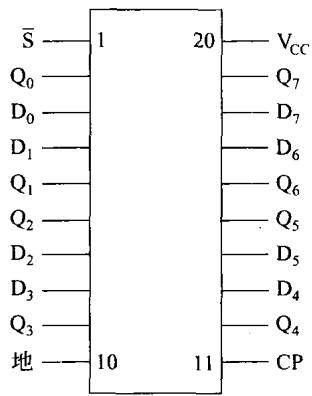  
图3-2374LS273锁存器引线

表3-574LS273功能表
<table><tr><td>s</td><td> $\mathbf { C P }$ </td><td> $\mathbf { D _ { X } }$ </td><td> $\mathbf { Q } _ { \mathbf { X } }$ </td></tr><tr><td>0</td><td>X</td><td>X</td><td>0</td></tr><tr><td>1</td><td>→</td><td>1</td><td>1</td></tr><tr><td>1</td><td>个</td><td>0</td><td>0</td></tr></table>

74LS273是将8个D触发器集成在一块芯片中，输入为 $\mathrm { D } _ { 0 } \sim \mathrm { D } _ { 7 }$ 而输出为 $\mathbf { Q } _ { 0 } \sim \mathbf { Q } _ { 7 }$ 。同时将8个D触发器的脉冲触发端在内部连在一起,外部上升沿触发端为CP。

由于该锁存器的输出是二态的，没有第三态，即(高阻)状态。因此，单独的锁存器只能作为输出接口。它不能单独作为输入接口，因为当它作为输入接口时，必然引起数据总线竞争。在使用时应特别注意。

## （2）带有三态门输出的锁存器

带有三态门输出的锁存器也有多种。在这里给读者介绍一种带有三态门输出的锁存器芯片74LS374，这也是经常使用的芯片，其引线图如图3-24所示。

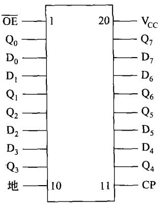  
图3-2474LS374的引线

表3-674LS374真值表
<table><tr><td> $\mathbf { D _ { X } }$ </td><td>CP</td><td>OE</td><td> $\mathbf { Q } _ { \mathbf { X } }$ </td></tr><tr><td>1</td><td>→</td><td>0</td><td>1</td></tr><tr><td>0</td><td>→</td><td>。</td><td>0</td></tr><tr><td>X</td><td>X</td><td>1</td><td>Z</td></tr></table>

由真值表3-6可以看到,74LS374与273的最重要的差别在于374的输出Q是经8个

三态门输出到芯片外部。这些三态门是由输出允许信号OE控制的，当 $\overline { { \mathrm { O E } } } = 0$ 时，三态门导通；而当 $\overline { { \mathrm { O E } } } = 1$ 时，三态门高阻。

由于374中既集成了锁存器又集成了三态门。因此，它既可以作为输出接口又可以作为输入接口使用。

## 2.移位寄存器

有多种型号的移位寄存器可供人们选用。图3-25所给出的是移位寄存器74198的引线。其功能表如表3-7所示。

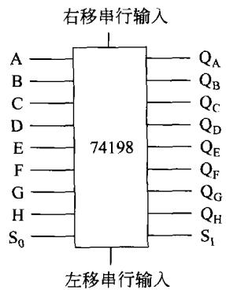  
图3-25移位寄存器74198引线

由表3-7可以看到，该移位寄存器可以并行输入并行

输出，也可以串行输入并行输出；既可以左移又可以右移；只要稍做工作它就可以实现移位及循环移位；它还可以作为寄存器使用。详细情况不再说明。

表3-7移位寄存器74198功能表
<table><tr><td colspan="7">输入</td><td colspan="4">输 出</td></tr><tr><td rowspan="2">清除</td><td colspan="2">模式</td><td rowspan="2">时钟</td><td colspan="2">串行</td><td>并行</td><td rowspan="2"> $\mathbf { Q _ { A } }$   $\mathbf { A } _ { \mathbf { B } }$ </td><td rowspan="2">：</td><td rowspan="2"> $\mathbf { Q _ { G } }$ </td><td rowspan="2"> $\mathbf { Q _ { \mathrm { { H } } } }$ </td></tr><tr><td> $\mathbf { s } _ { \mathbf { \imath } }$ </td><td> $\mathbf { S _ { 0 } }$ </td><td>左</td><td>右</td><td> $\mathbf { A } ^ { \bullet \bullet } \mathbf { H }$ </td></tr><tr><td>L</td><td>X</td><td>X</td><td>X</td><td>X</td><td>X</td><td>X</td><td> $\mathbf { L }$ </td><td> $\texttt { L }$ </td><td>：</td><td>L</td><td>L</td></tr><tr><td>H</td><td>X</td><td>X</td><td>L</td><td>X</td><td>X</td><td>X</td><td> $\mathbf { Q } _ { \mathbf { A } 0 }$ </td><td> $\mathbf { Q } _ { \mathrm { B 0 } }$ </td><td>：</td><td> $\mathbf { Q } _ { \mathrm { G 0 } }$ </td><td> $\mathbf { Q } _ { \mathrm { H 9 } }$ </td></tr><tr><td>H</td><td>H</td><td>H</td><td>→</td><td>X</td><td>X</td><td> $\mathbf { A } { \cdots } \mathbf { H }$ </td><td> $\mathbf { A }$ </td><td> $\mathbf { B }$ </td><td>：</td><td>G</td><td>H</td></tr><tr><td>H</td><td>L</td><td>H</td><td>→</td><td>X</td><td>H</td><td>X</td><td>H</td><td> $\mathbf { Q } _ { \mathsf { A } \mathsf { n } }$ </td><td>：</td><td> $\mathbf { Q } _ { \mathtt { F } _ { \mathtt { N } } }$ </td><td> $\mathbf { Q } _ { \mathrm { G n } }$ </td></tr><tr><td>H</td><td>L</td><td>H</td><td>→</td><td>X</td><td>L</td><td>X</td><td> $\texttt { L }$ </td><td> $\mathbf { Q } _ { \mathrm { A n } }$ </td><td>：</td><td> $\mathbf { Q } _ { \mathtt { F } \mathtt { n } }$ </td><td> $\mathbf { Q } _ { \mathtt { G n } }$ </td></tr><tr><td>H</td><td>H</td><td>L</td><td>→</td><td>H</td><td>X</td><td>X</td><td> $\mathbf { Q } _ { \mathrm { B n } }$ </td><td> $\mathtt { Q } _ { \mathtt { C } _ { \mathtt { N } } }$ </td><td>：</td><td> ${ \bf Q } _ { \mathrm { H n } }$ </td><td>H</td></tr><tr><td>H</td><td>H</td><td>L</td><td>→</td><td>L</td><td>X</td><td>X</td><td> $\mathbf { Q } _ { \mathrm { B } \mathrm { n } }$ </td><td> $\mathbf { Q } _ { \mathbb { C } _ { \mathtt { n } } }$ </td><td>：</td><td> $\mathbf { Q } _ { \mathrm { H n } }$ </td><td>L</td></tr><tr><td>H</td><td>L</td><td>L</td><td>X</td><td>X</td><td>X</td><td>X</td><td> $\mathbf { Q } _ { \mathsf { A } \mathsf { 0 } }$ </td><td> $\mathbf { Q } _ { \mathrm { B 0 } }$ </td><td>：</td><td> $\mathbf { Q } _ { \mathsf { G } \mathbb { 0 } }$ </td><td> $\mathbf { Q } _ { \mathrm { H 3 } }$ </td></tr></table>

## 3.2.2算术逻辑单元ALU

前人将算术运算、逻辑运算以至于移位功能结合到一起，研制出算术逻辑单元(ALU)集成电路。其中，中规模集成电路74181是一种4位的算术逻辑单元电路。

## 1.74181的引线

74181的引线如图3-26所示。74181有正逻辑工作的芯片，也有负逻辑工作的芯片，

图3-26所画的是工作在正逻辑的。74181的运算功能列于表3-8中。

由表3-8可以看到，74181有很多功能，在芯片上的控制信号的控制下，可实现各种算术运算和逻辑运算，这里不再做仔细说明。在此要强调的是74181内部已集成了在本章前面图3-3所示的先行进位电路，使74181的4位加法的延迟时间很小。同时，为了提高级联工作的速度，74181可以输出 $\mathrm { G } _ { \mathfrak { i } + \mathfrak { z } } ^ { * }$ 和 $\mathrm { P } _ { \mathrm { i } + 3 } ^ { \ast }$ ，即芯片上的G和P。

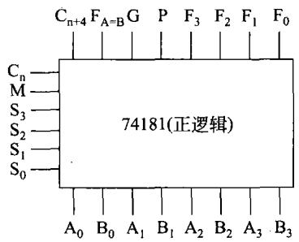  
图3-264位ALU74181引线

表3-874181的运算功能
<table><tr><td>操作选择</td><td colspan="3">运算功能</td></tr><tr><td> $\mathbf { S } _ { 3 } \mathbf { S } _ { 2 } \mathbf { S } _ { 1 } \mathbf { S } _ { 0 }$ </td><td rowspan="2">M=1</td><td colspan="2">M=0 算术运算</td></tr><tr><td>逻辑运算</td><td>Cn=1无进位</td><td>Cn=0有进位</td></tr><tr><td>0000</td><td>F=A</td><td>F=A</td><td>F=A加1</td></tr><tr><td>0001</td><td>F=A+B</td><td>F=A+B</td><td>F=(A+B)加1</td></tr><tr><td>0010</td><td>F=AB</td><td>F=A+B</td><td>F=(A+B)加1</td></tr><tr><td>0011</td><td>F=0</td><td>F减1</td><td>F=0</td></tr><tr><td>0100</td><td>F=AB</td><td>F=A加AB</td><td>F=A加AB加1</td></tr><tr><td>0101</td><td>F=B</td><td>F=(A+B)加 AB</td><td>F（A+B)加AB加1</td></tr><tr><td>0110</td><td>F=AOB</td><td>F=A减B减1</td><td>F=A减B</td></tr><tr><td>0111</td><td>F=AB</td><td>F=AB减1</td><td>F=AB</td></tr><tr><td>1000</td><td>F=A+B</td><td>F=A+AB</td><td>F=A加AB加1</td></tr><tr><td>1001</td><td>F=AB</td><td>F=A+B</td><td>F=A加B加1</td></tr><tr><td>1010</td><td>F=B</td><td>F=(A+B)加AB</td><td>F=(A+B)加AB加1</td></tr><tr><td>1011</td><td>F=AB</td><td>F=AB减1</td><td>F= AB</td></tr><tr><td>1100</td><td>F=1</td><td>F=2A</td><td>F=A加A加1</td></tr><tr><td>1101</td><td>F=A+B</td><td>F=(A+B)加A</td><td>F=(A+B)加A加1</td></tr><tr><td>1110</td><td>F=A+B</td><td>F=(A+B)加A</td><td>F=(A+B)加A加1</td></tr><tr><td>1111</td><td>F-A</td><td>F=A减1</td><td>F=A</td></tr></table>

## 2.级联工作

单独一片74181只能实现4位的算术或逻辑运算。显然，4位运算的精度太低，但

74181可以级联工作，用两片74181可以构8位的ALU,3片74181可以构12位的ALU。  
图3-27表示了用4片74181构成的片间串行进位的16位ALU。

在图3-27中，每片74181内部采用的是先行进位方式，速度很快。但是芯片与芯片之间却是串行(行波)进位方式，速度比较慢。也有人称这种级联方式为组内先行进位，组间串行进位。

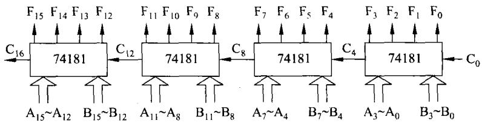  
图3-27由74181构成组间串行进位的16位ALU

为了提高级联ALU的运算速度，前人已研制出并(先)行进位链集成电路74182。对于该芯片不再做更多地说明，只是强调74182可以利用 $\mathrm { C } _ { 0 }$ 及74181提供的G和P便能先行产生图3-27连接所需要的进位信号，从而提高整个ALU的速度。利用74182构成的片（组）内、片（组)间均并行进位的ALU框图如图3-28所示。

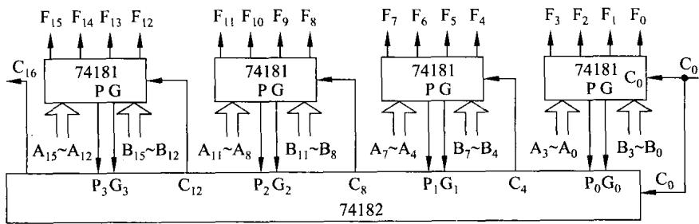  
图3-28由74181和74182构成组内组间均并行进位的16位ALU

## 3.2.3运算器的结构

## 1．三种基本结构

根据运算器内部总线与构成运算器的基本部件的连接情况，运算器有三种基本结构形式：单总线结构、双总线结构及三总线结构。它们分别由图3-29的(a)、(b)、(c)、(d)表示。

除了如图3-29所表示的结构外，还有其他类似的连接形式，不再说明。在这里要强调的是：

（1）总线总是分时工作的，即在任何时刻只允许传送一个部件的信号。也就是说任何时候只允许一个器件将其信号输出加到总线上。多于一个器件必然引起总线竞争。

（2）同一个功能部件一次只能做一件事。如ALU可以完成加、减、与、或等多种功能。但某一时刻只能完成一种功能，做加法时不可能同时做与运算。

（3）在双总线及三总线结构的运算器中需要多端口器件。图3-29所给出的运算器就是依据上述所强调的原则工作的。

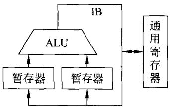  
(a)一种单总线结构形式

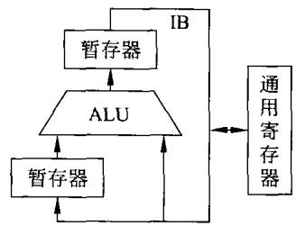  
(b)另一种单总线结构形式

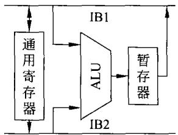  
(c)双总线结构形式

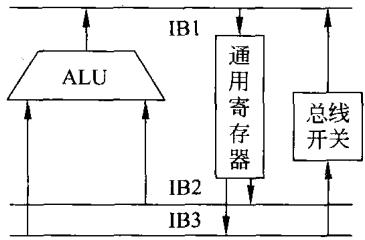  
(d)三总线结构形式  
图3-29运算器的三种基本结构

## 2.计算机简单框图

一种简化的计算机框图如图3-30所示。

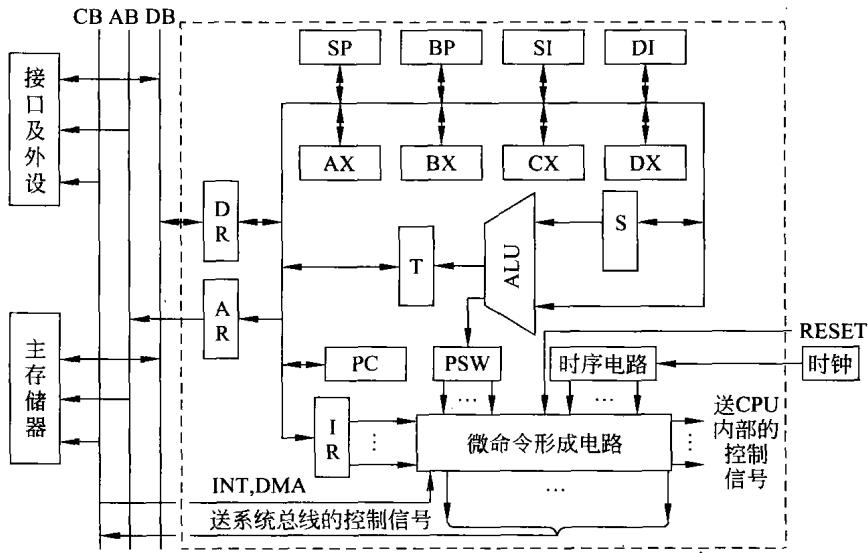  
图3-30某计算机简化框图

在图3-30中采用的是比较简单的单总线结构，其右上方的一些部件构成运算器。其中ALU完成算术逻辑运算，暂存器T还可以实现移位及循环操作，S为暂存器，还有8个通用寄存器AX、BX、CX、DX、SP、BP、SI、DI。

图3-30的右下方是后面第5章将要讲述的控制器。图3-30的左方是计算机的系统总线，主要包括双向数据总线DB、地址总线AB和控制总线CB。数据和地址分别通过双向数

据寄存器DR和地址寄存器AR与系统总线相连接。构成计算机的主存储器、接口及外设就接在系统总线上。

图3-30中，用虚线框起来的部分就是CPU。它是由运算器、寄存器、内部总线和控制器构成。

## 3.3浮点运算

有关浮点数的定义，规格化等问题已在第2章中做了详细说明，在本节中只描述浮点数的各种运算。

## 3.3.1加减运算

## 1.浮点数加减法的运算法则

设两个浮点数： ${ \mathbf { X } } { = } { \mathbf { M } } { \mathbf { x } } \cdot { \mathbf { \Omega } } 2 ^ { { \mathbf { E } } { \mathbf { x } } }$

$$
{ \dot { \mathbf { Y } } } = { \mathbf { M } } { \mathbf { y } } \cdot { \mathbf { \nabla } } 2 ^ { \mathsf { E } { \mathbf { y } } }
$$

实现X士Y运算的法则即过程如下4步。

## （1）对阶

一般情况下，两浮点数的阶码不会相同，也就是说两数的小数点没有对齐。与所熟悉的十进制小数加减一样,在进行加减运算前需将小数点对齐。这就是对阶，只有当两者的阶码相同时才能进行尾数的加减运算。

对阶的原则是小阶对大阶，也就是将小阶码变成大阶码。具体做法是小阶码每增加1，其相应的尾数右移一位，直到增大到与大阶码相同。这样的原则在对阶时丢失的是尾数的低位，造成的误差很小。若是大阶对小阶将丢失尾数的高位，会导致错误的结果。

## (2）尾数进行加(减)运算

在对阶之后，尾数进行加(减)运算。实际上只做加法就可以了，因为减法可以用加法来实现。在做减法时，只要先将减数求补，然后与被减数相加即可。

## （3）规格化

在进行加减运算后，其结果有可能是一个非规格化数。如果结果是非规格化数，则需要规格化。这时可能会出现如下两种情况。

## ①左规

如果运算结果尾数为11.1XX...X或者是.00.0XX...X时,规格化需将尾数左移。每左移一位，阶码减1,直到使尾数成为规格化数为止。这一过程称为左规。

在左规时，尾数每左移一位，阶码减1,必须同时判断阶码是否减到比所能表示的阶码还小。一旦出现这种情况，阶码将无法表示这样小的阶码，这就是下溢出。发生下溢出时可认为结果为0。

若阶码(包括1位符号位)用m位补码整数表示，它能表示的最小阶码为 $- 2 ^ { \mathfrak { m } - 1 }$ 。如果左规使阶码小于 $- 2 ^ { \mathbf { m } - 1 }$ ,则发生下溢出。

## ②右规

如果在尾数加(减)运算时，结果(尾数)发生溢出，即结果出现10.XX...X或者出现01.XX...X时，表明尾数出现溢出。但是，并不表明整个浮点数结果溢出。

出现上述情况，可将尾数右移一次，阶码加1，此过程称为右规。在浮点数加减运算时，右规最多1次。

右规使阶码加1，有可能使阶码超出所能表示的最大范围，如上定义为 $( 2 ^ { \mathsf { m } - 1 } - 1 )$ 。如果出现这种情况，结果将无法表示，这就是上溢出。一旦发生上溢出，可认为结果为。

可见，浮点数的溢出与否是由阶码决定的。

## （4）舍人处理

在对阶及规格化时需要将尾数右移，右移将丢掉尾数的最低位，这就出现舍人的问题。在进行舍人时，通常可采用下面的方法。

## ①截(尾)断法

此法最简单，就是将需丢弃的尾数低位丢弃。

②末位恒置1法

无论尾数右移丢弃的是0还是1，此法将保证要保留的尾数的最低位永远为1。

## ③0舍1入法

当尾数右移丢弃的是1时，要保留的最末位加1;当尾数右移丢弃的是0时，要保留的最末位不变。

这种方法误差较小。但当遇到01.111...11这种需在规的尾数时，采用此法会再次使尾数溢出。遇到这种情况可采用截尾法。

## 2.浮点数加(减)法流程

假定两浮点数X、Y相加(或相减)的结果为浮点数Z，浮点数加(减)法流程如图3-31所示。

## 3.浮点数运算实例

下面举例说明浮点数加法的过程。

【例3-18】两浮点数为：

$$
\begin{array} { l } { { \mathrm { X } { = } 0 . \ 1 1 0 1 0 1 \times 2 ^ { - 0 1 0 } } } \\ { { \mathrm { Y } { = } - 0 . \ 1 0 1 0 1 0 \times 2 ^ { - 0 0 1 } } } \end{array}
$$

求两数之和及差。

解：设两浮点数阶码为4位，用补码表示。尾数用8位，均用双符号位补码表示。则两数可表示为：

$$
\begin{array} { l l } { { [ \mathrm { X } ] _ { \# } = 1 1 1 0 } } & { { 0 0 . 1 1 0 1 0 1 } } \\ { { [ \mathrm { Y } ] _ { \# } = 1 1 1 1 } } & { { 1 1 . 0 1 0 1 1 0 } } \end{array}
$$

（1）对阶

求阶差： $[ \Delta \mathrm { E } ] _ { \ast } = [ \mathrm { E } _ { \mathrm { x } } ] _ { \ast \mathrm { t } } + [ - \mathrm { E } _ { \mathrm { x } } ] _ { \ast } = 1 1 1 0 + 0 0 0 1 = 1 1 1 1$ ，即X的阶码比Y的阶码小。

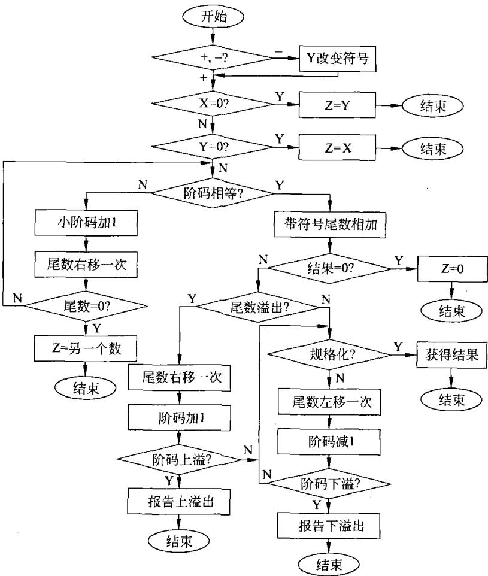  
图3-31浮点数加(减)法运算流程

因此,X尾数右移一次,使两者阶码相同。这时的X为 $[ \mathbf { X } ] ^ { \prime } { } _ { \# } = 1 1 1 1 ; 0 0 . 0 1 1 0 1 1$ ，采用的是0舍1人法。

（2）尾数求

$$
\begin{array} { r l r } { \mathcal { F } { \mathbb { I } } : } & { \qquad } & { \mathcal { k } _ { \mathrm { ~ s t } } ^ { \ast } \lambda \mathcal { k } _ { \Sigma } ^ { \ast } : } \\ { 0 0 . 0 1 1 0 1 1 } & { \qquad } & { 0 0 . 0 1 1 0 1 1 } \\ { \frac { + \ 1 1 . 0 1 0 1 1 0 } { 1 1 . 1 1 0 0 0 1 } } & { \qquad } & { \frac { + \ 0 0 . 1 0 1 0 1 0 } { 0 1 . \ 0 0 0 1 0 1 } } \end{array}
$$

## （3）规格化

从相加的结果可以看到结果为一个非规格化尾数。需将尾数左移2位，变为11.000100。同时，阶码减2,则阶码变为1101。

最后，得到两数相加结果为 $[ \mathbf { X } + \mathbf { Y } ] _ { \# } = 1 1 0 1 ; 1 1 . 0 0 0 1 0 0$

同样，从两者相减的结果看到尾数也不是规格化数。此时需右规,将尾数右移一次，变为00.100011,采用的是0舍1人法。同时，阶码需加1,则阶码为0000。得到两数相减结果为 $[ \mathbf { X } - \mathbf { Y } ] _ { \mathfrak { R } } = 0 0 0 0 ; 0 0 . 1 0 0 0 1 1$

## 3.3.2浮点乘除运算

## 1.浮点乘法运算

## （1）浮点乘法运算的过程

设两个浮点数： $\mathbf { X } { = } \mathbf { M } \mathbf { x } \cdot \mathbf { \partial } 2 ^ { \mathbf { E } \mathbf { x } }$

$$
\mathbf { Y } = \mathbf { M } \mathbf { y } \cdot \mathbf { \mu } 2 ^ { \mathrm { E y } }
$$

该两浮点数相乘为 $\mathrm { Z } = ( \mathbf { M } \mathbf { x } \cdot \mathbf { M } \mathbf { y } ) 2 ^ { \boldsymbol { \mathrm { E x } } + \ \mathrm { E y } }$ 。可以看到，两浮点数相乘之积的阶码为两乘数阶码之和，乘积的尾数为两乘数尾数之积。

浮点乘法的运算过程如下。

① 参加乘法运算的两浮点数一定是规格化数，且不为0。只要有一个乘数为0,则乘积必为0。

②求乘积的阶码，即 $\operatorname { E } \mathbf { z } = \operatorname { E } \mathbf { x } + \operatorname { E } \mathbf { y }$ 。并判断积的阶码是否溢出。

当积的阶码大于所定义浮点数最大阶码，即 $_ { \mathrm { E } z > \mathrm { E } m a x }$ 时，上溢出。一旦发生上溢出，则乘积将无法表示。若积的阶码小于所定义浮点数最小阶码，即 $\operatorname { E } \mathbf { z } { < } { - \operatorname { E } \operatorname { m } \mathbf { a } \mathbf { x } }$ 时，则下溢出。发生下溢出时，乘积可用0表示。当发生溢出时，尤其是上溢，应重新定义浮点数或对两乘数做出限制。

## ③两乘数的尾数相乘。

两尾数相乘可用本章3.1节所描述的方法进行。

④规格化乘积的尾数。

假定尾数为n位补码(其中含1位符号)，其规格化正数范围为 $+ 1 / 2 { \sim } + ( 1 { - } 2 ^ { - ( { \mathsf { n } } - 1 ) } )$ 而规格化负数的范围为 $- ( 1 / 2 + 2 ^ { - ( n - 1 ) } ) \sim - 1$ 。

前面已经提则，两乘数的尾数均为规格化数，根据上述规格化数的范围，两者之积的绝对值肯定不小于 $1 / 4$ 。因此，乘积的尾数如果需要左规，也只需要1次左移，便可使积之尾数变为规格化数。

同样，两乘数的尾数均为规格化数，两者之积有可能为十1，即两个一1相乘。 $\overrightarrow { \mathbb { I } \mathbb { I } } + 1$ 不是规格化数，因此，乘积的尾数如果需要右规，也只需要1次右移，便可使积之尾数变为规格化数。

规格化中,若进行右规,则应注意采用哪种舍入的算法。最终可以获得两浮点数的乘积。

## （2）浮点乘法的流程

根据上述浮点数乘法的过程，可以画出浮点乘法流程框图如图3-32所示。

## 2.浮点除法运算

## （1）浮点除法运算的过程

设两个浮点数： ${ \mathbf { X } } { = } { \mathbf { M } } { \mathbf { x } } \cdot { \mathbf { \Omega } } { 2 } ^ { \mathrm { { E x } } }$

$$
\mathbf { Y } = \mathbf { M } \mathbf { y } \cdot \mathbf { \mu } 2 ^ { \ E \mathbf { y } }
$$

该两浮点数相除为 $\mathbf { Z } = ( \mathbf { M } \mathbf { x } \div \mathbf { M } \mathbf { y } ) 2 ^ { \mathbf { E } \mathbf { x } - \mathbf { E } \mathbf { y } }$ 。可以看到，两浮点数相除的结果的阶码为被除数的阶码减去除数的阶码；商的尾数为被除数的尾数除以除数的尾数。

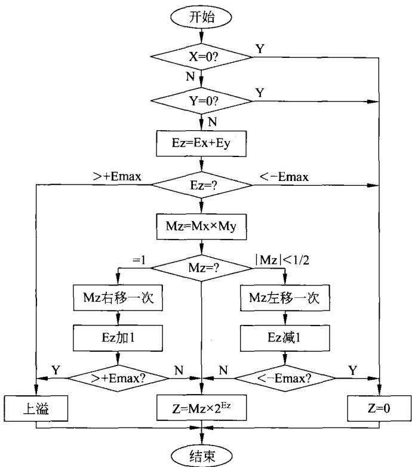  
图3-32浮点乘法流程框图

浮点除法的运算过程如下。

① 参加除法运算的两浮点数一定是规格化数。除数不能为0，否则肯定出错。若被除数为0,则商必为0。

②求商的阶码，即 $\operatorname { E } { \mathbf { z } } { = } \operatorname { E } { \mathbf { x } } { - } \operatorname { E } { \mathbf { y } }$ 。并判断积的阶码是否溢出。

当商的阶码大于所定义浮点数最大阶码，即 $_ { \mathrm { E z } } { \mathrm { > E m a x } }$ 时，上溢出。一旦发生上溢出，则商将无法表示；若商的阶码小于所定义浮点数最小阶码，即Ez<一Emax时，则下溢出。发生下溢出时，商可用0表示。当发生溢出时，尤其是上溢，应重新定义浮点数或对被除数除数做出限制。

③被除数的尾数除以除数的尾数。

在这里，由于进行的是浮点数运算，只要求两尾数是规格化数。并不要求被除数的绝对值小于除数的绝对值。除法可用本章前一节所描述的方法进行。

④规格化商的尾数。

根据上面提到的规格化数的范围，两者相除时，可能出现1/2除以一1的情况，此时的商为一1/2，这不是规格化数，此时的尾数需要左规，但只需要1次左移，便可使商的尾数变为规格化数。

同样，当被除数的尾数绝对值大于除数的尾数的绝对值时，会产生整数商。此时商的尾数需要右规，也只需要1次右移，便可使商的尾数变为规格化数。

规格化中，若进行右规，则应注意采用哪种舍入的算法。最终可以获得两浮点数的商。

## （2）浮点除法的流程

根据上述浮点数除法的过程，可以画出浮点数除法流程框图如图3-33所示。

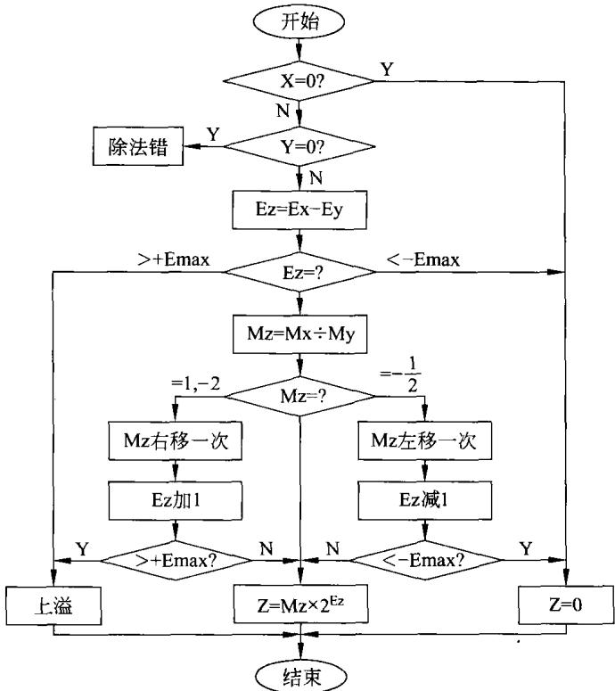  
图3-33浮点数除法流程框图

## 3.3.3浮点数运算的实现

在计算机中实现浮点数运算可以用不同的方法。

## 1．软件方法

在一些比较简单的微型机、单片机中，已设置有加减法指令，其内部有算术逻辑单元。可以通过编写程序的方法来实现浮点运算。在20世纪80年代笔者曾做过这样的工作。利用浮点数运算，在Z80上实现FFT的谱分析功能。这种方法速度慢、工作量很大。今天应尽可能避免使用这种方法。

## 2.配专用浮点数处理器

在许多没有浮点数处理能力的处理器之外，另外配上浮点数处理器。例如，在8086构成的微型机中可以配置浮点协处理器8087。80286上可配上80287、80386上配置80387等。这样就可以提高计算机的浮点数处理能力。当然，今天的高档处理器早已把浮点协处理器集成在处理器芯片内部，如从80486DX之后全是这样的。

将来在设计一套计算机系统时，若采用的处理器不支持浮点运算，而系统又需要进行浮

点运算时，可以考虑在此系统中配置独立的浮点协处理器。

## 3.在处理器中设置浮点数运算部件

如果有浮点数运算的需求，在设计处理器(CPU)时，可以将浮点数运算器放进处理器中。这样的处理器在设计制造出来之后就能实现浮点数运算的功能。

显然，后两种方法要付出硬件上的代价，但浮点数运算的速度必然比软件实现要来得快。

## 4.浮点运算的流水线处理

有关流水线的问题将在本书后面的章节中详细讲述。在这里不做介绍。

## 习 题

1．简要说明运算器的功能。

2．说明采用单符号位检测溢出的方法。

3．说明采用双符号位检测溢出的方法。

4．根据前面图3-4说明BCD加法器的工作原理。

5．说明浮点运算中溢出的处理办法。

6．某微型机字长16位，若采用定点补码整数表示数值，最高1位为符号位，其他15位为数值部分，则所能表示的最小正数和最大负数各为多少？

7．在进行定点原码乘法运算时，乘积的符号位是由被乘数的符号位和乘数的符号位进行何种运算来获得的？

8．用字长为二进制16位，定点数补码纯小数所能表示的最大的正数及最小的负数各为多少？

9．当两个同符号的数相加或异符号的数相减，所得结果的符号位SF和进位标志CF进行何种运算为1时，表示运算的结果产生溢出？

10．若浮点数的阶码用移码表示，尾数用补码表示。两规格化浮点数相乘，最后对结果规格化时，右规的右移位数最多为几位？左规的左移位数最多为几位？为什么？

11．分析下面图3-34所示的框图并回答下列问题。

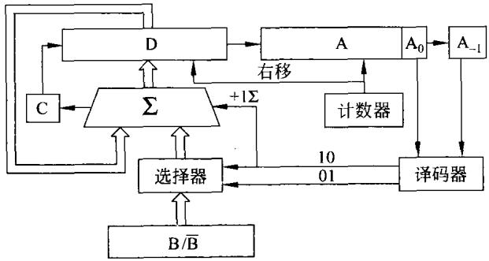  
图3-34习题11附图

该框图所完成的功能是什么？在运算开始时,D、A、B寄存器中分别存放的是什么？

12．若机器字长为8位，定点小数表示。已知 $\mathrm { X } = - 0 . 1 0 1 1 0 , \mathrm { Y } = 0 . 1 0 0 1 0$

（1）求 $[ \mathbf { X } ] _ { \ast \vert } \cdot [ \mathbf { Y } ] _ { \ast \vert }$ 和 $[ - \Upsilon ] _ { \ast \boldsymbol { \mu } }$

（2）用变形补码计算 $[ \mathrm { X } + \mathrm { Y } ] _ { \sharp \mathfrak { h } }$ 和 $[ \mathrm { X } - \mathrm { Y } ] _ { \ast \mathrm { k } }$ ,并判断结果是否溢出。

13．下面图3-35是一位算术逻辑单元(ALU)的结构框图。根据此图判断控制信号 $\mathsf { S } _ { 2 }$ $\mathsf { S } _ { 1 } \hphantom { \mathsf { S } _ { 0 } } \hphantom { \mathsf { S } _ { 1 } } \hphantom { \mathsf { S } _ { 0 } }$ 为何种状态时， $\mathrm { , F _ { i } { = } 0 \mathrm { ~ } . ~ } \mathrm { S } _ { 2 } \mathrm { , } \mathrm { S } _ { 1 } \mathrm { , } \mathrm { S } _ { 0 }$ 为何种状态时， $\mathbf { F _ { i } } { = } \mathbf { X _ { i } } + \mathbf { Y _ { i } }$ 0

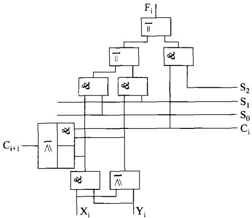  
图3-35习题13附图

14.已知 $[ \mathbf { X } ] _ { * } = 1 1 0 0 1 1 0 0 , [ \mathbf { Y } ] _ { * } = 1 0 1 0 1 0 0 1$ 分别为纯小数，且最高位为符号位，求两者之和为多少？并说明(有/无)溢出。

15．若已知 $2 \ [ \mathbf { X } ] _ { \mathfrak { X } } = 1 . 0 1 0 1 0 0 1 , 1 / 2 [ \mathbf { Y } ] _ { \mathtt { H } } = 1 . 0 1 0 1 1 0 0 0$ ，试利用变形码计算 $[ \mathbf { X } ] _ { \mathsf { X } } +$ $[ \boldsymbol { \Upsilon } ] _ { \# \mathfrak { s } } = ?$ 并判断结果有无溢出？

16．若已知 $1 / 2 \ [ \mathrm { \bf X } ] _ { \ast } = 1 . 0 1 0 1 0 0 1 , \ 2 [ \mathrm { \bf Y } ] _ { \ast } = 1 . 0 1 0 1 1 0 0$ ，试利用变形码计算 $[ \mathbf { X } ] _ { * \mathrm { { h } } } +$ $[ \boldsymbol { \Upsilon } ] _ { \ast \vert } = ?$ 并判断结果有无溢出？

17．试依据下列条件，用补码计算 $[ \mathbf { X } ] _ { \mathfrak { X } } + [ \mathbf { Y } ] _ { \mathfrak { X } } = ?$ 并判断结果有无溢出？

（1）X=0.01001 $\mathrm { Y } = - 0 . 1 0 1 1 1$

(2）X=0.10010 Y=0.11000

(3)X=-0.01101 Y=0.00101

(4)X=-0.11011 $\mathrm { Y } = - 0 . 1 0 0 1 0$

18．将下列十进制数变换为6位移码表示，其中最高1位为符号位，其余5位为数值位，计算 $[ \mathbf { X } + \mathbf { Y } ] _ { \ast \ast } = ?$ 并判断结果有无溢出？

(1) $\mathrm { X } { = } 1 8  { \mathrm { ~ \textrm ~ { ~ ~ } ~ } }  { \mathrm { Y } } { = } 1 5$

(2） $\mathbf { X } { = } { - } 2 2$ Y=-15

19．将下面十进制数用8421码表示，进行运算并校正。

(1） $8 8 + 9 9$

(2） $2 7 + 1 5$

20．根据题中的数据分别用原码1位乘及布斯(Booth)法求乘积，并写出计算步骤。

(1)X=-0.1101 $\mathrm { Y } = + 0 . 0 1 1 0$

(2）X=-0.1110 Y=-0.1101

21．试利用74181芯片和74182芯片构成32位的ALU，画出连接框图。

22．分别用原码加减交替法和补码加减交替法完成X除以Y的运算并写出运算步骤。

(1）X=-0.10101 Y=+0.11011

(2）X=+0.1001110001 Y= -0.10101

23．定点运算器的内部总线结构有三种形式，下面的描述 是对应三总线结构的。A．执行一次操作需要三步B．在此运算器中至少需要设置两个暂存器C．在运算器中的两个输入和一个输出上至少需要设置一个暂存器D．在运算器中的两个输入和一个输出上不需要设置暂存器

24．浮点数中，用补码表示的n位(包括1位符号位)规格化负尾数的取值范围可表示为多少？

25．浮点数字长16位，阶码7位(其中包括阶符1位)，数符1位，尾数8位。若阶码用移码表示，尾数用补码表示。该浮点数所能表示的数值范围为多少？

26．设浮点数字长12位，阶码5位（含1位符号），尾数7位（含1位符号）。阶码用移码、尾数用补码表示。将下列各数按浮点数相加减的步骤计算 $\mathbf { X } \pm \mathbf { Y }$

(1）X=11/16×2-4 Y=35/64×2-3

$$
{ \mathrm { ( 2 ) ~ } } \mathrm { X } = + 0 . 1 0 1 1 0 1 \times 2 ^ { - 1 1 } \mathrm { ~ B } \qquad \mathrm { Y } = \left( - 0 . 1 0 0 1 0 1 \right) \times 2 ^ { - 1 } \mathrm { B }
$$

27，试分析在浮点数进行算术运算(加、减、乘、除)时，在什么情况下会产生上溢出。

28．图3-36为某一运算器的简化框图，其中A、B既有寄存器又有多路选择器的功能，M有图中所标功能及多路选择功能,ALU为算术逻辑单元,RO和R1为通用寄存器。图中粗线为数据通路，是一种单总线结构。试写出下列运算的步骤。

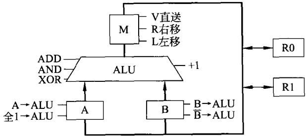  
图3-36习题28附图

(1) $( \mathrm { R 0 } ) + 2 ( \mathrm { R 1 } ) \mathrm { \to } \mathrm { R 0 }$

(2） $2 ( \mathrm { R 0 } ) - ( \mathrm { R 1 } ) \mathrm { \to R 0 }$

(3） $( \mathtt { R 0 } ) - 1 {  } \mathtt { R 0 }$

（4） $( \mathrm { R 0 } ) \mathrm { X O R } ( \mathrm { R 1 } ) {  } \mathrm { R 0 }$

29．一个可完成加、减、乘、除4种定点运算的运算器结构如图3-37所示。图中A,B,C为三个寄存器，并且A,B具有联合左，右移位的功能，≥为可完成加，减运算的加法器。箭 $\Sigma$ 头及连接线标明了数据流通的方向。

分析该图，说明在加法运算开始前，两个加数及加法完成后的和应分别放入的寄存器是哪几个？

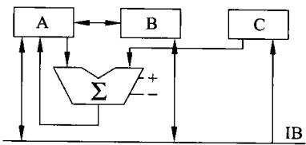  
图3-37习题29附图