## 第4章 指令系统与汇编语言

对一台计算机来说，指令系统是非常重要的，指令系统的功能和性能会对计算机的性能产生直接影响。在本章中将说明指令的构成格式，经常使用寻址方式以及常见的指令。

## 4.1指令格式

## 4.1.1概述

## 1．机器指令

指令是指定计算机完成某种功能的命令。由二进编码构成、计算机可直接识别并执行的命令就称为机器指令。它是与计算机的硬件紧密相关的，因此也称为机器语言。在这里也可以简单地称为指令。一组完成某种功能的指令的集合称为程序。

一台计算机所能执行指令的集合称为该计算机的指令系统。指令系统的设置会对计算机的运行速度、硬件结构、使用的方便程度等诸多方面产生影响。因此，指令系统是计算机基本功能的体现。

## 2．设置指令系统的要求

正如上面所提到的，计算机的指令系统会对计算机的性能产生直接影响。因此，在进行CPU设计时，设置一套完善的指令系统是非常重要的，评价指令系统优劣通常从以下几个方面来考虑，这也是设置指令系统的基本原则。

## （1）完备性

完备性是指所设置的指令系统必须具备最基本的、必不可少的一批指令。利用这样的指令系统中的指令，可以方便地编出完成所需功能的程序。

## （2）有效性

所谓有效性是指利用所设置的指令系统能够高效率地编写程序。高效率指的是实现规定功能的程序内存空间占得少，执行速度快。

## （3）规整性

规整性包括指令操作的对称性、匀齐性及指令格式与数据格式的一致性三个方面。

① 对称性是指在设置的指令系统中，所有的寄存器和存储单元均可同等对待。从而使编程更加简单，也会提高程序的可读性。

②匀齐性是指一种操作类型的指令可以支持多种数据类型。例如，算术运算指令可实现字节、字、双字、十进制数等多种数据的操作。这可使编程人员在进行程序设计选用指令时不必考虑数据类型。

③指令格式与数据格式的一致性是指指令长度和数据的长度是有一定标准的，例如是

字节的整数倍。这样在存取和处理指令和数据时必定方便。如果它们的长度是随机的，则必然使存取与处理变得十分麻烦。

## （4）兼容性

人们把具有相同的基本指令系统和相同的基本系统结构的一系列的计算机叫做系列计算机。例如由80x86及Pentium处理器构成的计算机称为PC系列机。由于系列机中各处理器的基本指令系统和基本系统结构是相同的，因此在基本指令系统上是兼容的。

指令系统的兼容性指的是同一程序可以不加修改地运行于其他计算机中。通常，这种兼容性是“向上兼容”;即在高档机上可运行低档机的程序。例如，在Pentium机上可以运行80x86的程序。

依据兼容性的原则，在设置处理器的指令系统的时候，必须留有余地，以便在下次设计高一档处理器时能方便地增加新的指令，达到"向上兼容"的目的。

## 4.1.2指令格式的描述

## 1.指令信息

指令所包含的信息包括如下4部分。

## （1）指令操作码

指令操作码用来规定指令所完成的功能。用不同的二进制编码来设定指令操作码，每种编码对应一条指令。

## （2）操作数地址

指令中指出操作数的地址，处理器便可以依此地址而获得操作数。操作数的地址通常是存储单元、I/O接口或CPU的内部寄存器。

## （3）操作结果的存放地址

指令操作码命令处理器(CPU)对操作数进行某种处理，指令中还会包括存放处理结果的地址，以便将结果存放在那里，以备再次使用。存放处理结果的地址通常是存储单元、I/O接口或CPU的内部寄存器。

## （4）下一条指令的地址

当程序顺序执行时，下一条指令的地址是由CPU中的程序计数器(PC)给出的。当程序转移或调用子程时，下一条指令的地址则由指令给出。在第5章中能更清楚地看到这种情况。

需要注意的是，上面所提到的指令所包含的4方面的信息，并不是说每条指令都一定会包括这4种信息。只有指令操作码信息是每一条指令必须具有的以外，其他信息的有无因指令而异。下面具体说明详细情况。

## 2.指令格式

依据操作数地址的个数不同，指令格式可分为如下几种。

## （1）零地址指令

这种格式的指令只有操作码(OP)，没有地址码，形式如图4-1所示。

这种指令用于两种情况：一是有的指令不需要操作数，当然也就不需要操作数地址。例如，空操作指令、停机指令等;另一种情况是指令所需操作数的地址是默认的，不需要由指令给出。

## (2）一地址指令

一地址指令中指令包含一个操作数地址。该地址指令执行前存放着操作数，指令执行后存放执行的结果。这种指令的格式如图4-2所示。

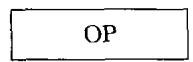  
图4-1零地址指令

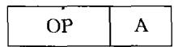  
图4-2一地址指令

指令中，A通常是存储单元、I/O接口或CPU的内部寄存器。

例如：

INCAX;加1指令,实现将寄存器 AX的内容加1SAL $\mathtt { A L } ;$ 算术左移指令，实现寄存器 AL的内容算术左移一次

## （3）二地址指令

二地址指令的格式如图4-3所示，其中 $\mathbf { A } _ { 1 } \setminus \mathbf { A } _ { 2 }$ 用于表示两个操作数的地址。其功能为：$( \mathbf { A } _ { 1 } ) \mathrm { O P } ( \mathbf { A } _ { 2 } ) {  } \mathbf { A } _ { 1 }$

指令中， $\mathbf { A } _ { 1 } \setminus \mathbf { A } _ { 2 }$ 是存储单元、I/O接口或CPU的内部寄存器。

通常，将A2称为源操作数的地址，其中的内容就是源操作数;而A称为目的操作数的 $\mathsf { A } _ { 2 }$ $\mathbf { A } _ { 1 }$ 地址，它用于存放指令执行的结果。也有相反定义的，即 $\mathbf { A } _ { 1 }$ 为源， $\mathbf { A } _ { 2 }$ 为目的。

例如：

MOV $\mathrm { D X } , \mathtt { A } _ { 2 }$ ;传送指令，实现将内存地址单元 $\mathtt { A } _ { 2 }$ 的内容传送到DX中，DX相当于 $\mathtt { A } _ { 1 }$

## （4）三地址指令

三地址指令的格式如图4-4所示，其中 $\mathbf { A } _ { 2 } \mathbf { \setminus A } _ { 3 }$ 用于表示两个操作数的地址， $\mathbf { A } _ { 1 }$ 为存放指令执行结果的地址。其功能为： $( \mathrm { A } _ { 2 } ) \mathrm { O P } ( \mathrm { A } _ { 3 } ) {  } \mathrm { A } _ { 1 }$ 0

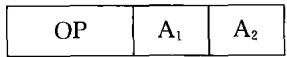

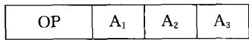  
图4-3二地址指令  
图4-4三地址指令

同样，指令中 $\mathbf { A } _ { 1 } \ldots \mathbf { A } _ { 2 } \ldots \mathbf { A } _ { 3 }$ 可以是存储单元、I/O接口或CPU的内部寄存器。例如：

ADD AX,BX,CX;80196的加法指令，实现 BX+ CX→AXADD R1,R2,R3;ARM 的加法指令,实现 R2+ R3→R1

## （5）多地址指令

在一些性能较好的处理器中，会设置一些多地址指令。例如，在ARM处理器中，就设置有批量处理指令。例如，一条批量传送如下。

$$
S \mathrm { T M I } \vec { \mathbb { A } } \qquad \mathbb { R } 9 : , \left\{ \mathbb { R } 0 , \mathbb { R } 1 , \mathbb { R } 3 , \mathbb { R } 5 \right\}
$$

该指令是以事后递增的方式将 RO、R1、R3、R5 这4个寄存器的内容放在以 R9的内容为起始地址的顺序内存单元中。

## 4.1.3指令设计

## 1．指令长度的影响因素

构成一条指令的二进制位数称为指令长度。从规整性的角度出发，指令长度都是字节（或16位的字)的整倍数。在设计CPU的指令系统时，指令的长度受多种因素的影响，设计者在设计CPU的指令系统时必须考虑这些因素。

## （1）内存大小与组织

在设计指令系统时，内存空间的大小会对指令长度产生影响。例如，内存寻址空间为4GB时，表示内存地址需要32位编码，当采用直接寻址时，用于表示地址的编码就需要32位。若内存寻址空间为64KB，则用16位编码就够了。

另外，如果内存按字节编址，将来存放指令就很方便。若内在按字(16位)编址，指令长度为字节的整数倍时则不方便。

存储器的传送速度也对指令长度产生一定影响。如果处理器执行指令的速度远远快于取指令的速度,那么存储器传送就变成了瓶颈。长指令在这样的系统中,效率就比短指令低。

## （2）CPU数据总线宽度

CPU数据总线宽度表示CPU一次读/写内存的数据位数，指令长度应为CPU数据总线宽度的整数倍。这样就避免了在取指周期内得不到整数目的指令。

## （3）CPU内部寄存器的数量

指令中必须用二进制编码来寻址CPU的内部寄存器，内部寄存器越多，则需要更长的编码对其寻址。当然，CPU内部寄存器越多则CPU的功能就越强，而且CPU内部寄存器读/写的速度是最快的。

## （4）寻址方式

寻址方式越多，则构成的指令系统的功能就越强，编程效率也会越高。但寻址方式越多，用于描述它们的编码就越长，指令长度也必然加长。

## （5）指令数量

设计CPU指令系统的指令越多，用于表示指令操作码的编码也会越长，这也会影响指令的长度。

综上所述，指令格式设计人员必须对多种因素考虑和平衡，同时也要结合设计对象的应用约束对各种因素有一定侧重的考虑，比如存储空间较小的系统，就可以采用直接寻址方式，寄存器丰富的系统也可以考虑设计多操作数指令等。

## 2．定长操作码变长指令码

在设计指令系统时，可以将指令设计成定长操作码变长指令码的格式。

在这种情况下，指令操作码的长度是固定不变的，通常放在指令编码的第1个字段中。指令编码的其他字段用于表示操作数的地址。若指令操作码为7位，则可以构成128条指令，若指令操作码为8位,共有 256 种编码,则可以构成 256 条指令。

在这种编码格式中，用固定长度的指令操作码来表述不同的指令。但不同的指令又有不同的寻址方式，它们所需要的操作数不一样。因此，指令码的长度随指令的不同而不同。假如设置指令操作码为8位，对于那些无操作数(即零地址)指令而言，指令码的长度就是操作码的长度。也就是说,这类指令仅用一个字节即可表示。但是,对于一地址、二地址及更多地址的指令，构成一条指令一定需要多个字节才行。而且，不同的指令、不同的寻址方式，其指令长度显然是不一样的。

## 3．定长指令码变长操作码

定长指令码变长操作码指令格式规定，指令码的长度是固定的，而其中所包含的操作码是可变的。

在这种指令编码方式中，由于指令码长度固定，但指令所需操作数地址随指令不同而不同：可以零地址、一地址、二地址及更多地址。当地址多时，表示地址所需要的二进位编码就多,则剩下用于表示指令操作码的位数就少；反之，当地址少甚至无地址时，表示地址所需要的二进位编码就少，则剩下用于表示指令操作码的位数就多。因此，这种指令编码方式的指令操作码长度会随指令中地址码的减少而不断扩展，故也称其为指令操作码扩展编码方式。

为了说明这种编码，假定指令码长度为16位，指令系统包括零地址、一地址、二地址和三地址指令。如图4-4所示，假定操作码OP字段占4位，地址 $\mathbf { A } _ { 1 } \setminus \mathbf { A } _ { 2 } \setminus \mathbf { A } _ { 3 }$ 各占4位。4位操作码最多可以定义16种三地址指令。若现在只用15种编码定义三地址指令，留下一种编码用做扩展标志，将操作码扩展到 $\mathbf { A } _ { 1 }$ (操作码扩展为8位)，用以定义二地址指令。根据这样的思想，可以继续扩展，用操作码扩展为12位来定义一地址指令、用操作码扩展为16位来定义零地址指令。这样，就可以定义61条指令，这种扩展方式如图4-5所示。

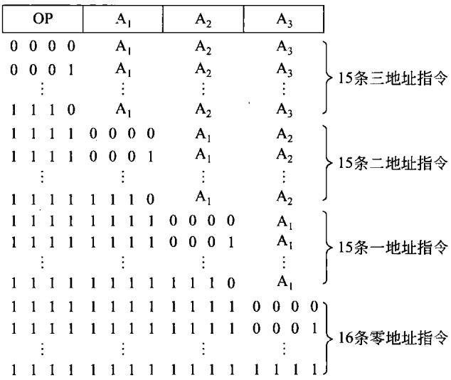  
图4-5扩展操作码的过程

除上述方法外，还有多种扩展方法。例如，可以定义14条三地址指令，30条二地址指令,30 条一地址指令和32 条零地址指令。对于上述举例，若要构成L(L<16)条三地址指令，K条二地址指令,M条一地址指令，则可构成的零地址指令条数为：

$$
\{ [ ( 2 ^ { 4 } - \mathrm { L } ) \times 2 ^ { 4 } - \mathrm { K } ] \times 2 ^ { 4 } - \mathrm { M } \} \times 2 ^ { 4 }
$$

以上描述了两种指令字长的设计方法：定长操作码变长指令码和定长指令码变长操作码。在实际应用中经常灵活地将它们结合在一起，操作码是可以扩展的而指令码的长度也是可变的。

## 4.霍夫曼编码

## （1）霍夫曼编码概述：

利用霍夫曼编码构造指令操作码的基本思路，是根据指令使用的频率来决定操作码的长短。让那些出现概率高的指令使用短的指令操作码，而让那些出现概率低的指令使用长的指令操作码。这样就能使指令系统的平均操作码长度低于等长操作码的平均码长。

假定指令系统有n条指令，第i条指个的出现的概率为 $\mathrm { p } ;$ ，其编码长度为 $\boldsymbol { \mathrm { l } } _ { \mathrm { i } }$ ，则利用霍夫曼编码构成的平均操作码长度l如式(4-1)所示。

若以固定长度操作码，则编码的平均操作码长度1如式(4-2)所示。

$$
\mathrm { { l _ { a } = \sum _ { i = 1 } ^ { n } \ p _ { i } \mathrm { { l _ { i } } } } }\tag{4-1}
$$

$$
\mathbf { l } _ { \mathbf { a } } = \log _ { 2 } \mathbf { n }\tag{4-2}
$$

在构造霍夫曼编码的操作码时，首先要构造霍夫曼树。构造的方法就是将所有的指令按使用的频度(也就是程序中出现的概率)由小到大依次排列，每次将两个使用频度最小合并在一起，构成一个频度为两者之和的新结点，将余下的结点放在一起。接着再从这些结点中继续找出两个使用频度最小的结点合并在一起，构成一个频度为两者之和的新结点。重复上述过程，直至全部结点合并完成，构成概率为1的根结点。最后，将每一结点的两个分支分别用0和1标志。这时，从根结点出发到每条指令所表示的使用概率的结点所经历的1或0便是该指令的霍夫曼编码。

## （2）举例

为了说明如何构成霍夫曼编码，现举例说明。若CPU指令系统有9条指令，分别是 ${ \bf I } _ { 1 }$ 、$\mathrm { I } _ { 2 } \ldots \mathrm { I } _ { 9 }$ ，它们使用的频度如表4-1中第2列所示。

表4-1几种编码的操作码与平均码长
<table><tr><td>指令</td><td>使用频度pi（%）</td><td>霍夫曼编码</td><td>扩展操作码</td><td>固定长度编码</td></tr><tr><td> $\overline { { \mathbf { I } _ { 1 } } }$ </td><td>40</td><td> $' _ { 0 }$ </td><td>00</td><td>0000</td></tr><tr><td> ${ \mathbf I } _ { 2 }$ </td><td>19</td><td>100</td><td>01</td><td>0001</td></tr><tr><td> $\mathrm { { I } } _ { 3 }$ </td><td>15</td><td>101</td><td>10</td><td>0010</td></tr><tr><td> $\Upsilon _ { 4 }$ </td><td>7</td><td>1100</td><td>11000</td><td>0011</td></tr><tr><td> ${ \tt I } _ { 5 }$ </td><td>7</td><td>1101</td><td>11001</td><td>0100</td></tr><tr><td> ${ \bf { I } } _ { 6 }$ </td><td>6</td><td>1110</td><td>11010</td><td>0101</td></tr><tr><td> $\mathrm { I } _ { 7 }$ </td><td>3</td><td>11110</td><td>11011</td><td>0110</td></tr><tr><td> $\bar { \mathrm { I } } _ { 8 }$ </td><td>2</td><td>111110</td><td>11100</td><td>0111</td></tr><tr><td> ${ \underline { { \mathbf { I } } } } _ { 9 }$ </td><td>1</td><td>111111</td><td>11101</td><td>1000</td></tr><tr><td>平均码长</td><td></td><td>2.55</td><td>2.78</td><td>4.0</td></tr></table>

根据上面霍夫曼编码的原理，画出霍夫曼树如图4-6所示。

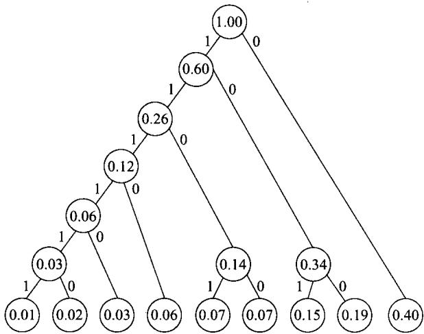  
图4-6例中所对应的霍夫曼树

如果按照图4-6所标志的1和0，即可获得表4-1中所表示的编码。显然，1和0的标志是可以改变的，因此霍夫曼编码的码值也是不一样的，会产生多种形式的编码。根据图4-6所标志的情况，算出霍夫曼编码的平均码长为：

$$
\begin{array} { r l } & { \mathrm { l _ { a } } \mathrm { = } 1 \times 0 . 4 + 3 \times ( 0 . 1 9 + 0 . 1 5 ) + 4 \times ( 0 . 0 7 + 0 . 0 7 + 0 . 0 6 ) + 5 \times 0 . 0 3 + 6 \times ( 0 . 0 1 + 0 . 0 2 ) } \\ & { \quad \mathrm { = } 0 . 4 + 1 . 0 2 + 0 . 8 + 0 . 1 5 + 0 . 1 8 = 2 . 5 5 ( | \mathfrak { I } | ) } \end{array}
$$

若采用固定长度的操作码，其长度最少必须是4（位）。

## （3）利用霍夫曼编码的思想扩展操作码

从上述构造霍夫曼编码的描述中可以看到，用上面的方法构成的霍夫曼编码不是唯一的，而是有许多种。同时，霍夫曼编码形成的操作码长种类也很多，这对将来构成指令译码器是不利的。必然会使译码器的结构变得复杂，因而这种编码并不实用。

但是，根据式(4-1)霍夫曼编码的平均码长应当是唯一的，而且码长是最短的。尽管直接使用霍夫曼编码构成操作码是不实用的，但可以利用霍夫曼编码的思想扩展操作码。将使用频度高的用短的编码表示而将使用频度低的用较长的编码表示，从而达到既能获得较短的平均码长，又有利于译码。表4-1中就列出了用这种思路构成的扩展码，其平均码长为2.78（位）。

## 4.2寻址方式

在本节中，将以8086的CPU为例说明处理器中常用的寻址方式。

## 4.2.1 8086处理器中的内部寄存器

为了说明8086处理器的寻址方式及指令系统。在此首先描述处理器中与应用有关的，用户能用指令改变其内容的寄存器。这些内部寄存器，其结构如图4-7所示。下面分别加以说明。

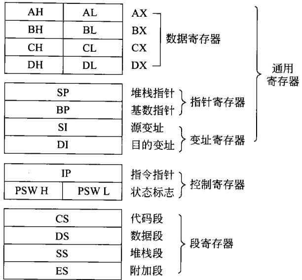  
图4-78086 的CPU的内部寄存器

## 1．数据寄存器

8086 有4个16 位的数据寄存器，可以存放16位的操作数。从图4-7中可以看到，4个  
16 位的寄存器在需要时，可分为8个8位寄存器来用,这样就大大增加了使用的灵活性。

## 2.指针寄存器

8086 的指针寄存器有两个：SP和 BP。SP 是堆栈指针寄存器,由它和堆栈段寄存器一起来确定堆栈在内存中的位置。BP是基数指针寄存器，通常用于存放基地址，以使8086的寻址更加灵活。

## 3.变址寄存器

.SI是源变址寄存器,DI是目的变址寄存器，都用于指令的变址寻址。顾名思义,SI通常指向源操作数，DI通常指向目的操作数。

## 4.控制寄存器

8086的控制寄存器有两个：IP和PSW。

## （1）IP

IP 是指令指针寄存器，用来控制CPU的指令执行顺序。它和代码寄存器CS一起可以确定当前所要取的指令的内存地址。CPU执行程序的地址总是为：CS×16十IP。当顺序执行程序时，CPU 每从内存取一个指令字节，IP自动加1,指向下一个要读取的指令字节。

当CS 不变、IP单独改变时,会发生段内程序转移。当CS 和IP同时改变时，会产生段间的程序转移。

## (2）PSW

PSW 是程序状态字，也有人称它为状态寄存器或标志寄存器，用来存放8086CPU 在

工作过程中的状态。PSW各位标志如图4-8所示。

<table><tr><td rowspan=1 colspan=1></td><td rowspan=1 colspan=1></td><td rowspan=1 colspan=1></td><td rowspan=1 colspan=1></td><td rowspan=1 colspan=1>O</td><td rowspan=1 colspan=1>D</td><td rowspan=1 colspan=1>1</td><td rowspan=1 colspan=1>T</td><td rowspan=1 colspan=1>s</td><td rowspan=1 colspan=1>z</td><td rowspan=1 colspan=1>×</td><td rowspan=1 colspan=1>A</td><td rowspan=1 colspan=1>×</td><td rowspan=1 colspan=1>P</td><td rowspan=1 colspan=1>×</td><td rowspan=1 colspan=1>C</td></tr></table>

图4-8程序状态字

状态标志寄存器是一个16位的寄存器，×位不用，空着的各位留做后用。8086中所用的9位对了解8086CPU的工作和用汇编语言编写程序是很重要的。这些标志位的含义如下。

C-—进位标志位。做加法时出现进位或做减法时出现借位时，该标志位置1;否则清0。位移和循环指令也影响进位标志。

P——奇偶标志位。当结果的低8位中1的个数为偶数时，则该标志位置1;否则清0。

A-—半加标志位。在加法时，当位[3]需向位[4]进拉，或在减法时位[3]需向位[4]借位时，该标志位置1;否则清0。该标志位通常用于对BCD算术运算结果的调整。

Z——零标志位。运算结果所有各位均为0时,该标志位置1;否则清0。

S——符号标志位。当运算结果的最高位为1,该标志位置1;否则清0。

T——陷阱标志位(单步标志位)。当该位置1时，将使8086 进行单步指令工作方式。在每条指令执行结束时，CPU总是去测试T标志位是否为1。如果为1,那么在本指令执行后将产生陷阱中断，从而执行陷阱中断处理程序。该标志通常用于程序的调试。例如，在系统调试软件DEBUG中的T命令，就是利用它来进行程序的单步跟踪的。

I——中断允许标志位。如果该位置1，则处理器有可能响应可屏蔽中断请求（还要看其他条件);否则就一定不能响应可屏蔽中断请求。

D——方向标志位。该标志只用于串操作指令，当该位置1时,串操作指令为自动减量指令，即从高地址到低地址处理字符串；否则串操作指令为自动增量指令。

O-—溢出标志位。在算术运算中，带符号的数的运算结果超出所规定的带符号数所能表达的范围时，该标志位置1；否则清0。

## 5．段寄存器

8086微处理器具有4个段寄存器：代码段寄存器CS、数据段寄存器DS、堆栈段寄存器SS 和附加段寄存器ES。这些段寄存器的内容与有效的地址偏移量一起可确定内存的物理地址。通常CS规定并控制程序区，DS和ES控制数据区，SS控制堆栈区。

## 6.存储器寻址

8086CPU具有1MB的内存空间，可是内部寄存器都只有16位，很显然，不采取特殊措施，是不能寻址1MB存储空间的。为此引入了段的概念。每个内存段具有64KB的存储空间。该段内的物理地址由16位的段寄存器内容和16位的地址偏移量来确定。如图4-9所示，20位的物理地址是这样产生的：

$$
\textcircled { 1 } \textcircled { 1 } \textcircled { 1 } \textcircled { 2 } \textcircled { 1 } \textcircled { 1 } \textcircled { 2 } \textcircled { 2 } \textcircled { 2 } \textcircled { 2 } \textcircled { 1 } \textcircled { 2 } \textcircled { 1 } \textcircled { 2 } \textcircled { 1 } \textcircled { 1 } \textcircled { 2 } \textcircled { 1 } \textcircled { 2 } \textcircled { 1 } \textcircled { 2 } \textcircled { 1 } \textcircled { 2 } \textcircled { 1 } \textcircled { 2 } \textcircled { 1 } \textcircled { 2 } \textcircled { 1 } \textcircled { 2 } \textcircled { 1 } \textcircled { 2 } \textcircled { 2 } \textcircled { 1 } \textcircled { 2 } \textcircled { 2 } \textcircled { 1 } \textcircled { 2 } \textcircled { 2 } \textcircled { 1 } 
$$

段寄存器的内容×16(相当于左移4位)变为20位，再在低端16位上加上偏移地址（也叫做有效地址EA)，便可得到20位物理地址。

对于CPU读程序的内存地址，总是由下式来决定：

$$
\$ 123,456,7
$$

也就是说，当8086(88)CPU读程序时，其内存地址永远是由代码段(CS)寄存器×16与IP(指令指针)的内容作为偏移地址来决定的。

但是，当8086(88)CPU读写内存数据时，各个段寄存器都能使用，经常使用的是CS，SS 和DS三个段寄器，如图4-10所示，而偏移地址又有多种不同的产生方法，有关内容在下面的章节中再做详细说明。

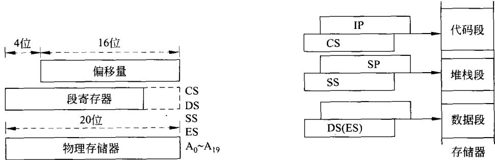  
图4-9物理地址的形成  
图4-10段寄存器的使用情况

## 4.2.2 8086CPU的寻址方式

8086处理器的寻址方式包括：决定操作数地址的寻址方式和决定转移地址的寻址方式。

## 1．决定操作数地址的寻址方式

## （1）立即寻址

这种寻址方式所提供的操作数直接包含在指令中。它紧跟在操作码的后面，与操作码一起放在代码段区域中。

这种寻址方式的操作数叫立即数，可以是8位的，也可以是16位的。例如：

MOVAL,05H

MOVDX,8000H

## （2）直接寻址

操作数地址的16位段内偏移地址直接包含在指令中，它与操作码一起存放在代码段区域中。操作数一般在数据段区域中，它的地址为数据段寄存器DS加上这16位的段内偏移地址。例如：

MOVBX,DS:[2000H]

在本例中，取数的物理地址就是：DS的内容×16(即左移4位),变为20位，再在其低端16位上加上偏移地址2000H。偏移地址2000H是由指令直接给出的。

## （3）寄存器寻址

操作数包含在CPU的内部寄存器中，例如：

MOVDS，AX

## （4）寄存器间接寻址

在这种寻址方式中，操作数存放在存储器中，操作数的16位段内偏移地址却放在以下4 个寄存器 SI、DI、BP、BX之一中。由于上述4个寄存器所默认的段寄存器不同，又可以分成两种情况。

① 若以 BX、SI、DI这三个寄存器进行寄存器间接寻址，则操作数默认放在 DS 所决定的数据段中。此时数据段寄存器内容乘以16加上SI、DI、BX中的16位段内偏移地址，即得操作数的地址。例如：

MOVAX,2000H

MOVDS，AX

MOVSI，1000H

MOVAX,[SI]

上面第4条指令执行时，操作数的地址为：DS×16十SI=21000H。即从21000H单元取一字节放人AL，从21001H单元取一字节放入AH。

②若以寄存器BP间接寻址，则操作数默认存放在堆栈段区域中。此时，堆栈段寄存器SS 的内容乘16加上BP中的16位段内偏移地址，即得到操作数的地址。例如：

MOVDX，4000H   
MOV SS、DX   
MOV BP，500H   
MOV BX，[BP]

在执行上面的指令时，第4条指便是从40500H单元取一个字节放入BL，从40501H单元取一个字节放入BH。

在这里说明段超越的问题。在对存储器操作数寻址时，存储单元的物理地址由段寄存器的内容和偏移地址来决定。在8086(88)指令系统中对段寄存器有基本规定，即默认状态，如上①②所述。指令中的操作数也可以不在基本规定的默认段内，这时就必须在指令中明确指定段寄存器，这就是段超越。例如：

MOV AX,ES:[SI]

该指令中ES为段超越前缀，指令功能就是从ES×16十SI形成的物理地址及其下一个地址中取一个字放人AX 中。

在指令中，默认段寄存器是可以缺省的，而段超越的前缀是不能缺省的，必须明确指定。当使用段超越前缀时，指令代码增加一个字节，从而也增加了指令的执行时间。因此，能不用段超越时尽量不用。

## （5）寄存器相对寻址

在这种寻址方式中，操作数存放在存储器中。操作数的地址是由段寄存器内容乘以16加上SI、DX、BX、BP之一的内容，再加上由指令中所给出的8位或16位带符号的位移量而得到的。

在一般情况下，若用SI、DI或BX进行相对寻址时，默认数据段寄存器DS作为地址基

准;而用BP寻址时，则默认堆栈段寄存器为地址基准。例如：

```csv
MOV BX，3000H
MOV DS,BX
MOV SI,1000H
MOV AL,[S-2]
```

则执行寄存器相对寻址指令时，操作数的物理地址为DS×16十SI一2=30000H十1000H一2=30FFEH。即从地址30FFEH单元取一个字节放人AL中。

## （6）基址变址寻址

在8086(88)中，通常把BX和BP作为基址寄存器，而把SI、DI作为变址寄存器。将这两种寄存器联合起来进行的寻址就称为基址变址寻址。操作数的地址应该是段寄存器内容乘以16加上基址寄存器的内容(BX或BP的内容)，再加上变址寄存器的内容（SI或DI的内容)而得到的。

同理，若用BX作为基地址，则操作数应放在数据段DS区域中；若BP作为基地址，则操作数应放在堆栈段SS区域中。例如：

```csv
MOV DX,8000H
MOV SS,DX
MOV BP,1000H
MOV DI,0500H
MOV AX,[BP][DI]
```

在执行基址变址寻址指令时，就是从81500H和81051H单元分别取一个字节放入AL和AH中。

## （7）基址变址相对寻址

这种方式实际上是第6种寻址方式的扩充。即操作数的地址是由基址、变址方式得到的地址再加上由指令指明的8位或16位的相对偏移地址而得到的，例如：

```csv
MOVAX,DISP[BX][SI]
```

## （8）隐含寻址

在有些指令的指令码中，不仅包含有操作码信息，而且还隐含了操作数地址的信息。例如,乘法指令MUL的指令码中只需指明一个乘数的地址，另一个乘数和积的地址是稳含固定的。再如DAA指令是隐含对AL的操作。

这种将操作数的地址隐含在指令操作码中的寻址方式就称为隐含寻址。

## 2．决定转移地址的寻址方式

由于8086(88)对内存的寻址是利用段寄存器对内存分段来实现的，CPU执行的程序放在代码段寄存器所决定的内存代码段中，这就存在着程序的转移可以在段内进行也可以在段间进行的情况。8086(88)CPU支持这两种情况的转移，下面分别加以说明。

## （1）段内转移

前面已经说明,CPU执行程序的地址永远都是CS×16十IP,而且IP 具有CPU每从内存取出一个字节，IP自动加1指向下一个字节的特性。

如果保持CS不变而改变IP,必然产生段内的转移。

## ① 段内相对寻址

在这种寻址方式中，指令应指明一个8位或16 位的相对地址位移量DISP(它有正负符号，用补码表示)。此时，转移地址应该是代码段寄存器CS 内容乘以16 加上指令针IP 的内容，再加上相对地址位移量DISP。例如：

JMP SHORT ARTX

指令中 ARTX表示要转移到的符号地址；而 SHORT表示地址位移量DISP为8位带符号的数。

上面的指令为一条两字节指令：

## EB -指令操作码

DISP- -位移量

此时转移指令的偏移地址为：IP十DISP8。此时的IP就是该转移指令的下一条指令的第一个指令字节所在的偏移地址，或称为下一条指令的首地址。

在这种情况下，转移地址就是以当前IP的内容(就是下一条指令的首地址)为基准加上DISP8（一个8位的正数或负数)。由于DISP8是8位带符号的数，其数值范围在一128～十127 之间，以此为基准向上转移(向地址减小的方向)只能跳 128个单元;向下转移（向地址增加的方向)只能跳127个单元。也就是说这种类型的指令跳不远。

若是用JMPNEARPTRPROM指令，则可以跳得更远一些。

在上面的指令中，使用的操作符NEARPTR就表示地址位移量用16位带符号的数来表示。由于16位带符号数可表示的数值范围为一32768～十32767。因此，该指令可以当前IP(即下一条指令的首地址)为基准向上最大可跳32768个单元，向下最大可跳32767个单元。转移的目的地址就是当前的IP上加DISP16。

可以看到，后面的指令转移的范围覆盖前面一条指令的转移范围。但后者的目的码为三个字节(前者两个字节)，执行时间也长一些。

## ②段内间接寻址

在这种寻址方式中，转移地址的段内偏移地址要么存放在一个16位的寄存器中；要么存放在存储器的两个相邻单元中。存放偏移地址的寄存器和存储器的地址将按指令码中规定的寻址方式给出。此时，寻址所得到的不是操作数，而是转移地址。例如：

JMP CX

JMP WORD BTR[BX]

可以看到，在段内转移的情况下，CS的内容保持不变，仅仅是IP的内容发生了变化。在段内相对转移时，相当于IP加上带符号的位移量。上面的指令JPMCX，相当于用CX的内容取代IP原先的内容。而JPMWORDPTR[BX]指令，是用DS作为段寄存器，DS×16加上BX的内容形成一个地址，并将该地址和它的下一个单元的内容(共16位)放入IP中。由于IP的内容改变了，必然产生转移。

## （2）段间转移

在程序执行中从内存的一个代码段转移到内存的另一代码段便是段间转移。当发生段

间转移时,必定是CS和IP同时发生改变。段间转移的寻址也分为两种情况。

## ①段间直接地址

在这种寻址方式中，指令码中将直接给出16位的段地址和 16 位的段内偏移地址。例如：

## JMP FAR PTR ADD1

在执行这种段间直接寻址指令时，指令操作码后的第二个字将赋予代码段寄存器CS，第一个字将赋予指令指针寄存器IP,最后,CS×16 和 IP 内容相加则得到转移地址。指令中用FARPTR操作符指明这是一条远转移指令。

当CS 和IP的内容同时改变时，便会发生段间转移。当8086(88)CPU执行一条远转移指令时，将从指令码下面的4个顺序单元中取出4个字节,分别放人IP和CS。这样就改变了两个寄存器的内容。这4个字节是由汇编程序事先放好的段间转移的目标地址。

## ②段间间接寻址

这种寻址方式和段内间接寻址相似。但是，由于确定转移的地址需要32位信息，因此只适用于存储器的寻址方式。用这种寻址方式可计算出存放转移地址的存储器的首地址，与此相邻的4个单元中，前两个单元存放16个的段内偏移地址；而后两单元存放的是16位的段地址，例如：

JMP DWORD PTR[BP][DI]

上述指令表示，同时改变CS和IP的内容。但是，在上面这个例子中，段间转移的目的地址是如下获得的：堆段寄存器 SS×16 再加上BP 的内容和 DI的内容形成物理地址。由该地址开始的顺序4个单元的内容分别放人IP和CS中，即开始两单元的内容形成一个字放入IP,后面两个单元的内容构成一个字放人CS。由此CS和IP形成的地址就是转移的目的地址(或称目标地址）。

显然，上例中放在堆栈段的目的地址(也就是放入IP和CS的字)是在程序执行前事先放好的。

## 4.38086(88)的指令系统

本节对8086(88)指令系统进行简要的介绍。读者应掌握一些常用的指令以便编写简短的程序。希望更多地认识一些指令，以便读懂别人编写的程序。8086(88)的指令系统可分为7类，下面将逐一加以说明。

## 4.3.1传送指令

## 1.MOVOPRD1,OPRD2

MOV是操作码，OPRD1和OPRD2分别是目的操作数(或目的操作数的地址)和源操作数(或源操作数的地址)。该指令可把一个字节或一个字操作数从源地址传送到目的地址。

源操作数可以放在累加器、寄存器、存储器或是立即操作数，而目的的操作数可放在累

加器、寄存器和存储器中。数据传送方向的示意图如图4-11所示。

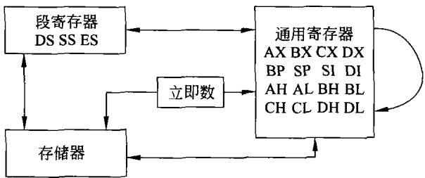  
图4-11数据传送示意图

指令例举如下。

（1）在CPU各内部寄存器之间传送数据（除代码段寄存器CS和指令指针IP以外）。

```csv
MOV AL,BL
MOV AX,DX
MOV CX,BX
MOV DX,ES
MOV SI,BP
```

（2）立即数传送至CPU的内部通用寄存器(即 AX、BX、CX、DX、BP、SP、SI、DI、AH、AL、BH、BL、CH、CL、DH、DL),给这些寄存器赋值。

```csv
MOVCL,4;8位数据传送（1个字节)
MOVAX,03FFH;16位数据传送
```

(3）CPU内部寄存器(除了CS和IP 以外)与存储器(所有寻址方式)之间的数据传送，与前述一样可以传送一个字节，也可以传送一个字。

·在CPU的通用寄存器与存储器之间传送数据。

```csv
MOV AL,BUFFER.
MOV AX,[SI]
MOV [DI],CX
MOV SI,BLOCK[BP]
```

·在CPU寄存器与存储器之间的传送数据。

```csv
MOV DS,DATA[SI+ BX]
MOV DEST[BP+ DI],ES
```

需要注意的是，MOV指令不能在两个存储单元器之间进行数据直接传送。为了实现存储器单元之间的数据传送，必须用内部寄存器作为中介。例如，为了将在同一段内的偏移地址为AREA1的数据传送到偏移地址为AREA2单元中去，就需要执行以下两条传送指令：

```csv
MOV AL,AREA1
MOV AREA2,AL
```

如果要求将内存中一个数据块搬移到另一个内存数据区中去，例如要将以 AREA1为首地址的100个字节数据搬移到以AREA2为首地址的内存中去，可以用带有循环控制的数据传送程序来实现。为此采用间接寻址方式,用SI存放源数据地址，DI存放目的数据地址,用CX作为循环计数控制单元。其程序如下。

```csv
MOV SI,OFFSET AREA1
MOV DI,OFFSET AREA2
MOV CX,100
AGAIN: MOV AL,[SI]
MOV [DI],AL
INC SI
INC DI
DEC CX
JNZ AGAIN
HLT
```

程序中INC、DEC分别为加1和减1指令;OFFSETAREA1是指地址单元AREA1在段内的地址偏移量。在寻址方式的介绍中已经提到，8086(88)中，要寻址内存中的操作数时，必须以段地址(放于某个段寄存器中)加上该单元的段内地址偏移量，才能确定内存单元的实际物理地址。

## 2.交换指令

```csv
XCHG OPRD1,OPRD2
目的 源
```

交换指令把一个字节或一个字的源操作数与目的操作数相交换。这种交换能在通用寄存器与累加器之间、通用寄存器之间、通用寄存器与存储器之间进行，例如；

XCHG AL,CL   
XCHG BX,SI   
XCHG AX,BUFFER   
XCHG BX,DATA[SI]

## 3.地址传送指令

8086有3条地址传送指令。

（1）LEA指令

LEA OPRD1,OPRD2

该指令把源操作数OPRD2的地址偏移量传送至目的地址OPRD1中。源操作数必须是一个内存操作数，目的操作数地址必须是一个16位的通用寄存器。这条指令通常用来建立串指令操作所需的寄存器指针。例如：

LEA BX,BUFR

是把变量BUFR的地址偏移量送到BX中。

## （2）LDS指令

该指令完成一个地址指针的传送。地址指针包括段地址和地址偏移量。指令执行时，将段地址送入DS,地址偏移量送人一个16位的通用寄存器。这条指令通常用来建立串指令操作所需的寄存器指针。例如：

LDSSI,[BX]

该指令是利用DS×16十BX的内容所构成内存地址，把由此地址开始的顺序4个单元的头两个单元的内容送DI,后两个单元的内容送入DS。

## （3）LES指令

这条指令除将地址指针的段地址送入ES外，其他操作与LDS的相同。例如：

```csv
LES DI,[BX+CONT]
```

该指令是利用DS×16十BX十CONT所构成内存地址，把由此地址开始的顺序4个单元中开始两个单元的内容送SI，后两个单元的内容送人ES。

## 4．堆栈操作指令

堆栈是内存中的一个特定区域，由SS的内容和SP的内容来决定。对堆栈的操作具有先人后出的特点。用于堆栈操作的指令主要如下。

PUSH OPRD(压人堆栈指令)   
POPOPRD(弹出堆栈指令)

堆栈操作指令中的操作数可以是段寄存器(除CS)的内容、16位的通用寄存器(标志寄存器有专门的出入栈指令)以及内存的16位字。例如：

```csv
MOV AX,8000H
MOV SS,AX
MOV SP,2000H
MOV DX,3E4AH
PUSH DX
PUSH AX
```

当执行完两条压人堆栈的指令时，堆栈中的内容如图4-12所示。

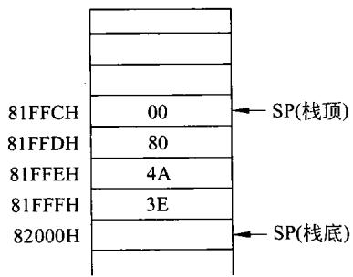

由图4-12可以解释压人堆栈指令的执行过程：

图4-12堆栈操作示意图

(1）SP-1→SP

(2）DH→(SP)

这就是把DX压入堆栈的过程。AX的压栈过程是一样的。

弹出堆栈的过程与此刚好相反，例如POPAX：

(1）(SP)→AL

(2）SP+1→SP

(3）(SP)→AH

(4）SP+1→SP

可见，SP的内容总是指向堆栈的顶。

以上堆栈操作是对8088 而言的。由于它的外部只有8位数据线，堆栈操作一定分两次进行，每次一个字节来完成。对8086来说，适当地选好堆栈的栈底，则8086CPU一次可压入或弹出一个字，时间上可以节省，而操作过程及堆栈的内容均与8088一样。

## 5．字节、字转换指令

有一条指令能将 AL 的符号位(bit7)扩展到整个AH中，它就是CBW 指令，即将字节转换成一个字。例如：

```csv
MOV AL,4FH
CBW
```

在执行完CBW之后，AX=004FH。

另一条指令是将AX的符号位(bit15)扩展到整个DX,它就是CWD指令，即将字转换成双字。例如：

MOVAX,834EH   
CWD

执行完CWD之后,DX=FFFFH,DXAX=FFFF834EH

以上这些包括在传送指令中的5类指令的执行都不影响标志位。

## 6．标志寄存器传送指令

（1）LAHF

该指令的功能是将标志寄存器的低字节传送到AH中。

(2) SAHF

该指令是将AH的内容传送到标志寄存器的低字节中。

（3）PUSHF

将标志寄存器的内容压人堆栈。

（4）POPF

由堆栈弹出一个字放人标志寄存器中。

利用上面的指令可以设置标志寄存器中的标志位。例如，利用下面的指令可使T标志置1而其他标志不变。

PUSHF   
POP AX   
OR AH,01H   
PUSH AX   
POPF

程序中OR为或指令，后面即将说明。

## 7．XLAT换码指令

执行该指令是在DS决定的数据段中，并以BX的内容与AL的内容相加作为偏移地址，构成内存地址。也就是DS×16十BX十AL为内存地址，由该地址取一个字节放在 AL中。该指令用于将一种代码转换为另一种代码。

## 4.3.2算术运算指令

8086(88)可提供加、减、乘、除4种基本算术运算的操作指令。这些指令可实现字节或字的运算，也可以用于符号数和无符号数的运算。

8086(88)还提供各种校正操作，故可以进行十进制的算术运算。

进行加、减运算的源操作数和目的操作数的关系如图4-13所示。

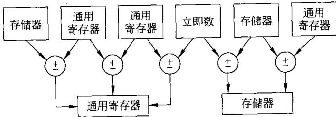  
图4-13加、减运算操作数之间的关系

## 1．加法指令

（1）ADDOPRD1,OPRD2（加法）

这条指令完成两个操作数相加，结果送至目的操作数OPRD1，即

OPRD1←OPRD1+OPRD2

目的操作数可以是累加器、任一通用寄存器或存储器中的操作数。

具体地说，该指令可以实现累加器与立即数、累加器与任一通用寄存器、累加器与存储单元内容相加，其和放回累加器中，例如：

```csv
ADD AL,30
ADD AX,SI
ADD AL,DATA[BX]
```

该指令也可以实现任一通用寄存器与立即数、累加器或别的寄存器、存储单元的内容相加，其和放回寄存器中，例如：

```csv
ADD BX,3FFFH
ADD SI,AX
ADD DX,DATA[BX+SI]
```

该指令还可以实现存储器操作数与立即数、累加器或别的寄存器的内容相加，其和放回存储单元中，例如：

```csv
ADDBETA[SI],100
ADD BETA[SI],AX
ADD BETA[SI],DX
```

上述所有加法指令执行时,对标志位CF、OF、PF、SF、ZF 和 AF 都会产生影响。

## （2）ADC指令（带进位加法）

这条指令与ADD指令基本相同，只是在对两个操作数进行相加运算时还应加上进位标志的当前值，然后再将结果送至目的操作数。

ADC指令主要用于多字节（多字)运算。例如，两个4字节的数相加，应分两次进行。先进行低两个字节的相加，然后再做高两字节的相加。在高两字节相加时，要把低位两个字节相加所出现的进位考虑进去，这就要用到带进位的加法指令ADC。

```csv
MOV AX,FIRST
ADD AX,SECOND
MOV THIRD,AX
MOv AX,FIRST+2
ADC AX,SECOND+ 2
MOV THIRD+ 2,AX
```

该指令对标志位的影响与ADD指令对标志位的影响相同。

## （3）INCOPRD指令（加1）

这条指令对指定的操作数进行加1操作，在循环程序中常用于修改地址指针和循环次数等。其操作数可以在通用寄存器中，也可以在内存单元中。

该指令执行结果对标志位AF、OF、PF、SF和ZF有影响，而对CF位不产生影响，例如：

INC AL   
INC BYTE PTR[SI]

## 2.减法指令

## （1）SUB OPRD1,OPRD2(减法）

该指令实现两个操作数的相减，即从OPRD1中减去OPRD2，其结果放于OPRD1中。具体可见图4-13所示。例如：

```csv
SUBCX,BX
SUB[BP+2],CL
```

## （2）SBB指令（带借位减法）

该指令与SUB相类似，只不过在两个操作数相减时，还应减去借位标志CF的当前值。与ADC一样，这条指令主要用于多字节的减法运算。

该指令对标志位AF、CF、OF、PF、SF和ZF都将产生影响。

## （3）DEC OPRD 指令（减1)

该指令实现对操作数的减1操作，所用的操作数可是寄存器，也可是内存单元。在相减时，把操作数看做无符号的二进制数。该指令执行结果将影响标志位AF、OF、PF、SF和ZF,但对CF标志不产生影响，例如：

DEC BX   
DEC WORD PTR[DI]

## （4）NEG OPRD

该指令用来对操作数进行求补操作，即用零减去操作数，然后再将结果送回，例如：

NEG AL   
NEG MULRE

该指令对字节操作时，若是对一128求补或在对字操作时，若是对一32768求补，则操作数不变，但是此时溢出标志OF将置位为1。

该指令影响标志位AF、CF、OF、PF、SF 和ZF。执行结果一般总是使标志位CF=1，除非在操作数为零时，才会使CF=0。

## （5）CMP OPRD1,OPRD2

该指令为比较指令，完成OPRD1一OPRD2的操作，这一点与减法指令相同，而且相减结果也同样反映在标志位上。它与减法指令SUB的主要不同点是相减后不回送结果，即执行比较指令前后，两个操作数的内容是不改变的。

比较指令可以用于累加器与立即数、累加器与任一通用寄存器或任一内存操作数之间的比较。例如：

```csv
CMP AL,100
CMP AX,DATA[BX]
```

该指令也可以用于任一寄存器与立即数或别的寄存器及任一内存操作数之间的比较，例如：

```csv
CMPBX,04FEH
CMPCX,COUNT[BP]
```

该指令还可以用于内存操作数与立即数及任一寄存器中操作数之间的比较，例如：

```csv
CMPDATA,100
CMPPOINTER[DI],BX
```

比较指令主要用来确定两个数之间的关系，如两者是否相等，两个中哪一个大等问题。在比较指令以后，通常要对标志位进行检查。标志位的不同状态，代表着两个操作数的不同关系。例如，标志位ZF=1，表明两个进行比较的操作数是相等的。

如果对两个无符号数进行比较，则在比较指令之后，可以根据CF标志位的状态来判断两个数的大小。例如，比较指令：

CMPAX,BX

执行以后，若CF 标志位置位，则可以确定AX中的数小于BX中的数;反之则 AX中的数大于或等于BX中的数。

两个带符号数的判别就比较麻烦。因为此时无法根据某一标志位的状态(SF或CF)来判断两个数的大小。此时应分成几种情况加以判断。

例如,在 CMP AX,BX 比较指令中,若 AX与 BX 中数的符号相同,即 AX>O,BX>0

或 $_ { \mathrm { A X } < 0 , \mathrm { B X } < 0 }$ ,则 AX一BX不会产生溢出,此时可根据 SF标志位的状态判断两个数的大小,即 $\mathrm { S F } { = } 0$ ，,则 $\mathrm { A X } { \geqslant } \mathrm { B X } ; \mathrm { S F } { = } 1$ ,则AX<BX。

若 AX 和 BX中数的符号不同。即 AX>O,BX<0或 $_ { \mathrm { A X } < 0 , \mathrm { B X } > 0 }$ ,那么AX-BX就有可能产生溢出。若AX一BX没有产生溢出，则仍可用 SF 标志判别两个数的大小，仍可沿用上述规律;但是若 AX一BX产生了溢出，则当 SF=1时， $\mathrm { A X } { \geqslant } \mathrm { B X } ; \mathrm { S F } { = } 0$ 时， $\mathrm { A X } { < } \mathrm { B X }$

综上所述，可以归纳出如下结论。

当没有溢出时(OF=0),若 $\mathrm { S F } { = } 0$ ，则 $\mathbf { A X } { \geqslant } \mathbf { B X }$ ，若 $\mathrm { S F } { = } 1$ ，则 $\mathbf { A X } { < } \mathbf { B X }$

当产生溢出时(OF=1),若 $\mathrm { S F } { = } 0$ ，则 $\mathbf { A X } { < } \mathbf { B X }$ ，若 $\mathrm { S F } { = } 1$ ，则 $\mathbf { A X } { \geqslant } \mathbf { B X }$ 。

用逻辑表达式又可简化为：

若OF④SF=0,则 $\mathrm { A X } { \geqslant } \mathrm { B X }$ 。

若 $\mathrm { O F } \ @ \mathrm { S F } = 1$ ，则 $\mathbf { A X } { < } \mathrm { B X }$ 。

在程序设计中，可利用比较指令产生程序转移的条件。CPU中有专门的指令来判断上述条件并产生转移。

例如，若自BLOCK开始的内存缓冲区中，有100个带符号的16位数，希望找到其中最大的一个值，并将它放到 MAX单元中。

这是一个循环程序。循环程序开始应置初值，包括循环次数为99次。在循环体中应包括比较指令和转移控制指令。满足上述功能要求的程序如下。

```csv
MOV BX,OFFSET BLOCK
MOV AX,[BX]
INC BX
INC BX
MOV CX,99
AGAIN: CMP AX，[BX]
JG NEXT
MOV AX，[BX]
NEXT: INC BX
INC BX
DEC CX
JNE AGAIN
MOV MAX, AX
HLT
```

## 3.乘法指令

8086(88)的乘法指令分为无符号数乘法指令和带符号数乘法指令两种。

（1）无符号数乘法指令MUL

①8位乘法

被乘数隐含在AL中，乘数为8位寄存器或存储单元的内容，乘积一定放在AX中。例如：

MULBL

## ②16位乘法

被乘数隐含在AX中，乘数为16位寄存器或两顺序存储单元构成的16位字，乘积放在DX 和AX连在一起构成的32位寄存器中。例如：

MUL CX

## （2）带符号数乘法指令IMUL

这是一条带符号数的乘法指令，它和MUL一样可以进行字节和字节、字和字的乘法运算（即8位带符号数乘法和16位带符号数乘法）。结果放在AX或DX中。当结果的高半部分不是结果的低半部分的符号扩展时，标志位CF和OF将置位。

## 4．除法指令

除法指令包括无符号除法指令和带符号除法指令。

## （1）无符号除法指令DIV

可实现8位除法和16位除法运算。

## ①8位除法

被除数隐含在AX中，除数可以是8位寄存器或存储单元的8位无符号数。指令执行结果商在AL中，余数在AH中。例如：

```csv
MOV AX,1000
MOV BL,190
DIV BL
```

则在AL中有商为5，而AH中有余数50。

## ②16位除法

被除数放在DX、AX 连到一起的32位寄存器中（隐含），除数为16位寄存器的内容或两连续存储单元构成的16位字；商在AX中，余数在DX中。例如：

```csv
MOVAX,1000
CWD
MOV BX,300
DIV BX
```

则执行结果AX=3,DX=100。

## （2）带符号除法指令IDIV

该指令是带符号的除法指令。除后,余数符号与被除数相同,其他同DIV指令。

## 5.调整指令

8086(88)的调整指令主要用于十进制数的调整。

AAA-—对AL中 ASCII未压缩的十进制和进行调整。

AAS——对AL中ASCII未压缩的十进制差进行调整。

AAD-—在除法指令前对AX中ASCII未压缩的十进制数进行调整。

AAM——对AX中两个ASCII未压缩十进制相乘结果进行调整。

DAA一—对AL中的两个压缩十进制数相加之和进行调整，得到压缩十进制和。

DAS-—-对AL中的两个压缩十进制数相减之差进行调整,得到压缩十进制差。

## 4.3.3逻辑运算和移位循环指令

这类指令包括逻辑运算、移位和循环移位三部分指令。

## 1．逻辑运算指令

## （1）NOT指令

该指令对操作数进行求反操作，然后将结果送回。操作数可以是寄存器或存储器的内容。该指令对标志位不产生影响。例如：

NOT AL

## （2）AND指令

该指令对两个操作数进行按位相“与"的逻辑运算。即只有参加相“与"的两位全为“1”时，相"与"结果才为“1”；否则相“与”结果为“0”。指令将相“与"结果送回目的操作数地址中。

AND指令可以进行字节操作，也可以进行字操作。AND指令的一般格式为：

AND OPRD1,OPRD2

其中，目的操作数OPRD1可以是累加器，也可以是任一通用寄存器，也可以是内存操作数。源操作数OPRD2可以是立即数、寄存器，也可以是内存操作数，例如：

AND AL,OFH

AND AX,BX

某一个操作数，如果自己与自己相"与”,操作数不变，但可以使进位标志位CF清0。

AND指令主要用于使操作数的若干位不变，而使某些位为0的场合。此时，不变的那些位应和1相"与”，而需要置0的那些位应与0相"与”。例如，要使AL中最低两位置0，而其他位不变，可以使用如下的相“与"指令：

## AND AL,OFCH

该指令执行以后，标志位CF=0,OF=O。标志位PF、SF、ZF反映操作的结果，而标志位AF未定义。

## （3）TEST指令

该指令的操作功能与AND指令相同，但结果不送回，其结果将反映在标志位上，即TEST 指令将不改变操作数的值，只影响CF、PF、ZF、SF、OF 标志位。

这条指令通常是在不希望改变操作数的前提下，用来检测某一位或某几位的状态。

TEST指令的一般格式为：

TEST OPRD1,OPRD2

(4）OR指令

该指令对两个操作数进行按位相"或"的逻辑操作，即进行相"或"的两位中的任一位如

果为1时，则相"或"的结果为1;如果两位都为0时，其结果才为0。OR指令操作结果将送回目的操作数的地址中。

OR 指令允许对字节或字进行相"或"运算。

OR指令可使标志位CF=0,OF=0；相"或"操作的结果反映在标志位PF、SF和 ZF上;对AF标志位未定义。

OR指令的一般格式为：

OR OPRD1,OPRD2

其中，目的操作数OPRD1可以是累加器，可以是任一通用寄存器，也可以是一个内存操作数。源操作数OPRD2可以是立即数，也可是寄存器，还可以是内存操作数。

操作数自身相"或"将不改变操作的值，但可使进位标志位CF清0。

相"或"操作主要用于要求使某一操作数的若干位不变，而另外某些位置1的情况。请注意，那些需要维持不变的位应与0相"或”，而需置1的那些位应与1相"或”。

## （5）XOR指令

该指令对两个操作数进行按位“异或"操作，即进行“异或"操作的两位值不同时，其结果为1;否则就为0，操作结果送回目的操作数的地址中。

XOR指令的一般形式为：

XOR OPRD1,OPRD2

其中，目的操作数OPRD1可以是累加器、任一个通用器，也可以是一个内存操作数。源操作数可以是立即数、寄存器，还可以是内存操作数。

当操作数自身进行“异或"时，由于每一位都相同，因此“异或"结果一定为0，且使进位标志也为0。这是对操作数清0的常用方法。例如：

XOR AX,AX

若要求一个操作数中的若于位维持不变，而某一些位取反时，就可用“异或"操作来实现。要维持不变的那些位应与“0"相“异或”；而要取反的那些位应与"1"相"异或”。

XOR 指令执行后，标志位CF=0,OF=0；标志位PF、SF、ZF将反映“异或"操作的结果。标志AF未定义。

## 2.移位指令

8086(88)有3条移位指令。

算术左移和逻辑左移指令：

SAL/SHL OPRD,m;m是移位次数,可以是1或寄存器CL中的内容

算术右移指令：

SAROPRD,m;m是移位次数，可以是1或寄存器CL中的内容

逻辑右移指令：

SHROPRD,m;m是移位次数，可以是1或寄存器CL中的内容

上述指令可以对寄存器操作数或内存操作数进行指定次数的移位，可以进行字节操作，也可以进行字操作。这些指令可以一次只移1位，也可以移位由CL寄存器中内容所指定的次数。

## (1）SAL/SHL指令

这两条指令的操作是完全一样的。每移位一次在右面最低位补一个0，而左面最高位则移人标志位CF，如图4-14所示。 MSB 操作数 LSB

左移次数为1的情况下，若移位完后，操作数的最高位与标志位CF不相等。则溢出标志位OF=1;否则OF=0。这主要用于判别移位前和移位后的符号位是否一致。标志位PF、SF、ZF表示移位以后的结果。

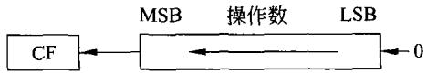  
图4-14 SAL/SHL操作示意图

## (2）SAR指令

该指令每执行一次移位操作，就使操作数右移一位，但符号位保持不变，而最低位移至标志位CF，如图4-15所示。

SAR可移位的次数由m所指定，结果影响标志位CF、OF、PF、SF和ZF。

## (3）SHR指令

该指令每执行一次移位操作，就使操作数右移一位，最低位移至标志位CF中。与SAR不同的是，左面的最高位将补0,如图4-16所示。

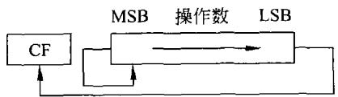  
图4-15SAR操作示意图

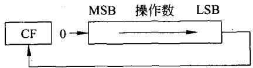  
图4-16 SHR 操作示意图

该指令可以执行由m 所指定的移位次数，结果影响标志位CF、OF、PF、SF和ZF。

## 3.循环移位指令

8086(88)有4条循环移位指令。

左循环移位指令：

ROLOPRD,m;m是移位次数,可以是1或寄存器CL中的内容

右循环移位指令：

ROROPRD,m;m是移位次数，可以是1或寄存器CL中的内容

带进位左循环移位指令：

RCLOPRD,m;m是移位次数,可以是1或寄存器CL中的内容

带进位右循环移位指令：

RCROPRD,m;m是移位次数,可以是1或寄存器CL中的内容

前两条循环指令未把标志位CF包含在循环中，后两条循环指令把标志位CF也包含在

循环中，作为整个循环的一个部分。

循环指令可以进行字节操作，也可以进行字操作。操作数可以是寄存器，也可以是内存单元。可以循环一次，也可以由寄存器CL的内容来决定循环次数。

## （1）ROL指令

该指令每做一次移位，总是将最高位移入进位CF中，并且还将最高位移人操作数的最低位，从而构成一个环，如图4-17(a)所示。

当规定的循环次数为1时，若循环以后的操作数的最高位不等于标志位CF，则溢出标志位OF=1;否则OF=0。这可以用来判断移位前后的符号位是否改变了。

ROL指令只影响标志位CF和OF。

## （2）ROR指令

该指令每做一次移位，总是将最低移入进位标志位CF中，另外，还将最低位移人操作数的最高位，从而构成一个环，如图4-17(b)所示。

当规定的循环次数为1时，若循环移位后，操作数的最高位和次高位不相等，则标志位CF=1;否则OF=0。这可以用来判别移位前后操作数的符号是否有改变。

该指令只影响CF和OF 标志位。

## （3）RCL指令

该指令是把标志位CF包含在内的循环左移指令。每移位一次，操作数的最高位移入进位标志位CF中，而原来CF的内容则移入操作数的最低位，从而构成一个大环，如图4-17（c）所示。

只有在规定循环次数为1时，若循环移位后的操作数的最高位与标志位CF不相等，则OF=1；否则OF=0。这可以用来判别循环移位前后的符号位是否发生了改变。

该指令只影响标志位CF和OF。

## （4）RCR指令

该指令是把进位标志位CF包含在内的右循环指令。每移位一次，标志位CF中的原内容就移入操作数的最高位，而操作数的最低位则移人标志位CF中，如图4-17(d)所示。

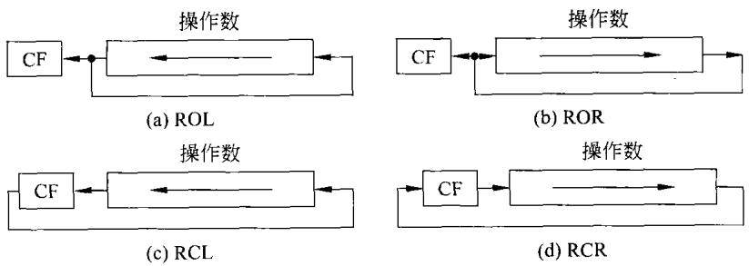  
图4-17循环移位指令示意图

只有当规定的循环次数为1时，在循环移位以后，若操作数的最高位与次高位不同，则OF=1;否则 $\mathrm { O F } { = } 0$ 。这可以用来判别循环移位前后的符号位是否有改变。

该指令只影响标志位CF和OF。

## 4.3.4串操作指令

在存储器中存放的一串字或字节，可以是二进制数，也可以是BCD码或ASCII码。它们存放在某一个连续的内存区中，若对它们的每个字或字节均做同样的操作，就称为串操作。把能完成这样功能的指令称为字符(或字)串操作指令或简称为串操作指令。

在串操作中，一般假定源串在数据段中(DS),而目的串在附加段中(ES)，用 SI做指针对源串寻址，用DI做指针对目的串寻址。在每做一次串操作后，若是对字节进行操作，则SI和 DI的值会自动加1或减1;若是对字进行操作,则 SI和DI的值就自动加2或减2,是加还是减由标志寄存器的方向标志位决定。若DF=0,则做加;否则，则做减。在操作前可用 STD指令使DF位置1;也可以用CLD指令使DF位清0。

## 1. M0VS/MOVSB/MOVSW

该类指令是串传送指令，用于内存区之间字节串或字串的传送。

该类指令执行时，将把当前数据段中用SI指针指出的源串的一个字节或一个字传送到用 DI指针指向的附加段的目的地址中去。当DF=0且字节传送时，则传送后SI,DI加1,以使指针指向下一个地址;当DF=0且是字传送时，则 SI和 DI都加2。若DF=1,则 SI和DI都减1或减2。

可见，上述指令只做两件事：字节或字从源地址传送到目的地址;地址修改。做完这两件事，这条指令就执行完了。该类指令一般格式为：

MOVS OPRD1,OPRD2 ;OPRD2是源串,OPRD1是目的串

MOVSB ;字节传送

MOVSW ;字传送

## 2.CMPS/CMPSB/CMPSW

该类指令是串比较指令，常用于内存区之间的数据、字符等的比较。

该类指令执行时，将当前数据段由SI所指出的字节和字同当前附加段中由DI所指出的目的串的字节或字进行比较，比较的结果只影响标志位。该指令对操作数不产生影响。

执行该指令就是由DS和 SI所决定的源操作数(字节或字)减去由ES 和DI所决定的目的操作数(字节或字)，相减的结果只影响标志而不进行传送。

该指令执行后,也将使 SI,DI加减1或2,具体由 DF 的值决定。该类指令的一般格式为：

CMPSOPRD1,OPRD2;OPRD1是源串,OPRD2是目的串

CMPSB ;字节比较

CMPSW ;字比较

同样，上述指令每执行一次仅做两件事：两字节或字比较(相减);地址自动修改。

## 3. SCAS/SCASB/SCASW

该类指令是串扫描指令或串搜索指令，用于寻找内存区中指定的数据或字符。

该类指令执行时,将AL或AX 的值减去附加段中由DI所指定的字节或字,结果将改变标志位，但不改变操作数的值。目的串指针DI将做修改，修改规则同上。

该类指令的一般格式为：

SCASOPRD

SCASB ;字节操作

SCASW ;字操作

## 4.LODS/LODSB/LODSW

该类指令是串装人指令。它将由DS和SI所指定的源串字节或字装人到累加器AL或AX中，并根据DF 的值修改指针 SI,以指向下一个要装入的字节或字。

该类指令的一般格式为：

LODS OPRD ;OPRD为源串

LODSB ;字节操作

LODSW ;字操作

## 5. STOS/STOSB/STOSW

该类指令是字串存储指令。它将AL或AX中的字节或字存储到由ES和DI所指定的附加段的存储单元中去，且根据DF的值来修改DI。

该类指令一般格式为：

STOS OPRD;OPRD为目的串

STOSB ;字节操作

STOSW ;字操作

上面提到的所有指令，每执行一次均只做两件事：完成某种操作；自动修改地址。因此，这些指令并未能对一串数据进行连续操作。若想实现对串操作数据连续进行操作，则可以利用下面的重复前缀来实现。

## 6.REP

它是串操作指令的重复前缀。当某一条串指令需要多次重复时，就可以加上该前缀。重复次数应放在寄存器CX中。这样每重复执行一次，CX内容减1，直到CX=0,才停止重复。例如：

```csv
MOV DX,8000H
MOV DS,DX
MOv DX,4000H
MOV ES,DX
MOV SI,1000H
MOV DI,3000H
MOV CX,2000H
CLD ;使DF=0
```

REPMOVSB  
HLT ;停机指令

上面程序用了重复前缀，可将以81000H开始的顺序8KB数据传送到以43000H开始的顺序8KB单元中。

## 7．REPE/REPNE

它们是条件重复前缀。当条件满足时，才重复执行后面的串指令；一旦条件不满足，重复就停止。

REPE前缀是相等重复前缀，即重复执行其后面的指令，每执行一次，CX一1→CX，若CX≠0，并且指令执行结果使ZF=1，则串指令就重复执行。只要CX≠0和ZF=1这两个条件有一个条件不满足，重复立即停止。

REPNE前缀是不相等重复前缀，即重复执行其后面的指令，每执行一次，CX一1→CX，若CX≠0，并且指令执行结果使ZF=0，则串指令就重复执行。只要CX≠0和ZF=0这两个条件有一个条件不满足，重复立即停止。

上述两条前缀有两个等效的名字REPZ/REPNZ,两者都可使用，都具有相同的效果。

条件重复前缀通常用在CMPS和SCAS串操作指令之前，用以判断这些指令的执行结果。例如，在上面利用REP前缀进行内存数据块搬移的基础上，现欲测试搬移的结果是否正确。若全对，则使CL=00H;若有错，使CL=EEH，程序如下。

```csv
MOV SI,1000H
MOV DI,3000H
MOV CX,2000H
REPE CMPSB
JCXz NEXT
MOV CL,OEEH
JMP ERROR ；发现有错，转到ERROR
NEXT:MOV CL,00H ;传送全对，则转到此
```

## 4.3.5程序控制指令

该类指令主要是指程序转移指令、子程序调用、返回等一系列重要指令。

## 1．无条件转移、子程序调用和返回指令

这些指令都将引起程序执行顺序的改变。转移有段内和段间转移之分。所谓段内转移是指段地址不变，仅IP发生改变；而段间转移，CS和IP均发生改变。

## （1）无条件转移指令JMP

该指令分直接转移和间接转移两种。直接转移又可分短程(SHORT）、近程(NEAR)和远程(FAR)3种形式。当程序执行到JMP指令时，就无条件地转移到所指的目的地址。该指令的一般格式为：

JMPOPRD;OPRD是转移的目的地址

①直接转移

直接转移的3种形式如下。

·短程转移 JMP SHORT NEXT

在短程转移中，目的地址与JMP指令所处的地址的距离应在－126～129 范围之内。

·近程转移 JMP NEAR PTR LOOP1

或 JMP LOOP1;NEAR可省略

近程转移的目的地址与JMP指令应处于同一地址段范围之内。近程转移的 NEAR往往予以省略。

·远程转移 JMP FAR PTR LOOP2

远程转移是段间的转移，目的地址与JMP指令所在地址不在同一段内。执行该指令时要同时修改CS和IP的内容。

②间接转移

间接转移指令的目的地址可以由存储器或寄存器给出。

·段内间接转移指令，例如：

JMPCX

JMP WORD PTR[BX]

·段间间接转移指令：

JMPDWORD PTR[BP][DI]

该指令指定的双字指针的第一个字单元内容送人IP,第二个字单元内容送出CS,所定义的单元必定是双字单元。

（2）调用和返回指令

子程序调用指令CALL用来调用一个过程或子程序。当调用的过程或子程序结束时，可使用返回指令RET,使程序从调用的过程或子程序返回。由于过程或子程序有段间（即远程 FAR)和段内调用(即近程 NEAR)之分，所以CALL也有FAR 和 NEAR之分。这由被调用过程的定义所决定。因此RET也分段间和段内返回两种。

调用指令一般格式为：

CALLNEAR PTR OPRD;段内调用

CALLFARPTROPRD;段间调用

其中OPRD为被调用的过程或子程序的首地址。

在段内调用时，CALL指令是将当前IP内容压人堆栈。当执行RET指令而返回时，再从堆栈中取出一个字放人IP中。在段间调用时,CALL指令先把CS压人堆栈,再把 IP 压人堆栈。当执行RET指令返回时，从堆栈中取出一个字放人IP中，然后从堆栈中取出第二个字放入CS中，作为段间返回地址。

## 2.条件转移指令

8086(88)有18条不同的条件转移指令。它们根据标志寄存器中各标志位的状态，决定程序是否进行转移。条件转移指令的目的地址必须在现行的代码段(CS)内，并且以当前指令指针寄存器IP的内容为基准，转移范围内在一128～十127的范围之内。因此条件转移指令的范围是有限的，不像JMP指令那样可以转移到内存的任何一个位置上。条件转移指令格式比较简单，如表4-2所示。

表4-2条件转移指令的格式和条件
<table><tr><td>指令助记符格式</td><td>条件说明</td><td></td><td>测试标志</td></tr><tr><td>JZ/JE</td><td>OPRD 结果为零</td><td></td><td>ZF=1</td></tr><tr><td> JNZ/JNE</td><td>OPRD</td><td>结果不为零</td><td>ZF=0</td></tr><tr><td>JS</td><td>OPRD</td><td>结果为负</td><td>SF=1</td></tr><tr><td>JNS</td><td>OPRD</td><td>结果为正</td><td>SF=0</td></tr><tr><td> JP/JPE</td><td>OPRD</td><td>结果中的1个数为偶数</td><td>PF=1</td></tr><tr><td>JNP/JPO</td><td>OPRD</td><td>结果中的1个数为奇数</td><td>PF=0</td></tr><tr><td>JO</td><td>OPRD</td><td>结果溢出</td><td>OF=1</td></tr><tr><td>JNO</td><td>OPRD</td><td>结果无溢出</td><td>OF==0</td></tr><tr><td> JB/JNAE,JC</td><td>OPRD</td><td>结果低于/不高于或不等于(无符号)</td><td>CF=1</td></tr><tr><td>JNB/JAE,JNC</td><td>OPRD</td><td>结果不低于/大于或等于(无符号)</td><td>CF=0</td></tr><tr><td> JBE/JNA</td><td>OPRD</td><td>结果低于或等于/不高于(无符号)</td><td>CFV ZF=1</td></tr><tr><td>JNBE/JA</td><td>OPRD</td><td>结果不低于或不等于/高于(无符号)</td><td>(CF=0)∧(ZF=0)</td></tr><tr><td>JL/JNGE</td><td>OPRD</td><td>小于/不大于或不等于(带符号)</td><td>SFVOF=1</td></tr><tr><td> JNL/JGE</td><td>OPRD</td><td>不小于/大于或等于(带符号)</td><td>SFVOF=0</td></tr><tr><td> JLE/JNG</td><td>OPRD</td><td>小于或等于/不大于(带符号)</td><td>(SFVOF) VZF=1</td></tr><tr><td>JNLE/JG</td><td>OPRD</td><td>不小于等于/大于(带符号)</td><td>（SFVOF)VZF=0</td></tr></table>

从该表可以看到，条件转移指令是根据两个数的比较结果和某些标志位的状态来决定是否转移的。

在条件转移指令中，有的根据对符号数进行比较和测试的结果实现转移。这些指令通常对溢出标志位OF和符号标志位SF进行测试。对无符号数而言，这类指令通常测试标志位CF。对于带符号数分大于、等于、小于3种情况；对于无符号数分高于、等于、低于3种情况。在使用这些条件转移指令时，一定要注意被比较数的具体情况及比较后所能出现的预期结果。对于初学者来说，对带符号数进行比较后，最好使用带符号数的转移指令；对无符号数进行比较后，最好使用无符号数的转移指令。当然，在熟悉这些指令的功能以后，就不--定受这种条件约束了。

有的指令既能用于带符号也能用于无符号数，例如JZ/JE和JNZ/JNE。还有专门测试CX的转移指令JCXZ。

## 3.循环控制指令

这类指令用于控制程序的循环，控制转向的目的地址是以当前IP的内容为中心的—128～十127的范围内。这类指令用CX做计数器，每执行一次指令，CX内容减1。有以下三条循环控制指令。

## （1）LOOPOPRD

每执行一次CX减1，CX≠0 则循环。

$$
( 2 ) ~ \mathrm { L O O P E / L O O P Z } ~ \mathrm { O P R D }
$$

每执行一次CX减1,CX≠0且前面指令的执行结果使ZF=1，则循环；两者之一或同时不满足，则停止循环。

$$
( 3 ) \mathrm { \ L O O P N E / L O O P N Z } \mathrm { O P R D }
$$

每执行一次CX减1,CX≠0且前面指令的执行结果使ZF=0,则循环;两者之一或同时不满足，则停止循环。

后两条指令常用在比较指令之后。

## 4.软中断指令及中断返回指令

在8086(88)系统中，当程序执行到中断指令INT时，便中断当前程序的执行，转向由256 个中断向量码(或称中断类型码)所提供的中断人口地址之一去执行。

软中断指令的一般格式为：

INT OPRD;OPRD可以取 OOH\~FFH中的值,即中断向量码

该指令执行的详细情况见第8章。

中断处理程序结束时，要再执行一条中断返回指令IRET，才可从中断处理程序返回原程序并开始执行原来的程序。

INTO是溢出中断指令。执行该指令时，CPU测试溢出标志位OF，当溢出标志位OF=1时，便进入溢出中断处理程序。其中断响应过程和INT指令的响应过程相同。当OF=0时，不产生溢出中断，CPU继续执行INTO后面的指令。

## 4.3.6处理器控制指令

该类指令用来控制处理与协处理器之间的交互作用，修改标志寄存器，以及使处理器与外部设备同步等。这类指令如表4-3所示。

表4-3处理器控制指令
<table><tr><td rowspan=1 colspan=2>汇编格式</td><td rowspan=1 colspan=1>操作</td></tr><tr><td rowspan=1 colspan=1>标志位操作指令</td><td rowspan=1 colspan=1>STCCLCCMCSTDCLDSTICLI</td><td rowspan=1 colspan=1>置进位标志，使CF=1清进位标志，使CF=0进位标志求反置方向标志，使DF=1清方向标志，使DF=0开中断标志,使IF=1清中断标志,使IF=0</td></tr><tr><td rowspan=1 colspan=1>外部同步指令</td><td rowspan=1 colspan=1>HLTWAITESCLOCKNOP</td><td rowspan=1 colspan=1>使 8088处理器处于停止状态,不执行指令使处理器处于等待状态使处理器从8088指令流中取得它的指令封锁总线指令，可放在任一指令前作为前缀空操作指令，处理器什么操作也不做</td></tr></table>

## 1．标志位操作指令

该类指令共有7条，分别对CF位、DF位及IF位进行操作。

## 2.外部同步指令

## （1）暂停指令HLT

执行该指令将使8086(88)处于暂停状态，只有在重新启动或一个外部中断发生时，8086(88)才能退出暂停状态。它常用来等待中断的产生。

## （2）空操作指令NOP

执行该指令并不产生任何结果，仅仅消耗3个时钟周期的时间，常用于程序的延时等。

## （3）等待指令WAIT

执行该指令，使8086(88)处于空操作状态，但每隔5个时钟周期要检测一下8086(88)的TEST输入引线。若该引线为输入为高电平，则仍继续检测等待；若为低电平，则退出等待状态。该指令主要用于8086(88)与处理器和外部设备之间的同步。

## （4）封锁总线指令LOCK

LOCK是一个指令前缀，可放在任何一条指令的前面。这条指令执行时，就封锁了总线的控制权，其他的处理器将得不到总线控制权，这个过程一直持续到指令执行完毕为止。它常用于多机系统。

## （5）处理器交权指令ESC

该指令执行时，可使处理器从8086（88)的指令流中取出一部分指令，并在处理器上执行。

## 4.3.7输入/输出指令

有的书中将输入/输出指令归属于传送指令。这里为了强调它的重要性，将它另立为一类指令，专门予以详细地介绍。

这类指令是专门用于对接口进行输人/输出操作的，其一般格式为：

IN ACC,PORT

OUT PORT,ACC

## 1.直接寻址

在这种方式下，输人/输出指令中直接给出接口地址，且接口地址由一个字节表示，例如：

IN AL,35H

OUT 44H,AX

由于指令中只能用一个字节表示接口地址，故在此种寻址方式下，可寻址的接口地址空间只有256个，即由00H到FFH。

## 2.寄存器间接寻址

在这种情况下，接口地址由16 位寄存器DX的内容来决定，例如：

```csv
MOV DX,03F8H
IN AL,DX
```

上述指令中,表示由接口地址03F8H(DX 的内容作为接口地址)读一个字节到 AL。

由于DX是一个16 位的寄存器,其内容可以从O000H到FFFFH,故其接口的地址范围为64KB。

值得注意的是,直接寻址时，接口地址直接给出，最大为256个接口地址；寄存器间接寻址只能用DX,最大可达64KB个接口地址；在这两种寻址之下，字节传送只能用AL,而字传送只能用AX。

## 4.3.8位操作指令

位操作指令是对某一位进行操作的指令，也就是对一个字(或字节)中的某一位进行操作的指令。8086的位操作指令仅在处理器控制指令中有几条很简单的指令。下面介绍的是 MCS-51的位操作指令。

## 1．位传送指令

位传送指令有：

MOVC，bit；将位地址的内容传送到进位标志CF中

MOVbit，C；将位地址的内容传送到进位标志CF中

## 2．位控制指令

位控制指令有如下几条。

CLR C；将进位标志CF清零

SETB C；将进位标志CF置1

CLRbit；将位地址的内容清零

SETB bit；将位地址的内容置1

CPL C；将进位标志CF取反

CPLbit；将位地址的内容取反

## 3.位逻辑运算指令

位逻辑运算指令有：

ANLC，bit；进位标志CF与位地址的内容相与,结果放在CF中

ANLC，/bit；进位标志CF与位地址的内容的反码相与,结果放在CF中

ORLC，bit；进位标志CF与位地址的内容相或,结果放在CF中

ORLC，/bit；进位标志CF与位地址的内容的反码相或,结果放在CF中

## 4.位转移指令

位转移指令包括：

JB bit，rel；功能为：若(bit)=1,则转移;(bit)=0,则顺序执行

JNB bit，rel；功能为：若(bit)=0,则转移;(bit)=1,则顺序执行

JBC bit，rel；功能为：若(bit)=1,则转移并且 $0 \to ( \mathtt { b i t } )$ ;若(bit)=0,则顺序执行

## 4.3.9其他指令

除上面所提到的基本的、常用的指令外，在许多CPU中还会设置一些功能更强的专用的指令，如数据转换指令、特权指令、DSP(数字信号处理)指令、MMX(SIMD多媒体指令集）、SSE、SSE2、SSE3、SSE4(数据流SIMD扩展指令集)等，本书不做说明。

## 4.4汇编语言及其程序设计

用指令的助记符、符号地址、标号、伪指令等符号编写程序的语言称为汇编语言。用这种汇编语言书写的程序叫做汇编语言源程序或称源程序。把汇编语言源程序翻译成在机器上能执行的机器语言程序(目的代码程序)的过程叫做汇编，完成汇编过程的系统程序为汇编程序。

汇编程序在对源程序进行汇编的过程中，除了将源程序翻译成目的代码外，还能给出源程序书写过程中所出现的语法错误信息，如非法格式，未定义的助记符、标号，漏掉操作数等。另外，汇编程序还可以根据用户要求，自动分配各类存储区域（如程序区、数据区、暂存区等)，自动进行各种进制数至二进制数的转换，自动进行字符至ASCII码的转换及计算表达式的值等。

汇编程序随CPU的更新而不断更新，版本不断提高，且是向上兼容的。

根据运行汇编程序的宿主机不同，汇编程序可以分为交叉汇编和驻留汇编两种。

（1）交叉汇编程序：运行这种汇编程序的计算机与该汇编程序所要汇编成目的程序的机器是不同的。例如，汇编程序可以在PC系统上运行，而所汇编成的目的代码是在MCS-51系列微机上执行的。

（2）驻留汇编程序：运行这种汇编程序的微机系统就是执行汇编后形成目的代码程序的系统。例如，在PC上对8086(88)的汇编语言源程序进行汇编，汇编后的目的程序就在PC上执行。

## 4.4.1汇编语言的语句格式

由汇编语言编写的源程序是由许多语句(也可称为汇编指令)组成的。每个语句由1～4个部分组成，其格式是：

[标号]指令助记符[操作数][;注解]

其中用方括号括起来的部分，可以有，也可以没有(请读者注意，方括号在语句中并不出现，只是为了便于解释而在此加标注，在以后的格式说明中也采用此类方法）。每个部分之间用空格(至少一个)分开，这些部分可以在一行的任意位置输人，一行最多可有132个字符，最好小于80个字符。这样做便于用户阅读源程序。

## 1．标号（也叫做名称）

这是给指令或某一存储单元地址所起的名字，名称可由下列字符组成。

字母：A\~Z或a～z。

数字：0～9。

特殊字符：“？”,“·”,“@”,“-”,"\$”。

数字不能做名称的第一个字符，而圆点仅能用做第一个字符。标号最长为31字符。

当名称后跟冒号时，表示是标号。它代表该行指令的起始地址，其他指令可以引用该标号，做转移的符号地址。

当名称后不带冒号时，有可能是标号，也可能是变量。伪指令前的名称不加冒号，当标号用于段间调用时，后面也不能跟冒号，例如：

段内调用 OUTPUT：IN AL,DX

段间调用 OUTPUT IN AL,DX

## 2.指令助记符

指令助记符表示不同操作的指令，可以是8086(88)的指令助记符，也可以是伪指令。如果指令带有前缀(如LOCK、REP、REPE/REPE、REPNE/REPNZ),则指令前缀和指令助记符要用空格分开。

## 3.操作数

操作数是指令执行的对象。依指令的要求，可能有一个、两个或者没有操作数，例如：

RET ；无操作数COUNT:INC SI ；一个操作数MOV CX,DI ;两个操作数

如果是伪指令，则可能有多个操作数，例如：

COST DB3,4,5,6,7;5个操作数

当操作数超过1个时，操作数之间应用逗号分开。

操作数可以是常数、寄存器名、标号、变量，也可以是表达式，例如：

MOVAX,[BP+4] ；第二个操作数为表达式

## 4.注解

该项可有可无，是为源程序所加的注解，用于提高程序的可读性。在注解前面要加分号，它可位于操作数之后，也可位于一行的开头。汇编时，对注解不做处理，仅在列源程序清

单时列出，供编程人员阅读。

注解一般都使用英文，在支持汉字的操作系统中，也可使用中文。

## 4.4.2常数

汇编语言语句中出现的常数可以有7种。

## 1.二进制数

二进制数字后跟字母B,如01000001B。

## 2.八进制数

八进制数字后跟字母Q或O，如202Q或202O。

## 3．十进制数

十进制数字后跟D或不跟字母，如85D或85。

## 4.十六进制数

十六进制数字后跟H,如56H,0FFH。注意，当数字的第一个字符是A～F时，在字符前应添加一个数字0，以示和变量的区别。

## 5.十进制浮点数

十进制浮点数的一个例子是25E一2。

## 6．十六进制实数

十六进制实数后跟R,数字的位数必须是8、16或20。在第一位是0的情况下，数字的位数可以是9、17或21，如0FFFFFFFFR。

以上第5项和第6项中，这两种数字格式只允许在MASM中使用。

## 7．字符和字符串

字符和字符串要求用单引号括起来，如‘BD’。

## 4.4.3伪指令

伪指令是用来对汇编程序进行控制，可对程序中的数据实现条件转移、列表、存储空间分配等处理。其格式和汇编指令一样，但是一般不产生目的代码，即不直接命令CPU去执行什么操作，这就是“伪"的含义。伪指令很多，有七八十种，这里仅介绍常用的几种。

## 1．定义数据伪指令

该类伪指令用来定义存储空间及其所存数据的长度。

DB——定义字节,即每个数据是1个字节。

DW——定义字，即每个数据占1个字(2)个字节。

DD——定义双字,即每个数据占2个字。低字部分在低地址，高字部分在高地址。

DQ——定义4字长，即每个数据占4个字,8个字节。

DT——定义10个字节长,用于压缩式十进制数。例如：

DATA1 DB 5,6,8,100

表示从DATA1单元开始，连续存放5,6,8,100，共占4个字节地址。

定义一个存储区时，也可以不放数据，如：

TABLE DB？

表示在TABLE单元中存放的内容是随机的。

当一个定义的存储区内的每个单元要放置同样的数据时，可用DUP操作符，例如：

BUFFER DB 100 DUP(0)

表示以BUFFER为首地址的100个字节中存放00H数据。

## 2．符号定义伪指令EQU

EQU伪指令给符号定义一个值。在程序中，凡是出现该符号的地方，汇编时均用其值代替，例如：

TIMES EQU 50

DATADBTIMESDUP(?)；"?"表示数据是随机的,不需初始化

上述两个语句实际等效于如下一条语句：

DATA DB 50 DUP(?)

## 3．段定义伪指令SEGMENT和ENDS

一般来说，一个完整的汇编源程序至少由3个段组成，即堆栈段、数据段和代码段。段定义伪指令可将源程序划分为若干段，以便生成目的代码和连接时将各同名段进行组合。

段定义伪指令一般格式为：

段名SEGMENT[定位类型][组合类型][类别]

段名ENDS

SEGMENT和ENDS应成对使用，缺一不可。伪指令各部分书写规定如下。

（1）段名：段名是不可省略的。其他括号部分是可选项，是赋予段的属性，可以省略。段名是给定义的段所起的名称，例如：

STACK SEGMENT STACK

DW20 DUP(?)

STACK ENDS

（2）定位类型：定位类型表示该段起始地址位于何处，它可以是字节型的(BYTE)，即段起始地址可位于任何地方；可以是字型(WORD)的，段起始地址必须位于偶地址，即地址最后一位是0(二进制的);也可以是节型(PARA)的，即段起始地址必须能被16除尽；也可以是页型的(PAGE)，即段起始地址可被 256 除尽(1页为256个字节)；也可以缺省。缺省时，段起始地址便定位为PARA型。

（3）组合类型：组合类型用于告诉连接程序，该段和其他段的组合关系。连接程序可以将不同模块的同名段进行组合。根据组合类型，可将各段连接在一起，或重叠在一起，组合类型有如下几种。

NONE——表明本段与其他段逻辑上不发生关系，当组合类型项省略时，便指定为这一组合类型。

PUBLIC——表明该段与其他模块中用PUBLIC说明的同名段连接成一个逻辑段，运行时装人同一个物理段中，使用同一段地址。

STACK—每个程序模块中，必须有一个堆栈段。因此连接时，将具有STACK类型的同名段连接成一个大的堆栈，由各模块共享。运行时，SS和SP指向堆栈的开始位置。

COMMON——表明该段与其他模块中由COMMON说明的所有同名段连接时，被重叠放在一起，其长度是同名段中最长者的长度。这样可使不同模块的变量或标号使用同一存储区域，便于模块间通信。

MEMORY——由MEMORY说明的段，在连接时，它被放在所装载的程序的最后存储区(最高地址）。若几个段都有MEMORY组合类型，则连接程序以首先遇到的具有MEMORY组合类型的段为准，其他段则认为是COMMON型的。

AT表达式—表明该段的段地址是表达式所给定的值。这样，在程序中就可由用户直接来定义段的地址。但这种方式不适用于代码段。

（4）类别：类别是用单引号括起来的字符串，以表示该段的类别，如代码段（CODE）、数据段(DATA）、堆栈段(STACK)等。当然也允许用户在类别中用其他的名字，这样进行连接时，连接程序便将同类别的段(但不一定同名)放在连续的存储区内。

## 4.设定段寄存器伪指令ASSUME

ASSUME一—段寄存器定义伪指令。它可通知汇编程序，哪一个段寄存器是哪一段的段寄存器，以便对使用变量或标号的指令汇编出正确的目的代码，其格式为：

ASSUME段寄存器:段名[,段寄存器：段名，]

通常，CODE段为代码段，DATA段为数据段，STACK段为堆栈段。定义代码段时，应在段定义伪指令后，紧接着加一条ASSUME伪指令，以告诉汇编程序，相应段的地址存于哪一个段寄存器中。由于ASSUME 伪指令只是指明某一个段地址对应于哪一个段寄存器中，并没有包含将段地址送人该寄存器的操作。因此要将真实段地址装入段寄存器还需要用汇编指令来实现，这一步是不可缺少的，例如：

CODE SEGMENT

ASSUMECS:CODE,DS:DATA,SS:STACK

MOV AX,DATA

```csv
MOVDS,AX
：
CODEENDS
```

## 5．定义过程的伪指令PROC和ENDP

在程序设计中，可将具有一定功能的程序段看成为一个过程(相当于一个子程序)。它可以被别的程序调用(用CALL指令)或由JMP指令转移到此执行;也可以由程序顺序执行；还可以作为中断处理程序，在中断响应后转至此执行。一个过程由伪指令PROC 和ENDP来定义，其格式为：

过程名PROC[类型]   
：过程体   
RET   
过程名 ENDP

其中过程名是为过程所起的名称，不能省略；过程的类型由FAR和NEAR来确定；ENDP表示过程结束。请读者注意，过程体内至少有一条RET指令，以便返回被调用处。过程可以嵌套,即一个过程可以调用另一个过程，过程也可以递归使用，即过程可以调用过程本身。

与前面转移指令JMP所述相似，过程也分近过程(类型 NEAR)和远过程(类型为FAR)。前者只在本段内调用，后者为段间调用。如果过程缺省类型，则该过程就默认为近过程。

例如，一个延时100ms的子程序，可利用软件延时的办法来实现。

假定 8086(88)CPU的时钟频率为 5MHz,查厂家的手册可知,LOOP 指令周期为17个时钟周期，定义过程如下：

SOFTDLY PROC NEAR   
MOV BL,10   
;内环延时10ms   
DELAY: MOV CX,2941   
WAIT0: LOOP WAIT 0   
DEC BL   
JNZ DELAY   
RET   
SOFTDLY ENDP

## 6．模块间通信的伪指令PUBLIC,EXTRN

当多个目的程序连接时，为了使连接程序正确地连接，必须互相提供一些信息：指出哪些标识符(即名称)是当前模块的，哪些标识符是来自其他模块的，模块内的哪些标识符可供其他模块使用，即通过标识符的相互使用来交换信息。PUBLIC和EXTRN伪指令可完成此功能，其一般格式为：

PUBLIC名称［,名称,]

EXTRN名称:类型[,名称:类型…]

其中名称可以是变量名或标号。若是变量名,则类型可以是BYTE、WORD、DWORD;若是标号，则类型是NEAR或FAR。

PUBLIC伪指令所指出的名称是在本模块中定义的，可供其他模块使用。凡未用PUBLIC定义的名称,不能被别的模块采用，若采用则会出错。这样可以避免由于不同人编写的模块可能有重名的变量或标号而出现混乱。因为没有该PUBLIC伪指令说明，虽然不同模块有重名，但是别的模块不能用，即各自用各自的名称，故不会出错。

EXTRN伪指令告知连接程序，其后面所指的名称在本模块中没有定义，而是由外部其他模块定义的名称，但本模块要使用它。该伪指令的类型部分是对变量进行说明的，以便汇编程序在汇编时能根据所指的类型生成正确的机器代码。应该注意，该伪指令在程序中必须在使用该外部名称之前进行说明，否则会出现未定义名称的错误。

## 7．宏命令伪指令

在汇编语言书写的源程序中，若有的程序段要多次使用，为了简化程序书写，该程序段可以用一条宏命令来代替，而汇编程序汇编到该宏命令时，仍会产生源程序所需的代码。例如：

```csv
MOV CL,4
SAL AL,CL
```

若该两条指令在程序中要多次使用，就可以用一条宏命令来代替。当然在使用宏命令前首先要对宏命令进行定义，例如：

SHIFT MACRO   
MOV CL,4   
SAL AL,CL   
ENDM

这样定义以后，凡是要使AL中内容左移4位的操作都可用一条宏命令SHIFT来代替。宏命令的一般格式为：

宏命令名MACRO[形式参量表]  
：宏体  
ENDM

其中，宏命令名是一个定义调用(或称宏调用)的依据，也是不同宏定义互相区别的标志，是必须有的。对于宏命令的规定与对标号的规定相一致。

宏定义中的形式参量表是任选的，可以有，也可以没有。表中可以只有一个参量，也可以有多个参量。在有多个参量的情况下，各参量之间应用逗号分开。

MRCRO是宏定义符，是和ENDM宏定义结束符成对出现的。这两者之间就是宏体，也就是该宏命令要代替的那一段程序，例如：

$$
\begin{array} { r l } { \mathtt { G A D D } } & { \mathtt { M A C R O } \quad \mathtt { X } , \mathtt { Y } , \mathtt { A D D } } \\ & { \mathtt { M O V } \quad \mathtt { A X } , \mathtt { X } } \end{array}
$$

```csv
ADD AX,Y
MOV ADD,AX
ENDM
```

其中X、Y、ADD都是形式参量。调用时，下面宏命令书写格式是正确的。

```csv
GADD DATA1,DATA2,SUM
```

这里DATA1、DATA2、SUM是实参量。实际上与该宏命令对应的源程序为：

```csv
MOV AX,DATA1
ADD AX,DATA2
MOV SUM,AX
```

宏命令与子程序有许多类似之处。它们都是一段相对独立的、完成某种功能的、可供调用的程序模块。定义后可多次调用。但在形成目的代码时，子程序只形成一段目的代码，调用时转来执行。而宏命令是将形成目的代码插到主程序调用的地方。因此，前者占内存少，但执行速度稍慢；后者刚好相反。

## 8．汇编结束伪指令END

该伪指令表示源程序的结束，令汇编程序停止汇编。因此，任何一个完整的源程序均应有 END指令，其一般格式为：

END[表达式]

其中表达式表示该汇编程序的启动地址。例如：

```csv
：
END START
```

则表明该程序的启动地址为START。

若几个模块连接在一起时，只有主模块可以有启动地址。

## 4.4.4汇编语言的运算符

汇编语言的运算符有算术符（如“十”,“一”，“×”，“/”等），逻辑运算符（AND、OR、XOR、NOT),关系运算符(EQ、NE、LT、GT、GE),取值运算符和属性运算符。前面3种运算符与高级语言中的运算符类似，此处不再做介绍。后两种运算符是8086(88)汇编语言特有的，下面对常用的几种运算符做介绍。

## 1．取值运算符SEG和OFFSET

这两个运算符给出一个变量或标号的段地址和偏移量。例如，定义标号SLOT为：

SLOTDW25

则下面的指令：

```csv
MOV AX,SLOT
```

将从 SLOT地址中取一个字送入AX中。假如要将 SLOT 标号所在段的段地址送入AX寄存器，则可用运算符SEG,其指令如下：

MOV AX,SEG SLOT

若要将 SLOT在段内的偏移地址送入AX 寄存器，则可用运算符OFFSET，其指令如下。

MOV AX,OFFSET SLOT

## 2.属性运算符

属性运算符用来给指令中的操作数指定一个临时属性，而暂时忽略以前的属性。常用的有如下几种。

指针运算符PTR：它作用于操作数时，则忽略了操作数以前的类型(字节或字)及属性（NEAR或FAR)，而给出一个临时的类型或属性，例如：

SLOT DW25

此时 SLOT已定义成字单元。若想取出它的第一个字节内容，则可用PTR对其作用，使它暂时改变为字节单元，即

MOV AL,BYTE PTR SLOT

改变属性的例子如下：

JMP FAR PTR STEP

这样,即使标号 STEP原先是 NEAR 型的,使用FARPTR后,这个转移就变成段间转移了。又如：

MOV[BX],5

这是一条错误的指令，因为汇编程序不能知道传送的是一个字节还是一个字。若是一个字节，则应写成：

MOVBYTE PTR[BX],5

若是字，则应写成：

MOV WORD PTR[BX],5

SHORT运算符：仅用于无条件转移指令，指出转移的标号不仅是NEAR型的，并且是在下一条指令地址的一128～十127个字节范围内。

## 4.4.5汇编语言源程序的结构

一般来说，一个完整的汇编程序至少应由3个程序段组成，即代码段、数据段和堆栈段。每个段都以SEGMENT开始，以ENDS结束。代码段包括了许多以符号表示的指令，其内容就是程序要执行的指令。堆栈段用来在内存中建立一个堆栈区，以便在中断、调用子程序

时使用。数据段用来在内存中建立一个适当容量的工作区，以存放常数、变量等程序需要对其进行操作的数据，还用来建立运算工作区和用于I/O接口的数据发送和接收的缓冲工作区。有的程序并不需要数据段和堆栈段，或仅需其中之一，不需要的可以省略。

数据段应放在代码段之前，这是因为在数据段中先定义了变量，然后才能在代码段中使用，否则汇编时，在代码段中用到的变量将不能确定其类型，致使汇编时得不到正确的机器代码,如：

MOVAL,WA

汇编程序不能确定WA是字节还是字，因而将给出错误信息，只有在数据段中WA定义为字节型变量时，这条指令才能正确汇编。

由上所述可知，一个源程序模块，一般都应有一个相同的结构，它们可以复制，这相当于一个基本的框架。编程时只要改变有关的名称，填入自己的程序内容即可。一个标准的程序结构如下。

```csv
STACK SEGMENT PARASTACK'STACK'
DW 500 DUP(0)
STACK ENDS
DATA SEGMENT
DATA ENDS
CODE SEGMENT
MAIN PROCFAR
ASSUME CS:CODE,DS:DATA,ES:DATA,SS:STACK
PUSH DS
MOV AX,0
PUSH AX
MOV AX, DATA
MOV DS,AX
MOV ES,AX
：
RET
MAIN ENDP
CODE ENDS
END MAIN
```

当然，上述标准结构仅仅是一个框架，形成实际程序模块时，还需要对它进行修改，如堆栈大小,数据段是否需要，其组合类型、类别等。

## 4.4.6汇编语言程序设计

利用不变的指令可以实现变化多样的程序。这有点类似于汇编语言和指令系统是基本原料，原料是不可改变的，但用这些原料可生产出花样繁多的产品。例如，大米和面粉是原料，不可改变。但用这些原料可以做出各种花样的食物来。因此，要求读者首先要记住汇

编语言和指令系统那些不可改变的规定，再掌握一些基本的程序设计方法，就可以设计出满足用户要求的程序。

## 1．程序设计概述

在这里，不去涉及软件工程的具体问题，只简单介绍程序设计的入门知识。一般可以按下面的步骤进行。

## （1）仔细了解用户的需求

这有时也称为需求调查。目的是为了弄清楚问题(或用户)的要求。后面所做工作的依据就来自于此，因此，这一步对于实际工程自然是十分重要的。

## （2）制定方案

这一步确定解决问题的算法、思路、程序设计方法及程序流程图。对各种方法进行仔细论证和比较，最后确定某一最佳方案。

## （3）编写程序

在前面方案及流程图的基础上，动手编写程序。尤其是对于汇编语言源程序，目前仍需要设计人员一条语句一条语句地编写。

## （4）查错

对于汇编语言源程序而言，首先利用汇编程序进行汇编，给出汇编过程中发现的明显的语法错误，如非法指令、标号重复等。然后利用专门的调试工具(例如DEBUG)查找逻辑及算法上的错误。

## （5）测试

在各种条件下，测试各种数据输入时，程序运行是否正确。对程序的测试必须全面，找出程序中所有可能的漏洞。

## （6）形成文件

当程序研制成功提交使用时，除了可执行文件之外，还应包括：程序的研制报告；程序的使用说明；程序流程图；程序清单及参数定义说明；内存分配表；程序测试方案及结果说明；程序维护说明。文件中还可以包括程序员所设计的详细流程图，程序结构及数据流程图。有时用户要求提供程序逻辑手册、用户使用指南及维护手册。程序逻辑手册是进一步简述软件的书面说明。

## 2.程序设计的基本方法

任何复杂的程序都是由一些简单的基本的程序构成的。在汇编语言程序设计中经常会用到这最基本的方法。下面将对它们逐一加以简单介绍。

## （1）顺序程序

顺序程序也称为简单程序，它确实是程序中最简单的形式。这种程序CPU执行时，是以指令的排列顺序逐条执行的。

【例4-1】 若m、n、w分别为三个8位无符号数,现欲求Q=m×n一w。若m、n、w存放在当前DS所决定数据段、偏移地址为DATA的顺序单元中，而且Q可放在AX中，则程序如下。

## LEA SI,DATA

```csv
MOV AL,[SI] ;取m放人AL
MOV BL,[SI+1] ;取n放人BL
MUL BL ;m×n放人AX
MOV BX,0
MOV BL,[SI+2] ;取w放人BL
SUB AX,BX ;mXn-w放人AX
```

上面的程序就是顺序程序，CPU执行时从上到下依次顺序执行。

## （2）分支程序

分支程序的基本结构如图4-18所示。

由图 4-18可见,分支程序的基本思路就是判断条件A是否成立，若成立,则执行 $\mathrm { { P } } _ { 1 }$ ；若不成立，则执行 $\mathrm { P } _ { 2 }$ 。现举例说明如下。

【例4-2】从接口03F0H中取数，若此数 ${ \geqslant } 9 0$ ,则将00H送接口 $0 3 \mathrm { F } 7 \mathrm { H } ;$ 若此数<90,则将FFH送接口03F7H。

程序如下：

```csv
MOV DX,03F0H
IN AL,DX ;从接口取数
CMP AL,90 ;判断数的大小
JNC NEXT1 ;≥90转向 NEXT1
MOV AL,OFFH
JMP NEXT2
NEXT1:MOV AL,00H
NEXT2: MOV DX,03F7H
OUT DX,AL
HLT
```

在分支程序中，若存在多种条件，则可以推广到如图4-19 所示的选择程序。

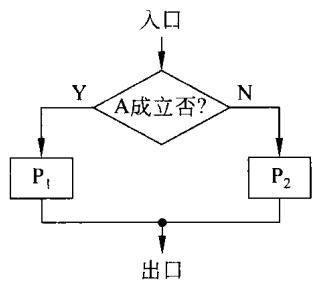  
图4-18分支程序的基本结构

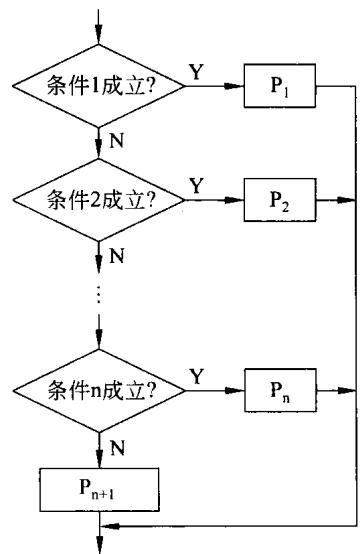  
图4-19选择程序结构图

【例4-3】在DS数据段偏移地址为DATA开始的顺序80个单元中，存放着某班80个同学的微型机原理考试成绩。现欲编程序统计≥90分，89分～70分、69分～60分和<60分的人数，并将统计的结果存放在当前数据段偏移地址为BUFFER的顺序单元中。程序如下。

```csv
START: MOV DX,0000H
MOV BX,0000H
MOV CX,80
LEA SI,DATA
LEA DI,BUFFER
GOON : MOV AL,[SI]
CMP AL,90;≥90分
JC NEXT3;<90分转移
INC DH;90分计数加1
JMP STOR
NEXT3:CMP AL,70
JC NEXT5
INC DL
JMP STOR
NEXT5: CMP AL,60
JC NEXT7
INC BH
JMP STOR
NEXT7:INC BL
STOR : INC SI
LOOP GOON
MOV [DI],DH
MOV [DI+1],DL
MOV [DI+2],BH
MOv [DI+3],BL
HLT
```

## （3）循环程序

循环程序是强制CPU重复执行某一指令集合的一种程序结构。它可以使许多重复性工作的程序大为简化。

循环程序通常有两种结构方式，如图4-20(a)和图4-20(b)所示。

循环程序的两种结构形式仅仅体现在工作部分上。图4-20(a)的工作部分至少执行一次，而图4-20(b)的工作部分有可能一次都不执行。

循环程序的初始化用来规定循环次数，设置地址指针，使某些存储单元或寄存器置初始值等。

循环控制部分要对变量或指针进行修改。修改指针是为下次循环做好准备。

条件判断用于对循环条件进行判别，决定循环继续进行还是结束。

工作部分则是循环程序要完成的基本功能。

在图4-20中所画的是单重的循环。在实际解决问题中还会出现二重循环甚至多重循

环的情况。只要单重循环的概念清楚，二重及多重循环也就容易解决。在此仅以简单的例子加以说明。

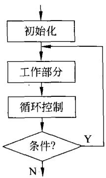  
(a)后判断条件

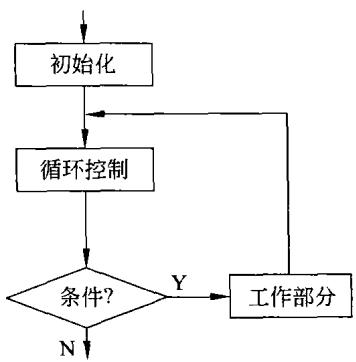  
(b)先判断条件  
图4-20循环控制的两种结构形式

【例4-4】在DS所决定的数据段，从偏移地址BUFFER开始顺序存放100个无符号16 位数。现欲编写程序将这100个字按大小顺序排序。

程序如下：

```csv
LEA DI,BUFFER
MOV BL,99
NEXT0:MOV SI,DI
MOV CL,BL
NEXT3:MOV AX,[SI]
ADD SI,2
CMP AX,[SI]
JNC NEXT5
MOV DX,[SI]
MOV [SI-2],DX
MOV [SI],AX
NEXT5: DEC CL
JNZ NEXT3
DEC BL
JNZ NEXTO
HLT
```  
当 HLT时，所要求的排序--——按由大到小的顺序排列即告完成。

同样的问题，可用不同的程序来实现，这是软件的重要特点。排序亦有多种方法，读者可参阅其他课程。

## （4）子程序

在前面8086(88)指令系统的介绍中已经提到有关子程序(或过程)的调用及返回。在编写较为复杂的程序时，采用子程序可以简化程序设计，减少某些程序段的多次重复，使程序便于编写和阅读，同时也为查错和测试带来了方便。因此，在编程中采用子程序是编程的基本方法之一。

所谓子程序就是由程序设计者定义的完成某种功能的程序模块。一旦定义了，该子程序可被任意调用。

编写子程序如同前面提到的程序设计一样，应有一定的规范。在本书中只提醒读者在使用子程序时应注意的几个问题。

①子程序如何调用和如何返回。

② 子程序的入口条件(或称人口信息)和出口条件(出口信息）。

③子程序中使用了哪些寄存器，调用之前是否需要保护。

④ 其他诸如占内存多少、执行时间长短、影响哪些标志、出错如何处理等。

正如前面已经提到，在8086(88)汇编语言中有专门的伪指令用来定义子程序。因此，可直接用伪指令来定义一个通过查询，向接口输出数据的输出子程序。

```csv
SENDAT PROC FAR
PUSH AX
PUSH DX
PUSH SI
LEA SI,BUFR
GOON: MOV DX,03FBH
WAIT O: IN AL,DX
TEST AL,20H
JZ WAIT 0
MOV AL,[SI]
MOV DX,03F8H
OUT DX,AL
INC SI
CMP AL,OAH
JNE GOON
POP SI
POP DX
POP AX
RET
SENDAT ENDP
```

在上面的例子中，子程序开始部分用于保护本子程序要用到的寄存器，并在子程序返回以前加以恢复。这种保护和恢复也可以在主程序中进行。当主程序要调用子程序时，要注意到子程序中所用到的寄存器在调用前后是否需要保持一致。若需要，可在主程序调用前保护，调用后恢复；不需要时，可以不加保护。

可见，调用子程序时的寄存器保护可在主程序中实现，也可在子程序中完成。

同时，寄存器保护放在子程序中，主程序编写更加简单，调用时不必考虑保护。这样做的缺点是，有可能使子程序占用的内存单元多一些，执行时间长一些。

主程序在调用子程序时，一方面初始数据要传递给子程序；另一方面子程序的运行结果要传递给主程序。尽管没有初始数据或没有运行结果的情况也有，但一般情况下必须予以考虑。参数传递可用以下3种方式。

·利用寄存器。

·利用内存单元。

·利用堆栈。

上面所述的例子，就是利用内存单元将要输出的初始数据传递给子程序的。对于其他方式传送参数的例子将不再给出。

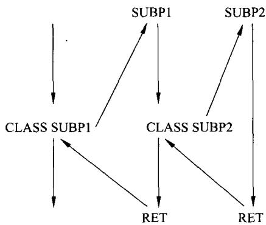  
图4-21多层子程序嵌套示意图

读者肯定会想到，在编写较为复杂程序的过程中，会出现子程序中调用子程序的情况，这就称为子程序嵌套。有时会出现如图4-21所示的多层子程序嵌套。

原则上讲，子程序嵌套的层次深度只受堆栈大小的影响。在程序运行时，要考虑各种因素（例如程序中随机压栈、中断嵌套等)，保证使堆栈不发生溢出。

由于调用子程序要进行堆栈操作，在子程序中也会发生对堆栈的操作，这一点务请读者特别注意。在编程时应倍加小心，以免出错。

## 4.5精减指令集计算机(RISC)

在计算机的发展过程中，计算机的指令系统经历了从简到繁，由繁到简再到繁的过程。也就是由复杂指令集计算机(CISC)到精减指令集计算机(RISC)再到两者结合的过程。

## 4.5.1指令系统的从简到繁

## 1．指令系统的发展

早期的计算机硬件结构很简单，因而其指令系统也很简单，寻址方式很少，指令种类很少、功能也很简单。

随着计算机的发展，计算机硬件成本的降低及软件成本的不断增加，促使CPU的设计者在指令系统中增加更多的指令及设置更加复杂，功能更强的指令，使指令系统越来越复杂。

人们通过增加指令系统的功能，增加指令的复杂程度，用一条指令来代替一小段程序。利用这样的方法来增强汇编语言的功能，使之更加靠近高级语言。

另外，各厂家均推出系列计算机，系列机中都会做到在指令上“向上兼容”。这就要求后开发的CPU的指令系统一定要在包括此前CPU全部指令的条件下增设新的指令，决不允许减少以前的指令，哪怕是减少一条都不能允许。这就促使系列机的指令系统越来越复杂。Intel的80x86系列机就是一个很好的例子。

正是由于上述原因使指令系统由简单发展到繁杂。人们将具有复杂指令系统的计算机称为复杂指令集计算机(CISC)。

## 2.复杂指令集计算机的特点

复杂指令集计算机的主要特点如下。

（1）指令系统复杂，指令数目多达200～3000条。

（2）指令长度不固定，有更多的指令格式和更多的寻址方式。

（3）CPU内部的通用寄存器比较少。

（4）有更多的可以访问主存的指令。

（5）指令种类繁多，但各种指令的使用频度差别很大。

（6）不同的指令执行时间相差很大，一般都需要多个时钟周期才能完成。

（7）控制器大多采用微程序控制器来实现。

（8）难以用优化编译的方法获得高效率的目的代码。

## 4.5.2精减指令集计算机的特点

## 1．精减指令集计算机的由来

在使用CISC过程中，人们发现一种规律：典型程序中80%的语句仅使用指令系统中20%的指令，这就是80-20规律。而且，在这些典型程序中，使用频度高的(80%)指令都是一些简单的基本指令，例如传送、转移、加指令等。复杂指令的使用频度是很低的（20%）。

指令越复杂，其硬件设计也越复杂，设计成本高，更容易出错。由于指令系统中指令功能简单与复杂相差甚多，很难实现流水操作。同时，由于复杂指令的存在，使指令的执行速度无法提高。

由于CISC存在种种问题，精减指令集计算机(RISC)应运而生。其出发点是要将CPU的指令系统精减，只采用最经常使用的指令系统中20%的指令。同时，通过指令的简化可以使CPU的结构更加简单、更加合理，从而提高执行速度。

现在，对RISC和CISC的性能进行简单的比较。程序的运行时间如下式计算。

$$
\mathbf { P } = \mathrm { N } \cdot \mathrm { C } \cdot \mathrm { T }\tag{4-3}
$$

其中，N为程序中的指令条数，C为执行一条指令的平均时钟周期数，T为时钟周期的时间。

在RISC中，用硬件实现少量的简单的指令，可以使CPU的时钟频率提高，从而降低了时钟周期的时间长度。由于只用少量的简单的指令，则每条指令执行的平均时钟周期数将比CISC大大减少，大多数的指令可在1个时钟周期内完成。因此，尽管同样功能的程序，RISC所用指令条数要比CISC多出20%～40%，但最终RISC的性能是CISC的2～5倍。统计结果表示在表4-4中。

表4-4 RISC与CISC性能比较
<table><tr><td rowspan=1 colspan=1>类型</td><td rowspan=1 colspan=1>N</td><td rowspan=1 colspan=1>C</td><td rowspan=1 colspan=1>T</td><td rowspan=1 colspan=1>类型</td><td rowspan=1 colspan=1>N</td><td rowspan=1 colspan=1>C</td><td rowspan=1 colspan=1>T</td></tr><tr><td rowspan=1 colspan=1>RISC</td><td rowspan=1 colspan=1>1.2~1.4</td><td rowspan=1 colspan=1>1.3~1.7</td><td rowspan=1 colspan=1>&lt;1</td><td rowspan=1 colspan=1>CISC</td><td rowspan=1 colspan=1>1</td><td rowspan=1 colspan=1>4~10</td><td rowspan=1 colspan=1>1</td></tr></table>

## 2．精减指令集计算机的特点

精减指令集计算机的主要特点如下。

（1）只设置使用频度高的一些简单指令，复杂指令的功能由多条简单指令的组合来实现。

（2）指令长度固定，指令种类少，寻址方式种类少。

(3）访存指令很少，有的RISC只有LDA(读内存)和STA(写内存)两条指令。多数指令的操作在速度快的内部通用寄存器间进行。

（4）CPU中设置大量的通用寄存器，一般有几十个甚至几百个。

（5）控制器用硬件实现，采用组合逻辑控制器。

（6）采用流水线技术，大多数指令在1个时钟周期即可完成。

（7）有利用优化编译程序。

（8）可简化硬件设计，降低设计成本。

在过去，指令系统经历了由简到繁(CISC)，由繁向简(RISC)的过程。随着技术的发展，摩尔定律使硬件集成度不断翻新，这一切也直接影响到指令系统。促使指令系统的两种设计理念相互影响、相互借鉴，使得RISC和CISC正逐渐融合。随着芯片密度和硬件速度提高,RISC系统已经越来越复杂，有的RISC的指令系统已十分复杂，功能非常强大。同时，CISC设计也加入了一些与RISC有关的技术，如增加通用寄存器数量和更加强调指令流水线设计等。未来的CPU的指令系统应当是将RISC和CISC结合在一起。

## 习 题

1．某指令系统的指令字长固定为16位，指令分为无操作数、一个操作数和两个操作数三类，每个操作数的地址码字段为6位。若两个操作数指令有K条，无操作数指令有L条，问一个操作数指令最多可有多少条？

2．某计算机14条指令的使用频度分别为：

0.15,0.15,0.14,0.13,0.12,0.11,0.04,0.04,0.03,0.03,0.02,0.02,0.01,0.01。

试分别求出用等长(固定长度)码、霍夫曼编码、只有两种码长的扩展操作码这三种编码方式的平均码长。

3．若某机器要求有如下形式的指令：

三地址指令4条，单地址指令255条，零地址指令16条。设指令字长为12位，每个地址码长3位，那么能否以扩展操作码进行编码？如果单地址指令为254条，其他不变，是否可以进行扩展操作码编码？说明理由。

4．某计算机指令字长16位，设有单地址指令和双地址指令两类，若每个地址字段均为6位，且双地址指令有m条，那么单地址指令最多可以有多少？

5．根据操作数所在位置，指出寻址方式。

（1）操作数在寄存器中，为（ )寻址方式。

（2）操作数地址在寄存器中，为（ )寻址方式。

（3）操作数在指令中，为（ )寻址方式。

（4）操作数地址在指令中，为（ )寻址方式。

（5）操作数的地址，为某一寄存器内容与位移量之和,可以是（)寻址方式。

6．某单地址指令格式如下所示。

<table><tr><td>OP</td><td>I</td><td>X</td><td>D</td></tr></table>

其中I为间接特征,X为寻址模式,D为形式地址。I、X、D组成该指令的操作数有效地址E。设R为变址寄存器,R1为基址寄存器，PC为程序计数器，请在表4-5中填入寻址方式名称。

表4-5寻址方式特征表
<table><tr><td>1</td><td>X</td><td>E</td><td>寻址方式</td><td>I</td><td>X</td><td>E</td><td>寻址方式</td></tr><tr><td>0</td><td>00</td><td>E=D</td><td rowspan="4"></td><td>0</td><td>11</td><td>E=(R1)+D</td><td></td></tr><tr><td>0</td><td>01</td><td>E=(PC)+D</td><td>1</td><td>00</td><td>E=(D)</td><td></td></tr><tr><td>0</td><td>10</td><td>E=(R)+D</td><td>1</td><td>11</td><td>E=((R1)+D)</td><td></td></tr><tr><td></td><td></td><td></td><td></td><td></td><td></td><td></td></tr></table>

7．某计算机字长为16位，主存容量为640KB,采用单字长单地址指令，共有40条指令。试采用直接、立即、变址、相对4种寻址方式设计指令格式。

8．一条PC相对寻址方式的转移指令存放于地址620D的存储位置，转移目标地址位置在530D处。指令中的地址字段是10位长，计算其二进制偏移量。

9．在一个36位长的指令系统中，设计一个扩展操作码，能表示下列指令。

7条具有两个15位地址和一个3位地址的指令；

500 条具有一个15位地址和一个3位地址的指令；

50条无地址指令。

10.现有(BX)=0100H，(SI)=0002H，(0100H)=12H，(0101H)=34H，(0102H)=56H，(0103H)=78H，(1200H)=2AH，(1201)=4CH，(1202H)=B7H,(1203H)=65H，试说明下列指令执行后AX的值。

(1）MOV AX,1200H (2）MOV AX,BX

(3）MOV AX,[1200H] (4) MOV AX,[BX]

(5) MOV AX,1100H[BX] (6）MOV AX,[BX][SI]

（7)MOV AX,1100H[BX][SI]

11．写出实现如下要求的指令。

（1）将AX寄存器低4位清零；

（2）将AX寄存器低4位置1；

（3）将AX寄存器低4位求反。

12．试编程序将内存从40000H～4BFFFH的每个单元中均写人55H，并再逐个单元读出比较，看写入的与读出的是否一致。若全对，则将AL置7EH；只要有错，则将AL置81H。

13．接口03FBH的BIT5为状态标志，当该位为1时，表示外设忙；当其为0时，表示可以接收数据。当CPU向接03F8H写人一个数据时，上述标志就置1；当它变为0状态时，又可以写人下一个数据。

根据上述要求，编写程序，将当前数据段偏移地址为SEDAT的顺序50个单元中的数据由接口输出。

14．上题中，若要发送的数据由0AH结束，试重新编程序将包括0AH在内的，由偏移

地址SEDAT开始的数据逐个发送出去。

15．若接口02E0H的BIT2和BIT5同时为1，表示外设接口02E7H有一个准备好的8位数据，当CPU从该接口读走数据后，02E0H接口的BIT2和BIT5就不再同时为1；只有当又有一个准备好的数据时，它们会再次同时为1。

试编程序，从上述接口读入32个数据，顺序放在A0100H单元开始的各单元中。

16．在内存40000H开始的16KB个单元中存放一组数据，试编程序将它们顺序搬移到A0000H开始的顺序16KB个单元中。

17．在上题的基础上，将两个数据块逐个单元进行比较，若有错将BL置00H;全对则将BL置FFH，试编程序。

18．试编程序，统计由40000H开始的16KB个单元中所存放的字符“A"的个数，并将结果存放在DX中。

19．编写一个子程序,对AL中的数据进行偶校验，并将经过校验的结果放回AL中。

20．利用上题的子程序，对80000H开始的 256个单元的数据加上偶校验，试编程序。

21．什么是CISC和RISC？它们的特点是什么？