# 计算机组成与设计-第5章151-191

## 来源

- 原始文件：`计算机组成与设计-第5章151-191.pdf`
- 对应章节：`第5章`
- 原始 PDF：`D:\wzb\计算机组成原理\资料\教材\计算机组成与设计-第5章151-191.pdf`
- 抽取任务：``

## 后续处理建议

- 从本整理稿中抽取稳定知识点
- 检查公式、表格、结构图抽取质量
- 对复杂图页补单独图像解读稿
- 如发现错误，转入勘误或分歧

## MinerU 抽取结果

## 第5章 处理器（CPU)设计

在计算机系统中，中央处理器CPU主要负责获取程序中的指令、译码并执行指令，实现指令们规定的功能。本章主要介绍CPU的结构及设计，重点放在控制器的设计方法，其内容对于深入理解计算机的工作原理有很大的帮助。

## 5.1 CPU的结构

利用大规模集成电路技术，计算机系统中的控制器、运算器、寄存器组（又称寄存器文件)被集成在一块芯片上，形成了现在称为CPU的中央处理单元。

## 5.1.1 CPU的功能

CPU是计算机工作的核心部件，用于控制并协调计算机的各个部件执行程序，对数据进行加工及输入/输出。其基本功能主要如下。

## 1.指令控制

CPU的首要任务就是对程序执行顺序实施控制，保证程序严格按规定顺序执行。

## 2.操作控制

下面对指令执行过程分析将会看到，一条指令的执行需要若干个微操作命令信号，通过这些微操作信号作用于CPU内部及外部的不同部件上,完成指令功能。CPU必须按每条指令功能的要求，产生操作信号并对信号进行控制，完成每条指令所要求的操作。

## 3.时间控制

CPU执行每一条指令都有严格的时间顺序。也就是说一条指令的执行过程，什么时刻该产生加在什么部件上的什么操作控制信号是有严格规定的。CPU能够对各操作控制信号的时序进行严格的控制。

## 4.数据加工

CPU能够根据指令功能的要求，对数据进行算术、逻辑及其他方面运算和加工处理。对数据的输人、加工处理以及数据的输出是CPU的基本功能。

## 5.中断处理

.CPU能对其内部或外部的中断(异常)做出响应，进行相应的处理。详见第8章。

## 6.其他功能

CPU能对直接存储器存取(DMA)请求做出响应。能对复位信号(RESET)做出响应并将复位启动的人口地址送人PC中。CPU还能接收外部时钟信号，以便形成其内部的时序控制信号。

## 5.1.2 构成CPU的主要部件

## 1．概念框图

计算机的概念框图如图5-1所示。可以发现该框图与第3章的图3-30非常相似，只是为了叙述上的方便，又专门画在图5-1上。这是一幅简单的计算机框图，特别强调CPU的内部结构，目的是更好地描述传统意义上如何设计CPU。

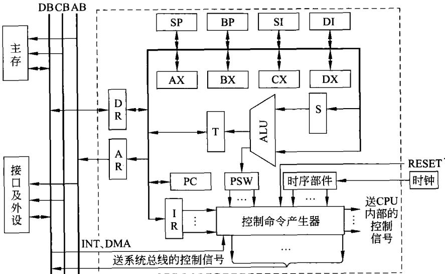  
图5-1 CPU及计算机简化框图

应当说,这里的CPU相对比较简单,本书的目的在于用这样一个简单的CPU,讲清楚有关的基本概念和基本方法。

## 2.CPU的组成部件

如图5-1所示的是计算机的简化框图，其中右侧用虚线所包围的部分就是本章要讨论的中央处理器CPU。这里要讨论的是一个16位CPU，其地址、数据信号均为16位，故最大的内存地址空间为64KB。主要由如下部件构成。

## （1）通用寄存器组

每一个CPU的内部都会设置一些通用寄存器，尽管不同的CPU所设置的通用寄存器的名称及数量各不相同，但这是CPU的重要组成部分。一般称为寄存器组或寄存器文件。

CPU中包含8个16 位的通用寄存器AX、BX、CX、DX、BP、SP、SI、DI。它们均为16位

寄存器，在功能上略有不同(类似于前一章描述的8086 的通用寄存器)。

AX、BX、CX、DX为通用数据寄存器,可用于基本相同的对数据操作功能。

BX、BP为基址寄存器，主要用于寄存器间接、基址寻址。

SI、DI主要用于寄存器间接、变址寻址等功能。

SP为堆栈指针，主要用于堆栈操作。

## （2）运算器

在此CPU中，运算器包括如下几种构件。

## ①算术逻辑单元ALU

算术逻辑单元ALU，能够完成各种算术和逻辑运算。有关ALU在前面第3章中已做了详细说明，那里的16位的ALU(图3-27或3-28)就可以作为这里的ALU。

## ②单总线

在前面第3章中曾说明运算器的三种基本结构，其中单总线结构需要两个暂存器。在现在的CPU中，为了简化结构也采用单总线。

## ③两个暂存器

两个16位的暂存器T和S,其中暂存器T还可以实现移位和循环操作。

把上述部件都归为CPU的运算器。尽管有人将通用寄存器组归并在运算器中，在这里还是单独列出。

## （3）控制器

构成CPU的另一重要部件就是控制器，由图5-1可以看到，控制器主要包括如下几种构件。

① 程序计数器PC，用于存放下一条要执行指令的内存地址。

②指令寄存器IR，存放正在执行的指令。

③ 程序状态字PSW,存放指令执行结果状态及一些特定的标志。通常，包括进位标志CF、溢出标志OF、零标志 ZF、符号标志 SF、中断标志IF等。

④时序部件，用于产生所需的时序信号。

③控制命令产生部件，在指令的执行过程中，控制命令产生部件能够根据指令操作码，产生相应的内部及外部控制信号，在这些控制信号的控制下，完成指令的功能。

此外，为了与外部系统总线接口，在CPU中设置单向地址寄存器AR和双向数据寄存器 DR。还有对外部中断INT、直接存储器存取DMA请求及响应的部件。

在有的CPU内部集成有高速缓存（cache）、流水线等部件，它们也应当是构成CPU的组成部分。

## 3.CPU的数据通路

## （1）数据通路的概念

数据通路是指数据在CPU各功能部件之间传送的路径。在这里，数据的概念是广义的，比如，某通用寄存器的数据经内部总线加到ALU上，是将总线作为数据通路。同样,PC送出的地址信号也通过总线传送到地址寄存器AR上。而CPU从内存读取的指令码也会通过数据通路加到指令寄存器IR上。

数据通路描述了信息从什么地方发出，中间经过什么部件，最后传送到哪个部件。而且，信息每传送一步都需要一定的控制信号(或控制命令)才能做到。执行指令的控制信号是由控制命令产生部件产生，用于建立执行指令的数据通路。

数据通路的功能是实现CPU内部运算器、寄存器、控制器等各功能部件间的数据传递。

## （2）数据通路的基本结构

数据通路的基本结构主要有两种形式。

## ①总线结构

连接两个以上数字器件的信息通路称为总线,有关总线的详细内容见第8章。

由图5-1可以看到，在CPU内部采用单总线结构，CPU的各部件均连接在此内部总线上。同时，由于要设计的CPU是16位的，其内部总线的宽度也是16位的。总线上连接的各寄存器也是16位的。此外，为简单起见，规定主存按字(16位)编址，每一主存地址存放16位二进制数。

在这种单总线结构中，所有寄存器、ALU、暂存器等部件的输人和(或)输出端均连接在这条单一的CPU内部总线上，它们共享一条内部总线。这就产生一个非常重要的问题：任何时刻只允许连接在此总线上的一个部件输出其数据到总线上，其他剩余的部件绝不允许有输出（可以输人）。因为，只要有两个或两个以上的部件将它们的数据同时输出到此总线上，必然使总线产生竞争(也称为争用或冲突)。一旦产生竞争就一定会出错。因此，在单总线结构的CPU中，避免总线竞争是特别值得注意的。

为了防止总线竞争，在CPU执行指令的过程中，连接在单总线上的部件在向总线输出数据时必须分时操作，即一个部件输出结束置为高阻后，另一部件才能向总线输出数据。当部件没有输出时，其输出端必须置高阻状态。

单总线结构易于发生总线竞争，为防止竞争就需分时操作，分时操作必定降低传输数据的性能。为此，可采用双总线或三总线结构，其结构形式类似于第3章图3-26（b）、3-26（c)。在双总线及三总线结构中，总线竞争的机会要小得多，总线的传输性能可得到提高。显然，这样的总线在构成上也会更加复杂。

## ②专用数据通路

在这种数据通路下，CPU内部各功能部件之间不采用总线相连接，而是设置专用的数据通路，让各部件的数据、地址等信号走自己专用的连接线。这样就可以避免共享总线容易产生的总线竞争，可以更好地提高CPU的性能。

构成专用数据通路工作很复杂，工作量很大，要动用更多的硬件资源。

## 5.2指令系统设计

从本章的开始，就着眼于一个简单的CPU的设计。从提出CPU的框图、决定构成CPU的主要功能部件到采用单总线构成数据通路。接下来，在本节中，将继续结合图5-1所示的CPU，设计该CPU的寻址方式及指令系统。

## 5.2.1设计寻址方式

一个CPU的寻址方式越多、设置的指令种类越多，则两者组合起来构成的指令就越多,CPU的功能也就越强。当然，这必然使CPU内部的信号就越复杂，进而CPU的内部结构，尤其是控制器也就越加复杂。在这里，设计的思路是在保证CPU的基本功能的前提下，尽可能简单一些。

在要设计的CPU中，指令有两种格式：单字指令和双字指令两种（在这里规定一个字为二进制16位)。即有的指令只用一个字构成，而有的指令则需两个字构成。用于决定寻址方式的是指令中的一个字节，具体规定如图5-2所示。

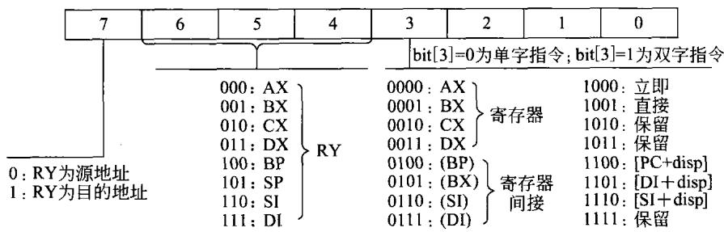  
图 5-2寻址方式的定义

为了简单起见，在图5-2中，只规定了CPU具有6种寻址方式。

（1）立即寻址。

（2）寄存器寻址。

（3）直接寻址。

（4）寄存器间接寻址。

（5）相对寻址。

（6）变址寻址。

利用图5-2中字节的bit[7]来规定8个通用寄存器中某一寄存器为源操作数地址，单操作数指令中只须定义一个目的操作数地址;在两个操作数的指令中，bit[7」可指定RY是源操作数地址(或目的操作数地址)，则另一个由寻址方式所决定的操作数地址必定是目的操作数地址(或源操作数地址）。

即使只有8个通用寄存器并且只有6种寻址方式，但它们组合起来仍然是比较复杂的，下面将会看到这一点。

## 5.2.2指令的设计

根据不同的寻址方式，指令码的构成有两种形式：单字指令和双字指令。由图5-2可以看到，寄存器寻址和寄存器间接寻址的指令只需一个字即可构成；而立即寻址、直接寻址、相对寻址和变址寻址则需要两个字，其中一个字用来表示操作码及寻址方式，另一个字表示立即数、直接地址或偏移量。单字和双字指令的指令码分别如图5-3(a)和图5-3(b)所示。

## 1．指令的设置

正如第4章所提到的，在设计指令系统时，必须考虑到指令系统的有效性、完备性、规整性以及兼容性等诸多方面的要求。在这里所设计的指令系统包括如下几类指令，值得注意

的是为了后面分析指令方便，这里是按操作数的多少来分类的。可以看到，这种分类所设置的指令完全可以涵盖前面第4章中所提到的基本指令。

<table><tr><td>15</td><td>87 0</td></tr><tr><td>指令操作码字段</td><td>指令寻址方式字段</td></tr></table>

(a)单字指令
<table><tr><td>15</td><td>87 0</td></tr><tr><td>指令操作码字段</td><td>指令寻址方式字段</td></tr><tr><td>15</td><td>0</td></tr><tr><td>16位偏移量、立即数或直接地址</td><td></td></tr></table>

(b)双字指令  
图5-3指令码构成格式

## （1）双操作数指令

双操作数指令设置有如下几种。

与指令（AND)

或指令(OR)

异或指令(XOR)

加法指令(ADD)

减法指令（SUB)

带进位加法指令（ADC)

带进位减法指令(SBC)

比较指令(CMP)

传送指令(MOV)

乘法指令 (MUL)

除法指令(DIV)

## （2）单操作数指令

单操作数指令设置有如下几种。

加1指令(INC)

减1指令(DEC)

压入堆栈指令(PUSH)

弹出堆栈指令(POP)

取反指令（NOT)

左移指令(SHL)

逻辑右移指令(SHR)

算术右移指令(SAR)

小循环左移指令 (ROL)

小循环右移指令 (ROR)

大循环左移指令 (RCL)

大循环右移指令 (RCR)

调用子程序指令 (CALL)

## (3）转移指令

尽管这类指令也是单操作数指令，在这里单独列出。设置指令有如下几种。

无条件转移指令（JMP)

零转移指令(JZ)

非零转移指令（JNZ)

有进位转移指令（JC)

无进位转移指令（JNC)

大于转移指令(JG)

大于等于转移指令(JGE)

高于转移指令(JA)

高于等于转移指令(JAE)

显然，在上述条件转移中，JC、JNC、JA、JAE 是用于无符号数；而JG、JGE则用于带符号数。

## （4）无操作数指令

无操作数指令主要有如下几种。

子程序返回指令 (RET)

中断返回指令(IRET)

空操作指令(NOP)

关中断指令(CLI)

开中断指令(STI)

软件中断指令（SWI)

十进制校正指令（DAA)

指令系统中没有设置专门的输入/输出指令，是因为该CPU构成的系统采用主存与接口统一编址，用于内存的指令原则上均能用于接口。

## 2.指令编码

由图5-3可以看出，用于设置指令的操作码字段为指令码的高字节。一个字节的编码共有256种，因此，在不采用扩展指令操作码的方法，仍然可以定义256种指令。从上面所设置的指令可以看到，一共只有三十几条指令，因此，利用一个字节编码足以定义这些指令。为了留下将来扩展指令的余地，在这里采用扩展操作码的方法来规定指令操作码字段，具体情况如图5-4所示。

<table><tr><td>15</td><td>14</td><td>13</td><td>12</td><td>11</td><td>10</td><td>9</td><td>8</td><td>7</td><td>6</td><td>5</td><td>4</td><td>3</td><td>2</td><td>1</td><td>0</td></tr><tr><td>0</td><td>0</td><td>0</td><td>0</td><td>X</td><td>X</td><td>X</td><td>X</td><td></td><td></td><td></td><td></td><td></td><td>一定义双操作数指令</td><td></td><td></td></tr><tr><td>0</td><td>0</td><td>0</td><td>0</td><td>1</td><td>1</td><td>1</td><td>0</td><td>X</td><td>X</td><td>X</td><td></td><td></td><td>X→定义单操作数指令</td><td></td><td></td></tr><tr><td>0</td><td>0</td><td>0</td><td>0</td><td>1</td><td>1</td><td>1</td><td>1</td><td>X</td><td>X</td><td>X</td><td></td><td></td><td>X-定义转移指令</td><td></td><td></td></tr><tr><td>0</td><td>0</td><td>0</td><td>0</td><td>1</td><td>1</td><td>1</td><td>1</td><td>1</td><td>1</td><td>1</td><td>1</td><td></td><td>xxxx</td><td></td><td></td></tr><tr><td></td><td></td><td></td><td></td><td></td><td></td><td></td><td></td><td></td><td></td><td></td><td></td><td></td><td>1 定义无操作数指令</td><td></td><td></td></tr></table>

图5-4指令操作码的定义

## （1）双操作数指令的编码

双操作数指令为11条，为了简化译码，用指令码高字节的低4位二进制编码表示，也就是用指令字的bit[11]～bit[8]编码来定义这些指令，见图5-4。

由图5-4可以看到，对于上面设置的指来说，指令操作码字段的最高4位bit[15]到bit[12]可固定不变为0000。bit[11]到bit[8]这4位编码有16种，足以定义11条双操作数指令。同时，bit[11]到bit[8]这4位的16种编码中，留下两种编码1110和1111用于扩展操作码。

将来对指令译码时，若bit[15]到bit[12]同时为0000且bit[11]到bit[9]这3位编码不为111时，则必定为双操作数指令，而后根据该指令字的寻址方式，可以判别这是单字指令还是双字指令。由图5-2可以知道，依据不同的寻址方式可以构成单字指令和双字指令。当寄存器或寄存器间接寻址时，也就是寻址字节的bit[3]为0时，必定是单字指令。而当立即、直接、相对和变址寻址方式时，也就是寻址字节的bit[3]为1时，必定为双字指令。

若指定两个操作数的ADD加法指令的操作码字段为00000001，则指令：

ADD AX,[SI]

是一条寄存器间接寻址的单字指令，它由16位二进制编码0000000110000110组成。

若指令：

ADD AX,[2000H]

是一条直接寻址的双字指令，该指令由两个16 位的字组成，一个为指令码字，一个为直接地址。

0000000110001001为指令操作码字

0010000000000000为直接地址字

## （2）单操作数指令的编码

由图5-4可以看到，若bit[11]到bit[8]为1110时，则必定为单操作数指令。由于是单操作数指令，寻址字节的bit[7]到bit[4]这4位对寻址来说已没有用处，恰好用来定义单操作数指令。该4位共有16种编码，足以定义13条单操作数指令。

同样，单操作数指令依据不同的寻址方式可以构成单字指令和双字指令。当寄存器或寄存器间接寻址时，也就是寻址的低字节bit[3]为0时，必定是单字指令。而当立即、直接、相对和变址寻址方式时，也就是寻址的低字节bit[3]为1时，必定为双字指令。假如规定加1指令INC的操作码为000011100001，则指令：

INC[BX];为寄存器间接寻址指令，为单字指令，其指令码为：0000111000010101

若指令：

INC[DI+1000H];是一条变址寻址指令，由两个字构成：

0000111000011101为指令操作码字

0001000000000000为偏移量字

## （3）转移指令的编码

转移指令的编码可用图5-4所示的编码来定义。其操作码在高8位为00001111的情况下，由寻址字节的bit[7]到bit[4]这4位来决定。显然，由于转移指令只定义9条，4位编码表示这些指令是有余的。但其中bit[7]到bit[4]这4位为1111的编码留做扩展用，用于扩展无操作数指令。为简单起见，转移指令全部采用相对寻址这一种寻址方式。也就是说这类指令全部都是双字指令，每条指令均由两个字构成。

例如，无条件转移指令JMPRTPRM，可以规定无条件转移指令bit[7]到bit[4]这4位编码为0000。则该指令由2个16位的字构成。第1个为指令操作码字：0000111100001100。第2个字为该指令下一条指令的地址为基准，到达标号RTPRM的地址数，转向大地址此数为正，转向小地址时此数为负。这就是相对的偏移量，用一个16位带符号的字来表示。

当CPU取出这类指令的第1个字即指令操作码进行译码时，若发现指令字的bit[15]到bit8]为00001111时，必然是一条转移指令。然后检测bit[7]～bit[4]编码，看是一条什么样的转移指令。

若bit[7]到bit[4]这4位是0000，则是一条无条件转移指令，则接着从PC的内容所决定的主存读出下一个字，即16位的偏移量。这是一个带符号的数，将此时PC的内容与该偏移量相加，相加的结果放在PC中，则该指令就执行完了。接着执行下一条指令。

若是一条条件转移指令，则接着从PC的内容所决定的主存读出下一个字，即16位的偏移量。而后需测试条件是否满足。不满足条件接着执行下一条指令。若满足条件，则将此时PC的内容与该偏移量相加，相加的结果放在PC中，则该指令就执行完了。接着转向执行下一条指令。

## （4）无操作数指令的编码

由图5-4可以看到，无操作数指令的编码将操作码扩展到寻址码的最低4位，其操作码的编码为000011111111XXXX，这最低4位共有16种编码，足以用来表示7条无操作数指令。

人们常将这种用二进制编码表示的指令称为机器指令。由机器指令构成的语言叫做机器语言。

## 5.3CPU执行指令的过程

## 5.3.1指令时序

为了设计CPU，必须对所设置的每一条指令进行分析，从而弄清楚指令的执行过程。明确了指令的执行过程,才能对CPU中最复杂的部件一控制器进行设计。

## 1．指令执行过程

## （1）指令周期

CPU从头到尾执行一条指令所用的时间称为指令周期。从前面指令系统设计可以发现，由于指令的功能不同，执行时间会有所不同。所以不同的指令的指令周期会不一样。

## （2）机器周期

正是由于不同的指令的指令周期不同，研究分析才比较困难。因此，人们把CPU通过系统总线对内存的一次读或写操作的时间称为一个机器周期（也有的称为CPU周期或总线周期等）。

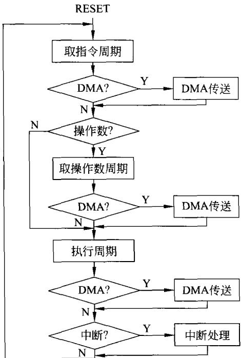  
图5-5指令执行过程

一条指令的执行可分为三个大的步骤：取指令操作码、取操作数和执行指令，并将这些步骤看做机器周期。在进行CPU设计时，通常需要保证每一个机器周期结束需查询有无DMA请求，若有请求，则响应DMA并等待其传送结束，再进行下一个机器周期。当一条指令执行结束时，要保证先查询有无DMA请求，再查询有无中断请求。显然，DMA请求的优先级比中断请求来得高。上述过程如图5-5所示。

由图5-5可以看到，CPU复位之后将会像图5-5所示的那样，不知疲倦地一条指令接一条指令地执行下去。每一条指令执行的第1个机器周期就是从内存中取指令操作码的周期，这一周期对所有的指令都是一样的。

接下来就是判断这条指令有无操作数，若是一条无操作数指令，则CPU将直接进入执行周期。若有操作数，不管是一个还是两个（这里不涉及字串或矢量数据)则进入取操作数的周期。由于操作数多少不同，有一个和两个甚至多个的差

别，同时由于寻址方式的不同，取操作数周期的过程是不一样的。

第三个周期是执行周期，这一周也因寻址方式、指令功能的不同而不同。

## （3）时钟周期

如图5-1中所示，每个CPU必有其时钟。时钟是CPU工作的激励源，CPU是在时钟的激励下执行指令的。时钟可以外接，由CPU外部的时钟发生器提供时钟信号，也有的CPU将时钟集成在CPU内部，则其工作频率将不易改变。

CPU指令的机器周期是由时钟激励完成的，不同的机器周期所需时钟周期数是不一样的。

## 2.时序波形

典型的时序波形如图5-6所示。

在这里要强调的是图5-6是一种理想化的特殊情况，为的是能用这种简化的时序图说明一些概念。在图5-6中一个指令周期是由三个机器周期来实现的，而假定每一机器周期都是由4个时钟周期来完成的。

由图5-6还可以发现，利用时钟信号和数字电路所学的知识，就能够产生每个机器周期所需要的节拍信号(W信号)和触发信号(P信号)，也可以产生其他在图5-6中未表示的信号。

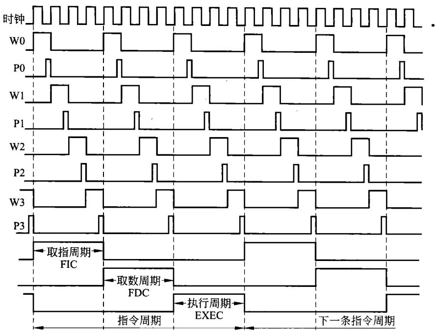  
图 5-6指令执行的时序

CPU的控制器在不同时刻产生不同的节拍信号、触发信号等一系列信号，在这些信号的控制下，完成每个机器周期。由于这些控制信号出现在机器周期内部，人们还将这些控制信号称做微操作命令。

## 3．时序控制方式

从上面的描述可以看到，CPU执行一条指令实质上是由CPU的控制器依据指令的功能，送出一系列的控制信号，最终完成一条指令。指令功能不同，控制器送出的控制信号和送出的时间是不一样的。通常，将如何根据不同指令形成不同系列控制信号所采用的控制方式称为时序控制方式，主要方式如下。

## （1）同步控制

同步控制方式是指系统有一个统一的时钟，所有的控制信号均由这一统一的时钟源产生。具体有4种方案。

## ①定长的机器周期，定长指令周期

在这种情况下，所有指令的指令周期都一样，都用同样的机器周期来完成，而机器周期的长度(节拍数)也是固定不变的。如图5-6 那样，一条指令3个机器周期，每个机器周期有4个时钟周期。因此，每条指令的执行时间都是12个时钟周期。

但是，指令的复杂程度差别很大，采用这种方式必须依最复杂的指令设计机器周期，这对简单指令必然造成时间上的浪费。

## ②定长的机器周期，变长指令周期

在此方式下，机器周期的长度(节拍数)是固定不变的，而指令可以由一个、二个、三个或更多个机器周期组成。

## ③变长的机器周期，变长指令周期

在这种控制方式下，不同的指令的机器周期长度是不一样的，也就是不同指令用不同节拍来完成。简单的少几个节拍，复杂的情况则增加节拍来延长机器周期。由于机器周期是变长的，则指令周期也一定是变长的。

## ④折中方案

折中方案将上述②和③情况相结合，将大多数指令采用定长机器周期方案，使指令周期在较短的时间内完成。仅仅对那些少量的较复杂的指令，采用变长机器周期。

## （2）异步控制

异步控制方式的系统中没有统一的时钟对信号同步，每条指令执行所需的机器周期数及机器周期的节拍数是不一样的。而且，控制器的工作经常是在信号发出后，等待有关电路做出应答再进行下一步操作。

## （3）联合控制

联合控制是上面同步控制和异步控制相结合的一种控制方式。在此情况下，大部分操作采用某种同步控制方式，而对某些时间上难以确定的操作则采用应答方式。例如，8086CPU采用同步②的方式，并在读/写内存或接口时，利用应答信号READY来决定机器周期的长短。

## 5.3.2指令执行过程分析

为了设计CPU,必须对所设置的每一条指令进行分析，从而弄清楚指令的执行过程。明确了指令的执行过程，才能对CPU中最复杂的部件—控制器进行设计。

## 1．指令执行步骤

在图5-5中，已经把一条指令的执行分为三个大的步骤：取指令操作码、取操作数、执行指令。由于要进行控制器的设计，在图5-5中，需要特别说明的是在取出指令操作码后，在是否取操作数的判断框中隐含着对指令操作码的译码。只有对指令操作码译码后，才能知道这是一条什么指令。只有知道了是一条什么寻址的指令,CPU才能决定下面的具体操作该怎么做。下面的详细分析中能清楚地看到这一点。

为了分析问题简单起见，详细分析中暂不涉及DMA和中断。

## 2．详细分析

在对指令进行分析的过程中，必须认真仔细地利用前面的设计内容，尤其是图5-1中所规定的CPU内部是单总线连接所构成部件，防止在指令执行过程中的总线竞争。同时还必须注意所设置的指令及这些指令所采用的寻址方式。

由前指令设置可以看到，取指令操作码的过程就是从主存中将指令字取出并放在指令寄存器IR中。而且这一过程对所有的指令(不管是单字指令还是双字指令)都是一样的。

## （1）取指令操作码阶段

在此CPU中，以时钟周期为基本时序单位，对一条指令而言，每一指令执行步骤均由若干个时钟周期来实现。由于各种指令的复杂程度不一样，执行指令所用的时钟周期也不一样。但是，每条指令的取指过程应是一样的，均由三个时钟周期来完成。取指令操作码的过程如图5-7所示。

由图5-7可以看到，取指过程由三步实现：首先将PC的内容送入地址寄存器AR，并且由 AR输出到系统总线上，作为主存地址MEMadr;接着送出读控制信号RD，同时内部程序计数器加1;第三步就是将从主存读出的指令字(即操作码)送到数据寄存器 DR，DR再将指令字送到指令寄存器IR中。到此取指令操作码的阶段即告结束，假定指令存储器的速度足够快，以上三步用三个时钟周期便可完成。

## （2）指令译码取操作数阶段

## ①检测指令

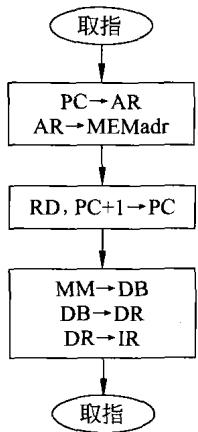

由于所设计的CPU指令比较多，又有多种寻址方式，不同的指令是靠指令译码来识别进而执行的。因此，指令译码是比较复杂的，可以说一条指令一个样。必须把每条指令的译码过程弄清楚，只有把每条指令的译码过程描述清楚，才能进行后面的设计。

图5-7取指过程

指令的译码过程简化框图如图5-8所示，首先是由指令译码器取出指令字，根据前面图5-4的定义，若其bit[15]～bit[9]，若不为0000111，则指令为双操作数指令；若为0000111，则再检测指令字的bit[8]，若bit[8]=0，则该指令必为单操作数指令；若bit[8]=1,还需检测bit[7]～bit[4]，若bit[7]～bit[4]为1111，则指令为无操作数指令；若bit[7]～bit[4]不为1111，指令定为相对寻址方式的转移指令。

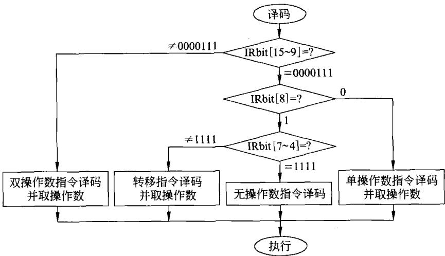  
图5-8译码取操作数过程框图

根据上面的描述，判断出是哪类指令后，译码过程并未结束，这需要根据不同的指令，进行相应的工作，下将分别予以说明。

## ②转移指令译码及取操作数

如前所述，转移指令有9种，图5-8中转移指令译码部分的详细框图如图5-9所示。

在图5-9中，为了简化框图,条件转移仅仅画出三条指令，其余的指令由于思路和方法都一样均予以省略。

在转移指令的译码过程中，首先将指令的下一个字，即转移指令的16位偏移量从内存

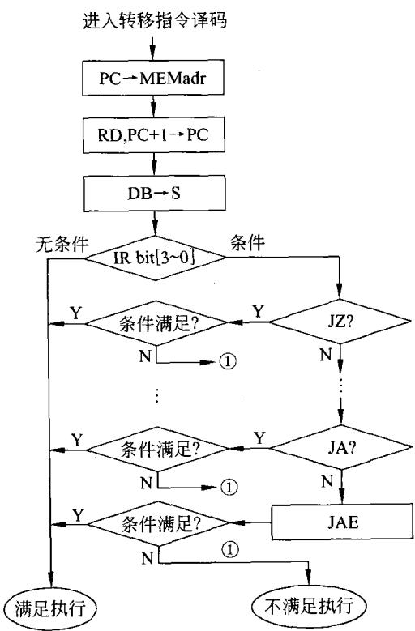  
图5-9转移指令译码过程

读到CPU的暂存寄存器S中。然后，译码判断若是无条件转移或条件转移满足条件时，译码过程会转向满足条件的执行过程。可以想象，这种情况下指令的执行过程必定是当前的PC与暂存器S中的偏移量相加放入PC中，而后转到该PC所规定的地址上执行新的指令。

若是条件转移不满足转移条件，则转到不满足条件的情况执行。这种情况下的执行不做任何事而直接利用当前的PC取指，而此时的PC就指向顺序的一条指令。因此，不满足条件的执行就是顺序执行。

## ③非转移指令

非转移指会包括三小类指令，是以指令中所包括的操作数的多少来定义的。在双操作数指令和单操作数指令中，又会根据不同的寻址方式而派生出多条指令。在这里，所要做的工作就是要将每一条指令的译码过程分析清楚。

正如前面一再提到的，即使已经将所设计的CPU简化了许多，但在描述起来仍然感到

比较复杂，不可能将每条指令都逐一说明。在下面将以很少的指令说明思路与方法，理解了这样的概念也就不难对其他指令做出解释了。

a）双操作数指令译码与取操作数

对于双操作数的指令，现以如下两条指令为例，说明它们的译码过程。

MOVAX，4000H

ADD BX,[DI]

双操作数的指令的译码过程如图5-10所示。图中首先根据图5-4的约定，对指令码的bit[11]～bit[8]进行译码，确定是所定义的11条指令中的哪条指令。图5-10中只画出上面两条指令MOV和ADD的译码过程，其余指令则省略。

当指令为MOV指令时，再根据bit[3]=1确定为立即寻址指令、bit[7]～bit[4]应为1000，即AX为目的地址。于是，以PC的内容为主存地址，由此地址读出立即数4000H，同时PC自动加1。最后，将4000H放人AX中。到此，该指令译码与执行已同时完成。下一个时钟周期将进入下一条指令的取指令码的过程。

对于ADD指令，根据指令字的bit[3]～bit[0]可知，其编码必为0111,即以DI寄存器的内容为主存地址的寄存器间接寻址。同时，由指令字的bit[7]～bit[4]可知，其编码必为1001,即目的寄存器为BX。接下来的过程如图5-10所示，以DI的内容为主存地址，从中读出加法的一个操作数并放在暂存器S中。到此ADD指令的译码过程结束，接着将进人该指令的执行阶段。

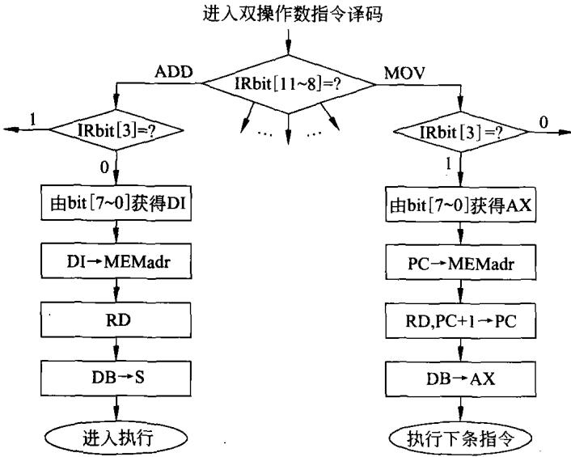  
图5-10双操作数指令译码过程

## b）单操作数指令译码与取操作数

对于单操作数指令，同样存在着多种指令又有多种寻址方式相组合的问题。为设计控制器，应当把每条指令的每种寻址方式都分析清楚。但在本章中限于篇幅又难以做到。因此，在这里也只取两条指令来说明问题。

INC[BX]

SHRCX

其中，INC［BX]指令是对由BX的内容所决定的内存的字内容加1;而指令 SHRCX 是对寄存器CX的内容逻辑右移一次。

单操作数指令的译码过程如图5-11所示。

进入单操作数指令译码，首先利用指令字的bit[7]～bit[4]决定是哪一条单操作数指令。若发现是INC 指令，则进一步获得指令字的bit[3]=0,进而得到bit[2]～bit[0]为101,即以寄存器BX为目标的寄存器间接寻址。于是，将BX的内容送入地址寄存器作为主存地址MEMadr，然后送出读信号，将该存储器的内容读到暂存器中。到此译码结束，后面接着进行的就是该指令的执行过程。

若发现指令为SHR,利用指令字的bit[3]～bit[O]可知这是对寄存器CX的寄存器寻址指令，接着便将CX的内容送到暂存器S中。到此译码结束，后面接着进行的就是该指令的执行过程。

## c）无操作数指令译码及执行

对于无操作数指令，由于没有操作数(或许操作数隐含在操作码中)，其译码过程同样因指令的不同而不一样。在这里，同样用两条指令予以说明。

IRET(中断返回指令）

NOP(空操作指令）

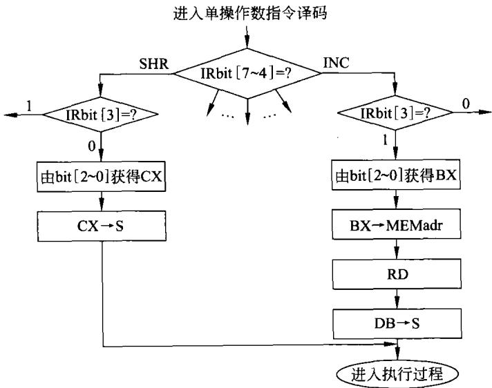  
图5-11单操作数指令译码过程

无操作数指令的译码过程如图5-12所示。

进入无操作数译码，通过对指令字的bit[3]～bit[O]译码即可获得当前是哪条无操作数指令，接下来便可针对不同的指令实施译码。

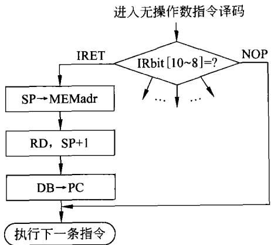  
图5-12无操作数指令的译码过程

若发现当前的指令是一条空操作指令时，则该指令包括执行就完成了，接下来就进人下一条指令的取指过程，即执行另一条新指令。

对于IRET指令，假定在CPU响应中断时，CPU只自动保护PC的内容。那么，在执行IRET指令时，取出指令字，会发现是无操作数指令，通过对指令字的bit[3]～bit[0]译码即可获得当前是IRET指令，后面的过程译码与执行合并在一起。把保护在堆栈中的断点PC的信息重新放回PC中。下一条指令必定由此PC的内容所决定，即回到被中断的程序，接着中断前的顺序继续执行。

在这里要说明的是，前面描述的译码基本上是针对带有操作数的指令，认为将一个操作数取出来放在某一寄存器中，就是译码阶段，接下来就是指令的执行阶段。显然，这仅仅是一种处理问题的思路和方法。而且，实际上，一条指令的译码和执行是接连发生的、是紧密相连的。因此，要特别强调，前面所提到指令执行的全过程是分开说明的，但指令的执行是顺序进行的，如图5-5所描述。

## （3）指令执行阶段

下面将说明指令的执行阶段。不同的指令这一阶段的过程是不一样的。在这里，只说明前面所提到的指令的执行过程。

## ①转移指令的执行

首先，接着图5-9的无条件转移和满足条件转移的情况继续接着执行阶段，此阶段的过程如图5-13所示。

如图5-13所示的过程是接在一条转移指令取出指令操作码，而后又取出指令操作数(即偏移地址)后。此时，偏移量已放在寄存器S中并加到ALU的一端。进入执行阶段，将当前的PC的内容加到ALU的另一端。然后，将加在ALU两端的PC与偏移量相加，并将相加的结果放在寄存器T中。最后，将T中的结果放回PC。到此，无条件转移指令（或条件转移满足条件)执行结束。下一个CPU的状态必定转移到新的PC的内容所指向的地址上去取指令、执行指令。

顺便提示，当条件转移不满足条件时，CPU将依据当时的PC的内容顺序执行，如图5-9所示的不满足执行。

## ②双操作数指令的执行

现在说明双操作数指令的执行过程。其中，立即寻址的传送指令MOVAX，4000H，其过程如图5-10所示，在译码阶段即已执行结束，在那里就可以直接转到下一条指令的取指阶段。

对于加法指令 ADDBX，[DI]，其执行过程如图5-14 所示。

在如图5-10所示的译码阶段，对该指令的译码已取得一个操作数放在寄存器S中，并且S的输出直接加到ALU的一端。

进人执行阶段，再将BX的内容通过CPU的内总线加到ALU的另一端。然后，送出相加命令并将相加结果放在寄存器T中。再一个时钟周期，即可将放在寄存器T中的相加之和送人BX。到此，ADDBX，[DI]指令执行结束。下一个CPU的状态必定根据PC的内容所指向的地址去取下一条指令。

## ③单操作数指令的执行

单操作数指令INC[BX]及SHRCX 的执行过程分别如图5-15(a)和图5-15(b)所示。

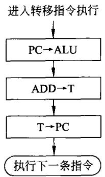  
图5-13转移指令执行

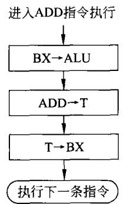  
图5-14 ADD指令执行

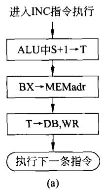

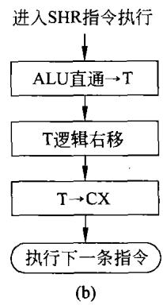  
图5-15INC指令及SHR指令执行过程

对于INC「BX]指令，在译码过程中已经将要加1的主存单元的内容放在寄存器S中，并已加到ALU上。在执行过程中(如图5-15(a)所示)，利用命令将S寄存器的数据加1,并将加1的结果放在寄存器T中。接着将BX的内容放在地址寄存器中，形成主存地址

MEMadr。将寄存器T的内容送数据寄存器，加在数据总线上，再送出写控制信号WR，将指令执行的结果写回到原来的存储单元。（图5-15(a)中BX→MEMadr这一步可以省略，因为地址寄存器中仍然放着前面该指令译码时的地址（即BX的内容)到此该指令执行结束，接着执行下一条指令。

对于SHR指令，在译码过程中已将CX的内容放在S寄存器中，并且S寄存器直接加到ALU上。在执行过程中，令ALU直通T并把S的内容直接放寄存器T中。下一步是命令寄存器T完成逻辑右移功能。最后，将寄存器T中的结果放回CX中。到此该指令执行结束，接着执行下一条指令。

无操作数指令的译码和执行两步可以合并，前面已经说明，这里不再解释。

## 5.4CPU的部件设计

在本节之前，已经决定了CPU的内部结构，设计了CPU的指令系统及其寻址方式，并对指令执行过程进行了详细分析。经过前面的一系列工作，在此基础上可以对构成CPU的部件进行具体设计。在这节里，将简单说明前面及前期课程已学过的部件，将重点放在控制器的设计上。

## 5.4.1熟悉部件的回顾

## 1．算术逻辑单元ALU

算术逻辑单元ALU是CPU的重要组成部件，有关算术逻辑单元ALU的具体内容在第3章中做了详细说明。在那里有如何利用74181或74181和74182构成16位的算术逻辑单元ALU的内容。用那里所描述的构成ALU的思路和方法，可以方便地构成如图5-1所示的CPU中的算术逻辑单元ALU。

## 2.移位寄存器

如图5-1所示的CPU中，暂存器T具有移位功能，能完成前面所设置的移位及循环指令功能。暂存器T实际上就是一种并人/并出的移位寄存器。具有这样功能的器件有许多种，前期的数字电路课中会有详细描述。本书前面第3章的3.2节中有关于该器件的简单说明。利用这样的器件只要在其输出端加上三态门，经三态将其输出接到CPU的内总线上，便可以实现暂存器T。

## 3.寄存器及带有三态输出的寄存器

在构成如图5-1所示的CPU时，会用到许多寄存器及带有三态输出的寄存器。例如，通用寄存器组都是带有三态输出的寄存器。而暂存器S、指令寄存器IR则是一般的寄存器。

## （1）寄存器

在第3章的3.2节中已介绍了8位寄存器。在这里，为了强调其控制信号，16位的寄

存器框图及信号波形如图5-16(a)和图5-16(b)所示。

由图5-16可以看到，当将数据加到寄存器的输人端 $\mathrm { D } _ { 0 } \sim \mathrm { D } _ { 1 5 }$ 上，利用触发脉冲P，可将输人端D的状态寄存在其输出端 ${ \sf Q } ( { \sf Q } _ { 0 } \sim { \sf Q } _ { 1 5 } )$ 上。该输出状态将一直维持到下一个触发脉冲P出现、寄存新的输入状态。

该寄存器可用做S、IR等寄存器。例如，某一时刻数据寄存器在W节拍信号控制下，将指令操作码输出到CPU的内部总线上，该信息将加在总线上所有连接部件的输入端。当然也加到IR的输入端，此时只在IR的P端加上触发脉冲，则此指令操作码就一定寄存在IR中，并从其输出端输出，加在控制器的指令译码器上。

## （2）带有三态输出的寄存器

同样，带有三态输出的寄存器在第3章的3.2节中已经介绍过。在这里需要说明的是，利用如图5-6所示的某个节拍信号W将数据加到寄存器的输入端 $\mathrm { D } _ { \circ } \sim \mathrm { D } _ { 1 5 }$ 上，利用触发脉冲P，可将输入端D的状态寄存在寄存器的内部，这些状态能否输出由输出允许端OE的状态来决定。在这里假定OE信号为高电平有效，即当OE为高电平时，三态门导通，寄存器内部的状态可输出到芯片外部；当OE加上低电平时，其输出为高阻状态。为了说明问题方便，16位带有三态输出的寄存器如图5-17所示。

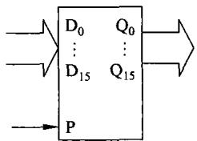  
(a)框图

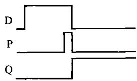  
(b)波形图  
图5-1616位寄存器

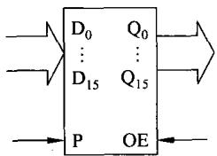  
图5-17三态输出寄存器

当某个节拍信号W将数据加到寄存器的输入端 $\mathrm { D } _ { 0 } \mathrm { \sim } \mathrm { D } _ { 1 5 }$ 上时，利用触发脉冲P，可将输人端D的状态寄存在寄存器的内部，而后，当另一个节拍信号W加到OE时，其寄存的数据便可输出。

这样的器件可用来构成寄存器组，它们的输入端输出端都接在CPU的内部总线上。例如，一个如图5-17所示的寄存器接到总线上用做BX，某时刻用一节拍信号W使暂存器T的输出三态门导通，则T的数据就加到了内总线上。同时，也就加到寄存器BX的输入端，此时利用P触发脉冲便可将T的数据存放在BX中。也就是说一个节拍信号W和同一节拍的触发脉冲P,就将T的内容存于BX中。

当要使BX的内容传送到其他寄存器时，必然先用节拍W使其内容输出到总线上，要传送到哪个寄存器，就在哪个寄存器上加P脉冲。显然，对其他寄存器的工作可以同样的思路去理解。

## 4.计数器

对所讨论的CPU中的程序计数器PC、堆栈指示器SP以及可以实现加1减1功能的寄存器，原理上均可用在第3章的3.2节中也曾提到并入/并出的可逆计数器、再在其输出端接上三态门来实现。例如，用16位并入/并出的计数器，并在计数器的输出接三态门，将其输入和三态门输出接到CPU的内部总线上，便可以构成程序计数器PC。只是该PC在

CPU复位时能使其输出置为CPU的复位启动地址。

当某寄存器(假定为T暂存器)的内容送PC，则可用W节拍信号打开T的三态门，T的数据就加到了CPU的内总线上，这时用P脉冲加到PC的预置端就能将数据写人PC。同样，当要使PC的内容传送到其他寄存器(例如AR)时，必定先用节拍W打开其输出三态门,使其内容输出到总线上，现要传送到地址寄存器 AR,就在地址寄存器 AR上加P脉冲。然后,利用另一P脉冲就可以使PC加1。显然，对其他寄存器的工作可以同样的思路去理解。

## 5.4.2指令执行的详细说明

## 1.组合逻辑控制器的构成

## （1）框图

图5-1中已说明控制器构成的5个组成部分，在这里针对组合逻辑控制器说明它的组成，其框图如图5-18所示。

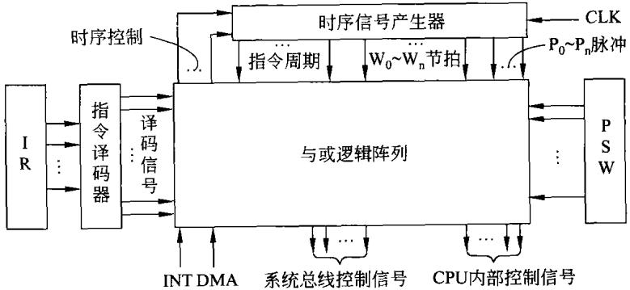  
图5-18硬件组合逻揖控制器框图

## （2）组成

由框图5-18可以看到，组合逻辑控制器是由如下部件构成的。

①时序信号产生器

该产生器产生如图5-6所示的三类信号。

a）指令周期，包括取指令码周期FIC、取操作数周期FDC 和执行周期EXEC。

b）节拍信号 $\mathbb { W } _ { 0 } \sim \mathbb { W } _ { 3 }$

c）触发脉冲 $\mathrm { P } _ { 0 } { \sim } \mathrm { P } _ { 3 }$

为了使问题简单一些，时序控制采取同步方式，一机器周期由4个时钟周期来完成。

## ②指令译码器

如上节所述，利用指令译码器，可根据不同的指令操作码和不同的寻址方式产生不同的信号，再经与或逻辑阵列产生相应的控制信号。

## ③程序状态字PSW

程序状态字PSW在5.1节中已说明，它里面存放着CPU执行一条指令后所处的状态。在条件转移指令执行过程中,会根据指令执行结果所产生的状态来决定程序的转向。

## ④与或逻辑阵列

利用与或逻辑阵列产生每一条指令执行所需要的全部控制信号。很显然，这部分是由与门、或门等硬件电路构成，是很复杂的。尤其当指令多、寻址方式多的情况下就会更加复杂。

## 2．微操作命令及其安排

## （1）微操作命令

在前面的描述中已经看到，为了方便分析和设计控制器，将指令分成若干机器周期，再将机器周期分成几步，每一步只完成一种最基本的操作。人们把这种最基本的操作称为微操作。实现微操作的控制信号称为微操作命令。例如，此前提到的PC→IB,BX→IB等操作都是微操作，而实现这些微操作的控制信号 $\mathrm { P C } _ { \mathrm { o u t } } , \mathrm { B X } _ { \mathrm { o u t } }$ 等信号都是微操作命令，它们就是上面提到的打开三态门的信号。同样，触发信号P脉冲是微操作命令，在下面常用 $\mathrm { P C } _ { \mathrm { i n } } , \mathrm { B X } _ { \mathrm { i n } }$ 表示。显然，基本功能为微操作，实现微操作的控制信号是微操作命令。

下面将要说明指令执行过程中微操作命令的安排。

## （2）微操作命令的安排

一个指令周期，最终是由一系列微操作命令来完成的。前面已经分析过了，在这里接着本章前面的内容更加具体地进行叙述。为了简单起见，规定一个机器周期由4个节拍来实现，如图5-6所示。

## ①取指令码周期FIC

每条指令的执行，首先就是从主存中取指令码，这个过程对所有的指令都是一样的。可以说这一取指令码过程是共用的。其过程如下。

```powershell
$\bar { \boldsymbol { \mathsf { W } } } _ { 0 }$ PCout,ARin
$\bar { \boldsymbol { w } } _ { 1 }$ RD,PC+ 1
$\bar { \boldsymbol { w } } _ { 2 }$ MD→DB,DRin
$\tilde { \boldsymbol { \mathsf { W } } } _ { 3 }$ DRout , IRin
```

在上述过程中， $\mathrm { P C _ { o u t } }$ 是将PC的内容输出到CPU的内部总线IB上，这是一种微操作命令，就可直接用 $\mathbf { W } _ { 0 }$ 加到PC的输出三态门上实现该操作。 $\mathrm { { A R } } _ { \mathrm { { i n } } }$ 也是一种微操作，其功能就是将出现在IB的PC的内容锁存在地址寄存器AR上。该微操作可用触发脉冲 $\mathrm { P } _ { 0 }$ 来实现。

从上面所描述的过程可以看到，取指周期由4个节拍来实现。 $\mathbf { W } _ { 0 }$ 节拍前面已做了解释，其他3个节拍读者可自行理解。

当最后一个节拍结束时，应当判别有无DMA请求，此处不做说明。没有DMA请求或DMA传送结束，则根据指令有无操作码，决定启动取操作数周期FDC或执行周期EXEC。

## ②取操作数周期FDC

由于指令有不同个数的操作数，也可以没有操作数，再加上不同的寻址方式。在上一节分析时已经强调，这一周期不同的指令是很不一样的。在这里要说明的是，为了设计控制器，必须把所有寻址方式的所有指令的微操作命令安排妥当。

显然，对于前面所要设计的CPU，由于指令比较多，寻址方式也比较多。要将每一条指令取操作数周期的微操作命令都写出来，作为教科书来说就太繁杂了。不过请读者记住，要真正用现在这种思路设计组合逻辑控制器，就必须将所有指令、所有寻址方式的所有微操作

命令安排全都写出来。

在这里，为了说明问题，只将前面提到的几条指令取操作数的微操作命令写在下面。

该指令的取操作数周期过程如下。

```csv
Wo PCout ,ARin
W AR→AB,RD,PC+1
W MD→DB,DRin
W DRout,AXin
```

这里要说明的是，该指令取操作数周期结束，该指令执行也就结束。利用最后的节拍启动下一条指令的 FIC周期。

```json
b）ADDBX，[DI]
```

该指令的取操作数周期过程如下。

$$
\begin{array} { r l r l } & { \mathbb { W } _ { 0 } } & & { \mathbb { D } \mathrm { I } _ { \mathrm { o u t } } \ , \ \mathbb { A } \mathrm { R } _ { \mathrm { i n } } } \\ & { \mathbb { W } _ { 1 } } & & { \mathbb { A } \mathrm { R } \mathrm { \to \mathbb { A } B } , \ \mathrm { R D } } \\ & { \mathbb { W } _ { 2 } } & & { \mathbb { M } \mathrm { D } \mathrm { \to \mathbb { D } B } , \ \mathrm { D } \mathrm { R } _ { \mathrm { i n } } } \\ & { \mathbb { W } _ { 3 } } & & { \mathbb { D } \mathrm { R } _ { \mathrm { o u t } } \ , \ S _ { \mathrm { i n } } } \end{array}
$$

在此取操作数的周期结束时，就将以DI的内容为内存地址的存储器单元的内容读出并放在暂存器S中，其输出加到了ALU的一边，接着就进行下一步执行周期EXEC。

## c）转移指令

在这里写出无条件转移和满足条件的条件转移的取操作数微操作命令安排。不满足条件顺序的执行前面已经提到，这里不再说明。

```powershell
W PCout,ARin
$\tilde { \pmb { W } } _ { 1 }$ AR→AB,RD,PC+1
$\mathbb { W } _ { 2 }$ MD→DB,DRin
$\mathbb { W } _ { 3 }$ DRout , Sin
```

将指令操作数即偏移地址取出放入暂存器S。

d） INC[BX]

该指令的取操作数周期过程如下。

```powershell
$\mathtt { W } _ { 0 }$ BXout ,ARin
$\bar { \boldsymbol { w } } _ { 1 }$ AR→AB,RD
$\mathbb { W } _ { 2 }$ MD→DB,DRin
${ \bar { \mathbb { W } } } _ { 3 }$ DRout ,Sin
```

在此取操作数的周期结束时，就将以BX的内容为内存地址的存储器单元的内容读出并放在暂存器S中，其输出加到了ALU的一边，接着就启动下一步执行周期EXEC。

e） SHR CX

该指令的取操作数周期过程如下。

$$
\begin{array} { c } { { \widetilde { W } _ { 0 } } } \\ { { { } } } \\ { { \widetilde { W } _ { 1 } } } \end{array}
$$

W2   
W CXout,Sin

此取操作数周期只需一个节拍，那就将其他3个节拍空着。

在此取操作数的周期里，只将CX 的内容送出,经内总线 IB 放在暂存器 S中，其输出加到了ALU的一边,接着就启动下一步执行周期EXEC。

在前面提到的无操作数指令，对空操作指令NOP来说，取出指令操作码则该指令执行结束,可启动新的取指周期。对于中断返回指令IRET,取指周期结束可启动下一步执行周期EXEC。

同样，当本周期的最后一个节拍结束时，应当判别有无DMA请求，此处不做说明。没有DMA请求或DMA传送结束，则启动执行周期EXEC。

## ③执行周期EXEC

对应上面的几条指令，它们的执行周期微操作命令信号安排如下。

a）MOV AX，4000H

该指令取指令操作数与执行周期合在一起，前面已经说明。

b）ADD BX,[DI]

该指令的执行周期过程如下。

$$
\begin{array} { r l } & { \check { W } _ { 0 } \qquad \mathrm { S \to A L U } } \\ & { \begin{array} { r l } & { \bar { \mathbf { W } } _ { \mathrm { 1 } } } \\ & { \bar { \mathbf { W } } _ { \mathrm { 2 } } } \end{array} \qquad \begin{array} { r l } & { \bar { \mathbf { B } } \mathbf { X } _ { \mathrm { o u t } } \qquad \mathrm { \to \bar { \mathbf { A } } L U } } \\ & { \bar { \mathbf { W } } _ { \mathrm { 2 } } } \end{array} } \\ & { \begin{array} { r l } & { \bar { \mathbf { W } } _ { \mathrm { 2 } } \qquad \quad \mathrm { \bar { A } L U } , \ \bar { \mathbf { A } } \mathrm { D } \bar { \mathbf { D } } \to \mathbf { - \bar { T } } , \ \bar { \mathbf { T } } _ { \mathrm { \perp n } } } \\ & { \bar { \mathbf { W } } _ { \mathrm { 3 } } } \end{array} } \\ &  \begin{array} { r l } & { \bar { \mathbf { W } } _ { \mathrm { 3 } } \qquad \quad \mathrm { \bar { T } } _ { \mathrm { o u t } } \ \mathrm { , ~ \bar { \mathbf { B } } X _ { \mathrm { i n } } ~ } } \end{array} \end{array}
$$

在此周期里,ALU将放在S 中的操作数与BX的内容相加送T,T输出放回BX中。

c）转移指令

在这里写出无条件转移和满足条件的条件转移的执行周期微操作命令安排。

```csv
W S→ALU,
W1 PCout→ALU
W2 ALU,ADD→T,Tin
W Tout,PCin
```

将 PC的当前值与偏移地址相加，构成目的地址放入PC。

d）INC[BX]

该指令的执行周期过程如下。

```csv
WG S→ALU
W ALU+1→T,Tin
W2 Tout,DRin
W3 DR→DB,WR
```

在此周期中，将上面周期取得的操作数经ALU加1，再送到数据寄存器DR中。此时，AR中仍存有操作数的地址，送时就将DR出的数据写回原来的地址。

e） SHR CX

该指令的执行周期过程如下。

```powershell
${ \bar { \boldsymbol { \mathsf { W } } } } _ { 0 }$ S→ALU
$\mathbb { W } _ { 1 }$ ALU直通→T,Tin
$\bar { \boldsymbol { w } } _ { z }$ T逻揖右移一次
$\mathbb { W } _ { 3 }$ $\boldsymbol { \mathrm { T } } _ { \mathsf { o u t } } , \mathsf { C X } _ { \mathrm { i n } }$
f） IRET
```

中断返回指令由取指周期直接进入执行周期，其过程如下。

```powershell
${ \bf \tilde { w } } _ { 0 }$ SPout,ARin
$\mathbf { \tilde { W } } _ { 1 }$ AR→AB,RD,SP+1
$\mathbb { W } _ { 2 }$ MD→DB,DRin
$\mathbb { W } _ { 3 }$ $\mathsf { D R } _ { \mathsf { o u t } } , \mathsf { P C } _ { \mathsf { i n } }$
$_ { \textrm { g } ) }$ 中断响应过程INTA
```

有关中断的详细内容请见第8章。在这里仅介绍最简单的情况：对中断请求响应时，CPU仅保护 $\mathrm { \Delta P C }$ 的内容,并且由硬件提供该中断的中断向量。其过程如下。

$\mathtt { W } _ { 0 }$ $\mathsf { S P } _ { \circ \mathsf { u t } } , \mathsf { A R } _ { \mathsf { i n } }$   
$\mathbb { W } _ { 1 }$ AR→AB,SP-1   
$\tilde { \cal M } _ { 2 }$ $\ P \mathsf { C } _ { \mathsf { o u t } } , \mathsf { D } \mathsf { R } _ { \mathsf { i n } }$   
$\mathbb { W } _ { 3 }$ DR→DB,WR   
$\mathtt { w } _ { \mathtt { c } }$ $0 {  } \mathrm { I F } , \mathrm { I F } _ { \mathrm { i n } }$   
$\mathbb { W } _ { 1 }$   
$\mathbb { W } _ { 2 }$   
${ \bar { \boldsymbol { \mathsf { W } } } } _ { 3 }$ $\mathrm { T V _ { o u t } } , \mathrm { P C _ { i n } }$

中断响应过程需两个机器周期，第1个机器周期保护断点PC的内容入堆栈。第2个机器周期关中断（使 $\mathrm { I F } { = } 0 )$ ，并将特定的该中断的中断向量IV放入 $\mathrm { P C }$ ，并启动取指周期。则下一个机器周期CPU必定进入该中断的中断处理程序入口开始执行。

## 5.4.3组合逻辑控制器设计

## 1.微操作命令的逻辑表达式

在这里必须再次强调，为了获得微操作命令的逻辑表达式，必须将所有寻址方式的所有指令的微操作命令安排写出来。正如前面已经提到的，只有将每一条指令每一个机器周期的微操作命令排列出来，才能进行下一步的设计工作。但是，设计CPU，全部写出微操作命令安排将是非常繁杂的。因此，必须清楚地知道，真正要设计控制器，就必须这样做。

现在，假定已经将要设计的CPU的全部微操作命令安排都已写出来了，下一步工作就是写出每一个微操作命令的逻辑表达式。

$$
\begin{array} { r l } & { \mathrm { P C } _ { \mathrm { o u } } = \mathrm { F I C } \cdot \mathrm { W } _ { 0 } + \mathrm { F D C } \cdot \mathrm { I R } ( \mathrm { b i t } _ { 1 5 \sim 9 } \neq 0 0 0 0 1 1 1 \cdot \mathrm { b i t } _ { 3 } = 1 ) \cdot \mathrm { W } _ { 0 } + \mathrm { F D C } \cdot \mathrm { I R } ( \mathrm { b i t } _ { 1 5 \sim 8 } = 0 0 0 1 1 1 \cdot \mathrm { b i t } _ { 1 5 \sim 9 } \times \mathrm { I C } ) } \\ & { \mathrm { 0 0 0 0 1 1 1 } \cdot \mathrm { b i t } _ { 1 \sim 4 } \neq 1 1 1 1 ) \cdot \mathrm { W } _ { 0 } + \mathrm { I N T A } \cdot \mathrm { W } _ { 2 } + \mathrm { E X E C } \cdot \mathrm { I R } ( \mathrm { b i t } _ { 1 5 \sim 9 } = 0 0 0 0 1 1 1 \cdot \mathrm { b i t } _ { 8 } = 1 \cdot \mathrm { G } ^ { 2 } ) } \\ & { \mathrm { b i t } _ { 7 \sim 4 } = 1 1 1 1 ) \cdot \mathrm { W } _ { 1 } + \cdots } \end{array}
$$

$$
\mathrm { A R } _ { \mathrm { i n } } = \mathrm { F I C } \cdot \mathrm { P } _ { \mathrm { 0 } } + \mathrm { F D C } \cdot \mathrm { I R } \left( \mathrm { b i t } _ { \mathrm { 1 5 } \sim \mathrm { 9 } } \neq 0 . 0 0 0 1 1 1 \cdot \mathrm { ~ b i t } _ { \mathrm { 3 } } = 1 \right) \cdot \mathrm { P } _ { \mathrm { 0 } } + \mathrm { F D C } \cdot \mathrm { I R } \left( \mathrm { b i t } _ { \mathrm { 1 5 } \sim \mathrm { 9 } } \neq 0 . 0 0 0 1 1 \cdot \mathrm { ~ b i t } _ { \mathrm { 3 } } = 1 \right)
$$

$$
\begin{array} { r l } & { 0 0 0 0 1 1 1 \cdot \mathrm { ~ b i t } _ { \mathrm { 7 } } = 1 \cdot \mathrm { ~ b i t } _ { \mathrm { 2 } } = 1 \cdot \mathrm { ~ P } _ { \mathrm { 9 } } + \mathrm { F D C } \cdot \mathrm { ~ I R } ( \mathrm { b i t } _ { \mathrm { 1 5 } \cdot \mathrm { s } } = 0 0 0 0 1 1 1 1 \cdot \mathrm { ~ b i t } _ { \mathrm { 7 } \cdot \mathrm { s } } = \mathrm { \overline { { \phi } } 1 1 1 1 } ) \cdot \mathrm { ~ P } _ { \mathrm { 9 } } + } \\ & { \mathrm { F D C } \cdot \mathrm { I R } ( \mathrm { b i t } _ { \mathrm { 1 5 } \cdot \mathrm { s } } = 0 0 0 0 1 1 1 0 \cdot \mathrm { ~ b i t } _ { \mathrm { 2 } } = 1 ) \cdot \mathrm { P } _ { \mathrm { 9 } } + \mathrm { E X E C } \cdot \mathrm { I R } ( \mathrm { b i t } _ { \mathrm { 1 5 } \cdot \mathrm { s } } = 0 0 0 0 1 1 1 1 1 1 1 \cdot \mathrm { ~ b i t } _ { \mathrm { 7 } \cdot \mathrm { s } } = 0 0 0 0 0 1 1 1 1 1 \cdot \mathrm { ~ b i t } _ { \mathrm { 7 } \cdot \mathrm { s } } = 0 0 0 0 0 0 1 0 1 0 ) } \\ & { = \mathrm { I R E T } \frac { \mathrm { i d } \cdot \mathrm { K } } { \mathrm { 1 5 } \cdot \mathrm { ~ B } } \cdot \mathrm { P } _ { \mathrm { 9 } } + \mathrm { I N T A } \cdot \mathrm { P } _ { \mathrm { 9 } } + \cdots } \end{array}
$$

$$
\begin{array} { r l } & { \mathrm { R D = F I C \cdot ~ W _ 1 + F D C \bullet ~ I R ~ ( b i t _ { 1 5 - 9 } \neq 0 0 0 0 1 1 1 \cdot ~ b i t _ 3 = 1 ) \bullet ~ W _ 1 + F D C \bullet ~ I R ( b i t _ { 1 5 - 9 } \neq 0 0 0 0 1 1 1 \cdot ~ b i t _ 3 = 1 ) } } \\ & { \mathrm { 0 0 0 0 1 1 1 \cdot ~ b i t _ { 7 } = 1 \cdot ~ b i t _ 2 = 1 ~ \cdot ~ W _ 1 + F D C \bullet ~ I R ( b i t _ { 1 5 - 8 } = 0 0 0 0 1 1 1 \cdot ~ b i t _ { 7 - 4 } \neq 1 1 1 1 1 ) \cdot ~ W _ 1 + \delta ~ W _ 1 ~ } } \\ & { \mathrm { F D C \bullet ~ I R ( b i t _ { 1 5 - 8 } = 0 0 0 0 1 1 1 0 \cdot ~ b i t _ 2 = 1 ) \bullet ~ W _ 1 + E X E C \bullet ~ I R ( b i t _ { 1 5 - 4 } = 0 0 0 0 1 1 1 1 1 1 1 \cdot ~ b i t _ { 7 - 4 } = \delta ~ W _ 2 ~ ) } } \\ & { \mathrm { I R E T ~ \frac { 4 \pi } { 4 \mu } \diamond ~ \cdot ~ W _ 1 + \cdots ~ } } \end{array}
$$

以上只写出三种微操作命令的逻辑表达式，而且没有写全。只有在所有指令的微操作命令过程都写出后，再根据指令操作码和寻址方式，可把每一条微操作命令的表示式写全。下一节将会看到，在所讨论的CPU中，需要用到50余种微操作命令。

即使这样，从上面简要写出的不完全的表达式，也可以看到如下几点。

（1）所有的微操作命令都可以用与或门来实现。由于指令和寻址方式较多，与或表达式也比较复杂。

（2）在不同的机器周期里、不同的节拍，会用到同样的微操作命令。因此，必须将所有的微操作命令的安排都写出来，才不至于遗漏。

（3）不同的指令、不同的寻址方式、条件转移指令的条件都是微操作命令的形成条件。上面的表达式中可以看这种情况(注：未包括条件转移指令的条件）。

（4）前面如图5-6所形成的 $\mathrm { F I C } \mathrm { , F D C , E X E C , W _ { \ell \sim 3 } \Delta , P _ { \ell \sim 3 } }$ 信号以及指令译码器和PSW的信号共同加到与或门上，形成所需要与或逻辑阵列，产生CPU工作所需要的所有信号，这也是框图5-18所表示的意图。

## 2.微操作命令的逻辑化简

上面提到，要设计组合逻辑控制器，就必须将所有用到50余种微操作命令的逻辑表达式写出来。写出后并不依照这些表达式直接去构成与或门。因为这太复杂，而且有许多信号是重复的。

鉴于这种情况，就需要将这些微操作命令的逻辑表达式进行综合化简。

## 3.构成与或逻辑阵列

在将所有微操作命令逻辑综合化简的基础上，便可以构成与或逻辑阵列，以便产生CPU所需要的所有内、外部控制命令。在计算机发展的早期，人们用与门、或门等门电路来实现。可想而知，构成此与或逻辑阵列是相当麻烦的。

当出现简单的可编程逻辑器件PLD(PAL、PLA、GAL等)后，人们用它们实现与或逻辑阵列，相对要简单一些，但还是很麻烦的。

今天，人们早已不用这样的器件来设计控制器，要用的方法和手段将在本书的最后一章中详加说明。这里，希望读者理解CPU设计的思路和分析方法，这是重要的、是最基本的概念。

## 5.4.4微程序控制器设计

## 1.微程序控制器原理

## （1）由来

在上面的讨论中，规定CPU执行指令的时序分为三个机器周期，每个机器周期分为 4个节拍，每个节拍为一个时钟周期。这是一种分析和解决问题的方法。

完全可以将一条指令的执行过程顺序地由多个步骤(或称为状态)来完成。也就是将每一条指令的执行过程分解为若干个状态，每一状态的操作完成时根据情况启动下一个状态。当一条指令最后一个状态完成时，再启动执行下一条指令的起始状态。

首先，写出5.4.3小节中两条指令的过程。

① ADD BX,[DI]  
a) $\mathrm { P C } _ { \mathrm { o u t } } , \mathrm { A R } _ { \mathrm { i n } }$   
b） $\mathrm { A R {  } A B , R D , P C { + } 1 }$   
c） $\mathrm { M D {  } D B , D R _ { i n } }$   
d) $\mathrm { D R } _ { \mathrm { o u t } } , \mathrm { I R } _ { \mathrm { i n } }$   
e) $\mathrm { D I } _ { \circ \mathrm { u t } } , \mathrm { A R } _ { \mathrm { i n } }$   
f) $\mathrm { A R } {  } \mathrm { A B } , \mathrm { R D }$   
g） $\mathrm { M D {  } D B , D R _ { i n } }$   
h) $\mathrm { D R } _ { \mathrm { o u t } } , \mathsf { S } _ { \mathrm { i n } }$   
》 $\mathrm { S } {  } \mathrm { A L U }$   
j) $\mathrm { B X } _ { \mathrm { o u t } } {  } \mathrm { A L U }$   
k) $\mathrm { A D D \mathrm { \to T } , T _ { i n } }$   
1） $\mathbf { T } _ { \mathrm { o u t } } , \mathbf { B } \mathbf { X } _ { \mathrm { i n } }$   
② $\mathrm { I N C } \ \mathrm { [ B X ] }$   
a) $\mathrm { P C } _ { \mathrm { o u t } } , \mathrm { A R } _ { \mathrm { i n } }$   
b) $\mathrm { A R {  } A B , R D , P C { + } 1 }$   
c） $\mathrm { M D { \cdot } { \succ } D B , D R } _ { \mathrm { i n } }$   
d) $\mathrm { D R } _ { \mathrm { o u t } } , \mathrm { I R } _ { \mathrm { i n } }$   
e) $\mathrm { B X } _ { \mathsf { o u t } } , \mathrm { A R } _ { \mathsf { i n } }$   
f） $\mathrm { A R } \mathrm {  } \mathrm { A B } , \mathrm { R D }$   
g） $\mathrm { M D { \to } D B , D R } _ { \mathrm { i n } }$   
h) $\mathrm { D R } _ { \mathrm { o u t } } , \mathsf { S } _ { \mathrm { i n } }$   
i) $\mathrm { S } {  } \mathrm { A L U }$   
j) $\mathrm { A L U } { + } 1 {  } \mathrm { T } , \mathrm { T } _ { \mathrm { i n } }$   
k) $\mathrm { T } _ { \mathfrak { o u t } } , \mathrm { D R } _ { \mathrm { i n } }$   
1） $\mathrm { D R } \{  \mathrm { D B } , \mathbf { W } \mathrm { R } $

由上面所描述的指令执行过程可以看到，一条指令的执行过程可以分解为若干更微小的基本操作，并称这种基本操作为微操作。控制完成微操作的命令称为微命令。能够产生一个或多个微命令的二进制编码就称为微指令。通过将完成一条机器指令的一系列微指令存入存储器中，然后再按顺序依次读出执行，从而完成指令的功能。并称这些完成机器指令功能的一系列微指令构成的程序称为微程序。执行一条指令所对应的一段微程序，就能完成这条指令的功能。利用微程序控制指令的执行这就是微程序控制器的基本思路。

## （2）微程序控制器的构成

微程序控制器的构成框图如图5-19所示。

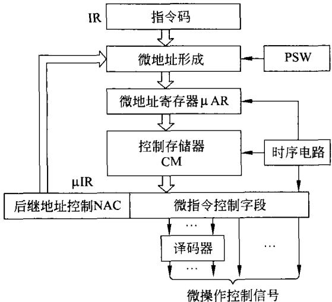  
图5-19微程序控制器的构成框图

## ①控制存储器CM

控制存储器CM用于存放CPU所能执行的所有指令的微程序。一旦指令确定，它所对应的一段微程序也就确定了，不会随便改动。因此，控制存储器CM都是只读存储器ROM。并目，希望该存储器的读出速度尽可能快。只有控制存储器CM读出速度快，执行一条指令所对应的一段微程序也就会更快，则CPU的速度就更快一些。

可以想象，在微程序控制器里增加一条指令就是在控制存储器CM中增加存储这条指令的一段微程序，做起来比较容易。若要在组合逻辑控制器里增加一条指令，那就复杂多了。

## ②微地址形成电路

如图5-19所示，该电路根据指令寄存器中指令操作码OP及指令的寻址方式，根据PSW的标志以及后继地址控制字段NAC的编码等因素，形成控制存储器CM的地址。在图5-19中未能画出，当有外部复位RESET时，该电路必定能产生固定的微地址，从那里开始执行取指令操作码的微程序。

## ③微地址寄存器 $\mu \mathrm { A R }$

该寄存器用来存放微地址形成电路产生的微地址，也就是控制存储器CM的地址。

④微指令寄存器 $\mu \mathrm { R }$

微指令寄存器 $\mu \mathrm { I R }$ 用来存放由控制存储器CM读出的微指令。由图5-19可以看到，微指令包括两个字段。

## a）微指令控制字段

该字段经译码或不经译码产生CPU执行指令所需要的微操作控制信号。有关微指令控制编码的问题，下面将专门讨论。

## b）后继地址控制字段NAC

该字段的不同编码用以表示后继地址的产生方式，主要有如下几种。

顺序执行，即后继地址为当前微地址加1。

无条件转移，转移地址可由该字段直接给出。

条件转移，二分支的转移，即满足条件转移，不满足条件顺序执行。

多分支转移，根据指令操作码OP或寻址方式MOD进行的多分支转移。

有关微地址的形成，下面将做详细讨论。

## ⑤时序电路

微程序控制器中的时序电路相对比较简单，只要产生节拍信号和触发脉冲，通过微指令译码就可形成微操作命令。

## 2.微地址形成

微程序控制器中，一个重要部件就是微地址形成电路。其结构还与微指令的结构有关，具体有如下几种情况。

## （1）两地址格式(断定方式）

最简单的方法是在每条微指令NAC域中提供两个地址字段和地址选择控制位(字段)

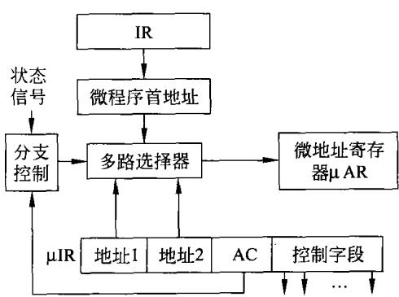  
图5-20两地址格式原理框图

AC，如图5-20所示，地址1和地址2分别提供下条命令的顺序地址和跳转地址。可以灵活地生成跳转地址以及确定下条微指令的地址是选择地址1(顺序地址)还是地址2(跳转地址）。

如图5-20所示，利用地址选择控制位AC及CPU的状态标志使分支逻辑产生地址选择信号，依据此信号，多路选择器可以选择顺序地址、跳转地址或微程序首地址之一作为下一条微指令的地址送入微地址寄存器中。微程序首地址逻辑电路可将输人的指令操作码映射为微指令地址(微程序首地址)并输出。

若控制存储器有512个存储单元，则控制存储器地址(微地址)为9位，那么两地址格式提供的微指令地址域长度应为 $( 2 \times 9 + \mathbf { m } )$ 位，m为地址选择控制位AC的位数。

## （2）单地址格式(计数方式，增量方式)

正如在内存中存放程序一样，在控制存储器中也是将顺序执行的微指令存放在连续的控存单元中。因此，顺序微地址通过当前微地址加1即可获得，计数器正适合完成此功能。参照CPU利用程序计数器(PC)提供顺序的内存地址，在控制器中引人了微程序计数器$( \mu \mathrm { P C } )$ ,利用微程序计数器具备的加1计数的能力，产生下条顺序微地址。

这样，在微指令中只需要一个地址字段提供跳转的微地址即可，微指令格式如图5-21中微指令寄存器 $\mu \mathrm { I R }$ R所示，地址字段仅提供下条跳转地址，而下条顺序地址则通过 $\mu \mathrm { P C }$ 加

1获得。同样，在地址域中仍设置了地址选择控制位(字段)AC,用它来确定何时需要使用跳转地址及如何生成实际的跳转地址。

如图5-21所示微程序控制器根据微指令AC字段提供的分支跳转信息和系统当前的状态信息生成分支跳转地址加载允许信号。在微程序执行过程中，若该信号有效，多路选择器选择将微指令地址字段的跳转地址输出并加载至 $\mu \mathrm { P C }$ 中；若跳转地址无效或未执行新的微程序，则多路选择器不输出，由$\mu \mathrm { P C }$ 加1的结果作为下条微指令的地址提供给控制存储器。

在图5-21的分支控制逻辑中， $\mu \mathrm { P C }$ 具有独特的功能。首先，它是一个典型的计数器，在每一个微指令周期(节拍)，时序电路向 $\mu \mathrm { P C }$ 发出“加1"控制信

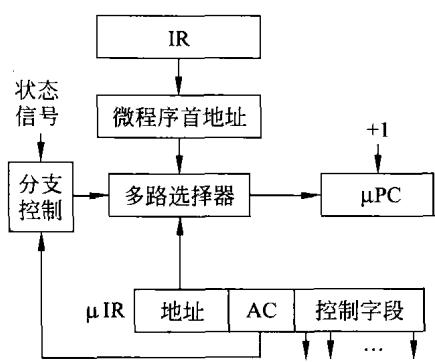  
图5-21一地址格式原理框图

号， $\mu \mathrm { P C }$ 实现自动加1操作,如果此时多路选择器无输出， $\mu \mathrm { P C }$ 的内容就是下条顺序的微地址。其次，它也像所有的计数器一样可以进行计数初值的加载，当需要执行与机器指令相应的一段新微程序时，微程序的首地址被加载至 $\mu \mathrm { P C }$ ，使 $\mu \mathrm { P C }$ 指向微程序在控存中的首地址。之后可以依据此首地址并通过不断地加1,获得微程序段内其他微指令在控存中存放的顺序地址。而当微程序需要分支跳转时，分支跳转地址被加载至 $\mu \mathrm { P C }$ 。这样就可以依据此地址重新从控存中获得一组微指令。对 $\mu \mathrm { P C }$ 的这种加载功能使 $\mu \mathrm { P C }$ 完全可以取代 $\mu \mathrm { A l }$ R，所以图5-21中没有出现 $\mu \mathrm { A R }$

引人硬件逻辑并不复杂的 $\mu \mathrm { P C }$ 代价极低，不但 $\mu \mathrm { P C }$ 利用率高，而且微指令长度被有效地缩短。

## （3）可变微指令格式

在微程序中，多数情况下是顺序程序。当执行顺序微程序段时，微指令的地址域信息实际是无用的。也就是说，在微程序执行的绝大多数时间里，微指令中地址信息是多余的。如果可以让微指令在顺序执行时只提供控制信号的产生，需要分支时再提供跳转地址，这样就可以保证在任何微指令执行时不存在无用信息。这就是提出可变微指令格式的依据。

为此，设计了两种微指令格式，分别如图5-22(a)和图5-22(b)所示。

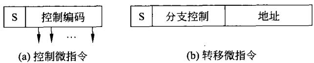  
图5-22两种不同的微指令

由图5-22可以看到，两种微指令的功能是完全不一样的。其中图5-22(a)只用于形成各种微命令；而图5-22(b)则只用于微程序的分支转移。两种指令用标志位S来决定。例如， $\mathbf { S } { = } 0$ 时为控制微指令，而当 ${ \sf S } = 1$ 时，则为转移微指令。

可变微指令的工作原理可由图5-23来说明，当从控制存储器中读出控制微指令时，利用其标志 ${ \bf S } { = } 0$ 控制门电路输出，译码产生相应的控制信号。同时，使 $\mu \mathrm { P C }$ 自动加1。

当从控制存储器中读出转移微指令时，由于其标志 ${ \bf S } = 1$ ，门电路没有输出。在它控制

下，利用状态及分支控制产生后继地址。

## （4）多分支地址形成

不同的指令编码表示不同的指令，同样的指令又有多种寻址方式。在微程序控制器的控制存储器CM中，不同的指令、不同的寻址方式必定对应一段不同的微程序。这些微程序在CM的地址也必定不相同。当CPU从内存取出一条指令后，对应这条指令的执行，就会面临多分支转移的问题。

诚然，多分支可以通过二分支来实现，也可以采用如图5-24所示的原理框图来实现。

由图5-24可以看到，不同的指令，其操作码不一样，可以将操作码作为ROM1的地址，在该地址中存放着该指令微地址的一部分。指令的寻址方式及状态信号也用于作为ROM2的地址，在该地址中存放着该指令微地址的另一部分。将这两部分地址结合在一起，便可以构成这条指令微程序的首地址。

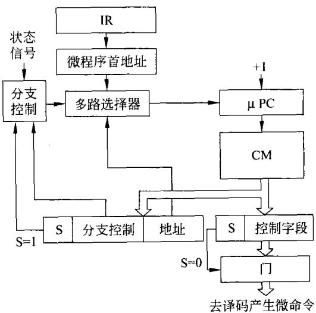  
图5-23可变微指令格式原理框图

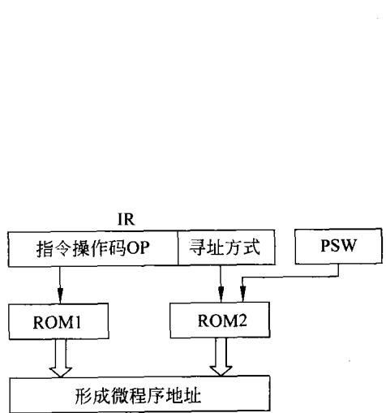  
图5-24多分支地址形成

## 3.微指令控制域编码

正如前面提到的微指令控制域编码要详细加以说明，它是构成微指令重要的组成部分。微指令在执行时，就是由该控制域的编码产生微命令。通常，将微指令分为水平型微指令和垂直型微指令。水平型微指令可以使多个控制信号同时有效，达到使多个微操作同时发生的效果。垂直型微指令类似于机器指令，它利用微操作码的不同编码来表示不同的微操作功能。

## （1）水平型微指令

## ①直接表示法

前面已经提到，对于如图5-1所示的CPU，执行其全部指令需要50余种微操作控制信号（也就是微命令）。在微指令的控制域字段中，直接表示法就是用二进制位表示一种微命令。

例如，若计算机系统需要n个控制信号，则控制域字段长度应为n个二进制位。就前述CPU，用直接表示法表示的微指令控制字段如图5-25所示。

在图5-25中，控制字段的每一位定义为一种微命令，如图中的 $\mathrm { P C } _ { \mathrm { o u t } } \ 、 \mathrm { B X } _ { \mathrm { o u t } }$ 信号等。微命令有多少个，控制字段就有多少位。当某位设定为"1"时，表示该位定义的控制信号有效，为"0"时，表示该位定义的控制信号无效。这样，就可以利用一条微指令，同时使多个控制信号有效。

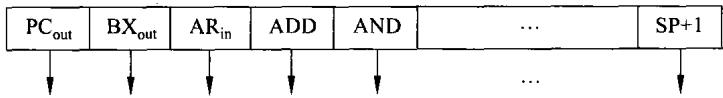  
图5-25直接表示法的控制字段

采用这种编码方式时，由于控制信号直接从微指令控制域的某位获得，所以在图5-19示意的微程序控制器中，不需要译码器。将微指令寄存器的控制域各位直接引出控制器，就获得了计算机系统的全部控制信号，所以这种设计法也称做不译码法或直接控制法。显然，这种设计可以快速地产生控制信号。

可以想象，这种编码构成的微指令控制字段很长而且利用率是非常低的。机器指令执行过程的每一步，只需少量的几个微命令。因此，每一条微指令的控制字段中只有少数几个1,绝大多数位都是0（该位无效)。而微指令越长，则CM的容量就越大，代价也越高。因此，在水平型微指令的控制字段编码中常用下面的方法。

## ②字段译码法(字段编码）

在计算机系统运行时，可以在同一个时间有效的控制信号称为相容信号，具有相容性。也就是说这些信号可以同时出现；不能在同一个时间有效的控制信号称为互斥信号，具有互斥性。也就是说这些信号不允许同时出现。相容的控制信号可以在同一条微指令中设置为“1”，互斥的控制信号必须在不同的微指令中设置为“1”。

如图5-1所示的单总线结构的CPU来说，下列情况下，控制信号必定是互斥的。

a）所有向内总线IB的输出信号必是互斥的，例如， $\mathrm { P C } _ { \mathrm { o u t } } \setminus \mathrm { B X } _ { \mathrm { o u t } }$ 等。这些信号一旦同时出现，必定引起总线竞争，一定会造成严重后果。

b）多功能器件的诸多功能必是互斥的。例如，ALU某一时刻只能完成一种功能；做加法时不可能同时做减法。移位器件不可能同时进行左移和右移。

c)CPU对系统总线的操作是互斥的。CPU不可能同时进行读写，读时不能写，写时不能读。

d）同一器件的输入和输出是互斥的。例如， $\mathrm { B X } _ { \mathrm { i n } } , \mathrm { B X } _ { \mathrm { o u t } }$ 是互斥的。

e）凡是有可能使状态引起竞争的控制信号都是互斥的。

一种性能良好而普遍使用的控制域编码方法是字段译码法，它是不译码法和译码法的结合。它将控制域分为若干字段。若各字段的编码相互独立，则通过各字段独立译码就可以获得计算机系统的全部控制信号，这被称做直接译码方式。若某些字段的编码相互关联，则关联字段要通过两级译码才能获得相关的控制信号，这被称做间接译码方式。字段编码结构如图5-26和图5-27所示。

在进行字段编码时，要遵循互斥的信号放在同一字段、相容的信号放在不同字段这一基本原则，以确保在字段编码后控制信号间有正确的相容、相斥关系。例如，控制信号PCi和 $\mathrm { P C } _ { \mathrm { i n } }$ $\mathrm { P C } _ { \mathrm { o u t } }$ 是程序计数器的输入与输出控制信号，如果两者同时有效，程序计数器的输入与输出动作将发生冲突，造成程序计数器不能正常工作，所以 $\mathrm { P C } _ { \mathrm { i n } }$ 和 $\mathrm { P C } _ { \circ \mathbf { u } \mathbf { t } }$ 是互斥信号，编码时可放在同一字段，保证两者不会同时出现。而控制信号 $\mathrm { { A R } _ { \mathrm { { i n } } } }$ 和 $\mathrm { P C _ { o u t } }$ 是地址寄存器的输人锁存控制信号和程序计数器的输出允许控制信号，只有两者同时有效时，程序计数器的内容才能加载至地址寄存器中，实现微操作PC→AR。所以， $\operatorname { A R } _ { \operatorname { i n } }$ $\mathrm { P C _ { o u t } }$ 是相容信号，编码时应放在不同字段，保证两者可以同时在不同字段中出现。

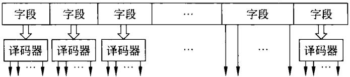  
图5-26直接译码法的控制字段

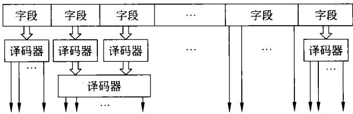  
图5-27间接译码法的控制字段

在字段译码法中，若控制域有L个字段，则允许有L个控制信号同时有效。考虑到各字段间同时有效的控制信号可以有不同的组合，在每个字段中都要设计一个无效控制信号的编码。这样一来，若控制域的某字段有m位，则可以提供2"一1个控制信号的编码。

在字段译码法中，如何组织字段对于微指令的长度和控制信号生成的时间有直接的影响。字段组织的有效方法有两种：按功能组织和按资源组织。

按功能组织就是把功能类同的各控制信号放在同一字段中。例如，针对如图5-1所示的CPU，所有向内总线输出的微命令，如 $\mathrm { P C _ { \mathrm { { o u t } \setminus \mathrm { { T _ { o u t } } \setminus \mathrm { { S P _ { o u t } } \setminus \mathrm { { A X } _ { o u t } } \setminus \mathrm { { B X } _ { o u t } } } } } } }$ 等均为互斥信号，可放在同一字段中。对于器件的输入命令，如 $\mathrm { P C _ { \mathrm { i n } } \setminus I R _ { \mathrm { i n } } \setminus S P _ { \mathrm { i n } } \setminus A X _ { \mathrm { i n } } \setminus A R _ { \mathrm { i n } } }$ 等均为CPU内部各寄存器的锁存输人控制信号，这些控制信号的功能相同，都是实现将CPU内部总线上的信息加载至相应寄存器内部的操作控制。这些控制信号中，凡是互斥信号，将其组织在同一字段中。其他功能相似的信号都可以按这样的思路归在一个字段中。

按资源组织就是把加载到同一部件上的各控制信号放在同一字段中。如前所述，为了保证多功能部件正常工作，部件都被设计成在一个时刻只实现一种功能。部件的控制信号必然是互斥的，可以组织在同一字段中。例如ADD、SUB、AND、OR、XOR等为控制ALU资源操作的控制信号，它们也是互斥的，应放在同一字段中。当然，这些控制信号也可以看做是一种按功能组织的结果，因为这些控制信号都用于实现运算类操作的控制。

## （2）垂直型微指令

垂直型微指令与水平型微指令的不同在于它们控制域的编码方法不同。

垂直型微指令的控制字段采用与机器指令相似的格式，由微操作码和微操作对象两大部分构成，其一般格式如图5-28所示。

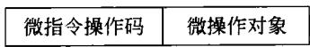  
图5-28垂直型微指令格式

微指操作码用来指示做何种微操作，微操作对象用来为该微操作提供所需的操作数（常量或地址)。采用与机器指令相似的设计，微操作码也可以采用固定长度或可变长度进行编码，而微操作数可以有一个或多个。这种高度编码的方法，使垂直型微指令的控制域变得非常紧凑、短小，是减小微指令长度的有效设计方法。

垂直型微指令的控制字段一种极端情况是：如果CPU执行机器指令只需50余种微命令，则可用6位二进制编码构成微指令的控制字段。因为，一种编码只指定一种微命令，6位编码有64种，足以表示这50几种微操作命令。可以想象其构成的微指令一定是很短的。

每条垂直型微指令只能完成对少量微操作的控制，并行能力较差，致使微程序变长，执行速度减慢。改变这一状况的方法是在计算机系统中大量引入并行机制，使得少量的控制信号就可以引起较多的微操作同时完成。例如，采用单总线构造的ALU实现一次加法运算需要三个节拍、三条微指令来完成，采用双总线构造的ALU实现一次加法运算需要两个节拍、两条微指令来完成，而采用三总线构造的ALU实现一次加法运算仅需要一个节拍、一条微指令就可以完成了。

在这里还需说明，既然垂直型微指令就如同一条机器指令，前面已经看到，一条机器指令可用一段微程序实现。那么，一条微指令能否用一段毫微指令构成的毫微程序来完成呢？答案是肯定的。即将一条微指令分解成更细的毫微操作命令，设计毫微指令来实现毫微操作命令，用一段毫微指令构成的毫微程序来完成微指令的功能。具体细节不再讨论。

## （3）水平型与垂直型微指令的比较

水平型微指令具有如下特性。

①具有位数较长的微指令，完成同样功能的微程序则比较短。

② 并行能力强、效率高。

③对控制域提供的控制信息只需较少的译码电路，甚至不需要译码。

④指令执行时间短。

③用户掌握、使用要困难一些。

垂直型微指令的特性与上述水平型微指令的特性相反。

## 4.微指令的设计

在说明微指令控制域可采用水平型或垂直型编码的基础上，下面将以水平型编码具体构成如图5-1所示的CPU的微指令。

## （1）控制域字段

对CPU执行指令所需微命令，依据前面提到的按功能分为如图5-29所示的几个组成分组。

## ①输出到内总线的命令

如图5-29中最左侧的一列，它们的作用是命令某个寄存器将其内容输出到内总线 IB上。显然，这些信号一定是互斥的，这才将它们放在一个用4位编码的字段中。用这4位编码来表示这些微命令。若从0000到1011的编码顺序表示从 $\mathrm { { N O P } }$ 到 $\mathrm { T _ { o u t } }$ ，则 $\mathrm { P C } _ { \mathrm { o u t } }$ 微命令必为1001。该命令即可完成PC→IB微操作。

## ②触发寄存器的命令

这是指 $\mathbf { X X } _ { \mathrm { i n } }$ 微命令，它们也是互斥的，放在同一字段中。这些命令用这4位编码来表

示。同样,若从0000 到1100 的编码顺序表示从 NOP 到 $\mathrm { { T } _ { i n } }$ ，则 $\mathrm { P C } _ { \mathrm { i n } }$ 微命令必为1001。该命令即可完成IB→PC 微操作。

<table><tr><td rowspan=1 colspan=10>4b       $\pmb { 4 6 }$     2b     2b    4b    3b    2b     2b     2b    2b</td></tr><tr><td rowspan=1 colspan=1> $\mathbf { X X _ { o u t } }$ </td><td rowspan=1 colspan=1> $\mathbf { X X _ { \mathrm { i n } } }$ </td><td rowspan=1 colspan=1>DR</td><td rowspan=1 colspan=1>AR</td><td rowspan=1 colspan=1>ALU</td><td rowspan=1 colspan=1>T</td><td rowspan=1 colspan=1>PC</td><td rowspan=1 colspan=1>M</td><td rowspan=1 colspan=1>SP</td><td rowspan=1 colspan=1>响应</td></tr><tr><td rowspan=1 colspan=1> $\mathbf { N O P }$ </td><td rowspan=1 colspan=1> $\mathbf { N O P }$ </td><td rowspan=1 colspan=4>NOP   NOP  NOP NOP</td><td rowspan=1 colspan=4>NOP   NOP   NOP  NOP</td></tr><tr><td rowspan=1 colspan=1> $\mathbf { A X _ { o u t } }$ </td><td rowspan=1 colspan=1> $\mathbf { A X _ { \mathrm { i n } } }$ </td><td rowspan=1 colspan=2>DB→DR AR→AB</td><td rowspan=1 colspan=1>ADD</td><td rowspan=1 colspan=1>SAR</td><td rowspan=1 colspan=1> $\scriptstyle \mathbf { 0 } \to \mathbf { P C }$ </td><td rowspan=1 colspan=1>RD</td><td rowspan=1 colspan=1>SP+1</td><td rowspan=1 colspan=1>INTA</td></tr><tr><td rowspan=1 colspan=1> $\mathbf { B X _ { o u t } }$ </td><td rowspan=1 colspan=1> $\mathbf { B X } _ { \mathrm { i n } } ^ { \cdots }$ </td><td rowspan=1 colspan=1>DR→DB</td><td rowspan=1 colspan=1> $\mathbf { A } \mathbf { R } _ { \mathrm { i n } }$ </td><td rowspan=1 colspan=1>ADC</td><td rowspan=1 colspan=1>SHL</td><td rowspan=1 colspan=1> $\mathbf { P C } { + 1 }$ </td><td rowspan=1 colspan=1>WR</td><td rowspan=1 colspan=1>SP-1</td><td></td></tr><tr><td rowspan=1 colspan=1> $\mathrm { C X } _ { \mathrm { o u t } }$ </td><td rowspan=1 colspan=1> $\operatorname { C X } _ { \mathfrak { i } \mathfrak { n } }$ </td><td rowspan=1 colspan=1></td><td rowspan=1 colspan=1></td><td rowspan=1 colspan=1>SUB</td><td rowspan=1 colspan=1>SHR</td><td rowspan=1 colspan=1></td><td rowspan=1 colspan=1></td><td rowspan=1 colspan=1></td><td></td></tr><tr><td rowspan=1 colspan=1> $ { \mathbf { D } }  { \mathbf { X } } _ { \mathrm { o u t } }$ </td><td rowspan=1 colspan=1> $ { \mathbf { D } }  { \mathbf { X } } _ { \mathrm { i n } }$ </td><td rowspan=1 colspan=2></td><td rowspan=1 colspan=1>SBC</td><td rowspan=1 colspan=1>ROL</td><td rowspan=1 colspan=1></td><td rowspan=1 colspan=1></td><td></td><td></td></tr><tr><td rowspan=1 colspan=1> $\mathbb { S } \mathbb { P } _ { \mathfrak { o u t } }$ </td><td rowspan=1 colspan=1> $\mathtt { S P _ { i n } }$ </td><td rowspan=1 colspan=1></td><td rowspan=1 colspan=1></td><td rowspan=1 colspan=1>AND</td><td rowspan=1 colspan=1>ROR</td><td rowspan=1 colspan=1></td><td></td><td></td><td></td></tr><tr><td rowspan=1 colspan=1> $\mathsf { B P } _ { \mathsf { o u t } }$ </td><td rowspan=1 colspan=1> $\mathsf { B P } _ { \mathrm { i n } }$ </td><td rowspan=1 colspan=1></td><td rowspan=1 colspan=1></td><td rowspan=1 colspan=1>XOR</td><td rowspan=1 colspan=1>RCL</td><td></td><td></td><td></td><td></td></tr><tr><td rowspan=1 colspan=1> $\mathbf { S I } _ { \mathrm { o u t } } ^ { \phantom { \dagger } }$ </td><td rowspan=1 colspan=1> $\mathbf { S } \mathbf { I } _ { \mathrm { i n } }$ </td><td rowspan=1 colspan=2></td><td rowspan=1 colspan=1>NOT</td><td rowspan=1 colspan=1>RCR</td><td></td><td></td><td></td><td></td></tr><tr><td rowspan=1 colspan=1> $\mathbf { D } \mathbf { I } _ { o u t }$ </td><td rowspan=1 colspan=1> $\mathrm { D I } _ { \mathrm { i n } }$ </td><td rowspan=1 colspan=2></td><td rowspan=1 colspan=1>INC</td><td rowspan=1 colspan=1></td><td></td><td></td><td></td><td></td></tr><tr><td rowspan=1 colspan=1> $\mathbf { P C } _ { o u t }$ </td><td rowspan=1 colspan=1> $\mathtt { P C } _ { \mathrm { i n } }$ </td><td rowspan=1 colspan=2></td><td rowspan=1 colspan=1>DEC</td><td rowspan=1 colspan=1></td><td></td><td></td><td></td><td></td></tr><tr><td rowspan=1 colspan=1> $\mathrm { D R } _ { \mathrm { o u t } }$ </td><td rowspan=1 colspan=1> $\mathrm { I R } _ { \mathrm { i n } }$ </td><td rowspan=1 colspan=2></td><td rowspan=1 colspan=1>CMP</td><td rowspan=1 colspan=1></td><td></td><td></td><td></td><td></td></tr></table>

图5-29控制字段各类微命令分布

## ③其他微命令

图5-29中其他字段依据同样的思路，每一字段中的信号是互斥的，根据信号的多少决定该字段编码的位数。例如， $\mathrm { { A R } _ { \mathrm { { i n } } } }$ 的编码应为二进制10。

如图5-29所示的微指令控制域字段中，各字段的信号是相容的，可见该域的长度为27位。其中共有54个微命令，加一空操作为55个。若完全用垂直制微指令的思路编码，该控制域短，只需6位编码。

## （2）微指令的构成

前面已经把一条微指令的核心部分，控制域字段决定了，其形式如图5-29所示。

若控制存储器的容量为512B,微指令采用一地址格式，则地址编码用9位即可表示。

后继地址控制字段AC设定为4位，4位AC编码用于控制顺序执行、无条件转移、两分支转移和多分支转移。

这样一来，-条微指令的字长为27十9十4=40位。微指令的格式如图5-30 所示。
<table><tr><td>9b</td><td>4b</td><td>4b</td><td>4b</td><td>2b</td><td>2b</td><td>4b</td><td>3b</td><td>2b</td><td>2b</td><td>2b</td><td>2b</td></tr><tr><td>NA</td><td> $\mathsf { A C }$ </td><td> $\mathbf { X X _ { o u t } }$ </td><td>xXin</td><td>DR</td><td>AR</td><td>ALU</td><td>T</td><td>PC</td><td>M</td><td>SP</td><td>响应</td></tr></table>

图5-30微指令各组成字段格式

如图5-30所示，就可以构成各种所需要的微指令。利用所构成的微指令便可以编出对应机器指令的微程序。

## （3）时序

时序逻辑电路有两个作用。

① 依据时钟按节拍为控制存储器提供读出控制信号。将每个时钟周期作为一个节拍，在每个节拍发一次读出控制信号read，从控存中读出并执行一条微指令，就可以实现一个节拍下的微操作。可见，在微程序控制器中，时序的设计与控制都很简单。

②微程序运行时生成下一条微指令地址，并将其装人到微地址寄存器中。微指令地址域的设计不同，生成下一条微指令地址的硬件电路也会有所不同。

微程序控制器是一个相对而言比较简单的逻辑电路，它可以实现控制器应具备的功能：一是微指令(代表微操作)执行顺序的控制；二是控制信号的产生(引起微操作发生)。它在一个节拍周期内完成如下工作。

①时序逻辑电路给控制存储器发出read命令。

②从微地址寄存器 $\mu \mathrm { A R }$ 指定的控存单元读出微指令，送入微指令寄存器 $\mu \mathrm { I R }$

③ 根据微指令寄存器的内容，产生控制信号，给时序逻辑提供下条微地址信息。

④时序逻辑根据来自微指令寄存器的下条微地址信息和 $\mathrm { C P U }$ 内外状态，给微地址寄存器加载一个新的微地址。

．微程序控制器依据节拍信号(以及触发信号，如图5-6所示)不断地重复这一工作过程，使存放在控制存储器中的微程序在机器指令的选择下一一被执行。显然，在微程序控制器中，时序控制相对比较简单。

## 5.微程序编程

上面已经描述了微指令的构成，利用如图5-30所表示的微指令，能够实现产生执行机器指令所需要的任何控制命令和各种转移。接下来的问题就是如何编写微程序。

## （1）一条指令对应一段单独的微程序

为编写微程序，最易理解的就是对应 $\mathrm { C P U }$ 设计时所设置的所有指令，对应每一条指令单独编这条指令的微程序。将这些指令所对应的独立的微指程序，固化在CM中，CPU执行哪条指令，就执行它所对应的那段微程序。

显然，这种方法很好理解，但并不适用。因为，如前所述，在每条指令所对应的单独的微程序中，有一些微程序段是重复的。最明显的就是前面小节中已经强调：所有指令取指令操作码的过程是一样的，为每条指令所共用。除此之外，还会有一些是多个微程序所共用的微程序段。若采用一条指令对应一段单独的微程序，显然是种浪费，更多的是用下一种方法。

## （2）共用可共用的微程序段

将那些可共用的微程序段单独编写出来，为那些可利用该段程序的指令使用。利用这种思路编写微程序的流程框图如图5-31所示。

在图5-31中，CPU复位后即从启动地址取指令操作码，然后执行该指令。每执行完一条指令再取下一条指令操作码，这段取指令操作码的微程序段是共用的。

取得指令操作码后，根据这条指令的操作功能及寻址方式(也就是那条具体的指令)转到执行这条指令的微程序段上。如图5-31所示，由于指令功能及寻址方式不同，可以认为每一条指令的执行过程对应一段微程序。在执行过程的微程序段中，还有可能调用的共用微程序段，只是在图5-31上没有表示出来。

一条指令结束，需判断有无中断请求，有则响应并处理。在图5-31中暂未考虑 DMA请求。

（3）示例

下面首先编写共同使用的程序段，取指过程如下。

① $\mathrm { P C } _ { \mathrm { o u t } } , \mathrm { A R } _ { \mathrm { i n } }$

② $\mathrm { A R {  } A B , R D , P C { + } 1 }$

③ $\mathrm { M D {  } D B , D R } _ { \mathrm { i n } }$

④ $\mathrm { D R } _ { \mathrm { o u t } } , \mathrm { I R } _ { \mathrm { i n } }$

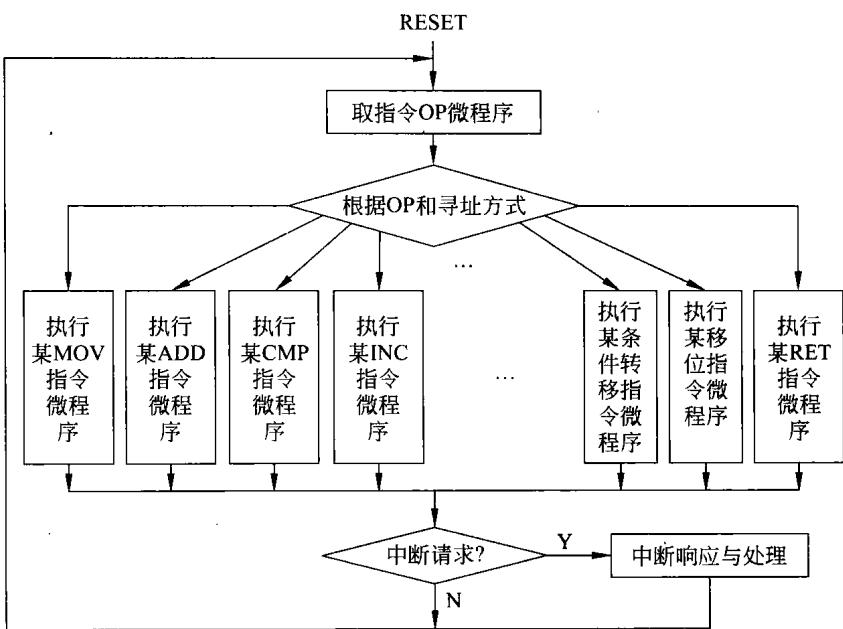  
图5-31微程序流程框图

对应的4条微指令如图5-32所示。
<table><tr><td rowspan=1 colspan=12>NA     AC  $\mathbf { X X _ { o u t } }$    $\mathbf { X X } _ { \mathrm { i n } }$  DR ARALU T PCMSP响应</td></tr><tr><td rowspan=1 colspan=1>000000000</td><td rowspan=1 colspan=1>0000</td><td rowspan=1 colspan=1>1001</td><td rowspan=1 colspan=1>0000</td><td rowspan=1 colspan=1>00</td><td rowspan=1 colspan=1>10</td><td rowspan=1 colspan=1>0000</td><td rowspan=1 colspan=1>000</td><td rowspan=1 colspan=1>00</td><td rowspan=1 colspan=1>00</td><td rowspan=1 colspan=1>00</td><td rowspan=1 colspan=1>00</td></tr><tr><td rowspan=1 colspan=12></td></tr><tr><td rowspan=1 colspan=1>000000000</td><td rowspan=1 colspan=1>0000</td><td rowspan=1 colspan=1>0000</td><td rowspan=1 colspan=1>0000</td><td rowspan=1 colspan=1>00</td><td rowspan=1 colspan=1>01</td><td rowspan=1 colspan=1>0000</td><td rowspan=1 colspan=1>000</td><td rowspan=1 colspan=1>10</td><td rowspan=1 colspan=1>01</td><td rowspan=1 colspan=1>00</td><td rowspan=1 colspan=1>00</td></tr><tr><td rowspan=1 colspan=12></td></tr><tr><td rowspan=1 colspan=1>000000000</td><td rowspan=1 colspan=1>0000</td><td rowspan=1 colspan=1>0000</td><td rowspan=1 colspan=1>1101</td><td rowspan=1 colspan=1>01</td><td rowspan=1 colspan=1>00</td><td rowspan=1 colspan=1>0000</td><td rowspan=1 colspan=1>000</td><td rowspan=1 colspan=1>00</td><td rowspan=1 colspan=1>00</td><td rowspan=1 colspan=1>00</td><td rowspan=1 colspan=1>00</td></tr><tr><td rowspan=1 colspan=12></td></tr><tr><td rowspan=1 colspan=1>000000000</td><td rowspan=1 colspan=1>1001</td><td rowspan=1 colspan=1>1010</td><td rowspan=1 colspan=1>1010</td><td rowspan=1 colspan=1>00</td><td rowspan=1 colspan=1>00</td><td rowspan=1 colspan=1>0000</td><td rowspan=1 colspan=1>000</td><td rowspan=1 colspan=1>00</td><td rowspan=1 colspan=1>00</td><td rowspan=1 colspan=1>00</td><td rowspan=1 colspan=1>00</td></tr></table>

图5-32取指令操作码的微程序段

在取指过程中，AC均为0，表明是顺序执行的。在此过程中，后继地址是不用的，故9位全为0。控制域的字段为0表示空操作。

取指过程对任何指令都是适用的。当指令操作码取出并放人IR后，后面的执行过程将因指令不同而异。下面仍以ADDBX，［DI]为例说明指令执行过程的微程序段。

利用如图5-32所示的微程序段即可将指令ADDBX，[DI]的指令码（如前所述包括寻址方式字节在内的16位)放到了指令寄存器IR中。

图5-32中的最后一条微指令将指令码放人IR中。同时，微指令中的AC（此处为1001)指出如何形成NA。该字段控制如图5-24所示形成该指令执行微程序入口地址：根据寄存器间接寻址的加法指令ADDBX，［DI的指令码，从ROM1中查出NA的基地址（例如08QH)，根据指令的寻址方式，从ROM2中得到位移量(假定为07H)，将两者加到一起就形成了该指令的目的地址(087H)。从此地址开始，可存放执行该指令的微程序。

执行步骤如下。

① $\mathrm { D I } _ { \mathrm { o u t } } , \mathrm { A R } _ { \mathrm { i n } }$

② $\mathrm { A R } \mathrm {  } \mathrm { A B } , \mathrm { R D }$

③ $\mathrm { M D } {  } \mathrm { D B } , \mathrm { D R } _ { \mathrm { i n } }$

④ $\mathrm { D R } _ { \mathrm { o u t } } , \mathsf { S } _ { \mathrm { i n } }$

5 $\mathbf { S } _ { \mathrm { o u t } } {  } \mathbf { A } \mathbf { L } \mathbf { U }$

$\mathrm { B X } _ { \mathrm { o u t } } {  } \mathrm { A L U }$

? $\mathrm { A D D \mathrm {  T } , T _ { i n } }$

8 $\mathbf { T } _ { \mathrm { o u t } } , \mathbf { B } \mathbf { X } _ { \mathrm { i n } }$

上述过程编写微程序如图5-33所示。

<table><tr><td rowspan=1 colspan=12>NA     AC  $\mathbf { X X } _ { \mathrm { o u t } }$   $\mathbf { X X } _ { \mathrm { i n } }$  DR ARALU T PCMSP 响应</td></tr><tr><td rowspan=1 colspan=1>000000000</td><td rowspan=1 colspan=1>0000</td><td rowspan=1 colspan=1>1000</td><td rowspan=1 colspan=1>0000</td><td rowspan=1 colspan=1>00</td><td rowspan=1 colspan=1>10</td><td rowspan=1 colspan=1>0000</td><td rowspan=1 colspan=1>000</td><td rowspan=1 colspan=1>00</td><td rowspan=1 colspan=1>00</td><td rowspan=1 colspan=1>00</td><td rowspan=1 colspan=1>00</td></tr><tr><td rowspan=1 colspan=1></td><td rowspan=1 colspan=1></td><td rowspan=1 colspan=1></td><td rowspan=1 colspan=1></td><td rowspan=1 colspan=1></td><td rowspan=1 colspan=1></td><td rowspan=1 colspan=1></td><td rowspan=1 colspan=1></td><td rowspan=1 colspan=1></td><td rowspan=1 colspan=1></td><td rowspan=1 colspan=1></td><td rowspan=1 colspan=1></td></tr><tr><td rowspan=1 colspan=1>000000000</td><td rowspan=1 colspan=1>0000.</td><td rowspan=1 colspan=1>0000</td><td rowspan=1 colspan=1>0000</td><td rowspan=1 colspan=1>00</td><td rowspan=1 colspan=1>01</td><td rowspan=1 colspan=1>0000</td><td rowspan=1 colspan=1>000</td><td rowspan=1 colspan=1>00</td><td rowspan=1 colspan=1>01</td><td rowspan=1 colspan=1>00</td><td rowspan=1 colspan=1>00</td></tr><tr><td rowspan=1 colspan=1></td><td rowspan=1 colspan=1></td><td rowspan=1 colspan=1></td><td rowspan=1 colspan=1></td><td rowspan=1 colspan=1></td><td rowspan=1 colspan=1></td><td rowspan=1 colspan=1></td><td rowspan=1 colspan=1></td><td rowspan=1 colspan=1></td><td rowspan=1 colspan=1></td><td rowspan=1 colspan=1></td><td rowspan=1 colspan=1></td></tr><tr><td rowspan=1 colspan=1>000000000</td><td rowspan=1 colspan=1>0000</td><td rowspan=1 colspan=1>0000</td><td rowspan=1 colspan=1>1101</td><td rowspan=1 colspan=1>01</td><td rowspan=1 colspan=1>00</td><td rowspan=1 colspan=1>0000</td><td rowspan=1 colspan=1>000</td><td rowspan=1 colspan=1>00</td><td rowspan=1 colspan=1>00</td><td rowspan=1 colspan=1>00</td><td rowspan=1 colspan=1>00</td></tr><tr><td rowspan=1 colspan=1></td><td rowspan=1 colspan=1></td><td rowspan=1 colspan=1></td><td rowspan=1 colspan=1></td><td rowspan=1 colspan=1></td><td rowspan=1 colspan=1></td><td rowspan=1 colspan=1></td><td rowspan=1 colspan=1></td><td rowspan=1 colspan=1></td><td rowspan=1 colspan=1></td><td rowspan=1 colspan=1></td><td rowspan=1 colspan=1></td></tr><tr><td rowspan=1 colspan=1>000000000</td><td rowspan=1 colspan=1>0000</td><td rowspan=1 colspan=1>1010</td><td rowspan=1 colspan=1>1011</td><td rowspan=1 colspan=1>00</td><td rowspan=1 colspan=1>00</td><td rowspan=1 colspan=1>0000</td><td rowspan=1 colspan=1>000</td><td rowspan=1 colspan=1>00</td><td rowspan=1 colspan=1>00</td><td rowspan=1 colspan=1>00</td><td rowspan=1 colspan=1>00</td></tr><tr><td rowspan=1 colspan=1></td><td rowspan=1 colspan=1></td><td rowspan=1 colspan=1></td><td rowspan=1 colspan=1></td><td rowspan=1 colspan=1></td><td rowspan=1 colspan=1></td><td rowspan=1 colspan=1></td><td rowspan=1 colspan=1></td><td rowspan=1 colspan=1></td><td rowspan=1 colspan=1></td><td rowspan=1 colspan=1></td><td rowspan=1 colspan=1></td></tr><tr><td rowspan=1 colspan=1>000000000</td><td rowspan=1 colspan=1>0000</td><td rowspan=1 colspan=1>1011</td><td rowspan=1 colspan=1>0000</td><td rowspan=1 colspan=1>00</td><td rowspan=1 colspan=1>00</td><td rowspan=1 colspan=1>0000</td><td rowspan=1 colspan=1>000</td><td rowspan=1 colspan=1>00</td><td rowspan=1 colspan=1>00</td><td rowspan=1 colspan=1>00</td><td rowspan=1 colspan=1>00</td></tr><tr><td rowspan=1 colspan=1></td><td rowspan=1 colspan=1></td><td rowspan=1 colspan=1></td><td rowspan=1 colspan=1></td><td rowspan=1 colspan=1></td><td rowspan=1 colspan=1></td><td rowspan=1 colspan=1></td><td rowspan=1 colspan=1></td><td rowspan=1 colspan=1></td><td rowspan=1 colspan=1></td><td rowspan=1 colspan=1></td><td rowspan=1 colspan=1></td></tr><tr><td rowspan=1 colspan=1>000000000</td><td rowspan=1 colspan=1>0000</td><td rowspan=1 colspan=1>0010</td><td rowspan=1 colspan=1>0000</td><td rowspan=1 colspan=1>00</td><td rowspan=1 colspan=1>00</td><td rowspan=1 colspan=1>0000</td><td rowspan=1 colspan=1>000</td><td rowspan=1 colspan=1>00</td><td rowspan=1 colspan=1>00</td><td rowspan=1 colspan=1>00</td><td rowspan=1 colspan=1>00</td></tr><tr><td rowspan=1 colspan=1></td><td rowspan=1 colspan=1></td><td rowspan=1 colspan=1></td><td rowspan=1 colspan=1></td><td rowspan=1 colspan=1></td><td rowspan=1 colspan=1></td><td rowspan=1 colspan=1></td><td rowspan=1 colspan=1></td><td rowspan=1 colspan=1></td><td rowspan=1 colspan=1></td><td rowspan=1 colspan=1></td><td rowspan=1 colspan=1></td></tr><tr><td rowspan=1 colspan=1>000000000</td><td rowspan=1 colspan=1>0000</td><td rowspan=1 colspan=1>0000</td><td rowspan=1 colspan=1>1101</td><td rowspan=1 colspan=1>00</td><td rowspan=1 colspan=1>00</td><td rowspan=1 colspan=1>0001</td><td rowspan=1 colspan=1>000</td><td rowspan=1 colspan=1>00</td><td rowspan=1 colspan=1>00</td><td rowspan=1 colspan=1>00</td><td rowspan=1 colspan=1>00</td></tr><tr><td rowspan=1 colspan=1>（</td><td rowspan=1 colspan=1></td><td rowspan=1 colspan=1></td><td rowspan=1 colspan=1></td><td rowspan=1 colspan=1></td><td rowspan=1 colspan=1></td><td rowspan=1 colspan=1></td><td rowspan=1 colspan=1></td><td rowspan=1 colspan=1></td><td rowspan=1 colspan=1></td><td rowspan=1 colspan=1></td><td rowspan=1 colspan=1></td></tr><tr><td rowspan=1 colspan=1>110000000</td><td rowspan=1 colspan=1>0001</td><td rowspan=1 colspan=1>1100</td><td rowspan=1 colspan=1>0010</td><td rowspan=1 colspan=1>00</td><td rowspan=1 colspan=1>00</td><td rowspan=1 colspan=1>0000</td><td rowspan=1 colspan=1>000</td><td rowspan=1 colspan=1>00</td><td rowspan=1 colspan=1>00</td><td rowspan=1 colspan=1>00</td><td rowspan=1 colspan=1>00</td></tr></table>

图 5-33ADD BX,[DI]指令执行过程的微程序

需要说明的是，上述微程序是顺序程序，由上到下顺序执行即可产生相应的微控制命令，最后将相加的结果放在BX中。在这过程中AC均为0,表示为顺序执行，这时NA中的地址是不用的。这段微程序就放在首地址为087H的顺序单元中，此后每一次执行这条指令都执行这一段程序。

但在最后一条微指令中，AC的编码为0001，这表示无条件转移，转移地址为NA的内容。在这里假定上面取指微程序的首地址就是000000000。则本指令执行结束就会无条件转移到检测中断请求的共用微程序其NA地址为180H，若有中断请求则转向中断响应;若无中断请求则转向取指令共用程序，去取下一条指令的指令码。（此处假定不考虑DMA的请求）

以上仅以一条指令为例来说明微程序的编程。由于作为描述对象的CPU设置了多种指令和寻址方式，因此，微程序设计相对也就比较麻烦。但是，有如图5-31所示的思路及上面的例子，读者能理解微程序控制器的原理及微程序的设计思路即可。

## 6.微程序控制器与硬布线控制器的比较

硬布线控制器完全利用逻辑器件实现，所以速度非常快。当计算机系统越来越复杂时，硬布线控制器设计也越来越困难。硬布线控制器一旦被实现，便不可修改和扩充。

微程序控制设计使控制器设计简单化、规范化，并使其功能具有可修改性和可扩充性。微程序控制器内部的译码和时序电路非常简单，实现成本低，出错概率小。微程序控制器的主要缺点是比硬布线控制器速度慢。

对于功能复杂的计算机系统，微程序控制器相对易于实现，所以CISC处理器几乎都采用微程序控制器。而RISC处理器具有简单的指令格式，又强调高速度，所以主要采用硬布线控制器。

## 习 题

1．中央处理器(CPU)由哪些部分组成？它们应具有哪些基本功能？

2．控制器的功能是什么？它由哪些部件组成？

3．什么是硬布线控制器？有什么特点？

4．硬布线控制器如何产生微命令？产生微命令的主要条件有哪些？

5．什么是指令周期和微指令周期？二者之间存在什么关系？

6．微程序控制的基本思想是什么？微程序控制器的特点是什么？

7．微程序控制器设计中微指令由哪几部分组成？各部分的作用是什么？

8．微指令产生控制信号(微命令)的方式有哪些？各方式是如何产生控制信号的？

9．对微指令进行字段直接编码的基本原则是什么？

10．主存与控存有什么异同？

11．与硬布线控制器相比，微程序控制器有哪些优缺点？

12．在微程序控制器设计中，若控制器需要处理100条指令，每条指令需要最多8条微指令构成的微程序来实现其功能;控制器需要产生100个微命令(控制信号)，且被分为6个相容类，如表5-1所示。

表5-1微命令相容类表
<table><tr><td rowspan=1 colspan=1>类型</td><td rowspan=1 colspan=1>0</td><td rowspan=1 colspan=1>1</td><td rowspan=1 colspan=1>2</td><td rowspan=1 colspan=1>3</td><td rowspan=1 colspan=1>4</td><td rowspan=1 colspan=1>5</td></tr><tr><td rowspan=1 colspan=1>微命令数</td><td rowspan=1 colspan=1>14</td><td rowspan=1 colspan=1>29</td><td rowspan=1 colspan=1>8</td><td rowspan=1 colspan=1>23</td><td rowspan=1 colspan=1>11</td><td rowspan=1 colspan=1>15</td></tr></table>

（1）请合理设计微指令的控制域(微命令生成字段)，使其长度尽可能的短。

(2）若微指令的次地址(即下一条微指令地址)产生仅是顺序地址和无条件跳转地址，请合理设计微指令的地址域（下条微指令地址生成字段）。

（3）请根据以上设计确定控制存储器多大为宜？

13．某微程序控制器采用的微指令字长为24位。微命令生成部分由4个字段构成，各字段所包括的互斥微命令分别为5个、8个、14个和3个。另外控制产生次地址的条件有3种。试说明该微控制器最多可用几位来表示次地址？控制存储器的容量为多少？

```csv
PC→AR
AR→AB,RD,PC+ 1
DB-→ DR
DR→IR
执行指令：
AX→S
BX→IB,ADD
ALU→T
T→AX
```

14．某计算机系统简化的CPU 结构如图5-1所示，实现指令ADD AX，BX（功能为(AX)+(BX)→AX)时采用以下微操作流程。

取指令：

(1）依据此流程,写出实现加法指令ADD AX，(BX)的微流程。说明：该指令中（BX)为寄存器间接寻址，指令功能为(AX)十（（BX))→AX,RD为存储器读控制信号，ADD为运算器加法控制信号。

(2）试拟出加法指令 ADD AX,DISP(SI)的微流程。其中DISP（SI)表示变址寻址，DISP 是偏移量，SI是变址寄存器。

（3）拟出减法指令 SUB BX,100(DI)的指令微流程。

15．图5-34为某一运算器的简化框图，其中A、B既有寄存器又有多路选择器的功能，M有移位和选择器的功能，ALU为算术逻辑单元，R0和R1为通用寄存器。图中粗线为数据通路，是一种单总线结构。带下标in者为数据存人该寄存器的微命令，带下标out者为将该寄存器的内容输出的微命令,XX→ALU、ADD、十1、V、L等均为微命令。

（1）根据图中所示，选择括号中的正确答案。

1 $\mathbf { R } 0 _ { \mathrm { o u t } } , \mathbf { A } _ { \mathrm { i n } }$ （相容/互斥） ②V,R,L(相容/互斥）

③ $\mathbf { R } 0 _ { \mathrm { o u t } } , \mathbf { R } 1 _ { \mathrm { o u t } }$ （相容/互斥） ④ A→ALU,ADD,V(相容/互斥）

⑤ADD,AND(相容/互斥）

（2）若2(（R0)一1)→R0 的微命令序列如下所示。

$\mathrm { R 0 } _ { \circ \mathfrak { u t } } , \mathrm { B } _ { \mathrm { i n } }$ ， ;(R0)→B

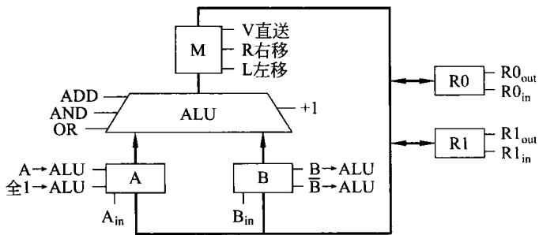  
图5-34习题15附图

② B→ALU,全 $\mathrm { 1 {  } A L U , A D D , L , R 0 _ { i n } } \quad \mathrm { ~ } ; ( \mathrm { ( B ) } - 1 ) \times 2 {  } \mathrm { R } 0$

试写出执行(RO）OR（R1)→RO 所需的微命令序列。

16．某假想主机的主要部件如图5-35所示。其中R0～R3为通用寄存器，A、B为暂存器,其他部件如图中所标。

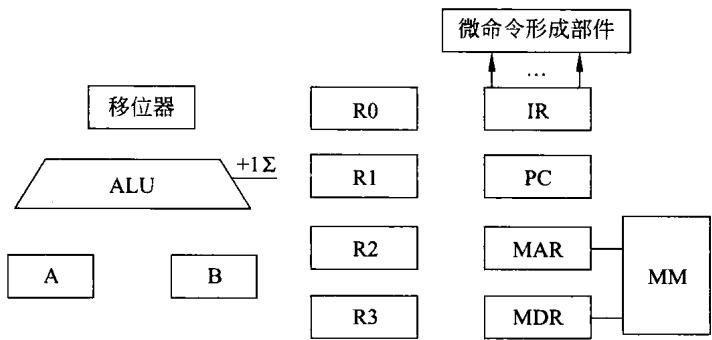  
图5-35习题16附图

（1）在上图的基础上，画出其内部的数据通路并标明数据流向。

（2）写出传送指令 MOV RO，R1（即将 R1的内容传送到 RO)的指令微操作流程。

17．某CPU结构如图5-36中虚框内所示，其中包括一个累加寄存器 AC、一个状态寄存器和其他4个寄存器，各部分之间的连线表示数据通路，箭头表示信息传送方向。

（1）图中的4个寄存器A、B、C、D分别是什么功能的寄存器？

（2）写出LDA X指令执行阶段的微操作流程(X 为内存地址,LDAX功能为（X)→AC)。

（3）写出 STAY指令执行阶段的微操作流程(Y为内存地址,STAY功能为(AC)→(Y)）。

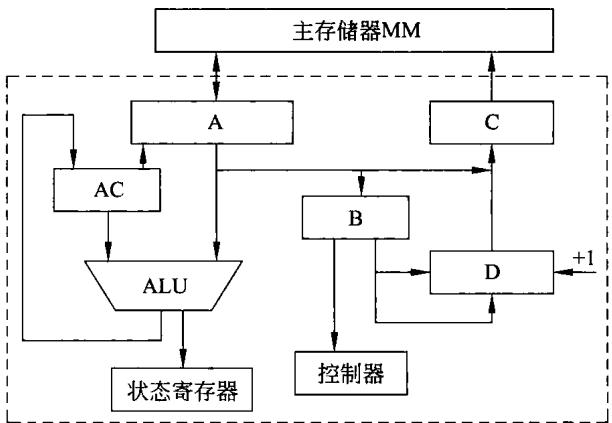  
图5-36习题17附图

18．已知某假想机的运算器逻辑如图5-37所示，它的核心部分是一个并行加法器，S为加法器的输出，加法器的输入为寄存器A和B,最低进位信号为‘十1'（‘十1'为高电平时，进位为1)。图中各带有下标in的控制信号为寄存器(A，B,C,D)的信息打入脉冲，其他为节拍控制电位信号，节拍控制电位与打人脉冲的相位关系如图5-37右下角所示。

写出实现运算(D)一1→(D)的微操作序列。

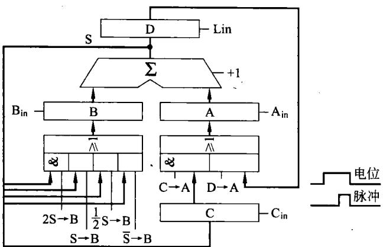  
图5-37习题18附图
