## 第6章 流水线技术

在有关CPU的设计中，速度是永恒的主题。而流水线技术的引人，其目的就在于提高速度。在不需要额外增加太多硬件的情况下，流水线是提高处理器工作速度的一种有效的方法，它不仅用于复杂的运算器，如乘法器、浮点加法器等，也用于改善指令的处理。在本章中将描述流水线技术的有关概念，对流水线性能进行分析，并讨论与流水线有关的问题。

## 6.1概述

## 6.1.1流水线概述

## 1.定义

人们对流水线并不陌生，最常见到的是生产过程中的流水线，如加工流水线、装配流水线等。在计算机中以类似的思想定义流水线：将某一重复的过程分解成若干子过程，使每一子过程与其他子过程同时进行。

根据流水线的定义可见，流水线适用于重复的过程，而计算机中恰恰有大量的重复过程。

## 2.原理描述

## (1）浮点加(减)运算流水线

为了说明流水线的原理，现以第3章所提到的浮点加(减)法运算为例来做说明。浮点数运算是一种较为复杂、耗时的运算，用非流水线结构运算器完成一次浮点数计算需要花费较长的时间，所以，每秒钟完成浮点数计算的次数已成为衡量计算机系统运行速度的重要指标。现将浮点运算用流水线来实现，把整个运算的过程分成如图6-1所示的4个子过程。

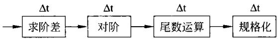  
图6-1浮点加减运算流水线

在图6-1中，人们将其中每一子过程称为一段(或一级)。因此，上面的流水线可称其为4级(或4段)流水线。流水线的段数常称为流水线的深度。

① 一条流水线是由若干段(或级)构成。

②流水线的各段所需要的时间应尽可能相等，如图6-1中的△t。若各段所需时间不相等，则时间最长的功能段将成为瓶颈，可影响到流水线的速度，使流水线堵塞或断流。

③可以看到，流水线对大量重复过程才有意义。例如，如图6-1所示进行一次浮点加法需4△t。而连续进行浮点加法，则1△t即可完成一次浮点加法运算。

④ 流水线需要有“通过时间”，也就是第一个任务从进入到流出结果所需的时间。在此之后，流水过程才进入稳定工作状态,每一个△t(或称为一拍)流出一个结果。这时，流水线的各段处于并行工作状态。

③正如下面将要看到的，为使流水线正常工作,在流水线各段之间需要设置缓冲器（或称为暂存器、锁存器)等寄存器，用于保存前一段的结果。这是因为各段的延迟时间不可能完全相同，况且下一时刻前一段应处理下一个任务。

## （2）浮点运算流水线框图

当为某功能设计流水线电路时，要为该功能实现寻找一个适当的、可分解为多步骤的、连续运行的算法，该算法的每一步骤应是时间均衡的、可以由硬件电路实现的。将实现算法每一步骤的硬件电路作为流水线的一段，并按照步骤顺序将各段连接起来，就可以构成实现指定功能的流水线电路。为了防止流水线各段的相互干扰，通常在流水线各段之间放置快速缓冲寄存器来分离各段，并利用缓冲寄存器逐段传送处理数据(部分或全部结果)。所有缓冲寄存器受同一时钟控制，以保证流水线中数据在各段同步向下级传送。浮点加减法运算流水线的硬件框图如图6-2所示。

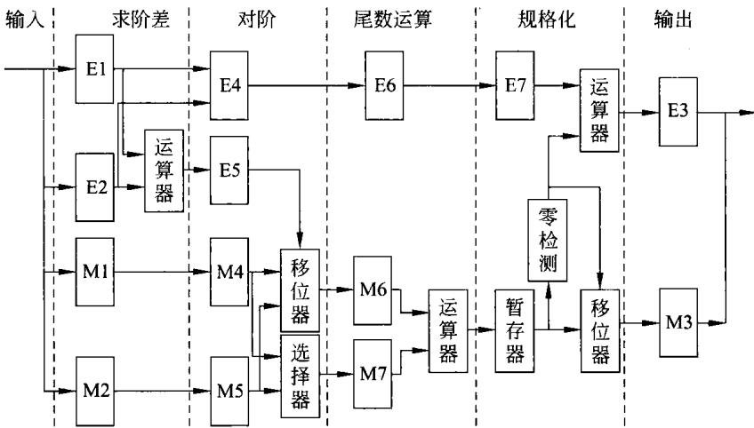  
图6-2浮点数加减运算流水线的构成框图

在图6-2中，输入的两规格化浮点数的阶码分别放入E1、E2中，尾数分别放入M1、M2中。运算器完成两阶码求差E1一E2，其结果用来选择被移位器进行右移的尾数是M1还是M2，以及移位的次数。另一运算器完成尾数的加/减运算，和/差存入暂存器中。利用一个专用的组合电路检测器对暂存器进行0数位检测，检测结果用于控制移位器实现尾数的规格化，并将结果存入寄存器M3中。同时，在规格化过程中用运算器完成对阶码的运算，并将结果存入寄存器E3中。至此，完成一次浮点数的加(或减)的运算。

在顺序结构实现浮点数的加减运算时，由于各部分功能是顺序进行的，没有重叠。因此，在硬件结构上可直接连接。但在流水线中，由如图6-2所示的浮点加/减法电路流水线结构可以看到，要构成流水线需对顺序结构加入定义和分离4个段的缓冲寄存器。

## 3.时空图

为了描述流水线的工作，经常采用的方法就是时空图。时空图是一种二维的图形，现将

如图6-1所示的浮点加(减)运算流水线的时空图画在图6-3上。

<table><tr><td colspan="8"></td></tr><tr><td>规格化</td><td colspan="2"></td><td>1</td><td>2</td><td>3</td><td rowspan="4">4</td></tr><tr><td>尾数运算 对阶</td><td colspan="2"></td><td>1 2</td><td>3</td><td>4</td></tr><tr><td rowspan="3">求阶差</td><td></td><td>1</td><td>2</td><td>3 4</td><td>5</td></tr><tr><td>1</td><td>2</td><td>3</td><td>4</td><td>5 6</td></tr><tr><td colspan="2">△t △t △t</td><td>△t</td><td>△t</td><td>△t</td></tr></table>

图6-3浮点加减运算流水线工作过程的时空图

由图6-3可以看到，时空图的横坐标表示时间，也就是流水线各段在流水过程中所用的处理时间。为了简单起见，图6-1和图6-3中假定流水线各段的处理时间都一样，为△t。时空图的纵坐标流水线所流过的各功能段，由图6-2可以看到，各功能段处于不同的物理空间。

从时空图中可以看到流水线中任务的每一段的流动过程，一组数据进人流水线首先是求阶差，当下一时段进入对阶时，下一组数据进入流水线求阶差。随着时间的推移，每一组数据都顺序地通过各功能段。显然，流水线连续工作时，各段均在重叠地并行工作。当第一组数据运算结束获得结果之后，流水线每一时间段△t流出一个运算结果。

## 6.1.2流水线的分类

从不同的角度，流水线有不同的分类方法。一般有如下几种。

## 1．按流水线功能的多寡分类

按流水线功能的多寡分类，流水线分为单功能流水线和多功能流水线。

## （1）单功能流水线

单功能流水线是指只能完成一种固定功能的流水线。如前面图6-1所示的就是单功能流水线，它只能完成浮点数的加法运算。当处理器中需要实现多种不同的功能时，可以用多条单功能流水线来实现，每条流水线只完成其中的一种功能。例如，在某计算机中就设置了18条单功能流水线。

## （2）多功能流水线

多功能流水线是指流水线的各段可以进行不同的连接，在不同的时间内或在同一时间内完成不同的功能。某计算机中的运算器是由多功能流水线构成，这条8段的多功能流水线如图6-4所示。

在图6-4中，图6-4(a)表示该多功能流水线由8段构成。当进行浮点加(减)法运算时，可将流水线连接成图6-4(b)所示的样子。当要进行定点乘法运算时，流水线各段的连接如图6-4(c)所示。

## 2.按流水线的连接特性分类

在多功能流水线中，按照流水线功能的连接特性分类，流水线可分为静态流水线和动态流水线。

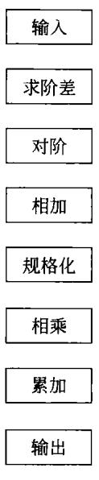  
(a)分段

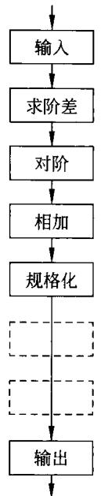  
(b)浮加连接

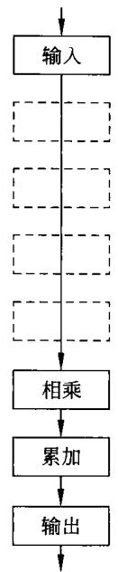  
(c)定乘连接  
图6-4多功能流水线示意图

## （1）静态流水线

静态流水线是指在同一时间内，流水线各段只能按同一种功能连接的流水线。如图6-4所示，某一时间内，流水线要么连接成浮点加(减)运算的形式，完成浮点的加(减）运算；要么连接成定点乘法运算的形式，完成定点的乘法运算。不能在同一时间里既进行浮点加(减)运算又进行定点的乘法运算。

可见，静态流水线只有当连续输人一串相同功能的运算时，流水线才能发挥效益。如果输入的是浮点加、定点乘、浮点加、定点乘连续重复这些运算，则此静态流水线将失去意义，其效率将下降到与顺序处理一样的水平。

## （2）动态流水线

动态流水线是指在同一时间内，流水线的某些段正在实现某种运算，而流水线的另一些段同时在实现另外的一种运算。一条多功能流水线同时实现多种连接，实现多种功能，这就是动态流水线。

显然，动态流水线具有更高的效率。但是，实现起来比较麻烦，需要对流水线的连接实施更加复杂地控制。

## 3.按照流水线使用的级别分类

按照流水线使用的级别可将流水线分为如下几种。

## （1）处理机级流水线

处理机级流水线又称为指令流水线。它将一条指令的执行过程分成若干子过程，每一子过程由一个独立的功能部件来实现。如第5章中，将一条指令的执行过程分为取指周期、取操作数周期及执行周期，若用特定的三个功能部件分别完成这三个周期中的功能，则这种指令流水线的结构框图和时空图可分别如图6-5和图6-6所示。

由图6-6可以看到，流水线中指令执行的各段是重叠并行的，如果各段所用的时间都为△t,则连续执行时每一个△t就可以执行一条指令。显然，上面指令流水线中，如果将每一段再分成运行时间更短的

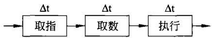  
图6-5三段指令流水线

多个更小的段，则整条指令流水线将由运行时间更短的更多个小的段构成，其执行指令的速度会更快。通常，将指令执行采用了流水线的处理机称为流水线处理机。

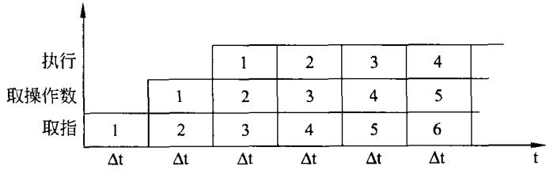  
图6-6三段指令流水线工作过程的时空图

## （2）部件级流水线

对于一些复杂的运算部件，为了提高运算的速度，经常将它们设计成流水线的形式。例如，如图6-1和图6-2所描述的浮点加减法运算流水线，这种流水线就是将多个功能部件连在一起构成流水线。因此，这种流水线称为部件级流水线或运算操作流水线。

## （3）处理机间流水线

处理机间流水线是由两个以上的处理机串行地对数据进行处理，每个处理机只完成整个处理任务的一部分。这种流水线又种为宏流水线，其框图如图6-7所示。

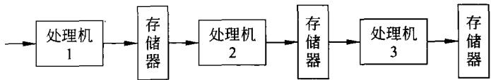  
图6-7处理机间流水线

一种典型的宏流水线是连续图像的存储系统，为了提高速度，处理机1用于完成图像数据的采集和预处理，其结果放在存储器中;处理机2从存储器取出图像数据，并用特定算法对图像进行压缩，并再次放于存储器中；处理机3再从存储器中取出数据并进行处理，最后将图像数据存储。

## 4.按标量、向量数据的处理分类

若处理机不具备向量表示能力，只能对标量数据进行流水线处理，这种处理机称为标量流水处理机。

若处理机具备向量表示能力，并能根据向量指令对向量数据的各元素进行流水线处理，这种处理机称为向量流水处理机。

## 5．按照流水线中是否有反馈回路分类

按照流水线中是否有反馈回路可将流水线分为线性流水线和非线性流水线。

## （1）线性流水线

线性流水线是构成流水线的各段串行连接，流水线中没有反馈回路。输人数据从流水线的输入端进人，数据在流水线的各功能段流过时，每一个功能段都流过一次，且仅流过一次，即从输出端流出。

通常，一条线性流水线只完成一种固定功能。

## （2）非线性流水线

非线性流水线是指流水线中除了有串行的连接通路之外，还有反馈回路。一种最简单的非线性流水线如图6-8(a)所示。

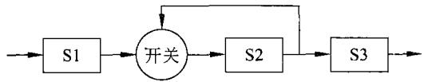  
(a)非线性流水线

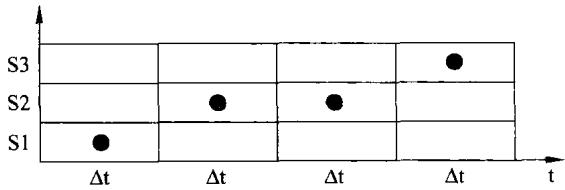  
(b)非线性流水的预约表  
图6-8非线性流水线及其预约表

在如图6-8(a)所示的非线性流水线中，S2段的输出可以直接传送给下一功能段S3，也可以经传送再反馈到本段。因此，该非线性流水线看起来只有三个功能段，但其中功能段S2可能因反馈而被多次调用。这就使得只用如图6-8(a)所示的连接图并不能充分描述任务在流水线中的实际流动过程。

为了描述非线性流水线的工作过程，除了如图6-8(a)所示连接图外，还需一张称为预约表的数据结构共同说明非线性流水线的工作过程。如图6-8(b)所示就是对应图6-8(a)的非线性流水线的预约表。在此预约表中，用“·"表示该功能段在哪一时间段内工作。有了预约表，可以更加清楚地表示非线性流水线的工作过程。

一张预约表对应非线性流水线的一种工作方式，实现其一种功能过程。一条非线性流水线可以有多种预约表，对应它的多种工作状态。

除以上分类方法之外，还可以按照输出端任务的流出顺序与输入端任务的流入顺序是否一致，分为顺序流动流水线和异步流动流水线（也称为无序流水线、乱序流水线或错序流水线),此处不再说明。

## 6.2流水线的性能分析

在本节里，以线性流水线为对象，分析其主要的性能指标。

## 6.2.1 吞吐率

流水线的吞吐率是指流水线在单位时间里所完成的任务数或输出的结果数。

1.最大吞吐率 $\mathbf { T P _ { m a x } }$

## （1）各段时间相等的流水线

流水线的最大吞吐率是指流水线连续工作达到稳定状态后，单位时间里所完成的任务数或输出的结果数。

若流水线各段的时间 $\Delta \mathfrak { t }$ 都一样，如图6-1和图6-5所示的那样，则这样的流水线的最大吞吐率 $\mathrm { T P } _ { \operatorname* { m a x } }$ 为：

$$
\mathrm { T P } _ { \mathrm { m a x } } = { \frac { 1 } { \Delta t } }\tag{6-1}
$$

## （2）各段时间不相等的流水线

当流水线各段时间不相等时，流水线就会产生瓶颈。图6-9表示了具有瓶颈的流水线及其时空图。

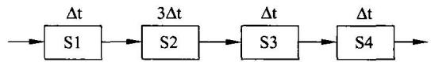  
(a)具有瓶颈的流水线

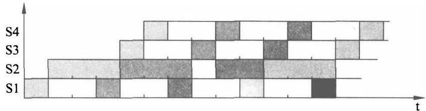  
(b)具有瓶颈流水线的时空图  
图6-9具有瓶颈的流水线及其时空图

由图6-9(a)可以看到，该流水线由4段构成。但段S2的时间最长，有 $3 \Delta \mathfrak { t } .$ ，最长时间段S2就构成了此流水线的瓶颈。

如图6-9(a)所示的流水线的时空图如图6-9(b)所示。由时空图可以看到，当流水线连续工作时，一旦通过一个任务(或指令)，则此后每3△t便可以流出一个任务(或指令）。

根据最大吞吐率的定义，在各段时间不相等的流水线中，最大吞吐率如式(6-2)所示。

$$
\mathrm { T P } _ { \mathrm { m a x } } = \frac { 1 } { \mathbf { m a x } \{ \Delta \mathbf { t } _ { \mathrm { i } } \} }\tag{6-2}
$$

由式(6-2)可以看到，当流水线的各段时间不相等时，该流水线的最大吞吐率就是由流水线中时间最长的段所需时间来决定，式（6-2）中 $\operatorname* { m a x } \left\{ \Delta \mathbf { t } _ { \mathrm { i } } \right\}$ 就是指流水线中需要时间最长的段的工作时间。

由上分析可以看到，当流水线各段时间不相等时，流水线中最慢的那段就构成了流水线的瓶颈。瓶颈将直接影响流水线水线的吞吐率。因此，需要解决流水线的瓶颈问题。解决流水线的瓶颈的方法可以有如下几种。

## ①将瓶颈细分

这种解决流水线的瓶颈的思路就是将构成瓶颈的段再进行细分，分成工作更短的子段。例如，可以将图6-9(a)中的需要3△t的S2段，再分成三个需用时间均为△t的三个子段S21、S22和S23，具体如图6-10(a)所示。

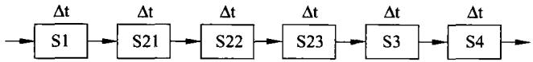  
(a)将瓶颈细分为时间更短的子段

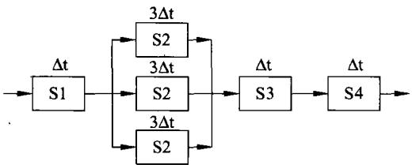  
(b)将瓶颈段重复设量  
图6-10流水线中消除瓶颈的方法

利用将图6-9(a)中瓶颈段S2分成更小的子段，使原来的4段流水线改变成6段，各段时间均为△t的流水线。经过改造后，该流水线各段的时间均为 $\Delta { \sf t }$ ，其最大吞吐率 $\mathrm { T P } _ { \mathbf { m a x } }$ 就由原来的1/(3△t)提高到1/△t。

## ②利用重复设置

也许会遇到瓶颈段不能再细分的情况，这时可以重复设置多个瓶颈段，使它们并行工作，从而达到提高吞吐率的目的。在图6-9(a)中，若S2不能再进行细分，则可以采用如图6-10(b)所示的方法，重复设置S2。

## 2．实际吞吐率TP

上面提到的最大吞吐率实际上是一种理想的情况，因为其前提条件是流水线连续地工作，一个任务接着一个任务地不停顿地工作下去。但在实际上，有多种原因会使流水线的实际吞吐率小于最大吞吐率。例如，流水线的工作不是连续的。下面就分析流水线的实际吞吐率。

## （1）各段时间相等的流水线

假定流水线由三段构成，各段所需时间均为 $\Delta \mathbf { t }$ ，该流水线及其连续执行n个任务的时空图分别如图6-11(a)和图6-11(b)所示。

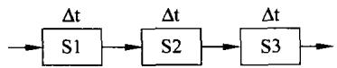  
(a)三段等时间流水线

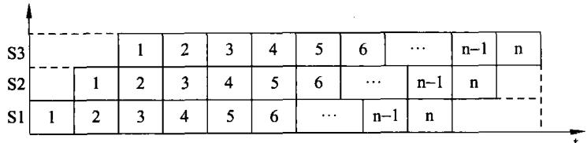  
(b)三段等时间流水线时空图  
图6-11三段等时间流水线及其完成n个任务的时空图

当利用如图6-11（a)所示的流水线，顺序执行n个任务时，所用的时间 $\mathrm { T _ { \vert \overrightarrow { a } \vert } }$ 为：$\mathrm { T } _ { \mathfrak { M } } = 3 \{ \mathtt { n } \Delta \mathfrak { t } \}$ 。

若流水线有m段，各段时间相同均为 $\Delta { \sf t }$ ,则顺序执行n个任务时，所用的时间 $\mathrm { T } _ { \mathbb { M } }$ 的一表示式为：

$$
\mathrm { T } _ { \mathfrak { M } } = \mathrm { n m } \Delta \mathfrak { t }\tag{6-3}
$$

由图6-11(b)可以看到，当采用如图6-11(a)所示的流水线完成n个任务所用时间为$\mathrm { T } = 3 \Delta \mathfrak { t } + ( \mathfrak { n } - 1 ) \Delta \mathfrak { t }$

若流水线有m段，各段时间相同均为 $\Delta \mathbf { t }$ ，则当采用此流水线执行n个任务时，所用的时间T的一表示式为：

$$
\mathrm { T } = \mathrm { m } \Delta \mathrm { t } + ( \mathbf { n } - 1 ) \Delta \mathrm { t }\tag{6-4}
$$

根据式(6-4)，可以看到n个任务需用时间T，则单位时间完成的任务数，即实际吞吐率TP为：

$$
\mathrm { T P } = \frac { \mathrm { n } } { \mathrm { T } } = \frac { \mathrm { n } } { \mathrm { m } \Delta \mathrm { t } + \left( \mathrm { n } - 1 \right) \Delta \mathrm { t } } = \frac { \mathrm { 1 } } { \Delta \mathrm { t } \left( 1 + \frac { \mathrm { m } - \mathrm { 1 } } { \mathrm { n } } \right) } = \frac { \mathrm { T P } _ { \mathrm { m a x } } } { 1 + \frac { \mathrm { m } - \mathrm { 1 } } { \mathrm { n } } }\tag{6-5}
$$

由式(6-5)可以看到，流水线的实际吞吐率除了与段的时间 ${ \mit \Delta } { \sf t }$ 有关外，还与段数m、任务数n有关，当n很大 $( > > \mathsf { m } )$ 时，流水线的实际吞吐率才接近于最大吞吐率。

例如，如图6-11(a)所示的流水线，设 $\Delta { \sf t } = 1 \mathrm { n s } , \mathrm { m } = 3$ ，完成100个任务。若顺序执行，则需 $3 0 0 \Delta \mathrm { t } = 3 0 0 \mathrm { n s }$ ；流水线执行，则只需 $3 \mathrm { n } \mathrm { s } + 9 9 \mathrm { n } \mathrm { s } = 1 0 2 \mathrm { n } \mathrm { s }$ 。实际吞吐率 $\mathrm { T P } { = } 1 / ( 1 0 2 \mathbf { n s } ) { = }$ $0 . 9 9 8 \times 1 0 ^ { 9 }$ 个任务，即每秒可完成 $0 . 9 9 8 \times 1 0 ^ { 9 }$ 个任务。

## （2）各段时间不相等的流水线

当流水线各段时间不相等时，当流水线为m段，完成n个任务的时间T及该流水线的实际吞吐率TP分别为：

$$
\mathrm { T } = \sum _ { \mathrm { i = 1 } } ^ { \mathrm { m } } \Delta \mathbf { t } _ { \mathrm { i } } + \left( \mathrm { n - 1 } \right) \Delta \mathbf { t } _ { \mathrm { m a x } }\tag{6-6}
$$

$$
\mathrm { T P = \frac { n } { T } = \frac { n } { \sum _ { i = 1 } ^ { m } \Delta t _ { i } + ( n - 1 ) \Delta t _ { m a x } } }\tag{6-7}
$$

假定某流水线有5段，其中4段的时间为1ns,只有1段的时间为2ns。若利用此流水线完成100个任务，则顺序执行的时间为600ns，顺序执行的吞吐率为 $1 6 7 \times 1 0 ^ { 6 }$ 个任务。流水线执行所用时间为 $\mathrm { T } = 6 \mathrm { n } \mathrm { s } + 9 9 \times 2 \mathrm { n } \mathrm { s } = 2 0 4 \mathrm { n } \mathrm { s }$ ，实际吞吐率为 $\mathrm { T P } { = } 1 0 0 / 2 0 4 { = } 4 9 0 \times 1 0 ^ { 6 }$ 个任务。

## 6.2.2加速比

流水线的加速比是指m段流水线顺序执行n个任务的时间与流水线执行的时间之比。同样分两种情况。

## 1．各段时间相等的流水线

当各段时间均为△t的m段流水线，顺序完成n个任务所用的时间 $\Delta { \sf t }$ ${ \mathrm { T } } _ { \parallel \perp } = { \mathrm { n m } } \Delta { \mathrm { t } }$ ；而采用流水线所用的时间为： $\mathrm { T } { = } \mathrm { m } \Delta \mathrm { t } { + } ( \mathrm { n } { - } 1 ) \Delta \mathrm { t }$ 。则此流水线的加速比S表示如下。

由式(6-8)可以看到，在各段时间相等均为△t的m段流水线中，当n很大 $\Delta { \sf t }$ $( > > { \mathfrak { m } } )$ 时，

流水线的加速比就接近于流水线的段数m。可以说，流水线的段数越多，加速比就越大。

$$
\mathbf { S } = { \frac { \mathrm { T } _ { \mathsf { s g } } } { \mathrm { T } } } = { \frac { \mathrm { n m } \Delta \mathbf { t } } { \mathrm { m } \Delta \mathbf { t } + ( \mathbf { n } - 1 ) \Delta \mathbf { t } } } = { \frac { \mathbf { m } } { 1 + { \frac { \mathrm { m } - 1 } { \mathbf { n } } } } }\tag{6-8}
$$

## 2．各段时间不相等的流水线

当各段时间不相等的m段流水线，顺序完成n个任务所用的时间 $\mathrm { T _ { \parallel f } }$ 和利用流水线完成n个任务所用时间T分别表示如下。

$$
\begin{array} { l } { \displaystyle \mathrm { T } _ { \mathfrak { M } } = \mathrm { n } \sum _ { \mathrm { i } = 1 } ^ { \mathfrak { m } } \Delta \mathrm { t } _ { \mathrm { i } } } \\ { \displaystyle \mathrm { T } = \sum _ { \mathrm { i } = 1 } ^ { \mathfrak { m } } \Delta \mathrm { t } _ { \mathrm { i } } + ( \mathrm { n } - 1 ) \Delta \mathrm { t } _ { \mathrm { m a x } } } \end{array}
$$

从而可以写出这种情况下的加速比如式(6-9)所示。

$$
\mathrm { S = \frac { T _ { \mathrm { m } } } { T } = \frac { n \sum _ { i = 1 } ^ { m } \Delta t _ { i } } { \displaystyle \sum _ { i = 1 } ^ { m } \Delta t _ { i } + ( n - 1 ) \Delta t _ { \mathrm { m a x } } } }\tag{6-9}
$$

## 6.2.3效率

流水线的效率是指流水线的设备利用率。由如图6-11(b)所示的时空图可以看到，当完成n个任务时，开始有流水线的通过时间（从第一个任务进入流水线到第一个任务完成的时间)，而最后有流水线的排空时间（由最后一个任务进入流水线到最后一个任务完成的时间)，这就使得在完成n个任务的过程中各段都没有满负荷地工作。现在同样考虑下面两种情况。

## 1.各段时间相等的流水线

当各段时间均为 $\Delta { \sf t }$ 的m段流水线，顺序完成n个任务时，画出 $\mathrm { m } = 5$ 的时空图如图6-12所示。

由图6-12可以看到，当流水线各段时间相等时，各段的设备利用率是一样的。因此，每一段的效率 $\mathbf { e _ { i } }$ 也都是相等的，可用 $\mathbf { e } _ { 0 }$ 表示：

$$
{ \mathrm { e } } _ { \mathrm { 0 } } = { \mathrm { e } } _ { \mathrm { 1 } } = { \mathrm { e } } _ { \mathrm { 3 } } = \cdots = { \mathrm { e } } _ { \mathrm { m } } = ( { \mathrm { n } } \Delta { \mathrm { t } } ) / { \mathrm { T } }\tag{6-10}
$$

对于各段时间相等的整条流水线而言，效率E可以表示为：

$$
\mathrm { E } = ( \mathrm { m e } _ { 0 } ) / \mathrm { m } = ( \mathrm { m n } \Delta { \mathrm t } ) / ( \mathrm { m T } )\tag{6-11}
$$

由式(6-11)结合图6-12可以看到，其中T是流水线执行n个任务所用的时间，m为流水线的段数。两者乘积mT就是图6-12中m个段与流水线执行时间所围成的面积。而式(6-11)的分子是n个任务完成过程中各段工作所对应的面程，由图6-12可以看到在流水线开始时的通过时间和结束时的排空时间里有些段是不工作的，如图6-12中左右两边虚线所画的部分。

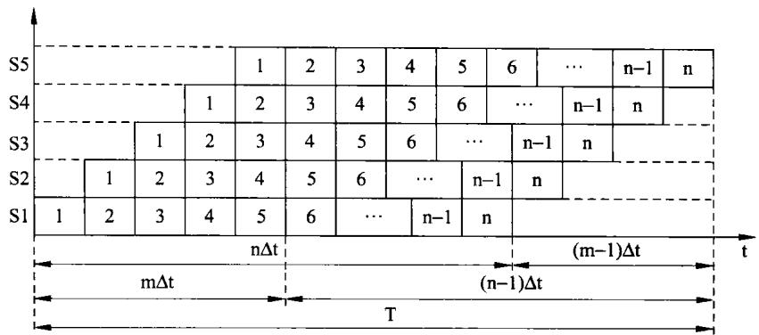  
图6-12各段时间相等的完成n个任务的时空图

因此，从时空图上看，流水线的效率就是各段工作所占时空面积与总面积之比。将前式(6-4)代人式(6-11)，则流水线的效率E还可以表示为：

$$
\mathbf { E } = { \frac { \mathbf { n } \Delta \mathbf { t } } { \mathbf { m } \Delta \mathbf { t } + ( \mathbf { n } - 1 ) \Delta \mathbf { t } } } = { \frac { 1 } { 1 + { \frac { \mathbf { m } - 1 } { \mathbf { n } } } } }\tag{6-12}
$$

由式(6-12)可以发现，当流水线段数m一定时，完成的任务n越多，也就是n越大则效率越高；当n很大时，流水线的效率就接近于1。

由式(6-8)和式(6-12)可以得出：

$$
\begin{array} { r } { \mathrm { E } = \mathrm { S / m } \quad \frac { \mathtt { m } } { \mathtt { M } } \sharp \frac { \mathtt { d } } { \mathtt { H } } \quad \mathrm { S } = \mathrm { m E } } \end{array}\tag{6-13}
$$

从而能够看到，效率E是实际的加速比S与最大加速比m的比值。

同样，由式(6-5)和式(6-12)可以得出：

$$
\begin{array} { r } { \boldsymbol { \mathrm { E } } = \mathrm { T P } \boldsymbol { \Delta } \boldsymbol { \mathrm { t } } \quad \not \equiv \not \nabla { \not \cdot } \quad \mathrm { T P } = \boldsymbol { \mathrm { E } } / \Delta \boldsymbol { \mathrm { t } } } \end{array}\tag{6-14}
$$

式（6-14)给出了吞吐率与效率的关系式，当△t不变时，提高了吞吐率也必定提高了效率。

## 2．各段时间不相等的流水线

各段时间不相等的流水线的时空图如图6-9所示。此时，完成n个任务的流水线的效率可表示如下：

$$
\mathrm { E } = \frac { \mathrm { n } \uparrow \mathrm { \sqrt { \frac { \partial } { \partial \mathrm { t } } \mathcal { H } \mathcal { H } \mathcal { H } \mathcal { H } } \mathcal { \overline { { H } } } } } { \mathrm { \Xi } _ { \mathrm { E u } } ^ { \mathrm { g _ { i } } } \mathrm { \overline { { H } } \mathrm { \Xi } _ { \mathrm { N } } ^ { \mathrm { f f } } } } = \frac { \mathrm { n } \sum _ { \mathrm { i = 1 } } ^ { \mathrm { m } } \Delta \mathrm { t } _ { \mathrm { i } } } { \mathrm { m } \Big [ \sum _ { \mathrm { i = 1 } } ^ { \mathrm { m } } \Delta \mathrm { t } _ { \mathrm { i } } + ( \mathrm { n } - 1 ) \Delta \mathrm { t } _ { \mathrm { m a x } } \Big ] }\tag{6-15}
$$

当流水线的各段时间不相等时，同样可以利用时空图分别求出n个任务各段的面积之和，再与总面积相比。由图6-9可以看到，由于流水线有瓶颈，致使一些段的效率降低，从而使整条流水线的效率降低。

例如，若某m为4的各段时间相等的流水线，每段时间均为 $\Delta { \sf t }$ 。该流水线连续完成100个任务，则此流水线的效率E为：

$$
\mathrm { E } = 1 / ( 1 + 0 . 0 3 ) = 9 7 \%
$$

若上述流水线是各段时间不相等的流水线，如图 ${ \tt 6 - 9 ( a ) }$ 所示，4段中 S2 为 $3 \Delta { \sf t }$ 。该流水线连续完成100个任务，则此流水线的效率E为：

$$
\mathrm { E } = ( 1 0 0 \times 6 \Delta { \sf t } ) / [ 4 \times ( 6 + 9 9 \times 3 ) \Delta { \sf t } ] = 6 0 0 / 1 2 1 2 = 4 9 . 5 \%
$$

可见，流水线的瓶颈大大地降低了流水线的效率。而且，由图6-9(b)可以看到，除了段S2之外，其他段的效率因S2而大为降低。这必然导致整条流水线效率的降低。

【例6-1】浮点乘法流水线框图如图6-13(a)所示。假定此流水线流出的结果可用暂存器保存，也可以根据需要直接加到输人端，不需要花时间。现有浮点数A、B、C、D，试画出$\mathtt { R } { = } \mathtt { A } \cdot \mathtt { B } \cdot \mathtt { C } \cdot \mathtt { D }$ 运算的时空图，并计算完成此运算的吞吐率、效率及加速比。

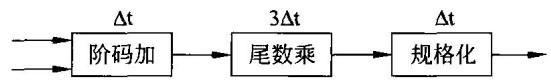  
(a)浮点数乘法流水线

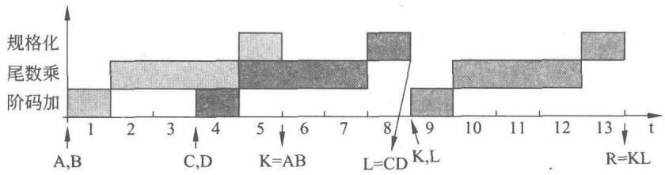  
(b)时空图  
图6-13浮点乘举例的流水线及其时空图

解利用如图6-13(a)所示的流水线完成上面4个浮点数的乘法运算，可以这样做：$\mathrm { R = A \cdot B \cdot C \cdot D = ( A \cdot B ) \cdot ( C \cdot D ) = K \cdot L }$ 。也就是说，先用流水线求 $\mathtt { K } = \mathtt { A } \cdot \mathtt { B }$ 在此期间利用输水线求 $\mathrm { L } { = } \mathrm { C } \cdot \mathrm { D } ;$ 当K流出时放暂存器，当L流出时协同K一起加到流水线上，最后求出 $\begin{array} { r } { { \tt R } = { \tt K } \cdot { \tt L } , } \end{array}$ 。其时空图如图6-13(b)所示。

由时空图如图6-13(b)可以看到，利用图6-13(a)所示的流水线，计算4个浮点数的乘法$\mathtt { R } { = } \mathtt { A } \cdot \mathtt { B } \cdot \mathtt { C } \cdot \mathtt { D }$ ，就需要三次浮点乘法运算。三次运算得到结果共需要13△t。也就是说三次浮点运算用了13△t，则在此运算过程中，流水线的吞吐率为：

$$
\mathrm { T P } = 3 / ( 1 3 \Delta \mathrm { t } ) ~ \mathrm { ( F L O P S ) }
$$

完成此运算流水线的效率计算如下：

$$
{ \mathrm { E } } = ( 3 \times 5 \Delta { \mathrm { t } } ) / ( 3 \times 1 3 \Delta { \mathrm { t } } ) = 5 / 1 3 = 3 9 . 5 \%
$$

如果顺序计算，3次浮点乘法需要 $3 \times 5 \Delta \mathrm { t } = 1 5 \Delta \mathrm { t }$ 。而采用流水线完成运算所用的时间为 $1 3 \Delta \mathfrak { t }$ ，则加速比S为：

$$
\mathrm { S } = 1 5 \Delta \mathrm { t } / 1 3 \Delta \mathrm { t } = 1 . 1 5
$$

可见，这条流水线完成这种浮点运算，效率不高，加速比不大。

## 6.3流水线中的相关

## 6.3.1概述

## 1.指令流水线的段数

理想的CPU体系结构是使它每个时钟周期至少启动/完成一条指令，这种结构的实现方法之一就是流水线。认真仔细地设计流水线，使流水线每段内的操作必须在一个时钟周期内完成，就有可能实现每条流水线CPI=1的理想目标。

如前所述，流水线并不能减少单独一条指令的执行时间，而且由于流水线段间存在缓冲寄存器的传输延迟、附加控制和时钟扭曲带来的额外开销时间。因此，流水线一般还会增加单条指令的执行时间。但流水线能够提高处理指令的吞吐率，以此来获得CPU对指令的高速执行。所以，高吞吐率是流水线设计中重点追求的目标。

增加流水线的深度(段数)，可以提高流水线的性能，但流水线的深度受到流水线的延迟、流水线段的时间不均衡和流水线的额外开销等因素的影响。当时钟周期小于最慢流水线段的运行时间时，流水线不能正常工作；当时钟周期小到与额外开销相当时，流水已没有意义。

## 2.相关的概念

除了流水线级数不能无限增大之外，限制流水线性能提高的另一因素是指令执行时可能存在相关问题。

流水线中的相关是指在流水线工作过程中，相邻或相近的任务之间存在的某种制约、依赖及影响，使任务之间有了某种关联。指令流水线中，通常有如下3种类型的相关。

（1）结构相关。当硬件资源满足不了流水线同时重叠执行指令的要求，而发生资源冲突时，出现结构相关。

（2）数据相关。当一条指令需要用到前面某条指令的结果，而前面的指令尚在流水还未产生结果，因而不能重叠执行时，发生数据相关。

（3）控制相关。当流水线遇到分支等转移类指令或其他能够改变PC值的指令时，产生控制相关。

流水线中一旦出现相关，必然会影响到流水线的正常工作，轻则影响流水线的性能，重则导致错误的结果。因此，要想使流水线正常运行，就必须认真解决流水线中的相关问题。

## 6.3.2结构相关

## 1．结构相关的原因

导致结构相关的主要原因是资源冲突。资源冲突主要出现在指令级并行机制中。指令流水线是典型的指令级并行机制，当两个以上的流水线段需要同时使用同一种硬件资源时，冲突就会发生。例如，当一条指令正在从存储器中取出时，另一条指令恰好在将一个数据存储到存储器中，因两者都要访问存储器，故出现冲突。

假定，4级指令流水线包括：取指、取数、运算和存数，各段时间均为△t。执行下面的指令。

```csv
ADD MM,R1,R2
SUB R3,R4,R5
AND R7,R6.RO
XOR R8,R9,R10
：
```

画出流水线的时空图如图6-14所示。由图可以看到，当由存储器取第4条指令操作码的时刻，刚好是第一条指令将指令执行结果与人存储器的时刻。如果指令和数据存放在同一存储器中，则必然引起竞争。因为同一存储器同一时刻不能同时完成读操作又完成写操作，这就出现结构相关。

<table><tr><td colspan="9">1</td></tr><tr><td colspan="2" rowspan="2"></td><td></td><td>存数</td><td>存数</td><td>存数</td><td>存数</td><td>存数</td><td></td></tr><tr><td>运算</td><td>运算</td><td>运算</td><td>运算</td><td>运算</td><td colspan="2"></td></tr><tr><td>取数</td><td>取数</td><td>取数</td><td>取数</td><td>取数</td><td colspan="3"></td></tr><tr><td>取指</td><td>取指</td><td>取指 △t</td><td>取指 △t</td><td>取指 △t</td><td>△t △t</td><td>△t</td><td></td><td>t</td></tr><tr><td>△t △t</td><td colspan="8"></td></tr></table>

图6-14出现结构相关的流水线时空图

## 2.解决方法

解决资源冲突可用如下几种方法。

## （1）增加资源副本

在如图6-14所示的例子中，可以设计一个数据存储器和一个指令存储器，这样，流水线的取指段与数据访存段就可以通过两个独立的通路同时访问两个独立的存储器了。

## (2）延迟(或暂停)流水线

通过延迟(或暂停)流水线的冲突段或在冲突段插入流水线气泡(气泡在流水线中只占资源不做实际操作)，使各段"轮流"使用资源。例如，若流水线的存数段与取指段需要访问同一个存储器时，可以采用允许存数指令继续执行、强制取指操作等待的方法避免访存冲突。

在如图6-14所示的例子中，可以用流水线气泡的方法来避免冲突，插入流水线气泡的·流水线时空图如图6-15所示。

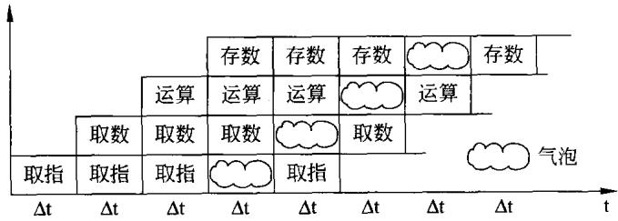  
图6-15插入气泡的流水线时空图

由图6-15可以看到，为了消除结构相关，在本应取第4条指令操作码的时刻，流水线暂停一个△t，这也就避开了对同一存储器的同时读写。显然，插人流水线气泡必然降低了流水线的吞吐率。

## （3）改变资源以便它们能并发的使用

除上述措施外，在相邻近的指令间尽可能不使用相同的资源。例如，在相邻的m(流水线的段数)条指令中，不相关的数据尽量使用不同的寄存器。如果发生使用寄存器冲突时，可以通过程序再设计或寄存器重命名技术来改变寄存器资源，达到可以同时对期望的寄存器访问的目的。

## 6.3.3数据相关

指令在流水线中的重叠执行有可能改变指令读/写操作数的顺序，当一条指令的结果还未有效生成，该结果就被作为后续指令的操作数时，就会产生数据相关。也就是说，流水线的存在使读/写操作的顺序不同于不用流水线时顺序执行的顺序，从而引起数据相关。具体包括下面的几种情况。

## 1.数据相关的分类

## （1）写后读相关

为了说明写后读相关，同样假定，4级指令流水线包括：取指、取数、运算和存数，各段时间均为△t。执行下面的指令：

```csv
ADD R1，R2，R3
SUB R4，R1，R5
AND R6，R1，R7
XOR R8，R9，R10
：
```

上述指令，用此流水线执行的时空图如图6-16所示。由时空图可以看到，第一条指令的执行结果需4个△t才能存放于R1中，但是，第二条指令在3△t开始就要从R1中取第一条指令的执行结果，这必然是取不到的，或者说取出来的是第一条指令执行前的R1的内容。同时，还可以看到，就是运行第三条指令时，在4△t时去取R1的内容也是不行的。因为，这时流水线正在向R1写第一条指令的执行结果。这就是写后读相关。

<table><tr><td colspan="3"></td><td>存R1</td><td>存R4</td><td>存R6</td><td>存R8</td><td></td></tr><tr><td colspan="2"></td><td>运算</td><td>运算</td><td>运算</td><td>运算</td><td colspan="2"></td></tr><tr><td></td><td>取R2、R3 操作数</td><td>取R1、R5 操作数</td><td>取R1、R7 操作数</td><td>取R10、R9 操作数</td><td colspan="3"></td></tr><tr><td>取指</td><td>取指</td><td>取指</td><td>取指</td><td></td><td></td><td></td><td></td></tr><tr><td>△t △t</td><td></td><td>△t</td><td>△t</td><td>△t</td><td>△t</td><td></td><td>t</td></tr></table>

图6-16写后读数据相关的流水线时空图

## （2）读后写相关

假定有如下两条指令，通过一条多功能流水线。按照指令的顺序，应当是先将R2的内容读出，写入存储器间接寻址的存储器单元中。再将R3的内容写人R2。

MOV（(M)），R2  
MOV R2，R3

由于是用流水线执行上述指令，流水线时空图也可用如图6-17所示的形式来描述。

在图6-17中，由于第一条指令是存储器间接寻址，比较复杂，需5△t才能执行完，而第

二条指令很简单，只需3△t就执行结束。因此，在流水线执行时，由于出现数据相关，写入存储器M的不是R2的内容，而是R3的内容。程序执行就出现错误的结果。

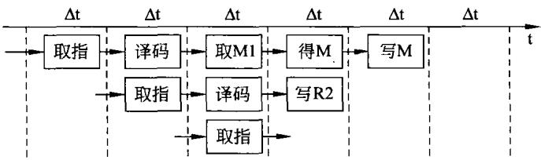  
图6-17读后写相关时空图

## （3）写后写相关

类似的情况，当不同的指令通过流水线执行时，会产生这类相关。例如下面的两条指令：

MUL R2,（(M))

AND R2，R3

执行上述指令的时空图如图6-18所示，这也是常见的表示形式。

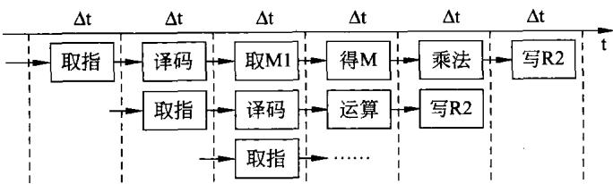  
图6-18写后写相关时空图

由图6-18可以看到，由于在流水线中第二条指令先于第一条指令执行完，故当两条指令都执行完时，就会产生错误的结果。

## 2.数据相关消除

有几种方法处理流水线中数据相关带来的冲突。

## （1）采用定向技术

定向通道即在某些流水线段之间设置的直接连接通路，也称为旁路或短路。当定向硬件检测到前面某条指令的结果操作数就是当前指令的源操作数时，控制逻辑会将前面那条指令的结果从其产生的地方直接连通到当前指令所处的位置，而将流水线上某些段旁路或短路掉，以此来减少指令访问操作数需要花费的时间，避免流水线停顿。一个功能单元的输出不仅可以直接连通到其自身的输入，而且还可以直接连通到其他单元的输入。

若有4级流水线，各段分别为取指、取数、运算和执行，执行下面的指令。

指令执行令产生数据相关，当第二条指令取R1的数据时，第一条指令正在运算中，指令的结果尚未产生。即使当第三条指令取R1的数据时，第一条指令还正在向R1中存放结果。在这里采用定向技术，直接将第一条指令ALU的结果加到第三条指令的ALU上；或者将第一条指令ALU的结果加到第三条指令所需的暂存器上。这样的情况如图6-19中的虚线所示。

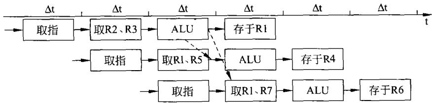  
图6-19采用定向技术的流水线数据通路

## （2）增加专用硬件

有的数据相关，不能用定向技术解决，但可以增加流水线互锁硬件。互锁硬件先要检测流水线中指令的数据相关性，当互锁硬件发现数据相关时，使流水线工作停顿下来，直到相关消失为止。

若通过流水线一组指令如下所示。

MOV R2，（(M1))

SUB R4，R2，R1

OR R6，R2，R8

画出时空图如图6-20所示。

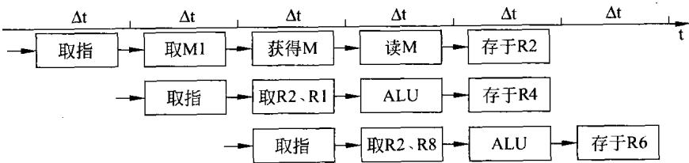  
图6-20未采用互锁技术的流水线时空图

由图6-20可以看到，由于第一条指令很复杂，当它从存储器读出结果之前，第二条指令已读过R2。此时，使用定向技术也无济于事。在这种情况下，互锁硬件检测到这种数据相关的存在，立即停止流水线的正常流动，在(取R2、R1)期间插入气泡。再用定向技术即可保证流水线的正常工作。

## （3）利用编译器

某些系统的编译器可以对指令重新排序或插入空操作指令，使得加载任何冲突数据的操作被延迟;但对程序逻辑或输出不受影响，这种技术称为流水线调度或指令调度。

## 6.3.4控制相关

## 1．概述

在一条指令流水线中，一条正在处理的转移指令在执行之前，流水线已获取甚至译码了几条指令，转移指令的执行必然导致已进人流水线的指令变为不可用，需要将转移目标处的指令流重新发送到流水线中，从而出现流水线断流或停顿。

使程序执行顺序发生改变的转移指令有两类：无条件转移指令（如无条件跳转、子程序或过程调用、返回指令等)和条件转移指令(如零跳转、循环控制指令等)。通常将程序中位于转移指令后面的存储单元位置称为分支延迟槽。

对于无条件转移指令的处理，某些CPU采取对紧跟在无条件转移指令之后的指令必须执行的方法，虽然从逻辑上来说不应该这样做，但它可以简化控制。而另一些CPU则采取逻辑相对复杂的方法，如提前计算出转移的目标地址。

条件分支指令是最难处理的转移指令。它们不仅需要延迟槽，而且一直到流水线的深处，取指单元才能知道是否转移或是顺序执行，才能知道到哪里去取下一条指令。所以，条件分支指令对流水线性能的影响远比无条件转移指令要大。

另外，控制相关中的一种重要情况就是中断。有关中断的详细描述将放在后面第8章中，这里必须明确的是无论中断在哪里发生，必定引起流水线断流。也就是说，不管处理器执行程序在什么地方，一旦中断发生，就一定使处理器转移到中断处理程序上去执行程序。中断发生时已进人流水线的指令必须进行适当的处置。以便保证处理器执行完中断处理程序后，能回到被中断的程序，接着中断前的状态继续执行原程序。

可见，只要改变处理器执行指令的顺序，如无条件转移、条件转移、子程序调用、子程序返回、各种类型的中断及中断返回均会产生控制相关。所有这些控制相关都需要采取一定的措施，以便最大限度地发挥流水线的效用。

## 2.冻结流水线

早期的流水线CPU采用最简单的冻结流水线的方法处理分支指令。即一旦在指令译码段检测到分支指令，就在确定转移目标地址之前删除所有紧随分支指令之后的指令，当分支指令从执行段流出、确定出新的PC值时，流水线才继续依据新PC值填充流水线。当然，这样会严重地影响流水线的性能。

## 3．预取分支目标

当条件分支指令被识别时，除了紧随其后的指令外，分支目标也被预取，并保存到分支指令被执行。如果分支跳转发生，已预取到的目标指令可立刻执行。

## 4.多流

有些系统采用在条件分支的两路上同时启动取指令操作，并将指令保存到分支指令被实际执行的时候。分支指令执行时，“真"的执行通路即刻可以获得。这种方法是对预取分支目标的发展。

## 5.循环缓冲器

在许多处理器中，用循环缓冲器来解决分支程序引起的相关。循环缓冲器是一个容量很小、速度非常高的存储器。它保存着最近获取的n条顺序的指令，由流水线的取指段进行维护。如果分支发生，硬件首先检查分支目标是否在缓冲器中。如果在，下一条指令从缓冲器中获取。采用循环缓冲器有以下好处。

（1）由于采用了预取方式，循环缓冲器将顺序地保存现行指令及其后的一些指令。当分支未发生时，顺序获取的指令将会有效，这时只要在缓冲器中取指令即可，而不必进行常规的存储器访问。

（2）通常，循环缓冲器的容量有限。但是，对于目标地址仅仅是在分支指令之后的几个单元处，则当分支发生时，目标将已在缓冲器中。这种情况，对于常见的if-then和if-then-else语句非常有利。

（3）这个策略特别适合处理循环或重复操作，所以称为循环缓冲器。如果循环缓冲器大到足以容纳一个循环中的全部指令，那么，循环中的指令仅需从内存中读取一次，可以大大加快取指令的速度。

循环缓冲器类似于指令cache，差别是循环缓冲器仅保留顺序指令，且容量比cache小得多，因此成本较低。

## 6.分支预测

为了降低分支指令引起断流(停顿)对流水线可能带来的影响，许多CPU提供了分支预测机构。预测既可以在编译阶段静态完成，也可以由硬件在执行阶段动态完成。要做到百分之百的正确预测几乎是不可能的，但采用分支预测必定能带来某些好处。所以，目前存在着多种预测的方法。

## （1）静态分支预测

程序执行遇到条件分支指令时，当条件成立，程序跳转到转移目标地址所确定的指令继续执行，分支转移成功；当条件不成立，程序顺序执行紧跟分支指令之后的指令，分支转移失败。统计分析表明，在所有的条件分支中，转移成功的概率是67%。因此，可以采用的预测方法有如下几种。

## ①预测分支不会发生

预测分支不会发生也就是预测分支失败。如果一个程序中大多数条件分支指令是用于出错检测处理,那么采用这种预测机制是有利的，因为在正确合理的设计下，出现错误的概率总是很小的，故预测分支失败是合理的。在这样的预测机制下，在知道分支结果之前，流水线流动着分支指令和紧随其后的指令。若分支预测失败，则正如所预期的那样，流水线照常执行；若分支成功，则要用空操作代替已取得的指令（例如清除执行段之前的各流水线段)，并到目标地址重新取指令。

## ②预测分支总是发生

如果一个程序中包含较多的循环，那么采用这种预测机制是有利的，因为n次循环仅有一次会出现分支转移失败。因此，该方法也称为预测分支成功法。在这样的预测机制下，一旦分支转移成功，就可以开始从分支目标地址处取指令执行。

## ③由编译器预测

当编译器看到循环语句 $\mathrm { f o r } ( \mathrm { i } { = } 0 ; \mathrm { i } { < } 1 0 0 0 0 0 0 , \mathrm { i } { + } + ) \left. \cdots \right.$ 时，它就知道循环尾部的转移几乎肯定会发生。如果能有办法让编译器把这一信息告诉硬件，将会节省大量的时间。但是，使用这种技术会带来体系结构的变化，某些处理器中设计了一组新的条件转移指令，这些指令中有一位可以由编译器设置，当编译器认为会发生转移时(或者不会发生时)就设置该位。当遇到这样的指令时，取指单元就直接按照指令中的指示采取行动。

## ④剖面法

剖面法是一种追踪程序执行状况加以预测的方法。它实际运行了该程序（一般是在模拟器上)，以获得程序中不同分支指令发生转移的信息（比如概率)，然后将这些信息送给编译器，编译器再使用特殊的条件转移指令来通知硬件该如何操作。

如果能正确预测分支，就可以跳转到目的地址继续执行。如果预测错误，就要找到正确的目的地址并转移到该目的地址继续执行。

这种方法的特点在于对预测错误的处理上，在预测错误时，如何取消已经执行的和将要执行的指令，通常有两种处理方法。

a）第一种是允许预测的条件分支指令之后的指令继续执行，直到它们将要修改计算机的状态(例如向寄存器中保存数据)。这时，并不把计算结果存人寄存器，而是存人一个临时寄存器，当得知预测结果正确时，再把该值复制到实际的寄存器中。

b）第二种是记录将要被覆盖的寄存器的原值(可以保存在临时寄存器中），这样当计算机发现自己发生预测错误时，可以恢复到正确的状态。

这两种方案都很复杂，需要付出很大的努力才能使它们正确工作，尤其是在第一次预测未定时又遇到第二个条件分支指令，情况将变得更糟糕。所以，提高分支预测的准确性是关键。

## （2）动态分支预测

动态分支预测通过记录分支指令的近期运行的历史信息，并以此作为预测的依据，来提高分支预测的准确度。解决好动态预测的关键是如何记录历史信息和如何决定转移的走向。

## ①分支历史表

分支历史表也称为分支预测缓存器，是一个小的高速存储器，用来记录分支指令的地址和在最近一次执行中是否发生了转移的信息。

## a）最简单的情况

这种方案的最简单情况如图6-21(a)所示。

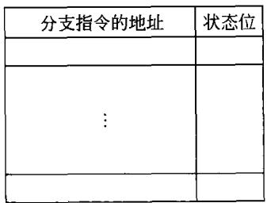  
(a)历史信息表

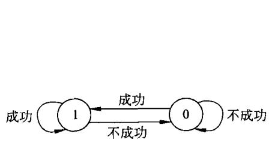  
(b)1位状态转换图  
图6-21历史信息表及1位状态转换图

历史表为每个条件分支指令分配一个表项，该项包括分支指令的地址（只保存高地址位作为标识),还有一位状态位，用于记录分支指令中最近一次执行时发生转移的成功与不成功的状态，1为分支成功 $\mathord { \mathfrak { s } } 0$ 为分支不成功。

使用这种方案时，从历史信息表中查到分支指令当前的状态位的状态，若此时状态位为

1,则预测分支成功；若状态为0，则预测分支不成功。

状态位的修改则由分支指令具体的执行结果有关：如果分支指令分支成功，则状态位置1;若分支指令分支不成功，则状态位清0。显然，状态位只取决于分支指令的执行结果。此结果只用于对下面的分支指令的预测。上述状态位的使用及转换如图6-21(b)所示。

历史表可以作为一个在取指流水段通过指令地址访问的专用cache来实现，也可以附属于指令cache中的每一块，随指令一起读取。可见，历史信息表并不大，但应为相连存储器，以便在工作过程中能更快地搜索到分支指令的地址及状态位。

这个方案最大的问题是，当循环最终退出时，位于循环尾部的分支指令将预测为不成功，并且这一错误预测将改变历史表中的预测位来指明将来的预测是“不成功”。这种不成功的状态将保持到再次执行此循环程序。例如，某循环程序连续循环100次。当第一次进人循环和最后一次循环会出现预测错误。第一次错误是由上一次循环结束时的状态位带来的。而中间的98次分支都是成功的，没有预测错。但最后一次肯定预测错误。因此，在100 次循环中，用这种方法预测成功为98次，预测错误是2次。由此可以得到这样的结论：由分支指令构成的多次循环，采用这种一个状态位方式预测，有两次错误预测，其他预测都是正确的。

## b）两个状态位

正如上面所提到的，采用简单的一个状态位的预测机制存在着缺点：只要预测出错，往

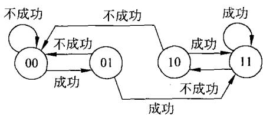  
图6-22两个状态位的状态转换图

往会引起连续两次出错而不是一次。

为了消除这种预测存在的问题，可以在历史表中设置两个状态(预测)位，一位是对分支指令的猜测，另一位是上次转移的情况。

采用两个状态位的状态转换过程如图6-22所示。

在如图6-22的情况下，只有两次连续的预测都

发生错误时才改变预测位。查找算法可以采用4状态的有限状态机(FSM)。在一系列连续正确的"不成功”预测之后，FSM将进人状态00，而且对下一次转移的预测也是“不成功”。如果不正确，即结果是“成功”，则FSM将进人状态01。但下次的预测仍然是“不成功”。此时预测的结果如果还不正确，即结果是“成功”。则FSM将进人状态11并把预测改为"成功”。可以看到，从状态00 两次预测均为错误，才将状态转换为11。同样，在成功状态11之下，一次预测错误转向10，只有再次预测错误才转到不成功状态00。若在10 状态再次预测为"成功”，则状态又会回到成功状态11。从效果上来说，状态的左边一位表示预测，右边一位表示上次的实际成功情况。可以看到，利用两个状态位可以有效地克服只用一个状态位的缺点。

在上面设计中，使用了两个状态(预测)位。事实也可以使用4位或者更多位的预测位。但多位预测位的预测效果不比两位好多少，故很少使用。

## ②分支目标缓冲器

在上面的讨论中，都是假定每条分支指令的目的地址是已知的，或者是一个明确的地址（包括在指令中)，或者是相对于当前指令的相对偏移量(即程序计数器加上一个带符号的数)，通常情况下这种假设是成立的。但是，某些条件分支指令是通过对寄存器内容进行运算来得到目的地址的，这时，即使图6-21中的FSM能够准确地预测将要发生的成功，但是这种预测对于目的地址未知的成功指令是毫无意义的。解决这个问题的一种方案是在历史表中保存上一次的实际成功的地址。这种方法称为分支目标缓冲器，其结构如图6-23所示。

<table><tr><td rowspan=1 colspan=1>分支指令的地址</td><td rowspan=1 colspan=2>状态位</td><td rowspan=1 colspan=1>分支目标地址</td></tr><tr><td rowspan=1 colspan=1></td><td rowspan=1 colspan=1></td><td rowspan=1 colspan=1></td><td rowspan=1 colspan=1></td></tr><tr><td rowspan=1 colspan=1></td><td rowspan=1 colspan=1></td><td rowspan=1 colspan=1></td><td rowspan=1 colspan=1></td></tr><tr><td rowspan=1 colspan=1></td><td rowspan=1 colspan=1></td><td rowspan=1 colspan=1></td><td rowspan=1 colspan=1></td></tr><tr><td rowspan=1 colspan=1></td><td rowspan=1 colspan=1></td><td rowspan=1 colspan=1></td><td rowspan=1 colspan=1></td></tr><tr><td rowspan=1 colspan=1></td><td rowspan=1 colspan=1></td><td rowspan=1 colspan=1></td><td rowspan=1 colspan=1></td></tr></table>

图6-23分支目标缓冲器的结构

当处理器工作时，当前指令地址与缓冲器中的分支指令的地址进行搜索和比较，如果发现有匹配者，则认为当前指令便是分支成功的分支指令。即可从分支目标地址栏中获得分支的目标地址。

## 7．延退分支

这种方法是利用编译器对指令代码进行重新排序，并插入有用指令或空操作指令(NOP)，使流水线尽可能保持充满状态。其中心思想就是延迟分支的发生。把分支指令延迟为长度为n的分支指令，其后紧跟有n个延迟槽，延迟槽中放有延迟分支需要执行的指令。流水线遇到分支指令时，按正常方式处理，同时执行延迟槽中的指令，分支延迟槽中的指令“掩盖"了流水线原来必须插入的停顿周期，从而减少分支开销。编译器的任务就是在延迟槽中放入有用的指令，称为延迟槽调度。有三种常用的调度方法：

（1）从分支前调度。

（2）从目标处调度。

（3）从失败处调度，如图6-24所示。

由图6-24的示意图可以看到，对不同形式的分支程序，应采用不同的调度方法。另外，延迟长度与流水线有密切关系，并不是如图6-24中所示的放人延迟槽中的指令只有一条。采用延迟分支法有两个限制。

（1）放入延迟槽的指令需要满足一定的条件。

（2）编译器要有预测分支是否成功的能力。为了提高编译器填充延迟槽的能力，大部分带条件成功的机器都引人了取消分支的技术，即分支指令带有对分支能否成功的预测。当预测正确时，正常执行延迟槽中的指令;否则，将延迟槽中的指令变成空操作(NOP)指令。

## 6.3.5流水线的中断处理

在后面的章节中将要详细描述有关中断的一系列问题。在这里，首先明确在大多数的

处理器中都设置有两类中断：内部中断和外部中断。顾名思义，内部中断是由处理器内部产生的，而外部中断大多是由处理器外部的设备所产生。同时，还需明确，无论是哪种中断，一日中断发生，处理器将响应并转向中断处理程序，对中断做出处理，则有可能会引起流水‘线断流。由于中断的频度相对转移、调用子程序等操作的频度要低得多，因此，人们不太关心其造成的流水线的断流，而更关心的是如何保护断点，以利于中断的返回。

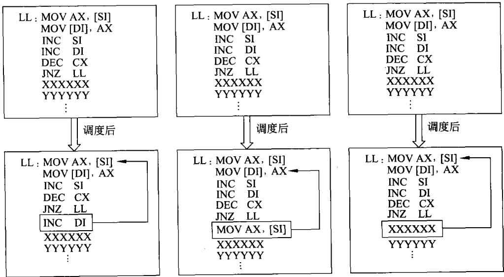  
(a)从分支前调度  
(b)从目标处调度  
(c)从失败处调度  
图6-24调度分支延迟的三种方法

## （1）内部中断

内部中断(或异常)可以是由某些状态或条件产生的,也可以就是一条指令如软件中断指令。

对于这样的内部中断，要保证流水线不断流，应该是不困难的。因为产生这样的中断，一是有相应的状态或是有一条软件中断指令。它们相当于永远都是成功的条件转移，用本节上面所提到的方法都可以达到目的。与条件转移不同的是在对中断做出响应及处理时，需记录断点信息，以便保证在中断处理结束后能回到中断前的断点位置上，继续执行被中断的程序。在断点的处理上，这种中断与外部中断可同样考虑。

## （2）外部中断

外部中断的情况就更复杂一些，原因在于这种类型的中断的出现是随机发生的。何时发生中断是不可知的。同样需解决流水线的断流及断点的保护问题。

## （3）精确断点与不精确断点

在对中断断点的处理上，有两种方案。

## ①不精确断点

## a）实现

实现是一种比较简单的处理方式，若中断发生在第i条指令期间，不管出现在指令流水线的哪一段，都不再允许尚未进入流水线的指令再进入，但已经进入流水线的指令全都执行完。然后，再转向中断处理程序，如图6-25所示。

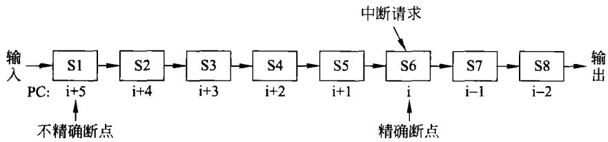  
图6-25流水线处理器的中断响应

由图6-25可以说明不精确断点的响应过程：当第i条指令流水到S6段时，中断请求发生，此时进入流水线的指令的地址是i十5，其下一条指令的地址应为PC=i十6。也就是说断点的地址为i十6。并且规定进入流水线的指令全都执行完。然后，再转向中断处理程序。此时，只要立即保存地址i十6并将中断处理程序的入口地址即中断向量送人PC，则可使流水线不产生断流或只有小的停顿。保存好断点地址i十6，才能保证在中断处理结束后能回到地址i十6上去继续执行。

## b）注意问题

采用不精确断点会存在两方面的问题。

（a）由于中断的发生可能是某些异常，例如，除法中断、溢出中断等。当中断发生后，还需要继续执行已进入流水线的指令，而后面的指令又用到前面引起中断的错误数据，必定导致错误的结果。

（b）在软件调试中经常会用到断点中断，而不精确断点就无法准确地停留在程序测试者所设定断点处。

为了避免出现这种情况，可以采用下面所说的精确断点方法。另外，也可以采取某些措施，当中断发生时判断引起中断的错误是否与已进入流水线的指令有数据相关。只要引起中断的错误对已进人流水线的指令没有影响，则此种方法还是可以使用的。

不精确断点方法实现起来比较容易，早期的流水线处理机经常采用。

## ②精确断点

精确断点规定哪条指令产生的中断，断点就是这条指令的地址。在图6-25中，若第i条指令产生中断，则断点就是这条指令的地址。

精确断点需要将断点时刻已进入流水线的所有指令执行的结果及现场信息全部保留下来，以便在中断返回时能将中断前的状态全部恢复。为此，在这种情况下，需要设置一些寄存器，用来保存有关的断点信息。因此，精确断点需要更多的硬件支持。

## （4）乱序执行

在指令流水线动态调度过程中，会发生指令的乱序执行。此时的中断断点的确定要特别小心，以避免产生错误。

在乱序执行环境中，为了保证异常处理现场的精确性，运算部件的执行结果不能直接写回到结果寄存器，必须等相应指令前面所有的指令都执行完后才能写回。否则，在某指令的执行结果写回寄存器后它前面的一条指令发生了异常时，异常现场就不正确了。

可以通过基于操作队列复用的寄存器重命名机制来保证异常现场的精确性。运算部件的计算结果不直接写回结果寄存器，而是写回到操作队列的相应项(把结果寄存器重命名为相应的操作队列号)，只有在该操作前面的所有操作都已经结束后，在结束该操作时再把该

操作的结果写回结果寄存器。

异常处理可以分成两个阶段。第一阶段为记录异常阶段，当一条指令在执行过程中引起异常时，不立即进行异常处理，而是把异常原因等保存在相应指令的操作队列中。第二阶段为异常处理阶段,当发生异常的指令成为操作队列中的第一条指令时，进行异常处理，把发生异常的信息发送到有关模块(PC,控制寄存器等）。

根据异常原因及其在指令流水线中的处理方式，可分为如下几种情况。

① 对于在指令执行阶段产生的异常，在执行结束时把异常原因记录到相应的操作队列中异常原因字段。

② 对于在取指令阶段以及译码阶段产生的异常，指令译码器将形成一条特殊的"指令”并放人操作队列，该"指令"不会被执行，只用于当该“指令"成为操作队列头上的指令时产生异常信号。

③ 外部中断异常，在操作队列从译码部件接收指令时作为被接收的指令发生的异常处理。

④软件中断指令视作操作队列头指令发生了异常处理(不用等操作队列头指令结束），把操作队列头的指令PC作为返回地址。

③ 对于硬复位异常，不用考虑当前操作队列以及PC的值，立即进行异常处理。

## 6.3.6带成功开销的流水线性能

假设理想情况下CPI为1，那么带成功开销的流水线加速比为：

$$
\begin{array} { r l } & { \mathfrak { M } \mathfrak { L } ^ { \sharp } \mathrm { K } = \frac { \sqrt [ 4 ] { \mathfrak { L } } / \xi _ { \overline { { X } } } ^ { \sharp } \sqrt { \mathfrak { L } } / \xi _ { \overline { { X } } } ^ { \sharp } } { 1 + \sqrt [ 4 ] { \mathfrak { L } } / \xi _ { \overline { { X } } } ^ { \sharp } \sqrt { \mathfrak { L } } / \xi _ { \overline { { X } } } ^ { \sharp } \sqrt { \mathfrak { L } } / \xi _ { \overline { { Y } } } ^ { \sharp } \sqrt { \mathfrak { L } } / \xi _ { \overline { { Y } } } ^ { \sharp } \sqrt { \mathfrak { L } } / \xi _ { \overline { { Y } } } ^ { \sharp } \sqrt { \mathfrak { L } } / \xi _ { \overline { { Y } } } ^ { \sharp } \sqrt { \mathfrak { L } } / \xi _ { \overline { { Y } } } ^ { \sharp } \sqrt { \mathfrak { L } } / \xi _ { \overline { { Y } } } ^ { \sharp } \sqrt { \mathfrak { L } } / \xi _ { \overline { { Y } } } ^ { \sharp } } } \\ & { \quad \quad \quad \quad \quad \quad \quad \quad \quad \quad \quad \quad \quad \quad \quad \quad \quad \quad \quad \quad \quad \quad \quad \quad \quad \quad \quad \quad \quad \quad \quad \quad \quad \quad \quad \quad \quad \quad \quad \quad \quad \quad \quad \quad \quad \quad \quad \quad \quad \quad \quad \quad \quad \quad \quad \quad \quad } \\ & { \quad \quad \quad \quad \quad \quad \quad \quad \quad \quad \quad \quad \quad \quad \quad \quad \quad \quad \quad \quad \quad \quad \quad \quad \quad \quad \quad \quad \quad \quad \quad \quad \quad \quad \quad \quad \quad \quad \quad \quad \quad \quad \quad \quad \quad \quad \quad \quad } \\ &  \quad \quad \quad \quad \quad \quad \quad \quad \quad \quad \quad \quad \quad \quad \quad \quad \quad \quad \quad \quad \quad \quad \quad \quad \quad \quad \quad \quad \quad \quad \quad \quad \quad \quad \quad \quad \quad \quad \quad \quad \quad \quad \quad \quad \quad \quad \quad \times \mathrm { ~ d ~ B ~ } / \xi _ { \overline { { Y } } } ^ { \sharp } \sqrt { \mathfrak { L } } / \xi _  \overline \end{array}\tag{6-16}
$$

假设某流水线在分支成功后会导致3个时钟周期的停顿，若分支指令的频度为30%，理想CPI=1,则实际 $\mathrm { C P I } = 1 + 3 0 \% \times 3 \approx 2$ ，因此实际的加速比将只能达到理想加速比的50%。

事实上，分支指令在允许更改程序的执行顺序、使程序设计变得灵活方便的同时，也成为影响流水线性能提高的最大问题。控制相关对流水线性能造成的损失远比数据相关要大得多。

## 6.4指令级并行

## 6.4.1指令级并行概述

自1985年以来，所有的处理器都采用流水线的方式使指令的执行可以重叠进行以提高性能。由于可以将指令间的关系看做是并行的，因此将指令间的这种潜在的重叠称为指令级并行。指令流水线是一种在连续指令流中开发指令级并行机制的技术。

指令级并行程度越高，CPU处理指令的吞吐量就越大，CPU的性能就越强。所以，如何通过各种可能的技术获得更高的指令级并行性是计算机体系结构、组织、实现的设计者们

研究的重要课题。

开发指令级并行的方法大致可以分为两类：一种方法依赖于硬件，动态地发现和开发指令级并行；另一种方法依赖于软件技术，在编译阶段静态地发现并行。

## 1.指令流水线的限制

在流水线技术中，采取两种技术。

（1）每个时钟周期发射多条指令（即发射指令的宽度）。

(2）增加流水线的深度(段数)来提高速度。这是经典的提高指令流水线性能的技术。

采取上述技术，使一次发射的被执行指令的数量增加，使流水线的结构更加复杂。相应地导致硬件结构也更加复杂，并且硬件的数量也会随之增加。同时，跟踪所有发射中指令之间相关性的逻辑以指令数量平方的速度增长。这就使得硬件电路的复杂性迅速增长，从而使得建造能控制发射大量指令的计算机更困难。这样一来，反而又限制了实际的发射宽度和流水线深度。另外，增加指令发射的宽度和指令流水线的深度，除了要求复杂硬件电路还要求更高频率处理器时钟。处理器的功耗与其时钟频率的平方成正比，这导致的最直接的结果是处理器功耗的上升。目前已逐渐形成共识，功耗是限制当代处理器发展的首要因素。

鉴于上述原因，为提高指令流水线性能所采取的两项技术均有一定的限制，不可能无限制地增加。

## 2.突破限制的途径

单纯地追求流水线深度的设计理念已逐渐被设计者所放弃。取而代之的是，考虑到影响指令流水线性能的最主要原因是各种相关导致的流水线停顿。设计者转而从更深层次上解决流水线中可能存在的各种相关性人手，来寻求提高指令流水线性能的各种手段。

从追求处理器时钟频率、流水线深度到在处理器中寻求更多的并行机制，已经看到了指令流水线的发展。由多核处理器带来的多指令流水线，使指令级并行性得到大幅提高的同时，已将并行层次提升到线程级。然而，无论是指令级并行还是线程级并行，解决流水线内部、流水线之间、指令之间或线程之间的相关问题仍是保障其并行机制具有高度并行性的关键。

在现代的处理器中，比较成熟的提高指令级并行的技术如表6-1所示。

表6-1提高指令级并行的技术
<table><tr><td colspan="1" rowspan="1">技术</td><td colspan="1" rowspan="1">简要说明</td><td colspan="1" rowspan="1">主要解决问题</td></tr><tr><td colspan="1" rowspan="1">直通和旁路</td><td colspan="1" rowspan="1">在流水线段间建立直接的连接通路</td><td colspan="1" rowspan="1">潜在的数据相关停顿</td></tr><tr><td colspan="1" rowspan="1">简单转移调度</td><td colspan="1" rowspan="1">冻结流水线，预取分支目标,多流，循环缓冲器等</td><td colspan="1" rowspan="1">控制相关停顿</td></tr><tr><td colspan="1" rowspan="1">延迟分支</td><td colspan="1" rowspan="1">利用编译器调度，填充延迟槽</td><td colspan="1" rowspan="1">控制相关停顿</td></tr><tr><td colspan="1" rowspan="1">基本动态调度(记分板)</td><td colspan="1" rowspan="1">乱序执行</td><td colspan="1" rowspan="1">由相关引起的数据相关停顿</td></tr><tr><td colspan="1" rowspan="1">重命名动态调度</td><td colspan="1" rowspan="1">WAW和WAR停顿,乱序执行</td><td colspan="1" rowspan="1">数据相关停顿、反相关和输出相关引起的停顿</td></tr><tr><td colspan="1" rowspan="1">分支预测</td><td colspan="1" rowspan="1">动态分支预测，静态分支预测</td><td colspan="1" rowspan="1">控制相关停顿</td></tr><tr><td colspan="1" rowspan="1">多指令发射</td><td colspan="1" rowspan="1">多指令流出(超标量和超长指令字)</td><td colspan="1" rowspan="1">理想CPI</td></tr><tr><td colspan="1" rowspan="1">硬件推测</td><td colspan="1" rowspan="1">用于多指令发射,使用重排序缓存</td><td colspan="1" rowspan="1">数据相关和控制相关停顿</td></tr><tr><td colspan="1" rowspan="1">循环展开</td><td colspan="1" rowspan="1">将循环展开为直线代码，消除判断、分支开销，加速流水</td><td colspan="1" rowspan="1">控制相关停顿</td></tr><tr><td colspan="1" rowspan="1">基本编译器流水线调度</td><td colspan="1" rowspan="1">对数据相关指令重排序</td><td colspan="1" rowspan="1">数据相关停顿</td></tr><tr><td colspan="1" rowspan="1">编译器相关性分析</td><td colspan="1" rowspan="1">利用编译器发现相关</td><td colspan="1" rowspan="1">理想CPI,数据相关停顿</td></tr><tr><td colspan="1" rowspan="1">软件流水线，踪迹调度</td><td colspan="1" rowspan="1">软件流水：对循环进行重构，使得每次迭代执行的指令是属于原循环的不同迭代过程的踪迹调度：跨越IF基本块的并行度</td><td colspan="1" rowspan="1">数据相关和控制相关停顿</td></tr><tr><td colspan="1" rowspan="1">硬件支持编译器推测</td><td colspan="1" rowspan="1">软硬件推测结合</td><td colspan="1" rowspan="1">理想CPI,数据相关停顿，转换相关停顿</td></tr></table>

表中的一部分技术已在前一节中讨论，还有一些内容将在下面的叙述中予以说明。

## 6.4.2提高指令级并行的方法

## 1．指令调度

指令调度就是在一个程序基本块里或者跨越基本块重新排序指令，使得程序中的相关指令尽可能地消除。有效的指令调度可以充分地利用处理器资源，提高指令级并行性。指令调度分为静态调度和动态调度。

## （1）静态调度

静态调度是指依据程序未执行时的行为特征和统计数据进行的调度策略，编译器确定并分离出程序中存在相关的指令，然后进行指令调度，并对代码进行优化。在出现数据相关时，消除或者减少流水线空转。

一个简单的静态调度流水线负责取指令并将它发射出去。如果流水线中的指令与取到的指令之间存在数据相关，而且无法通过旁路或直通技术避免该数据相关时，那么检测硬件将从使用相关结果的指令开始暂停流水线。在相关被清除之前，停止取指令和发射指令的工作。

静态调度的缺点主要表现在：虽然可以通过旁路控制机构，编译技术调度指令序列，分开具有相关性的指令来使竞争数目和性能损失减小到最低程度。但是数据相关是不可能完全消除的，竞争还会存在。

## （2）动态调度

动态调度是指通过硬件重新安排指令的执行顺序，来调整相关指令实际执行时的关系，减少流水线空转。动态调度是以增加硬件的复杂性为代价的。动态调度的优势在于以下几点。

①能调度在编译时不可能知道的竞争情况。

②符合程序执行的实际情况。

③具有更高的效率和准确性。

④简化编译程序设计。

③代码的移植性强。

动态调度的缺点是：流水线的乱序执行，指令的发射是乱序的，指令的完成也有可能是乱序的。由于流水线允许多条指令在同一时刻执行，所以流水线结构需要改变，功能单元也需要改变。

动态调度希望通过硬件对指令执行顺序进行重组，在保持数据流和异常行为的同时减少流水线的停顿。

动态调度流水线需具备以下功能。

①允许按序取多条指令和发射多条指令-—取指流水级允许按顺序取多条指令进入 单口暂存器或队列，然后从单口暂存器或队列取出指令，进人指令译码节拍。

②能检查并消除竞争——将指令译码流水级分为独立的两级：流出(issue)级和读操作数(read operand)级。

流出级功能：指令译码，检查是否存在结构竞争（即在这一流水级解决结构竞争问题）。

读操作数级功能：等到无数据竞争后，读出操作数。（即在这一流水级解决数据竞争问题）。

## 2.乱序执行和寄存器重命名

简单流水线技术的一个主要限制是它们按序发射和执行指令，即指令以程序顺序发射，一旦指令在流水线中停顿，后续指令就无法执行。因此，如果流水线中两条相近的指令之间存在相关，则必然引起流水线停顿。如果有多个功能单元，则这些单元会被闲置。

为了克服这些问题以达到更好的性能，某些处理器采用跳过相关的指令去执行后面不相关的指令，使指令的执行顺序不再按原程序的顺序进行，这种流水线的工作方式就称为乱序执行，这意味着指令完成也是乱序的。乱序执行是典型的动态调度法。为了保证程序的逻辑性，到目前为止大多数系统所使用的流水线仍被限制为指令必须顺序流出流水线，所以，要求指令调度算法必须保证程序的运行结果和按照顺序执行时的结果相同。

## （1）顺序执行“

为了说明乱序执行，作为对比下面首先用一个例子来说明如何使指令按序执行。

某计算机有8个程序员可用的寄存器，从R0到R7。所有的算术运算指令都使用三个寄存器：两个保存源操作数，一个存放结果。如果一条指令在周期n译码，那么它就在周期n十1开始执行；如果是简单指令，如加、减法指令，就在周期n十2结束时把结果写回目的寄存器；如果是比较复杂的指令，如乘法，就在周期n十3结束时把结果写回目的寄存器；允许译码单元每个时钟周期最多发射两条指令（商用的超标量处理器通常在一个时钟周期内能发送4～6条指令);它总是按照程序的顺序发射指令，而且指令的完成顺序也和程序规定的相同，即按序发射，按序执行。要执行的一段程序为：

```markdown
I1:R3=R0XR1
I2:R4=R0+R2
I3:R5=R0+R1
I4:R6=R1+R4
```

I5:R7=R1XR2   
I6:R1=R0-R2   
I7:R3=R3XR1   
I8:R1=R4+R4

这段程序按序执行的情况由表6-2进行记录。第1列是时钟周期序号，第2列是指令序号，第3列是被译码的指令，第4列是被发射的指令（每个时钟周期最多2条),第5列是已经完成的指令。在该表中，指令要按序发射、按序结束，因此指令k十1在指令k发出之前不能被发射，且指令k十1在指令k完成之前也不能完成。其他列指示当前指令读/写的寄存器情况。

表6-2按序发射、按序完成的处理器操作
<table><tr><td rowspan=1 colspan=5></td><td rowspan=1 colspan=8>读取的寄存器</td><td rowspan=1 colspan=8>写入的寄存器</td></tr><tr><td rowspan=1 colspan=1>周期</td><td rowspan=1 colspan=1>#</td><td rowspan=1 colspan=1>译码</td><td rowspan=1 colspan=1>发送</td><td rowspan=1 colspan=1>完成</td><td rowspan=1 colspan=1>0</td><td rowspan=1 colspan=1>1</td><td rowspan=1 colspan=1>2</td><td rowspan=1 colspan=1>3</td><td rowspan=1 colspan=1>4</td><td rowspan=1 colspan=1>5</td><td rowspan=1 colspan=1>6</td><td rowspan=1 colspan=1>7</td><td rowspan=1 colspan=1>0</td><td rowspan=1 colspan=1>1</td><td rowspan=1 colspan=1>2</td><td rowspan=1 colspan=1>3</td><td rowspan=1 colspan=1>4</td><td rowspan=1 colspan=1>5</td><td rowspan=1 colspan=1>6</td><td rowspan=1 colspan=1>7</td></tr><tr><td rowspan=1 colspan=1>1</td><td rowspan=1 colspan=1>12</td><td rowspan=1 colspan=1>R3=R0×R1R4=R0+R2</td><td rowspan=1 colspan=1>12</td><td rowspan=1 colspan=1></td><td rowspan=1 colspan=1>12</td><td rowspan=1 colspan=1>11</td><td rowspan=1 colspan=1>1</td><td rowspan=1 colspan=1></td><td rowspan=1 colspan=1></td><td rowspan=1 colspan=1></td><td rowspan=1 colspan=1></td><td rowspan=1 colspan=1></td><td rowspan=1 colspan=1></td><td rowspan=1 colspan=1></td><td rowspan=1 colspan=1></td><td rowspan=1 colspan=1>11</td><td rowspan=1 colspan=1>1</td><td rowspan=1 colspan=1></td><td rowspan=1 colspan=1></td><td rowspan=1 colspan=1></td></tr><tr><td rowspan=1 colspan=1>2</td><td rowspan=1 colspan=1>34</td><td rowspan=1 colspan=1>R5=R0+R1R6=R1+R4</td><td rowspan=1 colspan=1>31</td><td rowspan=1 colspan=1></td><td rowspan=1 colspan=1>33</td><td rowspan=1 colspan=1>22</td><td rowspan=1 colspan=1>11</td><td rowspan=1 colspan=1></td><td rowspan=1 colspan=1></td><td rowspan=1 colspan=1></td><td rowspan=1 colspan=1></td><td rowspan=1 colspan=1></td><td rowspan=1 colspan=1></td><td rowspan=1 colspan=1></td><td rowspan=1 colspan=1></td><td rowspan=1 colspan=1>11</td><td rowspan=1 colspan=1>11</td><td rowspan=1 colspan=1>11</td><td rowspan=1 colspan=1></td><td rowspan=1 colspan=1></td></tr><tr><td rowspan=1 colspan=1>3</td><td rowspan=1 colspan=1></td><td rowspan=1 colspan=1></td><td rowspan=1 colspan=1></td><td rowspan=1 colspan=1></td><td rowspan=1 colspan=1>3</td><td rowspan=1 colspan=1>2</td><td rowspan=1 colspan=1>1</td><td rowspan=1 colspan=1></td><td rowspan=1 colspan=1></td><td rowspan=1 colspan=1></td><td rowspan=1 colspan=1></td><td rowspan=1 colspan=1></td><td rowspan=1 colspan=1></td><td rowspan=1 colspan=1></td><td rowspan=1 colspan=1></td><td rowspan=1 colspan=1>1</td><td rowspan=1 colspan=1>1</td><td rowspan=1 colspan=1>1</td><td rowspan=1 colspan=1></td><td rowspan=1 colspan=1></td></tr><tr><td rowspan=1 colspan=1>4</td><td rowspan=1 colspan=1></td><td rowspan=1 colspan=1></td><td rowspan=1 colspan=1></td><td rowspan=1 colspan=1>123</td><td rowspan=1 colspan=1>２１</td><td rowspan=1 colspan=1>1１</td><td rowspan=1 colspan=1>1</td><td rowspan=1 colspan=1></td><td rowspan=1 colspan=1></td><td rowspan=1 colspan=1></td><td rowspan=1 colspan=1></td><td rowspan=1 colspan=1></td><td rowspan=1 colspan=1></td><td rowspan=1 colspan=1></td><td rowspan=1 colspan=1></td><td rowspan=1 colspan=1></td><td rowspan=1 colspan=1>1</td><td rowspan=1 colspan=1>１１</td><td rowspan=1 colspan=1></td><td rowspan=1 colspan=1></td></tr><tr><td rowspan=1 colspan=1>5</td><td rowspan=1 colspan=1>5</td><td rowspan=1 colspan=1>R7=R1× R2</td><td rowspan=1 colspan=1>45</td><td rowspan=1 colspan=1></td><td rowspan=1 colspan=1></td><td rowspan=1 colspan=1>１２</td><td rowspan=1 colspan=1>1</td><td rowspan=1 colspan=1></td><td rowspan=1 colspan=1>１1１</td><td rowspan=1 colspan=1></td><td rowspan=1 colspan=1></td><td rowspan=1 colspan=1></td><td rowspan=1 colspan=1></td><td rowspan=1 colspan=1></td><td rowspan=1 colspan=1></td><td rowspan=1 colspan=1></td><td rowspan=1 colspan=1></td><td rowspan=1 colspan=1></td><td rowspan=1 colspan=1>11</td><td rowspan=1 colspan=1>1</td></tr><tr><td rowspan=1 colspan=1>6</td><td rowspan=1 colspan=1>6</td><td rowspan=1 colspan=1>R1=R0-R2</td><td rowspan=1 colspan=1>1</td><td rowspan=1 colspan=1></td><td rowspan=1 colspan=1></td><td rowspan=1 colspan=1>2</td><td rowspan=1 colspan=1>1</td><td rowspan=1 colspan=1></td><td rowspan=1 colspan=1>1</td><td rowspan=1 colspan=1></td><td rowspan=1 colspan=1></td><td rowspan=1 colspan=1></td><td rowspan=1 colspan=1></td><td rowspan=1 colspan=1></td><td rowspan=1 colspan=1></td><td rowspan=1 colspan=1></td><td rowspan=1 colspan=1></td><td rowspan=1 colspan=1></td><td rowspan=1 colspan=1>1</td><td rowspan=1 colspan=1>1</td></tr><tr><td rowspan=1 colspan=1>7</td><td rowspan=1 colspan=1></td><td rowspan=1 colspan=1></td><td rowspan=1 colspan=1></td><td rowspan=1 colspan=1>4</td><td rowspan=1 colspan=1></td><td rowspan=1 colspan=1>1</td><td rowspan=1 colspan=1>1</td><td rowspan=1 colspan=1></td><td rowspan=1 colspan=1></td><td rowspan=1 colspan=1></td><td rowspan=1 colspan=1></td><td rowspan=1 colspan=1></td><td rowspan=1 colspan=1></td><td rowspan=1 colspan=1></td><td rowspan=1 colspan=1></td><td rowspan=1 colspan=1></td><td rowspan=1 colspan=1></td><td rowspan=1 colspan=1></td><td rowspan=1 colspan=1></td><td rowspan=1 colspan=1>1</td></tr><tr><td rowspan=1 colspan=1>8</td><td rowspan=1 colspan=1></td><td rowspan=1 colspan=1></td><td rowspan=1 colspan=1></td><td rowspan=1 colspan=1>5</td><td rowspan=1 colspan=1></td><td rowspan=1 colspan=1></td><td rowspan=1 colspan=1></td><td rowspan=1 colspan=1></td><td rowspan=1 colspan=1></td><td rowspan=1 colspan=1></td><td rowspan=1 colspan=1></td><td rowspan=1 colspan=1></td><td rowspan=1 colspan=1></td><td rowspan=1 colspan=1></td><td rowspan=1 colspan=1></td><td rowspan=1 colspan=1></td><td rowspan=1 colspan=1></td><td rowspan=1 colspan=1></td><td rowspan=1 colspan=1></td><td rowspan=1 colspan=1></td></tr><tr><td rowspan=1 colspan=1>9</td><td rowspan=1 colspan=1>7</td><td rowspan=1 colspan=1>R3=R3×R1</td><td rowspan=1 colspan=1>6-</td><td rowspan=1 colspan=1></td><td rowspan=1 colspan=1>11</td><td rowspan=1 colspan=1></td><td rowspan=1 colspan=1>11</td><td rowspan=1 colspan=1></td><td rowspan=1 colspan=1></td><td rowspan=1 colspan=1></td><td rowspan=1 colspan=1></td><td rowspan=1 colspan=1></td><td rowspan=1 colspan=1></td><td rowspan=1 colspan=1>１1</td><td rowspan=1 colspan=1></td><td rowspan=1 colspan=1></td><td rowspan=1 colspan=1></td><td rowspan=1 colspan=1></td><td rowspan=1 colspan=1></td><td rowspan=1 colspan=1></td></tr><tr><td rowspan=1 colspan=1>10</td><td rowspan=1 colspan=1></td><td rowspan=1 colspan=1></td><td rowspan=1 colspan=1></td><td rowspan=1 colspan=1></td><td rowspan=1 colspan=1>1</td><td rowspan=1 colspan=1></td><td rowspan=1 colspan=1>1</td><td rowspan=1 colspan=1></td><td rowspan=1 colspan=1></td><td rowspan=1 colspan=1></td><td rowspan=1 colspan=1></td><td rowspan=1 colspan=1></td><td rowspan=1 colspan=1></td><td rowspan=1 colspan=1>1</td><td rowspan=1 colspan=1></td><td rowspan=1 colspan=1></td><td rowspan=1 colspan=1></td><td rowspan=1 colspan=1></td><td rowspan=1 colspan=1></td><td rowspan=1 colspan=1></td></tr><tr><td rowspan=1 colspan=1>11</td><td rowspan=1 colspan=1></td><td rowspan=1 colspan=1></td><td rowspan=1 colspan=1></td><td rowspan=1 colspan=1>6</td><td rowspan=1 colspan=1></td><td rowspan=1 colspan=1></td><td rowspan=1 colspan=1></td><td rowspan=1 colspan=1></td><td rowspan=1 colspan=1></td><td rowspan=1 colspan=1></td><td rowspan=1 colspan=1></td><td rowspan=1 colspan=1></td><td rowspan=1 colspan=1></td><td rowspan=1 colspan=1></td><td rowspan=1 colspan=1></td><td rowspan=1 colspan=1></td><td rowspan=1 colspan=1></td><td rowspan=1 colspan=1></td><td rowspan=1 colspan=1></td><td rowspan=1 colspan=1></td></tr><tr><td rowspan=1 colspan=1>12</td><td rowspan=1 colspan=1>8</td><td rowspan=1 colspan=1>R1=R4+R4</td><td rowspan=1 colspan=1>7-</td><td rowspan=1 colspan=1></td><td rowspan=1 colspan=1></td><td rowspan=1 colspan=1>11</td><td rowspan=1 colspan=1></td><td rowspan=1 colspan=1>11</td><td rowspan=1 colspan=1></td><td rowspan=1 colspan=1></td><td rowspan=1 colspan=1></td><td rowspan=1 colspan=1></td><td rowspan=1 colspan=1></td><td rowspan=1 colspan=1></td><td rowspan=1 colspan=1></td><td rowspan=1 colspan=1>11</td><td rowspan=1 colspan=1></td><td rowspan=1 colspan=1></td><td rowspan=1 colspan=1></td><td rowspan=1 colspan=1></td></tr><tr><td rowspan=1 colspan=1>13</td><td rowspan=1 colspan=1></td><td rowspan=1 colspan=1></td><td rowspan=1 colspan=1></td><td rowspan=1 colspan=1></td><td rowspan=1 colspan=1></td><td rowspan=1 colspan=1>1</td><td rowspan=1 colspan=1></td><td rowspan=1 colspan=1>1</td><td rowspan=1 colspan=1></td><td rowspan=1 colspan=1></td><td rowspan=1 colspan=1></td><td rowspan=1 colspan=1></td><td rowspan=1 colspan=1></td><td rowspan=1 colspan=1></td><td rowspan=1 colspan=1></td><td rowspan=1 colspan=1>1</td><td rowspan=1 colspan=1></td><td rowspan=1 colspan=1></td><td rowspan=1 colspan=1></td><td rowspan=1 colspan=1></td></tr><tr><td rowspan=1 colspan=1>14</td><td rowspan=1 colspan=1></td><td rowspan=1 colspan=1></td><td rowspan=1 colspan=1></td><td rowspan=1 colspan=1></td><td rowspan=1 colspan=1></td><td rowspan=1 colspan=1>1</td><td rowspan=1 colspan=1></td><td rowspan=1 colspan=1>1</td><td rowspan=1 colspan=1></td><td rowspan=1 colspan=1></td><td rowspan=1 colspan=1></td><td rowspan=1 colspan=1></td><td rowspan=1 colspan=1></td><td rowspan=1 colspan=1></td><td rowspan=1 colspan=1></td><td rowspan=1 colspan=1>1</td><td rowspan=1 colspan=1></td><td rowspan=1 colspan=1></td><td rowspan=1 colspan=1></td><td rowspan=1 colspan=1></td></tr><tr><td rowspan=1 colspan=1>15</td><td rowspan=1 colspan=1></td><td rowspan=1 colspan=1></td><td rowspan=1 colspan=1></td><td rowspan=1 colspan=1>7</td><td rowspan=1 colspan=1></td><td rowspan=1 colspan=1></td><td rowspan=1 colspan=1></td><td rowspan=1 colspan=1></td><td rowspan=1 colspan=1></td><td rowspan=1 colspan=1></td><td rowspan=1 colspan=1></td><td rowspan=1 colspan=1></td><td rowspan=1 colspan=1></td><td rowspan=1 colspan=1></td><td rowspan=1 colspan=1></td><td rowspan=1 colspan=1></td><td rowspan=1 colspan=1></td><td rowspan=1 colspan=1></td><td rowspan=1 colspan=1></td><td rowspan=1 colspan=1></td></tr><tr><td rowspan=1 colspan=1>16</td><td rowspan=1 colspan=1></td><td rowspan=1 colspan=1></td><td rowspan=1 colspan=1>8</td><td rowspan=1 colspan=1></td><td rowspan=1 colspan=1></td><td rowspan=1 colspan=1></td><td rowspan=1 colspan=1></td><td rowspan=1 colspan=1></td><td rowspan=1 colspan=1>2</td><td rowspan=1 colspan=1></td><td rowspan=1 colspan=1></td><td rowspan=1 colspan=1></td><td rowspan=1 colspan=1></td><td rowspan=1 colspan=1>1</td><td rowspan=1 colspan=1></td><td rowspan=1 colspan=1></td><td rowspan=1 colspan=1></td><td rowspan=1 colspan=1></td><td rowspan=1 colspan=1></td><td rowspan=1 colspan=1></td></tr><tr><td rowspan=1 colspan=1>17</td><td rowspan=1 colspan=1></td><td rowspan=1 colspan=1></td><td rowspan=1 colspan=1></td><td rowspan=1 colspan=1></td><td rowspan=1 colspan=1></td><td rowspan=1 colspan=1></td><td rowspan=1 colspan=1></td><td rowspan=1 colspan=1></td><td rowspan=1 colspan=1>2</td><td rowspan=1 colspan=1></td><td rowspan=1 colspan=1></td><td rowspan=1 colspan=1></td><td rowspan=1 colspan=1></td><td rowspan=1 colspan=1>1</td><td rowspan=1 colspan=1></td><td rowspan=1 colspan=1></td><td rowspan=1 colspan=1></td><td rowspan=1 colspan=1></td><td rowspan=1 colspan=1></td><td rowspan=1 colspan=1></td></tr><tr><td rowspan=1 colspan=1>18</td><td rowspan=1 colspan=1></td><td rowspan=1 colspan=1></td><td rowspan=1 colspan=1></td><td rowspan=1 colspan=1>8</td><td rowspan=1 colspan=1></td><td rowspan=1 colspan=1></td><td rowspan=1 colspan=1></td><td rowspan=1 colspan=1></td><td rowspan=1 colspan=1></td><td rowspan=1 colspan=1></td><td rowspan=1 colspan=1></td><td rowspan=1 colspan=1></td><td rowspan=1 colspan=1></td><td rowspan=1 colspan=1></td><td rowspan=1 colspan=1></td><td rowspan=1 colspan=1></td><td rowspan=1 colspan=1></td><td rowspan=1 colspan=1></td><td rowspan=1 colspan=1></td><td rowspan=1 colspan=1></td></tr></table>

对某条指令译码之后，译码单元必须决定是否立即发射这条指令到流水线的下一段。为了做出决定，译码单元需要掌握所有寄存器的状态。例如，如果当前的指令需要用到某个值还没有计算出来的寄存器，那么这条指令就不能发出，处理器必须处于等待状态。

表6-2中的第1行是I1(指令1)，它把 R0 和 R1相乘并把结果存入R3。由于这些寄存器当前都是空闲的，该指令被发射，然后修改记分板以表示R0和R1正在被读而R3正在被写。在I1完成之前，其他指令不能写这些寄存器也不能读寄存器R3。由于该指令是乘法指令，它将在周期4结束时完成。每行的记分板值反映的是该行指令被发射后的寄存器引用状态，空白项表示0。

本例的计算机每个周期可以发射两条指令，因此第2条指令(I2)也在周期1发出。它将R0和R2相加，结果存人R4。使用下面的规则来判断该指令是否能发射。

①如果任何一个源操作数寄存器正在被写，就不能发射(RAW相关）。

②如果保存结果的寄存器正在被读，就不能发射（WAR相关）。

③如果保存结果的寄存器正在被写，也不能发射（WAW相关）。

其中RAW相关是当前指令需要使用之前指令还没有产生的结果作为操作数，这是数据相关，而WAR和WAW相关则没有那么严重，它们是资源冲突造成的，是可以通过增加资源避免的。如果不存在上述3种相关，而且功能单元可用，则该指令就被发射。本例中，I2 使用的寄存器R0正在被指令I1读取，但是这种重叠是允许的，因此I2被发射。类似地，周期2时I3也被发射。

I4 需要使用R4。从第3行中看到R4正在被写人，这时就发生了RAW相关，因此译码单元将停顿直到R4可用为止。停顿期间，译码单元停止从取指单元取指令。当取指单元的内部缓冲区存满之后，它也将停止取指令。

虽然程序中的下一条指令I5并没有和正在执行的任何一条指令冲突，但是并不能利用这一点，因为需要按顺序发送指令。

在周期3,加法指令I2应该执行结束，但按序完成的要求使它此时并不能在I1之前完成，因此也不能为I4释放R4。

按顺序完成可获得精确中断，这是处理器需要的特性。

到周期4结束时，所有三条正在执行的指令都已完成，因此，在周期5就可以发射I4和刚刚译码的I5。只要有指令完成，译码单元就会检查是否可以发射正在等待的指令。

在周期6,I6 将阻塞，因为它需要写入R1,而R1正在被使用。I6直到周期9才能启动。

虽然硬件能够每个时钟周期发出两条指令，但是由于存在许多相关性,整个8条指令的序列需要18个周期才能完成。注意观察表6-2的发送列和完成列就会发现，指令是按照顺序发射并按照顺序完成的。

## （2）乱序执行

为了实现乱序执行，在不同的处理器中采用不同的算法，主要有两种。

## ①记分牌法

某些处理器使用记分牌来掌握寄存器的使用情况，如CDC6600最先使用这种技术。记分牌中对应每个寄存器都有一个小计数器，它记录每个寄存器被当前正在执行的指令作为数据源引用的次数。如果处理器一次最多可以发射2"条指令，那么就需要使用n位计数器。当指令发射时，它使用的源操作数寄存器对应的记分牌加1，当指令结束时，记分牌就减1。记分牌还记录每个寄存器作为目的寄存器的次数，由于一次只允许写人一个寄存器，这些计数器为1位宽。表6-2中右面的第16列就是记分牌。

在实际的计算机中，记分牌还记录了功能单元的使用，这样可以避免出现发射一条指令后却没有功能单元可用的情况。

为了发挥乱序执行的优势，必须保证有多条指令同时在执行。为此，就要求处理器具备多个功能部件、功能部件流水化或两者兼而有之。

在处理器中，记分牌主要用于浮点操作，将指令的执行分为4级。

## a）发射级

指令的功能部件在没有结构竞争和没有WAW竞争的时候，则这条指令可以发射。将会把指令发射到相应的功能部件，同时修改记分牌的内部数据结构。如果存在结构竞争或者是存在WAW竞争时候，指令暂停发射。

## b）读操作数

记分牌监控源操作数是否就绪。一个源操作数就绪的条件为：早先发射的活动指令对该操作数不进行写入操作(即无RAW竞争)；含有操作数之一的寄存器，就是该活动功能单元即将写人的寄存器（即也不会出现RAW竞争)。记分牌在这一步解决了RAW竞争问题。

当源操作数准备就绪，记分牌通知功能单元读出操作数，并开始执行。

记分牌检测RAW，若有，则停顿该指令。但是在动态调度时，有多条指令并行操作，所以可能有另外指令满足条件，则继续执行下去，从而消除了停顿的损失。

## c）执行

功能单元开始对操作数执行操作。当得到"结果”后，功能单元通知记分牌该操作已执行完毕。

## d）写结果

检查是否有WAR竞争，如果存在，则暂停指令。否则就写人寄存器。

记分牌在各执行步骤中需检测和记录的事件。

现在采用乱序执行方案完成上述程序段，即指令发出时可以不按照顺序，指令结束时也可以不按照顺序。为了使问题简化，在本例中假定任意时刻都有合适的功能单元可用。表6-3是与前面同样的8条指令乱序执行的情况。

对比表6-2和表6-3,第一个差别发生在周期3。虽然I4阻塞，但仍然可以译码并发射I5,因为它没有和前面的任何指令冲突。但是，跳过指令会导致新的问题。如果I5用到了被跳过的指令I4产生的结果，就会出现问题。使用现在的记分牌，不可能发觉这一点。因此，需要对记分牌进行扩展来掌握由被跳过的指令执行的存储操作。可以通过增加一个位图来实现，位图中为每个寄存器分配了一位，来跟踪由阻塞的指令执行的存储操作（表中未画出位图)。发出指令的规则也进行相应扩展，以防止被发出的指令用到被跳过指令的运算结果。

在表6-3中，I6计算的结果存人R1,而I7用到了R1。但是，也发现该值以后不可能再被使用，因为I8又覆盖了R1。用R1保存I6的结果并没有什么实际的意义。

在表6-3中引人了寄存器重命名技术解决该问题。译码单元把I6(在周期3)和I7（在周期4)中用到的R1改成了一个隐秘的寄存器，即S1，该寄存器对程序员是不可见的。现代处理器通常有数十个隐秘寄存器用来对寄存器重命名。这种技术可以有效地减少WAR和WAW相关。

表6-3乱序发射、乱序完成的处理器操作
<table><tr><td rowspan=1 colspan=5></td><td rowspan=1 colspan=8>读取的寄存器</td><td rowspan=1 colspan=8>写入的寄存器</td></tr><tr><td rowspan=1 colspan=1>周期</td><td rowspan=1 colspan=1>#</td><td rowspan=1 colspan=1>译码</td><td rowspan=1 colspan=1>发送</td><td rowspan=1 colspan=1>完成</td><td rowspan=1 colspan=1>0</td><td rowspan=1 colspan=1>1</td><td rowspan=1 colspan=1>2</td><td rowspan=1 colspan=1>3</td><td rowspan=1 colspan=1>4</td><td rowspan=1 colspan=1>5</td><td rowspan=1 colspan=1>6</td><td rowspan=1 colspan=1>7</td><td rowspan=1 colspan=1>0</td><td rowspan=1 colspan=1>1</td><td rowspan=1 colspan=1>2</td><td rowspan=1 colspan=1>3</td><td rowspan=1 colspan=1>4</td><td rowspan=1 colspan=1>5</td><td rowspan=1 colspan=1>6</td><td rowspan=1 colspan=1>7</td></tr><tr><td rowspan=1 colspan=1>1</td><td rowspan=1 colspan=1>12</td><td rowspan=1 colspan=1>R3=R0×R1R4=R0+R2</td><td rowspan=1 colspan=1>12</td><td rowspan=1 colspan=1></td><td rowspan=1 colspan=1>12</td><td rowspan=1 colspan=1>11</td><td rowspan=1 colspan=1>1</td><td rowspan=1 colspan=1></td><td rowspan=1 colspan=1></td><td rowspan=1 colspan=1></td><td rowspan=1 colspan=1></td><td rowspan=1 colspan=1></td><td rowspan=1 colspan=1></td><td rowspan=1 colspan=1></td><td rowspan=1 colspan=1></td><td rowspan=1 colspan=1>11</td><td rowspan=1 colspan=1>1</td><td rowspan=1 colspan=1></td><td rowspan=1 colspan=1></td><td rowspan=1 colspan=1></td></tr><tr><td rowspan=1 colspan=1>2</td><td rowspan=1 colspan=1>34</td><td rowspan=1 colspan=1>R5=R0+R1R6=R1+R4</td><td rowspan=1 colspan=1>3二</td><td rowspan=1 colspan=1></td><td rowspan=1 colspan=1>33</td><td rowspan=1 colspan=1>22</td><td rowspan=1 colspan=1>11</td><td rowspan=1 colspan=1></td><td rowspan=1 colspan=1></td><td rowspan=1 colspan=1></td><td rowspan=1 colspan=1></td><td rowspan=1 colspan=1></td><td rowspan=1 colspan=1></td><td rowspan=1 colspan=1></td><td rowspan=1 colspan=1></td><td rowspan=1 colspan=1>11</td><td rowspan=1 colspan=1>11</td><td rowspan=1 colspan=1>11</td><td rowspan=1 colspan=1></td><td rowspan=1 colspan=1></td></tr><tr><td rowspan=1 colspan=1>3</td><td rowspan=1 colspan=1>56</td><td rowspan=1 colspan=1>R7=R1×R2S1=R0-R2</td><td rowspan=1 colspan=1>56</td><td rowspan=1 colspan=1>2</td><td rowspan=1 colspan=1>343</td><td rowspan=1 colspan=1>333</td><td rowspan=1 colspan=1>232</td><td rowspan=1 colspan=1></td><td rowspan=1 colspan=1></td><td rowspan=1 colspan=1></td><td rowspan=1 colspan=1></td><td rowspan=1 colspan=1></td><td rowspan=1 colspan=1></td><td rowspan=1 colspan=1></td><td rowspan=1 colspan=1></td><td rowspan=1 colspan=1>111</td><td rowspan=1 colspan=1>１１</td><td rowspan=1 colspan=1>111</td><td rowspan=1 colspan=1></td><td rowspan=1 colspan=1>１11</td></tr><tr><td rowspan=1 colspan=1>4</td><td rowspan=1 colspan=1>７8</td><td rowspan=1 colspan=1>R3=R3×S1S2=R4+R4</td><td rowspan=1 colspan=1>418</td><td rowspan=1 colspan=1>13</td><td rowspan=1 colspan=1>33321</td><td rowspan=1 colspan=1>４44３２</td><td rowspan=1 colspan=1>２２222</td><td rowspan=1 colspan=1></td><td rowspan=1 colspan=1>11３3３</td><td rowspan=1 colspan=1></td><td rowspan=1 colspan=1></td><td rowspan=1 colspan=1></td><td rowspan=1 colspan=1></td><td rowspan=1 colspan=1></td><td rowspan=1 colspan=1></td><td rowspan=1 colspan=1>１１1</td><td rowspan=1 colspan=1></td><td rowspan=1 colspan=1>1111</td><td rowspan=1 colspan=1>１１111</td><td rowspan=1 colspan=1>11111</td></tr><tr><td rowspan=1 colspan=1>5</td><td rowspan=1 colspan=1></td><td rowspan=1 colspan=1></td><td rowspan=1 colspan=1></td><td rowspan=1 colspan=1>6</td><td rowspan=1 colspan=1></td><td rowspan=1 colspan=1>2</td><td rowspan=1 colspan=1>1</td><td rowspan=1 colspan=1></td><td rowspan=1 colspan=1>3</td><td rowspan=1 colspan=1></td><td rowspan=1 colspan=1></td><td rowspan=1 colspan=1></td><td rowspan=1 colspan=1></td><td rowspan=1 colspan=1>1</td><td rowspan=1 colspan=1></td><td rowspan=1 colspan=1></td><td rowspan=1 colspan=1></td><td rowspan=1 colspan=1></td><td rowspan=1 colspan=1>1</td><td rowspan=1 colspan=1>1</td></tr><tr><td rowspan=1 colspan=1>6</td><td rowspan=1 colspan=1></td><td rowspan=1 colspan=1></td><td rowspan=1 colspan=1>7</td><td rowspan=1 colspan=1>458</td><td rowspan=1 colspan=1></td><td rowspan=1 colspan=1>21</td><td rowspan=1 colspan=1>11</td><td rowspan=1 colspan=1>1111</td><td rowspan=1 colspan=1>3:22</td><td rowspan=1 colspan=1></td><td rowspan=1 colspan=1></td><td rowspan=1 colspan=1></td><td rowspan=1 colspan=1></td><td rowspan=1 colspan=1>111</td><td rowspan=1 colspan=1></td><td rowspan=1 colspan=1>１１１1</td><td rowspan=1 colspan=1></td><td rowspan=1 colspan=1></td><td rowspan=1 colspan=1>1</td><td rowspan=1 colspan=1>11</td></tr><tr><td rowspan=1 colspan=1>7</td><td rowspan=1 colspan=1></td><td rowspan=1 colspan=1></td><td rowspan=1 colspan=1></td><td rowspan=1 colspan=1></td><td rowspan=1 colspan=1></td><td rowspan=1 colspan=1></td><td rowspan=1 colspan=1></td><td rowspan=1 colspan=1>1</td><td rowspan=1 colspan=1></td><td rowspan=1 colspan=1></td><td rowspan=1 colspan=1></td><td rowspan=1 colspan=1></td><td rowspan=1 colspan=1></td><td rowspan=1 colspan=1></td><td rowspan=1 colspan=1></td><td rowspan=1 colspan=1>1</td><td rowspan=1 colspan=1></td><td rowspan=1 colspan=1></td><td rowspan=1 colspan=1></td><td rowspan=1 colspan=1></td></tr><tr><td rowspan=1 colspan=1>8</td><td rowspan=1 colspan=1></td><td rowspan=1 colspan=1></td><td rowspan=1 colspan=1></td><td rowspan=1 colspan=1></td><td rowspan=1 colspan=1></td><td rowspan=1 colspan=1></td><td rowspan=1 colspan=1></td><td rowspan=1 colspan=1>1</td><td rowspan=1 colspan=1></td><td rowspan=1 colspan=1></td><td rowspan=1 colspan=1></td><td rowspan=1 colspan=1></td><td rowspan=1 colspan=1></td><td rowspan=1 colspan=1></td><td rowspan=1 colspan=1></td><td rowspan=1 colspan=1>1</td><td rowspan=1 colspan=1></td><td rowspan=1 colspan=1></td><td rowspan=1 colspan=1></td><td rowspan=1 colspan=1></td></tr><tr><td rowspan=1 colspan=1>9</td><td rowspan=1 colspan=1></td><td rowspan=1 colspan=1></td><td rowspan=1 colspan=1></td><td rowspan=1 colspan=1>7</td><td rowspan=1 colspan=1></td><td rowspan=1 colspan=1></td><td rowspan=1 colspan=1></td><td rowspan=1 colspan=1></td><td rowspan=1 colspan=1></td><td rowspan=1 colspan=1></td><td rowspan=1 colspan=1></td><td rowspan=1 colspan=1></td><td rowspan=1 colspan=1></td><td rowspan=1 colspan=1></td><td rowspan=1 colspan=1></td><td rowspan=1 colspan=1></td><td rowspan=1 colspan=1></td><td rowspan=1 colspan=1></td><td rowspan=1 colspan=1></td><td rowspan=1 colspan=1></td></tr></table>

执行I8时，再次用到了寄存器重命名。这次R1被重命名成S2，这样加法就可以在R1空闲之前执行(R1直到周期6才会空闲)。如果处理器认为最后的结果应该在R1中，那么可以及时地把S1复制到R1中。更好的方案是，所有后来用到R1的指令都可以把它们的源寄存器改成实际保存值的寄存器。无论哪种情况，I8指令都可以提前发射。

在许多实际的计算机中，重命名是嵌入在寄存器组织中的。这些计算机中有许多隐秘寄存器(寄存器文件)以及把程序员可见的寄存器映射到隐秘寄存器的对照表，这样，实际保存Ri寄存器值的隐秘寄存器可以通过查找映射表项i来得到。使用这种技术,处理器中并没有实际的寄存器Ri,而只有名称Ri与某个隐秘寄存器的绑定信息。在执行期间，为了避免相关，必须频繁地改变绑定信息。

观察表6-3的第4、5列，指令既不是按序发射的，也不是按序完成的。从该例中得到的结论很简单：使用乱序执行和寄存器重命名技术，可以把运算速度提高到几乎为原来的两倍。

要使指令能够乱序执行，需要性能良好的记分牌。通常，记分牌电路要负责记录资源的使用，并负责相关检测，在资源充足或不存在相关时，尽可能早地发射指令和启动没有数据阻塞的指令开始执行，指令结束时负责释放当前指令使用的所有资源。

记分牌机制运用指令级并行技术来减少程序中数据相关造成的停顿，在消除流水线停

顿时，会受到以下几个方面限制。

a）程序中是否存在可以并行执行的不相关的指令。

b）记分牌入口数量会影响到流水线提前查找独立不相关指令的能力。如果将一组待查指令的数量称为指令窗口，则记分牌入口数量决定了记分牌的大小，也就决定了窗口的大小。

c）功能单元的数量和种类。这影响到结构相关的可能性，并且在动态调度时结构相关的可能性还会提高。

d）反相关和输出相关的存在，会导致WAR和WAW相关。也就是说，记分牌无法消除WAR和WAW两种相关性—这一点对性能影响较大，需要新的动态调度方法。

其中，b)、c)两条不利因素可以通过增加记分牌的大小和功能单元的数量加以解决，当然会增加复杂性并影响周期时间。

## ② Tomasulo算法

Tomasulo算法是由Robert Tomasulo提出的，是一种更成熟的支持乱序执行机制。Tomasulo算法运用了源操作数缓存技术和寄存器重命名技术，其核心是通过寄存器重命名来减少由WAR和WAW相关所引起的流水线阻塞。

Tomasulo方法所采用的寄存器重命名的实现方法，是把记分牌中的寄存器名用一大组虚拟寄存器的名来代替，即用虚拟寄存器集来代替真实的寄存器组。虚拟寄存器集所含虚拟寄存器数目远大于真实的寄存器组。因此用它来完成寄存器改名就很容易了。虚拟寄存器集在Tomasulo方法中由每一功能单元所带的保留站、取数缓冲区和存数缓冲区组成。

Tomasulo算法实现的基本特点如下。

a）可以设立多个保留站，每个保留站保存一条已经被发射并等待执行的指令的操作数(若已在寄存器中)和运算符。

b）当指令所需要的操作数可用时，保留站马上取操作数并将其缓存，避免之后从寄存器中读操作数；否则提供该操作数的保留站的名字。

c）即将执行的指令指定保留站为其提供输人，指令的执行结果直接送到等待数据的其他保留站中去。

d）当对寄存器的后续写操作在执行过程中发生重叠时，只允许最后一次写操作实际更新寄存器。

e）在指令被发射后，它所需要的操作数所对应的寄存器名将被重命名为保留站的名字，即寄存器重命名。

由于可以使用数量多于实际寄存器的保留站，因此，寄存器重命名甚至可以消除一些编译器无法消除的相关性。

使用保留站与使用集中式的寄存器文件相比有两个优势：第一，相关检测和执行控制是分布的，位于每个功能单元中的保留站保存的信息决定了在该功能单元上的指令何时可以开始执行；第二，结果将从缓存它们的保留站中直接传送给功能单元，而不是通过寄存器传送。这个传送是通过一条公共结果总线实现的，它使得等待操作数的所有功能单元可以同时取到该操作数。在有多个执行单元且一个时钟周期内可发射多条指令的流水线中，需要一条以上的结果总线。

保留站常用的特征字段如图6-26所示，各个字段的意义如下。

<table><tr><td rowspan=1 colspan=1>Name</td><td rowspan=1 colspan=1>Busy</td><td rowspan=1 colspan=1>OP</td><td rowspan=1 colspan=1>Vj</td><td rowspan=1 colspan=1>Vk</td><td rowspan=1 colspan=1>Qj</td><td rowspan=1 colspan=1>Qk</td><td rowspan=1 colspan=1>A</td></tr></table>

图6-26保留站常用的特征字段

·Name 所需的功能部件名。

·Busy指示保留站和对应的功能部件是否空闲。

·Op 指令中的具体操作。

·Qj，Qk决定在保留站中，哪一条指令将为该条指令产生源操作数。当Qj，Qk为0时，表示源操作数已经准备好，保存在Vj，Vk中，或者不需要某个源操作数。

·Vj，Vk 操作数的实际值，对于每一个操作数，当Qj，Qk非0时，表示操作数还没准备好，此时Vj，Vk为0,同时Qj，Qk指向产生该操作数的指令。对于Load 指令，Vj保存基址寄存器的值，Vk保存偏移量。

·A用来为Load/Store指令保存地址信息，初始化时，保存立即数（偏移量)，当地址计算出来后，保存基址十偏移的计算结果。

在Tomasulo算法中，指令的执行过程简述如下（略去了取指令和指令译码的步骤）。

## a）发射（流出）

获取下一条指令，如果保留站中有匹配的空闲项目（消除了结构相关)，就把该指令提交到保留站中，并且更新相关数据结构。如果源操作数已经就绪，就把它读到保留站的Vj，Vk中，如果还没有就绪，就在Qj，Qk中记录将产生源操作数的部件。这个步骤被称为寄存器重命名，消除了WAR和WAW相关。

## b）执行

如果源操作数没有就绪，就监视通用数据总线(CDB)，将来如果某个部件完成运算时，会把结果广播到通用数据总线(CDB)上，这时就可以更新Vj，Vk，并开始执行。通过等待源操作数就绪后才开始执行，消除了RAW类型的数据相关。

## c）回写

计算完成时，把通用数据总线上的结果回写到目标寄存器，以及相应的保留站中。和记分牌比较，通过寄存器重命名，消除了WAR和WAR类型的数据相关，回写操作无需等待。为了说明Tomasulo算法，依据IBM360/91处理机的浮点执行部件为例，说明该算法的工作过程。此处理机的浮点执行部件的简化图如图6-27所示。

由图6-27可以看到，在这种处理器中有两个功能部件，它们可以并行工作：一个是具有两段流水线的浮点加法器；另一个是6段流水线的浮点乘/除法器。而且，两者均有自己的保留站A和M。保留站由它们的控制部件来控制，一旦功能部件所需的两个操作数就绪，只要功能部件是空闲的，则立即启动功能部件开始运算。

浮点处理部件采用的是先行控制方式，图6-27中画出了浮点先行操作站、浮点先行读数站和浮点后行写数站。这就允许处理器事前将更多的指令和数据放到先行站中，使用时可立即得到这些指令和数据。下面以几条典型的指令的执行为例，说明Tomasulo算法原理。指令如下。

k: MOV F1,A；从主存储器A取数据到F1

k+1： FADDF1,F2;浮点加法 F1+F2→F1

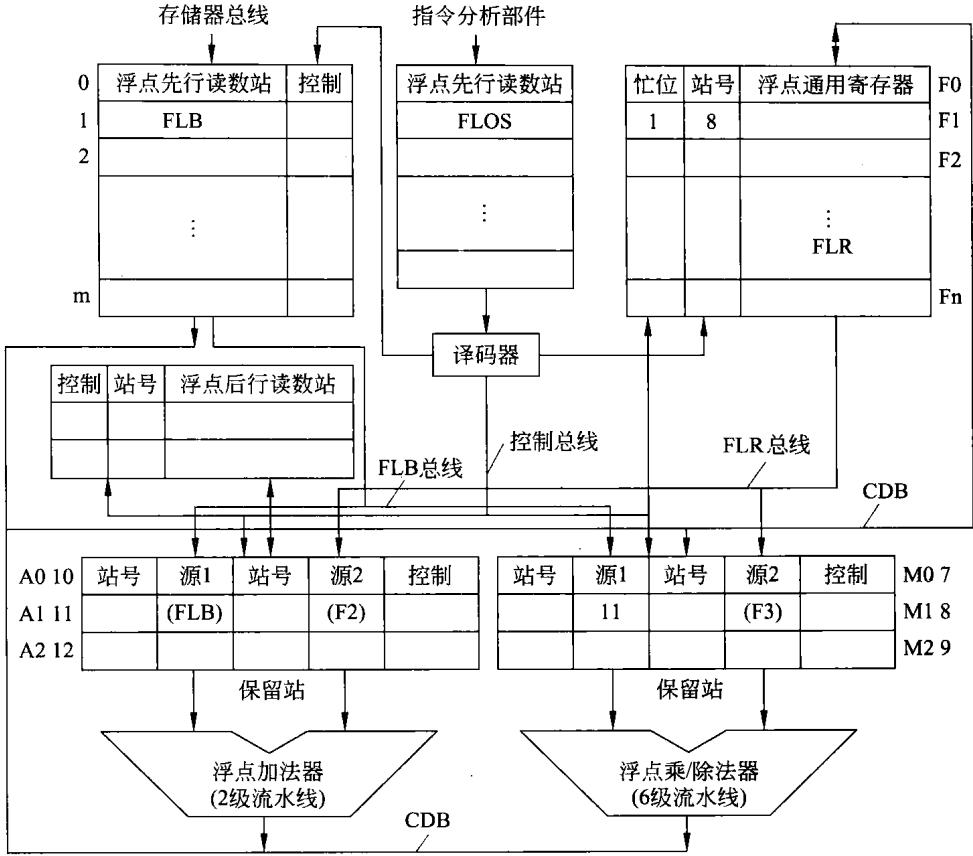  
图6-27 Tomasulo算法的处理机浮点执行部件

k+2： FMULF1,F3;浮点乘法 F1×F3→F1

k+3： MOV B,F1;浮点积写主存储器B

执行指令k，把一个浮点操作数从主存储器A中读出，并没有存在通用浮点寄存器F1中，而是放进了浮点先行读数站FLB中。并在执行指令k十1时，由FLB直接送到浮点加法器的保留站A1中。这相当于建立了一条由主存到浮点加法器的专用数据通路。

在执行指令k十1时，通用浮点寄存器F2的内容经FLR总线也送到浮点加法器的保留站A1中。并且，启动浮点加法器开始运算，同时，由于指令要将浮点加法器的结果存于F1,故需将通用浮点寄存器F1的站号写为A1的站号11并将忙位置1，表示F1的内容暂不可用。

当执行指令k十2时，可以将其一个操作数从通用浮点寄存器F3中读出并放在浮点乘/除法器的保留站M1中。但是，此时由于指令k十1尚未执行完，F1中还没有浮点乘法所需要的操作数，故需将F1中浮点加法器保留站的站号11读出放到浮点乘/除法器的保留站M1中，而把F1中的站号改为M1的站号8，表示未来F1接收的应当是浮点乘/除法器的运算结果。

当浮点加法器运算结束时，会将运算结果和其任保留站号11送到CDB上，并在浮点乘/除法器保留站M1中找到相一致的站号，于是就将浮点加法器的运算结果放进M1中，而不是将结果存于F1。这就相当于在浮点加法器和浮点乘/除法器之间建立了一条专用的

数据通路。

在刚开始执行浮点乘法运算指令时，指令k十3也开始执行。但是，由于此时浮点乘法尚未运算结束，这时就将浮点乘/除法器保留站M1的站号8装人后行写数据站的站号栏中。当浮点乘法器执行乘法指令结束时，在将结果写入通用浮点寄存器F1的同时，由于后行写数据站的站号栏中有保留站M1的站号8，故也将结果经后行写数据站写到主存储器B中。

由于Tomasulo算法对指令实行动态调度，再加之采用了源操作数缓存、寄存器重命名和动态存储器地址判别技术，因此具有较高的性能。自20世纪90年代开始，Tomasulo算法的许多改进版本在多发射处理器中得到了广泛应用。

## 6.5其他有关技术

在本节中，仍然以并行处理及提高速度为目标，介绍与此目标有关的超标量、超流水及超长指令字技术。

## 6.5.1超标量处理机

## 1.概述

一般的流水线处理机只有一条指令流水线，一个多功能部件，每一个时间间隔△t（通常称为一个周期或一个节拍)流出一条指令。将一条指令分成若干个周期处理以达到多条指令重叠处理，从而提高处理器部件利用率的技术叫做标量流水技术。具有这样流水线的处理机可以看做是一台基准标量处理机。

另外也有的流水线处理机，也只有一条流水线，但具备多个独立的操作部件。例如，处理器内部有定点算术逻辑部件、浮点加减法部件、浮点乘除法部件等。这种处理机称为多操作部件处理机。显然，这也是一种标量处理机。

## 2.超标量处理机的基本结构

超级标量是指处理器内有多条流水线，这些流水线能够并行处理。在单流水线结构中，指令虽然能够重叠执行，但仍然是顺序的，每个周期只能发射或流出一条指令。超级标量结构的处理器支持指令级并行，每个周期可以发射多条指令（2～4条居多）。这样，可以使得处理器的 $\mathrm { I P C } { > } 1$ ，从而提高处理器处理速度。

超级标量机能同时对若干条指令进行译码，将可以并行执行的指令送往不同的执行部件，在程序运行期间，由硬件(通常是状态记录部件和调度部件)来完成指令调度。

超级标量机主要是借助硬件资源重复(例如有多套译码器和ALU等)来实现空间的并行操作。

从上述描述可以看到，超标量处理机的内部结构中除了有多条流水线之外，在其他配置上也应当是比较好的。例如，配置有更多通用寄存器构成的寄存器组、配置有容量更大的指令与数据分离的cache、多个处理单元(如定点处理单元、浮点处理单元、图形图像处理单元等)。

根据超标量处理机结构特点，可以发现超标量处理机在工作时，不再像前面所描述的单一流水线的基准标量处理机，每一个周期只从cache取出一条指令进人流水线，这种情况称为单发射。而超标量处理机一次可取出多条指令，同时执行这多条指令。一个同时发射三条指令的多发射超标量处理机指令执行时空图如图6-28所示。

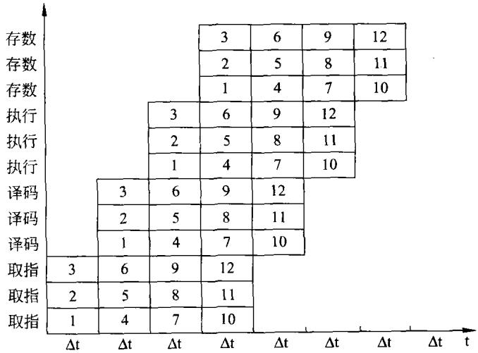  
图6-28三条流水线超标量处理机的时空图

由图6-28可以看到，此时空图所对应的处理器有三条流水线，每条流水线由4段构成。每个周期△t可同时流出三条指令。超标量处理机一次发射三条指令，而流水线一次流出三条指令，图中的12条指令只用7个周期便可执行完。因此，超标量处理机的每周期执行指令数的 $\mathrm { I P C } { > } 1$ 。

通常，将超标量处理机每个周期△t可同时流出的指令数称为超标量处理机的度。如图6-28所示的时空图所对应的就是度为3的超标量处理机。

## 6.5.2超流水线处理机

在前面描述单一流水线的基准标量处理机中，不管是流水线由3段构成还是4段构成，在一个周期△t,即一个基本时间段内可流出一条指令。如果能够将每一基本时间段再分成 $\Delta { \sf t }$ 更细小的段，使流水线在每一更细小的段——即此小段时间间隔内流出一条指令，这必定提高了流水线的吞吐率。这就是超流水线处理机的思想。

通常，把这种在一个基本时间段里能够分时发射多条指令的处理机称为超流水线处理机。段分细了，一条流水线的段就更多了，因此，有人将流水线的级数大于或等于8级的处理机叫做超流水线处理机。

若将一个4段流水线的每一个周期△t再细分为更小的3个周期△t'。仍然保证每个周 $\Delta \mathbf { t } ^ { \prime }$ 期△t'流出一条指令。则具有这样流水线的处理机就是超流水线处理机，其时空图如 $\Delta \mathbf { t ^ { \prime } }$ 图6-29所示。

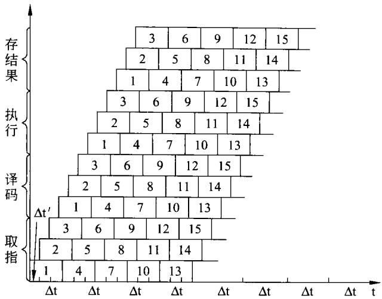  
图6-29超流水线处理机的时空图

若将一个基本段 $\Delta { \sf t }$ 分为更小的m小段，称该超流水线处理机的度为 $\mathbf { m } _ { \circ }$ 显然，如图6-29所示的流水线处理机就是度为3的超流水线处理机。

如果某流水线的基本段为k,每段时间为 $\Delta { \sf t }$ ,且一个基本段再细分为更小的m个周期$\Delta \mathbf { t } ^ { \prime }$ 。则一条指令的时间就是 $\mathbf { k } \mathbf { m } \Delta \mathbf { t ^ { \prime } }$ 。这就是一台k段m度的超流水线处理机。若用这台超流水线处理机连读执行n条指令，其执行时间T为：

$$
\mathrm { T } = [ \mathbf { k } + ( \mathbf { n } - 1 ) / \mathbf { m } ] \Delta \mathbf { t }\tag{6-17}
$$

相对基准流水线处理机,该超流水线处理机的加速比 $\mathrm { S p }$ 为：

$$
\begin{array} { c } { { \mathrm { S p } = \left[ \left( \mathbf { k } + \mathbf { n } - 1 \right) \Delta \mathbf { t } \right] / \left[ \left( \mathbf { k } + \left( \mathbf { n } - 1 \right) / \mathbf { m } \right) \Delta \mathbf { t } \right] } } \\ { { \mathrm { ~ } = \mathbf { m } ( \mathbf { k } + \mathbf { n } - 1 ) / ( \mathbf { m } \mathbf { k } + \mathbf { n } - 1 ) } } \end{array}\tag{6-18}
$$

由式(6-18)可以看到,当n很大时,超流水线处理机的加速比 $\mathrm { S p }$ 接近于 $\mathbf { m }$ 。

## 6.5.3超标量超流水线处理机

前面所描述的超标量处理机，是在处理机中设置多条流水线，具有多套"取指”、“译码”、“执行"和"写回"等执行部件，能够在一个周期里发射多条指令。因此，超标量处理机主要开发了空间的并行性，依靠在重复设置的操作部件上并行执行多条指令来提高处理机的执行速度。

超流水线处理机则是将“取指”、“译码”、“执行”和“写回"等这些基本的功能段，再进一步细分为若干更小的流水段。于是，在原来的只能发射一条指令的基本段中，这时就可以发射多条指令。原来一个基本功能段，也就是一个周期只能完成一条指令而在超流水线处理机中则可以完成多条指令的执行。因此，超流水线处理机主要开发的是时间上的并行性，在同一个操作部件上重叠多个操作。即使流水线的深度增加并同时提高时钟频率，以期达到加快速度的目的。

若将上述两者结合在一起，必能更好地改善处理机的速度，这样的处理机称为超标量超

流水线处理机，其时空图如图6-30所示。

<table><tr><td></td><td></td><td rowspan=1 colspan=2>取指</td><td rowspan=1 colspan=2>译码</td><td rowspan=1 colspan=2>执行</td><td rowspan=1 colspan=1>写回</td></tr><tr><td></td><td></td><td rowspan=1 colspan=2>取指</td><td rowspan=1 colspan=2>译码</td><td rowspan=1 colspan=2>执行</td><td rowspan=1 colspan=1>写回</td></tr><tr><td></td><td></td><td rowspan=1 colspan=2>取指</td><td rowspan=1 colspan=2>译码</td><td rowspan=1 colspan=2>执行</td><td rowspan=1 colspan=1>写回</td></tr><tr><td></td><td rowspan=1 colspan=2>取指</td><td rowspan=1 colspan=2>译码</td><td rowspan=1 colspan=2>执行</td><td rowspan=1 colspan=1>写回</td><td></td></tr><tr><td></td><td rowspan=1 colspan=2>取指</td><td rowspan=1 colspan=2>译码</td><td rowspan=1 colspan=2>执行</td><td rowspan=1 colspan=1>写回</td><td></td></tr><tr><td></td><td rowspan=1 colspan=2>取指</td><td rowspan=1 colspan=2>译码</td><td rowspan=1 colspan=2>执行</td><td rowspan=1 colspan=1>写回</td><td></td></tr><tr><td rowspan=1 colspan=2>取指</td><td rowspan=1 colspan=2>译码</td><td rowspan=1 colspan=2>执行</td><td rowspan=1 colspan=2>写回</td><td></td></tr><tr><td rowspan=1 colspan=2>取指</td><td rowspan=1 colspan=2>译码</td><td rowspan=1 colspan=2>执行</td><td rowspan=1 colspan=2>写回</td><td></td></tr><tr><td rowspan=1 colspan=2>取指</td><td rowspan=1 colspan=2>译码</td><td rowspan=1 colspan=2>执行</td><td rowspan=1 colspan=2>写回</td><td></td></tr></table>

图6-30超标量超流水线处理机的时空图

如果超标量超流水线处理机在一个周期里发射n次指令，且每次发射m条指令，则此处理机每个周期就能发射mn条指令，称为nm度超标量超流水线处理机。

## 6.5.4超长指令字处理机

在第5章中，微指令控制域编码里曾经提到水平型微指令。在构成超长指令字时，使用了类似的思路。即将能够并行执行的不相关的或无关的多条指令组合在一起，构成为一条位数超长的指令。超长指令中所包含的指令称为子指令也称为指令槽，其格式如图6-31所示。

<table><tr><td rowspan=1 colspan=1>整数运算</td><td rowspan=1 colspan=1>浮点运算</td><td rowspan=1 colspan=1>· 访内</td><td rowspan=1 colspan=1></td><td rowspan=1 colspan=1>转移</td><td rowspan=1 colspan=1>位寻址</td></tr></table>

图6-31超长指令的构成格式

如图6-30所示，每一指令槽包含着一组子指令，显然，一定会有一条空操作指令(NOP)。当某一指令不需要该槽中的子指令时，则此槽中就应放一条 NOP指令，由于每一指令槽中所包含的指令多少不同、寻址方式不同，每一指令槽的位数也就不同。若规定一条超长指令包括5个指令槽，每个指令槽的宽度在16～24位。那么，超长指令字的长度将达到80～120位。

从以上超长指令字的描述中可以想象，某一时刻将此超长指令读出进入处理机，处理机内部必须同时(即并行地)对每一个指令槽中的子指令译码并执行。这就需要根据指令槽的需要设置多个独立的功能部件，以便处理指令槽中的字指令。

超长指令字的构成是将水平型编码和超标量处理的思路相结合的产物。有关超长指令字的应用可见第10章。

## 习 题

1．列举用k级流水线设计浮点处理器的优缺点。

2.一个浮点流水线有5级,其延迟分别为110ns、90ns、120ns、80ns 和 100ns。该流水线的最大吞吐量是多少 MFLOPS?

3．何谓指令的重叠执行方式？请举一例，以示意图予以描述。

4．在指令流水线中，影响流水线性能的主要障碍是条件分支指令。请简要介绍至少3种处理条件分支指令的方法。

5．某CPU内有5级指令流水线,每级的处理时间(包括级间缓冲延迟)为10ns、5ns、5ns、10ns、5ns。

（1）当执行1000 条指令时，该流水线的吞吐率和加速比为多少?

（2）若要改进该流水线的性能，可对流水线做何改造？改造后的流水线吞吐率可达到多少？

6．某流水线为m段，各段的处理时间为 $\mathfrak { t } _ { \mathrm { i } } ( \mathrm { i } = 1 , 2 , 3 , \cdots , \mathbf { m } )$ 。现有n个任务需经此流水线完线，试计算：

（1）流水线完成此n个任务所需要的时间。

（2）与非流水线顺序执行该n个任务相比，流水线的加速比是多少?

7．流水CPU中的主要问题是 相关， 相关和 相关；为此需要采用相应的技术对策，才能保证流水畅通而不断流。

8．假设一条具有4个功能段的流水线，各段执行时间是1ns、2ns、2ns 和3ns，计算完成100 条连续指令的时间、吞吐率、加速比和效率。

9．在一台具有5个功能段的线性流水线处理机上计算：

$$
\sum _ { \mathbf { k } = 1 } ^ { 8 } \mathbf { X _ { k } }
$$

每个功能段均为1个时钟周期，设时钟频率为100MHz。计算实际吞吐率、实际加速比和实际效率。

10．在一条具有6个功能段静态多功能的流水线上，计算：

$$
\sum _ { \mathbf { k } = 1 } ^ { 8 } ( \mathbf { X } \mathbf { k } \times \mathbf { Y } \mathbf { k } )
$$

其中，加法用1、2、3和6功能段，乘法用1、4、5和6功能段。计算吞吐率、加速比和效率。

11．说明超标量处理机和超流水线处理机的差别。

12．说明动态分支预测的工作原理及两个状态位较一个状态位的优势。

## 第7章 存储系统

存储系统是构成计算机不可缺少的组成部分，其性能将直接影响计算机的性能。在本章里，在描述存储系统层次结构的基础上，将对计算机存储系统的各部分进行仔细说明。

## 7.1存储系统概述

## 7.1.1存储系统的层次结构

一台计算机中可能会包括各种存储器，如CPU内部的通用寄存器组、cache、CPU外部的二级和三级cache、主板上的主存储器、主板外的联机(在线)磁盘存储器以及脱机（离线）的磁带和光盘存储器等。这是一些具体的物理存储器，每一种都有它们具体的技术指标。

将上述两种或两种以上的存储器用硬件、软件(或硬件与软件组合)连接在一起并对它

们进行管理就构成了存储器系统。例如，cache存储器与主存储器连接在一起就构成了cache存储系统；主存储器与大容量的磁盘存储器构成了虚拟存储系统。现在的PC中的存储系统是由cache存储系统和虚拟存储系统构成的。

在计算机中，各种存储器的容量、速度、访问方式和用途等都不相同，这些存储器形成一种层次结构。在这样的层次结构中，不同层次上的存储器发挥不同的功能和作用。共同使计算机高效地工作。计算机存储系统的层次结构如图7-1所示。

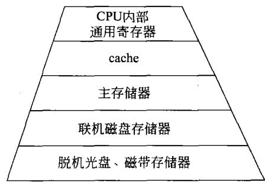  
图7-1存储系统的层次结构

在图7-1所示的计算机层次结构中，越是靠近上层，其速度越快、容量越小而单位存储容量的价格也越高。通过这种层次结构可使计算机的存取速度接近CPU的速度，使程序员所使用的主存容量接近联机外存的容量，使整个存储系统的单位存储器价格接近联机外存的价格。

## 7.1.2存储器分类

由于构成存储器的材料、性能及使用方法不同，从不同的角度考虑，就有不同的分类方法。

## 1.按照存储信息介质分类

目前，在计算机中用于存储信息的介质有半导体器件、磁性器件或光学器件及材料。因

此，就有半导体存储器，磁盘(磁带)存储器，光盘存储器等。

## 2．按在计算机中的用途分类

在计算机中用于存放当前正要执行或刚执行的程序和数据的存储器是主存储器，也称为内部存储器，简称内存。

用于存放正在执行程序或正在使用数据，用以克服主存储器速度太慢的存储器是高速缓冲存储器cache。

在CPU内部，用于存放微程序的存储器是控制存储器。

用来存放当前暂不使用的大量信息的存储器是外部存储器，又称外存。如磁盘存储器、光盘存储器、U盘、MMC(SD)存储卡、磁带存储器等。

## 3．按存放信息的易失(挥发)性分类

当存储器断电后，有的存储器所存信息也随之丢失。这类存储器所存信息是易失的、是可挥发的。例如，半导体随机读写存储器RAM就是易于挥发的易失存储器。

还有一些存储器在断电后所存信息不会丢失，当再次加电后它所存储的信息依然存在。例如，后面将要讲述的磁盘存储器、各种类型的半导体ROM等都是非易失存储器。

## 4．按存取方式分类

当存储器的存取时间与存储单元的物理地址无关，随机读写其任一单元所用的时间都一样，这就是随机读写存储器RAM。

有的存储器的存取只能按顺序进行，这就称为顺序存储器，如磁带存储器。

## 5.按存储器的读写功能分类

有的存储器既能读出又能写人，称为读写存储器。而有的存储器的内容已固定，工作时只能读出，称为只读存储器ROM。

## 7.1.3存储器的性能指标

前面已经提到，存储器和存储系统是不同的两种概念，这里说明存储器的主要性能指标。

存储器的性能指标是用来描述存储器性能的，主要包括如下几个方面。

## 1.存储容量

这里指的是存储器所能存储的二进制信息的总位数，其表示方式一般为：存储器总存储单元数×每个存储单元的位数。例如，某计算机内存容量为1024K×8b或1024KB、1GB（通常用b表示位；B表示字节），某磁盘存储器的容量为160GB。

同样，也用上述方式来描述一块存储器芯片的容量。例如，6264静态RAM的容量为8K×8b；动态RAM芯片NMC41257的容量为256KB。

## 2.存储器的速度

## （1）存取时间

存取时间又称访问时间，就是对存储器中某一个单元的数据进行一次存(取)所需要的时间。

对于主存而言，目前都是由半导体存储器构成。人们可以从厂家的技术手册上得到它的存取时间。值得注意的是CUP在读写存储器时，它所提供给存储器的读写时间必须比存储器所要求的存取时间长。如果不能满足这一点，计算机将无法正常工作。

厂家已生产出各种速度的存储器芯片，从1000ns到0.5ns，各种存取速度的芯片可任意选择。

## （2）存取周期

存取周期是指连续对存储器进行存(取)时，完成一次存(取)所需要的时间。

存取周期与存取时间很可能不一样。经常是存取周期要大于存取时间。因为在连续存取时，每读出(或写入)一个存储单元，在对下一个存储单元操作前,需要一定的稳定时间。

## （3）存储器带宽

单位时间里存储器可以读出(或写入)的字节数。若存储器的存取周期为tm，且每次可 $\mathbf { t _ { m } }$ 读出(或写人)n个字节，则存储器的带宽 $\mathrm { B } _ { \mathrm { m } } = \mathrm { n } / \mathrm { t } _ { \mathrm { m } }$

例如,某计算机主存的存取周期为tm为10ns,每次可读写8个字节。则该计算机主存 $\mathbf { t } _ { \mathbf { m } }$ 带宽为800MBps。

## 3.可靠性

计算机要正确地运行，必然要求存储器系统具有很高的可靠性。内存的任何错误就足以使计算机无法正常工作。

对计算机的存储器来说，有的是不可维修的，如构成存储器的超大规模集成电路芯片。一旦出现故障就丢弃换新的，它们是不可维修的。而有的存储器是可维修的，如磁盘存储器、磁带存储器等。可维修部件的可靠性可用平均故障间隔时间(MTBF)来描述，而不可维修部件的可靠性常用平均无故障时间或平均故障前时间(MTTF)来描述。

有时就用MTBF来说明存储器的可靠性，例如某80GB的硬磁盘存储器的MTBF为30000小时。某SRAM芯片的MTBF为 $5 \times 1 0 ^ { 6 }$ 小时。

除了用MTBF(或MTTF)来描述存储器的可靠性外，还有许多其他指标可以说明存储器的可靠性，这里不再介绍。

## 4.功耗

使用功耗低的存储器构成存储系统，不仅可以减少对电源容量的要求，而且还可以提高存储系统的可靠性。

## 5.价格

构成存储系统时，在满足上述要求的情况下，应尽量降低存储器的价格。通常是以每KB或每MB的价格来衡量存储器的成本。随着技术的发展，存储器的价格已大大降低。

例如,20世纪80 年代初每 MB需几千元而今天不值一毛钱。除上述指标外，其他如体积、重量、封装方式、工作电压、环境条件等不再说明。

总之，大容量、高速度、高可靠性、低功耗、低成本是存储器的主要要求。

## 7.2内部存储器(主存储器）

在本节中将描述与计算机内存有关的问题，包括主存的构成、高速缓存及虚拟存储器等。

## 7.2.1随机读写存储器RAM

现在构成计算机主存的毫无例外的都是半导体存储器，下面将逐一加以介绍。

## 1.静态随机读写存储器SRAM

在计算机中，常用的随机读写存储器RAM分为两大类：一类是静态随机读写存储器SRAM；另一类是动态随机读写存储器DRAM。下面将分别加以说明。

## （1）内部译码结构

RAM的生产厂家已为使用者开发研制出各种容量、速度、材料工艺、封装形式的IC存储器芯片，其型号品种有数十万种之多，为选用提供了很大的方便。

一种RAM芯片，其外部有地址引线、数据引线和控制信号引线。地址引线在芯片内部译码，选中芯片内部的相应存储单元。例如，某静态RAM芯片上有n条地址线时，这些地址线上所能表示的地址编码就有2"种。这就意味着该芯片内部有2"个存储单元。

为了能对芯片内部的存储单元进行读写，就需要在芯片内部对地址信号进行译码，以便选中地址所对应的存储单元。芯片内部的地址译码有两种方式。

①一维译码。对于容量很小的芯片，如容量在几百个存储单元以内的芯片，多用一维译码。芯片内部只用一个地址译码器，其译码输出可选中相对应的存储单元。其示意图如图7-2(a）所示。

②二维译码。当芯片容量在几百个存储单元以上时，再用一维译码将会使译码器过于复杂。因此，多用二维译码。此时，芯片内部用行译码器和列译码器两个地址译码器分别对地址译码，行译码输出可选中相对应的一行存储单元；而列译码输出可选中相对应的一列存储单元，而行列交叉点上的存储单元就是最终所选中的存储单元。其示意图如图7-2（b)所示。

由图7-2(a)可以看到，当芯片容量很大时，地址线会很多，译码器会很复杂。例如，某芯片容量为64KB,芯片上的地址线就有16条——A0～A15。利用一维译码，则译码器必须有65536条译码输出，分别选择64KB个存储单元。若采用图7-2（b)所示的二维译码方式，可将16位地址分成8条行地址和8条列地址，即图中n和m分别为8。则行、列地址译码器均为8位译码器。行、列地址译码器分别译出256行和256列。当行、列译码分别有效便可选中一个存储单元。显然，制作两个8到256译码器比制作一个16到65536 的译码器要容易得多。

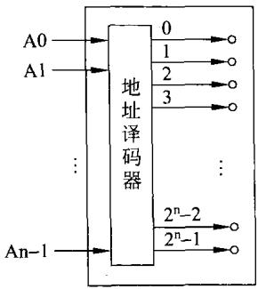  
(a)

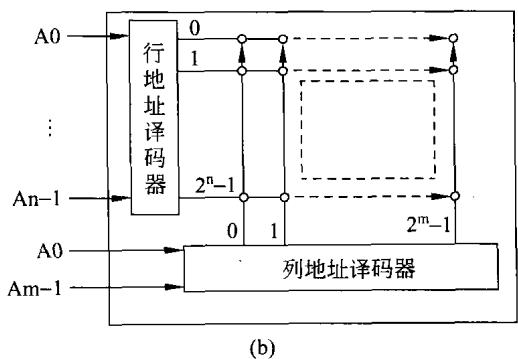  
图7-2RAM芯片内部的两种译码方式

## （2）单元电路

在这里将要说明RAM中1b信息是如何存储的，从而加深对存储器工作原理的理解。

①静态读写存储器 SRAM

首先,描述1b静态RAM的构成及工作原理。静态RAM可有多种结构，图7-3是一种典型的1位SRAM的构造形式。

图7-3中,T3、T4为T1、T2 的负载,分别相当于-个电阻。由它们构成了一种双稳态

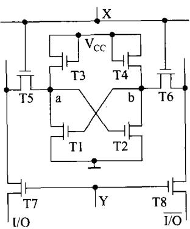

电路,即其a点或b点均有两种稳定状态,0或1。并且a和b的状态刚好相反，故可以存放0或1。

T5、T6、T7、T8是4个用于控制的晶体管，它们的栅极上分加上行译码信号X和列译码信号Y。当行、列译码信号X和Y同时有效时，便选中了该单元。

图7-3静态RAM单元电路

写数据时，X、Y有效，T5、T6、T7、T8这4个晶体管导通。写1时，I/O端上加高电平而I/O端上加低电平，双稳电路使a点为高电平，b点为低电平。而且，这种状态在写完之后会一直保持下去;写0也是一样，只是使a点为低电平，b点为高电平。同样，这种状态在写完之后会一直保留下去。

在读出数据时，经行列地址译码使X、Y有效，T5、T6、

T7、T8使4个晶体管导通。此时,本单元电路存储的信息——a点或a、b的状态便可以从I/O或I/O上读出。

从上面1位SRAM单元电路中可以看出以下几点。

a）图7-3只画出1b的存储电路,若n个这样的电路可构成n位存储单元。

b）数据一旦写人，其信息就稳定的保存在电路中，静静地等待读出。无论读出多少次，只要不断电，此信息会一直保持下去。这也许就是静态的由来。

c）SRAM初始加电时，其状态是随机的。写人新的状态，原来的旧状态就消失了。新状态一直维持到写入更新的状态为止。

d）在电路工作时，即使不进行读写操作，只要保持在加电状态下，电路中就一定有晶体管导通，就一定有电流流过，也就一定会有功率消耗。因此，与后面的DRAM比较,SRAM的功耗大，集成度不能做得很高。

## ②动态读写存储器DRAM

动态存储器DRAM也有多种结构形式，其中一种如图7-4所示。利用所给出的这种结构可阐明 DRAM的工作原理。 .F-

写入数据时，要写人的状态加到I/O端上（反相信号加到I/O端上)。同时，经行列地址译码使X、Y有效,T5、T6、T7、T8使4个晶体管导通。写1时,对C2充电，C1不充电；写0时，对C1充电，C2 不充电。写后，状态就保持在电容上。但是，由于C1、C2的电容量很小，信息仅能在电容上保持不长(几 ms)的时间。

读出数据时，先产生预充电信号使T9、T10导通，由 $\mathbf { E } _ { \mathrm { D } }$ 对电容 $\mathrm { C _ { D } }$ 和 $\overline { { \mathrm { C } _ { \mathrm { D } } } }$ 充电。而后，经行列地址译码使X、Y有效，T5、T6、T7、T8使4个晶体

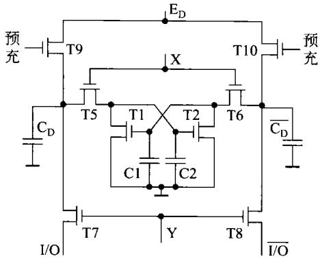  
图7-4动态RAM单元电路

管导通。此时，若原状态为1，则C2有电荷T2导通，预充电的 $\overline { { \mathrm { C } _ { \mathrm { D } } } }$ 经T6、T2放电,I/O输出为0;同时，由于C1未充电,T1截止，则 $\mathrm { C _ { D } }$ 上的预充电作为高电平由I/O输出。同时还通过 T5给C2补充电荷。

刷新，这是DRAM所特有的问题。由上述可见,DRAM的信息是存放在电容上的，且电容量很小(容量越小速度越快)。尽管不工作时T1、T2均不导通，但电容总有很微小的漏电，时间长了，存放的信息就会丢失。因此，必须在电荷漏掉前不断地补充电荷保证信息不会丢失，这就是刷新。刷新一般每2～4ms进行一次。

刷新过程就是每次刷新一行，行地址译码输出使X有效。由图7-4可以看到，X有效，使 T5、T6导通。同时，加上预充电信号使T9、T10导通。这时电源 $\mathrm { E } _ { \mathrm { D } }$ 就会对原先充有电荷的C1或C2充电，补充电荷，而原先未充电的电容不会被充电。从而实现刷新。

根据上述描述，对DRAM应注意的是以下几点。

a）图7-4只画出1b的存储电路，若n个这样的电路可构成n位存储单元。

b)DRAM必须定时不断地刷新，以保证所存储的信息不会丢失。这大概就是将这种类型的RAM叫做动态存储器的原因。

c）DRAM初始加电时，其状态是随机的。写人新的状态，原来的旧状态就消失了。新状态一直维持到写入更新的状态为止。

d）在电路加上电源不进行读写及刷新操作时，只是保持在加电状态下，电路中没有晶体管导通，也就没有电流流过(会有极微小的漏电流存在)，也就没有功率消耗（或功耗很小)。因此,DRAM的功耗非常小，其集成度可做得很高，当前的一块DRAM芯片的集成度达4GB。而厂家将它们堆叠在一块封装中可达72GB。

利用上述单元电路，采用微细加工技术，可以生 $\vec { \cal J } ^ { \pm }$ 出各种容量的集成电路芯片，用以构成存储器系统。

## 2.主存储器的组成及接口

## （1）存储器与CPU速度上的协调

对于简单的计算机，只要将半导体集成电路芯片接在计算机的系统总线上便可以构成内部存储器。在构成内存时必须注意存储器与CPU在速度上的协调。只有当CPU读写内存的时间大于内存所要求的读写时间时，才能保证可靠的读写。

在前面的章节中已经看到，CPU读(或写)内存时，由CPU内部的时序电路和控制器产生的控制信号，形成CPU读(或写)内存CPU(或总线或机器)周期，其写内存时序如图7-5(a)所示。

在CPU写内存的周期里，由CPU送出内存地址、送出要写入内存地址的数据、还送出写控制信号WR。这些信号加到系统总线上，传送到要写的内存芯片上。用CPU提供的这些信号去实现对存储器的写。不同的CPU，写内存的CPU周期不一样；同样的CPU如果时钟频率不一样，CPU周期也不一样。例如，5MHz时钟下的8086CPU的写内存CPU周期为4个时钟周期，即800ns。

另一方面，厂家研制了数以十万计的各种存储器芯片，前面已经说明了存储器的技术指标。图7-5(b)画出了存储器的写时序。请读者注意，这是存储器所要求的。不同类型的存储器芯片，写周期的长度是很不一样的，这是存储器芯片所固有的。笔者曾经用过450ns、180ns、120ns、75ns和25ns的SRAM芯片。

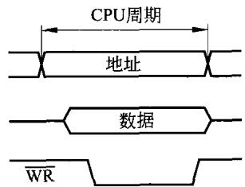  
(a) CPU写内存时序

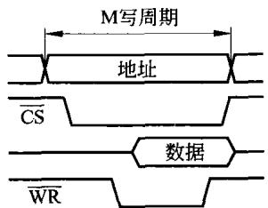  
(b)存储器的写时序  
图7-5CPU写内存及内存写的时序

这里要强调的是，在利用存储器芯片构成内存时，必须保证CPU的写(或读)内存的周期应大于等于存储器芯片所要求的写(或读)时间。也就是说CPU提供的信号持续时间必须大于等于存储器芯片所要求的信号时间。

在实际工程上构成内存时，要考虑到CPU发出的信号要经过总线传到存储器芯片上，信号在总线上传送总需要时间（比光速慢得多)。而且信号有可能经过驱动门或缓冲门，而任何门总对信号有延时。考虑上述因素，在选芯片时应留有30%的容量。例如，若CPU对内存的读写周期为100ns，则所选内存芯片的存取周期不要大于70ns。

如果工程上不能满足上述要求，也就是快速的CPU使用了慢速的存储器时，就需要采取措施：降低CPU时钟频率，即延长CPU所提供的读写时间；或选用读写速度更快的存储器芯片;或在CPU读写该慢速存储器时，适当延长CPU的读写时间，常用READY信号使CPU插入若干个时钟周期。

## （2）内存构成

将存储器芯片连接在系统总线上，便可构成所需内存。不同CPU构成的系统总线信号会有所不同。为更方便于系统设计，前人已制定上百种系统总线标准。为了叙述方便，在下面的描述中多使用PC/XT或ISA总线信号（详细情况见第8章）。

## ①单块存储器芯片的连接

现以一块典型的8K×8b的CMOSSRAM6264(或6164)芯片为例说明其外部特性及

工作过程。该芯片的引脚图如图7-6所示。

## a）引线功能

6264(6164)有28条引出线，它们包括如下几种。

$\mathbf { A } _ { 0 } \sim \mathbf { A } _ { 1 2 }$ 为13条地址信号线。芯片上的这13条地址线决定了该芯片有多少个存储单

元。因为13条地址线上的地址信号编码最大可以到8192（8K)个。也就是说，芯片上的13条地址线上的信号经过芯片的内部译码，可以决定8K个单元。这13条地址线在使用时通常接总线的低位地址，以便CPU来寻址该芯片拥有的8K个单元。

$\mathrm { D } _ { 0 } { \sim } \mathrm { D } _ { 7 }$ 为8条双向数据线。正如上面所说，静态RAM芯片上的地址线的数目决定该芯片有多少个存储单元；而芯片上的数据线的数目决定了芯片中每个存储单元存储了多少个二进制位。6264有8条数据线，说明该芯片的每个单元存放一个字节。在使用中，芯片的数据线与总线的数据线相连接。当CPU写芯片的某个单元时，将数据传送到该芯片内部这个指定的单元。当CPU读某一单元时，又能将被选中芯片该单元中的数据传送到总线上。

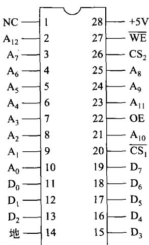  
图7-66264引脚图

$\overline { { \mathrm { C S } _ { 1 } } } , \mathrm { C S } _ { 2 }$ 为两条片选信号的引线，当两个片选信号同时有

效时，即 $\begin{array} { r } { \overline { { \mathbf { C } } } \overline { { \mathbf { S } } } _ { 1 } = 0 , \mathbf { C } \dot { \mathbf { S } } _ { 2 } = 1 } \end{array}$ 时，才能选中该芯片。不同类型的芯片，其片选信号多少不一，但要选中芯片，只有使芯片上所有片选信号同时有效才行。在使用中，通过对高位地址信号和控制信号的译码产生(或形成)片选信号，把芯片的存储容量放在设计者所希望的内存空间上。简言之，就是利用片选信号将芯片放在所需要的地址范围上。

OE为输出允许信号。只有当 $\overline { { \mathrm { O E } } } = 0$ ，即其有效时，才允许该芯片将某单元的数据送到芯片外部的 $\mathrm { D } _ { 0 } \sim \mathrm { D } _ { 7 }$ 上。

WE是写允许信号。当 $\overline { { \mathbf { W } } } \overline { { \mathbf { E } } } = 0$ 时，允许将数据写入芯片；当 $\overrightarrow { \bf W } _ { \mathrm { } } \mathrm { = } 1$ 时，允许芯片的数据读出。以上4个信号的功能如表7-1所示。NC为没有使用的空脚。芯片上还有十5V电压和接地线。

表7-16264真值表
<table><tr><td>WE</td><td> $\overline { { \mathbf { C } \mathbf { S } _ { 1 } } }$ </td><td> $\mathbf { C } \mathbf { S } _ { 2 }$ </td><td>OE</td><td> $\mathbf { D _ { 0 } } \sim \mathbf { D _ { 7 } }$ </td></tr><tr><td>0</td><td>0 0</td><td rowspan="4">1 1 0</td><td rowspan="4">× 0</td><td rowspan="4">写人 读出</td></tr><tr><td>1</td></tr><tr><td>×</td></tr><tr><td>×</td></tr><tr><td>1 × 1</td><td>0 1</td><td>× ×</td><td>三态(高阻)</td></tr></table>

注：×表示不考虑。

## b）6264(6164)的工作过程

从表7-1可以看到，写入数据的过程是：在芯片的 $\mathbf { A } _ { 0 } \sim \mathbf { A } _ { 1 2 }$ 上加上要写入单元的地址；在 $\mathrm { D } _ { 0 } \sim \mathrm { D } _ { 7 }$ 上加上要写入的数据；使CS，和CSz同时有效；在WE上加上有效的低电平，此时 $\overline { { \mathrm { C S } } } _ { \mathrm { l } }$ $\mathbf { C } \mathbf { S } _ { 2 }$ $\overline { { \mathbb { W } \mathbb { E } } } .$ OE可为高也可为低。这样就将数据写到了地址所选中的单元中。

从芯片中某单元读出数据的过程就是： $\mathbf { A } _ { 0 } \sim \mathbf { A } _ { 1 2 }$ 加上要读出单元的地址；使 $\mathrm { \overline { { C S } } } _ { 1 }$ 和 $\mathrm { C S } _ { 2 }$ 同时有效;使OE有效(为低电平)；使 $\scriptstyle { \overline { { \mathbf { W E } } } }$ 为高电平，这样即可读出数据。

以上读出或写人过程，实际上是CPU发出信号加到存储器芯片上的一个过程。其时间应满足芯片的要求。

## c）连接

对于使用人员来说，在了解存储器芯片的外部特性之后，重要的是必须掌握存储器芯片与总线的连接，即按照用户的要求，主要是按规定的内存地址范围，将存储器芯片正确地接到总线上，构成所要求的内存。

图7-7就是利用6264构成地址从F0000H到F1FFFH这8KB的内存空间。图7-7连接的是8088最大模式下的8位系统总线PC/XT。

## ②内存的字扩展

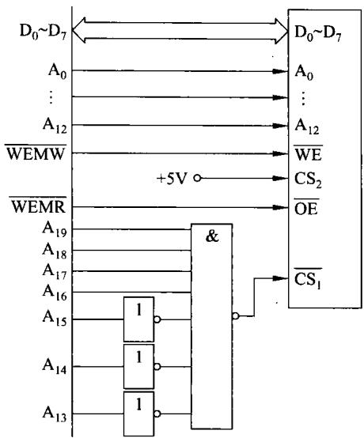

当用一片存储器芯片构成内存的字容量不够时，可采用字扩展的方法达到目的。

图7-76264全地址译码器

如图7-8所示是利用6264芯片，通过字扩展的方法，构成32KB的连接图。

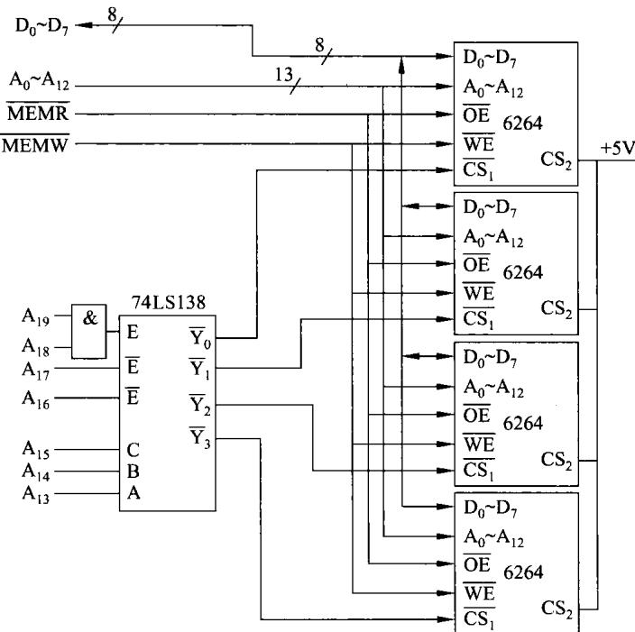  
图7-8内存字扩展的连接电路图

由于6264芯片的容量只有8K×8b，而要构成的内存为 $3 2 \mathrm { K } \times 8 \mathrm { b }$ ，这就需要将8KB扩展为32KB。因此，需要4片6264芯片。构成的内存地址为C0000H到C7FFFH。

## ③内存的位扩展

当存储器芯片的数据位数较少，而构成的内存每一存储地址单元要求的存储数据位较多时，可采用位扩展，即用多片存储器芯片来达到位扩展的目的。图7-9就是一种内存位扩展连接的形式。

在图7-9中，存储器芯片的容量是2K×4b的芯片，而要构成的内存是2KB。因此，需要将芯片的4位扩展为内存所需要的8位。

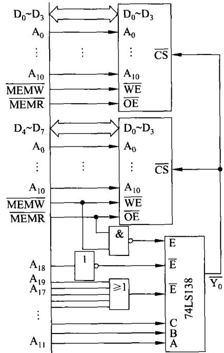  
图7-9内存位扩展连接

利用二片存储器芯片，其中一片的数据线 $\mathrm { D } _ { 0 } \sim \mathrm { D } _ { 3 }$ 接系统总线的数据总线 $\mathrm { D } _ { 0 } \sim \mathrm { D } _ { 3 }$ ；而另一片的数据线 $\mathrm { D } _ { 0 } \sim \mathrm { D } _ { 3 }$ 接系统总线的数据总线 $\mathrm { D } _ { 4 } \sim \mathrm { D } _ { 7 }$ 。在图7-9中，利用3-8译码器74LS138的译码输出端Y。作为两块芯片的片选信号。译码器Y。有效时，可同时选中这两块 $\overline { { \mathrm { Y } _ { \mathfrak { o } } } }$ $\overrightarrow { \mathrm { Y } _ { \mathfrak { o } } }$ 芯片，实现对一个字节8位数据的读写。

根据图7-9 的译码器连接，图中两块芯片所构成的内存地址为40000H～407FFH，即两片 $2 \mathtt { K } \times 4 \mathtt { b }$ 的芯片构成了2KB的内存空间。

## ④80x86内存的连接

以上在内存连接中都是认为内存一个地址单元存放一个字节，也就是说内存是按字节编址，每一个内存地址就存放8位二进制数。

从16位的8086CPU开始，80x86由16位到32位一直发展到64位。在这样的CPU构成的系统中，由于CPU的特性决定存储器的结构比较复杂。在存储器的连接上也有许多不同，下面将一一予以说明。

## a）8086的内存接口

8086 CPU是真正的16位处理器，它既能按字节访问内存又能按字(16位)访问内存。

8086的系统总线的数据线是16位的，即 $\mathrm { D } _ { 0 } { \sim } \mathrm { D } _ { 1 5 }$

## （a）8086系统中内存奇偶分体

在8086 系统中，为了能够实现一次访问一个字(16位)，又能一次访问一个字节(8位），故将其内存地址空间分成偶存储体和奇存储体。前者对应地址为偶数而后者对应的地址为奇数。整个1MB的内存空间就分为偶存储体512KB和奇存储体512KB。在8086系统中，无论实际构成的内存有多大，为了保证CPU能一次读写数据的高字节、一次读写数据的低字节或一次读写数据的高低两个字节(即一个16位的字),内存必须分成奇、偶两个体。例如，若构成的内存为64KB，则必须分成偶地址体32KB和奇地址体32KB。

同时，为做到上面所描述的奇偶分体，在8086的引线上，增加了一个BHE信号。当8086读写偶地址字节时， $\mathbf { A } _ { 0 } = 0 , \overline { { \mathrm { B H E } } } = 1$ ；当读写奇数地址字节时， $\mathbf { A } _ { 0 } = 1 , \overline { { \mathbf { B H E } } } = 0$ ，当读写一个16位字时， $\mathbf { A } _ { 0 } = 0 , \mathbf { \overline { { B H E } } = 0 }$

## （b）连接

在 8086内存的具体连接上就体现出上述的特点。作为例子，将两片6264接到8086的系统总线上，构成16KB的内存，其连接如图7-10所示。

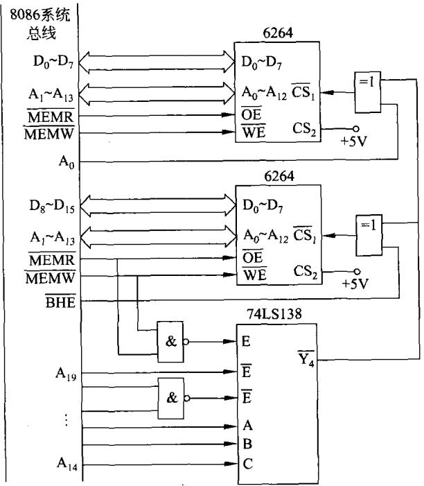  
图7-106264与8086系统总线的连接

图7-10中，将16KB的内存分为两个体，偶地址8KB，利用高位地址 $\mathbf { A } _ { 1 9 } \sim \mathbf { A } _ { 1 4 }$ 和 $\mathbf { A } _ { 0 }$ 译码构成片选信号；而奇地址8KB利用 $\mathrm { A } _ { 1 9 } \sim \mathrm { A } _ { 1 4 }$ 和BHE译码构成片选信号。形成的内存地址范围为70000H～73FFFH。

## b）80386、80486的内存接口

80386和80486都是典型的32位处理器。在这里不准备仔细介绍这些处理器，只说明在这样的处理器构成的系统中，内存接口的特点及其实现。

## （a）与内存接口相关的信号

在80386、80486构成的系统中，与内存有关的信号主要有如下几种。

·地址信号 $\mathbf { A } _ { 2 }$ 到 $\mathbf { A } _ { 3 1 }$ 共30个地址信号，其编码可寻址1G个32位的存储单元。这里没有 $\mathbf { A } _ { 0 }$ 和 $\mathbf { A } _ { 1 }$ ，这两个信号已在80386、80486内部译码产生4个体选择信号。

·体选择信号BE0到BE3。与前面提到的8086相类似，在32位的80386、80486系统中，为了灵活地寻址一个字节、一个16位的字或一个32位的字，内存必须分成4个体。而4个体选择信号BE0到BE3分别用于选择一个体。很显然，每个体选择信号对应一个字节。当读写一个8位的字节时，4个体选择信号只有一个有效，选中1个体的8位数据。当读写一个16位的字时，4个体选择信号中有两个有效，同时选中2个体的16位数据。当读写一个32位的字时，4个体选择信号均有效，同时选中4个体共32位数据。

·32位的数据信号 $\mathrm { D } _ { 0 } \sim \mathrm { D } _ { 3 1 }$ ，这32位数据分为4个字节，分别是 $\mathrm { D } _ { 0 } \sim \mathrm { D } _ { 7 } \ 、 \mathrm { D } _ { 8 } \sim \mathrm { D } _ { 1 5 }$ $\mathrm { D } _ { 1 6 } \sim \mathrm { D } _ { 2 3 }$ 和 $\mathrm { D } _ { 2 4 } \sim \mathrm { D } _ { 3 1 }$

·控制信号M/IO(内存/接口选择信号，与8086一样) $\mathrm { { } } _ { \mathrm { { ; D / \bar { C } } } }$ (数据/控制)信号，低电平为处理器中止或正在响应中断，高电平表示正在传送数据；W/R(读/写)信号，低电平表示读内存或接口，高电平表示写内存或接口。在486中，它们的功能如表7-2所示。

表7-2控制信号编码表示的总线周期
<table><tr><td>M/I0</td><td> $\mathbf { D } / \mathbf { \overline { { C } } }$ </td><td>W/R</td><td>总线周期</td></tr><tr><td>0</td><td>0</td><td>0</td><td>中断响应</td></tr><tr><td>0</td><td>0</td><td>1</td><td>停机</td></tr><tr><td>0</td><td>1</td><td>0</td><td>1/0读</td></tr><tr><td>0</td><td>1</td><td>1</td><td>I/0写</td></tr><tr><td>1</td><td>0</td><td>0</td><td>取指令操作码</td></tr><tr><td>1</td><td>0</td><td>1</td><td>保留</td></tr><tr><td>1</td><td>1</td><td>0</td><td>存储器读</td></tr><tr><td>1</td><td>1</td><td>1</td><td>存储器写</td></tr></table>

## （b）内存的连接

前面已经说明，在这里还需要再次强调，在32位的80386、80486系统中，内存必须分成为4个体。这与前面所描述的8位处理器 8088不一样，在8位机中内存是不分体的或者说就是一个体。16位机分为两个体。32位机分成4个体。后面的Pentium机内存将分为8个体。

80386、80486系统中内存分体组织如图7-11所示。

在80x86中，内存都是按字节编址。因此，32位的数据要占4个内存地址。由图7-11可以看到，一个32位的数据分别放在4个不同的体中。

在80486系统中，利用4片容量为 $1 2 8 \mathrm { K } \times 8 \mathrm { b }$ 的SRAM芯片构成512KB的内存，画出连接图如图7-12所示。

在图7-12中,4片SRAM构成4个存储体,分别利用BE0～BE3参加译码选中一个体。显然，在图7-12中，还可以有其他的译码形式，只要逻辑上是正确的，采用什么形式的译码电路并不很重要。

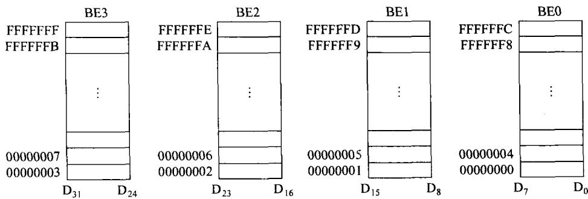  
图7-1132位机的内存组织

c）Pentium处理器的内存组织

Pentium处理器有几百条引线，其中与访问内存有关的是地址信号 $\mathbf { A } _ { 3 } \sim \mathbf { A } _ { 3 1 }$ 、体选择信号BE0～BE7、64位数据信号 $\mathrm { D } _ { \mathfrak { o } } \sim \mathrm { D } _ { \mathfrak { s } 3 }$ 、及控制信号 $\mathrm { M } / \overline { { \mathrm { I O } } } , \mathrm { D } / \overline { { \mathrm { C } } }$ 和 $\boldsymbol { \mathrm { W } } / \boldsymbol { \tilde { \mathrm { R } } }$

从上面的信号可以注意到，Pentium处理器对外部的数据线是64位的，可用8个字节来表示。同样，为了增加访问内存(或接口)的灵活性，须将内存分成8个体。为了方便对8个存储体的寻址，在处理器内部已将地址信号 $\mathbf { A } _ { 0 } \sim \mathbf { A } _ { 2 }$ 进行译码，形成了8个存储体的选择信号BE0～BE7。这与上面所说明的80386、80486的情况非常类似，所不同的是在Pentium处理器系统中内存要由8个体来构成，每个体对应一个体选择信号。具体内存芯片的连接这里不再说明。

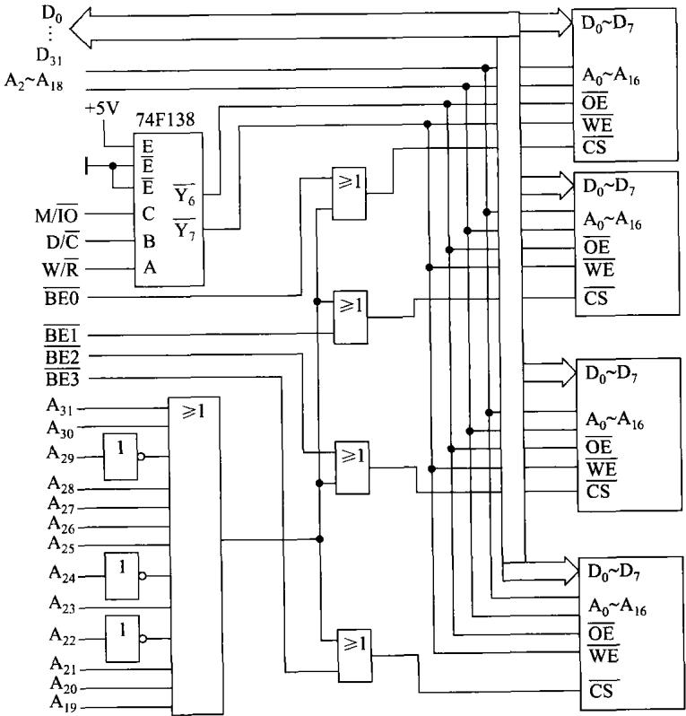  
图7-1280486内存芯片连接图

再次说明的是，上面构成内存的连接均是以80x86处理器的总线信号为例，存储器芯片也是特定的芯片。在实际的应用中，不同的处理器，不同的存储器芯片，它们的信号会略有不同。例如，在内存与接口统一编址(见后面章节说明)的处理器中，内存与接口的读写信号可以是RD和WR(或R/W)；在内存与接口独立编址的处理器中，内存与接口的读写信号可以是RD和WR再加上M/IO(或R/W再加上M/IO)；而存储器芯片上的WE、OE有可能只用R/W来代替。

尽管有这些不同，但在构成内存的连接中，只要利用门电路就很容易实现信号间的匹配，详细情况不再说明。

## 7.2.2只读存储器ROM

## 1．概述

只读存储器ROM的重要特性是其存储信息的非易失性，存放在ROM中的信息不会因去掉供电电源而丢失，当再次加电时，其存储的信息依然存在。

## （1）掩膜工艺ROM

这种ROM是芯片制造厂根据ROM要存储的信息，设计固定的半导体掩膜版进行生产的。一旦制出成品之后，其存储的信息即可读出使用，但不能改变。这种ROM常用于批量生产，生产成本比较低。计算机中一些固定不变的程序或数据常采用这种ROM存储。

## （2）可一次编程ROM(PROM或OTP)

为了使用户能够根据自己的需要来写ROM,厂家生产了一种PROM（或一次可编程OTP)。允许用户对其进行一次编程—写入数据或程序。一旦编程之后，信息就永久性地固定下来。用户只可以读出和使用，但再也无法改变其内容。

## （3）可擦去重写的PROM

这种可擦去重写的PROM是目前使用最广泛的ROM。这种芯片允许将其存储的内容利用物理的方法(通常是紫外线)或电的方法(通常是加上一定的电压)擦去。擦去后可以重新对其进行编程，写人新的内容。擦去和重新编程可以多次进行。一旦写入新的内容，就又可以长期保存下来（一般均在10年以上)，不会因断电而消失。

利用物理方法（紫外线)可擦去的PROM通常用称为EPROM；用电的方法可擦除的PROM称为EEPROM(E²PROM或EAROM)。这些芯片集成度高、价格低、使用方便，尤其适合科研工作的需要。

## 2.EPROM

EPROM是一种可以擦去重写的只读存储器。通常用紫外线对其窗口进行照射，即可把它所存储的内容擦去。之后，又可以用电的方法对其重新编程,写入新的内容。一旦写入，其存储的内容可以长期(几十年)保存，即使去掉电源电压，也不会影响到它所存储的内容。下面以一种典型的EPROM芯片为例来做介绍。

## （1）EPROM2764的引线

2764是一块 $8 \mathbf { K } \times 8 \mathbf { b }$ 的EPROM芯片，其引线图如图7-13所示。

$\mathbf { A } _ { 0 } \sim \mathbf { A } _ { 1 2 }$ 为13条地址信号输入线，说明芯片的容量为8K个单元。

$\mathrm { D } _ { 0 } \sim \mathrm { D } _ { 7 }$ 为8条数据线,表明芯片的每个存储单元存放一个字节(8位二进制数)。在其

工作过程中， $\mathrm { D } _ { 0 } \sim \mathrm { D } _ { 7 }$ 为数据输出线；当对芯片编程时，由此8条线输人要编程的数据。

CE为输入信号。当它有效(低电平)时，能选中该芯片，故 $\overline { { \mathrm { C E } } }$ 又称为片选信号(或允许芯片工作信号)。

OE是输出允许信号，当 $\dot { \overline { { \mathrm { O E } } } }$ 为低时，芯片中的数据可由 $\mathrm { D } _ { 0 } \sim \mathrm { D } _ { 7 }$ 输出。

PGM为编程脉冲输人端。当对EPROM编程时，由此加人编程脉冲；读数据时PGM为1。

## （2）EPROM2764的连接

2764在使用时，仅用于将其存储的内容读出。其过程与RAM的读出十分类似，即送出要读出的地址，然后使CE和OE均有效（低电平)，则在芯片的 $\mathrm { D } _ { 0 } \sim \mathrm { D } _ { 7 }$ 上就可以输出要读出的数据。

EPROM2764芯片与8088总线的连接图如图7-14所示。从图中可以看到，该芯片的地址范围在F0000H～F1FFFH之间。

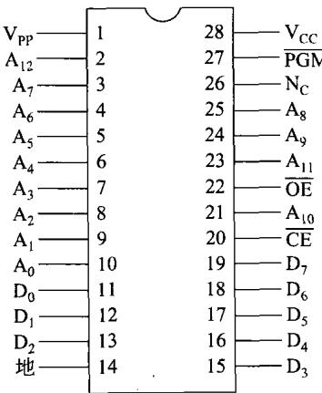  
图7-13EPROM2764引线图

## （3）EPROM的编程

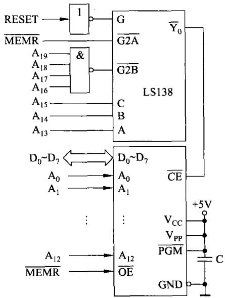  
图7-14EPROM2764的连接图

EPROM的一个重要优点就是可擦除重写，而且对其某一个存储单元来说，允许擦除重写的次数超过万次。

## ①擦除

那些刚出厂未使用过的EPROM芯片均是干净的，干净的标志就是芯片中所有单元的内容均为FFH。

若EPROM芯片已使用过，则在对其编程前必须将其从系统中取下来，放在专门的擦除器上进行擦除。擦除器利用紫外线照射EPROM的窗口，一般15～20min即可擦除干净。

## ②编程

对EPROM的编程通常有两种方式，即标准编程和快速编程。

## a）标准编程

标准编程过程为：将EPROM插到专门的编程器上，先使Vcc引脚加到十5V，然后Vpp加上EPROM芯片所要求的高电压(如+12.5V，+15V，十21V，十25V等),然后在地址线上加上要编程单元的地址，数据线上加上要写入的数据。CE使保持低电平，OE为高电平；上述信号全部达到稳定后，在PGM端加上 $( 5 0 \pm 5 ) \mathrm { m s }$ 的负脉冲，这样就将一个字节的数据写到了相应的地址单元中。重复上述过程，即可将要写人的数据逐一写入相应的存储单元中。

每写人一个地址单元，在其他信号不变的条件下，将OE变低，可以立即读出校验；也可在所有单元均写完后再进行最终校验;还可采用上述两种方法进行校验。若写人数据有错，则可从擦除开始，重复上述过程再进行一次写人编程过程。

标准编程用在早期的EPROM中。这种方式编程有两个主要的缺点：其一是编程时间太长。当EPROM容量很大时，每个单元50ms的编程时间，使写一块大容量芯片时间长得令人无法接受；其二是不够安全。编程脉冲太宽致使功耗过大而损坏EPROM。

## b）快速编程

随着技术的进步，EPROM芯片的容量越来越大。同时，也研制出相应的快速编程方法。编程时，其他步骤与标准编程都一样，不同的仅仅是使用编程脉冲已变窄，一般为0.1ms到2ms。例如，27C040所要求的编程脉冲的宽度仅为 $1 0 0 \mu \mathbf { s }$ 。因此，其编程时间会大大缩短。

## 3.EEPROM

EEPROM就是电擦除可编程只读存储器的英文缩写。EEPROM在擦除及编程上比EPROM更加方便。EEPROM的出现将使得EPROM逐渐地退出历史舞台。

## （1）典型EEPROM芯片介绍

EEPROM以其制造工艺及芯片容量的不同而有多种型号。下面仅以8K×8b的EEPROMNMC98C64A为例来加以说明。其引线如图7-15所示。

$\mathbf { A } _ { 0 } \sim \mathbf { A } _ { 1 2 }$ 为地址线，用于选择片内的8K的存储单元。

$\mathrm { D } _ { 0 } \sim \mathrm { D } _ { 7 }$ 为8条数据线，表明每个存储单元存储的一个字节的信息。

CE为片选信号。当CE为低电平时，选中该芯片；当它为高电平时，该芯片不被选中。芯片未被选中时，芯片的功耗很小，仅为CE有效时的1/1000。

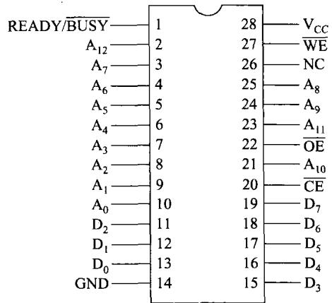  
图7-15EEPROMNMC98C64A引线图

OE为输出允许信号。当 $\overline { { \mathbf { C E } } } = 0 , \overline { { \mathbf { O E } } } = 0 , \overline { { \mathbf { W E } } } = 1$ 时，可将选中的地址单元的数据读出。

WE是写允许信号。当 $\overline { { \mathbf { C E } } } = 0 , \overline { { \mathbf { O E } } } = 1 , \overline { { \mathbf { W E } } } = 0$ 时，可以将数据写人指定的存储单元。

READY/BUSY是漏极开路输出端，当写人数据时该信号变低，数据写完后，该信号变高。

## （2）98C64A的工作过程

EEPROM98C64A工作过程如下所述。

①读出数据。由EEPROM读出数据的过程与从EPROM及RAM中读出数据的过程是一样的。 $\scriptstyle \pm \pmb { \mathbb { Y } } \overrightarrow { \mathrm { C E } } = 0 , \overrightarrow { \mathrm { O E } } = 0 , \overrightarrow { \mathbf { W E } } = 1$ 时，只要满足芯片所要求的读出时序关系，则可从选中的存储单元中将数据读出。

②写人数据。将数据写入EEPROM98C64A有两种方式。

第一种是按字节编程方式，即一次写入一个字节的数据，过程是：使 $\overline { { \mathrm { C E } } } = 0 , \overline { { \mathrm { O E } } } = 1$ ，地址线上加上要写的地址，数据线上加上要写人的数据。在WE端加上100ns的负脉冲，便可以启动数据的写人。这里要特别注意的是，WE脉冲过后READY/BUSY端为低电平，表示写人过程正在进行，直到READY/BUSY端的低电平变高,才完成一个字节的写人。这段时间里包括了对本单元数据擦除和新数据写人的时间。不同芯片所用时间略有不同，一般是几百微秒到几十毫秒,98C64A需要的Twr为5ms,最大为10ms。 $\mathrm { T } _ { \mathbf { W R } }$

在对EEPROM编程过程中,可以通过程序查询READY/BUSY信号或利用它产生中断来判断一个字节的写入是否已经完成。

可以看到，在对EEPROM编程时，可以在线操作，即可在计算机系统中直接进行，从而减少了不少麻烦。

第二种编程方法称为自动按页写人。在98C64A中一页数据最多可达32个字节，要求这 32个字节在内存中是顺序排列的。

页编程的过程是，连续写人一页，用查询或中断看READY/BUSY是否已变高，若变高，则写周期完成。接着可以写下一页，直到将数据全部写完。

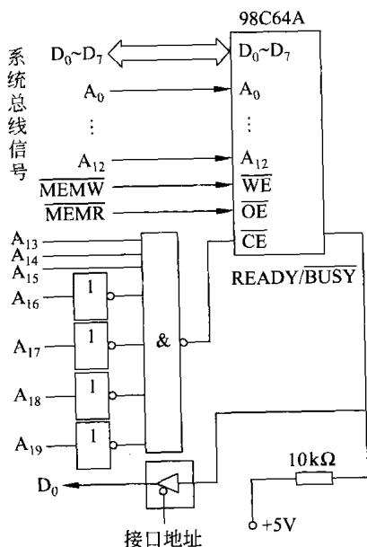  
图7-16 EEPROM98C64A的连接

新的EEPROM一页可达数KB,连续写满一页仅等待几ms，其编程速度很快。

## （3）连接使用

EEPROM可以很方便地接到计算机系统中。图7-16就是将98C64A连接到8088总线上的连接图。

除了上面提到的并行EEPROM之外，尚有多种型号的串行EEPROM。它们都是在外接时钟驱动下一位接一位的写入或读出。因此，它们的容量一般都比较小，几百b到几Kb，读写速度都很慢。多用于银行卡、各种预付费卡等。

## （4）闪速存储器

闪速(flash)存储器也是一种电可擦除可多次编程的存储器。与前面描述的 EEPROM不同之处在于其擦除写人的速度比较快，为强调其写人速度快才称为闪速存储器。闪速存储器在制造工艺主要有两类：或非(NOR)型阵列和与非型(NAND)阵列。

NOR的传输效率很高，在1～4MB的小容量时具有很高的成本效益。

NAND结构能提供极高的单元密度，可以达到高存储密度，并且写入和擦除的速度也

很快。当选择存储解决方案时，必须权衡以下的各项因素。

·NOR的读速度比NAND稍快一些。

·NAND的写人速度比NOR 快很多。

·NAND的4ms擦除速度远比NOR的5s快。

·大多数写人操作需要先进行擦除操作。

使用时应注意接口上的差别，NORflash带有SRAM接口，有足够的地址引脚来寻址，可以很容易地并行存取其内部的每一个字节。因此，它们可以直接接系统总线，构成内存储器。

NANDflash器件使用复杂的I/O口来串行地存取数据，采用串行接口，不能直接构成内存，只能用它们构成外存储器。很显然，基于NAND的存储器就可以取代硬盘或其他外存储设备。

## 7.2.3 动态读写存储器DRAM

在上一节中已介绍过动态存储器的单元电路，利用这样的单元电路构成的动态读写存储器速度快、集成度高、功耗小、价格低，在计算机中得到极其广泛的使用。PC中的内存条无一例外地采用动态存储器，现在的许多嵌入式计算机系统中也越来越多地使用这种存储器。

## 1.概述

目前，大容量的DRAM芯片已研制出来，为构成大容量的存储器系统提供了便利的条

件。下面以一种简单DRAM芯片来例说明DRAM的工作原理。

（1）动态存储器芯片2164的引线

2164是一块 $6 4 \mathsf { K } \times 1 \mathsf { b }$ 的DRAM芯片。这种存储器芯片引线与SRAM有所不同，请读者注意。2164的引线如图7-17所示。

$\mathbf { A } _ { 0 } \sim \mathbf { A } _ { 7 }$ 为地址输入端。在DRAM芯片的构造上，芯片上的地址引线是复用的。可以看到，2164的容量为64K个单元，每个单元存储一位二进制数。如何来寻址这64K个单元呢？在存取芯片的某单元时，其操作过程是将存取的

  
图7-17DRAM2164引线图

地址分两次输入到芯片中去，每一次都是由 $\mathrm { A } _ { 0 } \sim \mathrm { A } ,$ 输入的。两次加到芯片上去的地址分别称为行地址和列地址。

在芯片内部，各存储单元是一种矩阵结构排列。行地址在片内译码选择一行，列地址在片内译码选择一列。这样由选中的行和列来决定所选中的单元，可以简单地认为该芯片有256 行和256列，共同决定64K个单元。对于其他DRAM芯片也可以同样来考虑。

综上所述，动态存储器芯片上的地址引线是复用的，CPU对它寻址时的地址信号分在行地址和列地址上，分别由芯片上的地址线送入芯片内部进行锁存、译码而选中要寻址的单元。

$\mathrm { D } _ { \mathtt { I N } }$ 和 $\mathrm { D } _ { \tt O U T }$ 是芯片上的数据线。其中 $\mathrm { D } _ { \mathrm { I N } }$ 为数据输人线,当CPU写芯片的某一单元时，要写入的数据由 $\mathrm { D } _ { \mathrm { I N } }$ 送到芯片内部。同样， $\mathrm { D } _ { \mathrm { O U T } }$ 是数据输出线，当CPU读芯片的某一单元时，数据由此引线输出。

RAS为行地址锁存信号。利用该信号将行地址锁存在芯片内部的行地址缓冲寄存器中。

CAS为列地址锁存信号。利用该信号将列地址锁存在芯片内部的列地址缓冲寄存器中。

WE为写允许信号。当该信号为低电平时，允许将数据写入。反之，当 $\overline { { \mathbf { W } } } \overline { { \mathrm { E } } } = 1$ 时，可以从芯片读出数据。

## （2）DRAM的工作过程

## ①读出数据

当要从DRAM芯片读出数据时，CPU首先将行地址加在 $\mathbf { A } _ { 0 } \sim \mathbf { A } _ { 7 }$ 上，然后送出RAS锁存信号，该信号的下降沿将行地址锁存在芯片内部。接着将列地址加到芯片的 $\mathbf { A } _ { 0 } \sim \mathbf { A } _ { 7 }$ 上，再送CAS锁存信号，该信号的下降沿将列地址锁存在芯片内部。然后保持 $\mathbf { \overline { { W E } } = 1 }$ ，则在CAS有效期间(低电平)数据输出并保持。其过程如图7-18所示。

## ②写人数据

当需要将数据写人芯片时，前面的过程即锁存地址的过程与读出数据时一样，行列地址先后由RAS和CAS锁存在芯片内部。然后WE有效（为低电平），加上要写人的数据，则将该数据写入选中的存储单元，如图7-19所示。

  
图7-18DRAM2164的读出过程

  
图7-19DRAM2164的写入过程

图7-19中，WE变为低电平是在CAS有效之前，通常称为提前写。这能够将输人端 $\mathrm { D } _ { \mathrm { I N } }$ 的数据写入，而 $\mathrm { D } _ { \mathrm { { O U T } } }$ 保持高阻状态。若WE有效(低电平)出现在CAS有效之后，且满足芯片所要求的滞后时间，则WE开始是处于读状态，然后才变为写状态。这种情况下，能够先从选中的单元读出数据，出现在 $\mathrm { D } _ { \mathrm { O U T } }$ 上。然后，再将 $\mathrm { D } _ { \mathrm { I N } }$ 上的数据写入该单元。这种情况可一次同时完成读和写，故称为读变写操作周期。

## ③刷新

动态RAM一个重要的问题是，它所存储的信息必须定期进行刷新。对于单元电路的刷新过程上节已经说明。通常DRAM要求每隔2～4ms刷新一次。

动态存储器芯片的刷新过程是每次送出行地址加到芯片上去，利用RAS有效将行地址锁存于芯片内部，这时CAS保持无效(高电平)。这样就可以对这一行的所有列单元进行刷新。每次送出不同的行地址，顺序进行，则可以刷新所有行的存储单元。也就是说行地址循环一遍，则可将整个芯片的所有地址单元刷新一遍。只要保证在芯片所要求的刷新时间内（2～4ms)刷新一遍，也就达到了定期刷新的目的。刷新波形如图7-20所示。

在刷新中，CAS保持无效，只利用RAS锁存刷新的行地址，进行逐行刷新。即图7-4中所描述的Y无效X有效，每次刷新一行。

## 2.内存条


内存条是PC的重要组成部分。它是将多

图7-20DRAM2164的刷新过程

片存储器芯片焊在一小条印刷电路板上，构成容量不一的小条。使用时将小条插在主板的内存条插座上。由于PC的内存要求容量大、速度快、功耗低且造价低廉，而动态存储器恰恰具备这些性能。因此，PC的内存条无一例外地都采用动态存储器。

随着PC的发展，构成内存条的DRAM也经历了若干代的变更。早期的PC所用的PMDRAM、EDODRAM已经不再使用，这里不做说明。当前还在用的芯片主要是SDRAM和DDR SDRAM。

目前,PC上的内存条主要是由 SDRSDRAM(单倍速率同步DRAM)或DDR SDRAM芯片构成。

标准的DDR内存条是184引脚线DIMM(双面引脚内存条）。它很像标准的168引脚线SDRAMDIMM，只是用了一个凹槽而不是SDR上的2个凹槽。组件的长度也是5.25英寸。

标准化协会定义了两种不同配置的DDR内存条。第一种是无缓冲DDRDIMM，它成本低，可应用在PC和Internet设备上。第二种是有缓冲DDRDIMM，应用于较高存储密度的服务器。

新近的DDR-Ⅱ内存条所用的DDR芯片的速度更高一些。目前有三种工作频率：400MHz、533MHz和667MHz，分别可以达到的速率为7.8GBps、5.6GBps和6.4GBps。所有的DDR-Ⅱ内存条均工作在1.8V电压之下，单条容量均在512MB以上。DDR-Ⅱ内存条的引脚线有200线、220线和240线几种。

## 7.2.4其他存储器

除上面所提到的存储器外，尚有多种其他用途的存储器。这里仅介绍如下几种。

## 1.多端口存储器

在计算机系统中，经常利用多端口存储器实现处理机之间的快速数据交换。多端口存储器包括双端口、三端口、4端口等多种。这里仅对双端口存储器做简要介绍。

  
图7-21双端口存储器DS1609的引线

## （1）双端口存储器

双端口存储器有多个厂家生产的多种型号。在这里仅以一种为例说明它的应用。

## ①引线

双端口存储器DS1609的引线如图7-21所示。

由图7-21可以看到，双端口存储器的引线分为两个独立的端口，分别在图7-21的两侧。

引线AD。～AD为复用引线，这8条线上可输入地址信号，也可以传送数据。其他控制信号均已经熟悉，不再说明。

## ②同时操作

双端口存储器就存在A、B两端口对其存储单元同时操作，下面分别说明。

a）对不同存储单元允许同时读或写。

b）允许对同一单元同时读。

c）当一个端口写某单元而另一端口同时读该单元时，要么是读出旧数据，要么是写入新的数据。因此，这种情况也不会发生混乱。

d）当两个端口同时对同一单元写数据时，就会引起竞争，产生错误。因此，这种情况应想办法加以避免。

③竞争的消除

  
图7-22某一边的写过程

④对于DS1609来说，竞争发生在对同一单元同时写数据时。为了防止竞争的发生，可以另外设置两个接口，该接口能保证一个端口只写而另一个只读。例如，用带有三态门输出的锁存器来实现，74LS373、74LS374均可实现。如果可能，也可在DS1609中设置两个单元一个A端口只写而B端口是只读，另一个单元则相反，B端口只写而A端口只读。在A端口向DS1609写数据时，先读B端口的写状态。若B端口不写，则将自己的写状态写到存储单元中。当B端口写人时，同样需要查询A端口的状态。其过程可用图7-22所示的流程图来说明。

不同的双端口存储器在结构上有所不同，上述芯片没有状态信号，所需状态信号由使用者产生。而有的双端口存储器芯片有自己的状态信号，如BUSY，使用者在使用过程中可用芯片所产生的这种信号。

## 2．多体交叉存储器

## （1）多体并行访问

多体交叉存储器在本章的前一节中已经涉及，只是没有特别强调。例如，8086的内存连接中采用两个体——奇地址体及偶地址体的交叉编址方式。而80386和80486 的内存则采用4体交叉编址方式。参见图7-11可以看到4个体的地址编排不是顺序的而是交叉的。同样的思路Pentium的内存是8体交叉编址。

在上面80x86系列处理器中，处理器对内存的存取是以增加数据总线的宽度达到提高内存访问速度的目的的。在8086中，可一次读(或写)16位数据。若数据总线只有8位的话，处理器要两次才能读写16位。显然，速度提高了1倍。同样，386、486数据总线宽度增加到32位，比8位总线的速度提高了4倍；而Pentium处理器的数据总线宽度增加到64位，则比8位总线的速度提高了8倍。

在80x86系列中，处理器对内存的访问多个存储体同时进行，或者说是多体并行访问。这是多体交叉存储器的一种访问方式。这种方式实现比较容易(见前面的连接图)，而且速

度很快。但需要更宽的数据总线宽度。

为提高内存的访问速度，多体交叉存储器还有另一种访问方式，就是多个模块顺序轮流进行访问，也称为交叉访问。

## （2）多体交叉访问

如前所述，多体存储器中的体的个数一般是2的幂次方，如2、4、8个或更多。为了说明交叉访问，将4个体的多体存储器简化框图如图7-23所示。

  
图7-234体交叉访问存储器简化框图

由图7-23可以看到，存储器地址与80x86一样交叉编址。4个存储体是完全独立的，各自有自己的地址寄存器、地址译码器和数据寄存器DR。而且数据总线的宽度仅为每个存储单元的数据宽度。

该存储器的访问过程是交叉进行的，为此利用如图7-24的示意图来加以说明。

  
图7-244体存储器交叉访问示意图

在图7-24中，假定每个存储体的访问时间为T。显然，顺序访问任何一个体的4个连续地址则需要4T。同时假定控制部件每隔△t启动一个存储模块。并且在图7-24的情况下保证 $4 \Delta \mathfrak { t } \leqslant \mathrm { T }$ ，图中采用 $4 \Delta \mathfrak { t } { = } \mathrm { T }$ 的情况。也就是说应保证 $\mathrm { T } / \Delta \mathfrak { t }$ 应大于等于存储体的数量。只有这样才能保证连续访问时存取数据的正确性。

在对4个体进行一次访问时，访问命令启动存储器控制部件产生4个等间隔控制脉冲信号,顺序启动对4个体MO、M1、M2 和M3 的访问。在读出数据时,经T时刻都将数据读到DR中。T时刻开始CPU只需再用3个△t就可以将数据读走。

可以看到，顺序访问任何一个体的4个连续地址则需要4T=16△t，而采用交叉访问的情况下只需要7△t。

当连续读出m个数据时，由图7-24可知，在读出前面数据的同时，又可以启动后续数据的读出。这样就形成一种类似流水线方式的工作，当等待M0体读出后（用T时间），则每个△t可读出一个数据。因此，连续读出m数据时，只需T十（m一1)△t。当m很大时可近似读出一个数据的时间就是△t。显然，速度就提高了许多。

在上面的说明中，是以交叉读出为例来说明的，交叉写入数据的思路是一样的。在连续写大量数据时，可以认为CPU是以△t的速度交叉写每个存储体单元，而存储体单元的写人时间依旧是T。速度就提高了。

从以上分析可见，采用多体交叉存储器可以有效地提高存储器的存取速度。但多体交叉访问的形式已成为历史。

## 3.相联存储器

前面所描述的存储器都是按地址进行访问的，也就是说这些存储器都是依照地址去寻

找地址中的内容。而相联存储器是依据内容决定内容的地址或者是依据内容去寻找与其相关的内容。

相联存储器的构成框图如图7-25所示。其组成主要包括如下部件。

## （1）检索寄存器

用于存放要检索的内容，其长度为N位二进制编码。

## （2）屏蔽寄存器

屏蔽寄存器用于将不进行检索的某些位屏蔽掉，只留下需要检索的各位参与比较。通常屏蔽寄存器中某位置1，则将相应的检索位屏蔽掉；若置0则保留检索位。


## （3）存储体

图7-25相联存储器的构成图

用于存放信息的部件，假定存储体的容量为

2"×N，即它具有2"个存储单元，每个存储单元存储N位二进制信息。

## （4）比较电路

比较电路是由2"个N位的数字比较器构成，用来将存储体中所有存储单元的内容与经屏蔽后的检索字进行比较。采用如此数量的硬件比较器，进行并行的同时比较，为的就是提高比较器的速度。

## （5）匹配寄存器

匹配寄存器用于记录比较器的比较结果。该寄存器有2"位，刚好对应存储体的2"个存储单元。当某一存储单元存储的信息与屏蔽后的检索字相同(匹配)时，该位置1;未匹配存储单元的相对应位则为0。

## （6）数据寄存器

数据寄存器用来存放比较过程中发现的匹配存储单元的内容。加电后，其内容为随机数。

如图7-25所示，还在左侧画出了地址寄存器和地址译码器，为的是使相联存储器具有按地址访问的功能。

可以想象，相联存储器中使用了数字比较器，用来比较经屏蔽后的检索字与存储单元的内容是否相等。数字比较器还可以进行大于、小于等比较功能。因此，有的相联存储器具有大于、小于等其他功能的检索。

相联存储器可用于许多领域，本书中主要用在高速缓冲存储器及虚拟存储器中。

## 7.3高速缓冲存储器

在过去的30年里，CPU速度的提高非常快而存储器速度增加相对比较慢，与CPU速度相匹配的速度高的存储器价格很贵。这样一来就产生了矛盾：若计算机内存全部采用低价的慢速存储器作为内存，则CPU的高速度无法发挥出来。若全部采用高价的快速存储器作为内存，CPU的高速度是能够发挥出来了，但价格又使人无法接受。就PC而言，从80386CPU之后，人们采用高速缓冲存储器(cache)来解决上面的矛盾。使计算机既具有低的价格又发挥出了CPU的高速度。

## 7.3.1 工作原理

## 1．概述

## （1）高速缓冲存储器的位置

高速缓冲存储器的工作是建立在程序及数据访问的局部性原理之上。经过对大量程序执行情况的结果分析表明：在一段较短的时间间隔内程序集中在某一较小的内存地址空间执行，这就是程序执行的局部性原理。同样，对数据的访问也会存在局部性现象。

基于上述程序及数据访问的局部性原理，在CPU和主存之间，尽量靠近CPU的地方设置一种容量比较小而速度高的存储器，将当前正在执行的程序和正在访问的数据放在其中。在程序运行时，不需要从慢速的主存中取指令和数据，而是直接访问这种高速小容量的存储器，从而可以提高CPU的程序执行速度，这种存储器就称为高速缓冲存储器。

高速缓冲存储器所处的位置如图7-26所示。

## （2）cache的构成

cache的构成框图如图7-27所示。主要包括替换管理模块、由相联存储器构成的存储表以及小容量高速度存储器。

当CPU执行程序需从主存读指令或数据时，从地址线上将地址加到主存也加到相联存储表上。若在相联存储表中检索到要读写的信息就在高速cache中，则通过相联存储表将地址转换为cache地址，从中读出信息。这种情况称为“命中”。若在相联存储表中未能

检索到要读写的信息，则称"未命中”。此时,CPU用主存读周期从主存中读出指令或数据，同时将包括读出信息在内的一块主存的信息读出替换cache中的某一块。

  
图7-26cache所处位置

  
图7-27cache的组成

值得注意的是，cache中存储的内容与主存的相应部分的内容是完全一样的，是主存内容的复制。只是为了提高运行速度才将这部分内容放在cache中的。同时，为了提高速度，整个cache系统都是由硬件实现的。

由于程序执行的局部性原理，CPU在绝大多数的情况下都可命中。因此，CPU可以以更高的速度运行程序。有关cache工作的细节将在下面详细说明。

## 2．地址映射

如上所述，在cache工作过程中，需要将主存的信息复制到cache中，这就是主存地址到cache地址的"地址映射”。在程序执行中，如果命中，就从cache中存取信息。这就需要将主存地址转换为cache的地址，才能对cache进行访问。将主存地址转换为cache地址称为“地址变换”。地址映射与变换有如下三种基本方式。

## （1）全相联方式

为了工作方便，提高效率，通常将cache和主存分成容量相等的块。例如，主存64MB，cache为32KB,均将它们分为大小为4KB的块。在全相联方式下，cache被分为块号为0～

7的8块，块号可用3位二进制编码表示。而主存则分为16K块，块号从0～16383，块号需要用14位二进制编码表示。

全相联方式下，地址映射的法则是：主存的任何一块可从装入到cache的任何一块中。这时，存放主存块号的相联存储器应有cache块数个单元(上例为8)。在相联存储器中需要记录装人cache的主存块的块号，因此，相联存储器每个单元应为14位。相联存储器的容量为8×14b。全相联地址映射示意图如图7-28所示。

由图7-28可以看到，主存的每一块均可以装

  
图7-28全相联地址映射

入cache的任一块中，没有什么限制。

在全相联方式下，地址的变换过程如图7-29所示。

  
图7-29全相联地址变换

为了说明问题方便，主存及cache的大小及分块仍以上面所给出的特定数据。同时，图7-29中画出了8×14b的相联存储器。它只有8个存储单元，用3位编码来表示存储单元的地址。而且，地址号与cache的块号是完全对应的。

假定某时刻主存第28B5H块（即从28B5000H到28B5FFFH这4KB)已经装人cache的第100B(4)块中。这时，该cache块的地址是32KB中的4000H到4FFFH这4K个地址。同时，要将块号28B5H存在对应的相联存储器地址为100B(4)的单元中，如图7-29所示。

若此后某时刻，CPU送出主存地址为28B57A4H，其低12位为块内地址，而高14位28B5H为主存块号。利用相联存储器，在其中检索比较主存块号28B5H，由内容28B5H寻找到其地址为100B(4)。这就是cache 的块号-—高位地址。最后将此高位地址与块内地址连接在一起，便形成了cache地址—-47A4H。CPU从cache的47A4H单元即可访问到主存28B57A4H单元的内容。

全相联映射的优点是主存装人cache特别灵活，主存的任一块都可装入cache的任一块中。只有全部装满后才需要替换。在替换时，根据算法只需淘汰掉任何一块即可装人新的。

但是,这种方式的代价也是最高的。它要求的相联存储器容量最大，而且进行比较检索时需全部检索相联存储器才能获得cache的块号，地址变换机构最复杂。

## （2）直接映射方式

为了说明直接映射，下面仍以前面所给出的数值为例。在直接映射方式下，要将主存先以cache 的容量32KB分区。则64MB的主存就被分成0～2047个区——即2K个区。而后每个区再以4KB分块，如图7-30所示。

利用图7-30，说明地址直接映射的法则为：主存各区中块号相同的块只能装人与cache中相同的块号中。例如,所有区中的0号块只准装人cache的0号块中；1块号只能装人

cache的1块号中，以此类推。

由上所述可以看到，这种映射使主存块号与cache块号永远是一致的。

下面，分析直接映射的地址变换过程。同样假定某一时刻CPU送出主存地址为28B57A4H。此时该主存地址应由如下部分组成，如图7-31所示。

由图7-31可以看到，地址的低12位是块内的地址；中间3位用于表示区内的块号。这里要特别注意的是直接映射方式下，该3位表示的也一定是cache的块号。因为主存的101B(5)块一定要装人cache的101B(5）块中。故假如命中的话，这3位连同后面的12

  
图7-30直接映射方式示意图

位块内地址就是cache的地址57A4H。地址的最高11位用来表示区号，即区号为516H。

  
图7-31直接映射方式下主存地址分析

下面看一看地址的变换过程。假如在此之前CPU己访问过区号为516H、区内块号为101B(5)的块。则该块一定已经装人cache的101B(5)块中。同时，在相应的地址是101B的相联存储单元中必须存储主存的区号516H，如图7-32所示。

  
图7-32直接地址变换

利用图7-32所示的直接方式下的地址变换过程，当CPU送出主存地址为28B57A4H时，直接映射的变换机制得到此时的区号为516H，而块号为5(101B)，则直截了当只检索比较相联存储器的5(101B)号单元的内容是否是516H。若是，则为命中，主存地址的低15位就是cache的地址，则地址就是57A4H。若不是，则没有命中。

可见，直接映射方式下的地址变换变得很简单,只需根据主存地址中得到的块号--即相联存储器地址去检索该单元存放的是否定本块地址的区号。是则命中；不是则未命中。

综上所述，直接映射方式地址变换特别简单，只需以主存地址的块号为地址检测相联存储器(实际上，这种情况下已经是一种一般存储器)的一个存储单元。若命中，则由主存地址可直接获得cache的地址。该方式的缺点就是效率低，当某一块号正在使用而其他区同一块号又需装入时，即使其他块空着或很久都未使用也不能装入，只能将正在使用的替换。也就是说不同区的相同块号是不允许同时存在于cache中，若出现不同区的相同块号频繁交替被访问时，就会出现这些块被频繁装人的情况，这将大大影响命中率。因此，这种方式更适合于大容量cache。

## （3）组相联方式

前面已经看到，全相联方式和直接映射方式各有优缺点。而组相联方式就是将上述两者的优点结合而尽可能减小其缺点。该方式的基本思想是将cache先分组，组内再分块；而主存是先以cache的总容量分区，区内按cache的方法分组、组内再分块。

地址映射是组间直接映射而组内的块全相联映射。也就是说主存的某号组只能装入cache的同号组中，而组内的块可以装人同组号的任意一块中。具体示意图如图7-33所示。

  
图7-33全相联地址映射示意图

在图7-33中，将cache分为0、1两组，每组分为00～114块。同样,将主存分区，每区分为0、1两组，每组分为00～114块。图7-33中表明各区中同号组只能调入cache的同号组中，而组内块是全相联的。

作为前面例中CPU给出的主存地址为28B57A4H，在组相联地址变换中，对该地址分析如图7-34所示。

  
图7-34组相联方式下主存地址分析

由图7-34分析可知，设主存地址的区号仍为516H；区内的组号为1，这就是说该组内的所有块只能装人cache的第1组中；组内的块号为01B(第1块)，它可以装入cache第1组4块中的任一块中。

现在说明组相联方式下地址变换。参见组相联方式下的地址变换示意如图7-35所示。若在此之前CPU曾访问过28B5000H～28B5FFFH这块主存块中的某一地址，且需要将该块调人cache中。则cache系统分析该主存块的区号为516H；区内的组号为1;组内的块号为01。这就确定这一主存块只能装人cache第1组的4块中。

  
图7-35组相联地址变换

在cache第1组中进行搜索，若发现10块空着还未被使用或根据下面的替换算法应将10 块替换出去。则将主存的这一块装人cache的10块中。与此同时，还必须在相联存储器相应的第1组4个单元中寻找地址与cache的10块对应的10单元存放该段的区号516H和组内的块号二进制01，将块号放低位，相联存储单元中应保存的数据为1459H。此时组号是不需要保存的，因为它是固定的。

若某一时刻CPU送出主存地址为28B57A4H，通过图7-34分析可以发现该块一定在第1组中，而且由主存区号和组内块号构成的检索字为1459H。这时，相联存储器只在第1组内进行检索比较，发现匹配字所在的地址为10。此时便可如图7-35所描述的那样构成cache的地址：地址的最高位就是主存给出的组号(本例中为1)，接下来是经相联比较得到的地址(本例中为10)，最后接上主存地址的最低12位(块内地址）。这样就构成了15位的cache 地址67A4H。

从图7-35的地址变换中可以看到，在此情况下，相联存储器的容量为8×13b。每个存储单元除存放主存区号外，还需要存放组内块号。而在相联检索比较时，只需比较主存地址中给出的那一组相联存储单元就可以了。

## 7.3.2替换算法

当要访问的主存块未在cache中，即未命中时，就需要将主存的块调人cache,替换cache中的块。主要的替换算法有如下几种。

## 1．随机替换算法(RAND)

随机替换算法是用随机函数发生器产生需替换的块号，将其替换。这种算法没有考虑信息的历史及使用情况，故其命中率比较低。现已不再使用。

## 2．先进先出算法(FIFO)

先进先出算法是将最先装入cache的那一块替换出去。这种算法只考虑信息的历史情况而没有考虑其使用情况，也许最先装入的那一块正在频繁使用。因此，该算法也有一定局限性，命中率也不是很高。

## 3.近期最少使用算法(LRU)

近期最少使用算法就是将近期最少使用的块替换出去。这种算法需要对每块设置一个计数器，某块每命中一次，就将其计数器清0而其他块的计数器加1，记录cache中各块的使用情况。当需要替换时，便将计数值最大的块替换出去。前面提到cache的工作是建立在程序执行及数据访问的局部性原理。因此，该算法较前两种算法的命中率要高一些。

## 4.最不经常使用算法(LFU)

最不经常使用算法是将一段时间里被访问次数最少的块替换出去。这种算法也需要对每块设置一个计数器，且开始调入时计数为0。每被访问一次，被访问块的计数器加1。当需要替换时，便将计数值最小的块替换出去。同时将所有各块的计数器清0。这种方法将计数周期限定在两次替换的时间间隔内，不能完全反映近期的访问情况。

## 5.最优替换算法(OTP)

要实现最优替换算法程序需执行两次。执行第一遍时，记录各块地址的使用情况。根据第一遍的记录就能找出需要替换出去的该是哪块。有了先前的替换信息，在第二次执行时一定能将命中率达到最高。前面的算法是依据过去的信息决定未来，而这种算法是以未来的信息决定未来，必然最佳。

显然，这种方法是不实用的。但它可以用做衡量其他算法的标准。

下面通过一个简单的例子说明上述替换算法。假定程序在主存为5块，cache为3块。CPU执行程序的顺序为：P2、P3、P2、P1、P5、P2、P4、P5、P3、P2、P5和P2。

画出FIFO算法、LRU算法和OTP三种算法的命中情况如图7-36所示。

  
图7-36三种替换算法的比较

如图7-36(a)所示的是利用FIFO算法的执行结果。图中用★所表示的是命中的情况，在利用FIFO算法的情况下，命中率为3/12=25%。

如图7-36(b)所示的是利用LRU算法的执行结果。同样，图中用★所表示的是命中的情况，在利用LRU算法的情况下，命中率为5/12=42%。

最优替换算法OTP的替换情况如图7-36(c)所示，在此情况下，命中率为6/12=50%。

上面的例子仅仅说明OTP算法的命中率要高一些。当然，人们期望命中率尽可能的高。

## 7.3.3主存—cache 内容的一致性问题

从前面的讲述中可以看到，cache的内容是主存部分内容的复制，其内容应当与主存的内容保持一致。很显然，只是从cache中读出指令或数据是不会改变cache中的内容的。而CPU对cache内容的写就会改变其内容，为了保证主存与cache内容的一致性，主存的内容也必须更新。由于程序cache是只读的，不存在一致性问题。该问题只发生在数据cache中。在那里，如何更新主存的内容，可采取下面所描述的写策略。

## 1.写回法

写回法是当CPU写cache命中时，只将数据写人cache而不立即写入主存。只有当被

CPU写入修改的块被替换出去时才写回到主存中。

如果CPU写cache未命中，则写修改是将相应主存块调人cache之后，在cache中进行。对主存的修改仍留待该块替换出去时进行。

实现这种方法需要对cache的每一块都设置一位修改标志，以便在该块被替换出去时，根据此标志决定是将该块写回主存还是直接丢弃不要。

这种方法的写修改是在cache中进行，很可能会发生多次，而对主存的修改只有最后替换时的这一次。这比后面要说明的全写法速度要快得多。但在替换前时间里存在不一致的问题。

## 2.全写法

全写法是当CPU写cache命中时，在将数据写人修改cache的同时写人修改主存，较好地保证了主存与cache内容的一致性。

当CPU写cache未命中时，就直接对主存进行写入修改。而后，可以将修改过的主存块调人cache,也可以不将修改过的主存块调人cache。

全写法同时写人修改了cache和主存，一致性好，而且也不需要设置修改标志。但是，每次修改都要对速度慢的主存操作，必然降低了CPU的运行速度。

## 7.3.4cache 性能分析

## 1.加速比

前面已经提到，在计算机中设置cache的主要目的就在于降低存储系统的价格、提高存储系统的速度。尤其是速度，它是计算机的永恒的主题。因此，人们最关心的问题是加速比。

假设cache 的访问周期为 Tc,主存的访问周期为Tm,cache 的命中率为H,则cache系 $\mathrm { T _ { c } }$ $\mathrm { T } _ { \mathbf { M } }$ 统的平均访问周期T可如下表示：

$$
\mathrm { T } = \mathrm { H } \bullet \mathrm { T _ { c } } + ( 1 - \mathrm { H } ) \bullet ( \mathrm { T _ { c } } + \mathrm { T _ { x } } )\tag{7-1}
$$

在式(7-1)中,Tx为块的调入时间或替换开销，若cache以一个字或一个字节(对主存 $\mathrm { T } _ { \mathbf { X } }$ 的一次访问可以读写的字长)为一块，则 $\mathrm { T } _ { \mathrm { X } } = \mathrm { T } _ { \mathrm { M } }$ 。若以n个字或n个字节为一块，则$T _ { \mathbf { X } } = \mathbf { n } T _ { \mathbf { M } }$ 。

当命中率很高时,cache系统的平均访问周期就接近于cache的访问周期Tc。例如，若 $\mathrm { T _ { c } }$ 某计算机cache以1个字为一块，从0地址开始顺序读10个字，重复100 次，则命中率为99%,假定Tm为100ns,cache的访问周期Tc为10ns。则可得到cache系统的平均访问周 $\mathrm { T } _ { \mathbf { M } }$ $\mathrm { T _ { c } }$ 期T为11ns。若该cache以10个字为一块，同样从0地址开始顺序读10个字，重复100次，命中率为99.9%,Tm为100ns,cache的访问周期Tc为10ns。则可得到cache系统的平 $\mathrm { T _ { M } }$ $\mathrm { T _ { C } }$ 均访问周期T仍为1lns。

可见，块越大命中率越高，替换开销也越大。但同样的操作平均访问周期T没有改变。cache系统的加速比 $\mathsf { S } _ { \mathtt { P } }$ 定义为：

$$
\begin{array} { r } { \mathsf { S } _ { \mathtt { P } } = \mathrm { T } _ { \mathtt { M } } / \mathrm { T } . } \end{array}\tag{7-2}
$$

根据加速比的定义，上面所提到的计算机cache系统的加速比 $\mathrm { S } _ { \mathrm { P } } = 1 0 0 / 1 1 = 9 . 9$

可以看到，在块大小决定后，命中率越高，加速比越大。最大也只能接近 $\mathrm { T } _ { \mathrm { M } } / \mathrm { T } _ { \mathrm { C } }$ 。就如上面的例子，只有命中率为100%时才能达到加速比的极限10，实际上是不可能做到的，只能是希望加速比尽可能大一些。

## 2.成本

在本小节开始时曾说明，cache的出现是为了提高CPU访问存储器的速度，同时又可以降低成本。

假设计算机中的主存与cache的容量分别为S1和 S2。显然，S1>S2。同时，若主存与cache的单位价格分别为C1和C2,而且C1一定是低的。

则存储器的平均价格C由下式决定：

$$
\mathrm { C } = ( \mathrm { C } 1 \mathrm { S } 1 + \mathrm { C } 2 \mathrm { S } 2 ) / ( \mathrm { S } 1 + \mathrm { S } 2 )\tag{7-3}
$$

尽管cache的价格比主存高，但是当其容量很小时，存储器的平均价格C接近于主存的价格。

从以上两个侧面可以看到，由于设置了cache使CPU.的访存速度接近cache的速度，而使存储器的成本接近于主存的价格。

## 3.命中率与cache容量的关系

cache的命中率随着它的容量的增加而增加，其关系曲线如图7-37所示。

  
图7-37命中率H与容量S关系

由图7-37可以看到，在cache容量S比较小的时候，随着容量S的增加，命中率H的增加非常快。随着cache容量的增加，命中率增加变得比较缓慢。显然，当cache的容量能装下CPU要执行的所有程序和数据时，命中率就达到100%。注意到，当cache的容量达到一定量时，再增加容量对命中率的贡献就很有限了。

文献资料中认为，在一般情况下，图7-37所示的关系曲线可用下式近似表示：

$$
\mathrm { H } = 1 - \mathrm { S } ^ { - 0 . 5 }\tag{7-4}
$$

式(7-4)中，容量 S以字节为单位。

## 4.两级cache

为了克服CPU和主存间的性能差距，使两者在性能上更好的匹配，cache应运而生。随着技术的发展，目前均在原有的cache和主存之间增加另一级cache，构成两级cache系统。

通常，将第一级cache做得比较小，几KB、几十KB到一两百KB，而且速度很高；而将第二级cache做得比较大，一般都在几百KB到几MB,其速度也比较高，甚至与第一级一样。这样一来,当第一级cache 未命中时，再到第二级cache中去搜索。由于第二级cache容量很大，其命中率会很高。同时，在速度上也完全可以与CPU相匹配。

两级cache的总未命中率(或称总失效率)是由两级cache的各级失效率来决定：

$$
1 0 N H 3 N C = ( 1 + 3 0 \times 7 ) m \cdot 2 0 + ( 1 + 3 0 \times 7 \times 2 ) m = 0\tag{7-5}
$$

例如，在10O00 次访存中，第-级cache失效400次，第二级cache失效4次。则可以计算出（失效率） $1 \frac { A E } { A E } - \frac { A E } { A C }$ 为4%而(失效率） $A B = C Q$ 为1%，利用式(7-5)得到使用两级cache后总的失效率降为0.04%。

目前，均将第一级cache集成在CPU内部(称L1),而将第二级cache 放在CPU外部外接（称L2)。除两级cache外，还可采用三级cache，此处不再说明。

## 7.4虚拟存储器

在计算机存储系统中，虚拟存储器是非常重要的。可以说没有虚拟存储器就不可能有性能好的计算机。目前，虚拟存储器存在于所有PC、服务器等计算机中。

## 7.4.1虚拟存储器的概念

前面，通过在存储器系统中增加一个容量小、速度高的cache，解决了CPU与主存储器的速度匹配问题。随着技术的发展，与存储系统有关的另一个问题凸现出来：要求计算机具有海量存储器，以便支持多用户、多任务程序的开发。

目前，不可能将计算机的主存做到海量，而且即使做到了，其价格也是使用者无法承受的。那么，在一定的主存容量下，如何做到让程序员几乎可以无限制地（比主存的实际容量大成千上万倍)使用存储器。解决的办法就是采用虚拟存储器。

虚拟存储器是由价格比较贵、容量不太大、速度相对比较高的主存储器和价格很低、容

量非常大、速度慢的外部(辅助)存储器，在操作系统及辅助硬件的管理下，构成了像一个单一的、可直接访问的超大容量的主存储器。

可见，虚拟存储器为程序员提供了比计算机实际主存地址空间大得多的地址空间。它是利用了大容量外存(如硬磁盘)构成的。它解决的是主存容量与价格的矛盾，使速度接近主存速度而容量和价格又接近外存。虚拟存储器的结构形式如图7-37所示，虚存是在硬、软件的管理支持下，由主存和辅存共同实现的。

可依不同管理方式构成虚拟存储器，下面逐一说明。

  
图7-38虚拟存储器的构成

## 7.4.2虚拟存储器的管理

## 1.页式虚拟存储器

## （1）地址变换

在页式虚拟存储系统中，要将虚拟地址空间分成固定大小的页，称为虚页或逻辑页。同时，主存也分成同样大小的页，称为实页或物理页。页的大小为2的幂字节或字，一般为几

KB(或KW)。这样一来，虚拟地址和主存物理地址都包含有两个字段。

对于虚拟地址来说，高字段为虚页号，低字段为页内地址。

对于主存地址来说，高字段为实页号，低字段为页内地址。

在页式虚拟存储器中，由虚拟地址到主存物理地址的变换是通过页表来实现的。在页表中每一条记录都包含有虚页号所对应的实页号。在地址变换中，只要根据虚页号找到对应的实页号，将此实页号与虚拟地址中的低字段所给出的页内地址拼接在一起，就获得了主存的物理地址。页式虚拟存储器地址变换如图7-39所示。

  
图7-39页式虚拟存储器的地址变换

由图7-39可以看到，通常页表设置在主存中，表的起始地址可通过页表基址寄存器来设定。当程序给出虚拟地址后，CPU首先以虚页号为偏移地址查表，从而获得相应的实页号。将实页号与页内地址连接到一起，便是主存的物理地址。

页表中，每一行记录里必须有几个控制位，包括装人位（用以表示该页是否已装入主存）、修改位(用以表示该页是否已被修改）、替换控制位(用以表示该页的使用情况)等。当查表未发现所要访问的页时(未命中)，则需按某种算法将要访问的页由外存装人主存。

综上所述，页表的容量一般是比较大的。例如，虚存空间若为4GB,而页的大小为4KB,则页表应包含1M字，且每字应为一个记录(实页号和控制位）。

## （2）快表与慢表

根据上面描述，由于页表设置在主存中，在页式虚存工作时，首先是要访问主存中的页表进行地址变换获得主存地址。然后，再利用主存地址访问主存获得数据。显然，即使主存命中，也需要两次访问主存才能获得主存信息。前面已提到主存速度比较慢，这必然降低了CPU的速度。若是被访问的页不在主存中，那速度就更慢。

为了尽可能提高速度，可借鉴前面cache的思路，将页表中最活跃的部分放在cache存储器中，构成快表。对快表的查找及管理也全用硬件来实现，以达到快的目的。

快表一般很小，它仅是主存中页表(相对快表可称其为慢表)的一小部分。只有在快表中找不到目标内容时，才去访问慢表，从而提了高速度。利用快表工作的思路如图7-40所示。

  
图7-40页式虚拟存储器快表工作思路

·页式虚拟存储器的主要优点是：①主存的利用率高。由于页的容量很小，每一用户程序只有不到一页的浪费，故形成的主存碎片很小。②地址表的内容比较简单。③地址映像与地址变换速度比较快。

这种方式的缺点：①程序的模块性差。因为页的大小是固定的，无法与程序模块保持一致。②页表很长。如前面的例子可以看到页表长达1M字。

## 2．段式虚拟存储器

另一种经常采用的虚拟存储器是段式虚拟存储器。采用此种方式是将完成某种独立功能的程序模块定义为一段，例如主程序、子程序、数据块、表格等均可定义成一段。程序员在编程时，每一段都可从虚拟地址的0地址开始，并且每一段的长度是不一样的。

在进行段式虚拟存储器管理中，应将每一段程序规定一个段号(也可以定义某一段名)，最方便的办法是各段段号顺序排列，在表中可省略此项。确定每段的长度。同时，在主存中建立一个段表。

段表中每一行由段号、段起始地址、装入位、段长、属性等内容构成。每一行对应一个段。段号是每段唯一的;段起始地址是该段装人内存的起始地址;装入位状态用来表示此段是否已装人主存;段长度表明该段在主存中所占的地址空间；属性用来表征该段的其他属性特征，如可读写、只读、只写等。例如某8号段,装入内存的起始地址为4000000H，该段长度为64KB,装人位为1。则意味着该段程序已装在了主存地址4000000H到400FFFFH的地址范围内。

段式虚拟存储器管理中地址映射的方法是将程序段装入主存的任何可以放的位置上，顺序是随意的。当主存被占满，所剩空间不足以装入需装入的段时，就需依某种替换算法进行替换。

段式虚拟存储器地址的变换如图7-41所示。

  
图7-41段式虚拟存储器的地址变换

在地址变换中，将虚拟地址所确定的段号为偏移地址查段表，发现该段已装入主存，则直接将起始地址与虚拟地址中的段内地址相加便可得到主存的物理地址。

段式虚拟存储器的优点如下。

（1）很适合模块化程序设计。将每一功能独立的程序模块定义为一段，既便于程序的开发，又便于虚拟存储器的管理。

（2）便于程序和数据的共享。此方式能将整段独立的程序和数据装人主存，起始地址、段长度均已知，很容易实现共享。

（3）便于信息保护。对装人段的属性进行设置，很容易实现对段的保护。

段式虚拟存储器的缺点主要表现在，由于各段的长度是不一样的，在装入主存中分配地址空间比较麻烦，段与段之间可能会产生比较大的空隙(段间的主存碎片)，降低了主存储器的利用率。

## 3．段页式虚拟存储器

上面提到的两种虚拟存储器，各有优缺点。为将两者的优点结合到一起，人们提出段页式虚拟存储器。

段页式虚拟存储器是将程序首先分段，段的概念同前。然后，再将每段分成大小相同的若干页。对段来说要用段表来管理所有各段，段表中存放对应该段的页表基地址等有关信息，如图7-42所示。每一段有自己的页表，其中存放对应本段每一页的实页号。显然，在装人某一段的各页时，这些页在实存中并不一定连续。

如图7-42所示，在进行地址变换时，首先根据虚拟地址决定所在的段号，查段表可查出要访问的本段页表的起始地址。由此地址及虚拟地址中的页号再查本段的页表，从中查出该页的实页号。最后，将实页号与虚存给出的页内地址拼接在一起就获得到主存的物理地址。

  
图7-42段页式虚拟存储器的地址变换

## 7.4.3几点说明

在上面介绍虚拟存储器的三种方式中，为简单起见描述它们的基本原理和概念，尚有几个问题需说明。

## 1.多用户工作

前面有关虚拟存储器都是以单用户(仅一个程序员)的情况，即一个程序员在虚拟存储空间里编写许多程序模块。以上的三种方式均可支持单用户的工作。

当计算机系统工作在多用户的情况下，多个程序员各自编写自己的程序，则要求虚拟存储器也能支持多用户的工作。由于虚存空间是海量的，解决多用户的问题完全可以由虚拟存储器管理(操作系统)来指定用户的不同使用空间，即对用户编号。而各用户在编程时可自由使用整个虚拟存储空间，而在虚存管理过程中会为不同的用户编号。这时的虚拟地址较前多出一个字段，如图7-43所示的就是段页式虚存地址的管理格式。同样，对段式虚存只是在图7-43中无页号字段，而对页式虚存则无段号字段。

虚拟地址
<table><tr><td>用户号</td><td>段号</td><td>页号</td><td>页内地址</td></tr></table>

图7-43多用户段页式虚拟地址格式

根据图7-43，在进行虚实地址变换时，首先是以用户号查用户表，从中查到用户段表的基地址，后面的工作如前所述。在段式或页式虚拟存储器中，通过查用户表找到用户段表或页表的基地址，得到基地址后的过程也如前所述。

可见，在多用户的情况下，比单用户要多一步查用户表的过程。

## 2.调度方式

在三种虚存管理方式之下，由于主存容量有限，这就存在将页或段装人主存的问题。

段式虚拟存储器是相联地址映射方式，在主存中寻找足够空间将要访问的段装人。若无空位，则需按替换算法将某段替换出去。

在页式或段页式虚拟存储器中，可采用两种方法。

（1）分页式。即将程序的所有页一次装入主存。在后面程序执行中主存命中率为100%。

（2）请求页式。这种方法每次只装入一页，用到哪页装入哪页。

显然，两种方法各有优缺点。

## 3．替换算法

在虚拟存储器的管理中，同样存在段或页未能在主存命中，需要将新的段或页从外存中装人主存，将主存中的段或页替换出去。

在虚拟存储器的管理中可采用的替换方法与cache中的一样，这里不再说明。

## 习 题

1．试以单元电路说明，为什么DRAM的功耗比SRAM小？

2.某以8088为CPU的微型计算机内存RAM区为00000H～3FFFFH，若采用6264，62 256,2164或21256各需要多少片芯片？

3．试利用6264芯片，在PC/XT系统总线上实现00000H～03FFFH的内存区域，试画出连接电路图。若在8086系统总线上实现上述内存，试画出连接电路图。

4．叙述EPROM的编程过程，说明EEPROM的编程过程。

5．内存按字节编址，地址从40000H～BBFFFH 共有多少字节(KB)?

6.试判断PC/XT系统中存储系统译码器74LS138的输出 $\vec { \Upsilon } _ { \mathfrak { o } } \ 、 \overline { { \mathtt { Y } } } _ { 4 } \ 、 \overline { { \mathtt { Y } } } _ { 6 }$ 和 $\overline { { \boldsymbol { \Upsilon } } } _ { \tau }$ 所决定的内存地址范围，如图7-44所示。

7．将4片6264连接到8086系统总线上，要求其内存地址范围为70000H～77FFFH，画出连接图。


8．EEPROM98C64A芯片的各引脚的功能是什么？如果要将一片98C64A与8088微处理器相连接，并能随时改写98C64A中各单元的内容，试画出连接电路图（地址空间为40000H～41FFFH）。

图7-44习题6附图

9．与EPROM相比,EEPROM有什么不同?

10．在80486系统中，某SRAM芯片容量为256K×8b，试用这样的芯片构成40000000H到400FFFFFH的内存，画出电路连接图。

11．就书中提到的动态存储器2164，说明动态存储器的读、写过程。

12．标准的动态存储器 DRAM与同步动态存储器 SDRAM的主要不同表现在哪些方面？

13．DDR SDRAM 的 DDR 是什么意思？与一般的 SDRAM 相比有些什么不同?

14．半导体动态读写存储器DRAM在使用时需要定时刷新，其主要原因是

15．掉电后，下面说法中正确的是  
A．RAM的数据不会丢失  
B.ROM的数据不会丢失  
C. EPROM的数据会丢失  
D.DRAM的数据不会丢失

16．某CPU地址总线为 $\mathbf { A } _ { 1 9 } \sim \mathbf { A } _ { 0 }$ ，数据总线为$\mathrm { D } _ { 7 } \sim \mathrm { D } _ { 0 }$ ，内存读信号为MEMR，内存写信号为MEMW,某 SRAM连接电路图如图7-45所示。

（1）分析该图，请指出该 SRAM芯片占用的内存地址范围。

（2）采用该SRAM芯片实现30000H～33FFFH的内存区域，试画出连接图。


17．存储器的存取时间 $\mathbf { t _ { A } }$ 和存储周期 $\mathbf { t _ { m } }$ 的关系是 。 图7-45习题16附图A. $\mathbf { t } _ { \mathrm { A } } > \mathbf { t } _ { \mathrm { m } }$ B. $\mathbf { t } _ { \mathbf { A } } \geqslant \mathbf { t } _ { \mathbf { m } }$ C. $\mathbf { t } _ { \mathrm { A } } = \mathbf { t } _ { \mathrm { m } }$ D. $\mathbf { t _ { A } } < \mathbf { t _ { m } }$

18．主存与CPU之间增加高速缓存cache的目的是 0A．解决主存与CPU之间的速度匹配问题B．扩大主存的存储容量C．扩大外存储器的寻址空间D．提高外部存储器的速度

19．在计算机中，采用虚拟存储器的目的是A．提高内部存储器的速度B.扩大内部存储器的寻址空间C．扩大外部存储器的寻址空间D．提高外部存储器的速度

20．在计算机中,CPU对其访问速度最快的是 。A.主存 B.cacheC.CPU中的通用寄存器 D.硬磁盘

21．若cache以字为块，其存取时间为10ns,主存的存取时间为100ns,系统的平均存取时间为17.5ns，则cache的命中率为 。A. 96% B.95% C. 94% D.92%

22．高速缓存cache与主存间采用组相联地址映射方式（即组间直接，组内全相联），高速缓存分为两组，每组包含4块，每块为1KB。主存容量为1MB。

（1）说明主存区号、区内组号、组内块号、块内地址号各用多少位表示？

（2）已经地址变换表如图7-46所示，若主存地址为ABCDEH，试确定变换后的高速缓存的地址。

  
图7-46习题22附图

  
图7-47习题23附图

23．高速缓存cache与主存间采用全相联地址映射方式，高速缓存的容量为4KB，分为4块每块1KB,主存容量为1MB。

（1）地址变换表为 个存储单元，每个存储单元包括 位。

（2）若主存读写时间为300ns，高速缓存的读写时间为30ns，而平均读写时间为32.7ns,则该高速缓存的命中率为 %。

（3）若地址变换表如图7-47所示，试根据主存地址确定变换后的高速缓存的地址。

·主存地址为88888H时，高速缓存地址为 H。

·主存地址为56789H时，高速缓存地址为 H。

（4）简要说明采用全相联映射的优缺点。（主要从cache的利用率、命中率、地址变换硬件的繁简等方面进行说明)

24．某计算机主存按字节编址，主存与高速缓存cache地址变换采用组相联映射方式  
（即组内全相联，组间直接映射)。高速缓存分为2组，每组包含4块，块的大小为512B(字  
节)，主存容量为1MB。构成高速缓存的地址变换表相联存储器容量为，①\_b。每次参与  
比较的存储单元为②个。①A.4×10b B.8×10b C.4×11b D. 8×11b②A.1 B.2 C.4 D.8

25．使cache命中率最高的替换算法是. 。A．先进先出算法FIFOB．随机算法RANDC．优化替换算法OPTD．替换最近最少使用算法LRU

26．内存的段式管理有许多优点，下面的描述， 不是段式管理的优点。A．支持程序的模块化设计和并行编程的要求B．各段程序的修改互不影响C．地址变换速度快、内存碎片(零头)小D．便于多道程序共享主存的某些段

27．若cache容量为100 字，并以50字分块,起始为空，CPU从主存单元0,1,2,,99，依照一次读出一个字，顺序读出100个字，并重复读10次，求命中率为多少？若主存的速度比cache慢5倍，则在此情况下比无cache速度提高多少倍？

28．主存容量为4MB,虚存空间为1GB，实地址与虚地址各为多少位？若页面大小为4KB,则主存页表应有多少个表目？

29．段式管理虚拟存储器段表如表7-3所示。

表7-3虚拟存储器段表
<table><tr><td>段号</td><td>段首地址</td><td>装入位</td></tr><tr><td>0</td><td>50000H</td><td>1</td></tr><tr><td>1</td><td>30000H</td><td>0</td></tr><tr><td>2</td><td>15000H</td><td>1</td></tr><tr><td>3</td><td>44000H</td><td>1</td></tr></table>

若访问段3的1059H单元和段2的1678H单元，它们对应的实地址各是多少？

30．某页式管理虚拟存储器共有256K页，每页为4KB。主存容量为1MB。试问实存分多少页？主存页表有多大？描述虚实地址的变换过程并举例说明。

31．若某程序运行要求页面的顺序为P3、P4、P2、P6、P4、P3、P7、P4、P3、P6、P3、P4、P8、P4、P6，主存容量为3页，程序运行前主存为空。求FIFO算法和LRU算法的命中率。若主存增至4页，再求各自的命中率。