## 第7章 存储系统

存储系统是构成计算机不可缺少的组成部分，其性能将直接影响计算机的性能。在本章里，在描述存储系统层次结构的基础上，将对计算机存储系统的各部分进行仔细说明。

## 7.1存储系统概述

## 7.1.1存储系统的层次结构

一台计算机中可能会包括各种存储器，如CPU内部的通用寄存器组、cache、CPU外部的二级和三级cache、主板上的主存储器、主板外的联机(在线)磁盘存储器以及脱机（离线）的磁带和光盘存储器等。这是一些具体的物理存储器，每一种都有它们具体的技术指标。

将上述两种或两种以上的存储器用硬件、软件(或硬件与软件组合)连接在一起并对它

们进行管理就构成了存储器系统。例如，cache存储器与主存储器连接在一起就构成了cache存储系统；主存储器与大容量的磁盘存储器构成了虚拟存储系统。现在的PC中的存储系统是由cache存储系统和虚拟存储系统构成的。

在计算机中，各种存储器的容量、速度、访问方式和用途等都不相同，这些存储器形成一种层次结构。在这样的层次结构中，不同层次上的存储器发挥不同的功能和作用。共同使计算机高效地工作。计算机存储系统的层次结构如图7-1所示。

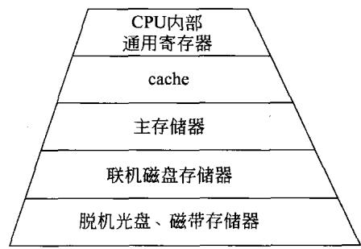  
图7-1存储系统的层次结构

在图7-1所示的计算机层次结构中，越是靠近上层，其速度越快、容量越小而单位存储容量的价格也越高。通过这种层次结构可使计算机的存取速度接近CPU的速度，使程序员所使用的主存容量接近联机外存的容量，使整个存储系统的单位存储器价格接近联机外存的价格。

## 7.1.2存储器分类

由于构成存储器的材料、性能及使用方法不同，从不同的角度考虑，就有不同的分类方法。

## 1.按照存储信息介质分类

目前，在计算机中用于存储信息的介质有半导体器件、磁性器件或光学器件及材料。因

此，就有半导体存储器，磁盘(磁带)存储器，光盘存储器等。

## 2．按在计算机中的用途分类

在计算机中用于存放当前正要执行或刚执行的程序和数据的存储器是主存储器，也称为内部存储器，简称内存。

用于存放正在执行程序或正在使用数据，用以克服主存储器速度太慢的存储器是高速缓冲存储器cache。

在CPU内部，用于存放微程序的存储器是控制存储器。

用来存放当前暂不使用的大量信息的存储器是外部存储器，又称外存。如磁盘存储器、光盘存储器、U盘、MMC(SD)存储卡、磁带存储器等。

## 3．按存放信息的易失(挥发)性分类

当存储器断电后，有的存储器所存信息也随之丢失。这类存储器所存信息是易失的、是可挥发的。例如，半导体随机读写存储器RAM就是易于挥发的易失存储器。

还有一些存储器在断电后所存信息不会丢失，当再次加电后它所存储的信息依然存在。例如，后面将要讲述的磁盘存储器、各种类型的半导体ROM等都是非易失存储器。

## 4．按存取方式分类

当存储器的存取时间与存储单元的物理地址无关，随机读写其任一单元所用的时间都一样，这就是随机读写存储器RAM。

有的存储器的存取只能按顺序进行，这就称为顺序存储器，如磁带存储器。

## 5.按存储器的读写功能分类

有的存储器既能读出又能写人，称为读写存储器。而有的存储器的内容已固定，工作时只能读出，称为只读存储器ROM。

## 7.1.3存储器的性能指标

前面已经提到，存储器和存储系统是不同的两种概念，这里说明存储器的主要性能指标。

存储器的性能指标是用来描述存储器性能的，主要包括如下几个方面。

## 1.存储容量

这里指的是存储器所能存储的二进制信息的总位数，其表示方式一般为：存储器总存储单元数×每个存储单元的位数。例如，某计算机内存容量为1024K×8b或1024KB、1GB（通常用b表示位；B表示字节），某磁盘存储器的容量为160GB。

同样，也用上述方式来描述一块存储器芯片的容量。例如，6264静态RAM的容量为8K×8b；动态RAM芯片NMC41257的容量为256KB。

## 2.存储器的速度

## （1）存取时间

存取时间又称访问时间，就是对存储器中某一个单元的数据进行一次存(取)所需要的时间。

对于主存而言，目前都是由半导体存储器构成。人们可以从厂家的技术手册上得到它的存取时间。值得注意的是CUP在读写存储器时，它所提供给存储器的读写时间必须比存储器所要求的存取时间长。如果不能满足这一点，计算机将无法正常工作。

厂家已生产出各种速度的存储器芯片，从1000ns到0.5ns，各种存取速度的芯片可任意选择。

## （2）存取周期

存取周期是指连续对存储器进行存(取)时，完成一次存(取)所需要的时间。

存取周期与存取时间很可能不一样。经常是存取周期要大于存取时间。因为在连续存取时，每读出(或写入)一个存储单元，在对下一个存储单元操作前,需要一定的稳定时间。

## （3）存储器带宽

单位时间里存储器可以读出(或写人)的字节数。若存储器的存取周期为tm，且每次可 $\mathbf { t _ { m } }$ 读出(或写人)n个字节，则存储器的带宽 $\mathrm { B } _ { \mathrm { m } } = \mathrm { n } / \mathrm { t } _ { \mathrm { m } }$

例如,某计算机主存的存取周期为tm为10ns,每次可读写8个字节。则该计算机主存 $\mathbf { t } _ { \mathbf { m } }$ 带宽为800MBps。

## 3.可靠性

计算机要正确地运行，必然要求存储器系统具有很高的可靠性。内存的任何错误就足以使计算机无法正常工作。

对计算机的存储器来说，有的是不可维修的，如构成存储器的超大规模集成电路芯片。一旦出现故障就丢弃换新的，它们是不可维修的。而有的存储器是可维修的，如磁盘存储器、磁带存储器等。可维修部件的可靠性可用平均故障间隔时间(MTBF)来描述，而不可维修部件的可靠性常用平均无故障时间或平均故障前时间(MTTF)来描述。

有时就用MTBF来说明存储器的可靠性，例如某80GB的硬磁盘存储器的MTBF为30000小时。某SRAM芯片的MTBF为 $5 \times 1 0 ^ { 6 }$ 小时。

除了用MTBF(或MTTF)来描述存储器的可靠性外，还有许多其他指标可以说明存储器的可靠性，这里不再介绍。

## 4.功耗

使用功耗低的存储器构成存储系统，不仅可以减少对电源容量的要求，而且还可以提高存储系统的可靠性。

## 5.价格

构成存储系统时，在满足上述要求的情况下，应尽量降低存储器的价格。通常是以每KB或每MB的价格来衡量存储器的成本。随着技术的发展，存储器的价格已大大降低。

例如,20世纪80 年代初每 MB需几千元而今天不值一毛钱。除上述指标外，其他如体积、重量、封装方式、工作电压、环境条件等不再说明。

总之，大容量、高速度、高可靠性、低功耗、低成本是存储器的主要要求。

## 7.2内部存储器(主存储器）

在本节中将描述与计算机内存有关的问题，包括主存的构成、高速缓存及虚拟存储器等。

## 7.2.1随机读写存储器RAM

现在构成计算机主存的毫无例外的都是半导体存储器，下面将逐一加以介绍。

## 1.静态随机读写存储器SRAM

在计算机中，常用的随机读写存储器RAM分为两大类：一类是静态随机读写存储器SRAM；另一类是动态随机读写存储器DRAM。下面将分别加以说明。

## （1）内部译码结构

RAM的生产厂家已为使用者开发研制出各种容量、速度、材料工艺、封装形式的IC存储器芯片，其型号品种有数十万种之多，为选用提供了很大的方便。

一种RAM芯片，其外部有地址引线、数据引线和控制信号引线。地址引线在芯片内部译码，选中芯片内部的相应存储单元。例如，某静态RAM芯片上有n条地址线时，这些地址线上所能表示的地址编码就有2"种。这就意味着该芯片内部有2"个存储单元。

为了能对芯片内部的存储单元进行读写，就需要在芯片内部对地址信号进行译码，以便选中地址所对应的存储单元。芯片内部的地址译码有两种方式。

①一维译码。对于容量很小的芯片，如容量在几百个存储单元以内的芯片，多用一维译码。芯片内部只用一个地址译码器，其译码输出可选中相对应的存储单元。其示意图如图7-2(a）所示。

②二维译码。当芯片容量在几百个存储单元以上时，再用一维译码将会使译码器过于复杂。因此，多用二维译码。此时，芯片内部用行译码器和列译码器两个地址译码器分别对地址译码，行译码输出可选中相对应的一行存储单元；而列译码输出可选中相对应的一列存储单元，而行列交叉点上的存储单元就是最终所选中的存储单元。其示意图如图7-2（b)所示。

由图7-2(a)可以看到，当芯片容量很大时，地址线会很多，译码器会很复杂。例如，某芯片容量为64KB,芯片上的地址线就有16条——A0～A15。利用一维译码，则译码器必须有65536条译码输出，分别选择64KB个存储单元。若采用图7-2(b)所示的二维译码方式，可将16位地址分成8条行地址和8条列地址，即图中n和m分别为8。则行、列地址译码器均为8位译码器。行、列地址译码器分别译出256行和256列。当行、列译码分别有效便可选中一个存储单元。显然，制作两个8到256译码器比制作一个16到65536 的译码器要容易得多。

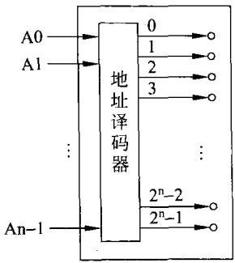  
(a)

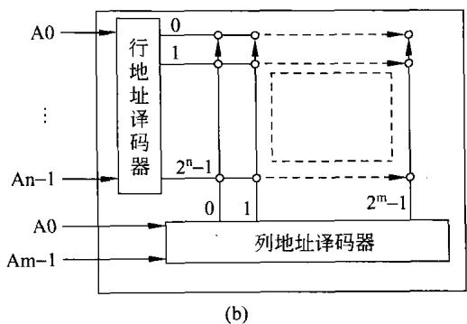  
图7-2RAM芯片内部的两种译码方式

## （2）单元电路

在这里将要说明RAM中1b信息是如何存储的，从而加深对存储器工作原理的理解。

①静态读写存储器 SRAM

首先,描述1b静态RAM的构成及工作原理。静态RAM可有多种结构，图7-3是一种典型的1位SRAM的构造形式。

图7-3中,T3、T4为T1、T2 的负载,分别相当于一个电阻。由它们构成了一种双稳态

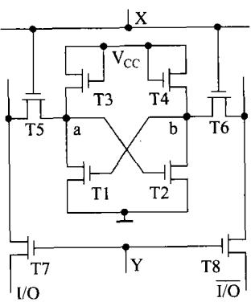

电路,即其a点或b点均有两种稳定状态,0或1。并且a和b的状态刚好相反，故可以存放0或1。

T5、T6、T7、T8是4个用于控制的晶体管，它们的栅极上分加上行译码信号X和列译码信号Y。当行、列译码信号X和Y同时有效时，便选中了该单元。

图7-3静态RAM单元电路

写数据时，X、Y有效，T5、T6、T7、T8这4个晶体管导通。写1时，I/O端上加高电平而I/O端上加低电平，双稳电路使a点为高电平，b点为低电平。而且，这种状态在写完之后会一直保持下去;写0也是一样，只是使a点为低电平，b点为高电平。同样，这种状态在写完之后会一直保留下去。

在读出数据时，经行列地址译码使X、Y有效，T5、T6、

T7、T8使4个晶体管导通。此时,本单元电路存储的信息——a点或a、b的状态便可以从I/O或I/O上读出。

从上面1位SRAM单元电路中可以看出以下几点。

a）图7-3只画出1b的存储电路,若n个这样的电路可构成n位存储单元。

b）数据一旦写人，其信息就稳定的保存在电路中，静静地等待读出。无论读出多少次，只要不断电，此信息会一直保持下去。这也许就是静态的由来。

c）SRAM初始加电时，其状态是随机的。写人新的状态，原来的旧状态就消失了。新状态一直维持到写入更新的状态为止。

d）在电路工作时，即使不进行读写操作，只要保持在加电状态下，电路中就一定有晶体管导通，就一定有电流流过，也就一定会有功率消耗。因此，与后面的DRAM比较,SRAM的功耗大，集成度不能做得很高。

## ②动态读写存储器DRAM

动态存储器DRAM也有多种结构形式，其中一种如图7-4所示。利用所给出的这种结构可阐明 DRAM的工作原理。 .F-

写入数据时，要写人的状态加到I/O端上（反相信号加到I/O端上)。同时，经行列地址译码使X、Y有效,T5、T6、T7、T8使4个晶体管导通。写1时,对C2充电,C1不充电；写0时，对C1充电，C2 不充电。写后，状态就保持在电容上。但是，由于C1、C2的电容量很小，信息仅能在电容上保持不长(几 ms)的时间。

读出数据时，先产生预充电信号使T9、T10导通，由 $\mathbf { E } _ { \mathrm { D } }$ 对电容 $\mathrm { C _ { D } }$ 和 $\overline { { \mathrm { C } _ { \mathrm { D } } } }$ 充电。而后，经行列地址译码使X、Y有效，T5、T6、T7、T8使4个晶体

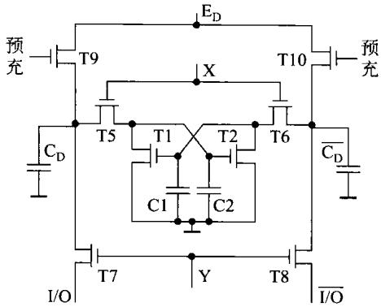  
图7-4动态RAM单元电路

管导通。此时，若原状态为1，则C2有电荷T2导通，预充电的 $\overline { { \mathrm { C } _ { \mathrm { D } } } }$ 经T6、T2放电,I/O输出为0;同时，由于C1未充电,T1截止，则 $\mathrm { C _ { D } }$ 上的预充电作为高电平由I/O输出。同时还通过 T5给C2补充电荷。

刷新，这是DRAM所特有的问题。由上述可见，DRAM的信息是存放在电容上的，且电容量很小(容量越小速度越快)。尽管不工作时T1、T2均不导通，但电容总有很微小的漏电，时间长了，存放的信息就会丢失。因此，必须在电荷漏掉前不断地补充电荷保证信息不会丢失，这就是刷新。刷新一般每2～4ms进行一次。

刷新过程就是每次刷新一行，行地址译码输出使X有效。由图7-4可以看到，X有效，使 T5、T6导通。同时，加上预充电信号使T9、T10导通。这时电源 $\mathrm { E } _ { \mathrm { D } }$ 就会对原先充有电荷的C1或C2充电，补充电荷，而原先未充电的电容不会被充电。从而实现刷新。

根据上述描述，对DRAM应注意的是以下几点。

a）图7-4只画出1b的存储电路，若n个这样的电路可构成n位存储单元。

b)DRAM必须定时不断地刷新，以保证所存储的信息不会丢失。这大概就是将这种类型的RAM叫做动态存储器的原因。

c）DRAM初始加电时，其状态是随机的。写人新的状态，原来的旧状态就消失了。新状态一直维持到写人更新的状态为止。

d）在电路加上电源不进行读写及刷新操作时，只是保持在加电状态下，电路中没有晶体管导通，也就没有电流流过(会有极微小的漏电流存在)，也就没有功率消耗（或功耗很小)。因此,DRAM的功耗非常小,其集成度可做得很高，当前的一块DRAM芯片的集成度达4GB。而厂家将它们堆叠在一块封装中可达72GB。

利用上述单元电路，采用微细加工技术，可以生 $\vec { \cal J } ^ { \pm }$ 出各种容量的集成电路芯片，用以构成存储器系统。

## 2.主存储器的组成及接口

## （1）存储器与CPU速度上的协调

对于简单的计算机，只要将半导体集成电路芯片接在计算机的系统总线上便可以构成内部存储器。在构成内存时必须注意存储器与CPU在速度上的协调。只有当CPU读写内存的时间大于内存所要求的读写时间时，才能保证可靠的读写。

在前面的章节中已经看到，CPU读(或写)内存时，由CPU内部的时序电路和控制器产生的控制信号，形成CPU读(或写)内存CPU(或总线或机器)周期，其写内存时序如图7-5(a)所示。

在CPU写内存的周期里，由CPU送出内存地址、送出要写入内存地址的数据、还送出写控制信号WR。这些信号加到系统总线上，传送到要写的内存芯片上。用CPU提供的这些信号去实现对存储器的写。不同的CPU，写内存的CPU周期不一样；同样的CPU如果时钟频率不一样，CPU周期也不一样。例如，5MHz时钟下的8086CPU的写内存CPU周期为4个时钟周期，即800ns。

另一方面，厂家研制了数以十万计的各种存储器芯片，前面已经说明了存储器的技术指标。图7-5(b)画出了存储器的写时序。请读者注意，这是存储器所要求的。不同类型的存储器芯片，写周期的长度是很不一样的，这是存储器芯片所固有的。笔者曾经用过450ns、180ns、120ns、75ns和25ns的SRAM芯片。

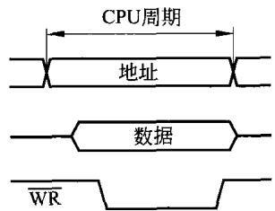  
(a) CPU写内存时序

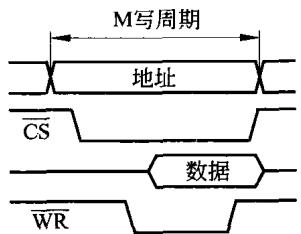  
(b)存储器的写时序  
图7-5CPU写内存及内存写的时序

这里要强调的是，在利用存储器芯片构成内存时，必须保证CPU的写(或读)内存的周期应大于等于存储器芯片所要求的写(或读)时间。也就是说CPU提供的信号持续时间必须大于等于存储器芯片所要求的信号时间。

在实际工程上构成内存时，要考虑到CPU发出的信号要经过总线传到存储器芯片上，信号在总线上传送总需要时间（比光速慢得多)。而且信号有可能经过驱动门或缓冲门，而任何门总对信号有延时。考虑上述因素，在选芯片时应留有30%的容量。例如，若CPU对内存的读写周期为100ns，则所选内存芯片的存取周期不要大于70ns。

如果工程上不能满足上述要求，也就是快速的CPU使用了慢速的存储器时，就需要采取措施：降低CPU时钟频率，即延长CPU所提供的读写时间；或选用读写速度更快的存储器芯片;或在CPU读写该慢速存储器时，适当延长CPU的读写时间，常用READY信号使CPU插入若干个时钟周期。

## （2）内存构成

将存储器芯片连接在系统总线上，便可构成所需内存。不同CPU构成的系统总线信号会有所不同。为更方便于系统设计，前人已制定上百种系统总线标准。为了叙述方便，在下面的描述中多使用PC/XT或ISA总线信号（详细情况见第8章）。

## ①单块存储器芯片的连接

现以一块典型的8K×8b的CMOSSRAM6264(或6164)芯片为例说明其外部特性及

工作过程。该芯片的引脚图如图7-6所示。

## a）引线功能

6264(6164)有28条引出线，它们包括如下几种。

$\mathbf { A } _ { 0 } \sim \mathbf { A } _ { 1 2 }$ 为13条地址信号线。芯片上的这13条地址线决定了该芯片有多少个存储单

元。因为13条地址线上的地址信号编码最大可以到8192（8K）个。也就是说，芯片上的13条地址线上的信号经过芯片的内部译码，可以决定8K个单元。这13条地址线在使用时通常接总线的低位地址，以便CPU来寻址该芯片拥有的8K个单元。

$\mathrm { D } _ { 0 } { \sim } \mathrm { D } _ { 7 }$ 为8条双向数据线。正如上面所说，静态RAM芯片上的地址线的数目决定该芯片有多少个存储单元；而芯片上的数据线的数目决定了芯片中每个存储单元存储了多少个二进制位。6264有8条数据线，说明该芯片的每个单元存放一个字节。在使用中，芯片的数据线与总线的数据线相连接。当CPU写芯片的某个单元时，将数据传送到该芯片内部这个指定的单元。当CPU读某一单元时，又能将被选中芯片该单元中的数据传送到总线上。

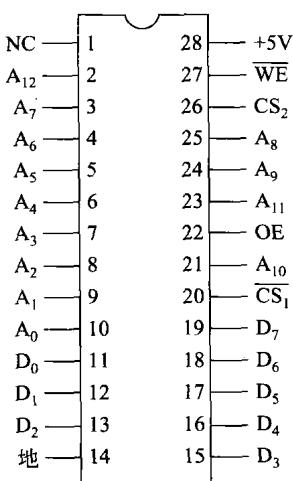  
图7-66264引脚图

$\overline { { \mathrm { C S } _ { 1 } } } , \mathrm { C S } _ { 2 }$ 为两条片选信号的引线，当两个片选信号同时有

效时，即 $\begin{array} { r } { \overline { { \mathbf { C } } } \overline { { \mathbf { S } } } _ { 1 } = 0 , \mathbf { C } \dot { \mathbf { S } } _ { 2 } = 1 } \end{array}$ 时，才能选中该芯片。不同类型的芯片，其片选信号多少不一，但要选中芯片，只有使芯片上所有片选信号同时有效才行。在使用中，通过对高位地址信号和控制信号的译码产生(或形成)片选信号，把芯片的存储容量放在设计者所希望的内存空间上。简言之，就是利用片选信号将芯片放在所需要的地址范围上。

OE为输出允许信号。只有当 $\overline { { \mathrm { O E } } } = 0$ ，即其有效时，才允许该芯片将某单元的数据送到芯片外部的 $\mathrm { D } _ { 0 } \sim \mathrm { D } _ { 7 }$ 上。

WE是写允许信号。当 $\overline { { \mathbf { W } } } \overline { { \mathbf { E } } } = 0$ 时，允许将数据写入芯片；当 $\overrightarrow { \bf W } _ { \mathrm { } } \mathrm { = } 1$ 时，允许芯片的数据读出。以上4个信号的功能如表7-1所示。NC为没有使用的空脚。芯片上还有十5V电压和接地线。

表7-16264真值表
<table><tr><td>WE</td><td> $\overline { { \mathbf { C } \mathbf { S } _ { 1 } } }$ </td><td> $\mathbf { C } \mathbf { S } _ { 2 }$ </td><td>OE</td><td> $\mathbf { D _ { 0 } } \sim \mathbf { D _ { 7 } }$ </td></tr><tr><td>0</td><td>0 0</td><td rowspan="4">1 1 0</td><td rowspan="4">× 0</td><td rowspan="4">写人 读出</td></tr><tr><td>1</td></tr><tr><td>×</td></tr><tr><td>×</td></tr><tr><td>1 × 1</td><td>0 1</td><td>× ×</td><td>三态(高阻)</td></tr></table>

注：×表示不考虑。

## b）6264(6164)的工作过程

从表7-1可以看到，写入数据的过程是：在芯片的 $\mathbf { A } _ { 0 } \sim \mathbf { A } _ { 1 2 }$ 上加上要写入单元的地址；在 $\mathrm { D } _ { 0 } \sim \mathrm { D } _ { 7 }$ 上加上要写入的数据；使CS，和CSz同时有效；在WE上加上有效的低电平，此时 $\overline { { \mathrm { C S } } } _ { \mathrm { l } }$ $\mathbf { C } \mathbf { S } _ { 2 }$ $\overline { { \mathbb { W } \mathbb { E } } } .$ OE可为高也可为低。这样就将数据写到了地址所选中的单元中。

从芯片中某单元读出数据的过程就是： $\mathbf { A } _ { 0 } \sim \mathbf { A } _ { 1 2 }$ 加上要读出单元的地址；使 $\mathrm { \overline { { C S } } } _ { 1 }$ 和 $\mathrm { C S } _ { 2 }$ 同时有效;使OE有效(为低电平);使 $\scriptstyle { \overline { { \mathbf { W E } } } }$ 为高电平，这样即可读出数据。

以上读出或写人过程，实际上是CPU发出信号加到存储器芯片上的一个过程。其时间应满足芯片的要求。

## c）连接

对于使用人员来说，在了解存储器芯片的外部特性之后，重要的是必须掌握存储器芯片与总线的连接，即按照用户的要求，主要是按规定的内存地址范围，将存储器芯片正确地接到总线上，构成所要求的内存。

图7-7就是利用6264构成地址从F0000H到F1FFFH这8KB的内存空间。图7-7连接的是8088最大模式下的8位系统总线PC/XT。

## ②内存的字扩展

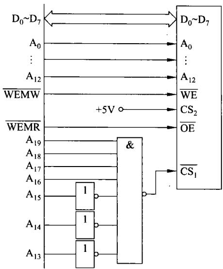

当用一片存储器芯片构成内存的字容量不够时，可采用字扩展的方法达到目的。

图7-76264全地址译码器

如图7-8所示是利用6264芯片，通过字扩展的方法，构成32KB的连接图。

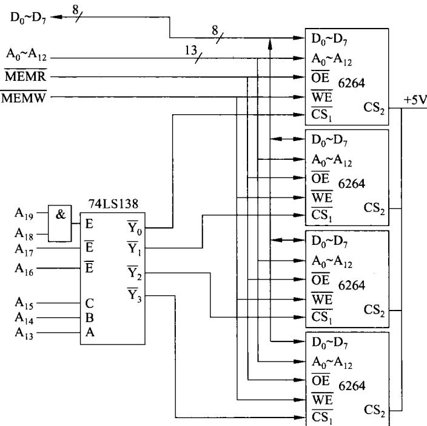  
图7-8内存字扩展的连接电路图

由于6264芯片的容量只有8K×8b，而要构成的内存为 $3 2 \mathrm { K } \times 8 \mathrm { b }$ ，这就需要将8KB扩展为32KB。因此，需要4片6264芯片。构成的内存地址为C0000H到C7FFFH。

## ③内存的位扩展

当存储器芯片的数据位数较少，而构成的内存每一存储地址单元要求的存储数据位较多时，可采用位扩展，即用多片存储器芯片来达到位扩展的目的。图7-9就是一种内存位扩展连接的形式。

在图7-9中，存储器芯片的容量是2K×4b的芯片，而要构成的内存是2KB。因此，需要将芯片的4位扩展为内存所需要的8位。

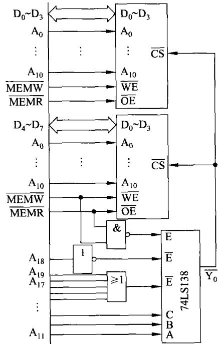  
图7-9内存位扩展连接

利用二片存储器芯片，其中一片的数据线 $\mathrm { D } _ { 0 } \sim \mathrm { D } _ { 3 }$ 接系统总线的数据总线 $\mathrm { D } _ { 0 } \sim \mathrm { D } _ { 3 }$ ；而另一片的数据线 $\mathrm { D } _ { 0 } \sim \mathrm { D } _ { 3 }$ 接系统总线的数据总线 $\mathrm { D } _ { 4 } \sim \mathrm { D } _ { 7 }$ 。在图7-9中，利用3-8译码器74LS138的译码输出端Y。作为两块芯片的片选信号。译码器Y。有效时，可同时选中这两块 $\overline { { \mathrm { Y } _ { \mathfrak { o } } } }$ $\overrightarrow { \mathrm { Y } _ { \mathfrak { o } } }$ 芯片，实现对一个字节8位数据的读写。

根据图7-9 的译码器连接，图中两块芯片所构成的内存地址为40000H～407FFH,即两片 $2 \mathtt { K } \times 4 \mathtt { b }$ 的芯片构成了2KB的内存空间。

## ④80x86内存的连接

以上在内存连接中都是认为内存一个地址单元存放一个字节，也就是说内存是按字节编址，每一个内存地址就存放8位二进制数。

从16位的8086CPU开始，80x86由16位到32位一直发展到64位。在这样的CPU构成的系统中，由于CPU的特性决定存储器的结构比较复杂。在存储器的连接上也有许多不同，下面将一一予以说明。

## a）8086的内存接口

8086 CPU是真正的16位处理器，它既能按字节访问内存又能按字(16位)访问内存。

8086的系统总线的数据线是16位的，即 $\mathrm { D } _ { 0 } { \sim } \mathrm { D } _ { 1 5 }$

## （a）8086系统中内存奇偶分体

在8086 系统中，为了能够实现一次访问一个字(16位)，又能一次访问一个字节(8位），故将其内存地址空间分成偶存储体和奇存储体。前者对应地址为偶数而后者对应的地址为奇数。整个1MB的内存空间就分为偶存储体512KB和奇存储体512KB。在8086系统中，无论实际构成的内存有多大，为了保证CPU能一次读写数据的高字节、一次读写数据的低字节或一次读写数据的高低两个字节(即一个16位的字),内存必须分成奇、偶两个体。例如，若构成的内存为64KB，则必须分成偶地址体32KB和奇地址体32KB。

同时，为做到上面所描述的奇偶分体，在8086的引线上，增加了一个BHE信号。当8086读写偶地址字节时， $\mathbf { A } _ { 0 } = 0 , \overline { { \mathrm { B H E } } } = 1$ ；当读写奇数地址字节时， $\mathbf { A } _ { 0 } = 1 , \overline { { \mathbf { B H E } } } = 0$ ，当读写一个16位字时， $\mathbf { A } _ { 0 } = 0 , \mathbf { \overline { { B H E } } = 0 }$

## （b）连接

在 8086内存的具体连接上就体现出上述的特点。作为例子，将两片6264接到8086的系统总线上，构成16KB的内存，其连接如图7-10所示。

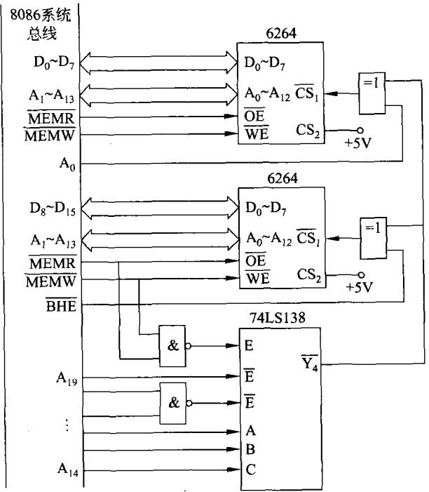  
图7-106264与8086系统总线的连接

图7-10中，将16KB的内存分为两个体，偶地址8KB，利用高位地址 $\mathbf { A } _ { 1 9 } \sim \mathbf { A } _ { 1 4 }$ 和 $\mathbf { A } _ { 0 }$ 译码构成片选信号；而奇地址8KB利用 $\mathrm { A } _ { 1 9 } \sim \mathrm { A } _ { 1 4 }$ 和BHE译码构成片选信号。形成的内存地址范围为70000H～73FFFH。

## b）80386、80486的内存接口

80386和80486都是典型的32位处理器。在这里不准备仔细介绍这些处理器，只说明在这样的处理器构成的系统中，内存接口的特点及其实现。

## （a）与内存接口相关的信号

在80386、80486构成的系统中，与内存有关的信号主要有如下几种。

·地址信号 $\mathbf { A } _ { 2 }$ 到 $\mathbf { A } _ { 3 1 }$ 共30个地址信号，其编码可寻址1G个32位的存储单元。这里没有 $\mathbf { A } _ { 0 }$ 和 $\mathbf { A } _ { 1 }$ ，这两个信号已在80386、80486内部译码产生4个体选择信号。

·体选择信号BE0到BE3。与前面提到的8086相类似，在32位的80386、80486系统中，为了灵活地寻址一个字节、一个16位的字或一个32位的字，内存必须分成4个体。而4个体选择信号BE0到BE3分别用于选择一个体。很显然，每个体选择信号对应一个字节。当读写一个8位的字节时，4个体选择信号只有一个有效，选中1个体的8位数据。当读写一个16位的字时，4个体选择信号中有两个有效，同时选中2个体的16位数据。当读写一个32位的字时，4个体选择信号均有效，同时选中 4个体共32位数据。

·32位的数据信号 $\mathrm { D } _ { 0 } \sim \mathrm { D } _ { 3 1 }$ ，这32位数据分为4个字节，分别是 $\mathrm { D } _ { 0 } \sim \mathrm { D } _ { 7 } \ 、 \mathrm { D } _ { 8 } \sim \mathrm { D } _ { 1 5 }$ $\mathrm { D } _ { 1 6 } \sim \mathrm { D } _ { 2 3 }$ 和 $\mathrm { D } _ { 2 4 } \sim \mathrm { D } _ { 3 1 }$

·控制信号M/IO(内存/接口选择信号，与8086一样) $\mathrm { { } } _ { \mathrm { { ; D / \bar { C } } } }$ (数据/控制)信号，低电平为处理器中止或正在响应中断，高电平表示正在传送数据；W/R(读/写)信号，低电平表示读内存或接口，高电平表示写内存或接口。在486中，它们的功能如表7-2所示。

表7-2控制信号编码表示的总线周期
<table><tr><td>M/I0</td><td> $\mathbf { D } / \mathbf { \overline { { C } } }$ </td><td>W/R</td><td>总线周期</td></tr><tr><td>0</td><td>0</td><td>0</td><td>中断响应</td></tr><tr><td>0</td><td>0</td><td>1</td><td>停机</td></tr><tr><td>0</td><td>1</td><td>0</td><td>1/0读</td></tr><tr><td>0</td><td>1</td><td>1</td><td>I/0写</td></tr><tr><td>1</td><td>0</td><td>0</td><td>取指令操作码</td></tr><tr><td>1</td><td>0</td><td>1</td><td>保留</td></tr><tr><td>1</td><td>1</td><td>0</td><td>存储器读</td></tr><tr><td>1</td><td>1</td><td>1</td><td>存储器写</td></tr></table>

## （b）内存的连接

前面已经说明，在这里还需要再次强调，在32位的80386、80486系统中，内存必须分成为4个体。这与前面所描述的8位处理器 8088不一样，在8位机中内存是不分体的或者说就是一个体。16位机分为两个体。32位机分成4个体。后面的Pentium机内存将分为8个体。

80386、80486系统中内存分体组织如图7-11所示。

在80x86中，内存都是按字节编址。因此,32位的数据要占4个内存地址。由图7-11可以看到，一个32位的数据分别放在4个不同的体中。

在80486系统中，利用4片容量为 $1 2 8 \mathrm { K } \times 8 \mathrm { b }$ 的SRAM芯片构成512KB的内存，画出连接图如图7-12所示。

在图7-12中,4片SRAM构成4个存储体,分别利用BE0～BE3参加译码选中一个体。显然，在图7-12中，还可以有其他的译码形式，只要逻辑上是正确的，采用什么形式的译码电路并不很重要。

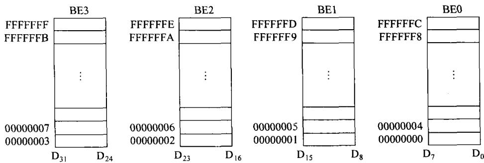  
图7-1132位机的内存组织

c）Pentium处理器的内存组织

Pentium处理器有几百条引线，其中与访问内存有关的是地址信号 $\mathbf { A } _ { 3 } \sim \mathbf { A } _ { 3 1 }$ 、体选择信号BE0～BE7、64位数据信号 $\mathrm { D } _ { \mathfrak { o } } \sim \mathrm { D } _ { \mathfrak { s } 3 }$ 、及控制信号 $\mathrm { M } / \overline { { \mathrm { I O } } } , \mathrm { D } / \overline { { \mathrm { C } } }$ 和 $\boldsymbol { \mathrm { W } } / \boldsymbol { \tilde { \mathrm { R } } }$

从上面的信号可以注意到，Pentium处理器对外部的数据线是64位的，可用8个字节来表示。同样，为了增加访问内存(或接口)的灵活性，须将内存分成8个体。为了方便对8个存储体的寻址，在处理器内部已将地址信号 $\mathbf { A } _ { 0 } \sim \mathbf { A } _ { 2 }$ 进行译码，形成了8个存储体的选择信号BE0～BE7。这与上面所说明的80386、80486的情况非常类似，所不同的是在Pentium处理器系统中内存要由8个体来构成，每个体对应一个体选择信号。具体内存芯片的连接这里不再说明。

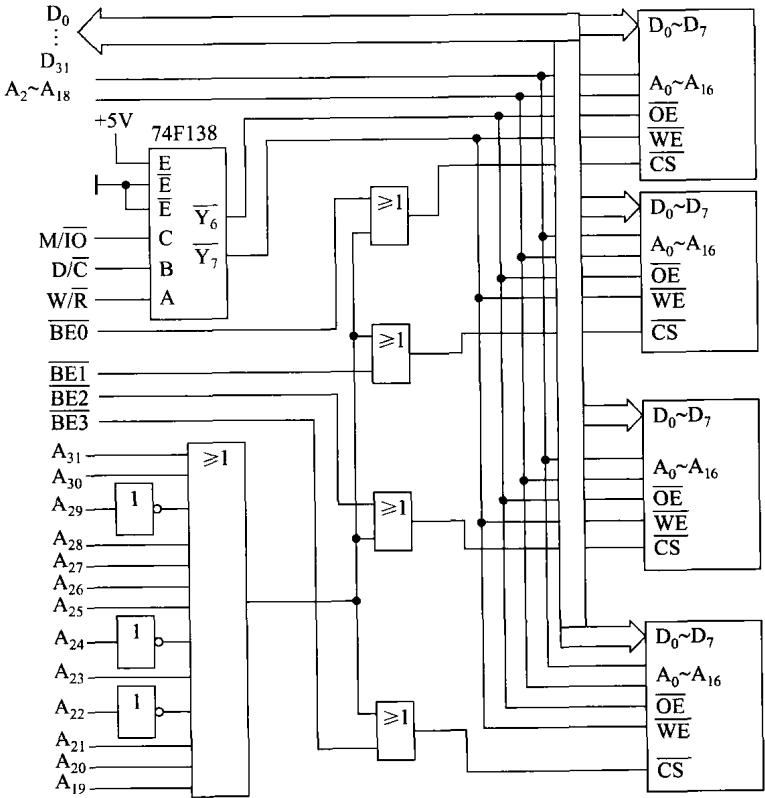  
图7-1280486内存芯片连接图

再次说明的是，上面构成内存的连接均是以80x86处理器的总线信号为例，存储器芯片也是特定的芯片。在实际的应用中，不同的处理器，不同的存储器芯片，它们的信号会略有不同。例如，在内存与接口统一编址(见后面章节说明)的处理器中，内存与接口的读写信号可以是RD和WR(或R/W)；在内存与接口独立编址的处理器中，内存与接口的读写信号可以是RD和WR再加上M/IO(或R/W再加上M/IO)；而存储器芯片上的WE、OE有可能只用R/W来代替。

尽管有这些不同，但在构成内存的连接中，只要利用门电路就很容易实现信号间的匹配，详细情况不再说明。

## 7.2.2只读存储器ROM

## 1．概述

只读存储器ROM的重要特性是其存储信息的非易失性，存放在ROM中的信息不会因去掉供电电源而丢失，当再次加电时，其存储的信息依然存在。

## （1）掩膜工艺ROM

这种ROM是芯片制造厂根据ROM要存储的信息，设计固定的半导体掩膜版进行生产的。一旦制出成品之后，其存储的信息即可读出使用，但不能改变。这种ROM常用于批量生产，生产成本比较低。计算机中一些固定不变的程序或数据常采用这种ROM存储。

## （2）可一次编程ROM(PROM或OTP)

为了使用户能够根据自己的需要来写ROM,厂家生产了一种PROM（或一次可编程OTP)。允许用户对其进行一次编程—写入数据或程序。一旦编程之后，信息就永久性地固定下来。用户只可以读出和使用，但再也无法改变其内容。

## （3）可擦去重写的PROM

这种可擦去重写的PROM是目前使用最广泛的ROM。这种芯片允许将其存储的内容利用物理的方法(通常是紫外线)或电的方法(通常是加上一定的电压)擦去。擦去后可以重新对其进行编程，写人新的内容。擦去和重新编程可以多次进行。一旦写入新的内容，就又可以长期保存下来（一般均在10年以上)，不会因断电而消失。

利用物理方法（紫外线)可擦去的PROM通常用称为EPROM；用电的方法可擦除的PROM称为EEPROM(EPROM或EAROM)。这些芯片集成度高、价格低、使用方便，尤其适合科研工作的需要。

## 2.EPROM

EPROM是一种可以擦去重写的只读存储器。通常用紫外线对其窗口进行照射，即可把它所存储的内容擦去。之后，又可以用电的方法对其重新编程,写入新的内容。一旦写入，其存储的内容可以长期(几十年)保存，即使去掉电源电压，也不会影响到它所存储的内容。下面以一种典型的EPROM芯片为例来做介绍。

## （1）EPROM2764的引线

2764是一块 $8 \mathbf { K } \times 8 \mathbf { b }$ 的EPROM芯片，其引线图如图7-13所示。

$\mathbf { A } _ { 0 } \sim \mathbf { A } _ { 1 2 }$ 为13条地址信号输入线，说明芯片的容量为8K个单元。

$\mathrm { D } _ { 0 } \sim \mathrm { D } _ { 7 }$ 为8条数据线,表明芯片的每个存储单元存放一个字节(8位二进制数)。在其

工作过程中， $\mathrm { D } _ { 0 } \sim \mathrm { D } _ { 7 }$ 为数据输出线；当对芯片编程时，由此8条线输人要编程的数据。

CE为输入信号。当它有效(低电平)时，能选中该芯片，故 $\overline { { \mathrm { C E } } }$ 又称为片选信号(或允许芯片工作信号)。

OE是输出允许信号，当 $\dot { \overline { { \mathrm { O E } } } }$ 为低时，芯片中的数据可由 $\mathrm { D } _ { 0 } \sim \mathrm { D } _ { 7 }$ 输出。

PGM为编程脉冲输人端。当对EPROM编程时，由此加入编程脉冲；读数据时PGM为1。

## （2）EPROM2764的连接

2764在使用时，仅用于将其存储的内容读出。其过程与RAM的读出十分类似，即送出要读出的地址，然后使CE和OE均有效（低电平)，则在芯片的 $\mathrm { D } _ { 0 } \sim \mathrm { D } _ { 7 }$ 上就可以输出要读出的数据。

EPROM2764芯片与8088总线的连接图如图7-14所示。从图中可以看到，该芯片的地址范围在F0000H～F1FFFH之间。

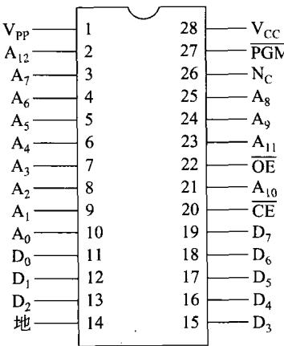  
图7-13EPROM2764引线图

## （3）EPROM的编程

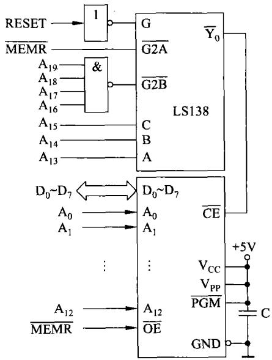  
图7-14EPROM2764的连接图

EPROM的一个重要优点就是可擦除重写，而且对其某一个存储单元来说，允许擦除重写的次数超过万次。

## ①擦除

那些刚出厂未使用过的EPROM芯片均是干净的，干净的标志就是芯片中所有单元的内容均为FFH。

若EPROM芯片已使用过，则在对其编程前必须将其从系统中取下来，放在专门的擦除器上进行擦除。擦除器利用紫外线照射EPROM的窗口，一般15～20min即可擦除干净。

## ②编程

对EPROM的编程通常有两种方式，即标准编程和快速编程。

## a）标准编程

标准编程过程为：将EPROM插到专门的编程器上，先使Vcc引脚加到十5V，然后Vpp加上EPROM芯片所要求的高电压(如+12.5V，+15V，十21V，十25V等),然后在地址线上加上要编程单元的地址，数据线上加上要写入的数据。CE使保持低电平，OE为高电平；上述信号全部达到稳定后，在PGM端加上 $( 5 0 \pm 5 ) \mathrm { m s }$ 的负脉冲，这样就将一个字节的数据写到了相应的地址单元中。重复上述过程，即可将要写人的数据逐一写入相应的存储单元中。

每写人一个地址单元，在其他信号不变的条件下，将OE变低，可以立即读出校验；也可在所有单元均写完后再进行最终校验;还可采用上述两种方法进行校验。若写人数据有错，则可从擦除开始，重复上述过程再进行一次写人编程过程。

标准编程用在早期的EPROM中。这种方式编程有两个主要的缺点：其一是编程时间太长。当EPROM容量很大时，每个单元50ms的编程时间，使写一块大容量芯片时间长得令人无法接受；其二是不够安全。编程脉冲太宽致使功耗过大而损坏EPROM。

## b）快速编程

随着技术的进步，EPROM芯片的容量越来越大。同时，也研制出相应的快速编程方法。编程时，其他步骤与标准编程都一样，不同的仅仅是使用编程脉冲已变窄，一般为0.1ms到2ms。例如，27C040所要求的编程脉冲的宽度仅为 $1 0 0 \mu \mathbf { s }$ 。因此，其编程时间会大大缩短。

## 3.EEPROM

EEPROM就是电擦除可编程只读存储器的英文缩写。EEPROM在擦除及编程上比EPROM更加方便。EEPROM的出现将使得EPROM逐渐地退出历史舞台。

## （1）典型EEPROM芯片介绍

EEPROM以其制造工艺及芯片容量的不同而有多种型号。下面仅以8K×8b的EEPROMNMC98C64A为例来加以说明。其引线如图7-15所示。

$\mathbf { A } _ { 0 } \sim \mathbf { A } _ { 1 2 }$ 为地址线，用于选择片内的8K的存储单元。

$\mathrm { D } _ { 0 } \sim \mathrm { D } _ { 7 }$ 为8条数据线，表明每个存储单元存储的一个字节的信息。

CE为片选信号。当CE为低电平时，选中该芯片；当它为高电平时，该芯片不被选中。芯片未被选中时，芯片的功耗很小，仅为CE有效时的1/1000。

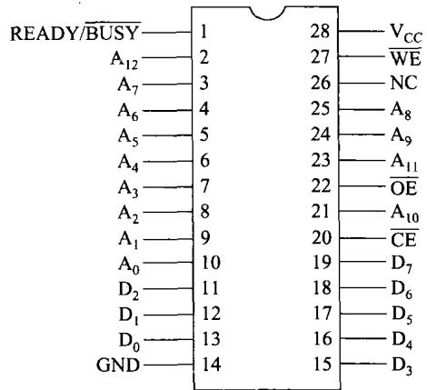  
图7-15EEPROMNMC98C64A引线图

OE为输出允许信号。当 $\overline { { \mathbf { C E } } } = 0 , \overline { { \mathbf { O E } } } = 0 , \overline { { \mathbf { W E } } } = 1$ 时，可将选中的地址单元的数据读出。

WE是写允许信号。当 $\overline { { \mathbf { C E } } } = 0 , \overline { { \mathbf { O E } } } = 1 , \overline { { \mathbf { W E } } } = 0$ 时，可以将数据写人指定的存储单元。

READY/BUSY是漏极开路输出端，当写人数据时该信号变低，数据写完后，该信号变高。

## （2）98C64A的工作过程

EEPROM98C64A工作过程如下所述。

①读出数据。由EEPROM读出数据的过程与从EPROM及RAM中读出数据的过程是一样的。 $\scriptstyle \pm \pmb { \mathbb { Y } } \overrightarrow { \mathrm { C E } } = 0 , \overrightarrow { \mathrm { O E } } = 0 , \overrightarrow { \mathbf { W E } } = 1$ 时，只要满足芯片所要求的读出时序关系，则可从选中的存储单元中将数据读出。

②写人数据。将数据写入EEPROM98C64A有两种方式。

第一种是按字节编程方式，即一次写入一个字节的数据，过程是：使 $\overline { { \mathrm { C E } } } = 0 , \overline { { \mathrm { O E } } } = 1$ ，地址线上加上要写的地址，数据线上加上要写人的数据。在WE端加上100ns的负脉冲，便可以启动数据的写人。这里要特别注意的是，WE脉冲过后READY/BUSY端为低电平，表示写人过程正在进行，直到READY/BUSY端的低电平变高，才完成一个字节的写人。这段时间里包括了对本单元数据擦除和新数据写人的时间。不同芯片所用时间略有不同，一般是几百微秒到几十毫秒,98C64A需要的Twr为5ms,最大为10ms。 $\mathrm { T } _ { \mathbf { W R } }$

在对EEPROM编程过程中,可以通过程序查询READY/BUSY信号或利用它产生中断来判断一个字节的写入是否已经完成。

可以看到，在对EEPROM编程时，可以在线操作，即可在计算机系统中直接进行，从而减少了不少麻烦。

第二种编程方法称为自动按页写人。在98C64A中一页数据最多可达32个字节，要求这 32个字节在内存中是顺序排列的。

页编程的过程是，连续写人一页，用查询或中断看READY/BUSY是否已变高，若变高，则写周期完成。接着可以写下一页，直到将数据全部写完。

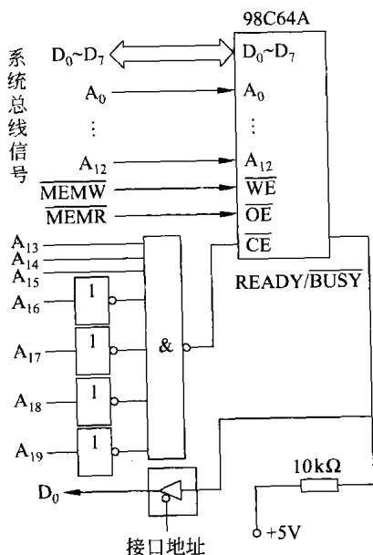  
图7-16 EEPROM98C64A的连接

新的EEPROM一页可达数KB,连续写满一页仅等待几ms，其编程速度很快。

## （3）连接使用

EEPROM可以很方便地接到计算机系统中。图7-16就是将98C64A连接到8088总线上的连接图。

除了上面提到的并行EEPROM之外，尚有多种型号的串行EEPROM。它们都是在外接时钟驱动下一位接一位的写入或读出。因此，它们的容量一般都比较小，几百b到几Kb，读写速度都很慢。多用于银行卡、各种预付费卡等。

## （4）闪速存储器

闪速(flash)存储器也是一种电可擦除可多次编程的存储器。与前面描述的 EEPROM不同之处在于其擦除写人的速度比较快，为强调其写人速度快才称为闪速存储器。闪速存储器在制造工艺主要有两类：或非(NOR)型阵列和与非型(NAND)阵列。

NOR的传输效率很高，在1～4MB的小容量时具有很高的成本效益。

NAND结构能提供极高的单元密度，可以达到高存储密度，并且写入和擦除的速度也

很快。当选择存储解决方案时，必须权衡以下的各项因素。

·NOR的读速度比NAND稍快一些。

·NAND的写人速度比NOR 快很多。

·NAND的4ms擦除速度远比NOR的5s快。

·大多数写入操作需要先进行擦除操作。

使用时应注意接口上的差别，NORflash带有SRAM接口，有足够的地址引脚来寻址，可以很容易地并行存取其内部的每一个字节。因此，它们可以直接接系统总线，构成内存储器。

NANDflash器件使用复杂的I/O口来串行地存取数据，采用串行接口，不能直接构成内存，只能用它们构成外存储器。很显然，基于NAND的存储器就可以取代硬盘或其他外存储设备。

## 7.2.3 动态读写存储器DRAM

在上一节中已介绍过动态存储器的单元电路，利用这样的单元电路构成的动态读写存储器速度快、集成度高、功耗小、价格低，在计算机中得到极其广泛的使用。PC中的内存条无一例外地采用动态存储器，现在的许多嵌入式计算机系统中也越来越多地使用这种存储器。

## 1.概述

目前，大容量的DRAM芯片已研制出来，为构成大容量的存储器系统提供了便利的条

件。下面以一种简单DRAM芯片来例说明DRAM的工作原理。

（1）动态存储器芯片2164的引线

2164是一块 $6 4 \mathsf { K } \times 1 \mathsf { b }$ 的DRAM芯片。这种存储器芯片引线与SRAM有所不同，请读者注意。2164的引线如图7-17所示。

$\mathbf { A } _ { 0 } \sim \mathbf { A } _ { 7 }$ 为地址输入端。在DRAM芯片的构造上，芯片上的地址引线是复用的。可以看到，2164的容量为64K个单元，每个单元存储一位二进制数。如何来寻址这64K个单元呢？在存取芯片的某单元时，其操作过程是将存取的

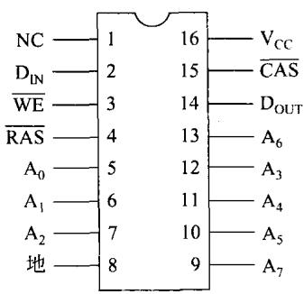  
图7-17DRAM2164引线图

地址分两次输入到芯片中去，每一次都是由 $\mathrm { A } _ { 0 } \sim \mathrm { A } ,$ 输入的。两次加到芯片上去的地址分别称为行地址和列地址。

在芯片内部，各存储单元是一种矩阵结构排列。行地址在片内译码选择一行，列地址在片内译码选择一列。这样由选中的行和列来决定所选中的单元，可以简单地认为该芯片有256 行和256列，共同决定64K个单元。对于其他DRAM芯片也可以同样来考虑。

综上所述，动态存储器芯片上的地址引线是复用的，CPU对它寻址时的地址信号分在行地址和列地址上，分别由芯片上的地址线送入芯片内部进行锁存、译码而选中要寻址的单元。

$\mathrm { D } _ { \mathtt { I N } }$ 和 $\mathrm { D } _ { \tt O U T }$ 是芯片上的数据线。其中 $\mathrm { D } _ { \mathrm { I N } }$ 为数据输入线,当CPU写芯片的某一单元时，要写入的数据由 $\mathrm { D } _ { \mathrm { I N } }$ 送到芯片内部。同样， $\mathrm { D } _ { \mathrm { O U T } }$ 是数据输出线，当CPU读芯片的某一单元时，数据由此引线输出。

RAS为行地址锁存信号。利用该信号将行地址锁存在芯片内部的行地址缓冲寄存器中。

CAS为列地址锁存信号。利用该信号将列地址锁存在芯片内部的列地址缓冲寄存器中。

WE为写允许信号。当该信号为低电平时，允许将数据写入。反之，当 $\overline { { \mathbf { W } } } \overline { { \mathrm { E } } } = 1$ 时，可以从芯片读出数据。

## （2）DRAM的工作过程

## ①读出数据

当要从DRAM芯片读出数据时，CPU首先将行地址加在 $\mathbf { A } _ { 0 } \sim \mathbf { A } _ { 7 }$ 上，然后送出RAS锁存信号，该信号的下降沿将行地址锁存在芯片内部。接着将列地址加到芯片的 $\mathbf { A } _ { 0 } \sim \mathbf { A } _ { 7 }$ 上，再送CAS锁存信号，该信号的下降沿将列地址锁存在芯片内部。然后保持 $\mathbf { \overline { { W E } } = 1 }$ ，则在CAS有效期间(低电平)数据输出并保持。其过程如图7-18所示。

## ②写人数据

当需要将数据写人芯片时，前面的过程即锁存地址的过程与读出数据时一样，行列地址先后由RAS和CAS锁存在芯片内部。然后WE有效（为低电平），加上要写人的数据，则将该数据写入选中的存储单元，如图7-19所示。

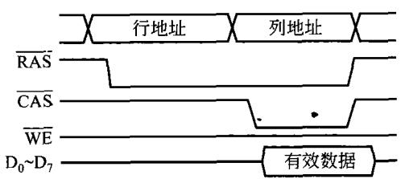  
图7-18DRAM2164的读出过程

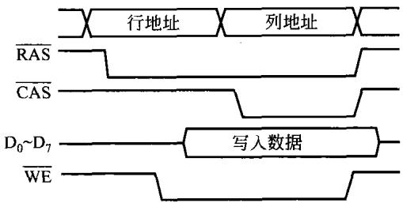  
图7-19DRAM2164的写入过程

图7-19中，WE变为低电平是在CAS有效之前，通常称为提前写。这能够将输人端 $\mathrm { D } _ { \mathrm { I N } }$ 的数据写入，而 $\mathrm { D } _ { \mathrm { { O U T } } }$ 保持高阻状态。若WE有效(低电平)出现在CAS有效之后，且满足芯片所要求的滞后时间，则WE开始是处于读状态，然后才变为写状态。这种情况下，能够先从选中的单元读出数据，出现在 $\mathrm { D } _ { \mathrm { O U T } }$ 上。然后，再将 $\mathrm { D } _ { \mathrm { I N } }$ 上的数据写人该单元。这种情况可一次同时完成读和写，故称为读变写操作周期。

## ③刷新

动态RAM一个重要的问题是，它所存储的信息必须定期进行刷新。对于单元电路的刷新过程上节已经说明。通常DRAM要求每隔2～4ms刷新一次。

动态存储器芯片的刷新过程是每次送出行地址加到芯片上去，利用RAS有效将行地址锁存于芯片内部，这时CAS保持无效(高电平)。这样就可以对这一行的所有列单元进行刷新。每次送出不同的行地址，顺序进行，则可以刷新所有行的存储单元。也就是说行地址循环一遍，则可将整个芯片的所有地址单元刷新一遍。只要保证在芯片所要求的刷新时间内（2～4ms)刷新一遍，也就达到了定期刷新的目的。刷新波形如图7-20所示。

在刷新中，CAS保持无效，只利用RAS锁存刷新的行地址，进行逐行刷新。即图7-4中所描述的Y无效X有效，每次刷新一行。

## 2.内存条

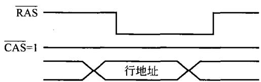

内存条是PC的重要组成部分。它是将多

图7-20DRAM2164的刷新过程

片存储器芯片焊在一小条印刷电路板上，构成容量不一的小条。使用时将小条插在主板的内存条插座上。由于PC的内存要求容量大、速度快、功耗低且造价低廉，而动态存储器恰恰具备这些性能。因此，PC的内存条无一例外地都采用动态存储器。

随着PC的发展，构成内存条的DRAM也经历了若干代的变更。早期的PC所用的PMDRAM、EDODRAM已经不再使用，这里不做说明。当前还在用的芯片主要是SDRAM和DDR SDRAM。

目前,PC上的内存条主要是由 SDRSDRAM(单倍速率同步DRAM)或DDR SDRAM芯片构成。

标准的DDR内存条是184引脚线DIMM(双面引脚内存条）。它很像标准的168引脚线SDRAMDIMM，只是用了一个凹槽而不是SDR上的2个凹槽。组件的长度也是5.25英寸。

标准化协会定义了两种不同配置的DDR内存条。第一种是无缓冲DDRDIMM，它成本低，可应用在PC和Internet设备上。第二种是有缓冲DDRDIMM，应用于较高存储密度的服务器。

新近的DDR-Ⅱ内存条所用的DDR芯片的速度更高一些。目前有三种工作频率：400MHz、533MHz和667MHz，分别可以达到的速率为7.8GBps、5.6GBps和6.4GBps。所有的DDR-Ⅱ内存条均工作在1.8V电压之下，单条容量均在512MB以上。DDR-Ⅱ内存条的引脚线有200线、220线和240线几种。

## 7.2.4其他存储器

除上面所提到的存储器外，尚有多种其他用途的存储器。这里仅介绍如下几种。

## 1.多端口存储器

在计算机系统中，经常利用多端口存储器实现处理机之间的快速数据交换。多端口存储器包括双端口、三端口、4端口等多种。这里仅对双端口存储器做简要介绍。

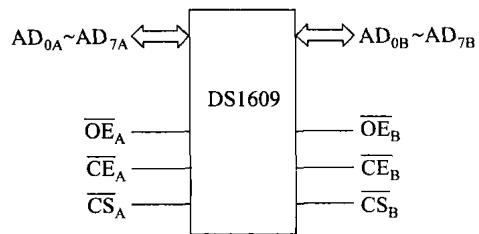  
图7-21双端口存储器DS1609的引线

## （1）双端口存储器

双端口存储器有多个厂家生产的多种型号。在这里仅以一种为例说明它的应用。

## ①引线

双端口存储器DS1609的引线如图7-21所示。

由图7-21可以看到，双端口存储器的引线分为两个独立的端口，分别在图7-21的两侧。

引线AD。～AD为复用引线，这8条线上可输入地址信号，也可以传送数据。其他控制信号均已经熟悉，不再说明。

## ②同时操作

双端口存储器就存在A、B两端口对其存储单元同时操作，下面分别说明。

a）对不同存储单元允许同时读或写。

b）允许对同一单元同时读。

c）当一个端口写某单元而另一端口同时读该单元时，要么是读出旧数据，要么是写入新的数据。因此，这种情况也不会发生混乱。

d）当两个端口同时对同一单元写数据时，就会引起竞争，产生错误。因此，这种情况应想办法加以避免。

③竞争的消除

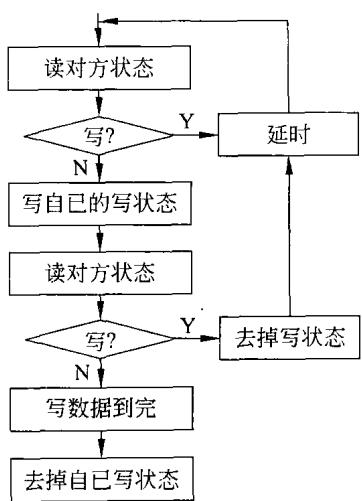  
图7-22某一边的写过程

④对于DS1609来说，竞争发生在对同一单元同时写数据时。为了防止竞争的发生，可以另外设置两个接口，该接口能保证一个端口只写而另一个只读。例如，用带有三态门输出的锁存器来实现，74LS373、74LS374均可实现。如果可能，也可在DS1609中设置两个单元一个A端口只写而B端口是只读，另一个单元则相反，B端口只写而A端口只读。在A端口向DS1609写数据时，先读B端口的写状态。若B端口不写，则将自己的写状态写到存储单元中。当B端口写人时，同样需要查询A端口的状态。其过程可用图7-22所示的流程图来说明。

不同的双端口存储器在结构上有所不同，上述芯片没有状态信号，所需状态信号由使用者产生。而有的双端口存储器芯片有自己的状态信号，如BUSY，使用者在使用过程中可用芯片所产生的这种信号。

## 2．多体交叉存储器

## （1）多体并行访问

多体交叉存储器在本章的前一节中已经涉及，只是没有特别强调。例如，8086的内存连接中采用两个体——奇地址体及偶地址体的交叉编址方式。而80386和80486 的内存则采用4体交叉编址方式。参见图7-11可以看到4个体的地址编排不是顺序的而是交叉的。同样的思路Pentium的内存是8体交叉编址。

在上面80x86系列处理器中，处理器对内存的存取是以增加数据总线的宽度达到提高内存访问速度的目的的。在8086中，可一次读(或写)16位数据。若数据总线只有8位的话，处理器要两次才能读写16位。显然，速度提高了1倍。同样，386、486数据总线宽度增加到32位，比8位总线的速度提高了4倍；而Pentium处理器的数据总线宽度增加到64位，则比8位总线的速度提高了8倍。

在80x86系列中，处理器对内存的访问多个存储体同时进行，或者说是多体并行访问。这是多体交叉存储器的一种访问方式。这种方式实现比较容易(见前面的连接图)，而且速

度很快。但需要更宽的数据总线宽度。

为提高内存的访问速度，多体交叉存储器还有另一种访问方式，就是多个模块顺序轮流进行访问，也称为交叉访问。

## （2）多体交叉访问

如前所述，多体存储器中的体的个数一般是2的幂次方，如2、4、8个或更多。为了说明交叉访问，将4个体的多体存储器简化框图如图7-23所示。

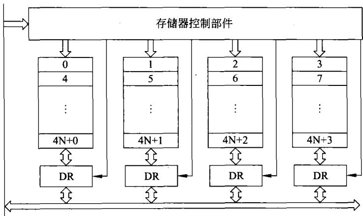  
图7-234体交叉访问存储器简化框图

由图7-23可以看到，存储器地址与80x86一样交叉编址。4个存储体是完全独立的，各自有自己的地址寄存器、地址译码器和数据寄存器DR。而且数据总线的宽度仅为每个存储单元的数据宽度。

该存储器的访问过程是交叉进行的，为此利用如图7-24的示意图来加以说明。

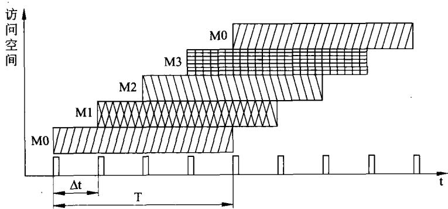  
图7-244体存储器交叉访问示意图

在图7-24中，假定每个存储体的访问时间为T。显然，顺序访问任何一个体的4个连续地址则需要4T。同时假定控制部件每隔△t启动一个存储模块。并且在图7-24的情况下保证 $4 \Delta \mathfrak { t } \leqslant \mathrm { T }$ ，图中采用 $4 \Delta \mathfrak { t } { = } \mathrm { T }$ 的情况。也就是说应保证 $\mathrm { T } / \Delta \mathfrak { t }$ 应大于等于存储体的数量。只有这样才能保证连续访问时存取数据的正确性。

在对4个体进行一次访问时，访问命令启动存储器控制部件产生4个等间隔控制脉冲信号,顺序启动对4个体MO、M1、M2 和M3 的访问。在读出数据时,经T时刻都将数据读到DR中。T时刻开始CPU只需再用3个△t就可以将数据读走。

可以看到，顺序访问任何一个体的4个连续地址则需要4T=16△t，而采用交叉访问的情况下只需要7△t。

当连续读出m个数据时，由图7-24可知，在读出前面数据的同时，又可以启动后续数据的读出。这样就形成一种类似流水线方式的工作，当等待M0体读出后（用T时间)，则每个△t可读出一个数据。因此，连续读出m数据时，只需T十（m一1)△t。当m很大时可近似读出一个数据的时间就是△t。显然，速度就提高了许多。

在上面的说明中，是以交叉读出为例来说明的，交叉写入数据的思路是一样的。在连续写大量数据时，可以认为CPU是以△t的速度交叉写每个存储体单元，而存储体单元的写人时间依旧是T。速度就提高了。

从以上分析可见，采用多体交叉存储器可以有效地提高存储器的存取速度。但多体交叉访问的形式已成为历史。

## 3.相联存储器

前面所描述的存储器都是按地址进行访问的，也就是说这些存储器都是依照地址去寻

找地址中的内容。而相联存储器是依据内容决定内容的地址或者是依据内容去寻找与其相关的内容。

相联存储器的构成框图如图7-25所示。其组成主要包括如下部件。

## （1）检索寄存器

用于存放要检索的内容，其长度为N位二进制编码。

## （2）屏蔽寄存器

屏蔽寄存器用于将不进行检索的某些位屏蔽掉，只留下需要检索的各位参与比较。通常屏蔽寄存器中某位置1，则将相应的检索位屏蔽掉；若置0则保留检索位。

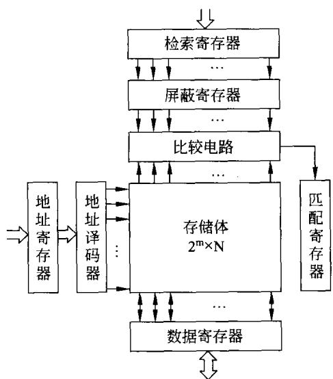

## （3）存储体

图7-25相联存储器的构成图

用于存放信息的部件，假定存储体的容量为

2"×N，即它具有2"个存储单元，每个存储单元存储N位二进制信息。

## （4）比较电路

比较电路是由2"个N位的数字比较器构成，用来将存储体中所有存储单元的内容与经屏蔽后的检索字进行比较。采用如此数量的硬件比较器，进行并行的同时比较，为的就是提高比较器的速度。

## （5）匹配寄存器

匹配寄存器用于记录比较器的比较结果。该寄存器有2"位，刚好对应存储体的2"个存储单元。当某一存储单元存储的信息与屏蔽后的检索字相同(匹配)时，该位置1;未匹配存储单元的相对应位则为0。

## （6）数据寄存器

数据寄存器用来存放比较过程中发现的匹配存储单元的内容。加电后，其内容为随机数。

如图7-25所示，还在左侧画出了地址寄存器和地址译码器，为的是使相联存储器具有按地址访问的功能。

可以想象，相联存储器中使用了数字比较器，用来比较经屏蔽后的检索字与存储单元的内容是否相等。数字比较器还可以进行大于、小于等比较功能。因此，有的相联存储器具有大于、小于等其他功能的检索。

相联存储器可用于许多领域，本书中主要用在高速缓冲存储器及虚拟存储器中。

## 7.3高速缓冲存储器

在过去的30年里，CPU速度的提高非常快而存储器速度增加相对比较慢，与CPU速度相匹配的速度高的存储器价格很贵。这样一来就产生了矛盾：若计算机内存全部采用低价的慢速存储器作为内存，则CPU的高速度无法发挥出来。若全部采用高价的快速存储器作为内存，CPU的高速度是能够发挥出来了，但价格又使人无法接受。就PC而言，从80386CPU之后，人们采用高速缓冲存储器(cache)来解决上面的矛盾。使计算机既具有低的价格又发挥出了CPU的高速度。

## 7.3.1 工作原理

## 1．概述

## （1）高速缓冲存储器的位置

高速缓冲存储器的工作是建立在程序及数据访问的局部性原理之上。经过对大量程序执行情况的结果分析表明：在一段较短的时间间隔内程序集中在某一较小的内存地址空间执行，这就是程序执行的局部性原理。同样，对数据的访问也会存在局部性现象。

基于上述程序及数据访问的局部性原理，在CPU和主存之间，尽量靠近CPU的地方设置一种容量比较小而速度高的存储器，将当前正在执行的程序和正在访问的数据放在其中。在程序运行时，不需要从慢速的主存中取指令和数据，而是直接访问这种高速小容量的存储器，从而可以提高CPU的程序执行速度，这种存储器就称为高速缓冲存储器。

高速缓冲存储器所处的位置如图7-26所示。

## （2）cache的构成

cache的构成框图如图7-27所示。主要包括替换管理模块、由相联存储器构成的存储表以及小容量高速度存储器。

当CPU执行程序需从主存读指令或数据时，从地址线上将地址加到主存也加到相联存储表上。若在相联存储表中检索到要读写的信息就在高速cache中，则通过相联存储表将地址转换为cache地址，从中读出信息。这种情况称为“命中”。若在相联存储表中未能

检索到要读写的信息，则称"未命中”。此时,CPU用主存读周期从主存中读出指令或数据，同时将包括读出信息在内的一块主存的信息读出替换cache中的某一块。

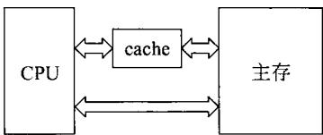  
图7-26cache所处位置

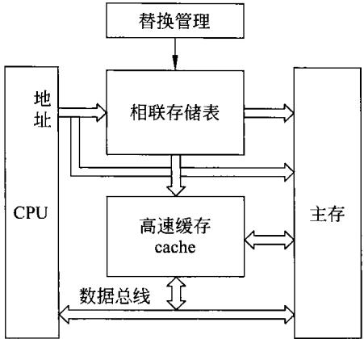  
图7-27cache的组成

值得注意的是，cache中存储的内容与主存的相应部分的内容是完全一样的，是主存内容的复制。只是为了提高运行速度才将这部分内容放在cache中的。同时，为了提高速度，整个cache系统都是由硬件实现的。

由于程序执行的局部性原理，CPU在绝大多数的情况下都可命中。因此，CPU可以以更高的速度运行程序。有关cache工作的细节将在下面详细说明。

## 2．地址映射

如上所述，在cache工作过程中，需要将主存的信息复制到cache中，这就是主存地址到cache地址的"地址映射”。在程序执行中，如果命中，就从cache中存取信息。这就需要将主存地址转换为cache的地址，才能对cache进行访问。将主存地址转换为cache地址称为“地址变换”。地址映射与变换有如下三种基本方式。

## （1）全相联方式

为了工作方便，提高效率，通常将cache和主存分成容量相等的块。例如，主存64MB，cache为32KB,均将它们分为大小为4KB的块。在全相联方式下，cache被分为块号为0～

7的8块，块号可用3位二进制编码表示。而主存则分为16K块，块号从0～16383，块号需要用14位二进制编码表示。

全相联方式下，地址映射的法则是：主存的任何一块可从装入到cache的任何一块中。这时，存放主存块号的相联存储器应有cache块数个单元(上例为8)。在相联存储器中需要记录装人cache的主存块的块号，因此，相联存储器每个单元应为14位。相联存储器的容量为8×14b。全相联地址映射示意图如图7-28所示。

由图7-28可以看到，主存的每一块均可以装

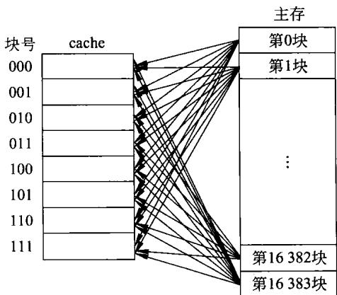  
图7-28全相联地址映射

入cache的任一块中，没有什么限制。

在全相联方式下，地址的变换过程如图7-29所示。

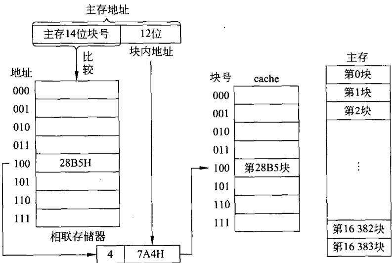  
图7-29全相联地址变换

为了说明问题方便，主存及cache的大小及分块仍以上面所给出的特定数据。同时，图7-29中画出了8×14b的相联存储器。它只有8个存储单元，用3位编码来表示存储单元的地址。而且，地址号与cache的块号是完全对应的。

假定某时刻主存第28B5H块（即从28B5000H到28B5FFFH这4KB)已经装人cache的第100B(4)块中。这时，该cache块的地址是32KB中的4000H到4FFFH这4K个地址。同时，要将块号28B5H存在对应的相联存储器地址为100B(4)的单元中，如图7-29所示。

若此后某时刻，CPU送出主存地址为28B57A4H，其低12位为块内地址，而高14位28B5H为主存块号。利用相联存储器，在其中检索比较主存块号28B5H，由内容28B5H寻找到其地址为100B(4)。这就是cache 的块号-—高位地址。最后将此高位地址与块内地址连接在一起，便形成了cache地址—-47A4H。CPU从cache的47A4H单元即可访问到主存28B57A4H单元的内容。

全相联映射的优点是主存装人cache特别灵活，主存的任一块都可装入cache的任一块中。只有全部装满后才需要替换。在替换时，根据算法只需淘汰掉任何一块即可装入新的。

但是,这种方式的代价也是最高的。它要求的相联存储器容量最大，而且进行比较检索时需全部检索相联存储器才能获得cache的块号，地址变换机构最复杂。

## （2）直接映射方式

为了说明直接映射，下面仍以前面所给出的数值为例。在直接映射方式下，要将主存先以cache 的容量32KB分区。则64MB的主存就被分成0～2047个区——即2K个区。而后每个区再以4KB分块，如图7-30所示。

利用图7-30，说明地址直接映射的法则为：主存各区中块号相同的块只能装人与cache中相同的块号中。例如,所有区中的0号块只准装人cache的0号块中；1块号只能装人

cache的1块号中，以此类推。

由上所述可以看到，这种映射使主存块号与cache块号永远是一致的。

下面，分析直接映射的地址变换过程。同样假定某一时刻CPU送出主存地址为28B57A4H。此时该主存地址应由如下部分组成，如图7-31所示。

由图7-31可以看到，地址的低12位是块内的地址；中间3位用于表示区内的块号。这里要特别注意的是直接映射方式下，该3位表示的也一定是cache的块号。因为主存的101B(5)块一定要装人cache的101B(5)块中。故假如命中的话，这3位连同后面的12

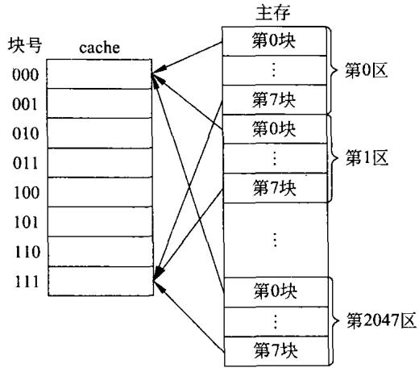  
图7-30直接映射方式示意图

位块内地址就是cache的地址57A4H。地址的最高11位用来表示区号，即区号为516H。

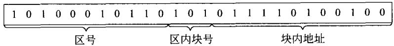  
图7-31直接映射方式下主存地址分析

下面看一看地址的变换过程。假如在此之前CPU己访问过区号为516H、区内块号为101B(5)的块。则该块一定已经装人cache的101B(5)块中。同时，在相应的地址是101B的相联存储单元中必须存储主存的区号516H，如图7-32所示。

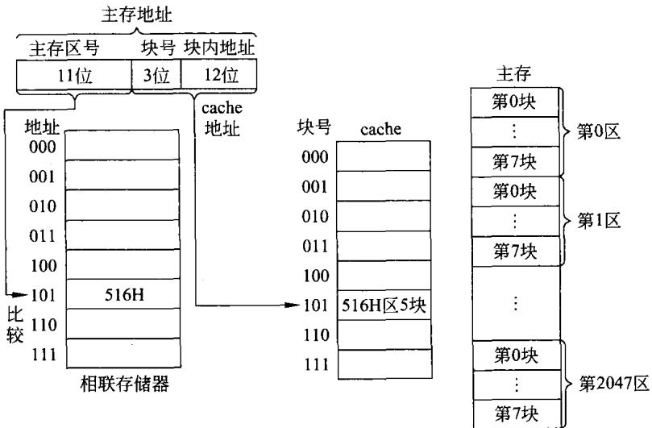  
图7-32直接地址变换

利用图7-32所示的直接方式下的地址变换过程，当CPU送出主存地址为28B57A4H时，直接映射的变换机制得到此时的区号为516H,而块号为5(101B)，则直截了当只检索比较相联存储器的5(101B)号单元的内容是否是516H。若是，则为命中，主存地址的低15 位就是cache的地址，则地址就是57A4H。若不是，则没有命中。

可见，直接映射方式下的地址变换变得很简单,只需根据主存地址中得到的块号-即相联存储器地址去检索该单元存放的是否定本块地址的区号。是则命中；不是则未命中。

综上所述，直接映射方式地址变换特别简单，只需以主存地址的块号为地址检测相联存储器(实际上，这种情况下已经是一种一般存储器)的一个存储单元。若命中，则由主存地址可直接获得cache的地址。该方式的缺点就是效率低，当某一块号正在使用而其他区同一块号又需装入时，即使其他块空着或很久都未使用也不能装人，只能将正在使用的替换。也就是说不同区的相同块号是不允许同时存在于cache中，若出现不同区的相同块号频繁交替被访问时，就会出现这些块被频繁装人的情况，这将大大影响命中率。因此，这种方式更适合于大容量cache。

## （3）组相联方式

前面已经看到，全相联方式和直接映射方式各有优缺点。而组相联方式就是将上述两者的优点结合而尽可能减小其缺点。该方式的基本思想是将cache先分组，组内再分块；而主存是先以cache的总容量分区，区内按cache的方法分组、组内再分块。

地址映射是组间直接映射而组内的块全相联映射。也就是说主存的某号组只能装入cache的同号组中，而组内的块可以装人同组号的任意一块中。具体示意图如图7-33所示。

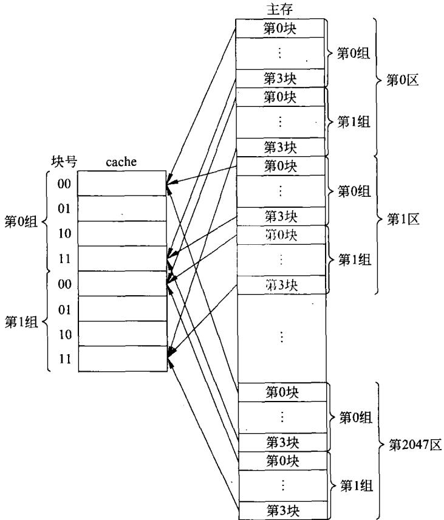  
图7-33全相联地址映射示意图

在图7-33中，将cache分为0、1两组，每组分为00～114块。同样，将主存分区，每区分为0、1两组，每组分为00～114块。图7-33中表明各区中同号组只能调入cache的同号组中，而组内块是全相联的。

作为前面例中CPU给出的主存地址为28B57A4H，在组相联地址变换中，对该地址分析如图7-34所示。

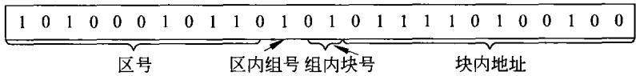  
图7-34组相联方式下主存地址分析

由图7-34分析可知，设主存地址的区号仍为516H；区内的组号为1，这就是说该组内的所有块只能装人cache的第1组中；组内的块号为01B(第1块)，它可以装入cache第1组4块中的任一块中。

现在说明组相联方式下地址变换。参见组相联方式下的地址变换示意如图7-35所示。若在此之前CPU曾访问过28B5000H～28B5FFFH这块主存块中的某一地址，且需要将该块调人cache中。则cache系统分析该主存块的区号为516H；区内的组号为1;组内的块号为01。这就确定这一主存块只能装人cache第1组的4块中。

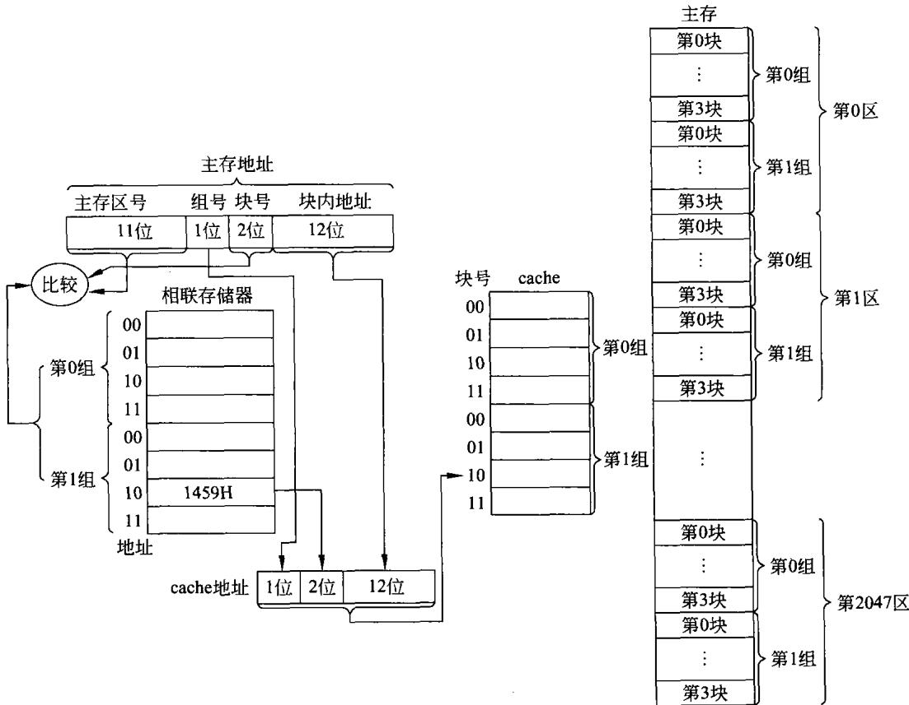  
图7-35组相联地址变换

在cache第1组中进行搜索，若发现10块空着还未被使用或根据下面的替换算法应将10 块替换出去。则将主存的这一块装人cache的10块中。与此同时，还必须在相联存储器相应的第1组4个单元中寻找地址与cache的10块对应的10单元存放该段的区号516H和组内的块号二进制01，将块号放低位，相联存储单元中应保存的数据为1459H。此时组号是不需要保存的，因为它是固定的。

若某一时刻CPU送出主存地址为28B57A4H，通过图7-34分析可以发现该块一定在第1组中，而且由主存区号和组内块号构成的检索字为1459H。这时，相联存储器只在第1组内进行检索比较，发现匹配字所在的地址为10。此时便可如图7-35所描述的那样构成cache的地址：地址的最高位就是主存给出的组号(本例中为1)，接下来是经相联比较得到的地址(本例中为10)，最后接上主存地址的最低12位(块内地址）。这样就构成了15位的cache 地址67A4H。

从图7-35的地址变换中可以看到，在此情况下，相联存储器的容量为8×13b。每个存储单元除存放主存区号外，还需要存放组内块号。而在相联检索比较时，只需比较主存地址中给出的那一组相联存储单元就可以了。

## 7.3.2替换算法

当要访问的主存块未在cache中，即未命中时，就需要将主存的块调人cache,替换cache中的块。主要的替换算法有如下几种。

## 1．随机替换算法(RAND)

随机替换算法是用随机函数发生器产生需替换的块号，将其替换。这种算法没有考虑信息的历史及使用情况，故其命中率比较低。现已不再使用。

## 2．先进先出算法(FIFO)

先进先出算法是将最先装入cache的那一块替换出去。这种算法只考虑信息的历史情况而没有考虑其使用情况，也许最先装入的那一块正在频繁使用。因此，该算法也有一定局限性，命中率也不是很高。

## 3．近期最少使用算法(LRU)

近期最少使用算法就是将近期最少使用的块替换出去。这种算法需要对每块设置一个计数器，某块每命中一次，就将其计数器清0而其他块的计数器加1，记录cache中各块的使用情况。当需要替换时，便将计数值最大的块替换出去。前面提到cache的工作是建立在程序执行及数据访问的局部性原理。因此，该算法较前两种算法的命中率要高一些。

## 4.最不经常使用算法(LFU)

最不经常使用算法是将一段时间里被访问次数最少的块替换出去。这种算法也需要对每块设置一个计数器，且开始调入时计数为0。每被访问一次，被访问块的计数器加1。当需要替换时，便将计数值最小的块替换出去。同时将所有各块的计数器清0。这种方法将计数周期限定在两次替换的时间间隔内，不能完全反映近期的访问情况。

## 5.最优替换算法(OTP)

要实现最优替换算法程序需执行两次。执行第一遍时，记录各块地址的使用情况。根据第一遍的记录就能找出需要替换出去的该是哪块。有了先前的替换信息，在第二次执行时一定能将命中率达到最高。前面的算法是依据过去的信息决定未来，而这种算法是以未来的信息决定未来，必然最佳。

显然，这种方法是不实用的。但它可以用做衡量其他算法的标准。

下面通过一个简单的例子说明上述替换算法。假定程序在主存为5块，cache为3块。CPU执行程序的顺序为：P2、P3、P2、P1、P5、P2、P4、P5、P3、P2、P5和P2。

画出FIFO算法、LRU算法和OTP三种算法的命中情况如图7-36所示。

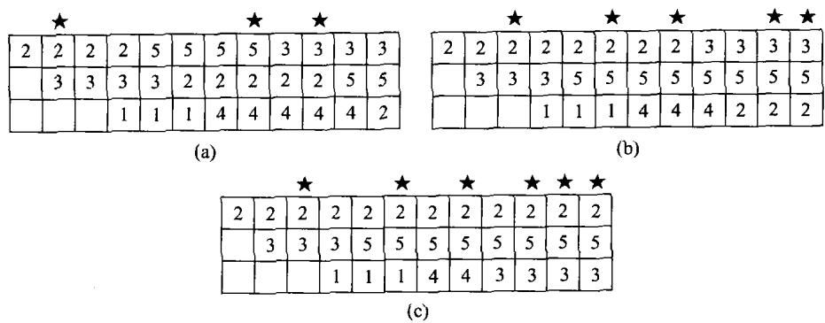  
图7-36三种替换算法的比较

如图7-36(a)所示的是利用FIFO算法的执行结果。图中用★所表示的是命中的情况，在利用FIFO算法的情况下，命中率为3/12=25%。

如图7-36(b)所示的是利用LRU算法的执行结果。同样，图中用★所表示的是命中的情况，在利用LRU算法的情况下，命中率为5/12=42%。

最优替换算法OTP的替换情况如图7-36(c)所示，在此情况下，命中率为6/12=50%。

上面的例子仅仅说明OTP算法的命中率要高一些。当然，人们期望命中率尽可能的高。

## 7.3.3主存—cache 内容的一致性问题

从前面的讲述中可以看到，cache的内容是主存部分内容的复制，其内容应当与主存的内容保持一致。很显然，只是从cache中读出指令或数据是不会改变cache中的内容的。而CPU对cache内容的写就会改变其内容，为了保证主存与cache内容的一致性，主存的内容也必须更新。由于程序cache是只读的，不存在一致性问题。该问题只发生在数据cache中。在那里，如何更新主存的内容，可采取下面所描述的写策略。

## 1.写回法

写回法是当CPU写cache命中时，只将数据写人cache而不立即写入主存。只有当被

CPU写入修改的块被替换出去时才写回到主存中。

如果CPU写cache未命中，则写修改是将相应主存块调人cache之后，在cache中进行。对主存的修改仍留待该块替换出去时进行。

实现这种方法需要对cache的每一块都设置一位修改标志，以便在该块被替换出去时，根据此标志决定是将该块写回主存还是直接丢弃不要。

这种方法的写修改是在cache中进行，很可能会发生多次，而对主存的修改只有最后替换时的这一次。这比后面要说明的全写法速度要快得多。但在替换前时间里存在不一致的问题。

## 2.全写法

全写法是当CPU写cache命中时，在将数据写人修改cache的同时写人修改主存，较好地保证了主存与cache内容的一致性。

当CPU写cache未命中时，就直接对主存进行写入修改。而后,可以将修改过的主存块调人cache,也可以不将修改过的主存块调人cache。

全写法同时写人修改了cache和主存，一致性好，而且也不需要设置修改标志。但是，每次修改都要对速度慢的主存操作，必然降低了CPU的运行速度。

## 7.3.4cache 性能分析

## 1.加速比

前面已经提到，在计算机中设置cache的主要目的就在于降低存储系统的价格、提高存储系统的速度。尤其是速度，它是计算机的永恒的主题。因此，人们最关心的问题是加速比。

假设cache 的访问周期为 Tc,主存的访问周期为Tm,cache 的命中率为H,则 cache系 $\mathrm { T _ { c } }$ $\mathrm { T } _ { \mathbf { M } }$ 统的平均访问周期T可如下表示：

$$
\mathrm { T } = \mathrm { H } \bullet \mathrm { T _ { c } } + ( 1 - \mathrm { H } ) \bullet ( \mathrm { T _ { c } } + \mathrm { T _ { x } } )\tag{7-1}
$$

在式(7-1)中,Tx为块的调入时间或替换开销，若cache以一个字或一个字节(对主存 $\mathrm { T } _ { \mathbf { X } }$ 的一次访问可以读写的字长)为一块，则 $\mathrm { T } _ { \mathrm { X } } = \mathrm { T } _ { \mathrm { M } }$ 。若以n个字或n个字节为一块，则$T _ { \mathbf { X } } = \mathbf { n } T _ { \mathbf { M } }$ 。

当命中率很高时,cache系统的平均访问周期就接近于cache的访问周期Tc。例如，若 $\mathrm { T _ { c } }$ 某计算机cache以1个字为一块，从0地址开始顺序读10个字，重复100 次，则命中率为99%,假定Tm为100ns,cache的访问周期Tc为10ns。则可得到cache系统的平均访问周 $\mathrm { T } _ { \mathbf { M } }$ $\mathrm { T _ { c } }$ 期T为11ns。若该cache以10个字为一块，同样从0地址开始顺序读10个字，重复100次，命中率为99.9%,Tm为100ns,cache的访问周期Tc为10ns。则可得到cache系统的平 $\mathrm { T _ { M } }$ $\mathrm { T _ { C } }$ 均访问周期T仍为1lns。

可见，块越大命中率越高，替换开销也越大。但同样的操作平均访问周期T没有改变。cache系统的加速比 $\mathsf { S } _ { \mathtt { P } }$ 定义为：

$$
\begin{array} { r } { \mathsf { S } _ { \mathtt { P } } = \mathrm { T } _ { \mathtt { M } } / \mathrm { T } . } \end{array}\tag{7-2}
$$

根据加速比的定义，上面所提到的计算机cache系统的加速比 $\mathrm { S } _ { \mathrm { P } } = 1 0 0 / 1 1 = 9 . 9$

可以看到，在块大小决定后，命中率越高，加速比越大。最大也只能接近 $\mathrm { T } _ { \mathrm { M } } / \mathrm { T } _ { \mathrm { C } }$ 。就如上面的例子，只有命中率为100%时才能达到加速比的极限10，实际上是不可能做到的，只能是希望加速比尽可能大一些。

## 2.成本

在本小节开始时曾说明，cache的出现是为了提高CPU访问存储器的速度，同时又可以降低成本。

假设计算机中的主存与cache的容量分别为S1和 S2。显然，S1>S2。同时，若主存与cache的单位价格分别为C1和C2,而且C1一定是低的。

则存储器的平均价格C由下式决定：

$$
\mathrm { C } = ( \mathrm { C } 1 \mathrm { S } 1 + \mathrm { C } 2 \mathrm { S } 2 ) / ( \mathrm { S } 1 + \mathrm { S } 2 )\tag{7-3}
$$

尽管cache的价格比主存高，但是当其容量很小时，存储器的平均价格C接近于主存的价格。

从以上两个侧面可以看到，由于设置了cache使CPU.的访存速度接近cache的速度，而使存储器的成本接近于主存的价格。

## 3.命中率与cache容量的关系

cache的命中率随着它的容量的增加而增加，其关系曲线如图7-37所示。

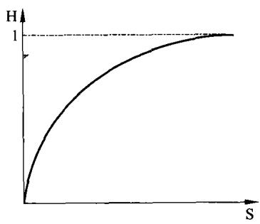  
图7-37命中率H与容量S关系

由图7-37可以看到，在cache容量S比较小的时候，随着容量S的增加，命中率H的增加非常快。随着cache容量的增加，命中率增加变得比较缓慢。显然，当cache的容量能装下CPU要执行的所有程序和数据时，命中率就达到100%。注意到，当cache的容量达到一定量时，再增加容量对命中率的贡献就很有限了。

文献资料中认为，在一般情况下，图7-37所示的关系曲线可用下式近似表示：

$$
\mathrm { H } = 1 - \mathrm { S } ^ { - 0 . 5 }\tag{7-4}
$$

式(7-4)中，容量 S以字节为单位。

## 4.两级cache

为了克服CPU和主存间的性能差距，使两者在性能上更好的匹配，cache应运而生。随着技术的发展，目前均在原有的cache和主存之间增加另一级cache，构成两级cache系统。

通常，将第一级cache做得比较小，几KB、几十KB到一两百KB，而且速度很高；而将第二级cache做得比较大，一般都在几百KB到几MB,其速度也比较高，甚至与第一级一样。这样一来,当第一级cache未命中时，再到第二级cache中去搜索。由于第二级cache容量很大，其命中率会很高。同时，在速度上也完全可以与CPU相匹配。

两级cache的总未命中率(或称总失效率)是由两级cache的各级失效率来决定：

$$
1 0 N H 3 N C = ( 1 + 3 0 \times 7 ) m \cdot 2 0 + ( 1 + 3 0 \times 7 \times 2 ) m = 0\tag{7-5}
$$

例如，在10O00 次访存中，第-级cache失效400次，第二级cache失效4次。则可以计算出（失效率） $1 \frac { A E } { A E } - \frac { A E } { A C }$ 为4%而(失效率） $A B = C Q$ 为1%，利用式(7-5)得到使用两级cache后总的失效率降为0.04%。

目前，均将第一级cache集成在CPU内部(称L1),而将第二级cache 放在CPU外部外接（称L2)。除两级cache外，还可采用三级cache，此处不再说明。

## 7.4虚拟存储器

在计算机存储系统中，虚拟存储器是非常重要的。可以说没有虚拟存储器就不可能有性能好的计算机。目前，虚拟存储器存在于所有PC、服务器等计算机中。

## 7.4.1虚拟存储器的概念

前面，通过在存储器系统中增加一个容量小、速度高的cache，解决了CPU与主存储器的速度匹配问题。随着技术的发展，与存储系统有关的另一个问题凸现出来：要求计算机具有海量存储器，以便支持多用户、多任务程序的开发。

目前，不可能将计算机的主存做到海量，而且即使做到了，其价格也是使用者无法承受的。那么，在一定的主存容量下，如何做到让程序员几乎可以无限制地（比主存的实际容量大成千上万倍)使用存储器。解决的办法就是采用虚拟存储器。

虚拟存储器是由价格比较贵、容量不太大、速度相对比较高的主存储器和价格很低、容

量非常大、速度慢的外部(辅助)存储器，在操作系统及辅助硬件的管理下，构成了像一个单一的、可直接访问的超大容量的主存储器。

可见，虚拟存储器为程序员提供了比计算机实际主存地址空间大得多的地址空间。它是利用了大容量外存(如硬磁盘)构成的。它解决的是主存容量与价格的矛盾，使速度接近主存速度而容量和价格又接近外存。虚拟存储器的结构形式如图7-37所示，虚存是在硬、软件的管理支持下，由主存和辅存共同实现的。

可依不同管理方式构成虚拟存储器，下面逐一说明。

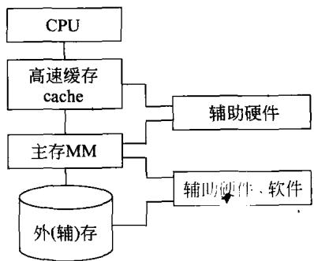  
图7-38虚拟存储器的构成

## 7.4.2虚拟存储器的管理

## 1.页式虚拟存储器

## （1）地址变换

在页式虚拟存储系统中，要将虚拟地址空间分成固定大小的页，称为虚页或逻辑页。同时，主存也分成同样大小的页，称为实页或物理页。页的大小为2的幂字节或字，一般为几

KB(或KW)。这样一来，虚拟地址和主存物理地址都包含有两个字段。

对于虚拟地址来说，高字段为虚页号，低字段为页内地址。

对于主存地址来说，高字段为实页号，低字段为页内地址。

在页式虚拟存储器中，由虚拟地址到主存物理地址的变换是通过页表来实现的。在页表中每一条记录都包含有虚页号所对应的实页号。在地址变换中，只要根据虚页号找到对应的实页号，将此实页号与虚拟地址中的低字段所给出的页内地址拼接在一起，就获得了主存的物理地址。页式虚拟存储器地址变换如图7-39所示。

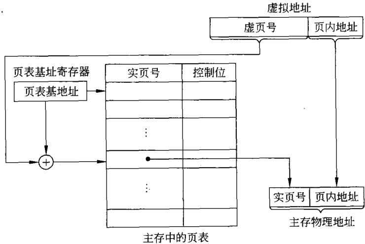  
图7-39页式虚拟存储器的地址变换

由图7-39可以看到，通常页表设置在主存中，表的起始地址可通过页表基址寄存器来设定。当程序给出虚拟地址后，CPU首先以虚页号为偏移地址查表，从而获得相应的实页号。将实页号与页内地址连接到一起，便是主存的物理地址。

页表中，每一行记录里必须有几个控制位，包括装人位（用以表示该页是否已装入主存）、修改位(用以表示该页是否已被修改）、替换控制位(用以表示该页的使用情况)等。当查表未发现所要访问的页时(未命中)，则需按某种算法将要访问的页由外存装人主存。

综上所述，页表的容量一般是比较大的。例如，虚存空间若为4GB,而页的大小为4KB,则页表应包含1M字，且每字应为一个记录(实页号和控制位）。

## （2）快表与慢表

根据上面描述，由于页表设置在主存中，在页式虚存工作时，首先是要访问主存中的页表进行地址变换获得主存地址。然后，再利用主存地址访问主存获得数据。显然，即使主存命中，也需要两次访问主存才能获得主存信息。前面已提到主存速度比较慢，这必然降低了CPU的速度。若是被访问的页不在主存中，那速度就更慢。

为了尽可能提高速度，可借鉴前面cache的思路，将页表中最活跃的部分放在cache存储器中，构成快表。对快表的查找及管理也全用硬件来实现，以达到快的目的。

快表一般很小，它仅是主存中页表(相对快表可称其为慢表)的一小部分。只有在快表中找不到目标内容时，才去访问慢表，从而提了高速度。利用快表工作的思路如图7-40所示。

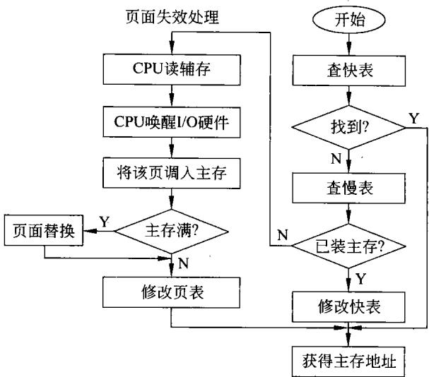  
图7-40页式虚拟存储器快表工作思路

·页式虚拟存储器的主要优点是：①主存的利用率高。由于页的容量很小，每一用户程序只有不到一页的浪费，故形成的主存碎片很小。②地址表的内容比较简单。③地址映像与地址变换速度比较快。

这种方式的缺点：①程序的模块性差。因为页的大小是固定的，无法与程序模块保持一致。②页表很长。如前面的例子可以看到页表长达1M字。

## 2.段式虚拟存储器

另一种经常采用的虚拟存储器是段式虚拟存储器。采用此种方式是将完成某种独立功能的程序模块定义为一段，例如主程序、子程序、数据块、表格等均可定义成一段。程序员在编程时，每一段都可从虚拟地址的0地址开始，并且每一段的长度是不一样的。

在进行段式虚拟存储器管理中，应将每一段程序规定一个段号(也可以定义某一段名)，最方便的办法是各段段号顺序排列，在表中可省略此项。确定每段的长度。同时，在主存中建立一个段表。

段表中每一行由段号、段起始地址、装入位、段长、属性等内容构成。每一行对应一个段。段号是每段唯一的;段起始地址是该段装人内存的起始地址;装入位状态用来表示此段是否已装人主存;段长度表明该段在主存中所占的地址空间；属性用来表征该段的其他属性特征，如可读写、只读、只写等。例如某8号段，装入内存的起始地址为4000000H，该段长度为64KB,装人位为1。则意味着该段程序已装在了主存地址4000000H到400FFFFH的地址范围内。

段式虚拟存储器管理中地址映射的方法是将程序段装入主存的任何可以放的位置上，顺序是随意的。当主存被占满，所剩空间不足以装入需装入的段时，就需依某种替换算法进行替换。

段式虚拟存储器地址的变换如图7-41所示。

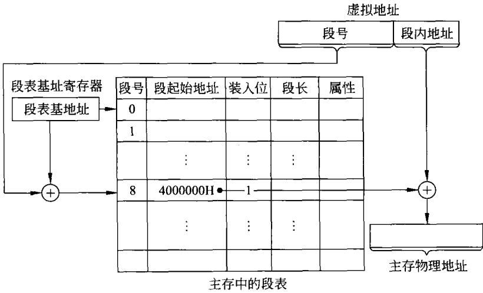  
图7-41段式虚拟存储器的地址变换

在地址变换中，将虚拟地址所确定的段号为偏移地址查段表，发现该段已装入主存，则直接将起始地址与虚拟地址中的段内地址相加便可得到主存的物理地址。

段式虚拟存储器的优点如下。

（1）很适合模块化程序设计。将每一功能独立的程序模块定义为一段，既便于程序的开发，又便于虚拟存储器的管理。

（2）便于程序和数据的共享。此方式能将整段独立的程序和数据装人主存，起始地址、段长度均已知，很容易实现共享。

（3）便于信息保护。对装人段的属性进行设置，很容易实现对段的保护。

段式虚拟存储器的缺点主要表现在，由于各段的长度是不一样的，在装入主存中分配地址空间比较麻烦，段与段之间可能会产生比较大的空隙(段间的主存碎片)，降低了主存储器的利用率。

## 3.段页式虚拟存储器

上面提到的两种虚拟存储器，各有优缺点。为将两者的优点结合到一起，人们提出段页式虚拟存储器。

段页式虚拟存储器是将程序首先分段，段的概念同前。然后，再将每段分成大小相同的若干页。对段来说要用段表来管理所有各段，段表中存放对应该段的页表基地址等有关信息，如图7-42所示。每一段有自己的页表，其中存放对应本段每一页的实页号。显然，在装人某一段的各页时，这些页在实存中并不一定连续。

如图7-42所示，在进行地址变换时，首先根据虚拟地址决定所在的段号，查段表可查出要访问的本段页表的起始地址。由此地址及虚拟地址中的页号再查本段的页表，从中查出该页的实页号。最后，将实页号与虚存给出的页内地址拼接在一起就获得到主存的物理地址。

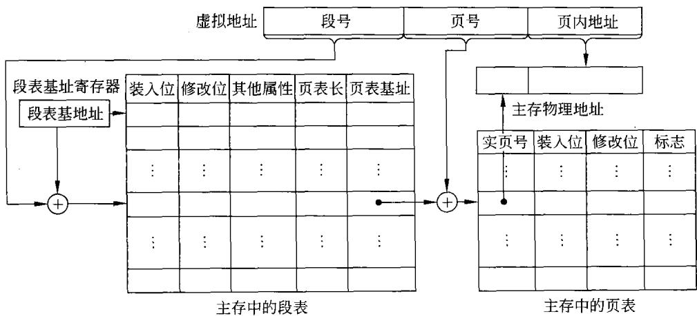  
图7-42段页式虚拟存储器的地址变换

## 7.4.3几点说明

在上面介绍虚拟存储器的三种方式中，为简单起见描述它们的基本原理和概念，尚有几个问题需说明。

## 1.多用户工作

前面有关虚拟存储器都是以单用户(仅一个程序员)的情况，即一个程序员在虚拟存储空间里编写许多程序模块。以上的三种方式均可支持单用户的工作。

当计算机系统工作在多用户的情况下，多个程序员各自编写自己的程序，则要求虚拟存储器也能支持多用户的工作。由于虚存空间是海量的，解决多用户的问题完全可以由虚拟存储器管理(操作系统)来指定用户的不同使用空间，即对用户编号。而各用户在编程时可自由使用整个虚拟存储空间，而在虚存管理过程中会为不同的用户编号。这时的虚拟地址较前多出一个字段，如图7-43所示的就是段页式虚存地址的管理格式。同样，对段式虚存只是在图7-43中无页号字段，而对页式虚存则无段号字段。

虚拟地址
<table><tr><td>用户号</td><td>段号</td><td>页号</td><td>页内地址</td></tr></table>

图7-43多用户段页式虚拟地址格式

根据图7-43，在进行虚实地址变换时，首先是以用户号查用户表，从中查到用户段表的基地址，后面的工作如前所述。在段式或页式虚拟存储器中，通过查用户表找到用户段表或页表的基地址，得到基地址后的过程也如前所述。

可见，在多用户的情况下，比单用户要多一步查用户表的过程。

## 2.调度方式

在三种虚存管理方式之下，由于主存容量有限，这就存在将页或段装人主存的问题。

段式虚拟存储器是相联地址映射方式，在主存中寻找足够空间将要访问的段装人。若无空位，则需按替换算法将某段替换出去。

在页式或段页式虚拟存储器中，可采用两种方法。

（1）分页式。即将程序的所有页一次装入主存。在后面程序执行中主存命中率为100%。

（2）请求页式。这种方法每次只装入一页，用到哪页装入哪页。

显然，两种方法各有优缺点。

## 3．替换算法

在虚拟存储器的管理中，同样存在段或页未能在主存命中，需要将新的段或页从外存中装人主存，将主存中的段或页替换出去。

在虚拟存储器的管理中可采用的替换方法与cache中的一样，这里不再说明。

## 习 题

1．试以单元电路说明，为什么DRAM的功耗比SRAM小？

2.某以8088为CPU的微型计算机内存RAM区为00000H～3FFFFH，若采用6264，62 256,2164或21256各需要多少片芯片？

3．试利用6264芯片，在PC/XT系统总线上实现00000H～03FFFH的内存区域，试画出连接电路图。若在8086系统总线上实现上述内存，试画出连接电路图。

4．叙述EPROM的编程过程，说明EEPROM的编程过程。

5．内存按字节编址，地址从40000H～BBFFFH 共有多少字节(KB)?

6.试判断PC/XT系统中存储系统译码器74LS138的输出 $\vec { \Upsilon } _ { \mathfrak { o } } \ 、 \overline { { \mathtt { Y } } } _ { 4 } \ 、 \overline { { \mathtt { Y } } } _ { 6 }$ 和 $\overline { { \boldsymbol { \Upsilon } } } _ { \tau }$ 所决定的内存地址范围，如图7-44所示。

7．将4片6264连接到8086系统总线上，要求其内存地址范围为70000H～77FFFH，画出连接图。

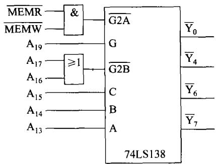

8．EEPROM98C64A芯片的各引脚的功能是什么？如果要将一片98C64A与8088微处理器相连接，并能随时改写98C64A中各单元的内容，试画出连接电路图（地址空间为40000H～41FFFH）。

图7-44习题6附图

9．与EPROM相比,EEPROM有什么不同？

10．在80486系统中，某SRAM芯片容量为256K×8b，试用这样的芯片构成40000000H到400FFFFFH的内存，画出电路连接图。

11．就书中提到的动态存储器2164，说明动态存储器的读、写过程。

12．标准的动态存储器 DRAM与同步动态存储器 SDRAM的主要不同表现在哪些方面？

13．DDR SDRAM的 DDR 是什么意思？与一般的 SDRAM 相比有些什么不同?

14．半导体动态读写存储器DRAM在使用时需要定时刷新，其主要原因是

15．掉电后，下面说法中正确的是  
A．RAM的数据不会丢失  
B.ROM的数据不会丢失  
C. EPROM的数据会丢失  
D.DRAM的数据不会丢失

16．某CPU地址总线为 $\mathbf { A } _ { 1 9 } \sim \mathbf { A } _ { 0 }$ ，数据总线为$\mathrm { D } _ { 7 } \sim \mathrm { D } _ { 0 }$ ，内存读信号为MEMR，内存写信号为MEMW，某 SRAM连接电路图如图7-45所示。

（1）分析该图，请指出该 SRAM芯片占用的内存地址范围。

（2）采用该SRAM芯片实现30000H～33FFFH的内存区域，试画出连接图。

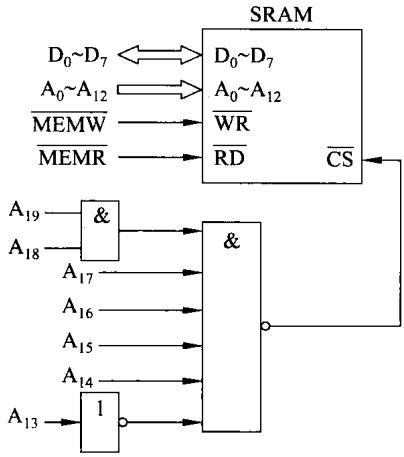

17．存储器的存取时间 $\mathbf { t _ { A } }$ 和存储周期 $\mathbf { t _ { m } }$ 的关系是 。 图7-45习题16附图A. $\mathbf { t } _ { \mathrm { A } } > \mathbf { t } _ { \mathrm { m } }$ B. $\mathbf { t } _ { \mathbf { A } } \geqslant \mathbf { t } _ { \mathbf { m } }$ C. $\mathbf { t } _ { \mathrm { A } } = \mathbf { t } _ { \mathrm { m } }$ D. $\mathbf { t _ { A } } < \mathbf { t _ { m } }$

18．主存与CPU之间增加高速缓存cache的目的是 0A．解决主存与CPU之间的速度匹配问题B．扩大主存的存储容量C．扩大外存储器的寻址空间D．提高外部存储器的速度

19．在计算机中，采用虚拟存储器的目的是A．提高内部存储器的速度B.扩大内部存储器的寻址空间C．扩大外部存储器的寻址空间D．提高外部存储器的速度

20．在计算机中,CPU对其访问速度最快的是 。A.主存 B.cacheC.CPU中的通用寄存器 D.硬磁盘

21．若cache以字为块，其存取时间为10ns,主存的存取时间为100ns,系统的平均存取时间为17.5ns，则cache的命中率为 。A. 96% B.95% C. 94% D.92%

22．高速缓存cache与主存间采用组相联地址映射方式（即组间直接，组内全相联），高速缓存分为两组，每组包含4块，每块为1KB。主存容量为1MB。

（1）说明主存区号、区内组号、组内块号、块内地址号各用多少位表示？

（2）已经地址变换表如图7-46所示，若主存地址为ABCDEH，试确定变换后的高速缓存的地址。

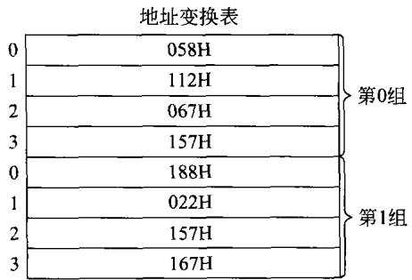  
图7-46习题22附图

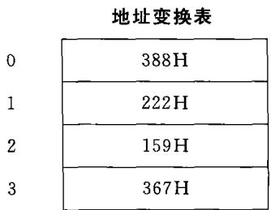  
图7-47习题23附图

23．高速缓存cache与主存间采用全相联地址映射方式，高速缓存的容量为4KB，分为4块每块1KB,主存容量为1MB。

（1）地址变换表为 个存储单元，每个存储单元包括 位。

（2）若主存读写时间为300ns，高速缓存的读写时间为30ns，而平均读写时间为32.7ns,则该高速缓存的命中率为 %。

（3）若地址变换表如图7-47所示，试根据主存地址确定变换后的高速缓存的地址。

·主存地址为88888H时，高速缓存地址为 H。

·主存地址为56789H时，高速缓存地址为 H。

（4）简要说明采用全相联映射的优缺点。（主要从cache的利用率、命中率、地址变换硬件的繁简等方面进行说明)

24．某计算机主存按字节编址，主存与高速缓存cache地址变换采用组相联映射方式  
（即组内全相联，组间直接映射)。高速缓存分为2组，每组包含4块，块的大小为512B(字  
节)，主存容量为1MB。构成高速缓存的地址变换表相联存储器容量为①\_b。每次参与  
比较的存储单元为②个。①A.4×10b B.8×10b C.4×11b D. 8×11b②A.1 B.2 C.4 D.8

25．使cache命中率最高的替换算法是 。A．先进先出算法FIFOB．随机算法RANDC．优化替换算法OPTD．替换最近最少使用算法LRU

26．内存的段式管理有许多优点，下面的描述， 不是段式管理的优点。A．支持程序的模块化设计和并行编程的要求B．各段程序的修改互不影响C．地址变换速度快、内存碎片(零头)小D．便于多道程序共享主存的某些段

27．若cache容量为100 字，并以50字分块，起始为空，CPU从主存单元0,1,2,,99，依照一次读出一个字，顺序读出100个字，并重复读10次，求命中率为多少？若主存的速度比cache慢5倍，则在此情况下比无cache速度提高多少倍？

28．主存容量为4MB,虚存空间为1GB，实地址与虚地址各为多少位？若页面大小为4KB,则主存页表应有多少个表目？

29．段式管理虚拟存储器段表如表7-3所示。

表7-3虚拟存储器段表
<table><tr><td>段号</td><td>段首地址</td><td>装入位</td></tr><tr><td>0</td><td>50000H</td><td>1</td></tr><tr><td>1</td><td>30000H</td><td>0</td></tr><tr><td>2</td><td>15000H</td><td>1</td></tr><tr><td>3</td><td>44000H</td><td>1</td></tr></table>

若访问段3的1059H单元和段2的1678H单元，它们对应的实地址各是多少？

30．某页式管理虚拟存储器共有256K页，每页为4KB。主存容量为1MB。试问实存分多少页？主存页表有多大？描述虚实地址的变换过程并举例说明。

31．若某程序运行要求页面的顺序为P3、P4、P2、P6、P4、P3、P7、P4、P3、P6、P3、P4、P8、P4、P6，主存容量为3页，程序运行前主存为空。求FIFO算法和LRU算法的命中率。若主存增至4页，再求各自的命中率。