## 第8章 输入/输出系统

计算机已渗透到人们工作和生活的每一个角落并产生了极大的影响，这依赖于计算机与外部世界的联系。通过输入/输出可实现计算机与外部世界的信息交换，完成人们所期望的各种功能。因此，输入/输出在计算机系统中占有极其重要的地位。本章将涉及总线、基本的输入/输出方法及有关的外部设备。

## 8.1总线

## 8.1.1概述

## 1．总线的分类

广义地说，总线就是连接在两个以上数字系统元器件的信息通路。从这个意义上讲，计算机系统中所使用的芯片内部、元器件之间、插件板卡间乃至系统到外设、系统到系统间的连线均可理解为总线。通常，可把总线分为如下几类。

## （1）片内总线

顾名思义，片内总线就是集成电路芯片内部各功能元件之间的连接线。这类总线是由芯片的设计者来实现的。对于本书的读者，将来自己设计SOC(片上系统)芯片的可能性非常大。目前已有多个厂家制定了多种片内总线供SOC设计者使用。

## （2）元件级总线

元件级总线又称板(卡)内总线，用于实现电路板(卡)内各元器件的连接。

## （3）内总线

内总线又称系统总线，用于将构成计算机的各电路板(卡)连接在一起。

内总线对计算机的设计者是非常重要的。如果所设计系统的内总线性能很差或工作不可靠，则这将直接影响所设计的计算机的性能，甚至使整个计算机系统不能正常工作。

从计算机问世以来，有许多科学工作者致力于内总线的研究与开发，现在已制定的内总线标准已超过100种，有民用级计算机内总线标准、有工业级计算机内总线标准也有军用级计算机内总线标准。

## （4）外总线

外总线又称通信总线，用于实现计算机与外设以及计算机系统之间的相互连接。从外总线的定义可从看到其功能是实现计算机与外设或者计算机系统之间相互通信的，对计算机系统来说，这一总线是系统的重要组成部分。显然，这种总线传送距离比较远，可采用串行方式或并行方式来实现。

同样，从计算机问世以来，有许多科学工作者致力于外总线的研究与开发，分别制定了串行、并行的外总线标准有七八十种之多。计算机系统设计者可以根据用户的需求和系统设计方案选择某一标准总线用于所设计的系统中。

## 2.结构

## （1）简单的总线结构

构成CPU的片内总线可以是如图5-1所示的单总线结构，也可以是如图3-30所示的二条或三条片内总线构成。这些片总线都集成于芯片内部。

同样，可以用简单的总线结构构成一部简单的计算机,在一些简单的应用中，一台规模不大的计算机的结构如图8-1所示。

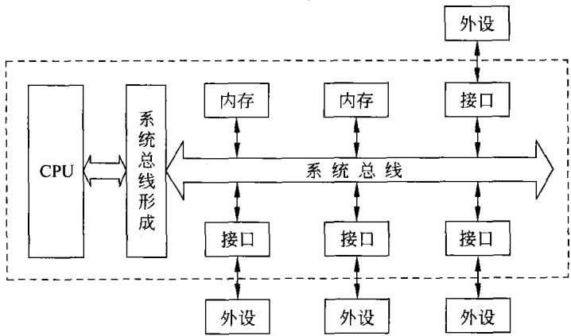  
图8-1简单的计算机结构框图

在图8-1中，CPU等芯片内部的各部件，是由片内总线连接在一起。内存、接口等框图  
可看做是一块块的电路板，板内的各元器件是由板内总线连接在一起的。系统总线则将构  
成计算机的各组成部分连接在一起。如图8-1所示，其中用虚线框起的就是计算机，它与外  
设(这里的外设是广义的，除输入/输出设备、外存储器外，还可以是计算机、局域网等)相连  
接的信号线就是外总线。CDI

## （2）复杂的总线结构

一种较复杂的计算机结构如图8-2所示。

在图8-2计算机结构描述中，所强调的是总线。可以看到，构成一台计算机是由多种总线将构成该计算机的各种部件连接在一起。图8-2中所画出的主要是内总线和外总线。有关这些总线的简单说明将放在下一节中。

后面第9章将讲到多机系统，在构成多机系统时，可以通过多种形式将多个处理器或计算机连接在一起，其中就可以利用总线实现多机系统的连接。

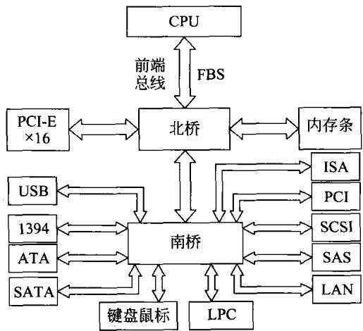  
图8-2较为复杂的计算机总线结构

## 3.总线性能描述

## (1）总线的带宽(总线数据传输速率)

总线的带宽指的是单位时间内总线上传送的数据量，即每秒钟传送MB的最大数据传输率。与总线密切相关的两个因素是总线的位宽和总线的工作频率，它们之间的关系如下。

$$
\sin \frac { 2 \pi } { 2 } \frac { 2 \pi } { 3 } \frac { 2 \pi } { 4 } + \frac { 2 \pi } { 1 4 } \frac { 2 \pi } { 3 4 } = \frac { 2 \pi } { 2 } \frac { 2 \pi } { 3 } + \frac { 2 \pi } { 3 } \frac { 2 \pi } { 1 4 } + \frac { 2 \pi } { 3 } \frac { 2 \pi } { 1 2 } \times \frac { 2 \pi } { 2 } \times \frac { 2 \pi } { 2 } \frac { 2 \pi } { 3 } \frac { 2 \pi } { 1 4 } \times 2 \pi \times \frac { 2 \pi } { 2 } \frac { 2 \pi } { 3 } \frac { 2 \pi } { 1 2 } \frac { 2 \pi } { 3 4 } = 1 8 \pi\tag{8-1}
$$

## （2）总线的位宽

总线的位宽指的是总线能同时传送的二进制数据的位数，或数据总线的位数，即32位、64位等总线宽度的概念。总线的位宽越宽，每秒钟数据传输率越大，总线的带宽越宽。

## （3）总线的工作频率

总线的工作时钟频率以MHz为单位，工作频率越高，总线工作速度越快，总线带宽越宽。

## 8.1.2总线的信息传送

## 1．信息传送方式

总线上，信息传送的方式有如下三种。

## （1）串行传送

串行传送是指将数据沿一条传输线一位接一位地传送。

在串行通信中，经常采用两种最基本的通信方式，一种是同步通信，另一种是异步通信。

## ①同步传送

所谓同步传送是指，在约定的波特率(每秒钟传送的位数)下，发送端和接收端的频率保持严格的一致（同步)。因为发送和接收的每一位数据均保持同步，故传送信息的位数几乎不受限制，通常一次通信传送的数据有几十到几百字节。这种传送的发送器和接收器比较复杂，成本也较高。

## ②异步传送

异步传送是指，收发端在约定的波特率下，不需要严格的同步，允许有相对的频率差异（异步)。即收发两端的频率差别在5%以内，就能正确地实现传送。异步传送的数据传送格式如图8-3所示。

  
图8-3异步串行通信数据格式

异步传送每传送一个字符，均由一位低电平的起始位开始，接着传送数据位，数据可以是5位,6位,7位或者8位，可由通信双方程序指定。在传送时，按低位在前，高位在后的顺序传送。数据位的后面还可以加上一位奇偶校验位，也可以不加这一位，可由程序来指定。最后传送的是一位，一位半或两位高电平的停止位。这样，一个字符就传送完了。在传送两个字符之间的空闲期间，要由高电平“1"来填充。

异步传送每传送一个字符，都要增加大约20%的用于同步和帧格式检测的附加信息位，这必然降低了传送效率。但这种传送方式简单可靠，实现起来比较容易，故广泛应用于各种计算机系统中。

## （2）并行传送

并行传送是指将构成一组数据的各位每位沿一条传输线同时传送。例如8位数据或16位数据并行传送。在前面作为例子的CPU(如图5-1所示)中的内总线上，或在如图8-1所示的系统总线上，无论是地址还是数据均采用并行传送。在并行传送中同样存在。

## ①同步传送

在此传送方式下，并行数据的传送与总线时钟严格同步。例如，图8-2中的前端总线传送内存条数据，若总线时钟频率为100MHz，内存条采用SDRAM，总线位宽为64位，则每10ns就可传送8个字节。也就是说64位并行数据严格按照每秒钟100M次的速率进行传送。

如图8-4所示的是8086CPU读内存的简化的时序，图中给出的就是严格的按4个时钟周期读出(或写入同)一个数据，这也是同步传送。

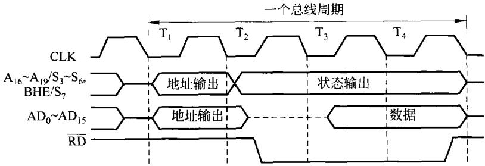  
图8-48086的读总线周期

## ②异步传送

同样，在并行传送中也有的采用异步方式。

异步传送没有严格的时钟同步。因此，实现过程就需要联络信号（或称握手信号)。利用这些信号实现数据的传送。异步传送的示意图如图8-5所示。

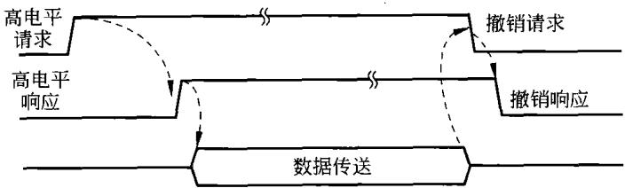  
图8-5异步传送示意图

在图8-5中，当设备需要传送数据时，首先提出请求，图8-5中画的是高电平为请求信号（也可以是低电平或边沿)。CPU经一段时间（可能很短也可能稍长，这也表现出异步特征),会做出响应，图8-5中画的是高电平响应。设备获得响应后传送数据，传送结束撤销请求。CPU得到撤销请求后便会撤销响应。这样，一次异步传送的过程结束。

有关异步传送的概念，在外通信总线上用得最多。

## 2．总线的仲裁

在许多情况下，总线为多种总线主控器所共享。也就是说，这些主控器都可以获得总线的控制权，控制总线来完成所需功能。但是，对共享总线来说任何时候只允许一个主控器控制其工作。这就需对总线的控制权进行仲裁，以保证以下几点。

（1）当多个主控器同时请求总线时，应将控制权交给优先级最高的主控器。

（2）当某主控器正在使用总线时，如又有比它优先级更高的主控器请求总线，则仲裁器必须暂停前者的总线使用权，将控制权交给优先级更高的后者。直到后者使用完总线，再将控制权交回前者。

实现总线的仲裁有如下两种方式。

## （1）集中式仲裁

集中仲裁常用如下几种方法。

## ①串行总线仲裁

串行总线仲裁方式中，各个设备的总线请求得到允许的优先级决定于它在串行链中的位置，如图8-6所示。

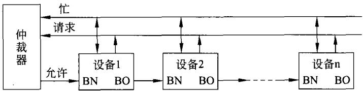  
图8-6串行优先级仲裁示意图

在图8-6中，仲裁器输出允许信号加到最高优先级设备1的BN上，其输出BO接下一级设备的BN端，依次连接。仲裁器输出允许信号为低电平，允许设备1提请求。若设备1无请求，则其BO输出为低，加到下一级设备上，允许这级设备提请求。若某一级设备有请求，则它将输出BO为高电平，此高电平加到下一级设备的BN上，使下一级设备不能提请求，同时还使得该设备的BO也输出为高电平。

显然，某一级设备有请求，则会输出BO为高电平，从而阻止其后的所有设备提请求。设备1的优先级最高，其后的设备一级比一级低，最后设备n的优先级最低。

在串行的总线优先级链中，当一个设备正在使用总线时，即使另一个优先级更高的设备希望取得总线控制权，也需要等待，直到当前模块用完总线为止。这中间，要用到“忙”信号去指出当前总线是处于“空闲"状态还是“忙"状态。“忙"有效时，表示总线上有一个设备已经获得总线控制权，此时，其他设备便不能获得总线控制权。

## ②并行总线仲裁

并行总线仲裁示意图如图8-7所示。

图8-7中有n个设备，都可作为总线主设备，每个设备都有总线“请求"线BR和总线“允许"线BG。设备之间是独立的，没有任何控制关系。这些信号接到总线优先控制器（仲裁器),任一设备使用总线，都要通过"请求"线向仲裁器发出“请求"信号。仲裁器一般由一个优先级编码器和一个译码器组成。该电路接到某个设备或多个设备发来的请求信号后，首先优先级编码器进行编码，然后由译码器产生相应的输出信号，发往请求总线设备中优先级最高的设备，并把“允许"信号送给该设备。被选中的设备撤销总线“请求"信号，输出总线“忙"BUSY信号，通知其余设备，总线已经被占用。在一个设备占用总线的传输结束以后，就把总线“忙"信号撤销，仲裁器也撤销"允许"信号。根据各请求输人的情况，仲裁器重新分配总线控制权。

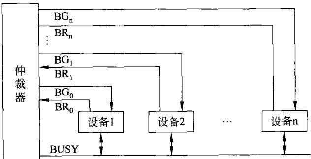  
图8-7并行优先级仲裁示意图

## ③计数器查询仲裁

计数器查询仲裁示意图如图8-8所示。

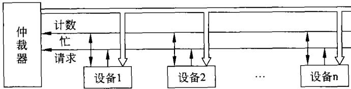  
图8-8计数查询仲裁示意图

当总线的某设备提出请求时，该总线请求加到仲裁器上。仲裁器启动计数器开始计数，并将计数值依次送出加到各设备上。每个发出请求的设备会将仲裁器发出的计数值与本设备的设备号进行比较。当仲裁器发出的计数值与本设备的设备号一致时，该设备就发出“忙"信号有效，向仲裁器及其他设备表示该设备获得了总线的控制权。同时，仲裁器收到此“忙"信号，便停止计数器计数。

可以看到，若每次请求计数器都从0开始计数，则设备号小的设备优先级高。若计数器从终止点开始新一次计数，直计数到最大设备号再以0循环，则设备的优先级相同。显然，计数器从何处开始计数，也可以由程序指定，这就使得用起来更加灵活。

20世纪70年代末，已经有集中式仲裁器集成电路，例如Intel的8289。利用这样的芯片很容易实现并行总线仲裁或串行总线仲裁。

## （2）分布式仲裁

分布式仲裁不需要一个集中的仲裁器，每个主控设备都有自己的仲裁号和仲裁器。当需要总线请求时，把它们唯一的仲裁号发送到共享的仲裁总线上。每个仲裁器将仲裁总线上得到的号与自己的号进行比较。如果仲裁总线上的号大，则它的总线请求不予响应，并撤销它的仲裁号。最后，获胜者的仲裁号保留在仲裁总线上。可见，分布式仲裁下仲裁号越大优先级越高。

## 8.1.3典型总线介绍

前面已经提到，前人已制定了适应不同应用的总线标准。限于篇幅，下面仅做简略地介绍。

## 1.通用总线标准

## （1）片内总线

目前，已有许多厂家推出用于SOC设计的片内总线，例如，AMBA总线、Wishbone总线、Avalon总线、CoreConnect总线、OCP总线等。有关这些总线的说明详见本书的最后一章。

## (2）系统(内）总线

不同领域的计算机有各自的系列系统总线，这里仅介绍常见的PC的系统(内)总线。

## ① PC/XT总线

这是最早期的PC(以8088为CPU)的系统总线。它由62个插座信号构成。包括8088CPU的20条地址线 $\mathbf { A } _ { 0 } \sim \mathbf { A } _ { 1 9 } \dots 8$ 条数据线 $\mathrm { D } _ { 0 } \sim \mathrm { D } _ { 7 }$ 以及内存的读写控制信号MEMR、MEMW和接口的读写控制信号IOR、IOW外，还包括6个中断清求 $\mathrm { I R Q } _ { 2 } \sim \mathrm { I R Q } _ { 7 }$ ,一个中断响应INTA,3个DMA请求信号 $\mathrm { D R E Q _ { 1 } } \sim \mathrm { D R E Q _ { 3 } }$ ,3个DMA响应信号 $\mathrm { D A C K } _ { 1 } { \sim } \mathrm { D A C K } _ { 3 }$ I/OCHCK、I/OCHRDY、AEN、RESET、OSC等信号。再就是±5V、±12V电源和地线。

## ②ISA总线

ISA是工业标准总线。它向上兼容早期的PC/XT总线，在原PC/XT总线62个插座信号的基础上，再扩充另一个36个信号的插座构成ISA总线。

ISA总线主要包括24个地址线，可寻址内存地址空间增加到16MB，有16条数据线，控制总线（内存读写、接口读写、中断请求、中断响应、DMA请求、DMA响应等)，士5V、士12V电源、地线等。

在原PC/XT总线信号的基础上，ISA总线新增加了8条数据线、4条地址线、7个中断请求、4个DMA请求、4个DMA响应等信号。使ISA总线成为寻址内存为16MB的16位总线。

## ③EISA总线

上面提到的ISA总线对于16位CPU是很合适的，例如80286、80386SX等CPU。但是，当80386DX(32位CPU)开发出来之后，ISA总线就无法适应32位CPU的性能要求了。为此，不少厂家在这个时期推出多种32位的内总线标准，例如VL总线、EISA总线等。

EISA总线是在ISA总线的基础上发展起来的32位总线。该总线定义32位地址线，32位数据线，以及其他控制信号线、电源线、地线等共196个接点。总线传输速率达33MBps。该总线利用总线插座与ISA总线相兼容，插板插在上层为ISA总线信号；将插板安到下层便是EISA总线。

尽管EISA在性能上比ISA要好得多，而且是一条32位的总线标准。但是，该标准并未得到很广泛的应用，不久它就被新推出的标准PCI所取代。

## ④PCI总线

1992年由Intel公司推出的PCI(外部设备互连)总线标准，该总线具有很好的性能和

特点，一经推出立即就得到广泛的应用。

PCI总线是一种不依赖任何具体CPU的局部总线，也就是说它独立于CPU。详细描述 PCI够写一本书,这里只说明 PCI的一些特点。

## a）高性能

PCI的总线时钟频率为33MHz/66MHz。而且在进行64位数据传送时，其数据传送速率可达到66M×8B=528MBps。这样高的传输速率是此前其他内总线所无法达到的。在PCI的插槽上，可以插上32位的电路板（卡)也可插上64位的电路板（卡），实现两者相兼容。

## b）总线设备工作与CPU相对独立

在CPU对PCI总线上的某设备进行读写时，要读写的数据先传送到缓冲器中，通过PCI总线控制器进行缓冲，再由CPU处理。当写数据时，CPU只将数据传送到缓冲器中，由PCI总线控制器将数据再写人规定的设备。在此过程中CPU完全可以去执行其他操作。可见，PCI的工作与CPU是不同步的，CPU速度可能很快而PCI相对要慢一些，它们是相对独立的。这一特点就使得PCI可以支持各种不同型号的CPU，具有更长的生命周期。

## c）即插即用

即插即用就是在PCI总线上的电路板（卡），插在PCI总线上立即就可以工作。PCI总线的这一特点为用户带来极大的方便。

在此前的总线上，例如ISA上，可以插上不同厂家生产的电路板（卡）。但不同厂家的电路板(卡)有可能发生地址竞争而无法正常工作。解决的办法就是利用的电路板(卡)上的跳线开关通过跳线改变地址而克服地址竞争。在PCI总线上就不存在这样的问题，此总线上的接口地址是由PCI控制器自动配置，不可能发生竞争。所以，电路板(卡)插上就可用。

## d）支持多主控设备

接在PCI总线上的设备均可以提出总线请求，通过PCI管理器中的仲裁机构允许该设备成为主控设备，由它来控制PCI总线，实现主控设备与从属设备间点对点的数据传输。并且，PCI总线上最多可以支持10个设备。

## e）错误检测及报告

PCI总线能够对所传送地址及数据信号进行奇偶校验检测，并通过某些信号线来报告错误的发生。

## f）两种电压环境

PCI总线可以在5V的电压环境下工作,也可以在3.3V的电压环境下工作。

## g）两种兼容卡槽

PCI总线定义了两种PCI扩展卡及连接器（即主板上的PCI插槽)：即长卡和短卡。

短卡为32位总线而设计，插槽分为A、B两边，每边定义62个引脚信号。故短卡共有124个引脚。

长卡为64位总线而设计，插槽分为A、B两边，每边定义94个引脚信号。很显然，长卡的A、B两边，每边的前62个引脚信号与短卡信号是完全一样的，以便长卡完全兼容短卡。

## ⑤ PCI-E

PCI属于并行传输方式，即使用多条信号线同时并行传输多位数据，但PCIExpress

(PCI-E)采用的是每次1位的串行传输方式。

PCI-E能够提供2.5Gbps的单向单线连接传输速率。一个PCIExpress连接可以被配置成x1，x2，x4，x8，x12,x16和 x32的数据带宽。x1的通道能实现单向312.5MBps(2.5Gbps)的传输速率，同理x32通道连接就能提供10GBps的速率。一般的显卡使用的是PCI-EX16标准，数据传输率为4.8GBps,远远高于现在最流行的AGP8X标准的2.1Gbps的数据流量。对于广大使用者来说，就像PCI代替ISA一样，PCI-E直接带来的就是显卡性能得到大幅度提升，从而使AGP永远退出历史舞台。

与PCI总线相比,PCIExpress总线主要技术特点如下。

a）PCI-E是串行总线，进行点对点传输，每个传输通道独享带宽。

b）PCI-E总线支持双向传输模式和数据分通道传输模式。其中数据分通道传输模式即PCIExpress 总线的x1、x2、x4、x8、x12、x16和x32多通道连接。

c）PCI-E总线充分利用先进的点到点互连、基于交换的技术、基于包的协议来实现新的总线性能和特征。PCI-E总线所支持电源管理、服务质量(QoS)控制、支持热插拔、数据完整性控制、错误处理机制等特征。

d）与PCI总线保持良好的继承性，从而可以保障软件的继承和可靠性。PCI-E总线的关键特征，比如应用模型、存储结构、软件接口等与传统PCI总线保持一致。使得并行的PCI总线被一种具有高度扩展性的、完全串行的PCI-E总线所替代。

e）PCI-E总线充分利用先进的点到点互连，降低了系统硬件平台设计的复杂性和难度，从而大大降低了系统的开发设计成本，极大地提高系统的性价比和健壮性。

## (3）通信(外)总线

① RS-232C

RS-232C是一条串行外总线，其主要特点如下。

## a）传输线比较少

尽管RS-232C定义的信号线比较多，但在应用中通常只用7到9条信号线即可实现通信。最少只需三条线(一条发、一条收、一条地线)即可实现全双工通信。

## b）传送距离远

用电平传送为15米，电流环传送可达千米。

## c）多种可供选择的传送速率

利用RS-232C进行通信，有多种通信速率可供选择。下列速率在可选之列：50、75、110、300、600、1200、2400、4800、9600 和19 200波特等。

## d）采用非归零码负逻辑工作

该标准规定，电平在一3V到一15V规定为逻辑1,而电平在十3V到十15V规定为逻辑0,具有较好的抗干扰性。

## e）结构简单、实现容易

RS-232C总线实现起来非常容易。

与该总线类似的还有RS-422、RS-423、RS-485等，此处不再说明。

## ② SCSI总线

小型计算机系统接口(SCSI)是一条并行外总线，广泛用于计算机与软硬磁盘、光盘、扫描仪等的外设的连接。就目前的应用来说，计算机的外存接口总线分为两大阵营，一类为下面将要提及的IDE(ATA)，另一类就是 SCSI。IDE是普通家用PC 硬盘、光盘等外设常用的接口，也是最常用到的硬盘接口；而SCSI主要是面向服务器、磁盘阵列(RAID)等高端外存储器市场。SCSI的特点如下。

## a）适应范围广

使用 SCSI可以连接的设备数超过15个，而且所有设备只占用一个中断号，因此它的适应面比IDE要广得多。

## b）传输速率高

目前最新的 SCSI接口类型Ultra320 SCSI所支持的最大总线速度为320Mbps,虽然实际使用时可能达不到这个理论值，但上百兆比特的传输率在 SCSI上还是能够达到的。即将诞生的 SCSI5 的传输速率将高达 640Mbps。

## c）提高了CPU的效率

构成 SCSI系统必须要有SCSI控制卡或适配器，在控制卡中有专用的芯片负责 SCSI数据的处理。CPU只需将命令传输给SCSI的专用处理芯片，后面有关的处理工作就由SCSI的专用芯片去处理。这时，CPU就可以去执行其他操作。因此，SCSI系统对CPU的占用率是很低的，这可以大大提高CPU的效率。

## d）支持多任务

在SCSI系统工作过程中，在对一个设备进行数据传输的同时，它允许另一设备对其进行数据访问。这在网络服务器系统中非常重要，因为在网络环境下，经常需要同时处理许多并行请求。可见，这一特点也是十分重要的。

## e）智能化

SCSI卡上的专用处理芯片可对CPU指令进行排队，这样就提高了工作效率。在多任务时，硬盘会在当前磁头位置，将邻近的任务先完成，再逐一处理其他任务。

## ③串行 SCSI(SAS)

SCSI在过去的二十多年里有了很大的发展。在今后的许多年里，SCSI总线还会继续发展并得到更加广泛的应用。

但是，在 SCSI总线的使用当中，尤其是近几年暴露出一些问题。

a）传输速率问题。目前SCSI的最高速率为320Mbps,未来可做到640Mbps。作为并行总线来说，这样的速率差不多到头了，再想增加速率就非常困难甚至不可能做到。

b）不支持热插拔。总的来说SCSI很娇气。必须在电脑和外设都关断电源的情况下插、拔，否则可能产生严重的后果。

c）挂接的设备有限。在SCSI总线上除主控器之外仅能挂接15个设备，每个设备须有自己的ID号，不得重复使用，CPU占用的ID其他设备不能用。这在使用上受到限制，若要突破这一限制，则需要比较复杂的工作。

## d）总线电缆的限制

SCSI总线电缆必须接上匹配网络，以减小电缆和连接器的反射，信号终端限制是比较苛刻的。

鉴于上述问题，2003年人们提出串行SCSI总线，即SAS总线。该总线一经提出，立即引起反响，许多厂家已根据其规范生产出有关产品。由于SAS的许多优异性能，可以肯定

它将成为未来连接硬盘、光盘等设备总线的发展方向。

SAS 的一些优异性能主要表现在如下几点。

## a）高速率

串行连接SCSI以一步到位的方式达到了优异的性能，具有扩展性和灵活性。目前的传输速率为3.0Gbps,SAS-2已做到 6Gbps,不久的将来传输速率将达到12Gbps。

## b）好的兼容性

针对不断扩大的系统需求，SAS能够对串行ATA(SATA)无缝兼容。可以方便地为用户提供混接SAS和SATA硬盘来有效地满足应用需求。

## c）点对点架构

串行 SCSI比此前的并行技术既简单又健壮。Ultra 320 SCSI需要用几十根信号导线（其中16个数据信号就需32条导线，每个信号需要两条)来实现信号传输，而SAS仅需4条。

## d）全双工设计

全双工操作在双方向上同时进行信号传输，因此使有效吞吐量提高一倍。

## e）更强的扩展性

与SAS的点对点架构相匹配的是高速交换设备，能够快速聚合许多硬盘，使一个单一SAS域能容纳多达16384块硬盘。

## f）更长的电缆长度

SAS电缆线最长可达8米(约25英尺)，不仅可用于直接连接服务器，还可连接服务器周围独立的存储阵列。

## g）电缆/接头紧凑设计

SAS接头和电缆比并行SCSI组件小得多，因此可简化接线、节省空间，并提高系统机箱内的空气流动及散热水平。SAS接头还能够轻松地插接到小尺寸硬盘上。

## h）支持热插拔/热交换

SAS的热插拔能力实现了不停机的硬盘交换。因此，保证了不中断的数据可用性。

## i）全球唯一的设备ID

每个SAS端口和扩展器都有一个全球唯一的64位SAS地址。

## j）保留 SCSI指令集

SAS 保留了现有的 SCSI指令及其并行技术所具有的核心优势。SAS还保护了企业多年来在配置、部署和维护 SCSI系统方面储备的大量 SCSI智力资金。

综上所述，串行SCSI被认为是企业级接口最佳的系统解决方案，SAS的超前思维设计确保它能够满足如今乃至未来的企业应用需要。

## ④ATA总线

ATA的前身为IDE(集成驱动器电气接口)及EIDE(增强IDE)。由美国国家标准学会命名为ATA总线。该总线广泛用于家用个人计算机，用来连接硬磁盘、光盘等设备。

早期的IDE功能很弱，但它能满足当时的个人计算机的需要。随着计算机的发展，对硬盘的容量要求越来越大，传输速率也要求越来越高，为适应这一要求，ATA也一代接一代的发展。ATA从1994年发布至今共经历了7代标准。

ATA总线也是一种并行总线，各代标准所定义的数据位宽不一样，传输速率也不一

样。最高传输速率可达到133Mbps。

像 SCSI总线一样,ATA作为主要用于磁盘、光盘、扫描仪等外设的并行总线，在技术与需求不断发展的情况下，暴露出许多问题，尤其是数据传输速率几乎快要达到极限。因此，也像 SCSI总线一样出现了串行的ATA总线，即SATA。

SATA采用7针数据电缆，主要有4个针脚,第1针发送信号,第2针接收信号,第3针供应电源，第4针为地线。最长可以达到1米，而并行ATA最长40厘米。SATA插接简单，还大大改善了机箱的通风条件。

同样，SATA也具备高速度(最新的eSATA传输速率为3Gbps)、可连接多台设备、支持热插拔、内置数据校验等优秀特点。

## ③通用串行总线USB

现在USB已经广为流行，成为PC不可或缺的接口总线。同时，USB也在工业控制机中广为采用，而且今后其应用必定更加普遍。之所以这样，是因为USB具备许多优异的性能与特点。

## a）传输速率高

USB1.0有两种传送速率：低速1.5Mbps,高速为12Mbps。USB2.0的传送速率为480Mbps。前者用于低速外设，如键盘、鼠标等；而后者可用于高速外设，如U盘、移动硬盘、多媒体外设等。

## b）支持即插即用

主控USB可以随时监测该USB总线上设备的接人和拔出情况。在主控器的控制下，总线上的外设永远不会发生冲突，实现了总线的设备即插即用。

## c）支持热插拔

用户在USB上使用外接设备时，不需要重复“关机→将并口或串口电缆接上→再开机”这样的动作，而是直接在PC开机时，就可以将USB电缆插上使用。显然，用户必须明确，作为USB总线接口是允许带电插拔的。但是，在使用时必须注意外设是否支持热插拔。若移动硬盘正在写数据，这时拔下USB电缆插头，这可能对USB总线没有伤害，但对移动硬盘来说就是不允许的。

## d）良好的扩展性

USB支持在总线上接上多个设备同时工作，而且总线的扩展很容易实现。在USB上最多可以连接127台设备。

## e）可靠性高

USB上传输的数据量可大可小，允许传输速率在一定范围内变化，为用户提供了使用上的灵活性。同时，在USB协议中包含了传输错误管理、错误恢复等功能，并能根据不同的传输类型来处理传输错误。从而提高了总线传输的可靠性。

## f）统一标准

USB是一种开放的标准。在USB总线上，所有用USB系统的接口都一致，连线简单。各种外设都可以用同样的标准与主机相连接，这时就有了USB硬盘、USB鼠标、USB打印机等。这就使得使用非常简单，尤其是有了支持USB的操作系统（例如，高于Windows 98的版本)，外设插上就可以使用。

## g）总线供电

USB总线上可以提供容量为5V×500mA的电源，这对许多要求功率不大的外设特别方便。

## h）传送距离

USB在低速传送(低速1.5Mbps)时，采用非屏蔽电缆，结点间的距离为3m;在全速传送（低速12Mbps)时，采用屏蔽电缆，结点间的距离为5m。

## i）低成本

USB接口电路简单，易于实现，特别是低速设备。USB系统接口/电缆也比较简单，成本相对较低。

在USB2.0的规范中，USB定义了4个信号： $\mathrm { \Delta V _ { U S B } }$ （电源+5V)、GND(地）、D+（信号正端)、D一(信号负端)。这4个信号用一条屏蔽(或没有屏蔽)的4芯电缆进行传送，如图8-9所示。

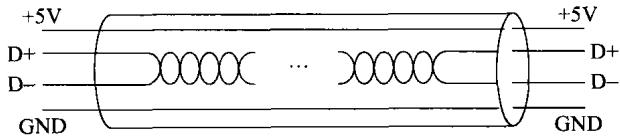  
图8-9USB总线信号

在图8-9中，一对标准规格的双绞线既可以用来传送单端信号也可以用来传送差分信号。另外一对用于提供5V×500mA容量的电源。

在USB总线上，允许以不同的速率来传送数据。

·USB1.0全速传送，传送速率为12Mbps;低速传送，传送速率为1.5Mbps。

·USB2.0传送速率为480Mbps。

·USB3.0传送速率为 5Gbps。

## ⑥IEEE-1394

IEEE-1394作为新一代串行外总线，有许多优点与USB相同，现将其主要性能特点罗列如下。

## a）支持热插拔

该特性保证系统在全速工作时，IEEE-1394设备也可以插人或拔下。使用者会发现，增加或去掉-个1394设备，就像将电源线插头插人或拔出电气插座一样容易。

## b）即插即用

同前USB一样，接在1394上的设备插上即可使用，不存在竞争问题。设备的存在与否及设备地址由主结点动态地确定，对使用者是透明的。

## c）传输速率高

IEEE-1394a标准定义了三种传输速率，这三种速率分别在100Mbps、200Mbps和400Mbps。这样的速率已经可以用来传输动态图像信号。而IEEE-1394b标准支持800Mbps、1.6Gbps甚至3.2Gbps的传输速率。

## d）兼容性好

IEEE-1394总线可适应台式个人机用户的各种I/O设备的要求，凡是SCSI、RS-232、IEEE-1284、Centronics等可实现的接口功能，1394均可实现。

## e）支持同步和异步传输

异步传输是传统的传输方式，它在主机与外设传输数据的时候，不是实时地将数据传给主机，而是强调分批地把数据传出来，但数据的准确性却非常高。而同步传输则强调其数据的实时性，利用这种功能，设备可以将数据直接通过IEEE-1394的高带宽和同步传输直接传到电脑上，从而减少了以往的昂贵的缓冲设备。

## f）构成网络形式灵活

IEEE-1394可以使用菊花链、树形、星形等多种形式构成通信网络，可以实现多种灵活的拓扑结构。每个设备都具有一个唯一的64位的设备地址，其中10位用做网络标识、6位用做网络内的设备标识，剩余的48位作为每个结点上的存储器地址。可见，理论上IEEE-1394上可以接上的设备数可用16位来表示，达64000台。

## g）传送距离远

在IEEE-1394上，两结点间的电缆长度为4.5米，而它最多允许有16层结点。因此，它构成的数据链路从头到尾为16×4.5米=72米。当然，可以由多条长度为72米的数据链路构成IEEE-1394的通信网络。根据IEEE-1394b规范，在此总线上两结点间的最大距离可达100米。

## h）接口设备对等

在IEEE-1394总线上不分主从设备，都是主导者和服务者。其中有足够的功能用于连接，不需附加控制。

## i）总线供电

IEEE-1394总线上可以提供电压8V到40V、电流为1500mA的电源供无源外设使用。

## j）价格低

IEEE-1394的价格降低，适合于家电产品。

IEEE-1394接口有6针和4针两种类型。

最早苹果公司开发的IEEE-1394接口是6角形的6针接口。这种接口主要用于普通的

台式计算机，目前很多主板都具备这种接口，应用十分广泛。6芯的IEEE-1394电缆截面示意图如图8-10所示。

在图8-10中，一组两股双绞线用于传送数据，另一组用于传送时钟信号。剩余的两条线用于提供电源。

SONY公司看中了1394数据传输速率快的特点，将早期的6针接口进行改良，设计成为现在大家所常见的小型4角形4针接口。该接口外观上要比6针的小很多，主要用于笔记本电脑和DV上。与6

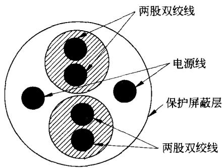  
图8-10IEEE-13946芯电缆示意图

针的接口相比，4针的接口没有提供电源引脚，所以无法供电，但其优势就是小巧。

目前常见到的外总线还有许多，如IEEE-1284、Centronic,尤其是像在工业控制计算机中常用到的CompactPCI总线、PC/104总线、现场总线（CNA)，以太网等，由于篇幅所限，这里不再说明。

## 8.2输人/输出基本原理

## 8.2.1外部设备

不同类型、不同用途的计算机所用的外部设备不一样，常规外设是每一台计算机所必备的，而专用外设是针对某种应用所配置的。常规外设主要包括三个方面：输人设备、输出设备和外部存储设备。

## 1．输入设备

输入设备有多种，下面仅介绍鼠标和键盘。

## （1）鼠标

鼠标因形似老鼠而得名“鼠标”。发明于20 世纪60年代，80 年代以后获得广泛的应用。

## ①分类

以不同的角度，鼠标有不同的分类，这里依照工作原理，分为如下几种。

## a）机械鼠标

机械鼠标是早期使用的一种鼠标，在此鼠标中用一个可4向滚动的胶质小球。这个小球在滚动时会带动一对转轴转动(分别为 X转轴、Y转轴)，在转轴的末端都有一个圆形的译码轮，译码轮上附有金属导电片与电刷直接接触。当转轴转动时，这些金属导电片与电刷就会依次接触，出现"接通"或“断开"两种形态，前者对应二进制数"1”、后者对应二进制数“0”。接下来，这些二进制信号被送交鼠标内部的专用芯片做解析处理并产生对应的坐标变化信号。只要鼠标在平面上移动，小球就会带动转轴转动，进而使译码轮的通断情况发生变化，产生一组组不同的坐标偏移量，反应到屏幕上，就使得光标可随着鼠标的移动而移动。

机械式鼠标价格便宜，维修方便。但其精度低，反应迟钝，易粘染纤维及污物影响其工作，现已不再使用。

## b）光机鼠标

在纯机械式鼠标的基础上，通过引入光学技术来提高鼠标的定位精度。与纯机械式鼠标一样，光机鼠标同样拥有一个胶质的小滚球，并连接着X、Y转轴，但在光机鼠标里不再用圆形的译码轮，代之的是两个带有栅缝的光栅码盘，并且增加了发光二极管和感光芯片。当鼠标在桌面上移动时，滚球会带动X、Y转轴的两只光栅码盘转动，而X、Y发光二极管发出的光便会照射在光栅码盘上，通过光栅码盘的栅缝照射在感光芯片的检测头上。如果接收到光信号，感光芯片便会产生"1"信号，若光栅阻挡接收不到光信号，则信号为"0”。接下来，这些信号被送人专门的控制芯片内运算生成对应的坐标偏移量，确定光标在屏幕上的位置，现已很少使用。

## c）光电鼠标

光电鼠标没有传统的滚球、转轴等设计，其主要部件为两个发光二极管、感光芯片、控制芯片和一个带有网格的反射板(专用鼠标垫)。工作时光电鼠标必须在反射板上移动，X发

光二极管和Y发光二极管会分别发射出光线照射在反射板上，接着光线会被反射板反射回去，经过镜头组件传递后照射在感光芯片上。感光芯片将光信号转变为对应的数字信号后将之送到定位芯片中专门处理，进而产生X-Y坐标的偏移数据。

这种光电鼠标在精度上有所提高，但它存在依赖反射板、造价高、移动不够方便等缺点，现已很少使用。

## d）光学鼠标

光学鼠标的底部也没有滚球，也不需要借助反射板来实现定位，其核心部件是发光二极管、微型摄像头、光学引擎和控制芯片。工作时发光二极管发射光线照亮鼠标底部的表面，同时微型摄像头以一定的时间间隔不断进行图像拍摄。鼠标在移动过程中产生的不同图像传送给光学引擎进行数字化处理，最后再由光学引擎中的定位DSP芯片对所产生的图像数字矩阵进行分析。由于相邻的两幅图像总会存在不相同的特征，通过对比这些特征点的位置变化信息，便可以判断出鼠标的移动方向与距离，这个分析结果最终被转换为坐标偏移量实现光标的定位。

光学鼠标既保留了光电鼠标的高精度、无机械结构等优点，又具有高可靠性和耐用性，并且在使用过程中不须清洁亦可保持良好的工作状态。因此，得到迅速广泛的应用。

## e）激光鼠标

激光鼠标原理跟光电鼠标一样，只是把发光二极管换成了激光二极管来照射鼠标所移动的表面，激光光线能从所照射的表面反射产生高反差图形，出现在传感器上的图形会显示物体表面上用一般发光二极管所不能产生的细节。从而大大提高鼠标的精确度。

## f）轨迹球鼠标

轨迹球鼠标从外观上看就像是翻转过来的机械鼠标，用手拨动轨迹球来控制光标的移动。这种鼠标有时用在笔记本或其他专用计算机上。

## g）感应鼠标

在感应板上移动手指，光标就会向相应方向移动，当光标到达预定位置时，按一下感应板，就可执行相应功能。感应鼠标经常用在笔记本电脑上。

## h）无线鼠标

无线鼠标器是为了适应大屏幕显示器而生产的。所谓"无线”，即鼠标没有电缆连接，而是采用电池无线遥控，接收范围在数米以内。

## i）3D鼠标

3D振动鼠标是一种新型的鼠标器，它不仅可以当作普通的鼠标器使用，而且具有如下特点。

·具有全方位立体控制能力。它具有前、后、左、右、上、下6个移动方向，而且可以组合出前右，左下等多种移动方向。

·外形和普通鼠标不同。一般由一个扇形的底座和一个能够活动的控制器构成。

·具有振动功能，即触觉回馈功能。玩某些游戏时，当玩家被敌人击中时，会感觉到玩家的鼠标也在振动。

·是真正的三键式鼠标。

②主要技术指标

鼠标的主要技术指标有如下几种。

## a）分辨率

鼠标分辨率的单位应该是cpi(每英寸测量次数),它所指的是鼠标在桌面上每移动1英寸距离鼠标所产生的脉冲数，脉冲数越多，鼠标的灵敏度也越高。一般说来，光机鼠标的灵敏度在300～600cpi之间。而对光学鼠标来说，分辨率高低就取决于感应器本身，目前主流光学鼠标的分辨率在 400～800cpi之间。

## b）采样频率

采样频率是光学鼠标独有的性能指标，它所指的是感应器每秒钟采集/分析图像的能力，单位为“帧/秒”。

早期的光学引擎的采样率只有1500 帧/秒，也就是说它在一秒钟内只能采集和处理1500张图像，此时它所能追踪到鼠标的最快移动速度为14英寸/秒。

图像处理能力是光学引擎中定位DSP芯片的计算能力，它等于CMOS感应器的尺寸与采样频率的乘积。例如，感应器尺寸为22×22=484像素，采样频率1500帧/秒，其图像处理能力就等于484×1500=726000，即每秒钟可处理72.6万个像素。显然，图像处理能力的高低是光学引擎能力的体现，目前的光学引擎拥有每秒580万像素的高超处理能力。

## c）有线接口

有线鼠标一般有三种接口，分别是RS-232串口、PS/2口和USB口。USB接口是今后发展的方向。

## d）无线接口

无线接口主要采用红外线或蓝牙。

## e）按键数

有两键鼠标和三键鼠标。两键鼠标和三键鼠标的左右按键功能完全一致，一般情况下，用不着三键鼠标的中间按键，但在使用某些特殊软件时(如Auto CAD等)，会用到这个键。

## （2）键盘

键盘是最常用也是最主要的输入设备，通过键盘，可以将英文字母、数字、标点符号等输入到计算机中。

早期的PC的键盘主要以83键为主，后来随着视窗系统的出现，取而代之的是101键和104键键盘。近年出现了多媒体键盘、人体工程学键盘、手写键盘、无线键盘系。

## ①分类

不同的角度，键盘有不同的分类。

按照应用可以分为：台式机键盘、笔记本电脑键盘、工控机键盘，双控键盘、超薄键盘5大类。

按照键盘的工作原理和按键方式可以分为如下几种。

## a）机械键盘

机械键盘采用类似金属接触式开关，工作原理是使触点导通或断开，具有工艺简单、噪音大、易维护的特点。使用时间一长故障率升高，现在已基本被淘汰，取而代之的是电容式键盘。

## b）塑料薄膜键盘

键盘内部共分4层，不存在机械磨损。其特点是低价格、低噪音和低成本。

## c）导电橡胶键盘

导电橡胶键盘触点是通过导电橡胶相连。键盘内部有一层凸起带电的导电橡胶，每个

按键都对应一个凸起，按下时把下面的触点接通。

## d）电容键盘

键盘中使用类似电容开关的原理，按键时改变电极间的距离引起电容容量改变，使振荡脉冲易于通过，从而驱动编码器输出对应不同按键的编码。这种开关是无触点非接触式的，磨损率极小，也没有接触不良的隐患，具有噪音小，容易控制手感，可以制造出高质量的键盘。目前被广泛采用。

## ②选择键盘

## a）按键的多少及结构

不同键盘按键的多少及结构形状不一样。根据计算机工作的需要加以选用。

## b）接口类型

早期的PC采用AT键盘接口，那是一个很大的圆形接口，俗称"大口"键盘。目前使用PS/2接口，而更多的则采用USB接口。

## c）通用与专用

在通用计算机中，经常配置通用的编码键盘。这种键盘是由厂家设计制造好，作为商品出售。这种键盘硬软件全部为用户准备好，用户拿来便可使用。上面所提到的PC的键盘，就是这种通用的编码键盘。

在许多专用应用中，尤其是嵌入式计算机系统中，配置专用的键盘。此时，为简单并满足专用的需要，可由用户自行设计专用的非编码键盘。这种键盘接口简单只能提供列的状态，按键的识别及键值的确定则由软件来完成。

## d）有线与无线

有线键盘通过接口利用电缆将键盘与主机相接。

无线键盘利用红外技术或蓝牙技术与主机传送信息。

## e）其他

在选用或设计键盘时，还需要考虑按键的手感、舒适度、体积、价格、可靠性等因素。

## 2.输出设备

计算机可以配置多种输出设备，下面仅简单介绍打印机及显示器。

## （1）打印机

打印机是将计算机的运行结果或中间结果打印在纸或其他介质上的常用输出设备。

## ①分类

打印机的种类很多，按打印元件对纸是否有击打动作分为：击打式打印机与非击打式打印机。按打印字符结构分为：全形字符打印机和点阵字符打印机。按一行字在纸上形成的方式分为：串式打印机与行式打印机。按所采用的技术分为：柱形、球形、针式、喷墨式、热敏式、激光式、静电式、磁式和发光二极管式等打印机。按打印的颜色分为：彩色打印机和单色打印机。下面仅介绍常见的几种。

## a）针式打印机

梳型点阵针式打印机的打印元件由若干水平排成一行的打印针组成，通过电磁铁驱动，使针撞击色带，在纸上印出一排点，根据字符点阵大小由几排点构成一行字符。

针式打印机由开始的9针发展到后来的24针;曾经有一段风光的历史。但终因其打印质

量低、噪声大、速度慢等原因，现已很少使用。只有在银行、超市等地方还可以见到它的存在。

## b）喷墨打印机

喷墨打印机是串式点阵字符非击打式打印机。喷墨打印机基本的工作原理都是先产生小墨滴，再利用喷墨头把细小的墨滴导引至设定的位置上，墨滴越小，打印的图片就越清晰。基本原理看起来很简单，但操作起来就没有那么简单了。在技术上主要有如下两种。

## ·微压电技术

微压电技术的基本原理是将许多微小的压电陶瓷放置到喷墨打印机的打印头喷嘴附近，利用压电陶瓷在电压作用下会发生形变的原理，使喷嘴中的墨汁喷出，在输出介质表面形成图案。

## ·气泡式喷墨技术

此技术利用加热组件在喷头将墨水瞬间加热产生气泡形成压力，从而墨水自喷嘴喷出，接着再利用墨水本身的物理性质冷却热点，使气泡消褪，借此达到控制墨点进出与大小之双重目的。

## c）激光打印机

激光打印机是将激光扫描技术和电子显像技术相结合的非击打输出设备。基本工作原理及过程是：充电、曝光、显影、转印、消电、清洁和定影7道工序，其中有5道工序是围绕感光鼓进行的。

感光鼓是一个光敏器件，有受光导通的特性。表面的光导涂层在扫描曝光前由充电辊充上均匀电荷。当激光束以点阵形式扫射到感光鼓上时，被扫描的点因曝光而导通，电荷由导电基对地迅速释放。没有曝光的点仍然维持原有电荷。这样在感光鼓表面就形成了一幅电位差潜像(静电潜像)，当带有静电潜像的感光鼓旋转到载有墨粉辊的位置时,带相反电荷的墨粉被吸附到感光鼓表面形成了墨粉图像。

当载有墨粉图像的感光鼓继续旋转，到达图像转移装置时，一张打印纸也同时被送到感光鼓与图像转移装置的中间，此时图像转移装置在打印纸背面施放一个强电压，将感光鼓上的墨粉像吸引到打印纸上。然后，再将载有墨粉图像的打印纸送入高温定影装置加温、加压热熔，墨粉熔化后浸人到打印纸中，最后输出的就是打印好的文本或图像。

## ②基本技术指标

## a）分辨率

分辨率是指在一定面积内打印机所能打印的单个点数，单位为dpi(每英寸点数)，比如分辨率为300dpi的打印机表示能在一平方英寸内打印300×300=90000个点数。一般来讲分辨率越高，则输出的图像就越精细，越没有颗粒感。

## b）打印速度

打印速度是用每分钟打印的张数来表示。不同的打印机打印速度不一样，慢的可以打印4～8页/分，快的可以达到300页/分。

## c）打印幅面

通常用可打印的纸张的大小表示，如A4、A3幅面等。特殊用途打印机可打印超大幅面，如绘图、广告等。

## d）打印负荷

在一般家庭用户看来，打印机的打印负荷似乎不那么重要，但是对那些打印量比较大的

用户而言，是一个非常重要的一个购买参数。如有的打印机的负荷力是10 000页/月，也就是说它每个月可以打印多达10000页的普通文件，平均每天可承受300多页的打印量。这是商业用户关注的指标。

## e）其他

其他如价格、体积、重量、耗材等指标。

## （2）显示器

显示器作为计算机重要的输出设备，从单色到彩色显示走过了几十年漫长而艰辛的岁月。目前，计算机配置多种不同类型的显示器。下面仅介绍常用的几种。

## ①CRT显示器

构成显示器可用阴极射线管(CRT)，它是利用电子技术控制CRT管内部电子枪发出的电子束，使电子束打在显示屏内部的磷光层上，从而产生画面。人们将阴极射线管称为显像管。

描述显像管的大小是用显像管的对角线的尺寸，而不是它的显示面积。目前常用的是17英寸、19英寸、21英寸等彩色显示器。CRT显示器现在都采用纯平屏幕，以增大可视角度。

由于CRT显示器在体积、重量、辐射等原因，加上液晶、等离子显示器的发展，不久的将来，就会退出历史舞台。因此，不再做更多的说明。

## ②LCD显示器

LCD显示器即液晶显示器的优点是机身薄，占地小，辐射小，重量轻，耗电低。目前，无论是用做计算机的显示器还是用做电视机的显示屏，均得到广泛应用。

## a）LCD显示器的工作原理

从液晶显示器的结构来看，无论是笔记本电脑还是桌面系统，采用的LCD显示屏都是分层结构。LCD由两块玻璃板构成，厚约lmm,其间由包含有液晶材料的5μm均匀间隔隔 $5 _ { \mu \mathrm { m } }$ 开。因为液晶材料本身并不发光，所以在显示屏两边都设有作为光源的灯管，而在液晶显示屏背面有一块背光板(或称匀光板)和反光膜，背光板由荧光物质组成，可以发射光线，其作用主要是提供均匀的背景光源。

背光板发出的光线在穿过第一层偏振过滤层之后进人包含成千上万液滴的液晶。液晶层中的液滴都被包含在细小的单元格结构中，一个或多个单元格构成屏幕上的一个像素。在玻璃板与液晶材料之间是透明的电极，电极分为行和列，在行与列的交叉点上，通过改变电压而改变液晶的旋光状态，液晶材料的作用类似于一个个小的光阀。在液晶材料周边是控制电路部分和驱动电路部分。当LCD中的电极产生电场时，液晶分子就会产生扭曲，从而将穿越其中的光线进行有规则的折射，然后经过第二层过滤层的过滤在屏幕上显示出来。

## b）LCD显示器的主要技术指标

## ·分辨率

分辨率是指像素点之间的距离，像素数越多，其分辨率就越高，因此，分辨率通常是以像素数来计量的，如： $6 4 0 \times 4 8 0$ ，其像素数为307200。

根据所使用的LCD面板，一旦面板定了，它能显示的像素点也就定了。也就是LCD实际上只支持一种显示模式，这就是它的最佳分辨率。它不能像CRT显示器那样可以方便地改变显示模式。例如，其19寸LCD显示器的最佳分辨率为 $1 4 4 0 \times 9 0 0$

当然，利用软件控制LCD可以显示其他的模式，例如,1024×768,800×600等，但显示效果就差了不少。

## ·点距与可视面积

点距(或条纹间距)是显示器的一个非常重要的硬件指标。所谓点距，是指一种给定颜色的一个发光点与离它最近的相邻同色发光点之间的距离，这种距离不能用软件来更改，这一点与分辨率是不同的。在任何相同分辨率下，点距越小，图像就越清晰。

根据显示分辨率和屏幕的可视尺寸，可以直接计算出点距。例如，14寸的LCD显示器的可视面积为285.7×214.3mm，若其最佳分辨率为1024×768，则其水平方向上的点距为285.7÷1024=0.279mm,垂直水平方向上的点距为214.3÷768=0.279mm。通常，点距多在0.2～0.3mm范围内。

显然，利用点距和最佳分辨率也可以算出液晶屏的可视面积。

## ·刷新速度

显示器的刷新率是指每秒钟出现新图像的数量，单位为Hz(赫兹)。刷新率越高，图像的质量就越好，闪烁就越不明显，人的感觉就越舒适。一般认为，70～72Hz的刷新率即可保证图像的稳定。

## ·亮度

LCD显示器的亮度单位为流明/平方米(cd/m)或者尼特(nits)。目前，LCD显示器的亮度在500cd/m上下，已达到CRT的亮度水平。最近厂家提供的新的产品亮度达到1500cd/m²。

## ·对比度

对比度是LCD显示器的重要指标，它直接影响显示图像的色阶。对比度越高，显示图像的层次感就越好。早期其LCD显示器的对比度为几百比一，目前市面上出售的高对比度产品的对比度已经达到了3000：1，甚至是10000：1。

## ·响应时间

响应时间是LCD显示器的又一个重要指标，它是指LCD显示器对输人信号的反应时间。也就是液晶显示器各像素点对输入信号反应的速度，即像素由暗转亮或由亮转暗所需要的时间(其原理是在液晶分子内施加电压，使液晶分子扭转与恢复)。

从早期的LCD的响应时间是25ms，到大家熟知的16ms再到最近的12ms、8ms和4ms。响应时间被不断缩短，这使得过去液晶显示器不适合娱乐的观念正在被打破。可以先做一个简单的换算：30ms对应1/0.030=每秒钟显示33帧画面；25ms对应1/0.025=每秒钟显示40帧画面;16ms对应1/0.016=每秒钟显示63帧画面；12ms对应1/0.012=每秒钟显示83帧画面。可以看出当响应时间缩短到8ms、4ms 时，意味着液晶显示的一个巨大进步。

## ·可视角度

可视角度是指用户可以从不同的方向清晰地观察屏幕上所有内容的角度。由于提供液晶显示的光源经折射和反射后输出时已有一定的方向性，在超出这一范围观看就会产生色彩失真。早期的LCD显示器的可视角度比较小，稍偏一点正视的角度，视觉效果就会受影响很大。

目前，市场上大多数产品的可视角度在120度以上，部分产品达到了140度，有的甚至

达到170度。

## ·色彩表现

色彩的表现就是能显示的色阶数目。目前，多数彩色显示器能够呈现260000种颜色。相当多的厂商使用了所谓的FRC（FrameRateControl)技术以仿真的方式来表现出全彩的画面。当然，此全彩画面必须依赖显示卡的显存的容量。利用这种技术可以达到呈现1600万种颜色。

## ·接口

与传统的CRT显示器一样，大部分LCD都被设计成接收模拟信号的模式。因为，目前桌面系统中的很多标准显卡仍然是在将视频信息由最初的数字信号转化为模拟信号之后再传送给显示器显示的，所以能直接接收由PC产生的信号。

最新的LCD采用了一种数字连接器图形卡，直接向LCD显示器传送数字信号。人们称之为DVI数字视频端口，可以得到更加纯净的画质，这也是DVI出现的原因。

## ·功耗

即使LCD显示器相对比较省吧，目前它也是计算机耗电最大的外设之一，显示器的功率消耗问题已越来越受到人们的关注。

## ③PDP等离子显示器

PDP(等离子显示器)是采用了近几年来高速发展的等离子平面屏幕技术的新一代显示设备。

## a）成像原理

等离子显示技术的成像原理是在显示屏上排列上千个密封的小低压气体室，通过电流激发使其发出肉眼看不见的紫外光，然后紫外光碰击后面玻璃上的红、绿、蓝3色荧光体后发出肉眼能看到的可见光，以此成像。

## b）等离子显示器的特点

## ·高亮度、高对比度

等离子显示器具有高亮度和高对比度，完全能满足眼睛需求；由于亮度高，所以其色彩还原性非常好。

## ·平面图像无扭曲

等离子显示器的RGB发光栅格在平面中呈均匀分布，这样就使得图像即使在边缘也没有扭曲的现象发生。

## ·超薄设计、超宽视角

由于等离子技术显示原理的关系，使其整机厚度大大低于传统的CRT显示器，与LCD相比也相差不大，而且能够多位置安放。

## ·具有齐全的输人接口

为配合接驳各种信号源,等离子显示器具备DVD接口、VGA/SVGA 接口、S端子和HDTV接口等。

## ·环保无辐射

等离子显示器一般在结构设计上采用了良好的电磁屏蔽措施，其屏幕前置环境也能起到电磁屏蔽和防止红外辐射的作用，对眼睛几乎没有伤害，具有良好的环境特性。

有关等离子显示器的技术参数可参照LCD显示器，此处不再说明。

## ④LED发光二极管显示器

这是一种通过控制半导体发光二极管的显示方式的显示器，它由很多个发光二极管点阵组成，是靠二极管的亮灭来显示字符、图形、图像、动画、视频、录像等各种信息的显示屏幕。

LED显示器的优点概括起来是：亮度高、工作电压低、功耗小、小型化、寿命长、耐冲击和性能稳定。LED的发展前景极为广阔。有关LED显示器的技术细节，本书不再说明。

## 3.存储器设备

无论是联机磁盘存储器还是脱机光盘存储器等都是外存储器，是计算机系统的重要组成部分。本小节将对常用的外存储器做简要介绍。

## （1）磁表面存储器

## ①磁表面存储原理及记录方式

目前，用做外存储器的主要是磁盘和磁带。下面说明磁记录的原理及记录方式。

## a）磁记录原理

磁记录的原理是利用硬磁材料的剩余磁状态来保存二进制信息。磁表面通过磁头记录信息的示意图如图8-11所示。

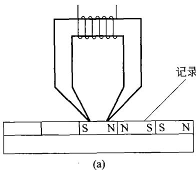

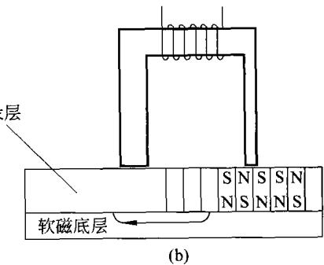  
图8-11水平记录与垂直记录示意图

早期的磁记录如图8-11(a)所示，称为水平记录。在写人时线圈中加入不同方向的电流，会在磁表面形成如图8-11所示的水平方向的磁畴。在读出时，随着磁表面的移动，磁畴会在读出磁头的线圈中感应出电流，从而将信息读出。

随着技术的发展，对磁记录密度及可靠性提出了更高的要求，近几年出现了如图8-11(b)所示的垂直记录形式。如图8-11所示，这种记录的磁畴是垂直的，记录密度非常高。而且，由于磁畴的极性相互锁住，其可靠性更高。同样,在读出时，随着磁表面的移动，磁畴会在读出磁头的线圈中感应出电流，从而将信息读出。

## b）磁记录方式

磁记录方式就是按照某种规则将二进制信息变换为磁记录层上磁场变化的方法。图8-12给出了二进制数据与其相应的写入电流的波形，也是与相应磁化状态的对应关系。

## ·归零制(RZ)

写人时，0为负电流脉冲，1为正电流脉冲。两位信息之间，电流回到零(归零)。显然，电流不同，磁畴的方向也不同，从而记录不同信息。

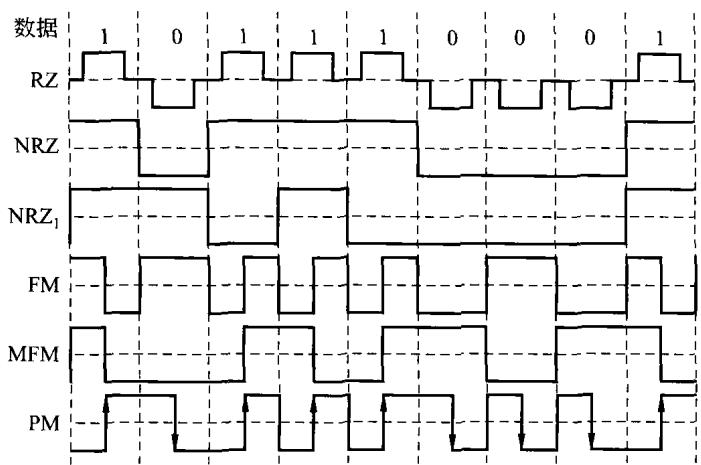  
图8-12磁记录波形(写人电流或磁化强度)

## ·不归零制(NRZ)

在记录信息过程中，磁头线圈里没有正电流就必有负电流，没有电流回到零的情况。这种记录方式在连续0或连续1时，记录电流(或磁化方向)不变，只在0变1或1变0时才改变。

## ·见1就变不归零制（NRZ）

此方式与NRZ类似，磁头线圈里没有正电流就必有负电流，没有电流回到零的情况。不同之处是只有记录1时电流(或磁化方向)发生改变。因此称为见1就变不归零制。

## ·调频制(FM)

该记录方式是每位记录电流(或磁化方向)改变一次，并且在记录1时，在其中心改变一次。由图8-12可以看到记录1时电流改变的次数为0的两倍，即记录0和1的频率不一样，故称调频制。

## ·改进调频制(MFM)

此方式规定记录1时只中间改变一次，记录连续两个或两个以上的0时，每位改变一次。并且;遇到单个0,电流不变。

## ·调相制(PM)

调相制是规定用不同的电流(或磁化)方向表示二进制的0或1。在图8-12中是以正方向为1而以负方向为0。

## c）性能评价

对磁记录方式的性能评价主要包括以下几种。

## ·自同步能力

在众多的记录方式中，能够直接在磁表面记录中读出的信息并获得其二进制码元同步信号的称该记录方式具自有同步能力。有自同步能力的记录方式很容易由其读出信号获得同步信号，硬件实现比较容易。若没有自同步能力，则需利用比较复杂的硬件和技术获得同步信号。

在如图8-12所示的记录方式中，NRZ、NRZ均无自同步能力。因为当记录了连续多个0或连续多个1时，无法直接从读出信号中提取同步信号。图8-12中的其他记录方式都

有自同步能力。

为了增加自同步能力，可用(5,4)群码来记录,即选用5位编码中的16 种连续0的个数不超过2的编码来表示4位编码，细节从略。

## ·编码效率η

编码效率n定义为：

$$
\eta = \vert \frac { 2 } { 1 2 } \frac { 2 3 } { 1 2 } \vert \frac { 3 } { 2 } \vert \frac { 3 } { 2 } \vert \frac { 3 } { 2 } \vert \frac { 3 } { 2 } \vert \frac { 3 } { 2 } \vert \frac { 3 } { 2 } \vert \frac { 5 } { 2 } \vert \frac { 3 } { 2 } \vert \frac { 5 } { 2 } \vert \frac { 5 } { 2 } \vert \frac { 5 } { 2 } \vert \frac { 5 } { 2 } \vert \frac { 5 } { 2 } \vert \frac { 5 } { 2 } \vert \frac { 5 } { 2 } \vert \frac { 5 } { 2 } \vert \frac { 5 } { 2 } \vert \frac { 5 } { 2 }\tag{8-2}
$$

例如,在FM和 PM方式下，记录一位二进制编码需磁化方向改变2次，故其编码效率η为0.5;而 MFM、NRZ、NRZ记录一位二进制编码只需磁化方向改变1次,故其编码效率n为1。

## （2）磁盘存储器

## ①磁盘驱动器结构

磁盘可分为软盘和硬盘两种。在这里只简单说明硬磁盘的结构。

硬盘的盘片一般是在铝为主要成分的基片表面涂上磁性介质形成的。一个硬盘驱动器内可装有多个盘片，组成盘片组，每个盘片可以提供两个记录面，每个记录面都配有一个独立的磁头，如图8-13(a)所示。所有记录面上相同序号的磁道构成一个圆柱面，其编号与磁道编号相同，如图8-13(b)所示。

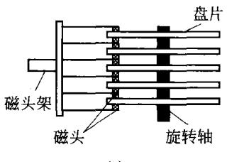  
(a)

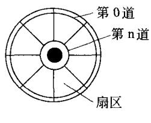  
(b)  
图8-13硬磁盘结构及记录面扇区示意图

磁盘中可记录信息的磁介质表面叫做记录面。在磁盘旋转时，每一个记录面上都分布着若干由磁头画出的同心的闭合圆环，称为磁道（Track)。数据就记录在磁道上。使用时要对磁道进行编号，按照半径递减的次序从外到里编号，最外一圈为0道，向内磁道号依次增加。最内圈的位密度称为最大位密度。为了便于存取信息，磁盘上的每个磁道又分成若干段，每一段称为一个扇区(Sector)。例如每个磁道分为16个扇区、32个扇区等。

硬盘的基本工作原理是：硬盘驱动器加电正常工作后，控制电路中的初始化模块进行初始化工作。初始化完成后，主轴电机启动，并高速旋转，将装载磁头的小车移动，使浮动磁头置于盘片表面的0道，处于等待指令的启动状态。当主机下达存取磁盘片上的数据时，通过前置放大电路，发出驱动电机运动的信号，控制磁头定位机构将磁头沿径向移动，搜寻要存取数据的磁道扇区位置，读写数据。

硬盘的第一个扇区(0道0头1扇区)被保留为主引导扇区，存储主引导记录和硬盘分区表，常常是病毒攻击的对象。

## ②数据记录格式

在磁盘上信息记录，是按柱面逐道记录的。一个柱面记录满，再移动磁头记录下一个柱面。在一个磁道上记录信息的组织形式称为磁道的记录格式。不同操作系统所采用的记录

格式会有所不同，用户甚至可以制定自己的格式来记录信息。图8-14给出一种典型的记录格式。读者根据图中所描述的情况，可以了解到数据是如何记录在磁道上的。

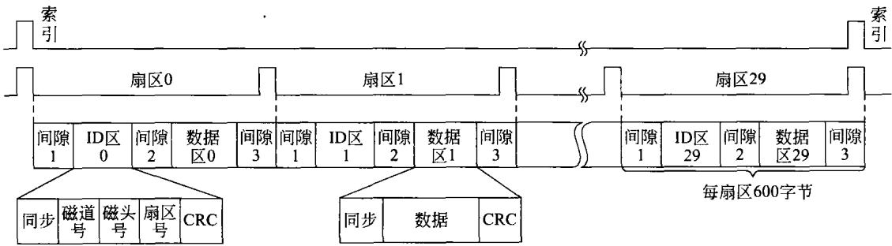  
图8-14磁盘记录格式

在图8-14中，两索引信号之间就是一完整的拉直了的一圈磁道。一圈磁道分成若干扇区，作为例子，该磁道分为30个扇区。每一扇区又分为标志区和数据区。下面对图8-14中各的部分做简单说明。

## a）间隙1到间隙3

每一扇区包括标志区(ID区)和数据区这两部分，两部分之间均留有间隙，而扇区的开始及结束前也加有间隙。各间隙记录不同长度的字节。如间隙1为17个字节，间隙2为41个字节，间隙3为20个字节。它们起到缓冲及消除主轴转速不稳的影响的作用。

## b）标志区

每一扇区的开始总是标志区。

同步字段SYNC，由一个特定字节构成。

磁道号，由2个字节构成。

磁头号，由1个字节构成。

扇区号，由1个字节构成。

循环冗余校验码CRC,2个字节。

## ③数据区

同步字段 SYNC，由一个特定字节构成。

数据DATA,该区域用以存放数据，其长度可从128字节到几K字节，此处为512字节。

循环冗余校验码CRC,2个字节。

## ④主要技术指标

硬盘的主要性能指标有容量、平均存取时间、转速和数据传输率等。

## a）道密度

为了减少干扰，磁道之间要保持一定的间隔，沿磁盘半径方向，单位长度内磁道的数目称为道密度。常用的道密度单位是道/mm，或道/英寸。

## b）位密度

位密度是指在磁道圆周上单位长度内存储的二进制位的个数。常用的位密度单位是：bit/mm，或bit/英寸。为了简化电路设计，规定每个磁道上的记录位数相同。由于磁盘中各个磁道的圆周长度不同,因此不同磁道上的位密度是不一样的，越靠近盘心，磁道位密度

就越高。位密度是以最靠近盘中心的磁道来定义的。

## c）存储容量

存储容量是指整个磁盘所能存储的二进制信息的总量。磁盘的容量有非格式化容量和格式化容量之分。

$$
1 \pm \hbar \pm \frac { 1 } { 1 4 } \pm \frac { 1 } { 1 4 } \pm \frac { 1 } { 1 4 } \pm \frac { 1 } { 1 4 } = \frac { 1 } { 1 2 } \pm \frac { 1 } { 1 4 } \pm 1 \pm 1 \pm 1 \pm 1 \pm 1 \pm 1 \pm 1 \pm 1 \pm 1 \pm 1 \pm 1 \pm 1 \pm 1 \pm 1 \pm 1 \pm 1 \pm 1 \pm 1 \times 1 \pm 1 \pm 1 \pm 1 \pm 1 \pm 1 \pm 1 \pm 1 \pm 1 \pm 1 \pm 1 \pm 1 \pm 1 \pm 1 \pm 1 \pm 1 \pm 1 \pm 1 \pm 1 \pm 1 \pm 1 \pm 1 \pm 1 \pm 1 \pm 1 \pm 1 \pm 1 \pm 1 \pm 1 \pm 1 \pm 1 \pm 1 \pm 1 \pm 1 \pm 1 \pm 1 \pm 1 \pm 1 \pm 1 \pm 1 \pm 1 \pm 1 \pm 1 \pm 1 \pm 1 \pm 1 \pm 1 \pm 1 \pm 1 \pm 1 \pm 1 \pm 1 \pm 1 \pm 1 \pm 1 \pm 1 \pm 1 \pm 1 \pm 1 \pm 1 \pm 1 \pm 1 \pm 1 \pm 1 \pm 1 \pm 1 \pm 1 \pm 1 \pm 1 \pm 1 \pm 1 \pm 1 \pm 1 \pm 1 \pm 1 \pm 1 \pm 1 \pm 1 \pm 1 \pm 1 \pm 1 \pm 1 \pm 1 \pm 1 \pm 1 \pm 1 \pm 1 \pm 1 \pm 1 \pm 1 \pm 1 \pm 1 \pm 1 \pm 1 \pm 1 \pm 1 \pm 1 \pm 1 \pm 1 \pm 1 \pm 1 \pm 1 \pm 1 \pm 1 \pm 1 \pm 1 \pm 1 \pm 1 \pm 1 \pm 1 \pm 1 \pm 1 \pm 1 \pm 1 \pm 1 \pm 1 \pm 1 \pm 1 \pm 1 \pm 1 \pm 1 \pm 1 \pm 1 \pm 1 \pm 1 \pm 1 \pm 1 \pm 1 \pm 1 \pm 1 \pm 1 \pm 1 \pm 1 \pm 1 \pm 1 \pm 1 \pm 1 \pm 1 \pm 1 \pm 1 \pm 1 \pm 1 \pm 1 \pm 1 \pm 1 \pm 1 \pm 1 \pm 1 \pm 1 \pm 1 \pm 1 \pm 1 \pm 1 \pm 1 \pm 1 \pm 1 \pm 1 \pm 1 \pm 1 \pm 1 \pm 1 \pm 1 \pm 1 \pm 1 \pm 1 \pm 1 \pm 1 \pm 1 \pm 1 \pm 1 \pm 1 \pm 1 \pm 1 \pm 1 \pm 1 \pm 1 \pm 1 \pm 1 \pm 1 \pm 1 \pm 1 \pm 1 \pm 1 \pm 1 \pm 1 \pm 1 \pm 1\tag{8-3}
$$

$$
M Z M : ( \overrightarrow { A } + \overrightarrow { A } + \overrightarrow { A } + \overrightarrow { B } + \overrightarrow { A } ) \overrightarrow { A } = \overrightarrow { B } + \overrightarrow { B } + \overrightarrow { B } - \overrightarrow { A } + \overrightarrow { B } + \overrightarrow { B } + \overrightarrow { A } - \overrightarrow { B } + \overrightarrow { B } + \overrightarrow { A } - \overrightarrow { B } + \overrightarrow { B } + \overrightarrow { B } + \overrightarrow { B } + \overrightarrow { B } + \overrightarrow { B } + \overrightarrow { A } - \overrightarrow { B } + \overrightarrow { B } + \overrightarrow { B } + \overrightarrow { B } + \overrightarrow { B } )\tag{8-4}
$$

一般情况下，磁盘容量是指格式化容量，它比非格式化容量要小。目前，磁盘容量在几十GB到几百GB的量级。采用最新纳米洞技术的2.5寸硬盘的容量已达到1.2TB。而且，目前洞的直径为100nm，将来可做到10nm。因此，硬盘容量还会进一步增加。同时，有的公司采用自排列纳米磁颗粒阵列，在不久的将来会将颗粒做到3nm，单碟2.5寸硬盘的容量可达到60TB。

## d）平均存取时间

平均存取时间是指从发出读写命令开始，磁头从某一位置移动到指定位置并开始读写数据所需的时间。它等于平均寻道时间与平均等待时间之和。

·寻道时间是指磁头移动到目标磁道(或柱面)所需要的时间，平均寻道时间由磁盘存储器的性能决定，是个常数，由厂家给出，目前硬盘的平均寻道时间在几ms到10ms之间。

·等待时间是指待读写的扇区旋转到磁头下方所用的时间，一般选用磁盘旋转一周所用时间的一半作为平均等待时间，在1ms～6ms之间。

## e）转速

转速指硬盘内驱动电机主轴的旋转速度，单位为RPM（转/分钟）。目前ATA硬盘的主轴转速一般为5400/7200RPM。SCSI硬盘主轴转速可达7200～10000RPM，最高可达15 000RPM。

## f）数据传输率

概括来讲，数据传输率是指磁头找到数据的地址后，单位时间内写人或读出的字节数。

$$
\frac { 3 } { 2 } \times \frac { 1 } { 2 } + \frac { 1 } { 2 } \times \frac { 1 } { 2 } \frac { 3 } { 4 } = \frac { 1 } { 2 5 } \times \frac { 1 } { 2 5 } \times \frac { 1 } { 2 } \times \frac { 1 } { 2 } \times \frac { 1 } { 3 5 } \times \times \frac { 1 } { 2 5 } \times \frac { 1 } { 2 5 } \times \frac { 1 } { 2 5 } \times \frac { 1 } { 2 5 } \times \frac { 1 } { 2 5 } \times \frac { 1 } { 2 5 } \times \frac { 1 } { 2 5 } \times \frac { 1 } { 2 5 } \times \frac { 1 } { 2 5 }\tag{8-5}
$$

## g）接口总线

计算机与磁盘相连接，可采用不同的接口总线。总线不同，对磁盘系统的性能会产生影响。能利用磁盘构成虚拟存储器的总线有SCSI、SAS、ATA和SATA等。移动磁盘常用USB和IEEE-1394等总线。

另外，硬盘内部的高速缓存大小、平均故障间隔时间和采用的接口、功耗、体积、重量，也反映硬盘的性能。此处不再说明。

文件在硬盘上存储时会尽可能放在同一圆柱面上，或者放在相邻柱面上，这样可以缩短寻道时间。

## ③连接框图

计算机与硬磁盘(软磁盘已成为历史)驱动器的连接如图8-15所示。

由图8-15可以看到，磁盘驱动器通过外总线接到磁盘控制器上，磁盘控制器接计算机的系统总线。

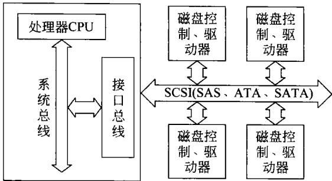  
图8-15磁盘驱动器的连接

对应要接入的系统总线，厂家为用户生产各种型号的磁盘控制器集成电路芯片。使用者可随意选用。该芯片一边与系统总线信号相适应，另一边提供接驱动器的总线标准信号。在PC中，磁盘控制器的接口总线控制器集成于南桥内部。

连接磁盘驱动器的总线标准有并行外总线ATA和SCSI,前者多用于个人计算机而后者多用于服务器构成阵列。为了进一步提高传输速率，现在已经出现了它们相应的串行总线 SATA和SAS。有关这些总线的细节此处不做说明。

## ③磁盘阵列RAID

廉价冗余磁盘阵列RAID(Redundent Array of Inexpensive Disks)是由美国加州大学伯克利分校的D.A．Patterson 教授在1988 年提出的，也简称为"磁盘阵列”。RAID一般是在SCSI(也有IDE)磁盘驱动器上实现的。SCSI适配器保证每个SCSI通道随时都是畅通的，在同一时刻每个SCSI磁盘驱动器都能自由地向主机传送数据。

RAID提供了专用服务器中接入多个磁盘(专指硬盘)时，以磁盘阵列方式组成一个超大容量、响应速度快、可靠性高的存储子系统。使用RAID可大大加快磁盘的访问速度，缩短磁盘读写的平均排队与等待时间，并以并行方式在多个硬盘驱动器上工作，被系统视做一个单一的硬盘，以冗余技术增加其可靠性，以多个低成本磁盘构成磁盘子系统，提供比单一硬盘更完备的可靠性和高性能，目前工业界公认的标准是RAID0～RAID6。过去，RAID被广泛地应用在服务器体系中，不久的将来它将出现在PC中。

## RAID的优点包括以下几点：

·成本低,功耗小，传输速率高。在RAID中，可以让很多磁盘驱动器同时传输数据，而这些磁盘驱动器在逻辑上又是一个磁盘驱动器，所以使用RAID可以达到单个的磁盘驱动器几倍、几十倍甚至上百倍的速率。

·可以提供容错功能。因为普通磁盘驱动器来说，如果不采用CRC(循环冗余校验)码,将不具备容错功能。RAID的容错是建立在每个磁盘驱动器的硬件容错功能之上的，所以它提供更高的可靠性和安全性。

·在同样的容量下，RAID比起传统的大直径磁盘驱动器价格要低许多。

依据磁盘阵列数据的校验方式，RAID系统有多种模式：RAID0、1、2、3、4、5、6、7和10等。

## a）冗余无校验的磁盘阵列(RAID 0)

在RAID中，不论何时有磁盘损坏,都可以随时拔出损坏的磁盘再插入好的磁盘(需要硬件上支持热插拔)，数据不会受损，失效盘的内容可以很快地重建，重建的工作也由RAID硬件或RAID软件来完成。但RAID0不提供错误校验功能，所以有人说它不能算做是RAID，其实这也是RAID0为什么被称为0级RAID的原因。

在RAID中，要存储的数据分成带条，带条可以是一个物理的数据块或一个扇区。将各数据带条分布记录在各个磁盘驱动器上，每个数据分块(即带条)无校验，无冗余存储，不提供真正容错性。构成RAID0至少需要2个硬盘，可支持8/16/32个磁盘。因为多个硬盘可同时读写，故读写速度在RAID中最快。但任何一个磁盘驱动器损坏都有可能使整个RAID系统失效。一般用在对数据安全要求不高，但对速度要求很高的场合。

图8-16表示无冗余无校验的磁盘阵列(RAID0)的结构。

在图8-16中，画出了4个物理磁盘的情况，各数据块分布在不同的物理盘上。当计算机读写相邻数据块时，有利于并行处理。

## b）镜像磁盘阵列(RAID1)

RAID1至少需要两台磁盘机才能构成，在此阵列中数据同时以同样的方式写到两个盘上，两个盘互为镜像。磁盘镜像可以是分区镜像或全盘镜像。容错以空间换取，可以采用镜像或者双工技术。主要用在对数据安全性要求很高，而且要求能够快速恢复被损坏的数据的场合。

由4个物理磁盘构成的RAID1的结构如图8-17所示。

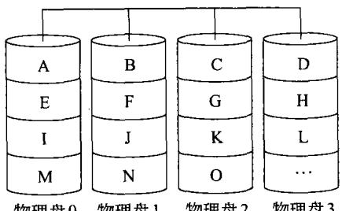  
图8-16RAID0中各数据带条(块)的分布

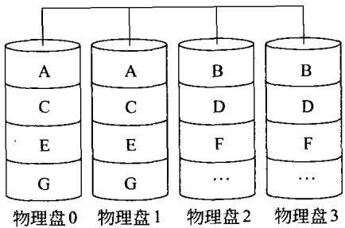  
图8-17RAID1中各数据带条(块)的分布

这种结构具有最高可靠性，策略简单，恢复数据时不必停机。但有效容量只有总容量的1/2,利用率50%。由于磁盘冗余，硬件开销较大，成本较高，是RAID各级别中最昂贵的。

在 RAID1中数据分块与镜像有不同的组织形式。现以8个物理盘来加以说明。

## ·先分块后镜像RAID0十1

这种组织形式是先将数据以RAID0的方法分布到4个磁盘上，然后再将这4个磁盘镜像到另外4个磁盘上，如图8-18所示。

## ·先镜像后分块RAID1十0

这种组织形式是先以RAID1的方式构造4对镜像盘，再将数据分布到这4对盘中，具体情况如图8-19所示。

## c）并行海明纠错阵列(RAID 2)

RAID2为位交叉海明编码阵列，采用海明冗余纠错码。数据按位分布到磁盘上，记录数据的同时，记录数据相应的海明码。

如前所述，数据位不同，要求的海明码的位数也不同。因此，磁盘台数由纠错码和数据位数决定。磁盘驱动器组中的第1个、第2个、第4个第2"个磁盘驱动器是专门的校验盘，用于校验和纠错。例如，当数据位为4位时，需要3位海明码。因此,需要7个磁盘驱动器构成RAID2,其中第1、2、4这3个磁盘驱动器是校验盘，其余的用于存放数据,其结构形式如图8-20所示。

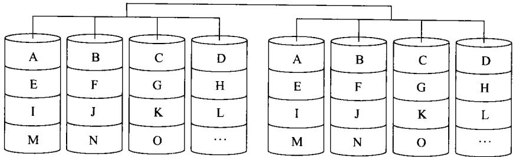  
图8-18RAID0十1先分块后镜像

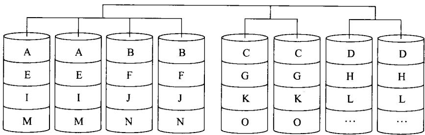  
图8-19RAID1十0先镜像后分块

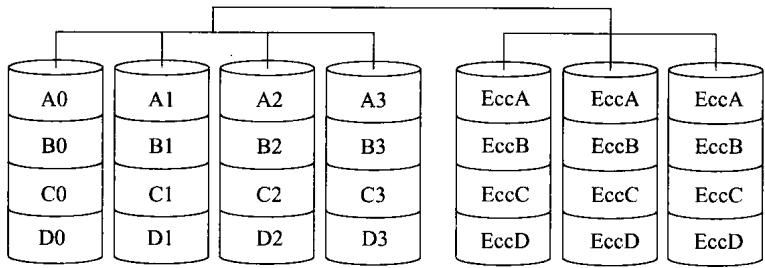  
图8-20RAID2位交叉海明码阵列

由图 8-20可以看到，当记录4位数据时，将这4位数据和它们相应的3位海明码一并记录在7个磁盘驱动器上。当某一磁盘驱动器损坏时，或其他原因产生1位错误时，通过纠错可获得正确数据。

当记录数据的位数增多时,使用的磁盘驱动器越多，校验盘在其中占的百分比会越少。RAID2对大数据量的输入/输出有很高的性能，但少量数据的输入/输出时性能不好。

RAID2的可靠性高，可自动确定是哪个硬盘已经失效，并进行自动数据恢复。但磁盘冗余太多，开销太大，故RAID2很少使用。

d）奇偶校验并行位交错阵列(RAID3)

RAID3是位交叉奇偶校验盘阵列。与RAID2类似，是其简化形式。在这里也采用并行存取技术。

在RAID3中，在将数据按位或按字节交叉存于各磁盘的同时，计算奇偶校验码，并将校验码记在专门的校验磁盘上，如图8-21所示。

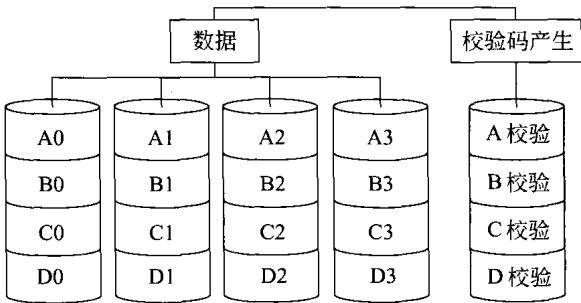  
图8-21RAID3位交叉奇偶校验阵列

从简单的概念可以这样理解RAID3的原理：如图8-21所示，若将4位数据存于各磁盘的同时，对数据求模2和，并将其存在校验磁盘上。即

$$
\mathrm { ~ A ~ } \hbar \neqq \frac { \ d } { \ d t } \frac { \ d } { \ d t } = \mathrm { ~ A ~ } 0 \circledast \mathrm { ~ A ~ } \oplus \mathrm { ~ A ~ } 2 \circledast \mathrm { ~ A ~ } 3\tag{8-6}
$$

同样，也可以求出B校验、C校验、D校验分别写入校验磁盘。

当某磁盘出现故障时，只要从累加和中减去正确盘上的数据即可得到故障盘中的原有正确数据。例如，若发现A1磁盘失效，则可由其他正常磁盘读出的数据计算出A1：

$$
\mathrm { A } 1 = \mathrm { A } \hbar \widehat { \mathrm { x } } \frac { \hbar \triangle } { \partial \mathsf { u } } \ @ \mathrm { A } 0 \oplus \mathrm { A } 2 \oplus \mathrm { A } 3\tag{8-7}
$$

RAID3速度快，适合较大数据量的存取。但校验磁盘没有冗余，若校验磁盘失效，数据很难恢复。

当只需写人A1'而其他数据不变时，则需要将 AO、A2、A3 读出，再与 $\mathbf { A } 1 ^ { \prime }$ $\mathrm { A } 1 ^ { \prime }$ 利用式（8-6)计算新的A校验'，并将它们一并写人各盘中。

e）奇偶校验扇区交错阵列(RAID4)

RAID4的结构如图8-22所示。由图8-22可以看到，它与RAID3似乎看不出区别。在RAID4中数据是以扇区交错方式存储于各台磁盘中的，而冗余信息存放在单独奇偶校验盘。

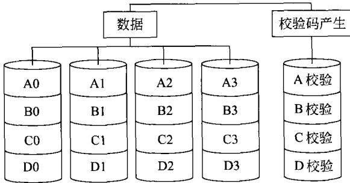  
图8-22RAID4扇区交叉奇偶校验阵列

注意到，RAID3的数据的存取是同时进行的，一次读或写所有的磁盘。而在RAID 4中，一次只读或写一个扇区的数据。因此，读一个扇区，只需访问一个磁盘，由于扇区中有错误检测信息，可以鉴别读出信息是否正确。当某磁盘损坏时，可以利用存放在校验盘中的冗

余信息来恢复数据。

写数据时，只访问一个数据盘和-个校验盘。各磁盘可独立工作(扇区读写)，读写并行进行。

当需要写 $\mathrm { \sf A } 1 ^ { \prime }$ 时，只需将 $\mathrm { A } 1 ^ { \prime } \mathrm { : }$ 写入。同时，用下式计算新的A校验'：

$$
\Delta \not \to \not \{ \not \exists \} ^ { \prime } = \Delta \not \to \not \{ \exists \not \times \not \exists \not \to \not \\in \Delta 1 \ @ \mathrm { A } ^ { \prime }\tag{8-8}
$$

RAID3和RAID4不论有多少数据盘，均使用一个校验盘，采用奇偶校验的方法检查错误。任何一个单独的磁盘驱动器损坏都可以恢复。RAID3和RAID4的数据读取速度很快，但写数据时要计算校验位的值以写人校验盘，速度有所下降。

## f）循环奇偶校验阵列(RAID 5)

与RAID4类似，但校验数据不固定在一个磁盘上，而是循环地依次分布在不同的磁盘上，也称块间插入分布校验，如图8-23所示。

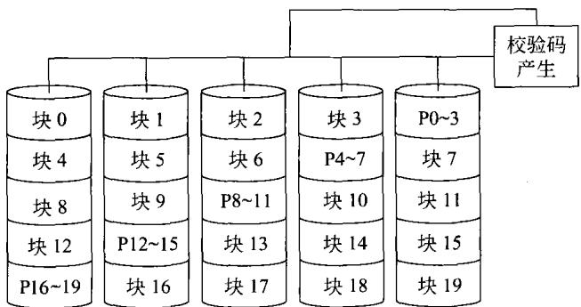  
图8-23RAID5块循环奇偶校验阵列

RAID5是无独立校验盘的奇偶校验磁盘阵列。同样采用奇偶校验来检查错误，但没有独立的校验盘，校验信息分布在各个磁盘驱动器上。RAID5对大小数据量的读写都有很好的性能，它是目前采用最多、最流行的方式，至少需要3个硬盘。

由于校验分布在多个磁盘中，写操作可以同时处理。为读写操作提供了最优的性能。一个磁盘失效，分布在其他盘上的信息也足够完成数据重建。

## g）二维奇偶校验阵列(RAID6)

将整个磁盘阵列看成一个二维阵列，数据块交叉存于各盘上。在这种情况下，加上了两种不同的校验。其中P校验就是前面RAID5中所用的，是利用异或算法产生的奇偶校验。Q则是由另外的算法产生的校验码。将两种校验码写到阵列中，形成了两个奇偶校验的二维阵列，如图8-24所示。

由于RAID6在校验上付出了代价，采用二维校验方式。故可以在二个磁盘出现故障的情况下仍能实现数据的重建。

## h）RAID 7

RAID7在RAID6的基础上加高速缓存，以提高数据传输率。

由干增加了校验盘，使磁盘阵列的可靠性大大高于单台盘。特别是阵列具有系统重构的功能。如果有一台盘坏了，通过校验码和其他数据盘上的数据，可以正确地复原损坏盘的数据，不影响系统正常工作。在第二台盘损坏之前，换上好盘，将复原的数据写入好盘，系统又可在有冗余的状态下工作。在许多磁盘阵列中，常常带有一个热备份盘。一旦有盘损坏，系统自动将复原的数据写入热备份盘，恢复有冗余的状态。用户将损坏的硬磁盘拔下，换上新盘，新盘在系统中作为热备份盘工作。磁盘阵列都有热插拔的功能，可以在带电状态下更换,不必停机影响系统正常工作。

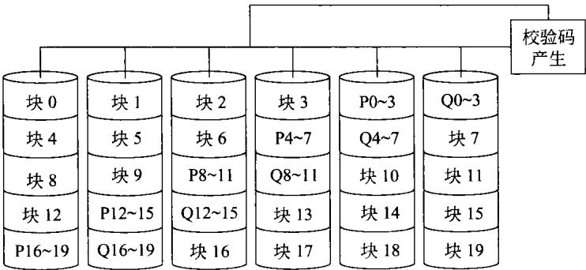  
图8-24RAID6二维奇偶校验独主存取阵列

利用磁表面记录信息的设备，除磁盘机之外还有磁带机。磁带机分为开盘式启停磁带机和数据流磁带机两大类，可用于记录数据。在计算机系统中磁带机常用做数据的备份设备。由于篇幅所限，本书不做说明。

## ?移动存储设备

常见的移动存储设备有USB移动硬盘和USB闪存盘。

## a）移动硬盘

移动硬盘的主要特点是抗振性能好，可随身携带；功耗低，可直接由USB总线供电，使用非常方便；价格低廉。

移动硬盘的接口有USB2.0,IEEE-1394,直接用电缆连接。使用USB2.0接口，数据传送速率可达480Mbps。

目前，移动硬盘的容量在80GB到500GB。

## b）闪存盘(U盘)

闪存盘是用半导体闪速存储器构成的可移动存储器。一般多采用USB接口。由于采用半导体存储器构成，其体积，重量轻，耗电少，抗振，便于携带，使用十分方便。

目前，U盘的容量在1GB到几十GB之间。

## c）固态硬盘

由于半导体技术的发展，半导体存储器的容量越来越大。这就为人们制造固态硬盘提供了基础。由于固态盘没有机械部分，其可靠性很高，速度快，耗电低，体积小，抗振好。

总之，目前的固态盘与磁性硬盘比较，除容量小、价格高之外，其他技术指标均超过磁性硬盘。固态盘是发展的方向，它是对磁性硬盘最大的挑战。目前固态盘能达到832GB，有人预言，三到五年内固态盘将全面占领笔记本电脑市场。

## （3）光存储器

## ① CD家族的发展

激光通过聚焦，可获得直径为1μm的光束。经技术人员研究发现，可以利用这种光束来记录和重放信息。将信息记录在光束走过的光道上，是用凸起和凹陷的交界记录为1而以凸起和凹陷的平面记录0。当光束照射光道时，凸起和凹陷的交界处的反射光会产生变

化，从而读出记录的信息。

## ②光盘的分类

按照光盘的可读写功能可分为如下几类。

## a）只读光盘

只读光盘上记录的数据是由工厂在制造光盘过程中形成的，用户可以读出光盘上的数据加以利用。但是，光盘上的数据只能读出，既不能擦除也不能改写。现在存储软件、电影、书刊的CD-ROM、VCD、DVD等只读光盘广为流行。

## b）一次写多次读光盘

这种光盘制造出来时，其记录表面涂有一层构成存储单元的特殊材料，利用物理的方法可使其存储单元的材料发生不可逆转的变化。材料的变化就意味着记录了信息。这些记录的信息是可以无限次读出的，信息可保持几十年不会丢失。

但是，这种光盘只能写一次。现在的CD和DVD均有这种可一次写多次读的光盘，利用刻录机用户可将自己的信息刻录在光盘上长期保存，为使用者提供很大方便。

## c）可擦写光盘

可擦写光盘像硬磁盘那样可以任意读写数据，根据擦写原理的不同分为两种。

## ·相变光盘PCD

相变光盘是基于存储介质的两个稳定状态，即反射率高的结晶状态和反射率低的非结晶状态，这两种状态的可逆转性来实现擦写的。

当相变光盘用高低不同的激光功率照射时，受高功率照射的变为非结晶状态而受低功率照射的变为结晶状态。根据这样的特性，可用于记录0和1这两种状态。当用微功率激光照射读出时，不会改变它们的状态，而因它们的反射率不同而形成0或1。当利用低功率激光长时间照射时，可使光盘全部处于结晶状态，从而达到擦除信息的目的。

以上是相变光盘的简单原理，这是一种全光型光盘。

## ·磁光盘MO

磁光盘是利用光照和磁化方法来记录数据的。在写入数据时，激光束聚焦于光盘的磁性表面上，使聚焦点的局部温度升高。同时，在聚焦点的下方加上磁场，由于聚焦点有高温，记录磁性材料的矫顽力降低，聚焦点将被磁场所磁化。不同的0或1数值，在磁光盘上表现了聚焦点的磁化方向不同。

当读出磁光盘时，采用微功率激光束，聚焦点的温度上升很少，不会对磁场产生影响。同时，根据磁光效应，由于聚焦点的磁化方向不一样，激光被反射的偏振角度也不相同。通过检测反射光的偏振角度即可读出0或1。

在高功率激光照射下，用同一方向的磁场可将信息擦除。

③光盘(驱)的主要技术指标

光盘的主要技术指标主要如下。

## a）尺寸

标准的 CD-ROM、CD-DA、DVD光盘直径均为120mm,中心孔15mm，厚度1.2mm。也有直径更大和更小的光盘。

## b）存储容量

不同的存储格式，不同的光盘，存储容量不同。CD-ROM有580MB和650MB两种。

而DVD有4种格式，一张盘的容量在4.7GB到17GB之间。

## c）传输速率

早期的CD-ROM驱动器的传输速率为150Kbps。后来速率不断提高，均以150Kbps为X。现在就有传输速率为16X、32X、48X、52X等。对DVD-ROM来说，有两种描述指标，一种如上面所述，用nnX表示;另一种定义Y=1385Kbps，用nnY来描述。

## d）平均存取时间

早期的CD-ROM光驱的平均存取时间在200ms左右。目前,DVD光驱的平均存取时间小于100ms。

## e）缓冲区大小

缓冲区越大越好。目前光驱的缓冲区在几百KB到几MB之间。

## f）接口类型

光盘驱动器通过接口总线与计算机相连接，常用的接口总线有SCSI、ATA、USB和IEEE-1394等。对PC来说，只要用总线电缆一头插主板另一头插光驱即可。当然，光驱要工作必须有相应的软件驱动程序支持。

## g）其他

对于光驱来说，还有MTBF、功耗、安装方式及纠错能力等指标，这里不再说明。

## ④数字通用光盘DVD

DVD也是光盘家族中的一种，因为当前普遍流行，在此特别说明。

## a）DVD概述

从20世纪90年代中期以后，DVD逐渐流行开来。目前，DVD的应用已非常普及。尽管DVD记录信息的方式与前面提到的CD是一样的，都是以光道上的凸凹来表示信息。但DVD有它的一些特点，主要表现在以下几点。

·CD采用的激光波长为780nm而DVD采用红色激光,波长为650nm。波长越短则聚焦点越小。

·DVD的光道间距为740nm,而CD的光道间距为1600nm,故DVD光道更加紧凑。

·DVD定义一张光盘有4种存储容量：单面单层4.7GB;双面单层9.4GB;单面双层8.5GB;双面双层17GB。而前面已提到CD的容量只有几百MB。

## ·兼容性问题

从DVD刻录诞生之初，就有着几个不同的标准，经过一段时间的发展,现在DVD刻录领域大致存在着三大标准：DVD-RAM、DVD+RW、DVD-RW。

随着大容量刻录、DVD刻录、家用DVD录像机逐渐普及，一些厂商已经推出了同时兼容DVD+RW和DVD-RW的产品,不久的将来会推出与DVD+RW、DVD-RW 和DVD-RAM全部兼容的产品。

## b）DVD的发展

在下一代DVD标准之争中，以索尼为首的蓝光光盘标准和以东芝为首的 HD-DVD标准竞争不断,致使标准无法确定。蓝光DVD(简称 BD)与HD-DVD(简称 HD)两大阵营，存储介质都是蓝色激光光盘。前不久，HD-DVD标准已宣布退出竞争行列。这样蓝光光盘将会迅速普及。

蓝光光盘的直径为12cm,和普通光盘(CD)及数码光盘(DVD)的尺寸一样。这种光盘利用波长405nm蓝色激光在单面单层光盘上可以录制、播放长达27GB的视频数据，比现有的DVD的容量大5倍以上(DVD的容量一般为4.7GB)。通过更加先进的抖颤寻址技术实现了对更大容量的存储地址与数据管理，使蓝光光盘的容量达到100GB。

## 8.2.2程序控制输入/输出技术

## 1.外设接口的编址方式

在计算机系统中，主要采用两种不同的外设地址的编址方式。

## （1）外设地址与内存地址统一编址

这种编址方式又称为存储器映射编址方式。在这种编址方式中，将外设接口地址和内部存储器地址统一安排在内存的地址空间中。即把内存地址分配给外设，由外设来占用这些地址。用于外设的地址，存储器不能再使用。这样一来，计算机系统的内存空间一部分将留做外设地址来使用，而剩下的内存空间可为内部存储器所使用。

外设与内存统一编址的方法占用了部分内存地址，将外设看做是一些内存单元。因此，原则上说，用于内存的指令都可以用于外设，这给使用者提供了极大的方便。但由于外设占用内存地址，内存不能再用，就相对地减少了内存可用范围。而且，从指令上不易区分是寻址内存的指令还是用于输入/输出的指令。这种编址方式在68系列和65系列的计算机中得到了广泛的应用。

## （2）外设与内存独立编址

在这种编址方式中，内存地址空间和外设接口地址空间是相互独立的。例如，在8086（8088)CPU中，内存地址是连续的1MB,即从00000H～FFFFFH，而外设的最大地址范围从0000H～FFFFH。它们相互独立，互不影响。这是由于CPU在寻址内存和外设时，使用了不同的控制信号来加以区分。

内存与外设独立编址，各有自己的寻址空间。用于内存和用于外设的指令是不一样的，很容易辨认。但用于外设的指令功能比较弱，一些操作必须由外设首先输人到CPU的寄存(或累加)器后才能进行。这种编址方式在Z80系列及Intel80系列计算机中得到了广泛应用。

除了上述两种最常用的编址方式外，还有一些其他方式。例如，在MCS-51单片机中，存放程序的内存地址是独立的64KB，而存放数据的内存与接口统一编址占另外独立的64KB。只要理解了前面所描述的两种方法，再去理解其他的方法将是十分容易的。

## 2．外设接口的基本模型

外设经接口与计算机的连接框图如图8-25所示。

由图8-25可以看到，接口实现了CPU与外设间数据交换的通道，或者称为两者间的界面。接口的一边挂在系统总线上;接口的另一边与外设相连接。接口与外设间通

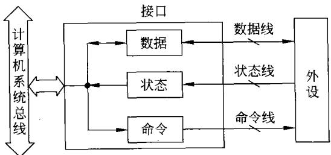  
图8-25外设与接口连接框图

常有三种信息。

## （1）数据信息

在计算机系统中通常有三种数据信息，即数字量、开关量和模拟量。数字量是以二进制编码表示信息。开关量是用两个状态表示的信息，用一位二进制编码即可表示。模拟量是时间上和幅度上均为连续的信息，它必须经过转换，变为二进制编码才能被CPU识别和处理。

## （2）状态信息

状态信息用来表示外设所处的状态。例如利用BUSY(忙)信号、READY(就绪)信号来表示外设是否正在忙或外设已经就绪。

## （3）控制信息

通常这类信号是CPU经接口发出的，用于控制外设工作的信号。

数据信息、控制信息和状态信息通常是利用系统总线在CPU与接口之间进行传送。后面将会看到，在计算机中，就是如何利用这些信号实现CPU与外设之间的数据交换的。

通常，一个接口可能有多个寄存器分别存放数据信息、控制信息和状态信息。CPU能够对这些寄存器进行读或写操作。人们还将这些能被CPU读或写的寄存器称为“端口”。可见，一个接口可能包含几个端口，也可能就包含一个端口。

## 3.程序控制输入/输出

在计算机中，有5种基本的输入/输出方法。

（1）无条件传送方式。

（2）查询传送方式。

（3）中断方式。

（4）DMA(直接存储器存取)方式。

（5）通道方式。

通常把前两种方式归类为程序控制输入/输出。它们都是利用CPU执行程序，实现计算机与外设的数据传送。下面分别予以说明。

## （1）无条件传送方式

在微机系统中，有一些简单的外设，当它工作时，随时都准备好接收CPU的输出数据或它的数据随时都是准备好的，CPU什么时候读它的数据均可以正确地读到。也就是说，外设无条件准备好向CPU提供数据或接收CPU送来的数据。所以CPU可以无条件地向这样的外设传送数据。在CPU与这样的外设交换数据的过程中，数据交换与指令的执行是同步的。故有人也称其为同步传送。

在与这类外设进行数据交换时，可以认为只有数据的输人/输出而不再需要如图8-25所示的控制信息和状态信息。正如在本书的后面所看到的，在无条件传送方式下，经接□输出的数据常作为控制信号使用，而由接口输入的数据又常作为状态信号来使用。常利用无条件传送的简单外设有许多种。例如，发光二极管、数码管、开关、继电器和步进电机等。

## ①输人接口

作为无条件数据输人的例子，来看一下如图8-26所示的电路。在图中，把开关K看做是一个简单的外设。K的状态是确定的，要么闭合，要么打开。当计算机通过外设接口读K的状态时，一定会读到指令执行时刻K的状态。 +5V

在图8-26中，利用三态门构成输入接口，它可以是74LS244。图8-26中输入接口的地址为FFF7H。当CPU读接口地址FFF7H时，三态门低电平有效的控制端上的或门的输出为低电平。该电平使三态门导通，则开关K的状态就通过数据总线 $\mathrm { D } _ { 0 }$ 读到CPU。判断读入数据 $\mathrm { D } _ { 0 }$ 的状态，即可知K的状态。当 $\mathrm { D } _ { 0 } = 0$ 时，K闭合 $\mathbf { \nabla } _ { \mathbf { i } } \mathrm { D } _ { 0 } = 1$ 时，K打开。例如，可以利用K的状态来控制CPU执行不同的程序：当K闭合时，执行PROG1;K打开时执行PROG2。可用下述指令来实现。

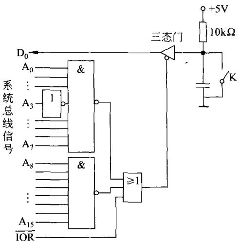

```csv
MOVDX,OFFF7H
INAL,DX
TEST AL,01H
JZ PROG 1
JMP PROG 2
```  
图8-26开关K的输入接口

②输出接口

无条件传送实现数据输出的例子如图8-27所示。

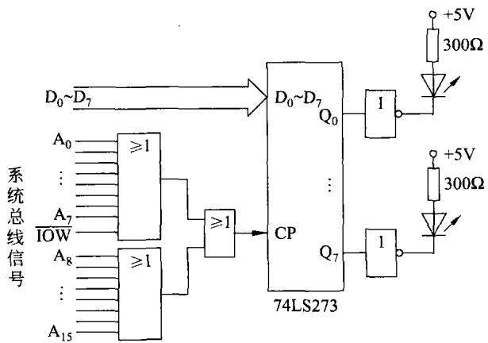  
图8-27锁存器输出接口

在图8-27中，发光二极管可以认为是一种最简单的外设，它总是处于准备好的状态，在输出的接口的控制下发光或熄灭。图8-27中的锁存器接口使用74LS273，请特别注意273是利用CP端的上升沿来锁存数据的。根据图8-27中译码器(或门)的输出可以断定，该锁存器输出接口的地址为0000H。

因为只用锁存器的 $\mathbf { Q } _ { 0 }$ 和 $\mathbf { Q } _ { 7 }$ 输出来控制发光二极管的亮灭，利用下面的程序可使两发光二极管亮灭各1s从而进行闪烁。

<table><tr><td>DIPDP:MOV DX、0000H</td><td></td></tr><tr><td>GOON: MOV</td><td>AL，81H</td></tr><tr><td>OUT DX，AL</td><td>;点亮发光二极管</td></tr><tr><td>CALL TIS</td><td>;延时1s</td></tr><tr><td>MOV AL，00H</td><td></td></tr><tr><td>OUT DX,AL</td><td>;熄灭发光二极管</td></tr><tr><td>CALL TIS</td><td>;延时1s</td></tr><tr><td>JMP GOON</td><td></td></tr></table>

当执行OUT指令时，译码器会在CP端产生负脉冲，利用该负脉冲的上升沿，将D。～D上的数据锁存于273的Q边。

从上述可见，开关K或发光二极管总是准备好的。当读接口时，总可以读到那一时刻K的状态。当写锁存器时，二极管总准备好随时接收发来的数据，点亮或熄灭它。以上是两个最简单的例子，用以说明无条件传送的过程。

在与这类外设进行数据交换时，可以认为只有数据的输人/输出而不再需要如图8-25所示的控制信息和状态信息。在无条件传送方式下，经接口输出的数据常作为控制信号使用，而由接口输入的数据又常作为状态信号来使用。常利用无条件传送的简单外设有许多种。例如，发光二极管、数码管、开关、继电器和步进电机等。

## （2）查询方式

无条件传送对于那些慢速的或总是准备好的外设是适用的。但是，许多外设并不总是准备好的。CPU与这类外设交换数据时可以采用程序查询方式。

所谓查询方式就是计算机利用程序不断地询问外部设备的状态，根据它们所处的状态来实现数据的输人和输出。

为了实现这种工作方式，要求外部设备向计算机提供一定的状态信息（或称状态标志），如图8-25中所表示的那样。

当计算机系统中存在多个外设，需利用查询方式工作时，可采用图8-28所示的某种方法实现工作。

由图8-28可以看到，所表示的多个外设查询方式工作均是对各外设逐个进行轮流查询，并根据其状态决定对其服务。但三种方法又略有不同，最终表现在对外设服务的优先级上。不同的应用场合，可采用不同的查询方法。

从以上分析可以看到，无条件传送适合于简单的外设，不需要专门的状态及控制信息，仅利用简单的接口通过程序即可实现输人/输出。

就查询方式来说，当利用查询方式工作时，CPU对外设的状态逐一进行查询，发现哪个外设需要服务便对它服务，然后再继续查询。在这种情况下，CPU就像采用查询方式工作的厂长。在图8-28(c)方式下，厂长一上班就一个车间接一个车间地逐个询问有无需要厂长处理的问题，若有则厂长加以处理；若没有则转到下一个车间。也就是说厂长不做别的事，就是一个车间接一个车间不停地轮流询问和处理它们的问题。

从上面对查询方式的描述可以看到，这种工作方式有两大缺点。

① 降低了CPU的效率。在这种工作方式下，CPU不做别的事，只是不断地对外设的状态进行查询。在实际工程应用中，对于那些慢速的外设，在不影响外设工作的情况下，CPU可以抽空做一些别的事。

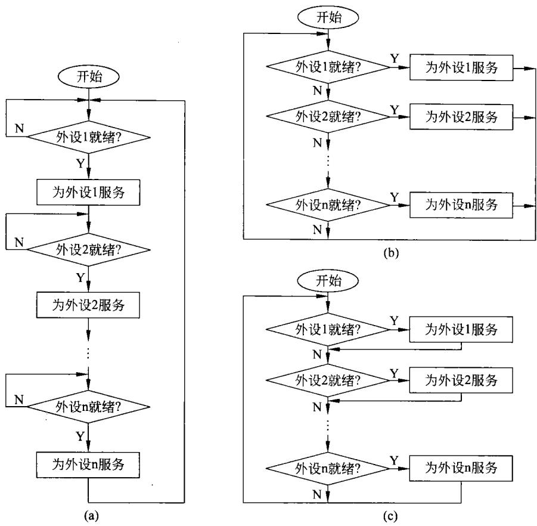  
图8-28几种多个外设查询工作

② 外部的突发事件无法做出实时响应。如上面提到的厂长，在他询问一车间有无厂长要处理的问题刚刚离开一车间时，一车间发生爆炸(或大火)等突发事件需要厂长处理，而这时厂长(也就是CPU)根本不知道事件的发生，也就无法做出处理，必须等到他把全厂其他所有车间询问处理完再回到一车间，才能发现事故，对发生的爆炸(或大火)进行处理。也许这时一切都已经晚了。查询方式的优点在于这种工作方式原理很易理解，实现起来也很容易。因此，在那些对实时性要求不高的工程应用中经常被采用。

一般地说，查询及无条件传送多用于慢速的外设。

## 8.3中断方式

中断是计算机中一个非常重要的概念，而且在计算机中应用极为广泛。掌握好中断的概念及其应用是每一个学习计算型计算机的人必须做到的，尤其是在计算机的监测控制系统中，经常会遇到实时处理各种突发事件。因此，在这些系统中一般都会用到中断。显然，一个没有采用中断的检测控制系统要么是一个非常小的系统，要么是一个性能很差的系统。

在计算机系统中，采用中断的优点就在于既能提高CPU的效率又是能对突发事件做出实时响应。这就如同前面提到的那位厂长。在中断方式下，他上班后直接进入办公室，做他的工作或阅读有关企业管理方面的书。某时刻下面的科室或车间发生需要厂长处理的问题时，电话铃响了，厂长暂停读书并用书签插在正在阅读的那一页上，接电话处理下面发生的问题。当问题处理完后，厂长放下电话，找到书签的位置接着读书。

中断方式具有上面所提到的优点，但中断实现起来比较麻烦，调试也比较困难。一旦出现故障需认真仔细地进行排除。

## 8.3.1中断的基本概念

## 1．中断的概念及中断源分类

在CPU执行程序过程中，由于CPU内部或其外部某种事件发生，强迫CPU暂时停止正在执行的程序而转向对发生的事件进行处理，事件处理结束后又能回到原来中止的程序，接着中止前的状态继续执行原来的程序，这一过程称为中断。

引起中断的事件就称为中断源。中断源的分类各家并不完全统一，但不外乎内部中断源和外部中断源两大类。

由处理机内部产生的中断事件称为内部中断源。例如，当CPU进行算术运算时，除数太小，致使商无法表示、运算发生溢出或执行软件中断指令等情况，都认为是内部中断。

若中断事件是发生在处理器外部，如事件由处理机的外部设备(广义地说)产生时，这类中断源称为外部中断源。例如，某些外设请求输人/输出数据，硬件时钟定时时间到，某些设备出现故障等，均属于这种情况。这里所说的外部设备含义比较广泛，例如，硬件定时器、A/D变换器等均可看做外部设备。

外部中断源产生引起中断的事件，事件发生后，如何告诉CPU以便让它做出处理呢？在CPU上有专门的中断请求输人引线，不同的CPU中断请求引线多少不一，多的可多达十几条而少的则有一两条。

## 2.中断的一般过程

在这里是以外部可屏蔽中断(INTR)为例说明中断的一般过程。所谓一般过程就是指无论哪种CPU(或处理器)都存在这样一个过程。并且通过对一般过程的描述，可加深对中断方式工作的理解。可屏蔽中断的一般过程按先后顺序分为如下几步。

## （1）中断请求

当外部设备要求CPU对它服务时，便产生一个有效的中断请求信号。注意这可以是一个电平信号(高电平或低电平)也可以是边沿信号（上升沿或下降沿)，将其加到CPU 的中断请求的输入端，即可对CPU提出中断请求。

对于中断请求信号，应注意两个问题：其一是有效的中断请求信号必须保持到被CPU发现;其二是当CPU响应请求后，应当把有效的请求去掉。这样才能保证CPU不会对同一请求造成多次响应，而且也为下一次请求做好了准备。

## （2）中断承认

CPU在一条指令执行的最后一个时钟周期，检测中断请求输入端有无请求发生，然后

决定是否对它做出响应。CPU 承认INTR 中断请求,必须满足以下4个条件。

①一条指令执行结束。CPU在一条指令执行的最后一个时钟周期对请求进行检测，当满足要叙述的4个条件时，本指令结束，即可响应。

② CPU处于开中断状态。只有在CPU的IF=1,即处于开中断时，CPU才有可能响应可屏蔽中断请求。

③没有复位(RESET）、保持（HOLD)和非屏蔽中断请求（NMI)等优先级高于INTR的请求发生。在复位或保持请求时，CPU不工作，不可能响应中断请求；而NMI的优先级比INTR高，因此CPU响应NMI而不响应INTR。

④开中断指令(STI)、中断返回指令(IRET)等特殊指令执行完，还需要执行另外的一条指令后才能响应INTR请求。

## （3）断点保护

中断事件的发生是随机的，尤其是外部中断。由于要求在中断事件处理结束后必须回到被中断的程序，接着中断前的状态继续向下执行。因此，必须进行断点保护。断点保护一般分为两部分来完成：一部分工作是由CPU硬件在中断响应过程中自动完成；另一部分是由程序员在中断服务程序中利用指令来完成。

CPU在响应中断时，会由CPU硬件自动保护断点的部分信息（又称为保护现场），如图8-29中断过程示意图(图中用8086的指令)所示。如图8-29所示中断事件出现在指令MOVAL,81H的执行过程中。该指令执行结束且满足其他条件，则CPU便对该中断做出响应。CPU保护该指令执行结束时的断点信息。不同的CPU利用其硬件自动保护的断点信息是不一样的。例如8086CPU保护的是在MOVAL，81H指令执行结束时，也就是下一条指令第一个指令字节所对应的CS和IP，同时保护这时的标志寄存器F。而MCS-51则只保护当时的PC（它指向下一条指令的第一个字节）。

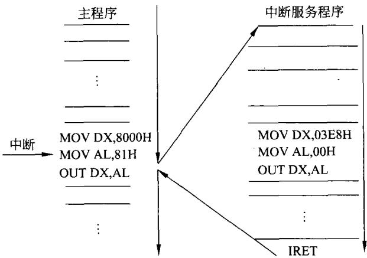  
图8-29中断过程示意图

一般情况下，CPU硬件自动保护的信息是不够的。如图8-29所示，中断在MOVAL，81H指令执行结束得到响应，经过一系列工作转向中断服务程序。在中断服务程序中又用到了寄存器DX和AL，改变了它们的内容，则中断返回到被中断的程序并接着中断前的OUTDX，AL指令执行时，DX和AL的内容均已被修改。因此，若不采取保护措施必然会发生错误。由于中断是随机发生的，在中断服务程序一开始，要由中断程序设计者保护在本中断服务程序中用到的所有寄存器，然后才能使用这些寄存器。

可见，断点保护，一部分由CPU硬件自动完成，另一部分则由程序设计者完成。这些保护通常是用压入堆栈的方法来实现的。

## 3.中断源识别

当计算机系统中存在多个中断源时，例如有多个中断源通过一条中断请求线INTR向CPU 提出请求，一旦做出响应就必须弄清楚是哪一个中断源提出的请求，以便有针对性地对它服务。这就是中断源识别。常用的中断源识别方法有以下两种。

（1）软件查询：利用输入接口将多个中断源的状态读人，逐个进行查询，查询到是谁就转向对谁服务。

（2）中断向（矢）量法：所谓中断向量就是中断服务程序的入口地址（也就是中断服务程序的起始地址)。如给每一个中断源分配一个特定的中断服务程序的入口地址(即中断向量)，当某一中断请求得到响应时，CPU硬件会自动产生该中断的中断向量，自动转向该中断的服务程序。从而将不同的中断源引向不同的中断服务程序。

目前，许多CPU(或单片机)都采用向量法进行中断源识别。

## 4.对中断源服务

当确定了中断源并且进行了断点保护后，接下来就是对具体的中断源的服务。不同的中断源服务不一样，一般根据预先确定的要求编写程序予以实现。其详细情况将在中断优先级控制中说明。

## 5.断点恢复和中断返回

这里的断点恢复是指恢复那些由设计者在断点保护时所保护的内容。前面已经提到，在断点保护时一部分寄存器的内容是CPU硬件自动保护的，另一些寄存器的内容是由设计者(或程序员)通过程序保护的。这里的断点恢复是恢复设计者所保护的内容，通常用弹出堆栈指令来完成（与保护时的压入堆栈操作相反）。

中断返回是一条IRET指令，它的功能就是命令CPU自动恢复在断点保护时自动保护的内容。可见，CPU自动保护的内容由中断返回指令来恢复，而程序员所保护的内容由程序员编程来恢复。

以上就是中断的一般过程。这一过程包括如图8-29所示的三条线。

（1）从请求到进入中断服务程序，即中断响应过程。

（2）执行中断服务程序。

（3）中断返回。

这三部分均需花费时间。若整个中断过程，从请求到返回需要T时间，则处理器允许该中断的频度F为1/T。在此频度下达到中断饱和。也就是说，在此中断频度下，CPU只能处理中断，不能再做其他事。

## 8.3.2中断优先级控制

在具有多个中断源的计算机中，不同的中断源对服务的要求紧迫程度是不一样的。在这样的计算机系统中，需要按中断源的轻重缓急来对它们服务。举日常生活中的例子来说，假如医院的急诊医生就是CPU,在其值班时，一个患感冒的病人和一个因车祸大出血的病人同时进入急诊室，则医生一定会首先抢救更加危重的病人，待大出血的病人处理过后再来诊治患感冒的病人。另一种情况是医生正在对感冒的病人进行诊断，这时抬进来因车祸大出血的病人，则医生一定会暂时放下患感冒的病人而去处理更加危重的病人，待危重病人处理结束后再来继续为感冒患者服务。

根据上述思想，在计算机中提出了中断优先级的控制问题。中断优先级控制应当解决这样两种可能出现的情况。

（1）当不同优先级的多个中断源同时提出中断请求时，CPU首先响应最高优先级的中断源。

（2）当CPU正在对某一中断源服务时，有比它优先级更高的中断源提出中断请求，CPU能够中断正在执行的中断服务程序而去对优先级更高的中断源进行服务，服务结束后再返回原优先级较低的中断服务程序继续执行。

上面的第(2)点，就是优先级高的中断源可以中断优先级低的中断服务程序，这就形成了中断服务程序中套用中断服务程序的情况，这就是所谓的中断嵌套。而且嵌套可以在多级上进行，形成多级中断嵌套，其示意图如图8-30所示。

在这种情况下，中断服务程序有两种形式：一种是不允许中断的中断服务程序；另一种是允许中断的中断服务程序。两种形式的服务程序框图分别如图8-31(a)和图8-31(b)所示。

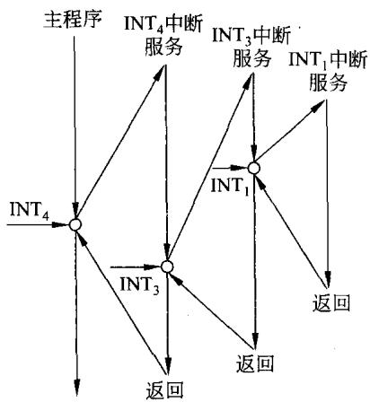  
图8-30中断嵌套示意图

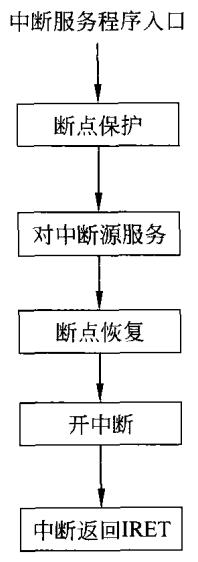  
(a)不允许中断的中断服务程序框图

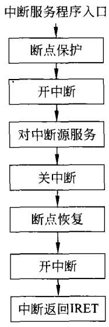  
(b)允许中断的中断服务程序框图  
图8-31两种中断服务程序框图

由图8-31可以看到，两种中断服务程序的区别仅在于不允许中断的中断服务程序一直是关中断的，仅在中断返回前开中断，则整个中断服务程序均不会响应中断。而允许中断的中断服务程序中有开中断指令，则允许中断。

对于图8-31,更重要的是读者必须记住并理解一个中断服务程序的基本框架：开始必须有断点保护，这就是前面提到的由程序员利用指令完成的那一部分。然后要有对中断源的具体服务。服务完后必定要有断点恢复。最后则是中断返回。这个基本框架是设计人员必须遵循的，是非常重要的。

当计算机系统需要中断嵌套工作时，需要编写前面提到的允许中断的中断服务程序。同时，要特别注意，每一次嵌套都要利用堆栈来保护断点，使堆栈内容不断增加，因此，要充分估计堆栈的大小，不要使堆栈发生溢出。

## 8.3.38086(88)的中断系统

8086(88)具有功能很强的中断系统，可以处理256个不同方式的中断。每一个中断赋予一个字节的中断向量码(也称中断类型码)，CPU根据向量码的不同来识别不同的中断源。8086(88)中断源分为两大类，下面将逐一加以介绍。

## 1．内部中断源

8086(88)的内部中断主要有5种。

## （1）除法错中断

在8086(88)执行除法指令时，若除数太小，致使所得的商超过了CPU所能表示的数值范围，则CPU立即产生一个向量码(又称中断类型码)为0的中断。因此，除法错中断又称为方式0中断。中断向量码0是由CPU内部硬件自动产生的。

## （2）单步中断

8086(88)CPU 的标志寄存器中有一位TF标志—陷阱状态标志。CPU每执行完一条指令都检测TF的状态。如果发现TF=1,CPU产生中断向量码为1的中断，使CPU转向单步中断的程序。单步中断广泛应用于程序的调试，使CPU一次执行一条指令。单步中断的中断向量码01H也是由CPU内部硬件自动产生的。

## （3）断点中断

8086(88)的指令系统中有一条专门用做设置断点的指令，其操作码为单字节CCH。CPU执行该指令产生向量码为3的中断(即方式3中断)。断点中断在调试过程中用于设置断点。断点中断向量码03H亦是由CPU内部硬件自动产生的。

## （4）溢出中断

当CPU进行算术运算时，如果发生溢出，则会使标志寄存器的OF标志置1。如果在算术运算后加一条溢出中断指令INTO,则溢出中断指令测试OF位，若发现OF=1,则发生向量码为4的中断(即方式4中断)。溢出中断的中断向量码04H同样是由CPU内部硬件自动产生的。若发现OF=0，则不发生中断并继续执行该指令后面的指令。

## （5）用户自定义的软件中断

用户可以用INTnnH这样的指令形式来产生软件中断。其中INT为操作符，形成一个字节的操作码;nnH为由用户确定的、一个字节的中断向量码。INTnnH是由用户自己确定的两个字节的软件中断指令。可见，软件中断指令的中断向量码是由程序员（用户)决定的。

总之，无论是内部中断的中断向量或者是CPU已经定死，如除法出错、单步、断点和溢出中断，或者由用户预先已经给定的中断，当CPU响应这些中断时，CPU本身或通过软件指令即可获得中断向量码。

## 2.外部中断

8086(88)有两个信号输入端供外部中断源提出中断请求，下面分别予以说明。

## （1）非屏蔽中断NMI

如前所述，8086(88)的NMI不受IF标志的限制。只要是CPU在正常执行程序，一旦NMI请求发生，CPU在一条指令执行结束后将对它做出响应。NMI的请求输人为上升沿有效。

8086(88)CPU响应NMI中断请求时，由CPU内部硬件自动产生中断向量码02H，该向量码决定非屏蔽中断服务程序的入口地址。

## （2）可屏蔽中断请求INTR

该中断通常简称为中断请求，它受中断允许标志位IF的约束。只有当IF=1,CPU才有可能响应INTR请求。INTR高电平有效。

8086(88)CPU响应INTR中断请求与响应内部中断和外部NMI中断的方法不同。在CPU响应内部中断和NMI中断时，是由CPU硬件自动形成或由软件指令提供中断向量码。可以认为，中断源在得到CPU响应时是与外部没有关系的。

但是，INTR中断响应则不一样，CPU的响应过程要做两方面的工作：其一，CPU首先产生两个连续的中断响应总线周期。在第一个中断响应总线周期，CPU将地址总线及数据总线置高阻，送出第一个中断响应号INTA。在第二个中断响应总线周期，CPU送出第二个INTA信号。该信号启动外部中断系统，通知它将提出中断请求的中断源的一个字节的中断向量码放到数据总线上，CPU由数据总线获得该中断源的中断向量码。外部中断系统(通常是可编程中断控制器)预先对不同的中断源赋予不同的中断向量码。因此，CPU获得不同的中断向量码也就可以区分不同的中断源。其二，当CPU获得中断源的中断向量码后，再由CPU硬件进行断点保护(FLAG,CS,IP)并关中断。然后，根据中断向量码，获得中断源的服务程序人口地址，转向对中断源进行服务。

可见,在获得中断向量码的方式上,INTR与内部中断和NMI中断是不同的。INTA的时序如图8-32所示。

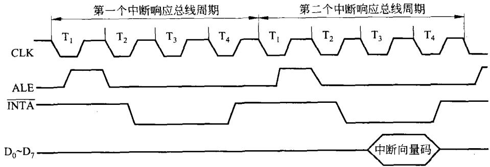  
图8-328088CPU的INTR中断响应时序

由图8-32可见，在响应INTR过程中，用两个总线周期。每个总线周期送出一个INTA负脉冲。第一个负脉冲用于响应提出中断请求的外设(接口)。第二个负脉冲期间，提出中断请求的外设将其中断源的中断向量码送的数据总线上。CPU可从数据总线上获取该向量码。图8-32是8088CPU的中断响应时序。8086与其不同之处仅仅在于在两个总线周期间多加了三个空闲的时钟周期。

综上所述，利用图8-33表示8086(88)CPU的中断响应的全过程。对这一过程，总结如下。

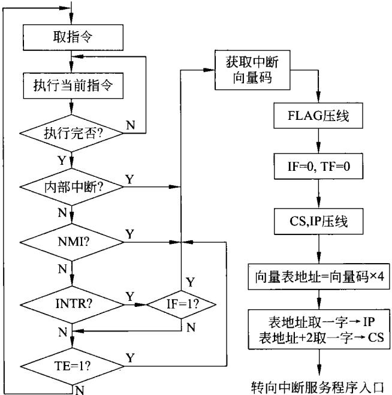  
图8-338088(86)中断响应过程

①由图8-33可知，CPU利用硬件查询各中断源。一条指令执行结束后，先查询的中断的优先级比后面的中断高。因此，除单步外的内部中断(除法、断点、溢出及软件中断指令)的优先级最高。依次是NMI,INTR，最低优先级为单步中断。

②各种中断源在响应过程中获取中断向量码的途径是不一样的。除法、溢出、断点、单步及NMI均由CPU内部硬件产生；软件中断指令的中断向量码包含在其指令中；而INTR的中断向量是由CPU从数据总线上读取。

获得中断源的中断向量码以后的过程则全都是一样的（如图8-33所示）。

③特别提醒读者注意的是，如图8-33所示的整个过程：从CPU硬件查询中断源到CPU转到中断服务程序这一复杂的过程，全部都是由CPU硬件自动完成的。读者必须记住这个过程，在今后利用中断解决具体的工程问题时，设计人员的工作就在于利用硬件和软件配合CPU的这个过程，最终使中断顺利地实现。后面将会看到这一点。

## 3.中断向量表

前面提到，中断服务程序的人口地址称为中断向量(或中断矢量)，每一个中断源都具有它自己的中断服务程序及其人口地址。前面又提到，每一个中断源都具有它自己的中断向量码。那么，中断向量码和中断向量两者有什么关系呢？

中断向量码和中断向量(即中断服务程序的入口地址)是通过如图8-34所示的中断向量表建立联系的。 003FFHr T

从图8-34中可以看到，中断向量表是内存00000H～003FFH的一段大小为1024个存储单元的区域。存储单元的地址（00000H～003FFH)叫做中断向量表地址，在这些地址中存放着中断向量。中断向量也就是中断服务程序的入口地址，它如何存放呢？每一个中断源都按其中断向量码所决定的地址存放其服务程序的入口地址。

## 中断服务程序人口的偏移地址存放在：

向量码×4=中断向量表地址及加1的地址

中断服务程序入口的段地址存放在：

向量码×4=中断向量表地址加2及加3的地址

如上所述，除法中断服务程序的入口地址的偏移地址就存放在00000H和00001H单元中，而入口地址的段地址就存放在00002H和00003H单元中。如图8-33所示，当除法中断发生后，CPU响应的最后步骤就是由中断向量码（00H)×4构成的中断向量表地址，即从00000H和00001H单元取出事先放好的中断服务程序入口的偏移地址放进IP，而将00002H和00003H单元中取出事先放好的中断服务程序的段地址放到

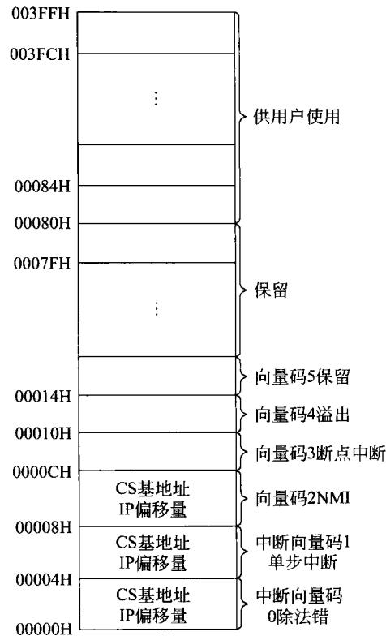  
图8-34中断向量表

CS中。则从下一个总线周期开始，CPU一定转向除法中断服务程序入口地址，开始执行服务程序。对于其他中断源，其思路与除法中断一样。

中断服务程序的入口地址(即中断向量)必须事先填写到中断向量表中。填写中断向量表可用下面两种方法。

## （1）直接编程序填写中断向量表

若某中断源的中断向量码为48H，而该中断的中断服务程序名称为TIME。则可编写如下程序填写到中断向量表。

SEDITV:MOV DX，0000H  
MOV DS、DX  
MOV SI，0120H ;中断向量码48H×4=0120H  
MOV DX,OFFSET TIME ;取服务程序人口的偏移地址  
MOV [SI]，DX  
MOV DX，SEG TIME ;取服务程序人口的段地址  
MOV[SI+2]，DX

在该程序中，将TIME的移偏地址放在了向量码48H×4=0120H及其加1的单元中，

也就是中断向量表地址00120H和00121H中，而把TIME所在段的段地址放在了向量码48H×4=0120H的加2和加3的单元中，即00122H和00123H中。

## （2）DOS系统调用填写中断向量表

若在DOS下工作，则可采用DOS系统调用，调用步骤如下。

INT21H的功能25H

25H→AH

中断向量码→AL

中断服务程序段：偏移量→DS：DX

程序如下：

```csv
MOV AH，25H ;功能号
MOV AL，48H ;中断向量码
MOV DX,SEG TIME
MOV DS、DX
MOV DX，OFFSET TIME
INT 21H
```

这样一来，就将中断向量码和中断服务程序的人口地址通过中断向量表联系在一起，而且每个中断向量码(也就是每个中断源)在中断向量表中占有4个地址，其中2个地址放中断服务程序人口地址的偏移地址，另2个地址放中断服务程序人口地址的段地址。由于8088CPU有00H～FFH共256个中断源，所以中断向量表也只有1KB大小。

## 8.3.4 中断控制器8259

前面曾经提到，可编程中断控制器是最常用的解决中断优先级控制的器件。中断控制器8259具有很强的控制功能，它能对8个或通过级联对更多个中断源实现优先级控制。通过提供不同的中断向量码来识别这些中断源，为用户构成中断系统提供强有力的手段。

现在开始，将介绍一些功能强大的可编程器件。这些可编程器件结构复杂，使用灵活。从应用角度出发，主要是介绍如何用好它们，来完成所需的功能。读者应从以下几个方面来认识并最终用好它们。

（1）弄清楚芯片外部引线的功能。只有熟悉每一条引线，在将来工程应用中才有可能将芯片连接到系统总线上。

（2）了解芯片的工作方式或工作特点。以便将来遇到具体的工程问题，能够知道该利用芯片的哪种工作方式或哪些工作特性来解决问题。

（3）理解芯片内部的控制字、命令字、状态字。以便在具体应用时能选择控制字、命令字并利用状态字对芯片编程。

（4）了解芯片所占的接口地址，以利于对芯片的具体连接。

（5）在上述的基础上，实现对芯片的初始化及具体应用。

上述几个方面是学习和应用每一块可编程芯片都必须注意到的。但由于还没有具体介绍芯片，读者不一定能理解。当学到本书后面的章节时会逐渐有所体会。

下面开始具体介绍可编程中断控制器8259。

## 1.8259的外部引线

可编程中断控制器8259外部引线及内部结构简图如图8-35(a)和图8-35(b)所示。

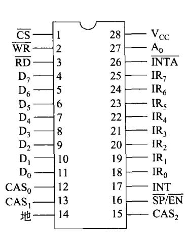  
(a)8259引线图

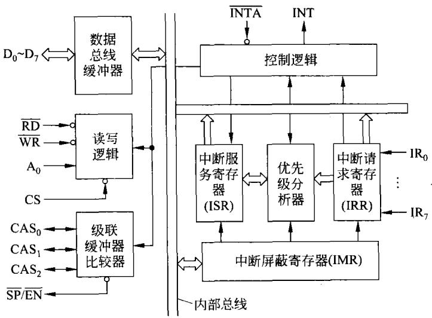  
(b)8259内部结构简图  
图8-358259中断控制器

8259中断控制器的引线及功能说明如下。

$\mathrm { D } _ { 0 } \sim \mathrm { D } _ { 7 }$ 为双向数据线，与系统总线的数据线相连接。编程时控制字、命令字由此写入。中断响应时，8259的中断向量码由此送到数据总线上，提供给 $\mathrm { C P U }$ 0

WR,RD为写和读控制信号，与系统总线的写，读信号相连接。

CS为片选信号，只有CS为低电平时，才能实现CPU对8259 的写或读操作。通常在系 $\overline { { \mathrm { C S } } }$ 统中连接地址译码器。

$\mathbf { A } _ { 0 }$ 是8259 内部寄存器的选择信号。它的不同状态，对应不同的内部寄存器。使用中，通常接地址总线的某一位，例如 $\mathbf { A } _ { 1 }$ 或 $\mathbf { A } _ { 0 }$ 等。

INT为8259的中断请求输出信号，可直接接到CPU的INTR输入端。

INTA为中断响应输入信号。在中断响应过程中，CPU的中断响应信号由此端进人8259。

$\mathrm { C A S } _ { 0 } \{ \mathrm { \sim C A S } _ { 2 }$ 为双向级联控制线。当多个8259级联工作时，其中一片为主控级芯片，其他均为从属级芯片。主控级芯片的 $\mathrm { C A S } _ { 0 } \sim \mathrm { C A S } _ { 2 }$ 作为输出，连接到各从属级芯片 $\mathrm { C A S } _ { \mathrm { 0 } } \sim$ $\mathrm { C A S } _ { 2 }$ 上（输人）。当某从属8259提出中断请求时，主控级 ${ 8 2 5 9 \mathrm { \ C A S } _ { 0 } } \mathrm { \sim } { \mathrm { C A S } _ { 2 } }$ 送出相应的编码给从属级，使从属级中断被允许。

SP/EN为双功能引线。当工作在缓冲模式时，它为输出，用以控制缓冲传送；在非缓冲模式时，它用做输入。当 $\overline { { \mathbf { S P } } } = 1$ 时，指定8259芯片为主控级； $\overline { { \mathsf { S P } } } = 0$ 时，指定它为从属级。

$\mathrm { I R } _ { 0 } \sim \mathrm { I R } _ { 7 }$ 中断请求输入端。其他外设中断请求可加在8259的 $\mathrm { I R } _ { 0 } \sim \mathrm { I R } _ { 7 }$ 的任一端上。该信号可以是上升沿有效提出中断请求，也可以是高电平有效提出中断请求，由程序指定。

图8-35(b)给出了8259 的内部结构简图。芯片内部结构并不重要。只要求了解其中

三个状态寄存器。

（1）中断请求寄存器(IRR)。该寄存器是一个8位寄存器，用以保存外部中断源 $\mathrm { ( I R _ { 0 } }$ IR)的等待响应的中断请求信号。此寄存器的每一位对应一个中断源，当某中断源有请求时，则其相应位为1。一旦得到响应，其相应位复位为0。

（2）中断屏蔽寄存器(IMR)。这个8位寄存器的每一位对应一个外部中断源的屏蔽或开放。当某一位为1时，它所对应的IR将被屏蔽；为0时则开放。

（3）中断服务寄存器(ISR)。该8位寄存器保存正在被服务的中断源。哪个IR正在被服务，则ISR的相应位为1，在需要用命令来结束中断时，此状态一直保持到该中断处理结束。结束服务，则ISR的相应位为0。

上述三个寄存器的具体应用见下面的说明。

## 2.8259的工作方式

通过编程，可以设置8259的不同工作方式，以便适应不同环境的需要。这也说明8259工作的灵活性和适应性。

## （1）8080/85与8086/88工作模式

8259可以应用于8080（85)的8位机系统中，也可以用于8086（88)的16位机系统中。利用初始化命令字（见后)可以指定8259是工作在8080/85系统模式下还是工作在8086/88模式下。

当8259工作在8080/85模式时，它能很好地与8080/85CPU中断响应过程相配合。在中断响应过程中，8080/85先后送出3个INTA脉冲，加到8259上。在此工作模式下，8259收到第一个INTA脉冲就立即将CALL指令操作码CDH通过数据总线传送给CPU。接着CPU送出第二个INTA脉冲，8259再次通过数据总线将中断服务程序的入口地址的低8位传送给 CPU。第三个INTA脉冲时，8259将中断服务程序人口地址的高8 $\mathrm { C P U }$ 位地址传送给CPU。这样一来，CPU就能很方便地在中断响应时转向中断服务程序。

在8086/88模式下，响应中断过程中，CPU产生两个INTA脉冲。这时，8259内部使用第一个INTA脉冲;在第二个INTA脉冲期间，8259 通过数据总线将中断源的1个字节的中断向量码送到数据总线上并传送给CPU。

## （2）8259的中断优先级管理方式

①一般完全嵌套方式。又称为固定优先级方式，在此方式下，8个中断源由 $\mathrm { { I R } _ { \mathrm { { 0 } } } }$ 到 $\mathrm { I R } _ { 7 }$ 优先级依次降低，即IR。最高而IR，最低固定不变。优先级高的可嵌入优先级低的服务 $\mathrm { I R } _ { 0 }$ $\mathrm { I R } _ { 7 }$ 程序。

②自动循环优先级方式。该方式规定刚刚服务结束的中断源优先级最低，它的下一个中断源优先级最高并依次降低。可见，8个中断源谁都可能获得最高优先级。当然，在设置自动循环优先级方式开始，总是 $\mathrm { { I R } } _ { 0 }$ 的优先级最高。

③特殊循环优先级方式。这种方式是在主程序或中断服务程序中利用命令来一次指定某一中断源的优先级最低。这就意味着它的下一个中断源的优先级最高并依次降低。一次指定后，开始自动循环。

④ 特殊全嵌套方式。该方式与完全嵌套方式基本相同。所不同的是在完全嵌套方式下，某一中断源请求得到响应后，则该中断源及其低于该级的中断源的请求不再响应，只有

高于该级中断源的请求才可以得到响应。而在特殊全嵌套方式下，某一中断源请求得到响应后，它仍允许同级(该级)中断请求并能得到响应。

这种方式主要用于级联方式工作。主控芯片采用该方式，才能实现从属芯片的优先级控制。

## （3）8259的屏蔽方式

有关8259的中断屏蔽需弄清楚如下这样一些概念。

①8259在某一中断请求得到响应时，会使ISR中的相应位置1。此时，8259的优先级判决电路就会禁止所有优先级等于或低于它的中断请求，除非再用其他命令来改变这种情况。这是利用ISR实现的屏蔽。这种屏蔽随着该中断服务结束，使它在ISR中的相应位清0而结束。

②利用命令的一般屏蔽。可以利用后面要提到的OCW1使某些位对应的中断源屏蔽。该命令写人中断屏蔽寄存器IMR中，可以屏蔽置1位所对应的中断源。

③特殊屏蔽方式。如前所述，中断响应后，利用ISR中的相应位置1，只能屏蔽同级或更低级的中断源。特殊屏蔽则可以屏蔽更高级的中断源，而使得低级中断源获得响应，嵌套到高优先级的中断服务程序中。

特殊屏蔽方式利用OCW3来设置，然后再利用OCW1将当前正在服务的中断加以屏蔽，这就可以使ISR中当前中断所对应的位清0。从而使所有未被OCW1屏蔽的中断源，包括优先级最低的中断源都有可能得到响应。

## （4）中断结束方式

①自动结束。当系统中只有一片8259且不会出现中断嵌套时，可以采用自动结束方式。

当8259设置为自动结束时，中断响应的第二个INTA负脉冲将清除ISR中的相应位，从而认为中断结束。实际上这时中断服务程序尚未执行。因此，这种中断结束方式不允许中断嵌套。

② 一般结束方式。此方式用在一般全嵌套方式下，由CPU利用程序发送结束命令（EOI)给8259，使8259中ISR中优先级最高的置1位清0，从而结束该位所对应的中断。该命令是利用OCW2的最高3位为001来实现的。

③特殊结束方式。在非一般全嵌套方式下，中断优先级在不断发生改变，无法利用ISR中的置1位来确定当前正处理的是哪一级中断。这时就要用特殊结束命令（SEOI)来结束所指定的那一级中断。此时OCW2的高3位为011，而最低3位的编码指定要结束的中断源。

## （5）中断触发方式

8259有8个外部中断源输入端 $\mathrm { I R } _ { 0 } \sim \mathrm { I R } _ { 7 }$ ，它们的请求触发方式有两种，都可编程设置。

① 电平触发。利用IR,上的高电平触发中断请求。高电平应维持到中断响应的第1个INTA负脉冲结束之前。一旦该响应脉冲结束，高电平也应撤销，以防止产生该电平的第二次响应。

② 边沿触发。利用加到IR,上信号的上升沿触发中断请求，而高电平则不表示有中断

请求。

在边沿触发方式时，应注意在上升沿产生后的高电平应持续到第1个INTA脉冲结束，甚至可以一直保持高电平。

无论哪种触发方式，若高电平持续时间很短，则8259将自动规定该中断由 $\mathrm { I R } _ { 7 }$ 进人。利用这一特性可以克服系统中的窄脉冲干扰。当有大的窄脉冲干扰时，,可将相应的 $\mathrm { I R } _ { 7 }$ 的中断服务程序用一条IRET来实现。显然，若能将请求脉冲保持必要的宽度且系统中没有大的窄脉冲干扰时， $\mathrm { I R } _ { 7 }$ 是可以利用的。只要在 $\mathrm { I R } _ { 7 }$ 的中断服务程序中读ISR并查询其状态是否是正常的中断请求即可。因为正常的 $\mathrm { I R } _ { 7 }$ 中断会使ISR的 $\mathbf { D } _ { 7 }$ 置1。

## 3.8259的内部控制字

8259的功能是很强的，在它工作以前必须通过软件命令它做什么。只有在8259接收了CPU的命令后，它才能按照命令所指示的方式工作，这就是对8259的编程。 $\mathrm { C P U }$ 命令分为两大类：一类是初始化命令字(ICW)，主要使8259处于初始状态；另一类是操作命令字(OCW)，使处于初始状态的8259去执行具体的某种操作方式。操作命令字可在8259初始化后的任何时刻写人。

## （1）初始化命令字

① 初始化命令字ICW1。在 $\mathrm { A } _ { 0 } = 0 , \mathrm { D } _ { 4 } = 1$ 时为写人，各位的功能如图8-36所示。

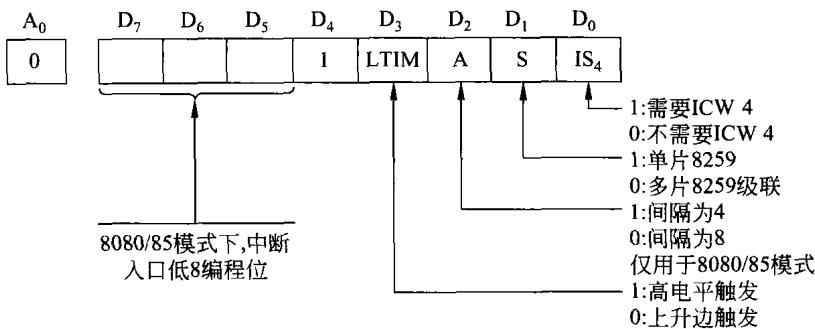  
图8-36 初始化命令字1(ICW1)

②初始化命令字ICW2。在8080/85模式下，它为中断人口地址的高8位，与ICW1的 $\mathrm { D } _ { 7 } { \sim } \mathrm { D } _ { 5 }$ 形成的低8位构成16位的人口地址。在8086/88模式下，仅用ICW2提供不同中断源的中断向量码。当中断响应时，再根据中断向量表获得人口地址。ICW2如图8-37所示。

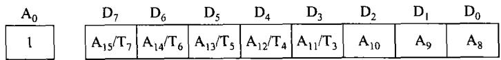  
图8-37 初始化命令字2(ICW 2)

ICW2所规定的中断向量码如表8-1表示。在表8-1中，设计人员在编程时只需规定ICW2中的 $\mathrm { T } _ { 3 } \sim \mathrm { T } _ { 7 }$ 即可，低3位是隐含默认的。从而形成了中断源 $\mathrm { I R } _ { 0 } \sim \mathrm { I R } _ { \mathrm { \Omega } }$ 的中断向量码。

表8-1 ICW2构成 $\mathbf { I R } _ { 0 } \sim \mathbf { I R } _ { 7 }$ 的中断向量码
<table><tr><td>IR</td><td> $\mathbf { D } _ { 7 }$ </td><td> $\mathbf { D _ { 6 } }$ </td><td> $\mathbf { D _ { 5 } }$ </td><td> $\mathbf { D _ { 4 } }$ </td><td> $\mathbf { D _ { 3 } }$ </td><td> $\mathbf { D _ { 2 } }$ </td><td> $\mathbf { D _ { 1 } }$ </td><td> $\mathbf { D _ { 0 } }$ </td></tr><tr><td>7</td><td> $\mathrm { T } _ { 7 }$ </td><td> $\mathrm { T } _ { 6 }$ </td><td> $\mathrm { T } _ { 5 }$ </td><td> $\mathrm { T } _ { 4 }$ </td><td> $\boldsymbol { \mathrm { T } } _ { 3 }$ </td><td>1</td><td>1</td><td>1</td></tr><tr><td>6</td><td> $\boldsymbol { \Upsilon } _ { 7 }$ </td><td> $\mathrm { T } _ { 6 }$ </td><td> $\mathrm { { T } _ { 5 } }$ </td><td> $\mathrm { T } _ { 4 }$ </td><td> $\mathbb { T } _ { 3 }$ </td><td>1</td><td>1</td><td>0</td></tr><tr><td>5</td><td> $\mathrm { T } _ { 7 }$ </td><td> $\mathrm { T } _ { 6 }$ </td><td> $\mathsf { T } _ { 5 }$ </td><td> $\mathrm { T } _ { 4 }$ </td><td> $\mathrm { T } _ { 3 }$ </td><td>1</td><td>0</td><td>1</td></tr><tr><td>4</td><td> $\boldsymbol { \Upsilon } _ { \tau }$ </td><td> $\mathrm { { T _ { 6 } } }$ </td><td> $\mathrm { T } _ { 5 }$ </td><td> $\mathrm { T } _ { 4 }$ </td><td> $\mathrm { T } _ { 3 }$ </td><td>1</td><td>0</td><td>0</td></tr><tr><td>3</td><td> $\mathrm { T } _ { 7 }$ </td><td> $\mathrm { T } _ { 6 }$ </td><td> $\mathrm { T } _ { 5 }$ </td><td> $\mathrm { T } _ { 4 }$ </td><td> $\mathbb { T } _ { 3 }$ </td><td>0</td><td>1</td><td>1</td></tr><tr><td>2</td><td> $\mathrm { T } _ { 7 }$ </td><td> $\mathrm { \Delta T _ { \ 6 } }$ </td><td> $\mathrm { T } _ { 5 }$ </td><td> $\mathrm { T } _ { 4 }$ </td><td> $\mathrm { T } _ { 3 }$ </td><td>0</td><td>1</td><td>0</td></tr><tr><td>1</td><td> $\boldsymbol { \Upsilon } _ { 7 }$ </td><td> $\mathrm { T } _ { 6 }$ </td><td> $\mathrm { T } _ { 5 }$ </td><td> $\mathrm { T } _ { 4 }$ </td><td> $\mathrm { T } _ { 3 }$ </td><td>0</td><td>0</td><td>1</td></tr><tr><td>0</td><td> $\mathrm { T } _ { 7 }$ </td><td> $\mathrm { T } _ { 6 }$ </td><td> $\mathrm { T } _ { 5 }$ </td><td> $\mathrm { T } _ { 4 }$ </td><td> $\mathrm { T } _ { 3 }$ </td><td>0</td><td>0</td><td>0</td></tr></table>

③初始化命令字ICW3。该字是用于多片8259级联的。在主控8259中，ICW3的每一位对应一个IR输人。哪一位为1,表示相应的IR接从属8259。例如，主控8259的 $\mathrm { I R } _ { 4 }$ 和IR，接从属8259，则主控8259和ICW3的 $\mathrm { D } _ { 4 }$ 和 $\mathrm { D } _ { 7 }$ 必须为1,而其他不接从属8259 的各位均为0。

从属8259的ICW3的最低三位的编码用以表示该从属8259接至主控8259的IR编号。例如，从属8259芯片接主控的 $\mathrm { I R } _ { 4 }$ ,则从属ICW3的 $\mathrm { D } _ { 0 } \sim \mathrm { D } _ { 2 }$ 的编码为100B(4)。两个ICW3如图8-38所示。

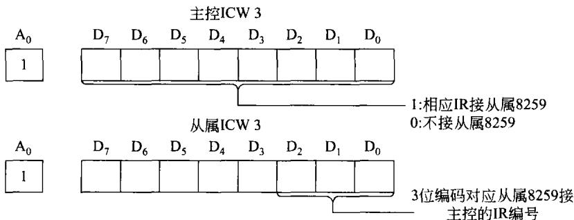  
图8-38初始化命令字3(ICW 3)

④ 初始化命令字ICW4。该ICW4各位的功能如图8-39所示。

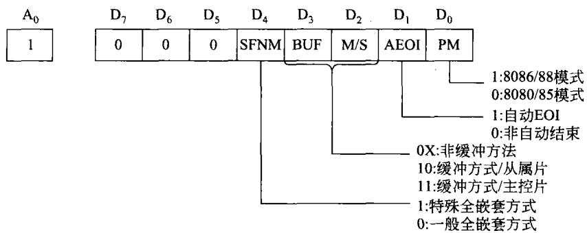  
图8-39 初始化命令字4(ICW 4)

ICW4中的AEOI位用于规定中断结束方式。该位为0，则规定必须利用程序命令来结束中断，详见OCW2的内容。当该位为1时，规定为自动结束。

BUF(ICW4的D3)用来指示8259的数据线 $\mathrm { D } _ { 0 } \sim \mathrm { D } _ { 7 }$ 与系统总线 $\mathrm { D } _ { 0 } \sim \mathrm { D } _ { 7 }$ 的连接中有无缓冲器。如果有缓冲器，则在中断响应过程中应打开缓冲器，保证在这时传送中断向量码。而在对8259编程时，要保证数据正确地写人8259，这时，可用8259的SP/EN信号输出作为控制信号。

在非缓冲方式下，SP/EN用来指定本8259是主控芯片还是从属芯片。当 $\overline { { \mathsf { S P } } } = 1$ 时为主片;SP=0时为从属片。

## （2）操作命令字OCW

在对8259用初始化命令字初始化之后，它就进入工作状态，准备好接收IR端进入的中断请求。在8259工作期间，可随时写人操作命令字，使8259按照操作命令字的规定来工作。操作命令字有3个，可单独使用。

① 操作命令字OCW1。它用于设置对8259中断的屏蔽操作。当这个8位的操作命令字的某一位置1时，它就屏蔽相对应的IR的输入。如图8-40所示，当M0=1时，屏蔽 $\mathrm { I R } _ { 0 }$ M1=1时，屏蔽 $\mathrm { { I R } _ { 1 } }$ ，以此类推。未被屏蔽的IR可继续正常工作。

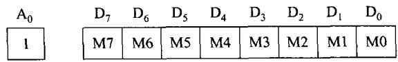  
图8-40 操作命令字1(OCW1)

② 操作命令字OCW2。该命令字具有多种功能，主要用于设置优先级、循环方式及中断结束方式等。OCW2各位的定义如图8-41所示。

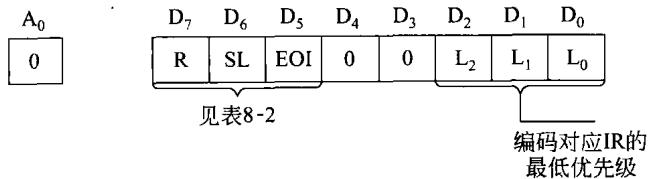  
图8-41 操作命令字2(OCW 2)

操作命令字各位功能描述如下。

R为优先级循环控制位，R=1为循环优先级； $\mathtt { R } = 0$ 为固定优先级。

$\mathrm { L } _ { 2 } \ , \mathrm { L } _ { 1 } \ , \mathrm { L } _ { 0 }$ 为系统最低优先级编码，用它们的编码来指定哪个IR优先级最低。

EOI是中断结束命令。该位为1时,将复位现行中断的中断服务寄存器ISR中的相应位。在非自动EOI的情况下,需要用OCW2来复位当前最高优先级所对应的位。

SL用于选择 $\mathrm { L } _ { 2 } , \mathrm { L } _ { 1 } , \mathrm { L } _ { 0 }$ 编码。当SL=1时， ${ \tt L } _ { 2 } \sim { \mathrm { I } } _ { \infty }$ 编码有效;SL=0时， ${ \mathrm { L } } _ { 2 } \sim { \mathrm { L } } _ { 0 }$ 编码无效。

OCW2的具体功能如表8-2所示。

③操作命令字OCW3。OCW3可以用设置查询方式、特殊屏蔽方式，还可以读8259的中断请求寄存器IRR和中断服务寄存器ISR的当前状态。OCW3各位功能如图8-42所示。

表8-2OCW2控制格式
<table><tr><td> $\mathbf { D } _ { 7 }$  R</td><td> $\mathbf { D _ { 6 } }$  SL</td><td> $\mathbf { D } _ { 5 }$  EOI</td><td> $\mathbf { D _ { 4 } }$ </td><td> $\bf { D _ { 3 } }$  0</td><td> $\mathbf { D } _ { 2 }$   $\mathbf { L } _ { 2 }$ </td><td> $\mathbf { D _ { l } }$   ${ \bf L _ { 1 } }$ </td><td></td><td> $\mathbf { D _ { \widehat { \mathfrak { p } } } }$   $\mathbf { L _ { 0 } }$ </td></tr><tr><td>0</td><td>0</td><td>1</td><td></td><td></td><td>·</td><td></td><td>：</td><td>一般结束命令，使 ISR中正在服务位清0</td></tr><tr><td>0</td><td>1</td><td>1</td><td></td><td></td><td> $\mathrm { L } _ { 2 }$ </td><td> ${ \bar { \mathbf { L } } } _ { 1 }$ </td><td> ${ \bf { L } } _ { 0 }$ </td><td>特殊结束命令，将  $\mathrm { L } _ { 2 } \sim \mathrm { L } _ { 0 }$  指定的ISR中的相应位清0</td></tr><tr><td>1</td><td>0</td><td>1</td><td></td><td></td><td>：</td><td></td><td>：</td><td>自动循环命令，结束正在执行的中断，并使其优先级最低</td></tr><tr><td>1</td><td>0</td><td>0</td><td></td><td></td><td></td><td>…</td><td>：</td><td>设置自动循环命令  $, \mathrm { I R } _ { 0 }$  优先级最低</td></tr><tr><td>0</td><td>0</td><td>0</td><td></td><td></td><td> $\cdots$ </td><td>：</td><td>：</td><td>清除自动循环命令，变为固定优先级</td></tr><tr><td>1</td><td>1</td><td>0</td><td></td><td></td><td> $\mathrm { L } _ { 2 }$ </td><td> $\mathrm { \Delta I } _ { \perp }$ </td><td> $\mathrm { L } _ { 0 }$ </td><td>优先级设置命令  $, \mathrm { L } _ { 2 } ~ \mathrm { L } _ { 1 } \mathrm { L } _ { 0 }$  指定的IR优先级最低</td></tr><tr><td>1</td><td>1</td><td>1</td><td></td><td></td><td> ${ \mathrm { L } } _ { 2 }$ </td><td> $\mathrm { L } _ { 1 }$ </td><td> ${ \tt L } _ { 0 }$ </td><td>结束由  $\mathrm { L } _ { 2 } ~ \mathrm { L } _ { 1 } \mathrm { L } _ { 0 }$  指定的中断(ISR 指定位清O)并使  $\mathrm { L } _ { 2 }$   $\mathrm { L _ { 1 } L _ { 0 } }$  指定的中断优先级最低</td></tr><tr><td></td><td></td><td>0</td><td></td><td></td><td></td><td>：</td><td>：</td><td>无效</td></tr></table>

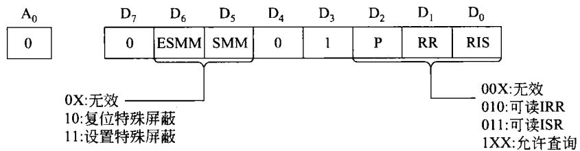  
图8-42操作命令字3(OCW3)

OCW3的bit[6]和bit[5]用于设置特殊屏蔽和撤销特殊屏蔽。当将两位同时为1的OCW3写人8259后，8259可以响应任何未被屏蔽的中断源。用完此状态后，若再将ESMM=1,SMM=0的OCW3再写入8259，则8259将恢复为未设置特殊屏蔽前的优先级方式。

OCW3的P位为查询方式控制位。当CPU向8259写入P=1的OCW3后，只要接着执行一条输入指令，则加到8259引脚上的RD有效信号就可以使8259送出了一个查询字节，该字节刚好通过这条输入指令读到CPU的AL中。查询字节的格式如图8-43所示。

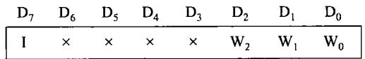  
图8-43查询字节的格式

其中I=1表示有中断；I=0表示无中断。 $\mathbf { W } _ { 2 } \ 、 \mathbf { W } _ { 1 } \ 、 \mathbf { W } _ { 0 }$ 的编码用来表示具有最高优先级的中断是哪一个IR。

查询方式常用在中断源超过64个的情况，一般较少使用。

OCW3的最后两位编码用来指定读ISR还是IRR。因为IRR和ISR共用一个地址，故由OCW3事先加以选择。

## 4.8259的寻址

8259的外部只有一条地址线 $\mathbf { A } _ { 0 }$ ，因此它只占两个接口地址。从上面的内容可以看到，要

写人8259中的命令字有许多个。如何利用有限的地址读写更多的状态字和命令字，这就是接口的寻址所考虑的问题。在可编程器件中，经常采用下列方法解决这个问题。

（1）利用命令字(或控制字)中的某一位或某几位来标明该字是什么字。例如，对同一地址写入命令字 $\mathrm { D } _ { 4 } = 1$ 的一定是ICW1;而 $\mathrm { D } _ { 4 } = 0 , \mathrm { D } _ { 3 } = 0$ 的命令字一定是 $\mathrm { O C W } ~ 2 ; \mathrm { D } _ { 4 } = 0$ $\mathrm { D } _ { 3 } = 1$ 的是OCW3。因此，尽管都写入同一地址，但不会出错。

（2）依据顺序。可编程芯片规定先写入的是哪个字，后写入的是什么字，再写入的是什么字，必须严格按所规定的顺序。尽管写人的是同一地址，但不会产生混乱。

（3）根据命令字的某一位或某些位的状态。例如，8259中ISR和IRR共用同一个地址。为了加以区别，在读出某个寄存器的状态前，必须先利用OCW3的最低两位的编码来指定是哪一个寄存器，然后再去读那个地址。

(4)利用专门的触发器或寄存器的状态作为指针。当状态为1时和状态为0时分别指向同一地址的不同的字。

上述方法在这里和后面的可编程器件中都会遇到。8259的寻址如表8-3所示。

表8-3 8259寻址控制
<table><tr><td> $\mathbf { A } _ { 0 }$ </td><td> $\mathbf { D _ { 4 } }$ </td><td> $\mathbf { D _ { 3 } }$ </td><td>RD</td><td>WR</td><td>Cs</td><td>操 作</td></tr><tr><td>o</td><td>×</td><td>×</td><td>0</td><td>1</td><td>0</td><td>先由OCW3指定，可读出IRR或ISR的内容</td></tr><tr><td>1</td><td>×</td><td>×</td><td>0</td><td>1</td><td>0</td><td>读出IMR的内容</td></tr><tr><td>0</td><td>0</td><td>0</td><td>1</td><td>0</td><td>0</td><td>写人OCW2</td></tr><tr><td>0</td><td>0</td><td>1</td><td>1</td><td>0</td><td>0</td><td>写人OCW3</td></tr><tr><td>0</td><td>1</td><td>×</td><td>1</td><td>0</td><td>0</td><td>写人ICW1</td></tr><tr><td>1</td><td>×</td><td>×</td><td>1</td><td>0</td><td>0</td><td>顺序写人ICW2,ICW3,ICW4,OCW1</td></tr></table>

从表8-3中可以看到，利用CS有效选中8259，再利用A。来寻址不同的寄存器和命令 $\mathbf { A } _ { 0 }$ 字，A。只可能有两个状态。因此，在硬件系统中,8259仅占两个外设接口地址。初始化命 $\mathrm { A } _ { 0 }$ 令与操作命令还利用命令字中的 $\mathrm { D } _ { 3 } , \mathrm { D } _ { 4 }$ 及写人的顺序加以区别。

## 5.8259初始化

前面已经提到，8259仅占两个接口地址。在利用各种命令对其初始化时，一方面利用这两个地址，同时利用命令字中D4和 $\mathrm { D } _ { 4 }$ $\mathrm { D } _ { 3 }$ 的状态及命令字的写入顺序对这些命令加以区分，做到有条不紊地初始化8259。

对8259初始化的命令字的写入顺序如图8-44所示。其中ICW2必须跟在ICW1之后，这就是顺序问题。后面的ICW3和ICW4是否需要初始化,取决于ICW1命令字的内容。ICW2,ICW3,ICW4均使用同一个地址，这就决定了图8-44所示的初始化顺序。初始化后8259可接收操作命令。

假定在微机系统中只有一片8259，所占的接口地址为FF00H和FF01H。

下面是8259的初始化程序。

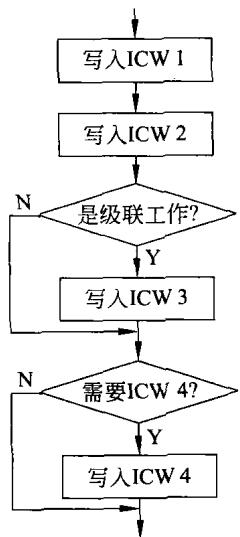  
准备好接收中断请求  
图8-448259初始化顺序

<table><tr><td>SET59A:MOV</td><td>DX,OFF00H</td><td>;8259A的地址,A=0</td></tr><tr><td></td><td>MOV AL,13H</td><td>;ICW1,LT1M=O,单片,需要ICW 4</td></tr><tr><td></td><td>OUT DX,AL</td><td>;上升沿产生中断</td></tr><tr><td>MOV</td><td>DX,OFF01H</td><td>;8259地址，此时A=1</td></tr><tr><td>MOV</td><td>AL,48H</td><td>;ICW 2,中断向量码</td></tr><tr><td>OUT</td><td>DX,AL</td><td></td></tr><tr><td>MOV</td><td>AL,01H</td><td>;ICW4,8086/88模式,非自动EOI</td></tr><tr><td>OUT</td><td>DX,AL</td><td>;非缓冲 ;方式一般全嵌套</td></tr><tr><td>MOV</td><td>AL,OEOH</td><td>;OCW1,屏蔽IR5,IR和 IR</td></tr><tr><td>OUT</td><td>DX,AL</td><td></td></tr></table>

前面已经提到,8259 的内部寄存器IMR,ISR和IRR的内容是可以读出进行查询的。

由于IMR有单独的地址，可以直接在 $\mathbf { A } _ { 0 } = 1$ 时读出。而要读出ISR或IRR,则必须先向8259写人OCW3。下面就是读出ISR的程序。

<table><tr><td>MOV</td><td>DX,OFFOOH</td><td>;对应A=0</td></tr><tr><td>MOV</td><td>AL,OBH</td><td>;0BH为OCW3</td></tr><tr><td>OUT</td><td>DX,AL</td><td>;OCW3写人8259</td></tr><tr><td>IN</td><td>AL,DX</td><td>;读出ISR的内容,放在AL中</td></tr></table>

## 6.应用

在8086(88)系统中，要用好8259，需做好以下三件事。

（1）连接8259到8086系统

将8259连接到8086(88)系统总线上的连接图如图8-45所示。

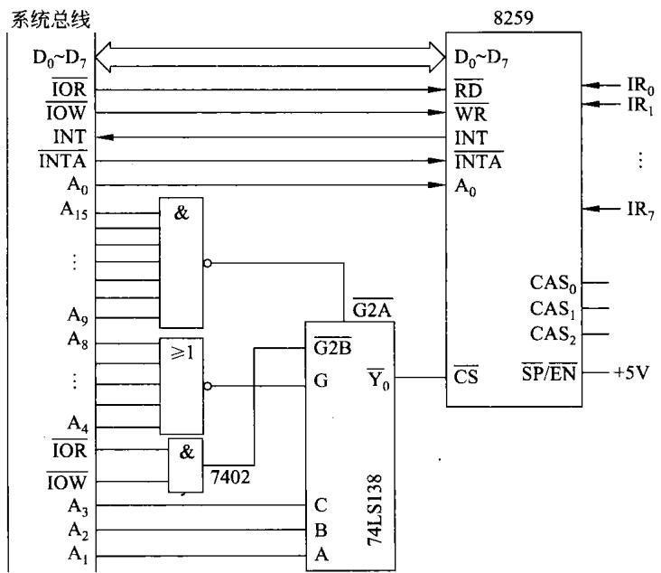  
图8-458259与系统总线连接图

若在图8-45所示的8259上，将周期为20ms的对称方波接在IR4上，以便每20ms产生一次定时中断，并且利用此定时中断建立时、分、秒电子时钟。因此，需要对连接好的8259初始化，初始化程序前面已给出，参见前面的程序。

## （2）编写中断服务程序

编写8259中断源的中断服务程序，针对20ms产生一次的定时中断，中断服务程序编写如下。

<table><tr><td>CLOCK</td><td>PROC</td><td>FAR</td><td></td></tr><tr><td></td><td>PUSH</td><td>AX</td><td></td></tr><tr><td></td><td>PUSH</td><td>DS</td><td></td></tr><tr><td></td><td>PUSH</td><td>SI</td><td></td></tr><tr><td></td><td>PUSH</td><td>DX</td><td>;程序进行的断点保护</td></tr><tr><td></td><td>STI</td><td></td><td>;开中断</td></tr><tr><td></td><td>MOV</td><td>DX,SEG TIMER</td><td></td></tr><tr><td></td><td>MOV</td><td>DS,DX</td><td></td></tr><tr><td></td><td>MOV</td><td>SI,OFFSET TIMER</td><td>；取50次计数单元</td></tr><tr><td></td><td>MOV</td><td>AL,[SI]</td><td></td></tr><tr><td></td><td>INC</td><td>AL</td><td></td></tr><tr><td></td><td>MOv</td><td>[SI],AL</td><td>;判1s到否</td></tr><tr><td></td><td>CMP</td><td>AL,50</td><td></td></tr><tr><td></td><td>JNE</td><td>TRNED</td><td></td></tr><tr><td></td><td>MOV</td><td>AL,0</td><td></td></tr><tr><td></td><td>MOV</td><td>[SI],AL</td><td>;取60s计数</td></tr><tr><td></td><td>MOV</td><td>AL,[SI+1]</td><td></td></tr><tr><td></td><td>ADD</td><td>AL,1</td><td></td></tr><tr><td></td><td>DAA</td><td></td><td></td></tr><tr><td></td><td>MOV</td><td>[SI+1]，AL</td><td>；判1min到否</td></tr><tr><td></td><td>CMP</td><td>AL，60H</td><td></td></tr><tr><td></td><td>JNE</td><td>TRNED</td><td></td></tr><tr><td></td><td>MOV</td><td>AL,0</td><td></td></tr><tr><td></td><td>MOV</td><td>[SI+1],AL</td><td>;取60min计数</td></tr><tr><td></td><td>MOV</td><td>AL,[SI+2]</td><td></td></tr><tr><td></td><td>ADD</td><td>AL,1</td><td></td></tr><tr><td></td><td>DAA</td><td></td><td></td></tr><tr><td></td><td>MOV</td><td>[SI+2],AL</td><td>;判1h到否</td></tr><tr><td></td><td>CMP</td><td>AL,60H</td><td></td></tr><tr><td></td><td>JNE</td><td>TRNED</td><td></td></tr><tr><td></td><td>MOV</td><td>AL,0</td><td></td></tr><tr><td></td><td>MOV</td><td>[SI+2]，AL</td><td>;取小时计数</td></tr><tr><td></td><td>MOV</td><td>AL,[SI+3]</td><td>·</td></tr><tr><td></td><td>ADD</td><td>AL,1</td><td></td></tr><tr><td></td><td>DAA</td><td></td><td></td></tr><tr><td></td><td>MOV</td><td>[SI+3],AL</td><td></td></tr><tr><td></td><td>CMP</td><td>AL,24H</td><td></td></tr><tr><td></td><td>JNE</td><td>TRNED</td><td></td></tr></table>

MOV AL,0   
MOV [SI+3]，AL   
TRNED:MOV DX,OFF00H   
MOV AL,20H ;结束中断命令   
OUT DX,AL   
POP DX   
POP SI   
POP DS   
POP AX   
IRET   
CLOCK ENDP

## （3）填写中断向量表

要做的第三件事就是将中断服务程序的人口地址(即中断向量)填到中断向量表中。

在本节前面介绍中断向量表时，已将如何填写中断向量表的两种方法加以说明。在此，仅就用其中第一种方法将程序写如下。

```csv
IRVTB:MOV DX,0000H
MOV DS,DX
MOV BX,0130H ;IR中断向量码为 4CH,4CH×4=130H
MOV DX, SEG CLOCK
MOV [BX+2]，DX
MOV DX,OFFSET CLOCK
MOV [BX],DX
```

做好了上述3项工作之后，电子时钟在中断方式之下便可工作。工作前需要修改时、分、秒单元，使起始时间准确。而后，任何时候，读出时、分、秒单元的内容，便可以知道当时的时间。

## 8.4直接存储器存取（DMA）

## 8.4.1 DMA 概述

前面已经介绍了计算机系统中常用的数据输入/输出方法。这些方法对应付慢速及中速外设的数据交换是比较合适的。因此，在速率不是很高的场合下，这些数据输入/输出方法获得了非常广泛的应用。

当高速外设要与计算机内存进行快速传递数据时，无论是采用查询方式还是中断方式，都要执行程序。CPU执行指令是需要花时间的，这就不可能使数据传送率提高。利用程序，CPU从内存(或外设)读数据到累加器(或寄存器),然后再写到接口(或内存)中，若包括修改内存地址，判断数据块是否传送完,8088CPU(时钟接近5MHz)传送一个字节约需要几十微秒的时间。由此可大致估计出用程序方法的数据传送速率约为每秒几十K字节。

为了能够实现高速率传送数据，人们提出了直接存储器存取(DMA)这种方法。

## 8.4.2常用的方法

计算机中，常用的DMA方法有如下几种。

## 1.CPU停止工作

在许多CPU上都有总线请求（BUSRQ)和总线响应（BUSAK)信号（或者是保持请求HOLD和保持响应HLDA信号)。利用请求信号可以使CPU放弃对系统总线的控制权，使CPU停止工作，将系统总线让给DMA，从而实现DMA传送。当DMA用完系统总线后，再将系统总线的控制权交给CPU，下面再详细说明。

## 2.周期挪用

周期挪用可有如下两种情况。

## （1）固定挪用周期

在某些CPU中，由于考虑到CPU从内存取出指令操作码后，要对指令进行分析和译“码，此时不会使用系统总线。因此，在设计取指周期时留出一段时间专门用于DMA传送，其思路如图8-46所示。

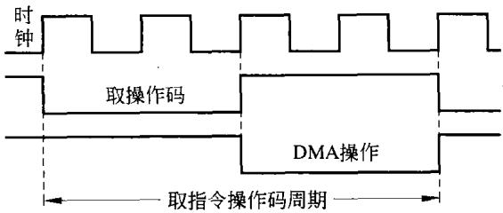  
图8-46周期的挪用示意图

由图8-46可以看到，该CPU的取指令操作码周期是4个时钟周期，其中用两个时钟周期从内存取出指令操作码，另外两个时钟周期可用于DMA传送。由于每一条指令都会有取指令操作码的周期，因此，每执行一条指令都会有一次DMA的传送，但传送时间只有两个时钟周期。

## （2）周期延长

在许多CPU上都有就绪(READY)信号(或等待WAIT信号），这种信号的作用就是延长CPU的机器周期(或总线周期)。例如，某CPU正常读写内存为4个时钟周期，若遇到慢速内存时，可利用READY信号将此读写内存的周期延长为5个、6个或任意多种时钟周期。

利用上述通过READY信号可以延长访问内存时间的思想，在延长的周期里可以不是用于等待慢速内存，而是用这段延长的时间实现DMA传送。这种DMA方式如图8-47所示。

在图8-47中，在一个机器周期里，利用READY信号将此机器周期延长若干个时钟周期，在延长的这些时钟周期里用来实现DMA传送。DMA传送结束，CPU继续执行完它的机器周期。早期用8088CPU构成的PC中，其DMA传送就是用的这种方法。

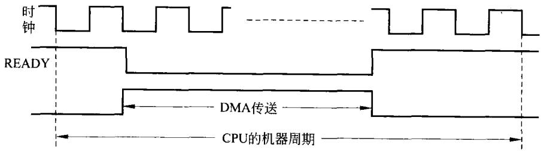  
图8-47周期延长实现DMA传送

## 3.CPU与DMA交替分时工作

利用专门的机制将时间分片，一片时间总线为CPU所用，用以实现CPU的机器周期；而另一时间片则将总线交由DMA控制，用以实现DMA传送。两者交替进行，其示意图如图8-48所示。

  
图8-48CPU与DMA分时工作示意图

由于DMA不像CPU的工作每时每刻都在进行。DMA传送一般只是偶尔为之。因此，这种方式实现起来比较简单，但有时会使总线闲置而影响CPU的处理速度。而另外两种方式都是在需要进行DMA传送时才占用系统总线，故它们能更好地提高总线的利用效率。

## 8.4.3DMA的一般过程

## 1.概述

要实现DMA传送，目前都采用大规模集成电路芯片DMA控制器（DMAC)。DMAC内部结构很复杂，例如Intel的8237就有4个独立的DMA通道，可实现以下功能。

（1）单字节传送。

（2）数据块传送，一次将一个数据块传完。

（3）请求传送，即有请求就传,无请求就停止传送。

（4）当一片8237的4个通道不够用时，还可以多片级联，构成更多个DMA通道。DMAC的多个通道可实现优先级控制。

一片DMAC内部有几十个寄存器，而且一定包括内存地址寄存器和传送数据字节计数器。有关的寄存器不再说明。

在CPU控制系统总线执行程序时，DMAC作为接口接在系统总线上。这时它是作为总线上的一个接口存在的。此时，CPU可以执行一段程序对它初始化，包括将传送的内存起始地址写入内存地址寄存器、将要传送的字节数写入字节计数器等。

当DMA请求得到CPU响应，DMAC便获得总线控制权。此时，DMAC作为系统总线的控制器，控制系统总线完成DMA传送。可见，在不同情况下,DMAC扮演两种不同的角色。

## 2.传送过程

在DMAC 初始化后，一旦请求发生,DMA 的工作过程大致如下。

（1）外设向DMAC发出DMA传送请求。

（2）DMAC 通过连接到CPU 的保持请求 HOLD信号向CPU 提出 DMA请求。

（3）CPU在完成当前总线周期后会立即对DMA请求作出响应。

CPU的响应包括两个方面：一方面，CPU将控制总线、数据总线和地址总线置高阻，即CPU放弃对总线的控制权；另一方面，CPU将有效的HLDA信号加到DMAC上，以此来通知DMAC,CPU已经放弃了总线的控制权。

（4）待CPU将总线置高阻-—放弃总线控制权,DMAC向外设送出DMAC的应答信号并立即开始对总线实施控制。

（5）DMAC送出地址信号和控制信号,实现外设与内存或内存与内存的数据传送。

（6）DMAC将规定的数据字节传送完之后，通过向CPU发HOLD信号来撤销对CPU的DMA请求。CPU收到此信号，一方面使HLDA无效，另一方面又重新开始控制系统总线，实现正常的运行。

上述过程的示意图如图8-49所示。

  
图8-49DMA传送一般过程示意图

在图8-49中，要特别说明的是在第(3)点中CPU放弃总线控制权时，还必须利用有关信号（如HLDA)控制BUS形成电路，使其放弃总线(置高阻)，避免在DMA的传送过程中发生总线竞争，以保证将内总线的控制权交给DMAC。

## 8.5通道方式

## 8.5.1通道方式的特点

通道方式是在一种称为IO通道处理机(或称IO通道控制器)的控制部件控制下，实现计算机与外设间数据输入/输出的方法。其主要特点如下。

(1）CPU将数据传送的控制功能交给IO通道处理机去完成，可以实现两者的并行工作。

(2）IO通道处理机接在系统总线上，接收来自CPU的命令。同时，它又通过自身的总线与外设的设备控制器相连接，如图8-50所示。

  
图8-50计算机的通道结构图

（3）整个系统分为三级管理：CPU管理通道、通道管理设备控制器和设备控制器管理外设。

## 8.5.2通道的类型

根据通道的工作方式，通道分为如下几种类型。

## 1.选择通道

在这种类型的通道上，可以连接多台设备。但是，这些设备不能同时工作，在某一时间段内，只能选择一台设备工作。

选择通道上所连接的是高速设备。数据传送以数据块为基本单位，一旦某一设备的通道程序开始执行，则直到整个数据块传送结束，才能执行其他设备的通道程序。

这种类型的通道上，若外设在数据传送中需用长的时间完成某些辅助操作，而这时通道只能等待，这必然影响通道的利用率。

## 2.数组多路通道

数组多路通道是上面选择通道的一种改进，通道上同样可以连接多个设备。当某设备

进行数据传送时，通道就只为该设备服务。当设备需要等待完成某些辅助操作时，通道将暂时挂起该设备，转而执行其他设备的通道程序，为其他设备服务。

数组多路通道既保留了选择通道的高速率传送的优点，又能利用等待完成某些辅助操作的时间为其他设备服务。因此，具有更高的通道利用率。

## 3.字节多路通道

这种类型的通道主要用来连接大量的低速外设。它与数组多路通道一样，通道上，一段时间内可有多个设备同时工作，交替地执行多个设备的通道程序。

字节多路通道与数组多路通道的不同之处在于以下几点：

（1）数组多路通道允许多个设备同时工作，但只允许一台设备进行传输操作，其他设备只能进行控制操作。而字节多路通道不仅允许多个设备同时工作，而且允许它们同时进行传输操作。

（2）数组多路通道的数据传送是以数据块为基本单位的，通道必须在为某设备传送完一个数据块后，才能为其他设备传送数据块。而字节多路通道与设备间的数据传送是以字节为单位的，通道在为一个设备传送一个字节后，即可为另一设备传送一个字节。

## 8.5.3通道的发展

通道应用于20世纪80年代之前，随着技术的发展，为更好地管理外设，高效地实现计算机与外设间的数据的输入/输出，厂家研制出专门用于输入/输出的处理器，用于实现通道控制器的功能。输入/输出的处理器实际上是一种独立，更偏重于实现输入/输出的CPU，它有自己的指令系统，可以独立地构成计算机系统；也可以和通用CPU共享系统总线，构成多处理器系统。在此系统中，输人/输出的处理器主要任务就是实现与外设的数据输入/输出操作。典型的输入/输出处理器有20世纪80年代初出现的Intel的8089和Motorola的M68120。

但是，随着系统总线及外总线的发展，输入/输出处理器并未获得广泛的应用，尤其是今天的SAS、SATA、USB、IEEE-1394的不断发展以及它们的优异特性，计算机的各种外设，不管是高速的还是低速的，不管是少数的还是大量的，它们都可以很好地满足用户的要求。因此，通道作为以往计算机中曾经使用的重要的输入/输出方式，已经成为历史。读者只要对其有些了解即可。

## 8.6几种常见的接口芯片

## 8.6.1 可编程并行接口8255

可编程并行接口芯片8255已面世三十多年了。由于它功能强、使用方便，因而从一开始就得到了广泛的应用。掌握该芯片概念和方法，对今后学习使用其他可编程接口芯片是十分有利的。

## 1.8255的引线及其功能

8255的外部引线如图8-51所示。

假设想象成将8255从中间分成两半，其左边与系统总线相连接，而其右边则与外设相

连接。它与系统总线相连接的引线如下。

8条双向数据线 $\mathrm { D } _ { 0 } \sim \mathrm { D } _ { 7 }$ ，用以传送命令、数据或8255的状态。

RD为读控制信号线，与其他信号线一起实现对8255的读操作。通常接系统总线的IOR信号（或RD信号）。

WR为写控制信号线，与其他信号线一起实现对8255的写操作。通常接系统总线的IOW信号（或WR信号）。

CS为片选信号线，当它为低电平时才能选中该8255芯片，才能对它进行读写操作。通常由高

  
图8-518255的外部引线

位地址译码输出接在CS上，以便将该8255放在接口地址空间的规定地址上。

$\mathrm { A } _ { 0 } , \mathrm { A } _ { 1 }$ 为8255的地址选择信号线。8255内部有三个口：A口、B口和C口，还有一个控制寄存器CR。它们各占一个接口地址。 $\mathbf { A } _ { 0 } , \mathbf { A } _ { 1 }$ 的不同编码可产生它们的地址，详情见后面8255的寻址。

RESET为复位输入信号。此端上的高电平可使8255复位。复位后，8255的A口，B口和C口均被定为输入状态。该端低电平使8255正常工作。

$\mathrm { P A } _ { 0 } \sim \mathrm { P A } _ { \tau }$ 为A口的8条输人/输出信号线。该口的这8条线是工作于输入/输出还是双向(输入/输出)方式可由软件编码程来决定。

$\mathrm { P B } _ { \mathfrak { c } } \sim \mathrm { P B } _ { \mathfrak { z } }$ 为B口的8条输入/输出信号线。利用软件编程可指定这8条线是输人还是输出。

$\mathrm { P C } _ { \mathfrak { o } } \sim \mathrm { P C } _ { 7 }$ 这8条线根据其工作方式可作为数据的输入或输出线，也可以用做控制信号的输出或状态信号的输人线，具体情况将在本节后面做介绍。

## 2.8255的工作方式

8255有三种工作方式：方式0、方式1和方式2。这些工作方式可以通过编程来指定。下面对它们做具体说明。

## （1）工作方式0

工作方式0又称为基本输人/输出方式。在此方式下，8255的三个接口（A口，B口，C□)24条线全部规定为数据的输人/输出线。A口的8条线 $( \mathrm { P A } _ { 0 } \sim \mathrm { P A } _ { 7 } )$ 、B口的8条线$( \mathrm { P B } _ { 0 } { \sim } \mathrm { P B } _ { 7 } )$ 、C口的高4位 $( \mathrm { P C } _ { 4 } \sim \mathrm { P C } _ { 7 } )$ 和C口的低4位 $( \mathrm { P C } _ { 0 } \sim \mathrm { P C } _ { 3 } )$ 可用程序分别规定它们的输入/输出方向，即可以分别规定它们哪个作为输入，哪个作为输出。由于A口、B口、C口高4位和C口的低4位共有4部分，可以分别指定它们的输人/输出方向，因此，它们的输入/输出共有16种不同的组合。

在方式0下,A口、B口和C口输出均有锁存能力,即只要向这些输出口写入数据，则数据将一直维持到写入新的数据为止。但在方式0下，这三个口输入全无锁存能力，也就是说外设的数据要一直加在这些接口上，必须保持到被CPU读走。

在方式0之下，可以对C口实现按位操作。其详细情况后面再予以说明。

由于方式0使用十分简单，可满足无条件传送和查询方式传送的需要，因此，这种工作方式应用很广泛。

## (2）工作方式1

工作方式1又称为选通输人/输出方式。只有A口和B口能工作在此方式之下，而且还必须使用C口的某些引线来实现数据传送所需要的握手信号和中断请求输出。通常该方式是以中断方式工作的，这并不是说，该方式不能进行查询工作，而查询方式用方式0更加方便，不必要用方式1。

在工作方式1下,A口和B口均可用作输入接口，也可以作为输出接口，且由软件编程来指定。在此工作方式下A口和B口的输出、输人均有锁存能力。为了说明问题方便，下面分别以A口、B口均为输出或为输人加以讨论。实际工作时，则可随意指定。

## ①方式1下A口、B口均为输出

当在方式1下，A口和B口均工作在输出状态时，要利用C口的6条线作为控制和状态信号线来实现，其定义如图8-52所示。

  
(a)A口输出

  
(b)B口输出  
图8-52方式1下A口、B口均为输出的信号定义

为了使A口或B口的工作于方式1下，必须利用C口的一些线来实现。如图8-52所示,在方式1下用A口或B口输出时，所用到的C口线是固定不变的，A口使用 $\mathrm { P C _ { 3 } } \bullet \mathrm { P C _ { 6 } }$ 和 $\mathrm { P C } _ { 7 }$ ，而B口用 $\mathrm { P C } _ { 0 } , \mathrm { P C } _ { 1 }$ 和 $\mathrm { P C } _ { 2 }$ 。C口提供的信号功能如下。

a)OBF为输出缓冲器满信号，低电平有效。利用该信号告诉外设，在规定的口上已由CPU输出一个有效数据，外设可从此接口获取此数据。

b)ACK为外设响应信号，低电平有效。该信号用来通知接口,外设已将数据接收，并使$\overline { { \mathrm { O B F } } } = 1$

c）INTR为中断请求信号，高电平有效。当外设收到一个数据后，由此信号通知CPU,刚才的输出数据已经被接收，可以再输出下一个数据。

d）INTE为中断允许状态。由图8-52可以看到,A口和B口的INTR均受INTE控制，只有当INTE为高电平时，才有可能产生有效的INTR。

A口的INTEA由PC来控制。用下面提到的C口按位操作可对！ $\mathrm { P C } _ { 3 }$ $\mathrm { P C } _ { 3 }$ 置位或复位，用以对中断请求INTRA进行控制。同理,B口的INTEB用 $\mathbf { P C } _ { 0 }$ 的按位操作来进行控制。

在方式1之下，某口的输出过程若利用中断方式进行，则该过程从CPU响应中断开始。进入中断服务程序，CPU向接口写数据，IOW将数据锁存于接口之中。当数据锁存并由信

号线输出，8255就去掉INTR信号并使OBF有效。有效的OBF通知外设接收数据。一旦外设将数据接收，就送出一个有效的ACK脉冲，该脉冲使OBF无效（高电平)。同时，产生一个新的中断请求，请求CPU向外设输出下一个数据。上述过程可用如图8-53所示的简单时序图进一步说明。


在这里提醒读者注意，当两个口同时为方式1输出时，使用C口的6条线。剩下的两条线还可以用程序指定它们的数据传送方向是输入还是输出，而且也图8-53方式1下的数据输出时序

可以位操作方式对它们进行置位或复位。当一个口工作在方式1时，只用去C口3条线，剩下的5条线也可按照上面所说的方式工作。

②方式1下A口、B口均为输入

与方式1下两个口均为输出类似，为实现选通输人，则同样要利用C口的信号线。其定义如图8-54所示。

  
(a)A口输入

  
(b)B口输入  
图8-54方式1下A口、B口均为输入的信号定义

在两口为输入时所用到的控制信号的定义如下。

a）STB为低电平有效的输人选通信号。它由外设提供，外设利用该信号可将其数据锁存于8255口的输人锁存器中。

b）IBF为高电平有效的输人缓冲器满信号。当它有效时，表示已有一个有效的外设数据锁存于8255口的锁存器中。可用此信号通知外设，它的数据已锁存于接口中，尚未被CPU读走，暂不能向接口输入新数据。

c）INTR为中断请求信号，高电平有效。对于A口，B口可利用位操作命令分别使$\mathrm { P C } _ { 3 } = 1$ 或 $\mathrm { P C } _ { \mathfrak { o } } = 1$ ，此时若IBF和STB均为高电平时，可使INTR有效，向CPU提出中断请求。也就是说，当外设将数据锁存于接口之中，且又允许中断请求发生时，就会产生中断请求。

d)INTE为中断允许状态。如图8-54所示，在方式1下输人数据时，INTR同样受中断允许状态INTE的控制。A口的INTEA是由PC控制的,当它为1时允许中断;当它为0时禁 $\mathrm { P C } _ { 3 }$ 止中断。B口的INTEB是由PC。控制的。利用C口的按位操作即可实现这样的控制。 $\mathrm { P C } _ { \circ }$

方式1下数据的输人过程如下所述。

当外设有数据需要输人时，外设将数据送到8255口上，并利用输出STB脉冲将数据锁存于8255内部，同时，产生INTR信号并使IBF有效。有效的IBF通知外设数据，产生已锁存而中断请求要求CPU从8255的口上读取数据。CPU响应中断，读取数据后使IBF和INTR变为无效。上述过程可用如图8-55所示的简单时序图进一步说明。

在方式1之下，8255的A口和B口均可以为输入或输出；也可以一个为输入，另一个为输出；还可以一个工作于方式1,而另一个工作于方式0。这种灵活的工作特点是由其可编程的功能来实现的。

## （3）工作方式2

工作方式2，又称双向输入/输出方式。这种工作方式只有8255的A口才有。在A口工作于双向输入/输出方式时，要利用C口的5条线才能实现。此时，B口只能工作在方式0或方式1，而C口剩下的3条线可作为输人/输出线使用或用做B口方式1之下的控制线。

A口工作于方式2之下时，各信号的定义如图8-56所示。图中未画B口和C口的其他引线。

  
图8-55方式1下的数据输人时序

  
图8-56方式2下的信号定义

当A口工作在方式2时，其控制信号OBF，ACK,STB及INTR与前面的叙述是一样的，所不同的主要是以下几点。

①因为在方式2之下，A口既作为输出又作为输入，因此，只有当ACK有效时，才能打开A口输出数据三态门，使数据由 $\mathrm { P A } _ { 0 } \sim \mathrm { P A } ,$ ，输出；当ACK无效时，A口的输出数据三态门呈高阻状态。

②工作在此方式时A口输入、输出均具备锁存数据的能力。CPU写A口时，数据锁存于A口,外设的STB脉冲可将输入数据锁存于A口。

③在此方式下，A口的输入或输出均可产生中断。中断信号的输出同时还受到中断允许状态 $\mathrm { I N T E } _ { 1 }$ 和 $\mathrm { I N T E } _ { 2 }$ 的控制。 $\mathrm { I N T E } _ { 1 }$ 和 $\mathrm { I N T E } _ { 2 }$ 的状态分别利用 $\mathrm { P C } _ { 6 }$ 和 $\mathrm { P C } _ { 4 }$ 按位操作来指定。当它们置位时，允许中断；而当它们复位时，禁止中断。

A口方式2的工作过程简述如下。

A口工作在方式2时，可以认为A口是工作在前面所描述的方式1的输人和输出相结合的分时工作，其工作过程和方式1的输入和输出过程十分相似。

在方式2之下，A口的 $\mathrm { P A } _ { 0 } \sim \mathrm { P A } , 8$ 条数据线既要向外设输出数据，又要从外设输人数据。因此， $\mathrm { P A } _ { 0 } \sim \mathrm { P A } _ { 7 }$ 是双向工作的。这就必须仔细进行控制，以防止总线竞争发生。

A口工作在方式2下的时序图如图8-57所示。

  
图8-57方式2下的工作时序

在图8-57中,输人或输出的顺序是任意的。但IOW应发生在ACK有效之前，也就是先有CPU向A口写数据,再有外设利用ACK从A口取数据。同样,STB应发生在IOR之前，以保证外设先利用STB将数据锁存于A口之内，再由CPU从A口读(IOR有效)取数据。一旦数据由STB锁存，外设即可撤销其输入数据，以便保证 $\mathrm { P A } _ { 0 } \sim \mathrm { P A } _ { 7 }$ 的双向数据传送的实现。

## 3.8255的控制字及状态字

前面已经叙述了可编程并行接口8255的工作方式。可以看到，8255有很强的功能，能够工作在各种工作方式下，在应用过程中，可以利用软件编程来指定8255的工作方式。也就是说，只要将不同的控制字装人芯片中的控制寄存器，即可确定8255的工作方式。

## （1）控制字

8255 的控制字由8位二进制数构成，各位的控制功能如图8-58所示。

当控制字 $\mathsf { b i t } [ 7 ] = 1$ 时，控制字的bit[6]～bit[3]这4位用来控制A组，即A口的8位和C口的高4位，而控制字的低3位 $\mathbf { b i t } [ 2 ] { \sim } \mathbf { b i t } [ 0 ]$ 用来控制B组，包括B口的8位和C口的低4位。

当控制字的 $\mathbf { b i t } [ 7 ] { = } 0$ 时，指定该控制字仅对C口进行位操作—按位置位或复位操作。对C口按位置位/复位操作的控制字格式如图8-59所示。如前所述，在必要时，可利用C口的按位置位/复位控制字来使C口的某一位输出0或1。

## （2）状态字

当8255的A口、B口工作在方式1或A口工作在方式2时，通过读C口的状态，可以检测A口和B口的状态。

当8255的A口和B口均工作在方式1的输入时，由C口读出的8位数据各位的意义如图 8-60所示。当8255的A口和B口均工作在方式1的输出时，由C口读出的状态字各

  
图8-588255的控制字格式

位的意义如图8-61所示。

  
图8-59C口的按位操作控制字

  
图8-60A、B口均为方式1输人时的状态字

<table><tr><td rowspan=1 colspan=8>A组状态              B组状态人                     人</td></tr><tr><td rowspan=1 colspan=1> $\mathbf { D } _ { 7 }$ </td><td rowspan=1 colspan=1> ${ \bf D } _ { 6 }$ </td><td rowspan=1 colspan=1> ${ \bf D } _ { 5 }$ </td><td rowspan=1 colspan=1> $\mathrm { D } _ { 4 }$ </td><td rowspan=1 colspan=1> $\mathbf { D } _ { 3 }$ </td><td rowspan=1 colspan=1> $\mathbf { D } _ { 2 }$ </td><td rowspan=1 colspan=1> $\mathbf { D } _ { 1 }$ </td><td rowspan=1 colspan=1> ${ \bf D } _ { 0 }$ </td></tr><tr><td rowspan=1 colspan=8>OBF INTE I/OI/O INTR INTE OBF INTR</td></tr></table>

图8-61A、B口均为方式1输出时的状态字  
当规定的8255的A口工作于方式2时，由C口读出的状态字如图8-62所示。  
图8-62中状态字的 $\mathrm { D } _ { 0 } \sim \mathrm { D } _ { 2 }$ 由B口的工作方式来决定。当为方式1输入时，其定义同

图8-60的 $\mathrm { D } _ { 0 } \sim \mathrm { D } _ { 2 }$ 。当工作在方式1输出时，与图8-61所定义的 $\mathrm { D } _ { 0 } \sim \mathrm { D } _ { 2 }$ 相同。

另外需要说明的是，图8-60和图8-61分别表示在方式1之下，A口、B口同为输入或同为输出的情况。若在此方式下，A口、B口各为输入或输出时，状态字为上述两状态字的组合。

<table><tr><td rowspan=1 colspan=8>A组状态              B组状芯人</td></tr><tr><td rowspan=1 colspan=1> $\mathbf { D } _ { 7 }$ </td><td rowspan=1 colspan=1> $\mathbf { D _ { 6 } }$ </td><td rowspan=1 colspan=1> $\mathbf { D } _ { 5 }$ </td><td rowspan=1 colspan=1> $\mathrm { D } _ { 4 }$ </td><td rowspan=1 colspan=1> $\mathbf { D } _ { 3 }$ </td><td rowspan=1 colspan=1> ${ \bf D } _ { 2 }$ </td><td rowspan=1 colspan=1> $\mathbf { D } _ { 1 }$ </td><td rowspan=1 colspan=1> $\mathbf { D } _ { 0 }$ </td></tr><tr><td rowspan=1 colspan=8>1/0OBFINTE IBF INTRINTR</td></tr></table>

图8-62A口工作在方式2时的状态字

## 4.8255的寻址及连接

8255占外设编址的4个地址，即A口、B口、C口和控制寄存器各占一个外设接口地址。对同一个地址分别可以进行读写操作。例如，读A口可将A口的数据读出；写A口可将CPU的数据写人A口并输出。利用8255的片选信号、 $\mathbf { A } _ { 0 } \setminus \mathbf { A } _ { 1 }$ 以及读写信号，即可方便地对8255进行寻址。这些信号的功能如表8-4所示。

表8-4 8255的寻址
<table><tr><td rowspan=1 colspan=1>Cs</td><td rowspan=1 colspan=1> $\mathbf { A } _ { 1 }$ </td><td rowspan=1 colspan=1> $\mathbf { A } _ { 0 }$ </td><td rowspan=1 colspan=1>IOR</td><td rowspan=1 colspan=1>10W</td><td rowspan=1 colspan=1>操   作</td></tr><tr><td rowspan=1 colspan=1>0</td><td rowspan=1 colspan=1>0</td><td rowspan=1 colspan=1>0</td><td rowspan=1 colspan=1>0</td><td rowspan=1 colspan=1>1</td><td rowspan=8 colspan=1>读A口读B口读C口写A口写B口写C口写控制寄存器D0～D7三态</td></tr><tr><td rowspan=1 colspan=1>0</td><td rowspan=1 colspan=1>0</td><td rowspan=1 colspan=1>1</td><td rowspan=1 colspan=1>0</td><td rowspan=1 colspan=1>1</td></tr><tr><td rowspan=1 colspan=1>0</td><td rowspan=1 colspan=1>1</td><td rowspan=1 colspan=1>0</td><td rowspan=1 colspan=1>0</td><td rowspan=1 colspan=1>1</td></tr><tr><td rowspan=1 colspan=1>0</td><td rowspan=1 colspan=1>0</td><td rowspan=1 colspan=1>0</td><td rowspan=1 colspan=1>1</td><td rowspan=1 colspan=1>0</td></tr><tr><td rowspan=1 colspan=1>0</td><td rowspan=1 colspan=1>0</td><td rowspan=1 colspan=1>1</td><td rowspan=1 colspan=1>1</td><td rowspan=1 colspan=1>0</td></tr><tr><td rowspan=1 colspan=1>0</td><td rowspan=1 colspan=1>1</td><td rowspan=1 colspan=1>0</td><td rowspan=1 colspan=1>1</td><td rowspan=1 colspan=1>0</td></tr><tr><td rowspan=1 colspan=1>0</td><td rowspan=1 colspan=1>1</td><td rowspan=1 colspan=1>1</td><td rowspan=1 colspan=1>1</td><td rowspan=1 colspan=1>0</td></tr><tr><td rowspan=1 colspan=1>1</td><td rowspan=1 colspan=1>×</td><td rowspan=1 colspan=1>×</td><td rowspan=1 colspan=1>1</td><td rowspan=1 colspan=1>1</td></tr></table>

根据这种寻址结构，可以方便地将8255连接到系统总线上，如图8-63所示。

  
图8-638255的一种连接

由图8-63可见，8255与8088总线连接是比较容易的。只是图8-63中为了简化起见，未画出AEN的形成。这里可以认为只要CPU正常地执行指令，AEN就为低电平。这样，可以看到在图8-63中，8255是由 $\mathbf { A } _ { 9 } \sim \mathbf { A } _ { 0 }$ 这10条地址线来决定其地址的，它所占的地址为380H～383H。

## 5.8255的初始化及应用

由于8255有多种工作方式，在使用它实现某种功能前，必须对它进行初始化。同时，也需要利用初始化程序使外设处于准备就绪状态。8255的初始化就包括这两部分工作，即将控制字写入控制寄存器(CR)，指定工作方式和数据传送方向。再就是输出相应的控制信号

使外设准备就绪。

在这里，以打印机为例，说明8255的初始化及应用。首先将打印机经8255连接到8086系统总线上，连接图如图8-64(a)所示；打印机的时序如图8-64(b)所示。

  
图8-64利用8255构成打印机接口

从图8-64中可以看到，8255占8086的4个偶数接口地址：8000H～8006H。在这里以查询方式实现打印机的打印。其初始化程序可编写如下。

$$
\begin{array} { c c c c c } { { \mathrm { T N I S 5 : } } } & { { } } & { { \mathrm { M O V } } } & { { } } & { { \mathrm { D X , ~ 8 0 0 6 \mathrm { H } } } } \\ { { } } & { { } } & { { \mathrm { ~ M O V } } } & { { } } & { { \mathrm { ~ \& L , 1 0 0 0 1 0 0 0 0 \mathrm { B } ~ } } } \\ { { \cdot } } & { { } } & { { \mathrm { O U T } } } & { { } } & { { \mathrm { ~ D X , ~ \& L ~ } } } \\ { { } } & { { } } & { { \mathrm { M O V } } } & { { } } & { { \mathrm { ~ \& L , ~ 0 0 0 0 0 0 0 0 1 \mathrm { B } ~ } } } \\ { { } } & { { } } & { { } } & { { \mathrm { O U T } } } & { { } } & { { \mathrm { ~ D X , ~ \& L ~ } } } \end{array}
$$

$$
\mathtt { P C } _ { 0 }
$$

初始化8255工作在方式0,A口8条线、B口8条线和C口的低4条线 $( \mathrm { P C } _ { 0 } \sim \mathrm { P C } _ { 3 } )$ 均规定为输出 $\mathfrak { s C }$ 口的高4条线 $( \mathrm { P C } _ { 4 } \sim \mathrm { P C } _ { 7 } )$ 定义为输人。而且，利用C口的按位操作将 $\mathrm { P C } _ { \mathrm { 0 } }$ 输出高电平。

编写打印程序如下。

$$
\begin{array}{c} \begin{array}{c} { \begin{array} { r l } { \operatorname { e x p } ( \mathbf { x } ) } & { \operatorname { e x p } ( \mathbf { x } ) } \\ & { \operatorname { e x p } ( \mathbf { x } ) } \\ & { \operatorname { e x p } ( \mathbf { x } ) } \\ & { \operatorname { e x p } ( \mathbf { x } ) } \\ & { \operatorname { e x p } ( \mathbf { x } ) } \\ & { \operatorname { e x p } ( \mathbf { x } ) } \\ & { \operatorname { e x p } ( \mathbf { x } ) } \\ & { \operatorname { e x p } ( \mathbf { x } ) } \end{array} } { \begin{array} { r l } { \operatorname { e x p } ( \mathbf { x } ) } & { 0 } \\ { \operatorname { e x p } ( \mathbf { x } ) } & { 0 } \\ { \operatorname { e x p } ( \mathbf { x } ) } & { \operatorname { e x p } ( \mathbf { x } ) } \\ { \operatorname { e x p } ( \mathbf { x } ) } & { \operatorname { e x p } ( \mathbf { x } ) } \end{array} }  \\ & { \operatorname { e x p } ( \mathbf { x } ) } \\ & { \operatorname { e x p } ( \mathbf { x } ) } \\ & { \operatorname { e x p } ( \mathbf { x } ) } \\ { \operatorname { e x p } ( \mathbf { x } ) } & { \operatorname { e x p } ( \mathbf { x } ) } \\ & { \operatorname { e x p } ( \mathbf { x } ) } \end{array}  { \begin{array} { r l } { \operatorname { e x p } ( \mathbf { x } ) } & { 0 } \\ { \operatorname { e x p } ( \mathbf { x } ) } & { \operatorname { e x p } ( \mathbf { x } ) } \\ { \operatorname { e x p } ( \mathbf { x } ) } & { \operatorname { e x p } ( \mathbf { x } ) } \\ { \operatorname { e x p } ( \mathbf { x } ) } & { \operatorname { e x p } ( \mathbf { x } ) } \end{array} }  \\ & { \operatorname { e x p } ( \mathbf { x } ) } \\ & { \operatorname { e x p } ( \mathbf { x } ) } \\ & { \operatorname { e x p } ( \mathbf { x } ) } \end{array} 
$$

<table><tr><td>OUT</td><td>DX,AL</td></tr><tr><td>MOV</td><td>DX,8004H</td></tr><tr><td>MOV</td><td>AL,00H</td></tr><tr><td>OUT</td><td>DX,AL</td></tr><tr><td>MOV</td><td>AL,01H</td></tr><tr><td>OUT</td><td>DX,AL</td></tr><tr><td>INC</td><td>BX</td></tr><tr><td>CMP</td><td>AH,OAH</td></tr><tr><td>JNE</td><td>GOON</td></tr><tr><td>POP</td><td>DX</td></tr><tr><td>POP</td><td>BX</td></tr><tr><td>POP</td><td>AX</td></tr><tr><td>POP</td><td>DS</td></tr><tr><td>RET</td><td></td></tr><tr><td>PRINTER</td><td>ENDP</td></tr></table>

当主程序将要打印的一行字符准备好时，这一行字符放在数据段中，偏移地址放在由DATAP开始的顺序单元中。一行字符由0AH结束。每当一行字符准备好，便可以调用上面的打印子程序，利用此程序打印这一行字符。

## 8.6.2可编程定时器8253

微处理器厂家都研制了自己的可编程定时/计数器（简称定时器）。尽管不同的定时器有它们不同的特性，但有很多的共性的东西。在本节中以8253为例来说明定时器的特性，相信掌握了8253之后，再遇到其他定时器将很容易理解和掌握它们。.

## 1.8253的引线功能

8253的外部引线如图8-65所示。形象地可将8253分成如图8-65所示的左右两半，左侧与系统总线连接，而右侧则是3个可编程定时器(计数器)，即3个功能完全一样的定时/计数器。每个定时/计数器都有3条引线，其中CLK为外部计数时钟输入，每一个时钟周期

可以对定时/计数器内部的16位计数器减 $1 { : } \mathrm { O U T }$ 为定时/计数器的输出信号，不同的工作方式输出不同的波形，详见下面工作方式。门控信号GATE用以控制定时/计数器的工作，详见下面工作方式的描述。

引线 $\mathbf { A } _ { 0 } \setminus \mathbf { A } _ { 1 }$ 为8253内部计数器和控制寄存器的编码选择信号，其功能如下。

${ \bf A } _ { 1 }$ $\mathbf { A } _ { 0 }$   
0 0 选择计数器0  
0 1 选择计数器1  
1 0 选择计数器2  
1 1 选择控制寄存器

  
图8-658253的引线

CS为片选信号，当其有效(低电平)时，选中该8253,实现对它的读写操作。

RD为读控制信号，低电平有效。

WR为写控制信号，低电平有效。

上述信号 $\mathbf { A } _ { 0 } \setminus \mathbf { A } _ { 1 }$ 和CS,RD,WR共同实现对8253的寻址及读写操作。详情下面再仔细说明。

8253芯片上双向数据总线 $\mathrm { D } _ { 0 } { \sim } \mathrm { D } _ { 7 }$ ，用于传送控制字和计数器的计数值。

## 2.8253的工作方式

可编程定时器 8253内部有3个相同的16位计数器。它们都能够实现以下的6种工作方式。

## （1）方式0(计数结束产生中断)

在方式0下，GATE必须为1,计数器在外部时钟作用下，每个时钟周期计数器减1。当$\mathrm { G A T E } { = } 0$ 时，计数停止。

当 ${ \bf G } { \bf A } { \mathrm { T E } } { = } 1$ ，写人控制字和计数值后，需一个CLK脉冲周期才将计数初值传送到计数器减1部件。而OUT是在写入控制字和计数值后就变低电平，直到计数减到0才变高电平。因此,OUT的负脉冲宽度应为计数值加1个时钟周期。例如，若计数值为100,写人后OUT变低电平，此低电平持续时间为101个时钟周期。

方式0下，每写一次计数值，可获得一个负脉冲。若想再产生负脉冲，就再写一次计数值。总是在写人计数值时OUT变低,计数值加1个时钟周期后变高。

如果在计数过程中写人新的计数值，则写第一个字节时停止计数,写入第二个字节的下一个时钟周期开始按新的计数值重新计数。

若在 $\mathrm { G A T E { = } } 0$ 时写入计数值N,计数器不工作。当GATE变为高电平时，计数开始，并且OUT输出端经计数值N个时钟周期(不是 N十1)变为高电平。

在方式0下，常利用OUT的上升沿作为中断请求信号。

## （2）方式1（可编程单稳）

在此方式下，写人控制字和计数值后，计数开始是以GATE的上升沿启动的。同时，OUT输出低电平，此低电平一直维持到计数器减到0。这样一来，就可以从OUT输出一个负脉冲，该脉冲由GATE上升沿开始，负脉冲的宽度为计数数值个时钟脉冲周期。若想再次获得同样宽度的负脉冲，只要用GATE上升沿再触发一次即可。可见，此种方式下，装入计数值后可多次触发。

如果在形成单个负脉冲的计数过程中改变计数值，则不会影响正在进行的计数。新的计数值只有在前面的负脉冲形成后，又出现GATE上升沿时才起作用。但是，若在形成单个负脉冲的计数过程中又出现新的GATE上升沿，则当前计数停止，而后面的计数以原初始的计数值开始工作。这时的负脉冲宽度将包括前面未计数完的部分和全部原始计数值两部分之和，使负脉冲加宽。

## （3）方式2(频率发生器）

在该方式下，计数器装人初值。开始工作后，计数器的输出OUT将连续输出一个时钟周期宽的负脉冲。两负脉冲之间的时钟周期数就是计数器装人的计数初值。这样一来，就可以利用不同的计数值达到对时钟脉冲的分频，而分频输出就是OUT输出。

在这种方式下，门控信号GATE用做控制信号。当GATE为低电平时,强迫OUT 输出高电平。当GATE为高时，分频继续进行。

在此方式下，计数周期数应包括负脉冲所占的那一个时钟周期。也就是说，计数减到1时开始送出负脉冲。

在计数过程中，若改变计数值，则不影响当前的计数过程，而在下一次计数分频时，采用新的计数值。

## （4）方式3(方波发生器）

在这种方式下，可以从OUT得到对称的方波输出。当装入的计数值N为偶数时，则前N/2计数过程中，OUT为高;后N/2计数过程中，OUT为低，如此这般一直进行下去。若N 为奇数，则(N十1)/2计数过程中，OUT保持高电平；而(N一1)/2计数期间，OUT为低电平。

在此方式下，GATE信号为低电平时，强迫OUT输出高电平。当GATE为高电平时，OUT输出对称方波。

在产生方波过程中，若装人新的计数值，则方波的下一个电平将反映新计数值所规定的方波宽度。

## （5）方式4（软件触发选通）

该方式与方式0有类似的地方，即写入计数值后，要用一个时钟周期将计数值传送到计数器的减1部件。然后计数开始，每个时钟周期减1。当计数减到0时，由OUT输出一个时钟周期宽度的负脉冲。

若写人的计数值为N,在计数值写入后经过N十1个时钟周期才有负脉冲出现。

此方式下，每写入一次计数值只得到一个负脉冲。

此方式同样受GATE信号控制。只有当GATE为高电平时，计数才进行；当GATE为低电平时禁止计数。

若在计数过程中装人新的计数值，计数器从下一时钟周期开始以新的计数值进行计数。

## （6）方式5(硬件触发选通）

设置此方式后，OUT输出为高电平。GATE的上升沿使计数开始，当计数结束时由输出端OUT送出一宽度为一个时钟周期的负脉冲。

在此方式下，GATE电平的高低不影响计数，计数由GATE的上升沿启动。

若在计数结束前，又出现GATE上升沿，则计数从头开始。

可见，若写人计数值为N，则GATE上升沿后N个时钟周期结束时，OUT会输出一个时钟周期宽度的负脉冲。同样，可用GATE上升沿多次触发计数器产生负脉冲。

从8253的6种工作方式中可以看到，门控信号GATE十分重要，而且对不同的工作方式，其作用不一样。现将各种方式下,GATE的作用列于表8-5中。

表8-5 GATE信号功能表
<table><tr><td>GATE</td><td>低电平或变到低电平</td><td>上升沿</td><td>高电平</td></tr><tr><td>方式0</td><td>禁止计数</td><td>不影响</td><td>允许计数</td></tr><tr><td>方式1</td><td>不影响</td><td>启动计数</td><td>不影响</td></tr><tr><td>方式2</td><td>禁止计数并置OUT为高</td><td>初始化计数</td><td>允许计数</td></tr><tr><td colspan="1" rowspan="1">方式3方式4方式5</td><td colspan="1" rowspan="1">同方式2禁止计数不影响</td><td colspan="1" rowspan="1">同方式2不影响启动计数</td><td colspan="1" rowspan="1">同方式2允许计数不影响</td></tr></table>

## 3.8253的控制字

8253的控制字格式如图8-66所示。

  
图8-668253的控制字格式

8253的控制字在初始化时要写入控制寄存器。而8253的控制寄存器只分配一个接口地址，但是每个计数器都必须有自己的控制字。为了加以区别，就利用控制字的最高两位 $( \mathrm { D } _ { 7 } \mathrm { D } _ { 6 } )$ 的编码来指定在该地址上的控制字是哪个计数器的控制字。这样就不会发生混乱了。

8253的控制字D。用来定义用户所使用的计数值是二进制数还是BCD数。因为每个计数 $\mathrm { D } _ { 0 }$ 器都是16位(二进制)计数器，所以允许用户使用的二进制数为0000H～FFFFH，十进制数为0000～9999。由于计数器做减1操作，所以当初始计数值为0000是，对应最大计数值。

8253控制字中， $\mathrm { R L } _ { 1 } \mathrm { \Omega } _ { \mathrm { \Omega } } \mathrm { R L } _ { 0 }$ 为00时的作用将在下面说明。控制字其他各位的功能一目了然，此处不再说明。

8253每个计数器都有自己的一个16位的计数值寄存器，存放16位的计数值。由于其使用简单,亦不做说明。

## 4.8253的寻址及连接

## （1）寻址

8253占用4个接口地址，地址由 $\overline { { \mathrm { C S } } } , \mathbf { A } _ { 0 } , \mathbf { A } _ { 1 }$ 来确定。同时，再配合RD,WR控制信号，可以实现对原各种读写操作。上述信号的组合功能如表8-6所示。

表8-6各寻址信号组合功能
<table><tr><td> $\overrightarrow { \mathbf { C } } \mathbf { \overrightarrow { s } }$ </td><td> $\mathbf { A } _ { 1 }$ </td><td> ${ \bf A } _ { 0 }$ </td><td>RD</td><td>WR</td><td>功 能</td></tr><tr><td>0 0</td><td>0 0</td><td>0 1</td><td>1 1</td><td>0 0</td><td>写计数器0 写计数器1</td></tr><tr><td>0</td><td>1</td><td>0</td><td>1</td><td>0</td><td>写计数器2</td></tr><tr><td>0</td><td>1</td><td>1</td><td>1</td><td>0</td><td>写方式控制字</td></tr><tr><td>0 0</td><td>0 0</td><td>0 1</td><td>0 0</td><td>1 1</td><td>读计数器0 读计数器1</td></tr><tr><td>0</td><td>1</td><td>0</td><td>0</td><td>1</td><td></td></tr><tr><td>0</td><td>1</td><td>1</td><td>0</td><td>1</td><td>读计数器2 无效</td></tr></table>

从表8-6中可以看出，对8253的控制字或任一计数器均可以用它们各自的地址进行写操作。只是要注意，应根据相应控制字中 $\mathrm { R L } _ { 1 }$ 和 $\mathrm { R L } _ { 0 }$ 的编码，向某一计数器写入计数值。当其编码是11时，一定要装入两个字节的计数值，且先写人低字节再写入高字节。若此时只写了一个字节，就去写其他计数器或控制字，则写人的字节将被解释为计数值的高字节，从而产生错误。

当对8253的计数器进行读操作时，可以读出计数值，具体实现方法有如下3种。

① 先使计数器停止计数，再读计数值。先写人控制字，规定好 $\scriptstyle \mathbf { R L } _ { 1 }$ 和 $\scriptstyle \mathbf { R L } _ { 0 }$ 的状态—也就是规定读一个字节还是读两个字节。若其编码为11，则一定读两次，先读出计数值低8位，再读出高8位。若只读一次同样会出错。

为了使计数器停止计数，可用GATE门控信号或自已设计的逻辑电路使计数时钟停止工作。

②在计数过程中读计数值。这时读出当前的计数值并不影响计数器的工作。

为做到这一点，首先写人8253一个特定的控制字： $\mathbf { S C } _ { 1 } \mathbf { S C } _ { 2 } 0 0 \times \times \times \times \times$ 。这是控制字的一种形式。其中 $\mathrm { { \bf S C _ { 1 } } }$ 和 ${ \tt S C } _ { 0 }$ 与图8-66的定义一样。后面两位刚好定义 $\mathrm { { R L } _ { 1 } }$ 和 $\mathtt { R L } _ { 0 }$ 为00。将此控制字写人8253后，就可将选中的计数器的当前计数值锁存到一个暂存器中，然后，利用读计数器操作——两条输入指令即可把16位计数值读出。

③连续读两次计数值，若两者相等或只差一两次计数，则读出值正确；若两次读出值相差很多，则接着读第三次，三次读数中两次接近的必是正确的。

## （2）连接

为了用好8253，读者必须能熟练地将它连接到系统总线上。如图8-67就是8253与8088系统总线连接的例子。

在图8-67中，主要解决了8253与8088总线的连接。通过译码器，使8253占FF04H～FF07H4个接口地址。假如在连接中采用了部分地址译码方式，使 ${ \bf A } _ { 0 }$ 不参加译码，则8253的每一个计数器和控制寄存器可分别占用两个接口地址。

## 5.8253的初始化及应用

·与任何可编程接口芯片一样，由于8253有多种功能，在使用它之前必须进行初始化。初始化程序通常要放在加电复位后或放在用户程序的开始进行。8253的初始化可以灵活地进行，通常可采用下述初始化顺序的任一种。

  
图8-678253与8位机系统总线相连接

## （1）逐个计数器分别初始化

对某一计数器先写入控制字，再写入计数值，如图8-68所示。初始化完一个计数器后，用同样的顺序初始化下一个计数器。直至要初始化的计数器全部初始化完。

在初始化过程中，先初始化哪一个计数器无关紧要，重要的是对每一个计数器的初始化顺序不能错，必须按如图8-68所示的顺序进行。

## （2）各计数器统一初始化

先将计数器的控制字写入各计数器，再将各计数器的计数值写人各计数器。其顺序如图8-69所示。

  
图8-68一个计数器初始化顺序

  
图8-69各计数器统一初始化顺序

从图8-69中可以看到先写控制字后写计数值，这一顺序不能错。但在写控制字或写计数值时，先写哪个计数器则无关紧要。

为了说明8253的初始化及其应用，以如图8-70所示的连接图为例，说明如何利用8253获得所需要的定时波形。

由图8-70可以看到，8253的接口地址为D0D0H～D0D3H。外部计数时钟频率为$2 \mathbf { M H } \mathbf { z } ,$ 。该例子是利用8253的三个计数器输出OUT端口，分别产生周期为 $1 0 0 \mu \mathbf { s }$ 的对称方波、周期为1s的负窄脉冲和周期为10s的对称方波。为达到此目的，采用如图8-70所示的连接，用上一级的OUT输出兼做下一级的计数时钟。

  
图8-708253应用连接图

与图8-70相对应的8253的初始化程序如下。

INT153: MOV DX,OD0D3HMOV AL,00110110BOUT DX,AL ;计数器0方式字MOV AL,200MOV DX,ODOD0HOUT DX,ALMov AL,0OUT DX,AL ;计数器0计数值MOV DX,0D0D3HMOV AL,01110100BOUT DX,AL ;计数器1方式字MOV DX,OD0D1HMOV AX,10000OUT DX,ALMOV AL,AHOUT DX,AL ;计数器1计数值MOv DX,OD0D3HMOV AL,10110110B ;计数器2方式字

<table><tr><td>OUT</td><td>DX,AL</td></tr><tr><td>MOV</td><td>DX,0D0D2H</td></tr><tr><td>MOV</td><td>AL,10</td></tr><tr><td>OUT</td><td>DX,AL</td></tr><tr><td>MOV</td><td>AL,0</td></tr><tr><td>OUT</td><td>DX,AL ;计数器2计数值</td></tr><tr><td>HLT</td><td></td></tr></table>

## 8.6.3可编程串行接口8250

微型计算机与外设(包括其他微型计算机)之间通常以两种方式通信,即串行通信和并行通信。并行通信是指将构成一组数据的各位同时传送，例如8位数据或16位数据并行传送。串行通信是指将数据--位接一位地传送。并行通信用前面提到的并行接口可予以实现。对于串行通信，现已研制出许多可供使用的串行接口来实现串行通信。

并行与串行通信各有其优缺点。一般地说，串行通信使用的传输线少,传送距离远，而并行通信却与之相反。

## 1.概述

在串行通信中,经常采用两种最基本的通信方式，一种是同步通信,另一种是异步通信。

## （1）同步通信

所谓同步通信是指在约定的波特率(每秒钟传送的位数)下,发送端和接收端的频率保持严格地一致(同步)。因为发送和接收的每一位数据均保持同步，故传送信息的位数几乎不受限制。

## （2）异步通信

异步通信是指收发端在约定的波特率下，不需要严格地同步，允许有相对的迟延。即两端的频率差别在5%以内，就能正确地实现通信。异步通信的数据传送格式如图8-71所示。

  
图8-71异步串行通信数据格式

异步通信每传送一个字符，均由一位低电平的起始位开始，接着传送数据位，数据可以是5位，6位，7位或者8位，可由程序指定。在传送时，按低位在前，高位在后顺序传送。数据位的后面可以加上一位奇偶校验位，也可以不加这一位,可由程序来指定。最后传送的是一位，一位半或两位高电平的停止位。

## 2.串行接口8250

各微处理器厂家都为自己的微处理器生产出相应的可编程串行接口，Intel公司提供的常用串行接口就有8250 和8251。还有其他多种可编程串行接口芯片可供选用，选择某一片串行接口芯片，掌握它的使用，以后再遇到其他类似芯片也就不难使用它了。为此，在这

里选择8250为对象，介绍它的应用。

## （1）引线及功能

8250的外部引线如图8-72所示。

时，才能选中该片8250。

$\mathbf { A } _ { 0 } \mathbf { \otimes } , \mathbf { A } _ { 1 } \mathbf { \otimes } , \mathbf { A } _ { 2 }$ 为 8250内部寄存器的选择信号。这3个输入信号的不同编码，用以选中8250内部不同的寄存器。详细情况，在寻址时再做介绍。

ADS为地址选通信号。该输入信号有效（低电平)时，可将 $\mathrm { C S } _ { 0 } , \mathrm { C S } _ { 1 } , \overline { { \mathrm { C S } } } _ { 2 }$ 及 $\mathbf { A } _ { 0 } \mathbf { , A } _ { 1 } \mathbf { , A } _ { 2 }$ 锁存于 8250内部。若在工作中不需要随时锁存上述信号，则可把ADS直接接地，使其总有效。

DISTR，DISTR为数据输人选通信号。当它们其中一个有效——DISTR为高或DISTR为低时，被选中的8250寄存器内容可被读出。DISTR经常与系统总线上的IOR相连接。当它们同时无效时，8250不能读出。

DOSTR，DOSTR为数据输出选通信号。当它们其中一个有效——DOSTR为高电平或者DOSTR为低电平时，被选中的8250寄存器可写人$\mathrm { C S } _ { 0 } , \mathrm { C S } _ { 1 } , \overline { { \mathrm { C S } } } _ { 2 }$ 为输人片选信号。只有当它们同时有效一— $\mathbf { \cdot C S } _ { 0 } = 1 , \mathbf { C S } _ { 1 } = 1 , \mathbf { \overline { { C S } } } _ { 2 } = 0$

  
图8-728250的外部引线

数据或控制字。DOSTR常与系统总线IOW的相连。当它们同时无效时,8250则不能写入。

RCLK为接收时钟信号。该输入信号的频率为接收信号波频率的16倍。

SIN 为串行信号输人端。外设或其他系统传送来的串行数据由该端进人8250。

CTS为清除发送信号。该输人信号为低电平时，表示提供CTS信号的设备已准备好，可以接收8250发来的数据。它还作为8250向外设发出的RTS信号，外设的回答信号使用。

RTS为请求发送信号。该输出信号为低电平时，用做8250向外设发送数据的请求信号。它与下面的DTR有同样的功能。

DTR为数据终端准备好信号。该输出信号有效—--低电平时,表示8250已准备好。它向外设发送数据的请求信号。

DSR为数据装置准备好信号。该输入信号低电平有效，用来表示接收数据的外设已准备好接收数据。

RLSD为接收线路信号检测信号。该信号低电平有效，表示MODEM（调制解调器）已将载波检出，通信信号传输正常。

RI为振铃指示信号。该输入信号低电平有效，表示MODEM已接收到一个电话铃声信号。

$\overline { { \mathrm { O U T } } } _ { 1 }$ 是由用户编程指定的输出端。若用户在MODEM控制寄存器第二位 $\textstyle ( \overline { { \mathrm { O U T } } } _ { 1 } )$ 写

入1，则 $\overline { { \mathrm { O U T } } } .$ 输出端可输出低电平。主复位信号(MR)可将 $\overline { { \mathbf { O U T } } } _ { 1 }$ 置高。

$\overline { { \mathrm { O U T } } } _ { 2 }$ 与 $\overline { { \mathrm { O U T } } } _ { 1 }$ 一样，可以由用户编程指定。只是要将MODEM控制寄存器的第三位$( \overline { { \mathrm { O U T } } } _ { 2 } )$ 写人1,才能使 $\overline { { \mathrm { O U T } } } _ { 2 }$ 为低电平。主复位信号(MR)可使其置高电平。

CSOUT为片选输出信号。当8250的 $\mathrm { C S } _ { 0 } , \mathrm { C S } _ { 1 }$ 和 $\overline { { \mathrm { C S } } } _ { 2 }$ 同时有效时，CSOUT为高电平。

DDIS为驱动器禁止信号。该输出信号在CPU读8250时为低电平，非读操作时为高电平。可用此信号来控制8250与系统总线间的数据总线驱动器。

BAUDOUT为波特率输出。该端输出的是，主参考时钟频率除以8250内部除数寄存器中的除数后所得到的频率信号。这个频率信号就是8250的发送时钟信号，是发送波特率的16倍，若将此信号接到RCLK上，又可以同时作为接收时钟使用。

INTR为中断请求输出信号。当8250中断允许时，接收错误、接收数据寄存器满、发送数据寄存器空以及MODEM的状态均可产生有效的INTR——高电平信号。主复位信号(MR)可使该输出信号无效。

SOUT为串行输出信号。主复位信号可使其变为高电平。

XT $\mathbf { \dot { A } L _ { 1 } } , \mathbf { X T A L _ { 2 } }$ 为外部时钟端。这两端可接晶体或直接接外部时钟信号。

$\mathrm { D } _ { 0 } \sim \mathrm { D } _ { 7 }$ 双向数据线。该线与系统数据总线相连接，用以传送数据、控制信息和状态信息。

MR为主复位输入信号，高电平有效。主复位时，除了接收数据寄存器、发送数据寄存器和除数锁存器外，其他内部寄存器及信号均受到主复位的影响。详细情况如表8-7所示。在表8-7中，有关中断状态，除受MR的影响外，还指出了当CPU对某些寄存器进行读写时也会使其复位的情况。MR通常与系统复位信号RESET相连。

表8-7 MR功能
<table><tr><td rowspan=1 colspan=1>寄存器或信号</td><td rowspan=1 colspan=1>复位控制</td><td rowspan=1 colspan=1>复位后的状态</td></tr><tr><td rowspan=1 colspan=1>通信控制寄存器中断允许寄存器中断标识寄存器MODEM控制寄存器通信状态寄存器INTR(线路状态错）INTR(发送寄存器空）INTR(接收寄存器满）INTR(MODEM状态改变）SOUTOUT,OUT,RTS,DTR</td><td rowspan=1 colspan=1>MRMRMRMRMR读通信状态寄存器或MR读中断标志寄存器,写发送数据寄存器或 MR读接收数据寄存器或MR读MODEM状态寄存器或MRMRMR</td><td rowspan=1 colspan=1>各位均低电平各位均低电平0位高，其余各位为低各位均低除5,6位其余位均高低电平低电平低电平低电平高电平高电平</td></tr></table>

## （2）8250的工作过程

这里简要说明8250的工作过程。

①发送数据

CPU执行有关程序，可将要发送的数据写到8250的发送数据寄存器中。当发送移位寄存器中的数据全部由SOUT移出时，则发送移位寄存器就空了。这时，发送数据寄存器

中待发送的数据会自动并行送到发送移位寄存器中。发送移位寄存器在发送时钟的激励下，一位接一位地发送出去。在发送过程中，它会按照事先由程序规定好的格式加上启动位、校验位和停止位。

一旦发送数据寄存器的内容送到发送移位寄存器中，则发送数据寄存器就空了。它变空后，会在状态寄存器中建立发送数据寄存器空的状态位；而且也可以因此而产生中断。因此，利用查询该状态或者利用中断都可实现数据的串行发送。

## ②接收数据

由通信对方来的数据在接收时钟RCLK作用下，通过SIN逐位进人接收移位寄存器。当接收移位寄存器接收到一个完整的数据后会立即自动并行传送到接收数据寄存器中，这时接收数据寄存器就满了。该寄存器满后，可在状态寄存器中建立收满的状态；而且也可以因此而产生中断。因而，利用查询该状态或者利用中断均可实现串行数据的接收。

目前，串行异步通信的速率一般在几百波特到几十千波特。无论是用查询方式或中断方式实现通信均不很困难。

## （3）内部寄存器

现在介绍8250的一些内部寄存器。只有了解这些内部寄存器各位的功能，才能用好8250。介绍这些内部寄存器的出发点也在于此。以下10个内部寄存器与用户编程使用8250有关。

## ①通信控制字寄存器

这是一个8位的寄存器，其主要功能如图8-73所示。

  
图8-73通信控制字格式

该控制字主要用于决定在串行通信时所使用的数据格式，例如数据位数、奇偶校验及停止位的多少。应特别注意该控制字的 $\mathrm { D } _ { 7 }$ 。当需要读写除数锁存器时，必须先将该字的 $\mathrm { D } _ { 7 }$ 置1；而在读写其他那三个寄存器时，又要使其为0。

## ②通信状态寄存器

通信状态寄存器是一个8位寄存器，其各位的功能如图8-74所示。

通信状态字用于说明在通信过程中8250接收和发送数据的情况。

$\mathrm { D } _ { 0 }$ 为1时表示8250已接收到一个完整的字符，处理器可以从8250 的接收数据寄存器中读取。一旦读取后，该位即变为0。

  
：图8-74通信状态字格式

$\mathrm { D } _ { 1 }$ 是越限状态标志。当前一数据尚在接收数据寄存器中而未被处理器读走，后一个数据已经到来而将其破坏时，该位为1。处理器读接收数据寄存器时使该位清零。

$\mathrm { D } _ { 2 }$ 为奇偶校验错标志。在8250对收到一个完整的数据进行奇偶校验运算时，若发现算出的值与发送来的奇偶校验位不同，则使该位为1，表示数据可能有错。在处理器读寄存器时该位复位。当收到正确数据时，可使该位复位。

$\mathrm { D } _ { 3 }$ 为结构错标志。当接收到的数据停止位不正确时，该位置1。

$\mathrm { D } _ { 4 }$ 为线路间断标志。若在大于一个完整的数据字的时间里收到的均为空闲状态，则该位置1，表示线路信号间断。当处理器读寄存器时使其复位。

出现以上4种状态中的任何一种都会使8250发出线路状态错中断。

$\mathrm { D } _ { 5 }$ 为1时表示发送数据寄存器空。处理器一将数据写人发送数据寄存器，则使其复位。

$\mathrm { D } _ { 6 }$ 为1时表示发送移位寄存器中无数据。当发送数据寄存器并行送入发送移位寄存器数据时，该位清零。

$\mathrm { D } _ { 7 }$ 位恒为0。

## ③发送数据寄存器

这是一个8位的寄存器，发送数据时，处理器将数据写人该寄存器。只要发送移位寄存器空，发送数据寄存器的数据便会由8250的硬件自动并行送到移位寄存器中，以便串行移出。

## ④接收数据寄存器

这是一个8位的寄存器。8250接收到一个完整的字符时，便会将该字符由接收移位寄存器传送到接收数据寄存器。处理器可直接由此寄存器读取数据。

## ③除数锁存器

该锁存器为16位。外部时钟被除数锁存器中的除数相除，可以获得所需的波特率。如果外部时钟频率f已知，而8250所要求的波特率F也已规定，那么，就可以由下式求出除数锁存器应锁存的除数：

$$
1 3 . 3 5 x = 1 / ( 1 6 \mathrm { F } )
$$

例如，当输人时钟频率为1.8432MHz时，若要求使用1200波特来传送数据，这时可算出锁存于除数锁存器的除数应为96。在8250工作前首先要将除数写到除数锁存器中，以便产生所希望的波特率。为了写人除数，首先在通信控制字中将D，置1,然后就可以将16位除数先低8位、后高8位地写人除数锁存器中。

## ③中断允许寄存器

中断允许字的格式如图8-75所示，该字存于中断允许寄存器中，它只用 $\mathrm { D } _ { 0 } \sim \mathrm { D } _ { 3 }$ 这4

位。每位的1或0分别用于允许或禁止8250的4个中断源提出中断。如果该寄存器的$\mathrm { D } _ { 0 } { \sim } \mathrm { D } _ { 3 }$ 均为0,则禁止8250提出中断。该寄存器的高4位不用。

  
图8-75中断允许字格式

在中断允许字中，接收线路状态包括越限错、奇偶错、结构错及间断等中断源引起的中断。对于由MODEM状态引起的中断见下面对MODEM状态寄存器的解释。

## 中断标志寄存器

中断标志寄存器为8位，高5位为0，只用低3位做8250的中断标志。8250有4个中断源，在8250内部安排优先级的顺序如下所述。

最高优先级为接收器线路状态中断，包括越限、奇偶错、结构错、间断等。读通信状态寄存器可使此中断复位。

下一个优先级是接收数据寄存器满中断。读接收数据寄存器可复位此中断。

再下一个优先级为发送数据寄存器空中断。写发送数据寄存器可使这一中断复位。

最低优先级为MODEM状态中断，包括发送结束、数传机准备好、振铃指示、接收线路信号检测等MODEM状态中断源。读MODEM状态寄存器可复位该中断。

中断标志寄存器的格式如图8-76所示。

③MODEM控制寄存器

这是一个8位的寄存器，用以控制 MODEM或其他数字设备。各位的功能如图8-77所示。

  
图8-76中断标志字格式

  
图8-77MODEM控制字格式

$\mathrm { D } _ { 0 }$ 位表示数据终端准备好。当该位为1时，使8250的DTR输出为低，向通信对象表明8250已准备好。若该位为0,则DTR为高，表明8250未准备好。

$\mathrm { D } _ { 1 }$ 位为1时,8250的RTS输出低电平,向通信对象发出请求发送信号，也以此来通知通信对象，串行接口8250已准备好。当它为0时,RTS输出高电平,表明8250未准备好。

$\mathrm { D } _ { 2 }$ 位和 $\mathrm { D } _ { 3 }$ 位分别用以控制8250的输出信号 $\overline { { \mathrm { O U T } } } _ { 1 }$ 和 $\overline { { \mathrm { O U T } } } _ { 2 }$ 。当它们为1时，对应的OUT输出为0；而当为0时，控制8250的输出OUT为1。

可见，上面4位的作用在于，它们的状态反相后，从相应的引线上输出。

$\mathrm { D } _ { 4 }$ 位用来控制循环检测，实现8250自己对自已的自测试。当 $\mathrm { D } _ { 4 } = 1$ 时,SOUT为高电平状态，而SIN将与系统相分离。这时发送移位寄存器的数据将由8250内部直接回送到接收移位寄存器的输入端。通信对象用以控制8250的4个信号CTS,DSR,RLSD和RI与系统分离。同时,8250的用来控制通信对象的4个输出信号RTS,DTR， $\scriptstyle \overline { { \mathrm { O U T } } } _ { 1 }$ 和 $\widetilde { \mathrm { O U T } } _ { 2 }$ ，在8250芯片内部分别与CTS,DSR,RLSD及RI相连，完成信号在8250芯片内部的返回。这样一来，8250发送的串行数据立即在8250内部被接收，从而完成8250的自检，而且在完成自测试过程中不需要外部连接。

在 $\mathrm { D } _ { 4 } = 1$ ,即自测试情况下，中断仍能进行。值得注意的是，在这种情况下，通信对象状态中断是由通信对象控制寄存器提供的。这一点在上面已经阐明。

当 $\mathrm { D } _ { 4 } = 0$ 时，8250正常工作。若由自测试转到正常工作，则必须对8250重新初始化，其中包括将 $\mathrm { D } _ { 4 }$ 清零。

## ③MODEM状态寄存器

MODEM状态寄存器用以提供MODEM或其他通信对象(外设)加到8250上的控制线的信号状态以及这些控制线的状态变化。当由MODEM来的控制线变化时，MODEM状态寄存器的低4位被相对应地置1。在读此寄存器时，使这4位同时清零。MODEM状态字的格式如图8-78所示。

<table><tr><td>D</td><td>D6</td><td>D</td><td>D4</td><td>D</td><td>D2</td><td>D</td><td>D0</td></tr><tr><td>4</td><td></td><td>+</td><td>1</td><td>+</td><td>4</td><td></td><td>7</td></tr></table>

RLSD反相RI反相DSR反相CTS反相对应RLSD对应RI对应DSR对应CTS  
图8-78MODEM状态字格式

MODEM状态字的低4位分别对应CTS,DSR,RI和RLSD。当某位为1时，表示自上次读该寄存器之后，相应的输入信号已改变状态。当某位为0时，则说明相应输入信号状态无改变。

该寄存器D4位的状态是输人信号CTS反相之后的状态。在自测试时，该位的状态等于 $\mathrm { D } _ { 4 }$ MODEM控制寄存器RTS位的状态。

此寄存器的D;位对应DSR输人状态的反相，自测试时为DTR的状态。 $\mathrm { D } _ { 5 }$

$\mathrm { D } _ { 6 }$ 位对应RI输入信号的反相，自测试时为 $\overline { { \mathrm { O U T } } } _ { 1 }$ 的状态。

D，位对应RLSD状态的反相，自测试时为 $\overline { { \mathrm { O U T } } } _ { 2 }$ 的状态。

## （4）8250的寻址及连接

8250内部有10个与编程使用有关的寄存器，利用片选 $\mathrm { C S } _ { 0 } , \mathrm { C S } _ { 1 }$ 和 $\overline { { \mathbf { C } \mathbf { S } } } _ { 2 }$ 信号可以选中8250。利用片上的 $\mathbf { A } _ { 0 } \mathbf { \otimes } \mathbf { A } _ { 1 } \mathbf { \otimes } \mathbf { A } _ { 2 }$ 三条地址线最多可以选择8个寄存器——对应3位地址线的8种不同编码。再利用通信控制字的最高位——除数锁定位(DLAB)来选中除数锁定寄存器。由于有的寄存器是只写的，有的寄存器是只读的，故还可以利用读写信号来加以选择。通过上述这些办法，可以顺利地对8250进行寻址。一个8250芯片占用7个接口地址。具体的地址安排如表8-8所示。

表8-8 8250的寻址
<table><tr><td> $\mathbf { C S } _ { \mathfrak { p } }$ </td><td> $\mathbf { C S _ { 1 } }$ </td><td> $\overline { { \mathbf { C } } } \overline { { \mathbf { S } } } _ { 2 }$ </td><td>DLAB</td><td> $\mathbf { A } _ { 2 }$ </td><td> $\mathbf { A } _ { 1 }$ </td><td> $\mathbf { A } _ { \mathbb { 0 } }$ </td><td>RD WR</td><td>所选寄存器</td></tr><tr><td>1</td><td>1</td><td>0</td><td>0</td><td>0</td><td>0</td><td>0</td><td>只读</td><td>接收数据寄存器</td></tr><tr><td>1</td><td>1</td><td>0</td><td>0</td><td>0</td><td>0</td><td>0</td><td>只写</td><td>发送数据寄存器</td></tr><tr><td>1</td><td>1</td><td>0</td><td>0</td><td>0</td><td>0</td><td>1</td><td>可读写</td><td>中断允许寄存器</td></tr><tr><td>1</td><td>1</td><td>0</td><td>×</td><td>0</td><td>1</td><td>0</td><td>只读</td><td>中断标志寄存器</td></tr><tr><td>1</td><td>1</td><td>0</td><td>×</td><td>0</td><td>1</td><td>1</td><td>可读写</td><td>通信控制寄存器</td></tr><tr><td>1</td><td>1</td><td>0</td><td>×</td><td>1</td><td>0</td><td>0</td><td>可读写</td><td>MODEM控制寄存器</td></tr><tr><td>1</td><td>1</td><td>0</td><td>×</td><td>1</td><td>0</td><td>1</td><td>只读</td><td>通信状态寄存器</td></tr><tr><td>1</td><td>1</td><td>0</td><td>×</td><td>1</td><td>1</td><td>0</td><td>只读</td><td>MODEM状态寄存器</td></tr><tr><td>1</td><td>1</td><td>0</td><td>1</td><td>0</td><td>0</td><td>0</td><td>可读写</td><td>除数(低8位）锁存器</td></tr><tr><td>1</td><td>1</td><td>0</td><td>1</td><td>0</td><td>0</td><td>1</td><td>可读写</td><td>除数(高8位)锁存器</td></tr><tr><td>1</td><td>1</td><td>0</td><td>×</td><td>1</td><td>1</td><td>1</td><td></td><td>不用</td></tr></table>

为了说明8250的连接,现以早期的PC中8250与8088系统总线的连接为例，画出其连接图如图8-79所示。

  
图8-798250的连接

在图8-79中，8250的片选信号是由AEN和 $\mathbf { A } _ { 3 } \sim \mathbf { A } _ { 9 }$ 译码产生的，这是由PC的结构决定的。PC的接口地址采用部分地址译码，只用 $\mathbf { A } _ { 0 } \sim \mathbf { A } _ { 9 }$ 这10条地址译码决定接口地址。剩下的6条地址线 ${ \bf A } _ { 1 0 } \sim { \bf A } _ { 1 5 }$ 空着不用。因此，PC可用的接口地址只有1K(1024)个。同时，由于DMAC的工作需要,只有AEN信号为低电平时，接口才能工作，故出现了如图8-79所示的译码器产生8250 的片选信号。这时，8250的地址范围为3F8H～3FFH。

在图8-79中利用外部时钟发生器产生时钟信号加到8250的 $\mathbf { X T A L _ { l } }$ 上。8250的波特率输出信号BAUDOUT加到RCLK上作为接收时钟。图8-79中的MC1488和MC1489是用于电平转换的，它们可分别进行TTL与RS-232C间的电平转换。

## （5）初始化及应用

8250的初始化过程，通常是首先将通信控制字的D，置1，即使DLAB=1。在此条件下将除数的低8位和高8位分别写人8250的除数锁存器。然后，再以不同的地址分别写人通信控制字、MODEM控制字、中断允许字等。具体初始化过程可按如图8-80所示的顺序依次进行。

依据图8-79的连接，对8250的初始化程序如下。


图8-808250的初始化顺序
<table><tr><td>INTI50:</td><td>MOV</td><td>DX,03FBH</td><td>图8-80 8250的</td></tr><tr><td></td><td>MOV</td><td>AL,80H</td><td rowspan="3">;将通信控制寄存器  $\mathbb { D } _ { 7 } = 1$  即 DLAB=1</td></tr><tr><td></td><td>OUT</td><td>DX,AL</td></tr><tr><td></td><td>MOV</td><td>DX,03F8H</td></tr><tr><td></td><td>MOV</td><td>AL,60H</td><td rowspan="3">;锁存除数低8位</td></tr><tr><td></td><td>OUT</td><td>DX,AL</td></tr><tr><td></td><td>INC</td><td>DX</td></tr><tr><td></td><td>MOV</td><td>AL,0</td><td rowspan="3">;锁存除数高8位</td></tr><tr><td></td><td>OUT</td><td>DX,AL</td></tr><tr><td></td><td>MOV</td><td>DX,03FBH</td></tr><tr><td></td><td>MOv</td><td>AL,OAH</td><td rowspan="3">;初始化通信控制寄存器</td></tr><tr><td></td><td>OUT</td><td>DX,AL</td></tr><tr><td></td><td>MOV</td><td>DX,03FCH</td></tr><tr><td></td><td>MOV</td><td>AL,03H</td><td rowspan="3">;初始化MODEM控制器</td></tr><tr><td></td><td>OUT</td><td>DX,AL</td></tr><tr><td></td><td>MOV</td><td>DX,03F9H</td></tr><tr><td></td><td>MOV</td><td> $\mathtt { A L } , 0$ </td><td></td></tr><tr><td></td><td>OUT</td><td>DX,AL</td><td>;写中断允许寄存器</td></tr></table>

从上面的初始化程序可以看到，为要写除数，首先写通信控制寄存器，使DLAB=1，然后写人16位的除数0060H，即十进制数96。由于加在XTAL，上的时钟频率为1.8432 MHz,故波特率为1200 波特。

初始化通信控制字为00001010。其指定数据为7位，停止位为1位，奇校验。MODEM控制字为03H，即00000011，使DTR和RTS均为低电平，即有效状态。最后，将中断允许控制字写入中断允许寄存器。由于中断允许字为00H,故禁止4个中断源可能形成的中断。有关8250中断的问题，在硬件上INTR是通过 $\overline { { \mathrm { O U T } } } _ { 2 }$ 输出控制的三态门接到8259上去的。若允许中断，则一方面要使 $\overline { { \mathbf { O U T } } } _ { 2 }$ 输出为低电平，同时，再初始化中断允许寄存器。 $\overline { { \mathrm { O U T } _ { 2 } } }$ 是由MODEM控制字的 $\mathrm { D } _ { 3 }$ 来控制。只有当MODEM控制字的 $\mathrm { D } _ { 3 } = 1$ 时，$\overline { { \mathrm { O U T } } } _ { 2 }$ 才为低电平。上述的MODEM控制字为03H,其 $\mathrm { D } _ { 3 } = 0$ ，故 $\overline { { \mathrm { O U T } } } _ { 2 } = 1$ ,这时禁止中断请求输出。

发送数据的程序接在初始化程序之后。若采用查询方式发送数据，且要发送数据的字节数放在BX中，要发送的数据顺序存放在以 SEDATA为首地址的内存区中，则发送数据的程序如下。

<table><tr><td>SEDPG:</td><td>MOV</td><td>DX,3FDH</td></tr><tr><td></td><td>LEA</td><td>SI,DATA</td></tr><tr><td>WAITSE:</td><td>IN</td><td>AL,DX</td></tr><tr><td></td><td>TEST</td><td>AL,20H</td></tr><tr><td></td><td>JZ</td><td>WAITSE</td></tr><tr><td></td><td>PUSH</td><td>DX</td></tr><tr><td></td><td>MOV</td><td>DX,3F8H</td></tr><tr><td></td><td>MOV</td><td>AL,[SI]</td></tr><tr><td></td><td>OUT</td><td>DX,AL</td></tr><tr><td></td><td>POP</td><td>DX</td></tr><tr><td></td><td>INC</td><td>SI</td></tr><tr><td></td><td>DEC</td><td>BX</td></tr><tr><td></td><td>JNZ</td><td>WAITSE</td></tr></table>

同样，在初始化后，可以利用查询方式实现数据的接收。下面是8250接收一个数据的程序。

<table><tr><td>REVPG:</td><td>MOV</td><td>DX,3FDH</td></tr><tr><td>WAITRE:</td><td>IN</td><td>AL,DX</td></tr><tr><td></td><td>TEST</td><td>AL,1EH</td></tr><tr><td></td><td>JNZ</td><td>ERROR</td></tr><tr><td></td><td>TEST</td><td>AL,01H</td></tr><tr><td></td><td>JZ</td><td>WAITRE</td></tr><tr><td></td><td>MOV</td><td>DX,3F8H</td></tr><tr><td></td><td>IN</td><td>AL, DX</td></tr><tr><td></td><td>AND</td><td>AL,7FH</td></tr></table>

该程序首先测试通信状态寄存器，看接收的数据是否有错。若有错就转向错误处理ERROR；若无错时，再看是否已收到一个完整的数据。若是这样，则从8250的接收数据寄存器中读出，并取事先约定的7位数据，将其放在AL中。

下面仍以图8-79所示的连接形式为例，说明利用中断方式，通过8250实现串行异步通信的过程。为了便于叙述，设想系统以查询方式发送数据，以中断方式接收数据，则对8250的初始化的程序如下。

$$
\begin{array} { r l r l r l } { \mathrm { I N I S I R : } \quad } & { \mathrm { M O V } } & & { \mathrm { D X , 3 F B H } } & \\ & { \mathrm { M O V } } & & { \mathrm { A L , 8 O H } } & \\ & { \mathrm { O U T } } & & { \mathrm { D X , A L } } & & { \mathrm { ; ~ } \boxplus \mathrm { L L A B = 1 } } \\ & { \mathrm { M O V } } & & { \mathrm { D X , 3 F B H } } & \\ & { \mathrm { M O V } } & & { \mathrm { A L , 0 C H } } & \\ & { \mathrm { O U T } } & & { \mathrm { D X , A L } } & \end{array}
$$

<table><tr><td>MOV</td><td>DX,3F9H</td><td rowspan="2">;置除数为000CH,规定为9600波特</td></tr><tr><td>MOV</td><td>AL,0</td></tr><tr><td>OUT</td><td>DX,AL</td><td rowspan="2"></td></tr><tr><td>MOV</td><td>DX,3FBH</td></tr><tr><td>MOV</td><td>AL,OAH</td><td rowspan="2">;初始化通信控制寄存器</td></tr><tr><td>OUT</td><td>DX,AL</td></tr><tr><td>MOV</td><td>DX,3FCH</td><td rowspan="2"></td></tr><tr><td>MOV</td><td>AL,OBH</td></tr><tr><td>OUT</td><td>DX,AL</td><td rowspan="2">;初始化MODEM寄存器</td></tr><tr><td>MOV</td><td>DX,3F9H</td></tr><tr><td>MOV</td><td>AL,01H</td><td>;初始化中断允许寄存器</td></tr><tr><td>OUT</td><td>DX,AL</td><td>;允许接收数据寄存器满产生中断</td></tr><tr><td>STI</td><td></td><td></td></tr></table>

该程序对8250进行初始化，并在初始化完时(假如其他接口初始化在此之前)开中断。接收中断服务程序可如下编写。

<table><tr><td>RECVE:</td><td>PUSH</td><td>AX</td></tr><tr><td></td><td>PUSH</td><td>BX</td></tr><tr><td></td><td>PUSH</td><td>DX</td></tr><tr><td></td><td>PUSH</td><td>DS</td></tr><tr><td></td><td>STI</td><td></td></tr><tr><td></td><td>MOV</td><td>DX,3FDH</td></tr><tr><td></td><td>IN</td><td>AL, DX</td></tr><tr><td></td><td>TEST</td><td>AL,1EH</td></tr><tr><td></td><td>JNZ</td><td>ERROR</td></tr><tr><td></td><td>MOV</td><td>DX,3F8H</td></tr><tr><td></td><td>IN</td><td>AL,DX</td></tr><tr><td></td><td>AND</td><td>AL,7FH</td></tr><tr><td></td><td>MOV</td><td>BX，BUFFER</td></tr><tr><td></td><td>MOV</td><td>[BX]，AL</td></tr><tr><td></td><td>INC</td><td>BX</td></tr><tr><td></td><td>MOv</td><td>BUFFER,BX</td></tr><tr><td></td><td>MOV</td><td>DX,INTRER</td></tr><tr><td></td><td>MOV</td><td>AL,20H</td></tr><tr><td></td><td>OUT</td><td>DX,AL</td></tr><tr><td></td><td>POP</td><td>DS</td></tr><tr><td></td><td>POP</td><td>DX</td></tr><tr><td></td><td>POP</td><td>BX</td></tr><tr><td></td><td>POP</td><td>AX</td></tr><tr><td></td><td>IRET</td><td></td></tr></table>

以上就是接收一个字符的中断服务程序。当接收数据寄存器满而产生中断时，此中断请求经过中断控制器8259加到CPU上。中断响应后，可以转向上述中断服务程序。该中断服务程序首先进行断点现场保护，再取接收数据过程中的状态，看有无差错。若有错则转向错误处理；无错则取得接收到的一个字符，将它放在DS：BX指定的存储单元中，并存储接收数据缓冲区的指针到BUFFER，以便下次中断使用。然后恢复断点，开中断并中断返回。这里特别说明的是，在中断服务程序结束前，必须给8259一个中断结束命令EOI。只有这样,8259才能将接收中断的状态复位，使系统正常工作。

## 习 题

1．试说明总线的分类及采用总线标准的优点。

2．某总线时钟频率为66MHz,总线数据位宽为64位，若总线每7个时钟周期传送6个字的数据块。该总线的数据传输速率为多少？

3．设某总线一个总线周期由5个时钟周期完成，并且一个总线周期可传送8个字节的数据。若总线时钟频率为66MHz，求总线带宽为多少？

4．总线仲裁的作用是什么？说明计数器查询和独立请求方式的工作原理。

5.PC/XT总线插座上有多少个接点？主要包括哪几类信号？

6．与PC/XT相比,PC/AT(ISA)总线新增加了哪些信号？其总线工作频率是多少?

7．试说明PCI总线的特点，PCI总线通常分为哪几类？说明什么叫即插即用。

8．叙述 SCSI总线的特点及在当前使用中存在的问题，并说明SAS的主要优点。

9．当前ATA总线的最高数据传输速率为多少？ATA中磁盘机与主机之间的两种数据传输方式有什么不同？SATA较ATA好在哪里？

10．说明USB的特点，USB由哪4个信号组成？各起什么作用？USB系统中主控器的主要功能是什么？

11．简要说明IEEE-1394的特点。

12．按照工作原理，鼠标可分为哪几类？鼠标的主要技术指标有哪些？

13．按照键盘的工作原理和按键方式，键盘可以分为哪几类？常用的键盘接口有哪些？

14．说明激光打印机的工作原理。说明打印机的基本性能指标。

15．简单说明LCD显示器的主要性能技术指标。

16．下面对磁盘位密度定义正确的是，盘片上A．最外圈磁道圆周上单位长度内存储的二进制位的个数B.最靠近盘心的磁道圆周上单位长度内存储的二进制位的个数C．从内向外的中间磁道圆周上单位长度内存储的二进制位的个数D．所有磁道圆周上单位长度内存储的二进制位数的平均值。

17．磁盘的平均等待时间，通常是指 。A．磁盘旋转半周所用的时间B．磁盘旋转三分之一周所用的时间C．磁盘旋转三分之二周所用的时间D．磁盘旋转一周所用的时间

18．图8-81为同一数据的三种磁头写入电流的波形，试说明每种波形的记录方式及它们的自同步能力。

  
图8-81习题18附图

19．某硬磁盘有5个记录面，记录面上有效记录区域的内径为20cm,外径为30cm。磁  
道上记录的位密度为250b/mm,道密度为10道/mm,每一磁道上分为16个扇区，每个扇区  
记录1KB(字节)，磁盘旋转速度为10000转/分。则该硬磁盘的非格式化容量  
为①MB;格式化容量为②MB;该硬磁盘的数据传输速率约为③MBps。①A. 37 、B.42 C. 47 D.56②A.25 B.29 C. 33 D.39③A.1.8 B. 2.2 C. 2.6 D. 3.120.若某磁盘有两个记录面，存储区的内径为5cm,外径为10cm。道密度为 500 道/cm，  
内径上的位密度为24000b/cm。则该磁盘的每个记录面上有①磁道；而每-条磁道上  
能存储的字节数约为②①A. 750 B.1250 C. 1750 D.2500②A.40750 B. 41 250 C. 43 750 D. 47120

21．光盘驱动器与主机的接口总线通常采用①总线。光盘上的信号是记录在光盘表面的②上。①A. ISA B. CETRONIC C. EIDE D. PCI②A．表面集成电容 B.表面的磁性材料C.表面集成电阻 D.表面上的凹坑和平面上

22．假设一个有3个盘片的硬盘，共有4个记录面，转速为7200转/分，盘面有效记录  
区域的外直径为30cm,内直径为10cm，记录位密度为250位/mm,磁道密度为8道/mm,  
每磁道分16个扇区,每扇区512字节,则该硬盘的非格式化容量和格式化容量约为①，  
数据传输率约为②。若一个文件超出一个磁道容量，剩下的部分\_③ 。①A．120MB和100MB B.30MB和25MBC.60MB和50MB D.22.5MB和25MB②A.2356KB/s B.3534KB/sC.7069KB/s D. 1000KB/s

③A．存于同一盘面的其他编号的磁道上B.存于其他盘面的同一编号的磁道上C.存于其他盘面的其他编号的磁道上D．存放位置随机

23．内存字长为16位，欲利用海明码纠正一位错，海明码最少需几位？为什么？

24．RAID分为几级？描述RAID0～RAID6各级的主要特点。

25．硬磁盘驱动器常用什么总线与计算机相连接？构成RAID通常用哪种总线连接？

26．说明光盘DVD的主要性能指标。

27．说明计算机中常用的外设编址方法及其优缺点。

28．说明中断的一般过程，若某中断一次向外设传送一个字节，从请求到返回整个中断处理过程平均需要50μs。试决定利用中断可向外设传送的最大速率为多少？

29．试比较程序查询与中断的优缺点。

30．说明中断优先级控制所要解决的两个主要问题。

31．为什么在多数中断处理程序中，需要程序对某些寄存器进行保护？

32．说明实现DMA的几种方法，在实现DMA过程中，如何实现CPU和DMAC间对系统总线控制权的交替？

33．若8253芯片可利用8088的外设接口地址D0D0H～D0DFH，试画出电路连接图。若加到8253上的时钟信号为2MHz。

（1）若利用计数器0,1,2分别产生周期为10ms的对称方波以及每1s和10s产生一个负脉冲，试说明8253如何连接并编写相应的程序。

（2）若希望利用8088 程序通过接口控制GATE,从CPU使GATE有效开始,20μs后在计数器0的OUT端产生一个正脉冲，试设计完成此要求的硬件和软件。

34．规定8255并行接口地址为FFE0H～FFE3H，试将其连接到8088的系统总线上。

（1）若希望8255的3个口24条线均为输出，且输出幅度和频率为任意的方波，试编程序。

(2）若A/D变换器的引线图及工作时序图如图8-82所示。试将此A/D变换器与8255 相连接，并编写包括初始化程序在内的、变换一次数据并将数据放在DATA的程序。

  
图8-82习题34附图

35．说明8253的6种工作方式。若加到8253上的时钟频率为0.5MHz,则一个计数器的最长定时时间是多少？若要求每10 分钟产生一次定时中断，试利用8253提出解决方案。

36．串行通信接口芯片8250给定地址为03E0H～03E7H,试画出其与8088系统总线的连接图。

37．说明8250自测试工作方式是如何进行的。

38．在题36中，若利用查询方式工作，由此8250发送当前数据段、偏移地址为BUFFER的顺序50个字节，试编此发送程序。

39．在题36中，若接收数据采用中断方式进行，试编写中断服务程序将中断接收到的数据放在数据段REVDT单元。同时，每收到一个字符，将数据段中的FLAG单元置为FFH。