## 第9章 多机系统

随着技术的发展，包括PC及嵌入式计算机（SOC)都不再是SISD结构。可以认为SISD结构的计算机时代即将结束。取而代之的是以并行处理为特征的多机系统（即MIMD)时代。在本章中将简要介绍多处理机(器)系统及多计算机系统。

## 9.1概述

## 9.1.1并行处理

在过去的几十年里，在摩尔定律的鼓励及支持下，顺序处理计算机有了很大的发展。但是，以SISD结构为特征的单处理器顺序处理计算机似乎已走到尽头，人们在追求高速度、高可用性、高可靠性、低功耗、低价培等高性能上，着眼于并行处理。通过并行处理，以达到提高计算机性能的目的。

并行处理是指计算机系统在同一时刻或同一时间间隔内完成两个或两个以上任务处理的方法。它包括同时性与并发性两种含义，同时性是指两个或两个以上的事件在同一时刻发生，并发性是指两个或两个以上的事件在同一时间间隔内发生。并行机制可以加速计算机系统的运行速度。

在计算机系统中，实现并行处理机制的方法有多种，可以归属于如下4类。

## 1.时间重叠

时间重叠运用的是时间并行技术，它是通过让多个处理任务或子任务同时使用系统中的不同功能的部件，使系统处理任务的吞吐量增大，从而达到使系统运行速度提高的目的。例如，指令流水线就是时间并行技术的典范。

## 2.资源重复

资源重复运用的是空间并行技术，它是通过大量重复设置硬件资源，使多个处理任务或子任务同时使用系统中的多个相同功能的部件，使系统处理任务的吞吐量增大，从而达到使系统运行速度提高的目的。例如，多核处理器中的多个CPU、并行计算机中的多处理器或多计算机都是空间并行技术的产物。

## 3.时间重叠加资源重复

时间重叠加资源重复则同时运用时间并行和空间并行技术，这已成为当前并行机制的主流。在新型计算机系统中，CPU无一例外地采用了多核处理器，目前常见的有双核、4核、8核处理器，其中的每一个CPU核又无一例外地通过多级流水线方式构成。

## 4.资源共享

资源共享与前3种方式不同，这是一种软件方式，通过操作系统的调度使多个任务按一定规则(如时间片)轮流使用同一设备。资源共享既可以降低成本，又可以提高设备利用率。例如，分时系统、共享存储器都是资源共享的体现。

## 9.1.2并行计算机分类

## 1．弗林(Flynn)分类

第1章中曾提到，弗林(Flynn)早在20 世纪60年代提出了一种计算机进行分类的简单模型。时至今日，这种分类模型仍有意义，它可以为计算机设计制定一个框架。Flynn分类法是基于指令流和数据流这两个概念的。根据指令所调用的数据流和指令流的并行度，计算机被归为4类。

## (1）单指令流单数据流(SISD)计算机

这是一种单处理器系统，传统的串行的冯·诺依曼计算机就是SISD系统。它只有一个指令流和一个数据流，一个时刻只能做一件事情。

## (2）单指令流多数据流(SIMD)计算机

同一条指令被多个使用不同数据流的多处理器执行。SIMD计算机中每个处理器有自己的数据存储器(多数据流)，有唯一的指令存储器和控制处理器用来获取和分配指令（单指令流)，它的控制单元一次发射一条指令，同时有多个ALU在不同的数据集合上同时执行这条指令，即将相同的操作以并行的方式应用于各数据流来实现数据级的并行。

对于有明显的数据级并行机制的应用来说，SIMD方法是十分高效的。多媒体扩展就是 SIMD并行的一种形式。向量处理机系统结构是这种系统结构中最大的一个分支。

## (3）多指令流单数据流(MISD)

多条指令同时在一个数据上进行操作。至今还没有这类的机器。

## (4）多指令流多数据流(MIMD)

这是一种同时有多个CPU执行不同操作的计算机系统，系统中每个处理器获取自己的指令并对自己的数据进行操作处理。MIMD计算机实现线程级并行，因为多个线程是并行操作的。一般来说，这种线程级并行比数据级并行更加灵活，用途也更为广泛。大多数现代的并行计算机都属于这一类。多处理器系统和多计算机系统都是MIMD型的计算机。

## 2.并行结构的分类

Flynn分类是一种粗略的分类，随着并行体系结构的发展，有些计算机成为上述多种类型的混合体，有些计算机成为上述某种类型的子类。现在普遍采用的更为细致的分类如图9-1所示。

## （1）指令级并行

从上述并行处理的方法可以看到，第6章中所描述的指令流水线，是时间重叠并行处理的典型实例。但是，指令级的并行都是在处理器内部进行的，即使超标量计算机，其多条流

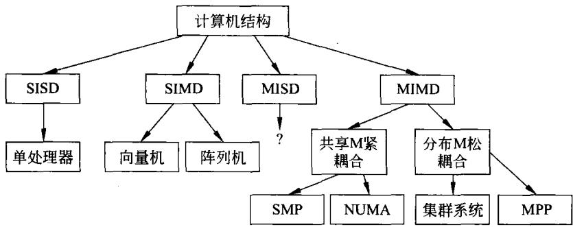  
图9-1计算机系统结构  
水线也处于单个处理器内。

这种并行处理的另一种形式是多线程，在这种并行处理过程中，单个处理器可以在多个线程之间来回切换，产生出一个虚拟的多处理器并行处理的效果。

本章所要讨论的是多处理器或多计算机的并行系统。因此，指令级并行不是本章要讨论的内容。

## （2）向量计算机和阵列计算机

SIMD分成两个子类。第一类是用于数值计算的超级计算机和向量计算机，可以在一个向量的每个元素上并行执行相同的操作。第二类是处理并行类型的阵列计算机，可以利用一个控制单元把指令广播给多个独立的处理单元。

许多早期的多机系统是SIMD系统，但近些年来由于MIMD的灵活性以及MIMD可以利于大量的商品化且性价比很高的处理器构成的特点，现在的绝大多数多机系统都是MIMD结构。即使在全球超级计算机TOP500中，MIMD结构的比例也在逐年上升而SIMD的比例则逐年降低。后面将重点说明MIMD，而对SIMD只做简略介绍。

## （3）MIMD结构的多机系统

正如图9-1所示，这种结构的计算机分为两类：

## ①集中共享存储器结构

在大多数多处理器系统中，内存被分成了多个不同的模块。根据共享内存的实现方式，多处理器系统又分成如下几种。

a）一致性存储器访问计算机（UMA）。

b）非一致性存储器访问计算机（NUMA)。

c）基于cache的存储器访问计算机(COMA)。

UMA计算机的特点是构成多机系统的处理器数量有限，各个处理器通过共享总线、交叉开关或者多级交换网络进行通信，CPU访问所有共享内存模块的时间都相同，即读写每个内存字的时间相等。这就是“一致性（uniform)”的含义。-种集中共享存储器结构的UMA框图如图9-2所示。

UMA的这种一致性可以保证系统的性能可以预测，也有利于程序员编写高效率的代码。相反，虽然NUMA多处理器也同样是在共享的地址空间上运行进程，但由于共享内存被分组并分配到每个处理器，使得远程内存的访问时间与本地内存在时间上不一致。这也是NUMA的由来。

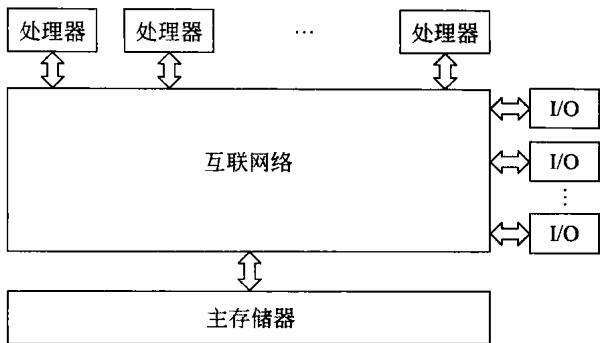  
图9-2集中共享存储器多机系统框图

有关这类多机系统的细节将在稍后再予讨论。

## ②分布式存储器结构

这种结构的多机系统实际上就是由多个独立的计算机，通过互联网络构成的系统。系统具有大量的处理器，每个处理器都有自己的私有本地内存，私有内存只能供自已使用，其他处理器则不能访问，这种体系结构也被称为分布式内存系统。

在这样的多机系统中，与互联网络相连接的每一个结点是一个相对独立的计算机。这些结点可以由一个或多个处理器构成。分布式存储器结构多机系统框图如图9-3所示。

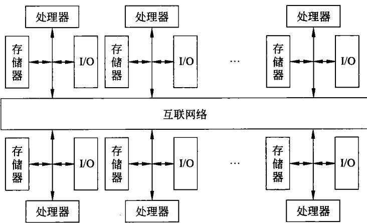  
图9-3分布式存储器结构的多机系统框图

分布式存储器结构中的互联网络常用高速千兆以太网或是InfiniBand技术，有关这种结构多机系统的细节将在稍后讨论。

## （4）网格计算与云计算

## ①网格计算

网格计算是伴随着互联网技术而迅速发展起来的，专门针对复杂科学计算的新型计算模式。这种计算模式是利用互联网把分散在不同地理位置的电脑组织成一个“虚拟的超级计算机”,其中每一台参与计算的计算机就是一个“结点”，而整个计算是由成千上万个结点组成的“一张网格”，所以这种计算方式叫网格计算。这样组织起来的虚拟的超级计算机有两个优势，一个是数据处理能力超强；另一个是能充分利用网上的闲置处理能力。简单地讲,网格是把整个网络整合成一台巨大的超级计算机,实现计算资源、存储资源、数据资源、信息资源、知识资源和专家资源的全面共享。

网格计算的目的是,通过任何一台计算机都能够提供无限的计算能力。这种环境将能够使各企业解决以前难以处理的问题，最有效地使用他们的系统，满足客户要求并降低计算机资源的拥有和管理总成本。网格计算的主要目的是设计一种能够提供以下功能的系统。

·提高或拓展企业内所有计算资源的效率和利用率，满足最终用户的需求，同时能够解决以前由于计算、数据或存储资源的短缺而无法解决的问题。

·整合计算能力、存储和其他资源，能使需要大量计算资源的庞大问题求解成为可能。

·通过资源共享、有效优化和整体管理，能够降低计算的总成本。

目前，已有许多网格计算在运行。例如，美国科学格网、远程分布式计算与通信、地球系统格网、国家地震工程仿真格网、天体物理虚拟天文台、英国国家格网、德国的计算资源统一接口项目和亚太地区格网等。

## ②云计算

云计算出现于2007年底，这个名词是借用了量子物理中的“电子云"概念，强调说明计算的弥漫性、无所不在的分布性和社会性特征。云计算一经面世立即得到飞速发展。

有关云计算的定义有上百种说法，选取其中一种：云计算是一种新兴的商业计算模型。它将计算任务分布在大量计算机构成的资源池上，使各种应用系统能够根据需要获取计算力、存储空间和各种软件服务。

云计算具有以下特点。

## ·超大规模

“云"具有相当的规模,Google云计算已经拥有100多万台服务器，Amazon、IBM、微软、Yahoo等的"云”均拥有几十万台服务器。企业私有云一般拥有数百上千台服务器。“云"能赋予用户前所未有的计算能力。

## ·虚拟化

云计算支持用户在任意位置、使用各种终端获取应用服务。所请求的资源来自“云”，而不是固定的有形的实体。应用在“云”中某处运行，但实际上用户无需了解、也不用担心应用运行的具体位置。只需要一台笔记本或者一个手机，就可以通过网络服务来实现所需要的一切。

## ·高可靠性

“云"使用了数据多副本容错、计算结点同构可互换等措施来保障服务的高可靠性，使用云计算比使用本地计算机更加可靠。

## ·通用性

云计算不针对特定的应用，在“云"的支撑下可以构造出千变万化的应用，同一个“云"可以同时支撑不同的应用运行。

## ·高可扩展性

“云"的规模可以动态伸缩，满足应用和用户规模增长的需要。

·按需服务

“云"是一个庞大的资源池，可按需购买;云可以像自来水，电，煤气那样计费。

·极其廉价

由于“云"的特殊容错措施可以采用极其廉价的结点来构成云。因此，用户可以充分享受“云"的低成本优势。

目前，对云计算的基本形式已经基本达成了一致，这就是基础设施服务（IaaS)、平台即服务(PaaS)、软件即服务(SaaS)，从下到上，构成云计算。位于最底层的是 ${ \mathrm { I a a S } } ;$ 再上一层是 $\mathbf { P a a S ; }$ 最上一层是SaaS。

从上面的简单说明可以看出，无论是网格计算还是云计算，它们都是依赖于网络，通过网络，尤其是今天的因特网，将无数的计算机及其相关资源系在一起，为用户提供几乎是无限的计算能力。显然，云计算是网格计算的进一步发展，其发展过程如图9-4所示。

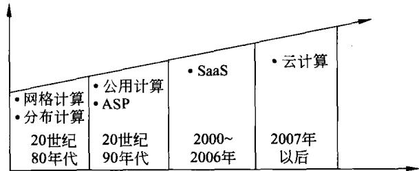  
图9-4网格计算与云计算的发展

过去，曾经有人提出网络就是计算机。从网格计算和云计算来看，它们都是依托互联网络构成的多机系统，可以看成是一种超级的虚拟计算机。但是，它们所用于连接的是世界范围的因特网，它们所构成的是更大数量的计算机或服务器，这些计算机所分布的地域也是世界范围的。

尽管网格计算与云计算也是广义的计算机结构形式，可以理解为松耦合的多机系统即集群系统，但又有与之不同的特征。它们所包含的内容很多，本书不再讨论。

## 9.2多机互联网络

无论是构成什么结构的多机系统，都需要利用互联网络将构成系统的各部分连接起来。互联网络的性能将对整个多机系统的性能将产生重要的影响。本节将讨论有关问题。

## 9.2.1互连函数

## 1.互连函数的表示方法

为了反映不同互联网络的连接特性，每种互联网络可用一组互连函数来定义。如果把互联网络的N个输入端和N个输出端分别用整数0,1，…，N一1来表示，则互连函数就是表示互联网络的输出端号和输入端号的一一对应关系。令互连函数为f，则它的作用是：对于所有的 $0 { \leqslant } \ j { \leqslant } \mathbf { N } - 1$ ,同时存在输入端j连至输出端f(j)的对应关系。

当互连函数用来实现处理机之间数据变换时，互连函数也反映了网络输入数组与输出数组间对应的排列关系或者为置换关系。互连函数有三种表示法。

## （1）输入/输出对应表示法

输人/输出对应表示法将输入/输出对应表示为：

$$
\binom { 0 } { \mathfrak { f } ( 0 ) } \quad \begin{array} { c c c } { { 1 } } & { { \cdots } } & { { \mathbf { N - 1 } } } \\ { { \mathbf { f } ( 1 ) } } & { { \cdots } } & { { \mathbf { f } ( \mathbf { N - 1 } ) } } \end{array} )
$$

这就是说0变换为f(0)，1变换为f(1)，…,N一1变换成f(N一1)，f是互连函数。例如，N=8，均匀洗牌函数的这种表示形式为：

$$
\left( { \begin{array} { c c c c c c c c c } { 0 } & { 1 } & { 2 } & { 3 } & { 4 } & { 5 } & { 6 } & { 7 } \\ { 0 } & { 2 } & { 4 } & { 6 } & { 1 } & { 3 } & { 5 } & { 7 } \end{array} } \right)
$$

## （2）函数表示法

函数表示法用×表示输入变量，用f(x)表示互连函数，常常把输入端×和输出端 $\mathbf { f } ( \mathbf { x } )$ 都用二进制编码表示，从中看出对应的函数关系。例如×表示为 $\left\{ \mathbf { \Delta x } _ { \mathrm { n } - 1 } \mathbf { \Delta x } _ { \mathrm { n } \cdots 2 } \cdots \mathbf { \Delta x } _ { \mathrm { i } } \cdots \mathbf { \Delta x } _ { 0 } \right\}$ 互连函数相应地表示为 $\mathrm { f } ( \mathbf { x } _ { \mathrm { n } - 1 } \mathbf { x } _ { \mathrm { n } - 2 } \cdots \mathbf { x } _ { \mathrm { i } } \cdots \mathbf { x } _ { 0 } )$ 。

对于后面将要说明的均匀洗牌函数，可表示为： $\small \mathrm { e } ( \mathbf { x } _ { \mathrm { n } - 1 } \mathbf { x } _ { \mathrm { n } - 2 } \cdots \mathbf { x } _ { \mathrm { i } } \cdots \mathbf { x } _ { 0 } ) = \mathbf { x } _ { \mathrm { n } - 2 } \mathbf { x } _ { \mathrm { n } - 3 } \cdots \mathbf { x } _ { \mathrm { i } } \cdots \mathbf { x } _ { \mathrm { ~ } }$ ${ \bf x } _ { 0 } { \bf x } _ { \bf n - 1 }$ 。在这里 $\mathbf { e } ( \mathbf { x } _ { \mathrm { n } - 1 } \mathbf { x } _ { \mathrm { n } - 2 } \cdots \mathbf { x } _ { \mathrm { i } } \cdots \mathbf { x } _ { 0 } )$ 便是均匀洗牌函数，而 $\mathbf { x } _ { \mathrm { n } - 2 } \mathbf { x } _ { \mathrm { n } - 3 } \cdots \mathbf { x } _ { \mathrm { i } } \cdots \mathbf { x } _ { 0 } \mathbf { x } _ { \mathrm { n } - 1 }$ 则是该函数的具体表达式。它表示实现不同的输入端和输出端之间的连接。直接画出输入和输出的互连拓扑结构图，称为互连结构图法。

## （3）循环表示法

把互连函数f(x)表示为 $( \mathbf { x } _ { 0 } \mathbf { x } _ { 1 } \mathbf { x } _ { 2 } \cdots \mathbf { x } _ { \mathrm { j } } \cdots \mathbf { x } _ { \mathrm { k - 1 } } )$ 其中 $\mathbf { k } { \leqslant } \mathbf { N }$ ,循环表示有下列对应的函数关系 $\mathbf { f } ( \mathbf { x } _ { 0 } ) = \mathbf { x } _ { 1 } , \mathbf { f } ( \mathbf { x } _ { 1 } ) = \mathbf { x } _ { 2 } , \cdots , \mathbf { f } ( \mathbf { x } _ { i } ) = \mathbf { x } _ { i + 1 } , \cdots \mathbf { f } ( \mathbf { x } _ { k - 1 } ) = \mathbf { x } _ { 0 }$

其中 $\mathbf { x _ { j } }$ 为结点编号，这里k为循环长度。

## 2.基本互连函数

下面介绍常用的基本互连函数、它们的函数表达式以及主要的特征。

## （1）恒等置换

相同编号的输入端与输出端一一对应互连所实现的置换即为恒等置换，其表达式为：

$$
\small \mathrm { r } ( \mathbf { x } _ { \mathrm { n } - 1 } \mathbf { x } _ { \mathrm { n } - 2 } \cdots \mathbf { x } _ { \mathrm { i } } \cdots \mathbf { x } _ { \mathrm { 0 } } ) = \mathbf { x } _ { \mathrm { n } - 1 } \mathbf { x } _ { \mathrm { n } - 2 } \cdots \mathbf { x } _ { \mathrm { i } } \cdots \mathbf { x } _ { \mathrm { 0 } }\tag{9-1}
$$

其中等式左边括号内的 $\mathbf { x } _ { \mathrm { n } - 1 } \mathbf { x } _ { \mathrm { n } - 2 } \cdots \mathbf { x } _ { 1 } \mathbf { x } _ { 0 }$ 和等式右边的 $\mathbf { x } _ { \mathrm { n } - 1 } \mathbf { x } _ { \mathrm { n } - 2 } \cdots \mathbf { x } _ { 1 } \mathbf { x } _ { 0 }$ 均为网络输入端和输出端的二进制地址编号。设 $\ N = 8$ ，则这种置换完成的变换图形如图9-5所示。图9-5的左边为输入端，右边为输出端。

## （2）交换置换

交换置换是实现用二进制编码的地址号最低位不同的输入端与输出端的连接，其表达式为：

$$
\small \begin{array} { r } { \mathbf { h } ( _ { \mathbf { x } _ { n - 1 } \mathbf { x } _ { n - 2 } } \cdots \mathbf { x } _ { \mathrm { i } } \cdots \mathbf { x } _ { \mathrm { 1 } } \mathbf { x } _ { 0 } ) = \mathbf { x } _ { \mathrm { n } - 1 } \mathbf { x } _ { \mathrm { n } - 2 } \cdots \mathbf { x } _ { \mathrm { i } } \cdots \mathbf { x } _ { \mathrm { 1 } } \ \overline { { \mathbf { x } } } _ { 0 } } \end{array}\tag{9-2}
$$

当 $\Nu { = } 8$ 时，二进制编码为000的输人端应与001的输出端相连，而001的输人端应与000 的输出端相连。以此类推，二进制编码为110的输入端应与111的输出端相连，而111的输人端应与110的输出端相连。相连接的图形如图9-6所示。

## （3）方体置换

方体置换是实现用二进制编码的地址号的第i位不同的输入端与输出端的连接，其表达式为：

$$
\mathrm { C } _ { \mathrm { i } } ( \mathbf { x } _ { \mathrm { n - 1 } } \mathbf { x } _ { \mathrm { n - 2 } } ^ { \prime } \cdots \mathbf { x } _ { \mathrm { i } } \cdots \mathbf { x } _ { \mathrm { 1 } } \mathbf { x } _ { \mathrm { 0 } } ) = \mathbf { x } _ { \mathrm { n - 1 } } \mathbf { x } _ { \mathrm { n - 2 } } \cdots \mathbf { x } _ { \mathrm { i } } \cdots \mathbf { x } _ { \mathrm { 1 } } \mathbf { x } _ { \mathrm { 0 } }\tag{9-3}
$$

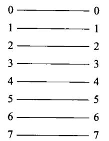  
图9-5N=8的恒等置换

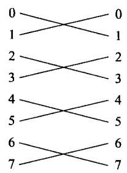  
图9-6N=8的交换置换

根据式(9-3),对于n个输入/输出的情况,应有 $\mathbf { C } _ { 0 } \ 、 \mathbf { C } _ { 1 } \cdots \mathbf { C } _ { \mathbf { n } - 1 }$ ,共有 $\begin{array} { r } { \mathbf { n } { = } \log _ { 2 } \mathbf { N } } \end{array}$ 种方体置换。当N=8时，则有

$$
\begin{array} { r } { \begin{array} { r } { \mathrm { C } _ { 0 } \left( \mathbf { x } _ { 2 } \mathbf { x } _ { 1 } \mathbf { x } _ { 0 } \right) = \mathbf { x } _ { 2 } \mathbf { x } _ { 1 } \overline { { \mathbf { x } } } _ { 0 } } \\ { \mathrm { C } _ { 1 } \left( \mathbf { x } _ { 2 } \mathbf { x } _ { 1 } \mathbf { x } _ { 0 } \right) = \mathbf { x } _ { 2 } \overline { { \mathbf { x } } } _ { 1 } \mathbf { x } _ { 0 } } \\ { \mathrm { C } _ { 2 } \left( \mathbf { x } _ { 2 } \mathbf { x } _ { 1 } \mathbf { x } _ { 0 } \right) = \overline { { \mathbf { x } } } _ { 2 } \mathbf { x } _ { 1 } \mathbf { x } _ { 0 } } \end{array} } \end{array}\tag{9-4}
$$

其相连接的图形如图9-7所示。

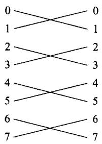  
(a) $\mathbf { C } _ { 0 } \mathbf { \mathrm { . } }$ 方体置换

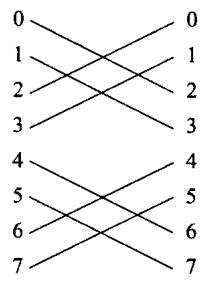  
(b) $\mathbf { C } _ { 1 }$ 方体置换  
图9-7N=8的交换置换

(c） $\mathbf { C } _ { 2 }$ 方体置换  
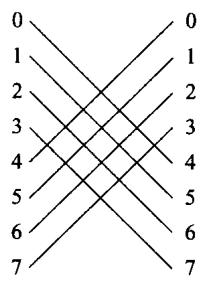

## （4）均匀洗牌置换

均匀洗牌置换是将输人端分成相等的两半,使前一半和后一半按顺序一个隔一个地与输出端依次相连接。这就如同打扑克牌时将一副扑克分成相等的两叠，一张隔一张地均匀洗牌。其函数表示为：

$$
\sigma ( \mathbf { x } _ { \mathfrak { n } - 1 } \mathbf { x } _ { \mathfrak { n } - 2 } \cdots \mathbf { x } _ { \mathfrak { i } } \cdots \mathbf { x } _ { 0 } ) = \mathbf { x } _ { \mathfrak { n } - 2 } \cdots \mathbf { x } _ { \mathfrak { i } } \cdots \mathbf { x } _ { 0 } \mathbf { x } _ { \mathfrak { n } - 1 }\tag{9-5}
$$

由式(9-5)可以看到，均匀洗牌置换就是将输入端的二进制编码循环左移一位即为相对应的输出端编码。当N=8时，均匀洗牌置换的变换图形如图9-8(a)所示。

均匀洗牌置换也可以逆向进行，即将输入端的二进制编码循环右移一位即为相对应的输出端编码。这就称为逆均匀洗牌置换。

逆均匀洗牌置换的函数表示形式为：

$$
\sigma ^ { - 1 } ( \mathbf { x } _ { n - 1 } \mathbf { x } _ { n - 2 } \cdots \mathbf { x } _ { i } \cdots \mathbf { x } _ { 0 } ) = \mathbf { x } _ { 0 } \mathbf { x } _ { n - 1 } \mathbf { x } _ { n - 2 } \cdots \mathbf { x } _ { i } \cdots \mathbf { x } _ { 1 }\tag{9-6}
$$

当 N=8时，逆均匀洗牌置换的变换图形如图9-8(b)所示。

## （5）加减2i置换

加减 $2 ^ { \mathrm { i } }$ 置换是将输入端的编号循环加减 $2 ^ { \mathrm { i } }$ 与输出端相连接，其函教表示形式为：

$$
\mathrm { P M } 2 _ { + \mathrm { i } } ( \mathbf { x } ) = \mathbf { x } + 2 ^ { \mathrm { i } } \mathrm { \ m o d \ N }\tag{9-7}
$$

$$
\mathrm { P M } 2 _ { - \mathrm { i } } ( \bf { x } ) = \bf { x } - 2 ^ { \mathrm { i } } \ m o d \ N\tag{9-8}
$$

由上面式(9-7)和式(9-8)可以看到，无论是加还是减 $2 ^ { \mathrm { i } }$ ，通过modN都可以保证循环连接。

当N=8时，图9-9表示加 $2 ^ { \mathrm { i } }$ 置换的变换图形，而图9-10表示减 $2 ^ { i }$ 置换的变换图形。

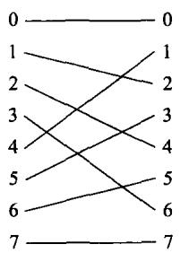  
(a)均匀洗牌置换

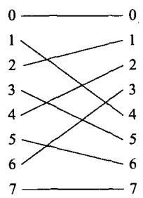  
(b)逆均匀洗牌置换

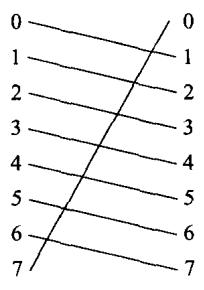  
图9-8N=8的均匀与逆均匀洗牌置换  
(a)i=0

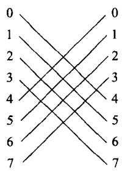  
图9-9N=8的PM2+;置换  
(b)i=+2

可以看到，随着N和i的不同，还会有多种不同的连接形式。

## （6）蝶形置换

蝶形置换其名源自快速傅里叶变换(FFT)，因在变换实现时图形形状如蝶形。蝶形置换的表示式为：

$$
\beta ( \mathbf { x _ { n - 1 } } \mathbf { x _ { n - 2 } } \cdots \mathbf { x _ { i } } \cdots \mathbf { x _ { 0 } } ) = \mathbf { x _ { 0 } } \mathbf { x _ { n - 2 } } \cdots \mathbf { x _ { i } } \cdots \mathbf { x _ { i } } \mathbf { x _ { n - 1 } }\tag{9-9}
$$

由式(9-9)可见，这种置换是将输入端的二进制编码的最高位与最低位互换，从而求得输出端的编码。

当N=8时，蝶形置换的变换图形如图9-11所示。

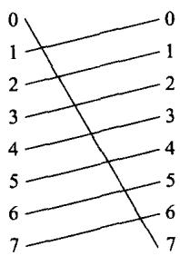  
(a)i=0

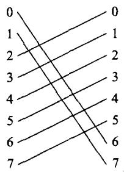  
(b)i=-1  
图9-10N=8的PM2-;置换

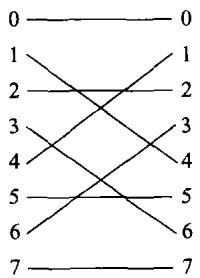  
图9-11 N=8 的蝶形置换

## 3.互联网络特性

互联网络的拓扑可以采用静态结构或动态结构。静态结构的网络由结点和结点直接连接，这种连接方式在工作过程中结构是不会改变的，常用于固定不变的连接。而动态结构的网络通过开关等方式连接，可以动态地改变结构。

网络可以用有向边或无向边连接的有限个结点的图来表示。在说明静态结构和动态结构的互联网络之前，首先说明网络的有关参数。

## （1）网络的规模

网络中的结点数称为网络的规模。

## （2）结点度

与结点相连接的边数即为结点度。这里的边就是链路或通道，用于传送数字信号。在单向通道的情况下，进入结点的通道数称为人度;而从结点出来的通道数则称为出度。结点度便是这两者之和。

## （3）距离

两结点间相连的最少边数就是该两结点的距离。

## （4）网络直径

网络直径是网络中任意两个结点间距离的最大值。这是用于描述网络通信性能的一个指标。

## （5）等分宽度

在将某一网络切成相等的两半的各种切法中，沿切口的最小边数称为通道等分宽度，通常用b表示。等分宽度能说明网络等分处的最大通信带宽。

## （6）结点间的线长

它是两结点之间的线的长度或通道长度。该参数会影响信号的延迟及对信号功率大小的要求。

## （7）对称性

若从网络的任何一个结点，看网络的拓扑结构都是一样的，则称该网络为对称网络。

## 9.2.2静态互联网络

网络可以用有向边或无向边连接的有限个结点来表示。静态互联网络使用直接链路，一旦构成就固定不变。下面介绍几种常见的静态互联网络。

## 1．线性阵列

线性阵列是一种一维的线性网络，它有N个结点并用N一1个链路将这些结点连成一行，其连接形式如图9-12(a)所示。

由图9-12(a)可以看到，线性阵列的内部结点度为2而端结点度为1。该网络的直径为N-1。等分宽度b=1。

线性阵列结构简单，是一种不对称结构。当N很小时，线性阵列是相当经济及合理的。当N很大时，通信效率很低，不再使用这种方案。

需要说明的是线性阵列与总线有很大区别，总线是分时操作的，而线性阵列的源和目的结点对之间可以并行地使用网络的不同部分。

## 2.环和带弦环

环是用一条附加链路将线性阵列的首尾相连接，构成一个环，其连接如图9-12（b)所示。

环可以单向工作，也可以双向工作，其结构是对称的。可以看到，环的结点度为2。单

向环的直径为N,双向环的直径为 $\mathbf { N } / 2$

如果用增加链路的方法将图9-12(b)的结点度提高到3或4，就构成了如图9-12(c)和图9-12(d)所示的带弦环。链路增加越多，结点度越高，网络直径就越小。图9-12（b）、图9-12(c)和图9-12(d)的直径分别为8、5和3。

## 3.循环移数网络

图9-12(e)是一种循环移数网络,该网络结点数N仍为16,它是通过在环上的每一个结点到所有与它距离为2的整数幂的结点间增加一条链路构成的。

当网络规模 $\mathbf { N } { } = 2 ^ { \mathfrak { n } }$ ，如果结点i与结点j满足 $| { \mathfrak { i } } - { \mathfrak { j } } | = 2 ^ { \mathfrak { r } }$ ,其中 $\mathbf { r } { = } 0 \ldots 1 \ldots 2 { \cdots } \mathbf { n } { - } 1$ 。则结点i与结点j相连接，从而构成循环移数网络。这种网络的结点度 ${ \mathsf { d } } = 2 { \mathsf { n } } - 1$ ，直径 ${ \tt D } { = } { \tt n } / 2$ 。

对于N=16的循环移数网络，其结点度为7，直径为2。显然，这要比如图9-12(f)所示的全连接要简单得多。全连接是一种很极端的情况，它要求网络中的结点要与所有的其他结点相连接，从而使每个接的度均为 $2 ^ { \mathfrak { n } } - 1$ ,直径为1,连接也特别复杂。

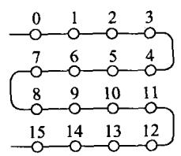

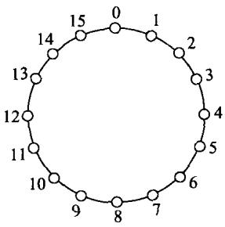  
(a)线性阵列

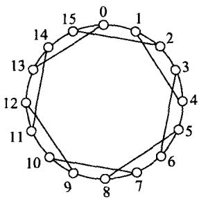  
(c)度为3的带弦环

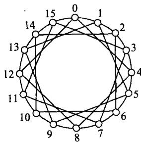  
(d)度为4的带弦环

(b)环  
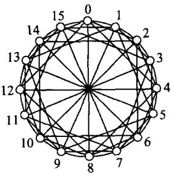  
(e)循环移数网络  
图9-12几种线性网络

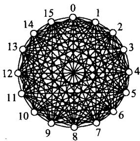  
(f)全连接

## 4、树形和星形连接

由5层31个结点构成的二叉树如图9-13(a)所示。一般来说，一棵k层的平衡二叉树有 2\*一1个结点，其最大的结点度为3,直径为2(k一1)。例如，某多机系统采用10 层平衡二叉树结构，其网络就有1023个结点构成。

星形连接是一种二层树，如图9-13(b)所示。这种连接其结点度d为 $\mathbf N - 1$ ，直径是常数为2。

## 5.胖树形

二叉胖树如图9-13(c)所示。由图可以看到，胖树的通道宽度，由叶子向根结点逐层加宽，它更像真实的树，越靠近树根其枝权越粗。

在传统的二叉树中，越靠近根部通信越繁忙，形成通向根结点的瓶颈。胖树所出现，可较好地缓解这一问题。

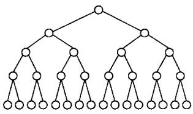  
(a)二叉树

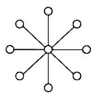  
(b)星形  
图9-13树形、星形及胖树形网络

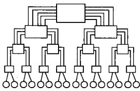  
(c)二叉胖树

## 6.网格形及环网形

网格形是一种常用的网络结构，一种3×3网格形网络如图9-14(a)所示。

一般而言， $\mathbf { N } { = } \mathbf { n } ^ { \mathbf { k } }$ 个结点的k维网格，其内部的结点度为2k，网络直径为k（n一1)。可以想象，纯网格形是不对称的。由图9-14(a)可以看到，边结点和角结点的结点度分别为3和2。

环网形如图9-14(b)所示,阵列的每一行和每一列均有环形连接。显然，一个n×n的二元环网的结点度为4，直径为 $2 \times [ { \bf n } / 2 ]$ 。

## 7．搏动式阵列

搏动式阵列如图9-14(c)所示，它非常适宜于矩阵-矩阵乘法，实现多维流水线阵列。如图9-14(c)所示的搏动式阵列的内部结点度6。

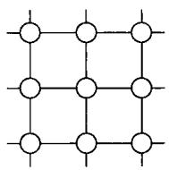  
(a)网格形

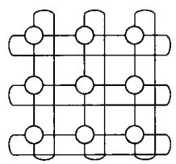  
(b)环网形

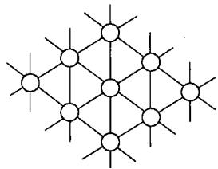  
(c)搏动式阵列  
图9-14网格形、环网形及搏动式阵列

## 8．超立方体

一个n-立方体由N=2"个结点构成,这些结点分布在n维上，每维有两个结点。一个由8个结点构成的3-立方体如图9-15(a)所示。

4-立方体可以通过两个3一立方体连接在一起来构成，如图9-15(b)所示。一个n-立方

体的结点度为n,其直径也是n。显然，这种结构结点度随维数线性增加，因此，维数越高实现起来就越困难。

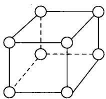  
(a)3-立方体

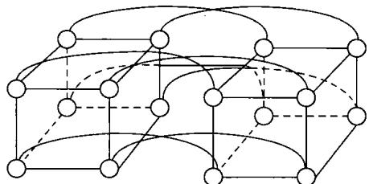  
(b)由两个3-立方体组成的4-立方体  
图9-15超立方体

## 9.k元n-立方体网络

k元n-立方体网络中，n是立方体的维数;k是基数或是沿每一方向的结点数。这两个参数与网络的结点数的关系为：

$$
\mathbf { N } = \mathbf { k } ^ { \mathbf { n } }\tag{9-10}
$$

一个4元3-立方体网络如图9-16所示。在图9-16中，只画出了这种结构的可见部分而未画全，没有画出隐藏部分。

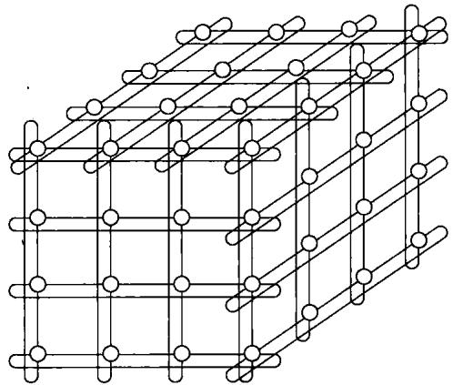  
图9-16k=4和n=3的k元n-立方体网络

k元n-立方体网络的结点度为2n，网络直径为 $\mathbf { n } \times [ \mathbf { k } / 2 ]$ 。

按照惯例，一维k元n-立方体网络称为环；二维的就是环形网；三维的就称立方体；4维以上的称为超立方体。

## 9.2.3动态互联网络

为了达到多用或通用的目的，需要采用动态互联网络。动态互联网络中设置有开关电路，以便利用控制信号来控制这些开关的状态，从而达到动态互联的目的。下面将介绍常用的几种动态互联网络。

## 1.总线

## （1）回顾

在第8章里，已经说明了总线的有关概念。在那里已经强调了几个重要问题。

## ① 内总线上的分时工作

在内总线上，不管是处理器CPU还是其他总线控制器（如DMAC),都是分时工作的，利用内总线完成对内存或接口的读写。同时，总线上的控制器也是分时共享总线，任何时候都只允许一个总线控制器使用总线。

## ②防止总线竞争

无论是什么总线，在其工作过程中均需防止总线竞争。一旦总线上出现竞争,必定会产生严重的后果。

## ③总线的性能

总线的性能会对整个计算机的性能产生影响。因此，构成好的性能的计算机必须注意到将总线也考虑在内。

## ④单处理器系统

第8章所讨论的有关总线的内容主要是单个处理器构成的计算机系统。下面将把着眼点放在多处理器(机)及多计算机系统上。

## （2）基于总线连接的多机系统

利用总线将多个处理器(机)连接在一起，构成一种称为对称多处理机系统的框图如图9-17所示。

在如图9-17所示的多机系统中，系统总线为处理机、主存储器及I/O子系统提供了相互通信的共享通路。在使用中必须分时操作，系统总线会产生瓶颈。有关对称多处理机系统的内容后面再做说明，此处只是强调此多机系统是利用总线互连的。

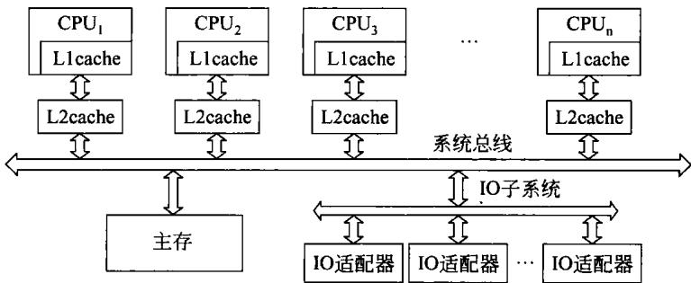  
图9-17对称多处理机系统结构

## 2.多级网络

## （1）概述

SIMD和MIMD都使用多级网络互联。一种通用的多级网络框图如图9-18所示。

由图9-18可以看到，多级网络的每一级都是由多个a×b开关模块和级间连接模式ISCn 连接在一起构成。

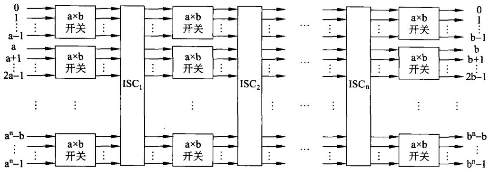

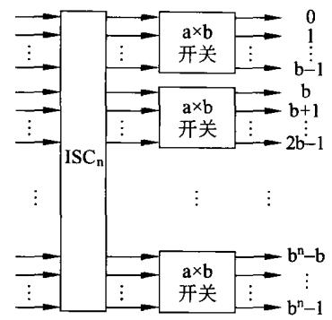  
图9-18利用aXb开关及级间连接 $\operatorname { I S C } _ { \mathrm { n } }$ 构成通用互联网络框图

各种多级网络的区别就在于它们所使用的开关模块、控制方式及级间连接模式ISCn的不同。常用的级间连接模式ISCn前面已经做了说明。下面介绍开关模块。

## （2）开关模块

一个a×b开关模块有a个输入和b个输出。原则上,a和b不一定必须相等，但实际上a 和b经常选择相等，即a=b且是2的整数幂。

一个二元开关与 $\mathtt { a } = \mathtt { b } = 2$ 的 $2 \times 2$ 开关模块相对应，这是一种最简单的开关模块。图9-19表示2×2开关模块及其他的4种控制状态。

2×2开关模块的4种控制状态如下。

## ①直送

直送也称直连，即0人0出，1入1出，即如图9-19(a)所示。

## ②上播

0人使0和1均输出，而1人悬空，如图9-19(b)所示。

## ③下播

1人使0和1均输出，而0人悬空，如图9-19(c)所示。

## ④交叉

交叉也称交换,0人使1出，1人使0输出，如图9-19(d)所示。

具备上述4种功能的 $2 \times 2$ 开关模块称为4功能模块；有的则只具备①④两种功能，则称为二功能模块。

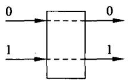  
(a)直送

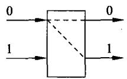  
(b)上播

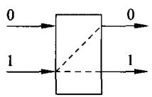  
(c)下播

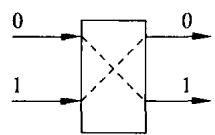  
图9-192×2开关模块的4种控制状态  
(d)交叉

## （3）控制方式

在多级网络的互联过程中，为达到动态连接就需要对网络中的开关模块进行控制。控制方式如下。

## ①级控制

级控制就是只用一个控制信号来控制处于同一级上的所有开关模块，使它们处于同一

状态之下。显然,这种控制十分简单,但同一级上的所有开关模块只能处于同一种状态。

## ②单元控制

这种控制方式是每一个开关模块都有自己的控制信号，各开关模块可各自处于不同的状态。这种控制实现起来比较复杂，但控制十分灵活。

## ③部分级控制

每一级开关模块所用的控制信号不同，第i级用i十1个控制信号。例如，第0级用1个控制信号，而第1级用2个控制信号，以此类推。

## （4）多级均匀洗牌网络

## ①构成

多级均匀洗牌网络亦称Omega网络。-个N=8用2×2开关和均匀洗牌构成的Omega网络如图9-20所示。

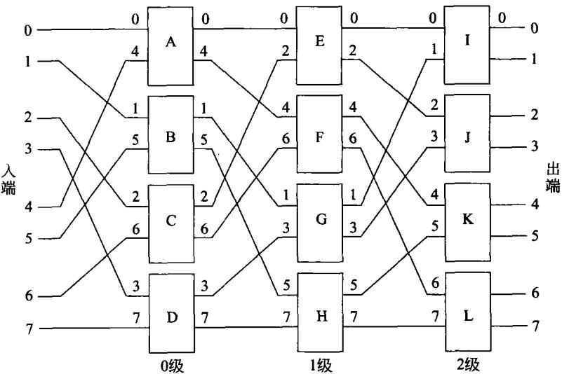  
图9-20N=8多级均匀洗牌交换互联网络

Omega网络由n级相同结构的网络组成，使用均匀洗牌连接作为各级交换开关之间的级间互连模式，利用其后跟随的4功能交换开关，采用单元控制方式，使每级的输入/输出达到全混洗交换。

具有N个输人和N个输出的Omega网络结构图可按如下步骤画出。

a）利用 $\begin{array} { r } { \mathbf { n } { = } \log _ { 2 } \mathrm { N } } \end{array}$ ,可求出Omega 网络的级数为n。

b）利用本节前面提到的均匀洗牌置换方法，画出N个端的均匀洗牌拓扑，在其后接上一级4功能开关模块。

c）每一级需N/2个开关模块，级号从人端到出端依次为 $\mathfrak { o } , 1 , \cdots , \mathrm { i } , \cdots , \mathrm { n } - 1$

②控制方式

Omega网络的2×2开关模块采用单元控制方式，因此，该网络可以实现如下功能。

a）一个输人端对一个输出端的连接。

b）一个输入端对多个输出端的连接，从而实现一到多的广播功能。

c）有条件地同时实现多个输人端对一个输出端的连接。

这是因为N个输入、输出一对一的排列有N！种。同时，要实现完全的一对一的连接，二元开关模块只能用二功的模块。则N个输人端的Omega网络开关数量为 $( \mathrm { N } / 2 ) \log _ { 2 } \mathrm { N }$ 而每个开关只有两个状态。因而，Omega网络一次通过只有 ${ \bf N } ^ { { \bf N } / { \bf 2 } }$ 种连接，该数量小于实现完全的一对一的连接所需要的N！，在这种情况下有可能会产生路径上的冲突，也称为阻塞。一旦发生阻塞，就无法实现同时，必须保证某一些一对一连接无阻塞，而其他的则等待下一次连接。

如图9-21所示通过设置开关的状态，实现 $\begin{array} { r } { 0 \to \infty 7 , 7 \to 6 , 6 \to 4 , 4 \to 2 , 2 \to 0 , 1 \to 3 , 3 \to 1 } \end{array}$ 5→5的无阻塞连接。

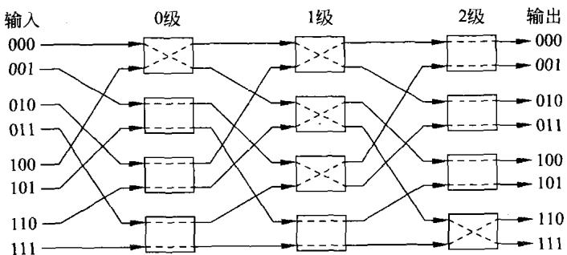  
图9-21Omega网络实现无阻塞连接

但是，同样的N=8用 $2 \times 2$ 开关和均匀洗牌构成的Omega网络如图9-22所示。若要利用该网络实现 $\begin{array} { r } { 0 \to 6 , 6 \to 4 , 4 \to 7 , 7 \to 3 , 3 \to 0 , 1 \to 5 , 5 \to 1 , 2 \to 2 } \end{array}$ 。就会在开关A、D、G上产生冲突。

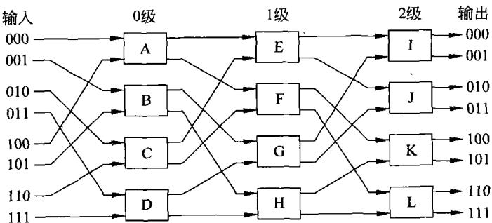  
图9-22Omega网络发生阻塞

为了解决冲突(即阻塞)，可以采用多次通过的方式，也就是使一些连接延迟到下一次进行。上述情况可分两次通过：第一次可以是： $ \begin{array} { r l } \end{array}  0 {  } 6 , 1 {  } 5 , 2 {  } 2 , 5 {  } 1 , 6 {  } 4$ 。第二次通过时为： $3 {  } 0 , 4 {  } 7 , 7 {  } 3$ 。从而避免冲突发生，但是多花了时间。一般而言，N个输人端的Omega网络要实现非阻塞连接，最多需要通过的次数为 $\log _ { 2 } \mathrm { N }$

## ③路径控制

最后，说明Omega网络路径控制的方法。

由于N个输人端的Omega网络有 $\begin{array} { r } { \mathbf { n } { = } \log _ { 2 } \mathrm { N } } \end{array}$ 级，如前所述，从输人端到输出端级的编号依次为 $0 , 1 , \cdots , \mathrm { i } , \cdots , \mathrm { n } { - } 1$ 。通过检查用二进制编码表示的目的地址，来控制数据的传送路径。目的地址编码从高位开始的第i位为0时，第i级的 $2 \times 2$ 开关的输人端与上输出端相连接；为1时，开关的输入端与下输出端相连接。

以上仅以多级均匀洗牌Omega网络为例，介绍了利用2×2开关和三级均匀洗牌的级间连接模式构成互联网络的有关的问题。由图9-18可以看到，多级网络的每一级都是由多个a×b开关模块和级间连接模式ISCn连接在一起构成。那就是说除了2×2开关，也可以用4×4开关、8×8开关;除了均匀洗牌，还可以用前面所提到的其他基本互连函数作为级间连接模式，构成动态互联网络。因篇幅所限，这里不再举例说明。

## （5）全排列网络

正如前面所分析的，在前面的网络中不能实现所有输入端与输出端一对一的任意连接。这是由于N个输人、输出一对一的任意排列有N！种，而前述Omega 网络一次通过只有NN/2种。可以达到既能实现输入端与输出端一对一的任意连接又不会发生传送路径上的冲突的互联网络称为全排列网络。实现全排列网络的方法如下。

## ①增加镜像级数

这是一种常用的解决方案，就是增加logN级附加开关到网络中，让它们镜像原有的拓扑结构。此时，由于增加了级数，使全部开关的状态数增加到： $\mathbf { N } ^ { \mathbf { N } / 2 } \times \mathbf { N } ^ { \mathbf { N } / 2 } = \mathbf { N } ^ { \mathbf { N } }$ 种，远大于实现一对一的任意排列有N！种。因此，最终形成的网络准许在新的源-目的对之间建立无冲突路径，所以它是路径可重规划且无阻塞的，但它也加倍了级间的跳跃次数，并且可能要求在某种集中式控制下重新规划一些已建立的通信对，故该网络也称为可重排列网络。

## ②Clos网络

Clos网络是一种多级交换网络，CharlesClos研究多级电话交换系统时，于1953年首次提出。Clos网包含三级：输入级、中间级以及输出级。每一个级都由一些交叉开关组成，如图9-23所示。进人到输入交叉开关的每一个能够通过任意一个可用的中间级的交叉开关选路到相关的输出级的交叉开关。

Clos 网络由三个参数来定义，其输人级由r个n×m交叉开关构成，中间级由m个r×r交叉开关，而输出级由r个m×n交叉开关组成。

如果m≥2n一1,那么Clos网络是严格意义上的无阻塞。这就意味着输入交换上一个未用的输入总是能够连接到输出交换上的一个未用输出，而且不需要重新排列现存的输人。显然，这是在输入和输出级之间，通过中间级开关提供的足够多的选择路径，来允许在输入级和输出级交换开关之间建立无冲突路径，实现完全的一对一的交换，成为全排列网络。

Clos 网络还可以推广到任意奇数个级。其方法是通过使用一个三级Clos网络来替代中间级的交叉开关，就能够构建一个5级Clos网络。通过重复地应用这一过程，就有可能构建7、9、11、...级的Clos网络。

## ③Benes网络

Clos网络的开关模块比较复杂，实现起来比较困难。为此，提出Benes网络。该网络将所有的交叉开关模块规模降低到2×2，三级Clos拓扑结构的多通道特性被递归地应用于中间交换级，最终获得了 $2 \log _ { 2 } \mathrm { N } - 1$ 级的Benes拓扑结构，这是一种路径可重新规划且无阻塞的网络结构。递归构造Benes网络的框图如图9-24所示。

图9-24为N个输人和N个输出的Benes网络的递归构造过程，每次一半一半的进行，最终包括输入、输出级共需 $2 \log _ { 2 } \mathbf { N } - 1$ 级。

利用这种方法，构成N=8的Benes网络如图9-25所示。

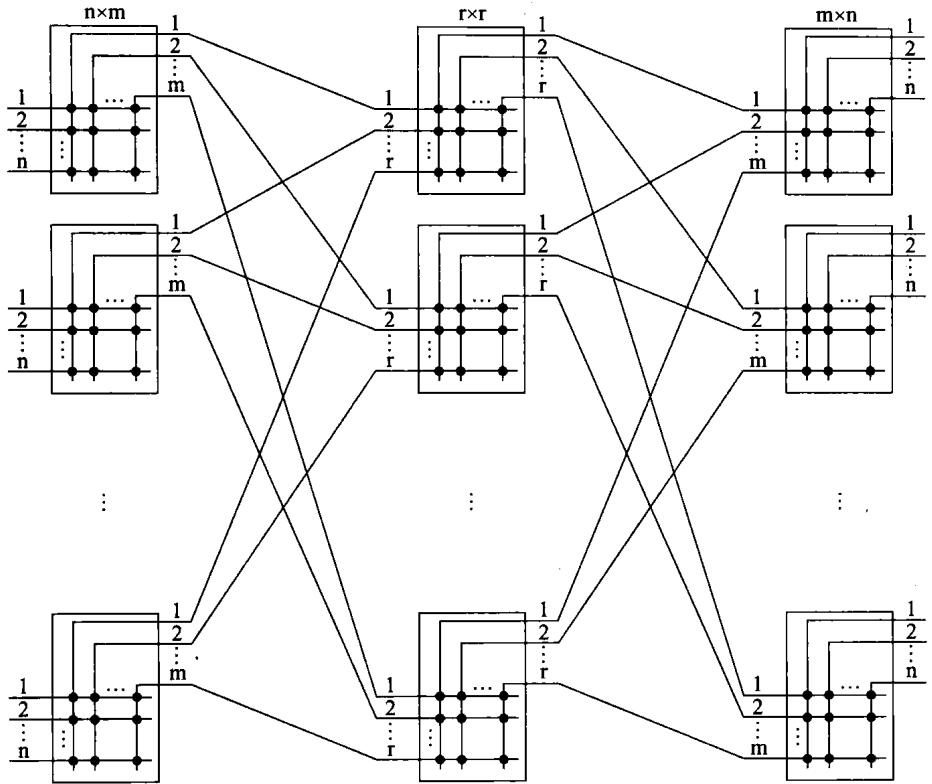  
图9-23Clos 网络结构

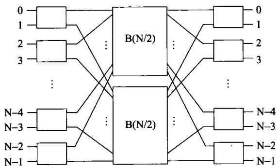  
图9-24Benes网络构造框图

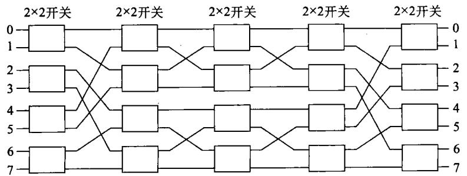  
图9-25 N=8的Benes 网络

注意到，图9-25是左右对称的。实际上它是一个三级网络与它的逆网络连到一起，而且省掉中间完全相同的一级构成。此时，N=8的互联网络由5级构成，即在原来输入、输出级的中间插入了3级。正是由于插人了更多的级，才使得Benes网络成为全排列网络。

总之，不管是Clos网络还是Benes网络，它们或采用复杂的开关网络、或增加网络的级数，以便实现无阻塞交换，成为全排列网络的目的。

## 3.交叉开关网络

## （1）构成

交叉开关技术来源于电话网络中采用的电路交换技术。电路交换专用于在源交点和目的交点之间建立通信通道，通道是在交点间的一组顺序连接的物理链路。在每条链路上，进来的数据不需要太多的延迟(假如不需要数据处理的话)就可以被路由或交换到适当的输出通道中。利用电路交换技术控制若干开关组成的开关连接阵列，就构成了交叉开关网络，它可以依照控制交叉点上的开关，将网络的任意输入无阻塞地与空闲输出连接起来。

交叉开关网络是单级网络，它由交叉点上的一元开关构成。如图9-26所示利用交叉开关将多个处理机连在一起。所用的交叉开关只有两个状态，要么将行列线短路，要么使它们开路。显然，构成一个交点就需要多个这样的开关。

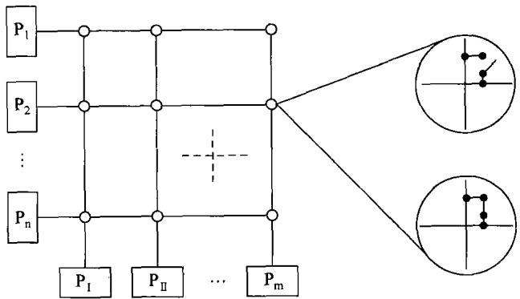  
图9-26利用交叉开关将多个处理机互连及开关状态

值得说明的是，在图9-26中画出的是处理机 $\mathrm { P } _ { 1 } \cdots \mathrm { P } _ { \mathrm { n } }$ 及 $\mathbf { P } _ { \mathrm { ~ I ~ } } \cdots \mathbf { P } _ { \mathbf { m } }$ 的互相连接。显然，将其中的 $\mathrm { P } _ { 1 } \cdots \mathrm { P } _ { n }$ 换成存储器或I/O设备也是可以的。

## （2）优缺点

交叉开关网络的优点在于：①它是无阻塞网络，即处理机及设备之间不会因为某些交叉点或者链路被占用而无法建立连接(仅在有两个以上的处理机试图向同一个目的设备发信息时才可能在交叉链路上发生阻塞)，从而最大限度地降低了对信息链路的争用。②信息传送只是在交叉开关上的时间延迟，比多级互联网络要小得多。③对于一个n×n交叉开关网络来说，一个传送周期可传送n个数据。而利用总线，每个周期只能传送一个数据。因此，交叉开关网络比总线具有更高的带宽。事实上，开关网络正在替代总线成为计算机之间、I/O设备之间、电路板之间、芯片之间甚至芯片内部模块之间的连接手段。

由图9-26可以看到，要构成n×m的交叉开关网络则需要n×m套交叉开关,其硬件代价是很大的。因为，一套交叉开关，不仅要有多路开关，还应有处理器访问目标部件的冲突仲裁电路，故其结构是很复杂的。而且，交叉开关网络的复杂度随网络端口数量的平方级增长，即交叉开关的数量达到 $\mathbf { n } \times \mathbf { m }$ 个。对于中小规模的系统，交叉开关设计是可行的。但当规模较大时，例如 $\mathtt { n } = \mathtt { m } = 1 0 0 0$ 时，就需要100万套交叉开关。这么大规模的交叉开关网络是很难实现的，这就是交叉开关网络的劣势。

## （3）多级交叉开关网络

对交叉开关网络的一种改进是通过用多个较小规模的交叉开关模块“串联"和"并联"构成多级交叉开关网络，以取代单级的大规模交叉开关。如图9-27所示是用 $4 \times 4$ 的交叉开关模块组成 $1 6 \times 1 6$ 的两级交叉开关网络，其设备量减少为单级 $1 6 \times 1 6$ 的一半。这实际上是用 $4 \times 4$ 的交叉开关模块构成 $4 ^ { 2 } \times 4 ^ { 2 }$ 的交叉开关网络，其中，指数2为互联网络的级数。若互联网络的输入端数和输出端数不同时，可使用a×b的交叉开关模块，使a中任一输人端与b中任一输出端相连。用n级 $\mathsf { a } \times \mathsf { b }$ 交叉开关模块，可以组成一个 $a ^ { \mathfrak { n } } \times { \mathfrak { b } } ^ { \mathfrak { n } }$ 的开关网络。

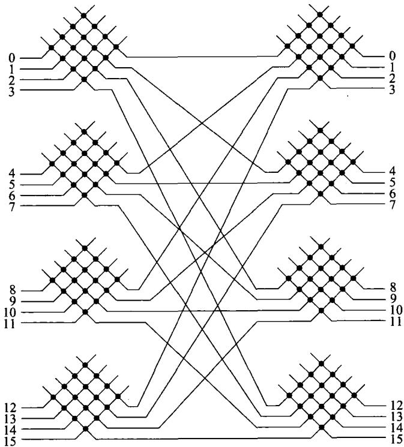  
图9-27用4×4交叉开关模块构成16×16两级交叉开关网络

## 4.多端口存储器

大型的多机系统使用交叉开关网络在成本及复杂程度上无法忍受，故许多大型的多机系统采用多端口存储器来实现。利用多端口存储器构成多机系统的框图如图9-28所示。

在这里，实现这种多机系统的关键部件是多端口存储器。这样的存储器对外有多个端口，可分别与多个处理机相连接。可以想象，其内部必然有复杂的控制逻辑，用以解决多个处理机对存储器模块的请求冲突。

当m 和n很大时，必然使多端口存储器变得复杂且昂贵，同时,使系统的连线也变得十分庞杂。另外，利用多端口存储器构成的系统一旦构成，要进行扩展是十分困难的。典型的

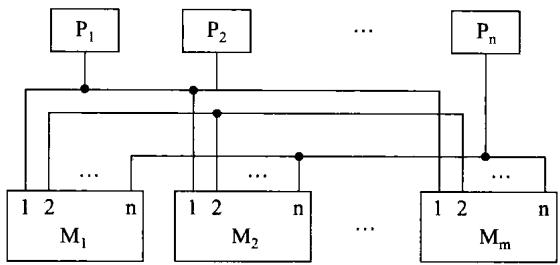  
图9-28利用多端口存储器构成多机系统

系统是用16个4端口存储器模块与4个处理机构成的。

## 5.以太网

以太网发明于1973年，以太网是当今现有局域网采用的最通用的通信协议标准。它也是构成多计算机系统采用最多的互联标准。该标准定义了在局域网(LAN)中采用的电缆类型和信号处理方法。

## ：（1）分类

## ①标准以太网

开始以太网只有10Mbps的吞吐量，使用的是CSMA/CD(带有碰撞检测的载波侦听多路访问)的访问控制方法，这种早期的10Mbps以太网称之为标准以太网。

## ②快速以太网

IEEE802工程组经过对100Mbps以太网的各种标准进行了研究。于1995年3月宣布了IEEE802.3u100BASE一T快速以太网标准。快速以太网技术可以有效地保障用户在布线基础实施上的投资，它支持3、4、5类双绞线以及光纤的连接，能有效地利用现有的设施。快速以太网仍是基于CSMA/CD技术的。

## ③千兆以太网

千兆以太网技术作为最新的高速以太网技术，给用户带来了提高核心网络的有效解决方案，它的最大优点是继承了传统以太技术价格便宜的优点。千兆技术仍然是以太技术，它采用了与10Mbps以太网相同的帧格式、帧结构、网络协议、全/半双工工作方式、流控模式以及布线系统。该技术不改变传统以太网的桌面应用和操作系统。因此可与10Mbps或100Mbps的以太网很好地配合工作。升级到千兆以太网不必改变网络应用程序、网管部件和网络操作系统，能够最大程度地投资保护。

## ④万兆以太网

自2002年万兆以太网标准步入网络时代，经历了几年的发展，现在，万兆以太网已经获得广泛的应用。

已制定了多种10Gbps的传输速率以太网传输协议，支持不同波长上多模或单模的光纤传输以太网。

## ③十万兆以太网

国际网络标准团体IEEE802.3已经开始定制十万兆以太网标准。这一举措，意味着十万兆以太网即将诞生。可以预期，不久的将来十万兆以太网将进人应用。

## （2）以太网的拓扑结构

计算机网络的拓扑结构是引用拓扑学中研究与大小，形状无关的点,线关系的方法。把网络中的计算机和其他设备抽象为一个点，把传输介质抽象为一条线，由点和线组成的几何图形就是计算机网络的拓扑结构。以太网的拓扑结构主要有如下几种形式。

## ①总线形

总线结构是将网络中的所有设备通过相应的硬件接口直接连接到公共总线上，结点之间按广播方式通信，一个结点发出的信息，总线上的其他结点均可“收听"到。

总线结构的优点是：结构简单、布线容易、可靠性较高，易于扩充，是局域网常采用的拓扑结构。缺点：所有的数据都需经过总线传送，总线成为整个网络的瓶颈；出现故障诊断较为困难。

## ②星形

管理方便、容易扩展、需要专用的网络设备作为网络的核心结点、需要更多的网线、对核心设备的可靠性要求高。采用专用的网络设备(如集线器或交换机)作为核心结点，通过双绞线将局域网中的各台主机连接到核心结点上，这就形成了星形结构。星形网络虽然需要的线缆比总线形多，但布线和连接器比总线形的要便宜。

此外，星形拓扑可以通过交换机、网关、路由器等设备以级联的方式很方便地将网络扩展到很大的规模，因此得到了广泛的应用，被绝大部分的以太网所采用。

星形结构的中心结点是全网络的可靠瓶颈，中心结点出现故障会导致网络的瘫痪。

## ③环形

各结点通过通信线路组成闭合回路，环中数据只能单向传输。这种结构简单、容易实现，适合使用光纤，传输距离远，传输延迟确定。但环网中的每个结点均成为网络可靠性的瓶颈，任意结点出现故障都会造成网络瘫痪，另外故障诊断也较困难。

## ④树形

树形是一种层次结构，结点按层次连接，信息交换主要在上下结点之间进行，相邻结点或同层结点之间一般不进行数据交换。

## （3）以太网的工作原理

以太网采用带冲突检测的载波帧听多路访问(CSMA/CD)机制。以太网中结点都可以看到在网络中发送的所有信息，因此，说以太网是一种广播网络。

当以太网中的一台主机要传输数据时，它将按如下步骤进行。

①监听信道上是否有信号在传输。如果有的话，表明信道处于忙状态，就继续监听，直到信道空闲为止。

②若没有监听到任何信号，就传输数据。

③传输的时候继续监听，如发现冲突则执行退避算法，随机等待一段时间后，重新执行步骤①（当冲突发生时，涉及冲突的计算机会发送会返回到监听信道状态）。

·④若未发现冲突则发送成功，所有计算机在试图再一次发送数据之前，必须在最近一次发送后等待一段时间，例如9.6μs(对于10Mbps）。

以太网，由于其应用的普及，已为广大工程技术人员所熟悉。尤其是万兆以太网的出

现，为构成后面将要提到的集群系统提供了很好的互联手段，为多数高性能的集群系统所采用。相信，当十万兆以太网出现的时候，它会在高性能计算机领域中发挥更大的作用。

## 6.InfiniBand 网

InfiniBand(IB或 IBA,即 InfiniBand Architecture）,InfiniBand是以通道为基础的双向、串行式传输，其单通道连接形式如图9-29所示。 IR连接器 IR连接器

由图9-29可以看到，单通道传输时，为实现全双工通信，收发各用两条线，则IBA连接器有4个接点。

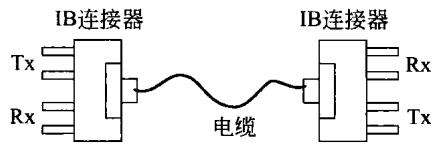

在连接拓扑中，可采用交换、切换式结构。所以会有所谓的IBA交换机。此外在线路不够长时可用

图9-29InfiniBand连接

IBA中继器进行延伸。而每一个IBA网络称为子网，每个子网内最高可有65536个结点。IBA子网结构的示意图如图9-30(a)所示。IBA交换机、IBA中继器仅适用于IB子网的范畴，若要跨越多个IB子网，就需要用到IBA路由器或IBA网关。相对以太网，InfiniBand可以更加分散地进行管理，每个子网内有一个管理器，其在路由分组、映射网络拓扑、在网络内提供多个链路、监视性能方面起决定性的作用。子网管理器也能保证在特别通道内的带宽，并为不同优先权的数据流提供不同级别的服务。子网并不一定是一个单独的设备，它可以是内置于交换机的智能部件。

至于结点部分，若结点想与IBA子网接轨，就必须透过配接器。若是CPU、内存部分要与子网连接，也需透过主通道配接器HCA。若硬盘、I/O部分要与子网连接，则需通过目标通道配接器TCA，之后各部分的衔接称为联机。

利用路由器将多个IBA子网连按在一起，构成一个更大的IBA网的示意连接图如图9-30(b)所示。

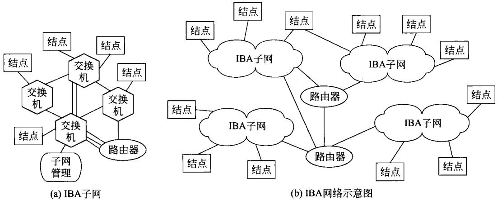  
图9-30 InfiniBand 网络构成

InfiniBand的扩展性非常好，在一个子网内可支持万个以上的结点，而每个网络中可有几千个子网，每个安装的系统中可以有多个网络结构。如图9-30所示，InfiniBand交换机通过子网路由分组，InfiniBand 路由器将多个子网连接在一起。

InfiniBand1.0定义了16个虚拟通道，0到15通道。通道15预留给管理使用，其他通道用于数据传输。一个通道专用于管理，可以保证流量拥塞时网络的正常管理。例如，网络可随时准备改变其拓扑结构。InfiniBand设备是热插拔的，从网络中拔出设备时要求网络迅速重新配置拓扑映射。子网管理器使用通道15来查询交换机、路由器和终端结点其有关配置的改变。

InfiniBand也支持与IPv4、IPv6的寻址，称为IPoIB。除完善、严谨的架构设计外，IBA的重要特点就在于高速的传输速率和极低的传输延迟。IBALink的接头设计可有3种通道选择，即1X、4X、12X。也就是说，多X是多个1X并行传输线路的组合。并行之后，再根据传输速率的倍数调整，传输速率模式有单倍速SDR、双倍速DDR、4倍速QDR三种。并行接头的三种并行列宽度与3种传输速率模式相组合，构成了如表9-1所示的9种传输速率。据有关报导，InfiniBand 链路速率将在2011年突破240Gbps。

表9-1 InfiniBand 传输速率
<table><tr><td>模式</td><td rowspan="3"> SDR</td><td rowspan="3">DDR</td><td rowspan="3">QDR</td></tr><tr><td>通道数</td><td></td></tr><tr><td>1X</td><td>5Gbps</td></tr><tr><td>4X</td><td>2.5Gbps 10Gbps</td><td>20Gbps</td><td>10Gbps 40Gbps</td></tr><tr><td>12X</td><td>30Gbps</td><td>60Gbps</td><td>120Gbps</td></tr></table>

由表9-1可看到InfiniBand技术可以很容易地达到端设备端口带宽20Gbps，而交换机间连接的传输带宽可达到60Gbps或更高。在这样的传输速率下，交换机的延迟只有0.14μs,与10Gbps以太网及FC相比优势非常明显，如表9-2所示。

表9-2InfiniBand与其他网络的传输延迟
<table><tr><td>网络</td><td rowspan="3">InfiniBand</td><td rowspan="3">以太网</td><td rowspan="3">FC光纤通道</td></tr><tr><td>参数</td><td></td></tr><tr><td colspan="2" rowspan="2">带宽 延迟</td></tr><tr><td>0.14μs</td></tr><tr><td>20/60Gbps</td><td></td><td>10Gbps 4Gbps 50μs 2us</td></tr></table>

在高性能计算机邻域里，研制计算机日益注重性价比。目前，满足此需求的最佳作法即是采用集群方式，即用大量的独立运行的计算机，通过互联网络使之融为一体。集群系统中计算机间的相互通信也必须尽可能高速。所以，IBA终于在集群式超级计算机上找到了发挥其特长的用武之地。由于FC只至2Gbps、4Gbps，而10GbpsEthernet尚不够成熟，延迟控制也尚待改进。因此，最合适的便是IBA，IBA低延迟、能以10Gbps为基准单位进行倍增传输，使得全球前500强的超级计算机中，有相当多套系统都使用上IBA，或至少是IBA与其他高速联机的搭配混用。

## 9.3对称多处理机系统

## 9.3.1 对称多处理机(SMP)构成

## 1.SMP的结构

对称多处理机系统,是一致性存储器访问计算机(UMA)中的一种常用形式。其结构框图如图9-31所示。

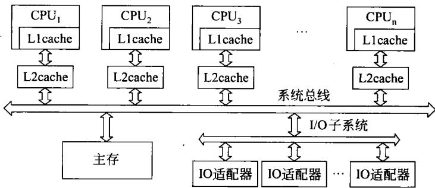  
图9-31对称多处理机系统结构

由图9-31可以看到，构成的 SMP中包含多个处理机。SMP最常见到的实例就是目前广为使用的双核、4核等多核计算机,其中的核就是如图9-31所示包含一级cache(甚至二级 cache)的 CPU。

## 2.SMP的特点

对称多处理机系统具有如下特点。

（1）这样的系统是由两个以上的多个相同的处理机构成。

（2）多个处理机通过总线或其他互联方式连接在一起。在图9-31中，是利用系统总线将这些处理机连在一起。

（3）多个处理机共享同一主存储器。并且，每一个处理机访问主存储器的时间是相同的，也就是一致的。这或许就是一致性存储器访问计算机(UMA)的来历。

（4）所有的处理机通过相同的通道或不同的通道共享I/O设备。

（5）每一处理机都能完成相同的功能,这或许是对称多处理机中对称的由来。

（6）整个对称多处理机系统是在一个集中的操作系统统一管理下工作。操作系统能够为每一处理机安排进程或线程,对各处理机的工作进行统一地调度与控制。

## 3.SMP的优点

对称多处理机系统相对于单个处理机的计算机系统,有如下突出的优点。

（1）由于SMP包含多个处理机，而这些处理机可以并行工作。因此，SMP具有比单个处理机构成的系统更高的性能。后面将分析多处理机系统的加速比，到时就可以看到这种

情况。

（2）SMP具有高的可靠性和高的可用性。这是因为系统中包含有多个处理机，当某一处理机出现故障时，除此处理机之外的处理机仍然可以工作，并不会因此而停止系统的工作，只是由于一个处理机有了故障使整个系统的性能有所下降。

（3）由图9-31可以看到，SMP系统具有很好的扩展性能。也就是说，用户可以比较容易地在系统中增加一个处理机，只要将相同的处理机连接在系统总线即可达到目的。从而较方便地增强系统的性能。

（4）可以灵活地按照用户的需求构成不同数量处理机的SMP系统。

## 4.构成SMP应注意的问题

在基于SMP结构的单芯片多处理机中，处理器之间通过片外cache或者是片外的共享存储器来进行通信。虽然多核能利用集成度提高带来的诸多好处，让芯片的性能成倍地增加，但很明显的是使原来系统级的一些问题引入到了处理器内部。在构成SMP系统时应注意下述一些问题。

## （1）核结构研究：同构还是异构

SMP的构成分成同构和异构两类，同构是指内部核的结构是相同的，而异构是指内部的核结构是不同的。为此，面对不同的应用研究核结构的实现对未来微处理器的性能至关重要。核本身的结构直接影响多核的性能和实现周期。同时，根据Amdahl定理，程序的加速比决定于串行部分的性能，所以，从理论上来看似乎异构微处理器的结构具有更好的性能。

## （2）cache设计

处理器和主存间的速度差距对SMP来说是个突出的矛盾，因此必须使用多级cache来缓解。目前有共享一级cache的SMP、共享二级cache的SMP以及共享主存的SMP。通常，SMP采用共享二级cache的结构，即每个处理器核心拥有私有的一级cache，且所有处理器核共享二级cache。

多级cache又引发一致性问题。采用何种cache一致性模型和机制都将对SMP整体性能产生重要影响。有关问题在本节后面进行讨论。

## （3）核间通信技术

SMP系统中的各处理品核心执行程序时，有时需要进行数据共享与同步，因此其硬件结构必须支持核间通信。高效的通信机制是SMP系统高性能的重要保障，目前比较主流的片上高效通信机制有两种，一种是基于总线共享的cache结构，一种是基于片上的互连结构。

总线共享cache结构是指每个CPU内核拥有共享的二级或三级cache，用于保存比较常用的数据，并通过连接核心的总线进行通信。这种系统的优点是结构简单，通信速度高，缺点是基于总线的结构可扩展性较差。

基于片上互连的结构是指每个CPU核心具有独立的处理单元和cache,各个CPU核心通过交叉开关或片上网络等方式连接在一起。各个CPU核心间通过消息通信。这种结构的优点是可扩展性好，数据带宽有保证；缺点是硬件结构复杂，且软件改动较大。

## （4）总线设计

传统微处理器中，cache不命中或访存事件都会对CPU的执行效率产生负面影响，而总线接口单元(BIU)的工作效率会决定此影响的程度。当多个CPU核心同时要求访问内存或多个CPU核心内私有cache同时出现cache不命中事件时，BIU对这多个访问请求的仲裁机制以及对外存储访问的转换机制的效率决定了SMP系统的整体性能。因此寻找高效的多端口总线接口单元(BIU)结构，将多核心对主存的单字访问转为更为高效的猝发访问。

## （5）操作系统设计

对于多核CPU，优化操作系统任务调度算法是保证效率的关键。一般任务调度算法有全局队列调度和局部队列调度。前者是指操作系统维护一个全局的任务等待队列，当系统中有一个CPU核心空闲时，操作系统就从全局任务等待队列中选取就绪任务开始在此核心上执行。这种方法的优点是CPU核心利用率较高。后者是指操作系统为每个CPU内核维护一个局部的任务等待队列，当系统中有一个CPU内核空闲时，便从该核心的任务等待队列中选取恰当的任务执行，这种方法的优点是任务基本上无需在多个CPU核心间切换，有利于提高CPU核心局部cache命中率。目前多数多核CPU操作系统采用的是基于全局队列的任务调度算法。

多核的中断处理和单核有很大不同。多核的各处理器之间需要通过中断方式进行通信，所以多个处理器之间的本地中断控制器和负责仲裁各核之间中断分配的全局中断控制器也需要封装在芯片内部。

另外,多核CPU是一个多任务系统。由于不同任务会竞争共享资源，因此需要系统提供同步与互斥机制。

## （6）存储器

为了使芯片内核充分地工作，最起码的要求是芯片能提供与芯片性能相匹配的存储器带宽，虽然内部cache的容量能解决一些问题，但随着性能的进一步提高，必须有其他一些手段来提高存储器接口的带宽。为此，怎样提供一个高带宽，低延迟的接口带宽，是必须解决的一个重要问题。

## （7）可靠性及安全性设计

随着技术的发展，处理器的应用渗透到现代社会的各个层面，但是在安全性方面却存在着很大的隐患。一方面，处理器结构自身的可靠性低下，由于超微细化与时钟设计的高速化、低电源电压化，设计上的安全系数越来越难以保证，故障的发生率逐渐走高。另一方面，来自第三方的恶意攻击越来越多，手段越来越先进，已成为具有普遍性的社会问题。现在，可靠性与安全性的提高在计算机体系结构研究领域备受注目。

## 9.3.2多机系统的性能分析

在本小节里对多处理机系统的性能进行分析，所得的结论既适合于SMP系统也适合其他多机系统。

## 1．任务粒度

多处理机系统的主要目的就是利用多个处理机并行地执行任务，从而达到提高处理速度的目的。但是，当多个处理机并行执行多个任务时，除了执行任务需要时间外，为了实现并行就需要对系统进行控制和调度，处理机之间要进行通信，这一切均需时间上的开销。如果任务的执行时间为R，而为执行任务所需要的通信及其他附加的时间开销为C。可以看到，只有当R/C的比值比较大时，开发并行处理才有意义。当其比值很小时，采用多机系统除了增加系统的造价及复杂性外，不可能在性能上带来好处。

为了获得大的R/C比值，就需认真决定任务的粒度。显然，将任务的粒度分得越小(细)，对实现并行处理越有利，但所需要更大的通信开销。而任务粒度分得越大(粗)，开销可以减小，但不利于并行处理。下面将会看到，R/C的比值对多机系统性能的影响。

## 2.性能分析

## （1）两台处理机

现在，首先讨论只有两个处理机的多机系统。假定每个任务的执行时间为R。并且当两个任务在同一处理机上执行时没有通信开销，而当两个任务不在同一处理机上执行时通信及其他开销为C。

可以想象，任务分配有多种方式。例如，可以把所有任务分配给一台处理机而让另一台空着。此时没有通信开销也没有两台处理机的并行处理。也可以将任务平均分配给两台处理机。如何分配好呢？这就需要下面的分析。

假定有M个任务的程序用两个处理机的多机系统进行处理，则程序总的处理时间可用下式表示：

$$
\check { \Xi } _ { \mathrm { s } } ^ { \mathrm { s } } \mathcal { I } [ \mathcal { I } \pm \mathbb { H } ] \breve { \Xi } ] = \mathbb { R } \bullet \operatorname { m a x } \{ \mathbf { M } - \mathbf { K } , \mathbf { K } \} + \mathbb { C } \bullet \left( \mathbf { M } - \mathbf { K } \right) \bullet \mathbb { K }\tag{9-11}
$$

由式(9-11)可以看到，总处理时间包括两部分：执行时间和用于通信及其他开销的时间。对两台处理机来说，执行时间是两台处理机中执行时间较长的那个执行时间。当K个任务分配给一台处理机，剩下的(M一K)个任务分配给另一台处理机时，执行时间取 $\mathbf { R } \cdot \mathbf { K }$ 和R·（M一K)中较大的一个。另一项为额外开销时间，它与通信次数和每次通信时间成正比。可以看到执行时间与K是线性关系，而通信及其他开销与K的平方成正比。

由式(9-11)看到，总处理时间是K的函数，K被称为任务分配参数。人们关心的是任务如何分配才能使总的处理时间最短？它还和哪些因素有关？可以用图9-32所示的图解法来求得一些有益的结论。

由图9-32可以看到，当 $\mathbb { R } / \mathbb { C } { < } \mathbb { M } / 2$ 时，也就是通信及其他开销比较大时，双机并行处理没有意义，还是将所有任务分配给一台处理机所用的总处理时间最短。即使当 $\mathbf { R } / \mathbf { C }$ 增加到$\scriptstyle \mathbf { R } / \mathbf { C } = \mathbf { M } / 2$ 时，双机并行处理仍然没有得到好处。只有当 $\mathbb { R } / \mathbb { C } \mathrm { > } \mathbb { M } / 2$ 时，采用双机并行处理可以使总的处理时间缩短。而且，当任务分配参数 $\mathtt { K } { = } \mathtt { M } / 2$ 时，总的处理时间达到最小。

## （2）N台处理机

当多处理机系统有N台处理机构成时，系统将Ki个任务分配给第K;台处理机，则前 $\mathtt { K } _ { \mathrm { i } }$ $\mathtt { K } _ { \mathrm { i } }$ 式(9-11)可推广到N台处理机的情况。

  
(a) R/C<M/2

  
(b) R/C= M/2

  
(c) R/C>M/2  
图9-32不同R/C下的并行处理时间

$$
\underline { { \underline { { s } } } } _ { i } ^ { j } \downarrow [ \underline { { \dot { \bf z } } } \underline { { \dot { \bf z } } } \underline { { \bf \acute { u } } } ] \dot { \bf z } ] = \bf R \cdot \mit \operatorname \Pi _ { i = 1 } ^ { N } ( \bf K i ) + C / 2 \cdot \sum _ { i = 1 } ^ { N } \bf K i \cdot \mathrm { ( M - K i ) }\tag{9-12}
$$

同样，由式(9-12)看到，总的处理时间是由两项构成：第一项是N台处理机中执行时间最长的时间；第二项则是 $\mathrm { K _ { i } }$ 与 $( \mathbf { M } - \mathbf { K } _ { \mathrm { i } } )$ 个任务间两两通信所需要的总的开销，显然，这一时间是关于K的二次函数。

对于N台处理机的多机系统，如何分配任务才能使总的处理时间最短？根据前面的分析可知,对于N台处理机来说，这同样取决于 $\mathtt { R } / \mathtt { C }$ 的比值。结论是：当 $\mathbf { R } / \mathbf { C } { > } \mathbf { M } / 2$ 时，采用将任务平均分配给每一个处理机，使它们并行运行；当 $\mathbb { R } / \mathbb { C } { < } \mathbb { M } / 2$ 时，采用集中分配方案，只需一台处理机工作。任务平均分配给N台处理机和任务集中分配给一台处理机，两种情况总处理时间的差可用下式表示：

$$
\Xi _ { \mathrm { s } } ^ { \mathrm { i } } , \acute { \Sigma } \equiv \mathbb { H } \mathbb { H } \mathbb { H } \breve { \Xi } _ { \mathrm { c } } ^ { \neq } = \mathrm { R } \bullet \mathrm { M } / \mathrm { N } + \mathrm { C } \bullet \mathrm { M } ^ { 2 } / 2 - \mathrm { C } \bullet \mathrm { M } ^ { 2 } / 2 \mathrm { N } - \mathrm { R } \bullet \mathrm { M }\tag{9-13}
$$

式(9-13)中，前三项为平均分配时的总处理时间，而最后一项为集中分配于一台处理机的总处理时间。该式在临界状态：即平均分配总处理时间等于集中分配的总处理时间时，经化简得到：

$$
\mathbf { C M } / 2 - \mathbf { R } = 0 ~ \mathbf { \textmu } \mathbf { H } ~ \mathbf { R } / \mathbf { C } = \mathbf { M } / 2\tag{9-14}
$$

这就是上面所说的结论R/C的临界值。可以想象，R/C越大，并行处理的性能就会越好。为描述并行处理系统较一台处理机性能上的改善，引入参数加速比。

多机并行系统的加速比是一多个任务构成的程序在一台处理机的总处理时间与在多处理机并行系统的总处理时间之比，可近似表示如下。

$$
\begin{array} { r l } & { \mathfrak { H } \mathfrak { U } \dot { \mathfrak { L } } \dot { \mathfrak { L } } = \mathrm { R } \bullet \ \mathbf { M } / ( \mathrm { R } \bullet \mathbf { M } / \mathrm { N } + \mathrm { C } \bullet \ \mathbf { M } ^ { 2 } / 2 - \mathrm { C } \bullet \ \mathbf { M } ^ { 2 } / 2 \mathrm { N } ) } \\ & { \qquad = ( \mathrm { R } \bullet \ \mathbf { N } / \mathrm { C } ) / \bigl [ \mathbf { R } / \mathrm { C } + ( \mathbf { M } ( \mathrm { N } - 1 ) ) / 2 \bigr ] } \end{array}\tag{9-15}
$$

由式(9-15)可以看到，当R/C比较大而M、N比较小时，并行系统的加速比与N成正比。此时，构成并行系统的处理机台数越多则加速比就越大。

当N很大时，加速比与 $\mathbf { R } / ( \mathbf { C } \cdot \mathbf { M } )$ 成正比，而与N无关。可见，此时增加处理机数量N对加速比改善的影响已经很小。

以上的分析说明，任务粒度与通信等额外开销会直接影响多机系统的性能，也就是说系统中的 $\mathtt { R } / \mathtt { C }$ 的大小总是起着关键作用。为此，在构成多机系统时，必须采用措施使 $\mathtt { R } / \mathrm { C }$ 尽可能的大。

## 9.3.3对称多处理机系统cache一致性

## 1．问题的提出

## （1）主要原因

在具有共享存储器(不管是集中共享还是分布式共享)的多处理机系统中，如图9-31所示SMP系统都存在cache一致性的问题，特别是处理机众多时它还是一个严重而棘手的问题。产生cache不一致性的原因主要有三种。

## ①共享数据

为了减少访问远程共享数据的时延、减少对共享存储器带宽的需求和访问共享数据时的竞争。在多个处理机上运行的程序会要求在多个cache中有同一个数据的副本。而这种共享性要求正是cache不一致性的主要原因。

## ②进程迁移

在多处理机系统中，进程可以在处理机中相互迁移。如果某个处理机中的进程修改了私有cache中的数据，但还没写回内存前，由于某种原因需要迁移到其他处理机中继续运行，此时读到的将是"过时"的数据。

## ③I/0操作

绕过cache的I/O操作会引起cache与共享内存的不一致性。例如，当DMA控制器直接对主存进行操作(读或写)时，若cache中有相应数据的副本，就会造成内存与cache之间的不一致。

## （2）协议

为了维护cache一致性，多处理机系统引入协议解决这一问题，这个用于维护多个处理机一致性的协议称为cache一致性协议。它是由cache、CPU和共享存储器共同实现，用以防止多个cache中出现相同数据不同副本的规则集合。协议有多种，但目的只有一个：防止在两个或者更多的cache中出现同一块数据的不同版本。考虑到快速性，多处理机系统一般通过硬件实现cache一致性协议。

实现cache一致性协议的关键在于跟踪所有共享数据块的状态。目前广泛采用的有两类协议，它们采用不同的技术跟踪共享数据。

## ①监听式

主要用于总线作为互联网络的系统。在这种方案中，cache控制器通过监听总线行为来决定自己采取某种行动。这种cache被称为监听型cache。这种方案可用于其他具有广播特性的通信媒介的系统中。

## ②目录式

这种方案是把共享存储器中共享数据块的状态及相关信息存放在一个目录中，通过访问目录来跟踪所有共享数据块的状态。目录式一致性协议比监听式的实现开销略大些，但是可以用来扩展更多的处理机。

## 2．监听协议

大多数多处理机系统中使用微处理机，并采用总线将微处理机和它的cache连接集中

共享存储器，这使得监听协议可以使用已有的物理连接总线来查询cache块的状态。

有两种常用的监听式cache一致性协议：写直达协议和 MESIcache一致性协议（写回协议）。

## （1）写直达协议

## ① 协议内容

写直达协议是最简单的cache一致性协议，该协议保证共享存储器的数据总是最新的。该协议规定如下。

a）当CPU要读的字不在cache中时，发生读失效，cache控制器则把包括该字的一个数据块从共享存储器读人cache。接下来对该数据块的读操作就直接在cache中进行。

b）当发生写失效时，被修改的字写人共享存储器，但包括该字的数据块不调人cache。当发生写命中时，修改cache的同时把该字直接写入共享存储器。

该协议的要点就在于所有的写操作都必须直接写入共享存储器，这也是该协议的名称由来。

## ②协议的实现

假设有两个cache,cachel和监听的cache2。当cache1读失效时，它向总线发送一个从共享存储器中取数据的请求。cache2监听到该动作，但它不做操作。当cache丨读命中时，不向总线发送请求。此时，cache2不知道(也不需要知道)cachel发生了读命中。

当CPU1执行写操作时，无论cache1写失效还是写命中，cache1都要在总线上发送写请求。cache2只要监听到写请求，就要检查写人共享存储器的修改字(字地址)是否在自己的cache中。如果不在，那么从cache2的角度来看，这就是一个远程的写失效请求，因此，它不需要做如何动作；如果在，就出现远程的写命中请求，此时cache2就将包含这个修改字的cache块打上无效标记(因为该字已过时)，这相当于把该块从cache中删除。因为所有的cache都在监视总线请求，所以，无论何时总线上有写请求，其结果都是使操作发起者的cache被更新，共享存储器被更新，其他持有该修改字的cache将其所在cache块置为无效，所以这个协议也被称做写无效协议。它保证了一个处理机写某个数据项之前对该数据项有唯一的访问权。如果CPU2在写操作的下一个周期需要读刚修改的字，则cache2将从共享存储器中读入该字的最新版本，这时，cache1、cache2和共享存储器就具有该字最新的、相同的副本，避免了cache不一致性的出现。

这个基本协议存在多种变种。一种变种是出现远程写命中请求时，监听cache接收监听到的修改字并用该字更新自身，这种协议称做写更新协议。从效果来看，更新cache与把数据置为无效再从共享存储器中读取是一样的，所有的cache协议都必须在更新策略和无效策略中做出选择。更新策略的负载比无效策略大一些，但是可以防止后续操作出现失效。在基于总线的多处理机系统中，写无效协议为大多数系统所选择。

另一种变种是cache写失效时，被修改的字写人共享存储器同时，把相应的字块调入cache,这就是写分配策略。这种变种只是对性能有一点影响。

由于每次写操作都要通过总线，只要CPU的数量稍多一些，总线就成为瓶颈。

## （2）MESIcache一致性协议

## ①内容

为了保证一定的总线流量，人们设计了另一种cache操作协议，其内容如下。

a）CPU做写操作时，修改数据写人cache块，但不立刻写入共享存储器，在cache中设置状态以表示该cache块中的数据是正确的、共享存储器中的数据是过时的。

b）仅当需要替换该cache块时，将该cache块写回共享存储器。故该协议被称为写回协议。

## ②状态及转换

MESI协议是IEEE标准，是一种比较常用的cache一致性协议，它是用协议中的4种状态的首字母(M,E,S和I)来命名的。许多计算机都使用MESI协议。MESI协议规定每个cache块都处于以下4种状态之一。

a）无效(invalid)——该cache块包含的数据无效。

b）共享(shared)——多个cache 中都有这块数据,共享存储器中的数据是最新的。

c）独占（exclusive)---没有其他的cache包括这块数据，共享存储器中的数据是最新的。

d）修改(modified)——该项的数据是有效的，共享存储器中的数据是无效的，而且在其他cache中没有该数据块的副本。

## （a）“无效"状态的设置

当系统启动时，系统中所有的CPU通过它的cache控制器将所有cache块标记为I（无效)，并启动cache控制器开始监听总线。

## （b）“独占"状态的设置

假设CPU1首先读取共享存储器中的数据块D，此时cache1控制器是不会监听到其他cache拥有数据块D的消息的。因为，这是当前cache中唯一的一个副本，所以cache1控制器将数据块D读人cache1后，将其所在的cache块标记为E(独占）。之后，CPU1对在该cache块中的数据进行访问时，均不需要经过总线。

## （c）“共享"状态的设置

在cache1"独占"数据块D期间，如果CPU2需要读取数据块D，那么它要先向总线发送读数据块D的消息（在总线上提供数据块D的地址），并启动cache2控制器将数据块D从共享存储器读人到cache2，同时监听总线。数据块D的其他持有者(如cache1)监听到CPU2的读数据块D的消息后，立刻在总线上发布通告，宣称自已拥有一份该数据的副本，并将数据块D所在的cache块标记为S(共享)。同时，cache2控制器监听到该总线通告后，将cache2中数据块D所在的cache块也标记为S(共享)。这样，数据块D在cache中的所有副本就都被标记成S(共享)状态。S状态意味着该数据块在多个cache中存在，并且共享存储器中的数据是最新的。CPU对处于S状态的cache块进行读操作时不使用总线。

## （d）“修改"状态的设置

如果CPU2需要向处于S状态的cache写入数据，它会把一个无效信号和写入字的地址通过总线传送(广播)给其他的CPU，通知它们把相应的数据副本置为I(无效)。而CPU2自己的cache块的状态则改变成M(修改)，但该块并不需要写回共享存储器。如果处于E(独占)状态的cache块发生了写操作，则不需要给其他的cache发送无效信号，因为它是cache 中唯一的副本。

## （e）状态转换

如果数据块D已在cache2中，且它所在的cache 块处于M(修改)状态，此时，当

CPU3读数据块D时，拥有该块的CPU2知道共享存储器中的数据已是无效，因此CPU2就向总线发送将该块写回共享存储器的消息。CPU3监听到CPU2的写消息后，它会等待CPU2把该块写回共享存储器后，CPU3再从共享存储器中取得数据块D的副本，然后cache2和cache3中数据块D所在的cache块都被标记为S(共享）。

如果数据块D已在cache2中，且它所在的cache块处于M(修改)状态，此时，当CPU1想向数据块D中写入一个字时，CPU1向总线发出写请求。CPU2监听到该写请求后，也向总线发送一个消息，通知CPU1等待它把该块写回共享存储器。当写回操作完成后，CPU2将cache2中的该块标记为I(无效)，因为它知道CPU1将会修改该块。如果使用写分配策略，CPU1仅修改cache1中相应块，并标记为M(修改)状态。如果没有使用写分配策略，将直接对共享存储器执行写操作而该块不会被读人任何cache。图9-33为MESI协议的简化状态转换图。

  
图9-33MESI协议状态转换图

## ③ MOESI协议

除了MESI协议之外，还有一种不常使用的MOESI扩展协议。除了上述的4个独立的状态之外,MOESI还增加了“拥有者”（owner)状态，如表9-3 所示。在 MOESI协议中，如果CPU1获得了某个内存数据区的"拥有者"状态，那么其他处理机可以直接从CPU1的缓存中进行更新，而无需访问内存。这个过程减少了对内存的访问次数，加快了访问的速度。

表9-35状态的MOESI协议
<table><tr><td>有效（valid)</td><td>共享(shared)</td><td>“脏&quot;(dirty)</td><td>状态</td><td>说明</td></tr><tr><td>0</td><td>×</td><td>×</td><td>I</td><td>无效</td></tr><tr><td>1</td><td>0</td><td>0</td><td>E</td><td>独占</td></tr><tr><td>1</td><td>1</td><td>0</td><td>S</td><td>共享</td></tr><tr><td>1</td><td>0</td><td>1</td><td>M</td><td>修改</td></tr><tr><td>1</td><td>1</td><td>1</td><td>0</td><td>拥有者</td></tr></table>

注：①MOESI协议的5状态由有效(valid)、共享(shared)、“脏"(dirty)位的状态组合确定；  
②“脏"(dirty)位用来表示cache块是否被修改过。

使用监听cache一致性协议可以不要求拥有集中式总线，但仍然要求完成广播；协议实现尽管简单，但也限制了系统的扩展和速度。

## 3.目录协议

## （1）结构

目录协议不需要向所有cache进行广播，便于处理机提高速度和增加数量。因此在大规模系统中越来越受到青睐。目录协议经常用在分布式存储器结构的系统中，但也适用于按组进行组织的集中式存储器结构系统。

目录是一个在专用存储器中存储的数据结构，它记录着调人cache的每个数据块的访问状态、该块有各个处理机的共享状态以及是否修改过等信息。

目录协议的设计思想是利用目录来维护cache块的共享信息。最简单的目录协议实现机制是在目录中给每个共享存储器数据块分配一个目录项，目录项个数由存储器中块的个数和处理机个数的乘积决定。由于每条访问共享存储器的指令都要查询这个目录，因此这个目录必须保存在速度非常快的专用硬件存储器中，以保证在不到一个总线周期的时间内做出响应。

为了防止目录成为瓶颈，将目录分组并分布到各处理机上，这样访问不同的目录就要到不同的地点。分布目录使得数据块的共享状态总是位于一个已知的地点，正是这个特性避免了一致性协议中的广播。图9-34显示了目录在分布式存储器结构的多处理机系统中的分布情况。连接在互联网络上的每一个处理机构成一个结点。

  
图9-34每个结点都带有目录的分布式共享存储器多机系统

## （2）全映射目录协议

为了达到cache一致性要求，目录协议需要完成两个基本操作：①处理读失效，②处理共享、未修改cache块的写操作（处理共享数据块的写失效由这两个操作简单组合而成）。为了实现这些操作，目录必须跟踪每个cache块的状态。最简单的cache块状态可定义为以下三种。

·共享：在一个或多个处理机上具有这个数据块的副本，且主存中的值是最新值（所有cache均相同）。

·未缓存：所有处理机的cache中都没有该数据块的副本。

·独占：仅有一个处理机上有该数据块的副本，且已对该块进行了写操作,而主存的副本仍是旧的(无效)。这个处理机称为该块的拥有者。

cache块的状态转换与监听协议相同，只是转换中执行的动作稍有不同（涉及目录通信)。除了跟踪cache块的状态外，还必须跟踪拥有共享数据块副本的处理机。因为执行写操作后，除拥有者外的处理机中的该数据块副本都要设置成无效状态。跟踪处理机最简单方法是为每个存储器块设置一个位向量。当数据块处于共享状态时，向量的每一位表示所对应的处理机是否拥有该块的副本。当数据块处于独占状态时，可以利用位向量来跟踪块的所有者。

如图9-35所示是包含位向量的基本目录结构，每个目录项对应一个存储器块，且由状

态和位向量组成。状态描述该目录项对应存储块的当前情况（至少用上述3种状态表示）。因此，图9-35中的状态位K至少应为2；位向量共有 $\mathrm { N } = 2 ^ { \mathfrak { n } }$ 位，每一位对应一个处理机的本地cache，用于指出该cache中有无该存储块的副本；而图9-35中的m为存储块的块数二进制编码的位数。

在基于目录的协议中，目录利用消息机制来完成一致性协议所要求的操作功能。当CPU对

<table><tr><td rowspan=6 colspan=1>2m-120</td><td></td><td></td></tr><tr><td rowspan=1 colspan=1></td><td rowspan=1 colspan=1></td></tr><tr><td rowspan=1 colspan=1></td><td rowspan=1 colspan=1></td></tr><tr><td rowspan=1 colspan=1></td><td rowspan=1 colspan=1></td></tr><tr><td rowspan=1 colspan=1></td><td rowspan=1 colspan=1></td></tr><tr><td rowspan=1 colspan=1>状态位(K位)</td><td rowspan=1 colspan=1>位向量(2位)</td></tr></table>

图9-35结点上的目录结构

内存操作出现读失效、写失效、数据写回状况时，由它的MMU(存储器管理单元)向目录发送一个消息，目录硬件按照消息的请求进行服务，并更新目录状态。具体实现如下。

① 当一个数据块处于未缓存状态时，若目录接收到对此块读操作而引发的读失效请求，则目录硬件会将存储器数据送往请求方处理机，且本处理机成为此块的唯一共享结点，本块的状态转换为共享。若目录接收到对此块写操作而引发的写失效请求，则目录硬件会将存储器数据送往请求方处理机，此块成为独占。

② 当一个数据块是共享状态，且存储器中的数据是当前最新值时，若目录接收到对此块读操作而引发的读失效请求，则目录硬件会将存储器数据送往请求方处理机，并将其加入共享集合。若目录接收到对此块写操作而引发的写失效请求，则目录硬件会将数据送往请求方处理机，对共享集合中所有的处理机发送写无效消息，然后将共享集合置为仅含有请求方处理机，其块的状态变为独占。

③当某数据块处于独占状态时，本块的最新值保存在共享集合指出的拥有者处理机中，这时有三种可能的目录请求消息。若为读失效消息，则目录硬件会将“取数据"的消息发往拥有者处理机，使该块的状态转变为共享，并将数据送回目录结点、写入存储器，再把该数据返送请求方处理机，将请求方处理机加入共享集合。若为写失效消息，则目录硬件会记录本块的新拥有者。若为数据写回消息，意味着拥有者处理机的cache要替换此块，此时目录硬件必须将此块写回存储器(使存储器拥有最新数据)，然后将共享集合置为空，使原共享块变为未缓存状态。

在上述的目录协议实现中，确定共享集合中的cache位于哪个处理机的方法就是查找图9-35中目录结构的位向量。这种用位向量定位处理机的目录结构称为位向量目录，因为位向量的每位与处理机一一对应，所以又将其称为全映射目录。位向量目录的主要优点是存储块的共享信息记录完整，写无效时，无效消息发送准确（根据位向量的记录向相应结点发消息)。但是，由于位向量目录所需的目录存储器的大小与系统中处理机数目N的平方成正比，即为 $\mathrm { N } \times 2 ^ { \mathrm { m } } \times \ ( \mathrm { k } + \mathrm { N } )$ ，所以当N很大时，实现目录协议的存储开销很大。

## （3）其他目录结构

显然，目录组织方式影响目录存储开销，同时也影响协议性能及可扩展性。为了减小目录存储开销，提高性能,在商用系统和学术研究领域还经常采用另外两种目录结构：有限指针(映射)目录和链式目录。

## ①有限指针目录

有限指针目录可以解决目录存储开销过大的问题。它用有限个（比如m个)指针来指向当前拥有此数据副本的那些处理机。有限指针体现优势的前提是同一数据块在系统中各处理机cache的副本数总小于某一常数 $\mathrm { m } ( \mathrm { m } { < } { < } \mathrm { N } )$ ，这种情况下有限指针目录的存储开销要远小于位向量方式。然而，当同一数据块的副本数大于m 时(指针溢出)，必须做特殊处理。一般的处理方法是随机选取一个指针，向其指示的结点发送失效消息，使其相应的副本无效，因此系统的性能也将受到影响。

## ②链式目录

在链式目录中，所有拥有同一存储块副本的cache块通过链表连接起来，通过链表的加入、删除操作使共享块位于一个链表中。如果想得到某个存储块的共享情况，必须搜索整个cache目录链。这使得链式目录协议变得相当复杂。

IntelPentium4Xeon和AMDOpteron等处理机都被设计成可直接用于cache一致性多处理机系统，而且有支持监听的外部接口，此接口还可直接连接2至4个处理机，使构建小规模的基于总线的多处理机系统已经变得很容易。Intel的多核处理机更为构成小规模的多处理机系统提供了便利。

## 9.3.4多处理机系统的调度与负载平衡

## 1．多处理机操作系统

多处理机操作系统目前有三种类型。

## （1）主从式

主从式操作系统由一台主处理机记录、控制其他从处理机的状态，并分配任务给从处理机。主从式多处理机操作系统，它驻留在某一个处理机Po上运行，其余所有处理机都从属于Po。操作系统在主处理机上运行，从处理机的请求通过陷阱(中断)传送给主处理机，然后主处理机回答并执行相应的服务操作。主从式操作系统的监控程序及其提供服务的过程不必迁移，因为只有主处理机利用它们。

由于整个多机系统都在主控处理机的管理下工作，其责任重大。当它来不及处理进程请求时，其他从属处理机的利用率就会随之降低。主从式操作系统有如下特点。

①操作系统程序在一台处理机上运行。如果从处理机需要主处理机提供服务，则向主处理机发出请求，主处理机接受请求并提供服务。不一定要求把整个管理程序都编写成可重入的程序代码,因为只有一个处理机在使用它，但有些公用例程必须是可重人的才行。

② 由于只有主控处理机一个处理机访问执行表,所以不存在管理表格存取冲突和访问阻塞问题。

③当主处理机故障时很容易引起整个系统的崩溃。如果主处理机不是固定设计的，管理员可从其他处理机中选一个作为新主处理机并重新启动系统。

④ 任务分配不当，容易使部分从处理机闲置而导致系统效率下降。

③此种方式多用于工作负载不是太重或由功能相差很大的处理机组成的非对称系统。

③系统由一个主控处理机加上若干从处理机组成，硬件和软件上结构相对简单，但灵活性稍差。

## （2）独立监督式

独立监督式与主从式不同，在这种类型多处理机系统中，每一个处理机都有各自的操作系统(管理核心)。采用独立监督式操作系统的多处理机系统有IBM370/158等。独立监督式的特点如下。

① 每个处理机将按自身的需要及分配给它的任务的需要来执行各种管理功能，这就是所谓的独立性。

②由于有好几个处理机在执行管理程序，因此管理程序的代码必须是可重人的，或者为每个处理机装人专用的管理程序副本。

③由于每个处理机都有自己的专用管理程序，故访问公用表格的冲突较少，阻塞情况自然也就较少。因此，系统具有较高的效率。但冲突仲裁机构仍然是需要的。

④系统中每个处理机相对独立，因此一台处理机出现故障不会引起整个系统崩溃。但是，要想补救故障造成的损害或重新执行故障机未完成的工作非常困难。‘

③ 每个处理机都有专用的I/O设备和文件等。

③这类操作系统适合于松耦合多处理机体系，因为每个处理机均有一个局部存储器用来存放管理程序副本，存储冗余太多，利用率不高。

?独立监督式操作系统要实现处理机负载平衡更困难。

## （3）浮动监督式

浮动监督式每次只有一台处理机作为执行全面管理功能的“主控处理机”，但根据需要，“主处理机"是可浮动的，即可以从一台切换到另一台处理机。这是最复杂、最有效、最灵活，的一种多处理机操作系统，常用于对称多处理机系统（即系统中所有处理机的权限是相同的，有共享主存和I/O子系统)。浮动监督式操作系统适用于紧耦合多处理机体系。浮动监督式的特点如下。

①每次只有一台处理机作为执行全面管理功能的“主控处理机”，但容许数台处理机同时执行同一个管理服务子程序。因此，多数管理程序代码必须是可重入的。

②根据系统需要，“主控处理机"是可浮动的。这样，即使执行管理功能的主控处理机出现故障，则主控处理机可从一台切换到另一台处理机，系统仍能继续运行。

③一些非专门的操作(如I/O中断)可分配给那些在特定时段内最不忙的处理机去执行，使系统的负载达到较好的平衡。

④服务请求冲突可通过优先权办法解决，对共享资源的访问冲突用互斥方法解决。

③系统内的处理机采用处理机集合概念进行管理，其中每一台处理机都可用于控制任一台I/O设备和访问任一存储块。这种管理方式对处理机是透明的，并且有很高的可靠性和相当大的灵活性。

## 2．多处理机系统负载平衡

多处理机调度是指将作业或任务分配给指定的处理机，并要求在指定的时间内完成。调度算法的一般目标是：使用最少的处理机、在最短的时间内完成并行程序的执行任务。在处理机器数目固定时，要改进处理机分配和进程调度算法，尽量减少并行程序的执行时间，尽可能使各处理机的负载达到平衡。

## （1）多处理机调度

一般多处理机系统采用两级调度：长期负载调度和短期进程调度。

长期负载调度是指选择和激活一个新进程使之进人就绪进程表，从而使多处理机系统的负载增加。当有进程终止导致系统负载减少时，长期负载调度得到执行。。

短期进程调度与多道程序的单处理机进程调度相同，它从就绪进程队列中选出一个进程送处理机执行。带有局部存储器的多处理机系统中，每个处理机保持一个局部进程就绪队列，短期进程调度从局部进程就绪队列中选择可运行的进程。为了实现进程在处理间的迁移，在共享存储器中保持一个全局进程就绪表。

多处理机的调度方式有两种：确定性调度和不确定性调度。

确定性调度在调度之前必须知道所有有关信息，例如每个任务的执行时间和任务间的依赖关系，以便合理地把任务分派到处理机。它的优点是调度算法比较简单，缺点是不能准确估计每个任务的运行时间(任务尚未运行，怎能知道运行时间呢？只能做粗略估计)，系统的效率不高。此外，任务之间的依赖关系往往在运行过程中才能暴露，事先预测是困难的。

不确定性调度又称随机调度，它根据任务运行的动态行为，将任务分配到特定的处理机上。它的优点是能很好地利用处理机资源，使每台处理机经常处于“忙"状态，缺点是调度算法复杂，调度开销较大。

## （2）负载平衡的意义

在并行处理系统中，一个大的任务往往由多个子任务组成。这些子任务被分配到各个处理结点上并行执行，称之为负载。对于由异构处理结点构成的并行系统而言，由于各结点的处理能力不同，相同的负载在其上运行的时间和资源占有率都不同。因此，准确的负载定义应是绝对的负载量与结点处理能力的比值。当整个系统任务较多时，各结点上的负载可能产生不均衡现象，就会降低整个系统的利用率。这就是负载不平衡问题。负载不平衡问题解决得好坏，直接影响到系统性能，因此它就成为并行处理中的一个重要问题。

为了充分利用高度并行的系统资源，提高整个系统的吞吐率，就需要负载平衡技术的支持。负载平衡技术的核心就是调度算法，即将各个任务比较均衡地分布到不同的处理结点并行计算，从而使各结点的利用率达到最大。

负载平衡就是要尽量均匀地分配任务，并尽量减少结点之间的通信。在多机系统中，负载平衡要解决的问题是系统资源使用不均的问题。在并行计算中常常会出现这样的现象，某个结点的CPU处于十分繁忙的状态，而另一些结点却非常空闲。这导致了系统资源的极大浪费和并行效率的下降。因此，必须动态监视系统的资源状况，做出准确的分配决策。

## （3）负载的定义

在多处理机系统中，负载与CPU的利用率、任务执行时间、请求队列长度或计算机的资源利用率包括内存利用率及I/O设备利用率等诸多因素有关。

假设在t时刻，N个处理机完成该时间段执行时间为 $\mathrm { T _ { K } } , \mathrm { K } { = } 0 , 1 , 2 , \cdots , \mathrm { N } { - } 1$ 。各个处理机在完成这段时间里的任务所用的时间是不一样的，可以求得其中最长的执行时间，用下式表示：

$$
\mathrm { T } _ { \mathrm { m a x } } = \operatorname* { m a x } _ { 0 \leqslant \mathsf { K } \leqslant \mathsf { N } - 1 } \mathrm { T } _ { \mathsf { K } }\tag{9-16}
$$

同时，也可求得这一时间段的N个处理机执行任务的平均时间为：

$$
\mathrm { { T } _ { A V } = \frac { 1 } { N } \sum _ { K = 0 } ^ { N - 1 } \mathrm { { T } _ { K } } }\tag{9-17}
$$

则负载平衡系数为：

$$
\mathrm { \Delta W = \frac { T _ { \ m a x } - T _ { A v } } { T _ { A v } } }\tag{9-18}
$$

显然，当W=0时表示负载是平衡的；若 $\mathbf { W } { > } 0$ 则表示负载不平衡。

## （4）负载平衡系统的主要技术

负载平衡技术可分为静态负载平衡和动态负载平衡两大类。

## ①静态负载平衡

所谓静态方法就是在编译时针对用户程序中的各种信息（如各个任务的计算量大小、依赖关系和通信关系等)以及并行系统本身的状况（如网络结构，各处理结点计算能力等），对用户程序中的并行任务做出静态分配决策。在运行该程序的过程中依照静态分配方案将任务分配到相应的结点上。

在静态调度算法中求解最优调度方案属于NP-Complete(NP完全性理论)问题，解题很困难。因此，在实践中往往采用求次优解的算法。静态算法要求获知完整的任务依赖关系信息，但在高度并行的多计算机领域，特别是在多用户方式下，各处理机上的任务负载是动态产生的，不可能做出准确的预测。因此，静态负载平衡方法求解很困难，而且许多因素无法先验获取，故这种算法并不实用，多用做理论研究和辅助工具。

## ②动态负载平衡

动态负载平衡方法是在应用程序运行过程中实现负载平衡。它通过分析并行系统的实时负载信息，动态地将任务在各处理机之间进行分配和调整，以消除系统中负载分布的不均匀性。

由于各处理机上的任务是动态产生的，因此在程序执行期间，某台处理机上的负载就可能突发性地增加或减少。这时，重载的处理机应及时地把多余的任务分配到轻载的处理机上去(或者轻载的处理机及时地向重载的处理机申请任务)。动态负载平衡的特点是算法简单，实时控制，但同时也增加了系统的额外开销。

## （5）动态调度模式

动态调度模式可分为集中式和分布式两种。

## ①集中式负载平衡控制

集中式负载平衡控制一般通过主/从方式来实现，最典型的是任务池方法。该方法由主控处理机创建和维护任务池(通常就是就绪任务队列的形式),并从就绪队列中选出任务向负载轻的从属处理机分派任务。如果每个任务粒度不同，则粒度较大的任务一般处于队列头部。在主/从方式的负载平衡控制中，各从属处理机只服从主控处理机的命令，互相间一般不进行通信。

另一种比较典型的集中式负载平衡方法是相关域平衡法，该方法是一种全局控制的、完全同步的策略。它首先将N个处理机中相邻近的几个组织成相关域，则N个处理机就可以构成多个相关域。然后，每次在一个相关域的处理机集合中进行负载平衡。通过改变相关域的处理机集合，利用相关域与相关域之间处理机的重叠，达到全局负载平衡的效果。

在集中式负载平衡控制中，各结点收集本地负载信息，并以一定时间间隔向控制结点报告。这里时间间隔的设置对性能影响很大，太短会引起通信拥挤，太长则影响调度的准确性。

## ②分布式负载平衡控制

在分布式负载平衡控制中，各处理机分别进行调度。它又可分为合作型以及非合作型两类。

合作型的调度决策基于整个系统状况，准确度高但网络开销大；而非合作型的调度决策则基于局部信息，相对而言网络开销小，但决策准确度低。所以，实际的系统实现往往是这两种类型的折中。分布式控制系统不会因一个结点的故障而崩溃，故健壮性较强。

在分布式控制中，各结点也必须收集本地负载信息，在信息交换时可以有两种选择，既可以定时交换，又可以只在发生任务调度时交换。

## 3.负载平衡的调度策略

## （1）概述

多机系统中，每个结点上的任务是动态产生的，负载大小也是动态变化的。在完成任务的过程中，要周期性地检查任务完成的情况，并与其他结点交互这些情况。在此基础上，按照一定原则确定是否对任务进行迁移，以及迁移的源、目的结点和迁移量。

在动态负载平衡策略中，比较有代表性的算法是轻载结点请求算法和重载结点请求算法。一般情况下，根据系统当前的负载情况选用其中之一，可以有效地平衡负载。但是，当系统负载发生变化后，可能会由于原先选用的算法不合适而导致附加开销陡增，并且无法有效地平衡负载。为此，在综合这两种算法的优缺点的基础上，就有了双向请求算法。

下面具体描述多处理机系统的负载平衡模型，通过动态判断当前系统的负载情况，自动选择负载平衡算法，从而使整个系统以尽可能小的附加代价来达到全局的负载平衡。

前面式(9-17)给出了N个处理机多机系统(也可以是相关域)的平均执行时间TAv。由于一般情况下，上一时间段与下一时间段处理机的负载状况不会变化很大，因此可用前一时间段的负载作为下一时间段负载的基准。可以设置 $\mathrm { T } _ { \mathrm { P } } = \mathrm { T } _ { \mathrm { A V } } + \Delta \mathrm { t }$ 为重负载门限；而设置$\mathrm { T } _ { \mathrm { D } } { = } \mathrm { T } _ { \mathrm { A V } } { - } \Delta \mathrm { t }$ 为轻负载门限。而△t视系统不同而采用不同的值。在下面的算法描述中就是依这种门限来定义结点的负载是轻还是重。

## （2）轻载结点请求算法

轻载结点会尝试向重载结点请求任务，每个结点都定义了相关域，相关域的定义是把所有与之相邻的结点作为相关域成员。结点只与其相关域中的结点进行交互和任务传递。如果请求到任务，则中止请求，否则就继续询问下一个相邻结点。

系统开始启动时，所有结点几乎都是轻载结点。经过一段时间以后，结点开始检查自身是否仍是轻载结点，如果仍是，就试图在相关域中找出重载结点，并请求该重负载结点上的任务。

轻载结点请求算法流程如下。

①判断自己是否为轻载结点。

②如果是，则找出附近的重载结点，并对它发出任务请求。

③接收到请求的重载结点向该轻载结点发送任务。

轻载结点请求算法的优点是：不需要相互交换负载信息，当每个结点均处于忙状态时，不会有结点启动轻载结点请求算法，几乎不需要额外调度开销。处理负载平衡问题的许多工作是由空闲结点来完成的，没有给重载结点增加太多的额外负担。

这种算法的缺点是：在开始和结束阶段时任务数相对较少，大量轻载结点会不断发出任务请求，并且这些请求中的大多数无法得到满足，于是许多轻载结点会继续发出请求。最终，大量的请求增加了系统的额外开销，影响了系统整体性能，同时大量针对重载结点的任务请求会拖延它们本身任务的执行。

在系统整体负载较轻时，使用轻载结点请求算法会有大量的结点不断地询问其他结点，从而造成较大的额外开销，不利于系统的整体性能。因此，轻载结点请求算法更适合在整个系统负载较重时使用。

## （3）重载结点请求算法

重载结点会尝试向轻载结点发送任务，至于发送任务给哪个结点，则取决于该结点相关域中结点的负载状态。因此，该策略需要交换处理器的负载信息。一个结点有多种方法向邻接结点通知它的负载情况，例如定期询问、当任务数发生变化时、接收到执行任务请求时、响应请求或者当任务数超过一定阈值时等。

系统启动工作一段时间以后，各结点开始检查自身是否是重载结点，如果是，就试图在相关域中均匀地分布任务。

重载结点请求算法流程如下。

①判断自己是否为重载结点。

③如果是，则找出附近的轻载结点，并对它发出任务转移请求。

③得到同意后，重载结点向该轻载结点发送任务。

重载结点请求的优点是：如果没有过重负载的忙结点，就不会被空闲邻接结点所打扰。这在整个系统负载较轻时显得尤为重要。其缺点是：负载过重的重载结点还要额外增加处理负载平衡调度的负担。

系统整体负载较重时，如果使用重载结点请求算法，那么重载结点在自身已经高负荷的情况下，还要负担额外的处理负载平衡调度的负担，发出任务转移请求。由于系统整体负载较重，重载结点数目就会比较多，此时可能因找不到空闲结点而使多数任务转移请求无法得到满足。这时，重载结点就会继续发出请求，这些请求反而会造成较大的额外开销。因此，重载结点请求算法适合在整个系统负载较轻时采用。

## （4）双向请求算法

综合上面两种算法的优缺点，就有了双向请求算法。发送者和接收者都能转移任务，因此该算法兼有重载结点请求算法和轻载结点请求算法的优点。在系统负载较轻时，使用重载结点请求算法；在系统负载较重时，使用轻载结点请求算法。

在这里，一个需要解决的问题是，怎么样判断系统负载的轻与重，即怎样决定何时使用重载结点请求算法，何时使用轻载结点请求算法。这是非常关键的，如果解决得不恰当，则双向请求算法就不是结合它的优点，而是结合了二者的缺点。

为此，可采用自适应算法，合理地设置判断负载的阈值，并随着每个结点的任务负荷变化，动态地改变这个评判标准。

在此算法中，每个结点记录其相关域中其他结点的状态信息，每个结点中保存两个集合，分别是轻载集合和重载集合。轻载集合中保存的是其相关域中轻载结点的信息，而重载集中保存的是其相关域中重载结点的信息。每当结点的负载状态发生变化时，就将信息发给相关域中的各结点，各结点相应地改变其轻载集合和重载集合。

比较两个集合的大小来决定采用重载结点请求算法还是轻载结点请求算法。当系统处于重载时，会有大量的重载结点，因而轻载集较小，而重载集较大，那么就采用轻载结点请求算法,在轻载集中找到接收者，由接收者主动申请结点的任务；当系统处于轻载时，会有大量的轻载结点，因而重载集较小，而轻载集较大，那么就采用重载结点请求算法，在重载集中找到发送者，由发送者主动迁移任务给结点。

系统中各结点的状态分为轻载(即任务接收者)和重载(即任务发送者)。当系统刚启动时，各结点负载都比较轻。因此，重载集合为空，轻载集合则等于结点全集。当产生新任务时，只要结点负载不超过门限，这个新任务就在本地运行，结点状态仍旧是轻载。这种情况下，系统处于低负载，使用重载结点请求算法。

随着一个个新任务的到来，结点负载增大，当超过门限时，结点状态变为重载，并通知其他结点改变它们所维护的重载集与轻载集。然后，比较结点轻载集和重载集的大小；若重载集小于轻载集，则继续采用重载结点请求算法，按重载结点请求算法遍历其轻载集中的结点，找出最合适执行新产生任务的结点，并发送任务。若重载集大于轻载集，则改用轻载结点请求算法,按轻载结点请求算法遍历重载集中的结点，并发送请求任务的信号。

在本节中除了描述SMP系统外，还特说明了多机系统中性能分析、cache的一致性问题及多机系统的负载平衡问题。这些问题不仅适用于SMP系统，也适用于其他多机系统。

## 9.4分布式共享存储器多机系统

## 9.4.1分布式共享存储器多机系统结构

## 1.概述

在图9-31所表示SMP的多处理器系统，各个处理器可以共享单个集中式主存储器。在使用大容量cache的情况下，单一存储器能够确保小数目处理机的存储访问得到及时响应。通过使用多个点对点的连接，或者通过交换机，集中共享存储器设计可以将处理机数目扩展到几十个。随着处理机数量的增多以及处理机对存储器访问的增加，系统的任何集中式资源(如I/O设备)都会变成"瓶颈”。

为了支持更多的处理机，减少存储器在为多个处理机提供所需要的带宽时无法避免的较长时延，存储器不能再按照集中共享方式组织,而必须分布于各个处理机中，图9-34 就是分布式存储器(DM)结构多处理机系统的组织结构。

在图9-34中，存储器分布到各个结点上，这样做有两个主要的好处：第一，如果大部分访问是在结点内的本地存储器中进行的，这是增大存储器带宽比较经济的方法。第二，缩短了本地存储器访问的时延。分布式存储器系统结构的主要缺点是由于处理机不再共享单一集中存储器，处理机间的数据通信在某种程度上变得更加复杂，且时延也更大。

分布式存储器多处理机系统由多个独立结点构成。每个结点至少包含处理机、存储器、输入/输出系统和互联网络的接口，各个结点通过互联网络连接，从直接互联网络（如交换机)到间接互联网络(如多维网格网)都有可能用到。每个结点的处理机可以有多个，这些处理机使用总线或其他互连技术连接在一起，结点内采用的互连技术的可扩展性可低于全局互联网络。

在分布式存储器结构系统中，通常采用基于目录的协议解决数据一致性问题。在图9-34中，每个结点上的目录用来实现cache的一致性。目录可以按图中所示通过公用总线与处理机和存储器通信，也可以通过专用端口连接到存储器，或者可以作为中央结点控制器的一部分来实现。

## 2.存储器结构

在分布式存储器结构系统中，存储器有两种组织结构。第一种是所有分布的存储器共享地址空间。物理上分开的存储器能够作为逻辑上共享的地址空间进行寻址，就是说只要有正确的访问权限，任何一个处理机都能够通过引用地址的方式访问任意结点上的存储器。这类机器称为分布式共享存储器(DSM)系统。所谓共享存储器指的是共享寻址空间，也就是说,两个处理机中相同的物理地址指向存储器中的同一个位置。与对称式共享存储器多处理机系统(UMA)相比，DSM系统由于访问时间取决于数据在存储器中的位置，因而也称为 NUMA(非一致性存储器访问）。

第二种是存储器地址空间由多个独立私有的地址空间组成，这些私有地址空间在逻辑上是独立的，并且不能被远程处理机直接寻址。在这种机器中，两个不同处理机中相同的物理地址分别指向两个不同存储器中的不同位置。每个处理机-存储器模块本质上是一台独立的计算机。采用这种存储器结构的计算机起初由不同的处理结点和专用互联网络组成，而现在已演变为集群。有关集群的内容将在后面讨论。

每一种地址空间组织方式都有相应的通信机制。对于共享地址空间的计算机系统，通过load和 store操作隐式地在处理机间传递数据。对于有多个寻址空间的计算机系统，通过显式地在处理机间传送消息来完成数据通信，为此，这类机器也称为消息传递计算机系统。

## 9.4.2 CC-NUMA系统

## 1.CC-NUMA系统结构

CC-NUMA系统是指高速缓存相关的非一致性内存访问的系统，是NUMA的一种类型。在CC-NUMA系统中，分布式内存相连接形成单一内存，内存之间没有页面复制或数据复制。CC-NUMA只有一个内存映像，存储部件利用铜缆和某些智能硬件进行物理连接。CC是指不需要软件来保持多个数据复制的一致性，即某个存储单元的内容被某个CPU改写后，系统可以很快地(通过专用的ASIC芯片和光纤通道)通知其他各个处理机。也不需要软件来实现操作系统与应用系统的数据传输。如同在SMP模式中一样，单一操作系统和多个处理器完全在硬件级实现管理。一种典型的CC-NUMA系统的结构框图如图9-36所示。

  
图9-36CC-NUMA结构框图

## 2.CC-NUMA系统工作过程

由图9-36可以看到,CC-NUMA系统是由互联网络连接在一起的诸多个计算机结点构成。与图9-31比较可以发现，每一个结点就是前述的SMP系统。每个结点都包含有多个处理机(器)，以及自已的高速缓存L1和L2,还包括各处理机共享的主存储器。

CC-NUMA系统中，将每一个结点所包含的主存储器组织在一起，构成统一编址的存储器。当处理机要存取的存储器块不在cacheL2中而在本结点的主存储器时，则处理机就会通过结点的本地总线去访问主存储器。如果处理机要存取的存储器块不在本结点的主存储器时，处理机就自动将请求信息经互联网络发往系统中的每一个结点。每一个结点检测发来的请求信息是否存在于自己的主存中，若发现请求的信息是在自己的主存储器中，则将其读出发往请求结点的cacheL2中;若发现请求的信息是要写到本结点，则结点收到数据并写入自己的主存储器。

从图9-36可以看到,每一个结点都有自己的目录,利用目录协议保证cache内容的一致性。为了说明该CC-NUMA系统的工作,现假定结点3的处理机3(P2-3)请求读主存储器地址799，并且地址799 的主存储器是在结点1中，其过程如下。

（1）P2-3发出读主存地址799的请求到结点2的检测总线上。

（2）结点2的目录检测到请求并确认该主存地址在结点1。

（3）结点2的目录发送到被结点1所识别的请求信息。

（4）结点1的目录检测到结点2请求799的信息。

（5）结点1的主存响应请求并将请求的数据放到总线上。

（6）结点1的目录从总线上获取数据。

（7）数据被反馈传到结点2的目录。

（8）结点2的目录将数据放到结点2的总线上。

（9）数据被放进P2-3的cache中并提供给P2-3。

以上所描述的过程是P2-3从远地结点上读数据的过程，这一过程是由硬件实现的。类似地，本地结点也可以将数据写到远地结点。

## 3.CC-NUMA系统特点

CC-NUMA系统与其他多处理机系统相比有以下特点。

（1）所有处理机看到的是同一个主存地址空间。

（2）使用LOAD和STORE 指令访问远程共享存储器。

（3）访问远程共享存储器比访问本地共享存储器速度慢。大量地远地访问必然降低系统的性能。

（4）CC-NUMA系统比SMP具备更高的性能。SMP系统的处理机数量难以达到64，而CC-NUMA系统所包含的处理机可达到1000。

CC-NUMA系统的一个重要特性是NUMA因子（NUMAfactor)。NUMA因子表示从本地与远地存储单元存取数据的延迟差。依赖于系统的连接结构，系统不同部分的NUMA因子可以不同，从相邻结点存取数据要比从相对较远的结点存取数据快，因为较远的结点可能要通过多级交叉开关存取数据。所以，当提及NUMA因子时，主要是指最大的网络截面，即两个处理机间的最大距离上的延迟。

## 9.5多机系统其他结构形式

在前两节中介绍了共享存储器的多机系统。本节中再介绍多机系统的其他结构形式。

## 9.5.1 大规模并行处理(MPP)系统

## 1.结构

大规模并行处理系统的结构框图如图9-37所示。

由图9-37可以看到，大规模并行处理(MPP)系统是由几百、几千甚至上万台独立的处理机（又称为结点)，通过高性能的互联网络连接在一起构成。而每一个独立的结点又可以由多个处理器通过总线或其他互联网络构成。每一个结点都有本结点所私有的本地存储器

和I/O接口，同时还有与高性能互联网络相连接的网络接口。-般认为，MPP系统的结点及高性能互联网络是在系统研发过程中由设计者自行开发研制，故构成MPP的造价一般都是比较高的。

  
图9-37大规模并行处理(MPP)系统结构框图

## 2.MPP系统的主要特点

大规模并行处理(MPP)系统的特点如下。

（1）MPP是由大量的结点构成，结点数目少则数百多达上万。

（2）MPP的结点可由一个或多个带有cache的处理机构成。具体构成形式有以下三种。

① 每个结点只包含一个处理器。

② 每一个结点包含一台SMP。

③每一个结点由CC-NUMA系统构成。

（3）构成MPP的结点可以是同构的也可以是异构的。

（4）MPP各结点的存储器是各自独立的，每个结点只能直接存取自己结点的本地存储器，不能直接访问非本地结点的存储器。若需访问非本地结点的存储器，则需使用消息传递的方式来达到目的。这使得编程困难而且增加通信开销。

（5）每个结点都有自已的操作系统，各结点可以有各不相同的操作系统。用户可将任务提交给任务管理系统，由该系统负责任务的调度，以便使系统负载平衡。在MPP系统中也允许用户登录到某一特定结点上或指定在某一结点上运行某任务。

## 9.5.2 集群(Cluster)系统

## 1.结构

集群技术是使用特定的连接方式，将相对于超级计算机便宜许多的计算机结合起来，提供与超级计算机性能相当的并行处理技术。早在20世纪70年代就有人提出可以使用这种集群技术完成并行处理，但是由于受到当时网络交换技术的限制，集群系统在性能上与其他并行处理系统相距甚远，直到ATM技术、千兆位以太网技术等逐渐成熟的今天，它才具备了与超级计算机相匹敌的能力。集群系统框图如图9-38所示。

  
图9-38 集群(Cluster)系统框图

在图9-38所示的集群中，每一台独立的计算机系统被认定为一个结点。也就是说，每一个结点都有自己的处理器、总线、内存、接口及外设，构成的是一部完整的计算机。系统中某一个结点机充当集群管理者的角色，它最先收到用户发来的请求，然后判断一下集群中哪个结点的负载最轻，就把这个请求发过去。集群中的所有结点都会在本地内存中开设缓冲区。当一个结点需要使用其他结点内存中的数据时，这些数据会通过网络先放人本地缓冲区。集群系统的另一个优点是容错性好，例如在两个结点的集群中，如果一个结点失效了，另一个结点可以通过检查缓冲区中的内容将失效结点的任务接管过去。目前最为流行的方式是用高速或超高速网络传输设备将几台服务器相连，实现并行处理，屏蔽单点失效。集群系统可以通过使用纯硬件的方式或使用软硬件结合的方式来搭建。

## 2.集群系统分类

集群系统可从不同的角度进行分类，可以按照应用或结构进行分类。

（1）按应用目标

按应用目标是面向科学计算型还是面向关键任务应用型，集群系统可分为如下几种。

①高性能集群。

②高可用性集群。

（2）按组成集群的处理机类型

按构成集群系统的处理机类型，可分为如下几种。

① PC集群。

②工作站集群。

③SMP(对称多处理机)集群。

## （3）按处理机操作系统

按集群系统中处理机所用的操作系统，可分为如下几种。

① Linux 集群。

② Solaris集群。

③NT集群。

④AIX集群。

③数字VMS(虚拟存储机)集群。

⑥HP-UX集群。

?微软Wolfpack集群。

## （4）按处理机的配置

① 同构型集群：所有结点拥有近似的构造和相同的操作系统。

② 异构型集群：所有结点拥有不同的构造和不同的操作系统。

（5）按处理机的位置和数量

①组集群，结点数量为2～99,通过SANs(系统级网络)连接，如：InfiniBand。集群系统设在一个机箱中或放在一个小的范围之内。

②部门集群，结点数量为几十到几百。

③企业集群，结点数量为几百到几千。

（6）按构建集群系统的方式

①专用集群，极高的性能价格比使专用集群深受欢迎。

②通用集群。

## 3.集群系统的优势

集群系统提出之后发展得十分迅猛，已成为目前研究的热点。集群受到广泛关注的原因是多方面的。其中之一就是它可以用商品处理器和商品网络方便地构造。另外，它还有许多过去的并行系统不可比拟的优势。

## （1）投资风险小

传统的大规模并行处理机比较昂贵，如果性能不好就等于浪费了大量资金。而集群即使作为并行系统效果不好，它的每个结点仍可以作为高性能微机使用，不会浪费资金。

## （2）性能价格比高

传统的并行机由于生产批量小往往价格昂贵。而集群基本上使用市售的商品化部件，价格较低。集群整体的性能可达GFlops量级甚至更高的水平。

## （3）系统的开发周期短

集群的硬件都是商用的，开发的重点在通信机制和并行编程环境上。

## （4）编程方便，软件继承性好

在集群系统中用户无需学习新的并行程序设计语言。只需在常规的C、C++、Fortran串行程序中插入少量通信原语，即可使其在集群上运行。

## （5）系统结构灵活

不同结构、不同性能、不同操作系统的工作站都可以连接起来构成集群系统。这样用户就可以充分利用现有设备以及闲散的计算机，用少量投资获得较大的计算能力。

## （6）可扩展性好

只需要很少的配置工作就可以方便地向集群加入或减少结点，随时根据服务要求改变系统的处理能力，并且在这个改变过程中，系统不必停机，服务不会中断。

## 4.Cluster系统与MPP系统的不同

由图9-38可以看到,Cluster系统与MPP系统十分类似，但存在一些差别。两者的主要差别如下所述。

集群是一种分布存储的并行系统，属于NURMA结构，各结点通信主要使用消息传递方式。集群与MPP的主要区别如下。

集群的每个结点都是一个完整的计算机系统，包括CPU、内存、硬盘，但可能没有显示器、键盘、鼠标等外围设备，这样的结点称为“无头工作站”；MPP的每个结点内不一定有硬盘。集群的结点间通常使用低成本的商品化网络相连，如以太网、ATM、Myrinet等，而MPP使用专门定制的网络，这个特征被认为是集群与MPP最主要的区别。集群结点与系统级网络的网络接口是连接到结点内的I/O总线上的，属于松耦合；而MPP的网络接口是连到结点内的存储总线上的，属于紧耦合。集群的每个结点上驻留有完整的操作系统；而MPP的结点内通常只有操作系统的微内核。

## 9.5.3向量处理机

向量处理机是典型的SIMD结构的计算机。

## 1．向量处理方式

人们把N个互相独立的数叫做"向量”,对这样一组数的运算叫做"向量处理”。一条向量指令可以处理N个或N对操作数。

由于向量数据具有的特点，各元素间独立无关，同一种操作，采用流水线处理可以得到很好的吞吐率和效率，充分发挥了流水线的效能。向量处理可以有三种不同的方式，使向量的处理体现出不同的效能。现就以一个简单的例子予以说明。

例如，计算 $\mathrm { D } { = } \mathbf { A } { \times } \left( \mathbf { B } { + } \mathbf { C } \right)$

其中A、B、C、D都是具有n个元素的向量，可采用如下处理方式。

## （1）横向处理方式

按组成的元素顺序逐个进行计算。

第1步求 $\mathbf { D 1 } { = } \mathbf { A } \mathbf { 1 } \times ( \mathbf { B } \mathbf { 1 } { + } \mathbf { C } \mathbf { 1 } )$

第2步求 $\mathbf { D 2 } = \mathbf { A } 2 \times ( \mathbf { B } 2 + \mathbf { C } 2 )$

第N步求 $\mathrm { D n } { = } \mathrm { A n } { \times } \left( \mathrm { B n } { + } \mathrm { C n } \right)$

这种方式如同一般标量机的处理方法，采用执行循环程序即可完成。这样处理不能发挥流水线作用，在速度及效率上都得不到提高。

## （2）纵向处理方式

按操作步骤分段进行所有元素的操作。

第1步计算向量B十C=E,B、C都是n个元素的向量，得到n个结果E；

第2步计算向量A×E=D。

可以看到，完成上述操作只需要一条向量加法指令和一条向量乘法指令即能完成，所以这种方式适用于流水线处理。向量长度不受限制，n越大，实际吞吐率及效率就越高。

## (3）纵横(分组)处理方式

这种方式是上述两种方式的结合，把长度为N的向量分成若干组，每组的长度为n，组内按纵向处理方式，组间按横向处理。假如分成K组。

计算第1组，分两步：

① B1\~n+C1\~n=E1\~n

② A1\~nXE1\~n=D1\~n

接着计算第2组分两步：

① Bn+1\~2n+Cn+1\~2n=En+1\~2n

最后计算第K组，分两步：

```csv
① B(k-1)n+1~N+C(k-1)n+1~N=E(k-1)n+1～N
```

需要说明的是：向量长度N不受限制，在分组时每组长度为n，就可能有两种结果。一种是N/n=K可以整除，没有余数。上述分析不需修改;二是N/n=K十r有余数r,所以在处理次数上应该再加一次，即进行K十1次计算。

## 2.向量处理机的结构

由图9-1可以看到，向量处理机属于SIMD类计算机，具体构成上可以有如图9-39所示的两种范畴，即单一控制单元构成的向量处理机和多控制单元构成的向量处理机。

  
图9-39向量处理机的结构分类

## （1）单控制单元向量处理机

在单控制单元向量处理机结构中，又有三种形式。其中的单控制单元就是最简单的SISD标量处理器。显然，它也能一个(对)数据一个(对)数据地对向量数据进行处理，只是速度很慢，效率很低。

向量处理机都采用了流水线技术，因而得到高速度的优良性能。单控制单元向量计算机的系统结构的另两种形式如图9-40所示。


(a)流水线ALU  
  
(b)并行ALU  
图9-40单控制单元向量处理机结构

由图9-40可以看到,单控制单元向量处理机的两种结构：流水线ALU(处理单元)和并行流水线ALU(处理单元）。

这两种结构形式的单控制单元向量处理机都能充分发挥流水线处理向量数据优点，达到快速处理向量数据的目的。

若流水线ALU(处理单元)采用4级流水线来实现浮点数的加法，流水线框图如图9-41所示。

利用如图9-41所示的向量处理机做浮点数的加法，其过程分别如图9-42（a）和图9-42(b)所示。

  
图9-414级浮点加法流水线

如图9-42(a)所示的是在单个控制器的控制之下，由单个流水线处理单元(ALU)进行向量的浮点加法。由于采用了流水线，其处理速度得以提高。而图9-42(b)所示的是在单个控制器的控制之下，由三个流水线处理单元(ALU)并行进行向量的浮点加法。显然，这种并行加流水的方法能更好地提高处理速度。

如图9-40(b)所示的并行处理单元(ALU)结构，尤其当更多处理单元(ALU)构成处理系统时，人们也称其为阵列处理机。

## （2）多控制单元向量处理机

如图9-39所示，在这里，用于向量处理为目标的结构有多个控制单元，这些控制单元用来控制多个处理单元，以便实理向量处理。如果这多个处理单元能够协同运行以完成某一给定的任务，则它们可称为多控制单元构成的并行处理机。这类处理机在结构上与前面提到的 SMP等多机系统已没有很大差别，只不过在这里在结构上更着眼于向量处理。

传统意义上的向量处理机就是单控制单元向量处理机，随着技术的发展，人们已不再花费大量的人力物力去构成这样的计算机,代之的是多机系统。因此，近几年来,向量机在整个高性能计算机中所占的比重逐年减少。为此，对向量处理机不再做详细讨论。

  
图9-42向量的流水线处理

## 9.5.4高性能计算机的发展

高性能计算机并无确切的定义，有人认为超过10万元的计算机就是高性能计算机。也有人认为速度达万亿次的就是高性能计算机。这恐怕与时间和技术发展有关，过去的高性能计算机今天可能算不上，而今天认为是的过几年也就成一般计算机了。

## 1．世界500 强中的中国计算机

在高性能计算机领域中，中国距最高水平的差距已很小（一到两年)。中国已有多台计算机进入世界500强。

## （1）曙光5000A

曙光5000A的基本性能如下，通过这些基本性能读者可以看到当今高性能计算机的大致特点。

## ①高性能

曙光5000A高性能计算机采用最新的4核AMDBarcelona（主频1.9GHz)处理器，采用基于刀片架构的HPP体系架构，共有30720颗计算核心，122.88TB内存，700TB数据存储能力，采用低延迟的20Gb的网络互联，其设计浮点运算速度峰值为每秒230万亿次。曙光5000A一天完成的工作量，相当于全中国所有人每天24小时、每年365天利用手持计算机不停地进行计算46 年时间的工作量。

## ②高效能(高生产率)

曙光5000A采用4路刀片结点和8路胖结点设计，共有1650个结点，因而大幅提高了系统并行应用度及实用性。CPU核心内部采用直连内存访问技术，可在结点内实现无阻塞地内存访问。刀片结点单CPU核最大支持64GB内存，胖结点单CPU核最大支持128GB。

曙光5000A采用了基于ConnectX的DDRInfiniBand互联，二叉树无阻塞设计，实现了20Gb的传输速率,1.3μs的最低通信延迟。

曙光5000A的高效并行文件系统，可以提供70GBps的磁盘I/O访问带宽。

## ③高密度

曙光5000A全球首次采用了4路4核的刀片服务器设计，在7U高度的机箱内可部署

了40颗CPU，实现160个计算核心的计算密度。曙光5000A的单机柜内可以部署5个7U高度机箱，这意味了曙光5000A单机柜即可实现200颗CPU，800个计算核心的超高计算密度，理论计算峰值7.5万亿次。

曙光5000A所采用的刀片服务器应用了全内置的ConnectXDDR二层交换模块，管理Ethernet网交换模块。

## ④高可靠性

曙光5000A的高速互联是该机成功的关键。曙光5000A采用了全冗余刀片服务器设计，使系统中无单一故障点，较机架式Cluster减少了70%以上的系统电缆连接。

曙光5000A采用了全冗余的网络设计，机群内部采用了全无阻塞的InfiniBandCLOS网络构建计算存储网络，冗余万兆级联的无阻塞Ethernet互联网络。

曙光50o0A的全内置ConnectXDDRInfiniBand二层交换，减少了50%的InfiniBand连线，全面采用光纤传输技术，降低高速信号衰减。

曙光5000A采用的液冷机柜拥有冗余的制冷风扇，并采用智能散热控制，能有效避免系统过热带来的系统停机。

曙光5000A采用了曙光自主开发的GridView集群管理系统。该管理系统提供统一的集中式监控平台，具备可扩展性、集成性、可靠性和易用性。使得当部署运行环境等发生异常时系统能够运行在可控的范围内，并进行准确的异常定位提示。

## ⑤低能耗

曙光5000A在功耗方面与其他品牌两百万亿次计算机相比具有绝对优势。功耗也仅为其他品牌同级别高性能计算机的六分之一，不带水冷系统运行时功耗为720千瓦，带水冷系统运行时功耗为1000千瓦。

## ③低价格

百万亿次计算规模的曙光5000A售价还不到1亿元人民币，为当前其他厂商同等规模高性能计算机的1/6～1/7。

## ?自主知识产权

曙光5000A高性能计算机的体系架构、主计算单元的刀片服务器及胖结点，刀片主板，散热及信号仿真，基于ConnectX的DDRInfiniBand交换模块完全由曙光公司在中科院计算所的支持下自主设计，全部达到了国际领先水平。在自主创新的研制过程中，曙光取得了多项业界第一，并在系统研发设计阶段获得50余项自主专利。

a）最早实现了4路4核的高密度刀片系统。

b）最早实现了同等尺寸的8路4核SMP主板设计。

c）最早实现了基于IOE的通用刀片系统。

d）最早实现了ConnectX的DDRHCA 和InfiniBand 交换的刀片内集成。

③高可应用性

曙光5000A不仅像其他品牌高性能计算机一样可以应用于高性能计算，还可以应用于信息服务，电子政务，网络游戏等常见的商业应用。

曙光5000A可广泛运行证券指数计算、电力安全评估、建筑工程抗震性评估、天气预报、石油地震资料处理、核能开发利用、汽车碰撞、电磁辐射、计算流体力学、基因匹配与拼接、蛋白质结构分析和材料科学等多个应用领域。

## （2）天河一号

天河一号是2009年我国研发的性能最高的计算机。该系统峰值性能达每秒1206万亿次双精度浮点运算，内存总容量98TB，点点通信带宽每秒40Gb，共享磁盘容量为1PB，具有高性能、高能效、高安全和易使用等显著特点，综合技术水平进人世界前列。

该机由103个机柜组成、占地面积近千平方米、总重量155吨。

这套系统采用混合异构的环境：使用6144枚Intel至强5500CPU和5120枚ATI的GPU。峰值性能可以达到1.206pF，是我国首台千万亿次超级计算机系统。

## 2.多机系统的发展

由多机系统支持的高性能计算机无疑是未来计算机发展的方向，也许在不久的将来，在工作的桌面上所用的就是千亿甚至万亿次计算机。下面仅将2007年11月第30届世界500 强计算机的某些统计数据说明列出，以便看到当今世界500强计算机的一些基本情况。

## （1）处理器架构

在500强中，不同计算机架构所占比例如图9-43所示。

由图9-43可以看到，在500台世界一流的计算机中，标量计算机占了绝大部分（496台），而向量计算机只有4台。

## （2）操作系统

在500强中，不同操作系统占比重很不一样。几年前，UNIX曾经是超级计算机上最流行的操作系统。但现在，江山易主，Linux已经占据了最大的份额。尽管微软一直在努力想打破这种格局，但Windows在这里面所占的份额微乎其微。具体情况如图9-44所示。

  
图9-43500强计算机比例

  
图9-44500强OS比例

## （3）处理器

在这些超级计算机中，所采用的处理器种类相对比较多，有十几种。但有354套（占70.8%)采用了英特尔公司的处理器。采用AMD处理器的有78套(15.6%)。另外有61套系统(12.2%)运行在IBM的Power处理器上。可见这三家厂商的处理器占了绝大多数份额，其他处理器占的比例很小，如图9-45所示。在所采用的处理器中，双核及多核处理器又占更高的比例。

## （4）互联网络

构成多机系统的重要组成部分的互联网络，在这些超级计算机中，采用的种类也比较多，有十几种。其中千兆以太网仍然是使用最广泛的一种内部系统互连技术（有270套系

统）。其次是InfiniBand技术，有121套系统采用。Myrinet曾经在几年前占据了主流地位，但在2007年已只占很小的比例了。其大致情况如图9-46所示。

  
图9-45500强处理器比例

  
图9-46500强互联网络比例

## （5）体系结构

使用最广泛的体系架构是集群架构，在500套超级计算机系统中，有406套（占81.2%)都是集群。甚至在前10强中还有两套集群系统。大规模并行MPP占有18.2%的份额，而且在前10强中占了8套。可以看到，其他体系结构所占的份额已经很少很少。

体系结构的这种比例关系如图9-47所示。

有人对500强的体系结构提出如下分类，可供参考。

①数据并行系统（Data parallel systems），包括Vector(CrayY-MP和X1、NECSX等为代表)和SIMD（CM-2等为代表）。

②定制标量系统（Custom scalarsystems），包括MPP(CrayT3E和XT3、IBMSP等为代表），ScalarSMP和Constellations（大 SMP的Cluster）。


③商品化集群系统(Commodityclusters）,包括现在的PCcluster、刀片系统等。

图9-47500强系统结构比例

④高能效系统(Power-efficientsystems)：蓝色基因/L或蓝色基因/P是低功耗系统的首批例子，它们有可能会形成一种新的类别，但现在还不能确定。

## 习 题

1．计算机系统中，并行性的含义是什么？提高计算机系统并行性的技术途径有哪些？

2.说明云计算的特点。

3．编号为0、1、2、、15的16个处理器，用单级互联网络互联，互连函数分别为：

（1）方体置换

(2）PM2+3

（3）均匀洗牌置换

（4）蝶形置换

时，第13号处理器各连到哪一号处理器上？

4．画一个N=8用2×2开关和均匀洗牌构成的Omega网络，并说明如何将0号处理器的信息广播到4、5、6、7号处理器上。

5．以一个N=8用2×2开关和均匀洗牌构成的Omega网络为例，说明为什么会产生阻塞？并以N=8的Benes网络说明如何做到全排列？

6．说明交叉开关网络的优点。

7．画图说明InfiniBand网的网络结构。

8．描述对称多处理机系统SMP的特征及优点。

9．某程序有26个任务，在A、B、C三台处理机组成的多处理机上运行。每个任务在A处理机上执行的时间为20s,在B处理机上执行的时间为30s,在C处理机上执行的时间为40s,不考虑机间通信时间，问：

（1）如何分配任务，可使该程序的总执行时间最短？

（2）最短的总执行时间为多少？

10．描述多处理机系统cache一致性的写直达协议并说明写直达协议的实现过程。

11．MESIcache一致性协议中,规定每个cache 块都处于哪4 种状态？它们之间是如 何转换的？

12．在基于目录的协议中，cache块状态可定义为哪几种状态？当CPU对内存操作出现读失效、写失效、数据写回状况时，目录的协议是如何具体实现的？

13．多处理机操作系统目前有哪三种类型？它们各有什么特点？

14．说明多机系统中负载平衡的调度策略。

15．说明CC-NUMA系统和MPP系统的特点，描述集群系统的优势所在。

16．计算向量：D=（A十B）\*C,向量长度均为8,时钟周期时间为10ns。在下列不同类型的处理机上分别计算向量所需的最短时间是多少？写出简要计算过程。

（1）SISD单处理机,有一个通用运算部件,每3个时钟周期完成一次加法，每4个时钟周期完成一次乘法。

（2）流水线处理机，有一条两功能静态流水线，加法经过其中的3段，乘法经过其中的4段，每段的延迟时间均为一个时钟周期。

（3）向量处理机，有独立的向量加法器和向量乘法器，每5个时钟周期完成一次向量加法，每8个时钟周期完成一次向量乘法。

(4）SIMD并行计算机,有8个PE(处理器)，每个PE有一个通用运算部件,每3个时钟周期完成一次加法，每4个时钟周期完成一次乘法。不计PE之间传送数据所用的时间。

17．考虑3000×3000平方公里、垂直高度为11公里的大气范围。将3000×3000×11立方公里的区域分成10-立方公里的小区域，则有近101个不同的小区域。现在需要计算天气预报数据。假设时间参数已量化，每一小区域的计算包括参数的初始化及与其他区域的数据交换，且每一小区域做一次计算需要运算指令100条，一天的气象数据需要计算 50次。若进行24小时天气预报，用一台10亿次/秒(Pentium ⅢI 500)计算机进行计算，大约需要多少小时？如果希望1小时得到预报结果，至少需要多少台Pentium ⅢI 500 计算机并行工作？