# 课本-计算机组成与设计-425-497

## 来源

- 原始文件：`课本 - 计算机组成与设计-425-497.pdf`
- 对应章节：`附录/后续章节`
- 原始 PDF：`D:\wzb\计算机组成原理\资料\教材\课本 - 计算机组成与设计-425-497.pdf`
- 抽取任务：``

## 后续处理建议

- 从本整理稿中抽取稳定知识点
- 检查公式、表格、结构图抽取质量
- 对复杂图页补单独图像解读稿
- 如发现错误，转入勘误或分歧

## MinerU 抽取结果

# 第10章 基于EDA的计算机设计

在本章中将描述如何利用EDA方法进行计算机部件及SOC的设计，也就是设计专用的处理器及SOC。由于是对处理器及SOC的设计，将涉及除本书前面所描述的一些内容外，还将涉及多个方面的概念及知识，在有限的篇幅内不可能详细阐述。因此，本章将把有关的基本概念和基本方法讲述清楚，为日后进行这方面的工作奠定基础。

## 10.1概述

## 10.1.1数字系统设计的发展

在这里，处理器或SOC设计实际上是数字系统设计的一个侧面，应当利用数字设计的概念和方法来解决其中的问题。

SOC是包含一个或多个处理器同时还包括存储器、数字电路模块、模拟电路模块、数模混合电路模块以及片上可编程逻辑的超大规模集成电路芯片。用一片这样的芯片就可能构成一套计算机系统，故将SOC称为片上系统或系统芯片。

数字系统设计经历了几十年的发展，在设计理念和设计方法上都有很大的变化。20 世纪80年代以前，是人工利用晶体管或门电路设计最简单的数字系统。那时，设计的系统一般比较简单，而且全部设计都是人工手工劳动的。

20世纪80年代，人们利用CAD(计算机辅助设计)工具，代替了人工的手工劳动，进行数字电路、电路版图编揖、印制电路板布局布线等工作来设计数字系统。系统设计一般都是自上而下的设计方法(瀑布法)，调试是在数字系统硬件完成后进行的，基本上都是人工调试。一旦发现设计不合理，无法达到希望的性能，则要推倒重新设计，其损失将是非常大的。

到20世纪90年代，技术的发展促成了EDA(电子设计自动化)技术的出现。这期间，专门用于数字系统设计的硬件描述语言已经标准化，而且逐渐普及。利用这样的硬件描述语言，可以实现数字系统的硬、软件协同设计。通过对设计过程的每一步的仿真，保证整个数字电路满足要求后，再去配置CPLD/FPGA（复杂的可编程逻辑器件/现场可编程门阵列)。从而保证设计的数字系统达到设计要求。

进人新的21世纪，EDA技术以更快的速度发展。在此期间厂家研制出更大规模的CPLD/FPGA,规模超过2000万个元件。而且，有些器件中已嵌人了.32位处理器，这将使用户构成处理器或SOC变得更容易。同时，厂家为用户设计计算机系统提供了功能十分强大的开发工具与平台。软、固、硬IP(知识产权)核已开始逐渐走上标准化并开始普及。系统级、行为级设计与验证的硬件描述语言已经纷纷出现。所有这一切，使复杂的数字系统（包括计算机)的设计可以采用新的工具和新的方法，而且工程实现起来也更加容易。

从工程应用角度而言，未来的工程技术人员将要设计的是专用的嵌人式计算机系统。

设计专用系统不再沿用过去传统的设计方法：从选择通用的CPU、设计系统总线、在系统总线上设计主存、设计接口及外设来构成系统。这种设计思路是20世纪末所采用的设计方法。今天，已有许多厂家提供大批不同用途的SOC，其内部均嵌有一个或多个处理器。因此，今天的系统设计，尤其是小规模的系统，多以现成的 SOC为基础，以SOC为核心构成目标系统。

在基于SOC的系统设计中，SOC内部的处理器都是事先嵌人的通用处理器。由于是通用的，在总体性能上应当是很好的，但是，当用在特定的用途时，其大部分功能是没有用的。而用于完成特定用途的那一部分功能又不强。因此，在这种情况下，用那种通用的SOC去完成某一特殊功能时，表现出性能比较差(速度慢、功耗大、价格高)的缺点。为了解决这些矛盾，系统设计者可以根据系统要完成的特定用途，按需自行设计SOC。系统设计者可以自行按需配置处理器的结构和指令系统、按需配置所需接口。文献[22]指出，利用这种有针对性的专用设计，对于不同应用(如消费类、电信类、网络类)的电子产品其性价比均比用通用的SOC的性价比高出数倍到数十倍。

## 10.1.2数字系统的设计方法

数字系统(包括计算机)设计经常采用以下3种设计方法。

## 1．使用CAD软件和在线仿真器(ICE)

这种设计方法是一种经典的方法，在20世纪八九十年代经常采用，主要包括如下工作。

（1）根据系统要实现的功能要求，对系统功能细化，分成若干功能模块，画出系统功能框图，再对功能模块进行硬件和软件功能实现的分配。就如本书前面所描述的，以CPU为核心模块，在系统总线上设计主存、接口等一系列功能模块，构成系统的设计方案。

（2）硬件设计主要是根据性能参数要求对各功能模块所需要使用的元器件进行选择和组合，画出电路原理图。接着，使用印制板(PCB)计算机辅助设计(CAD)软件对系统的元器件进行布局和布线，印制板加工、装配和硬件调试。

（3）软件设计贯穿了整个系统的设计过程，包括任务分析、模块划分、流程设计和细化、手编程序、查错和调试等。软件设计的工作量主要集中在程序调试，最有效的调试工具就是在线仿真器(ICE)。

这种设计方法是属于利用标准部件的即购即用设计。也是一种自上而下的瀑布式设计方法。

## 2.使用EDA工具软件和相应的开发平台

随着半定制逻辑器件技术经历了可编程逻辑阵列（PLA）、可编程阵列逻辑（PAL）、通用阵列逻辑(GAL)、复杂可编程逻辑器件(CPLD)、现场可编程门阵列(FPGA)及标准电路单元库的建立和发展，器件的集成度和性能不断提高。这就使得设计人员可以使用这些半定制器件，把原先要用印制板线路互连的若干标准逻辑器件制成专用集成电路(ASIC)。这样一来，不但可以降低系统综合成本、提高系统性能，而且也不需要设计人员精通半导体工

艺和片内集成电路布局和布线的知识。

利用这种方法，使设计人员从选择和使用标准通用集成电路器件，逐步转向使用EDA工具软件，自己设计和制作需要的数字集成电路及器件。然后，再通过自下而上的设计方法，把自制的集成电路、可编程外围器件与微处理器或微控制器在印制板上布局、布线构成系统。

因此，在这里可以采用半定制电路进行设计，也可以采用全定制设计。只是后者风险大、开始投资多，适合于大批量生产。而半定制设计由于成本低、耗时短更适合于研究及小批量的应用场合。

## 3．使用 SOC(SOPC）的设计技术

SOC的设计技术，是从“集成电路"级设计到"集成系统"级设计转变的结果。其设计是从整个系统性能出发，把微处理器、模型算法、外围器件乃至器件的设计紧密结合起来，并通过系统软件和硬件的协同设计，在单个芯片上完成整个系统的功能。当然，实际应用时，不是所有的系统都能在一块芯片上实现的，也许需要使用几块芯片。SOC设计的基础就是通过授权，使用成熟优化的知识产权(IP)内核模块来进行设计集成和二次开发，缩短系统设计周期和提高可靠性。设计者可以在厂家提供的器件上对处理器、总线、片内外存储器和各种外设接口进行配置，从而设计出用户所需要的SOC。这种设计方法属于半定制设计；只有在特殊需要时，才将所设计的SOC转化为全定制方式，以利于批量生产。

通常使用SOC的设计都是自上而下的设计。并且，有关厂家为设计者提供了专门的设计工具和开发平台，使一般工程技术人员都可以设计开发出自己所需要的SOC。这也是目前和未来的主要设计方法。如果说过去的系统设计是IC集成的话，今天则是IP集成，即将各种有关的IP核集成构成SOC。

## 10.2设计语言与工具

在最近二十多年的时间里,数字系统(包括计算机)设计经历了由人工设计到利用计算机在各种开发平台下，利用软件及有关工具进行设计的过程。在本节里只对目前应用比较多的部分设计语言及工具做简略介绍。

## 10.2.1 EDA工具软件分类

EDA是指以计算机为工作平台，以EDA软件为开发环境，以硬件描述语言为设计语言，以可编程器件PLD为实验载体(包括CPLD、FPGA、EPLD等),以集成电路芯片为目标器件的电子产品自动化设计过程。目前流行的EDA工具软件有两种分类方法：一种是按提供这些工具软件的公司分类，另一种是按工具软件的功能分类。

## 1．按提供这些工具软件的公司分类

按公司类别分，大体可分两类：一类是EDA专业软件公司，业内最著名的三家公司是Cadence、Synopsys和Mentor Graphics;另一类是PLD器件厂商为了销售其产品而开发的

EDA工具，较著名的公司有Altera、Xilinx、lattice等。前者独立于半导体器件厂商，具有良好的标准化和兼容性，适合于学术研究单位使用，但系统复杂、难于掌握且价格昂贵；后者能针对自己器件的工艺特点做出优化设计，提高资源利用率，降低功耗，改善性能，比较适合产品开发单位使用。

## 2．按工具软件的功能分类

按工具软件的功能分类可有如下三种情况。

## （1）集成的PLD/FPGA开发环境

由半导体公司提供，基本上可以完成从设计输入（原理图或HDL)→仿真→综合→布线→下载到器件等基于PLD开发流程的全部工作。例如Altera公司的MaxplusⅡ、QuartusⅡI;Xilinx公司的ISE;Lattice公司的ispDesignExpert等都属于这一类软件。其优势是功能全集成化，可以加快动态调试，缩短开发周期；缺点是在综合和仿真环节与专业的软件相比，都不是非常优秀的。

## （2）综合类

这类软件大都是由专业的EDA软件公司提供的，其功能是对设计输入进行逻辑分析、综合和优化，将硬件描述语句翻译成最基本的与或非门的连接关系(网表)，可以导出使厂家生产进行布局和布线的结果。为了优化结果，在进行较复杂的设计时，基本上都使用这些专业的逻辑综合软件。这类软件如Synplicity公司的Synplify；Synopsys公司的FPGAexpress、FPGA Compiler Ⅱ等。

## （3）仿真类

这类软件的功能是对设计进行模拟仿真，包括布局布线前的“功能仿真"（也叫“前仿真")和布局布线后的仿真，包含门延时、线延时等的"时序仿真"(也叫“后仿真")。复杂一些的设计，一般需要使用这些专业的仿真软件。因为同样的设计输入，专业软件的仿真速度比集成环境的速度快得多。此类软件最著名的有ModelTechnology公司的Modelsim;Cadence公司的 NC-Verilog/NC-VHDL/NC-SIM等。

## 10.2.2 硬件描述语言HDL

## 1.概述

目前，硬件描述语言可谓是百花齐放，有VHDL、Superlog、Verilog、SystemC、CynlibC++和CLevel等。它们均有自己的特点，各有所长。在本节里仅对VHDL做简单介绍。

VHDL即超高速集成电路硬件描述语言，在基于CPLD/FPGA和ASIC的数字系统设计中有着广泛的应用。

VHDL语言诞生于1983年，1987年被美国国防部和IEEE确定为标准的硬件描述语言。自从IEEE发布了VHDL的第一个标准版本IEEE776-1987后，各大EDA公司都先后推出了自己的支持VHDL的EDA工具。VHDL在电子设计行业得到了广泛的认同。此后IEEE又先后发布了IEEE776-1993和IEEE776-2000版本。

VHDL语言的基础知识主要有如下5个方面。

若干并行执行语句；

```javascript
port(端口名，…,端口名:方向数据类型；
：
端口名，,端口名：方向数据类型)；
```

（1）实体及结构体。

（2）与层次结构设计有关的内容。

（3）最常用的数据类型。

（4）常用的基本语句。

（5）库及程序包。

下面将对这5个侧面逐一进行简要说明。

## （1）实体及结构体

在VHDL设计中，一个最基本的设计单元是由实体和结构体构成。一个完整的设计单元应当包括5部分：使用库的说明、实体描述、一个或多个结构体、程序包说明和配置描述。

## ①实体

实体由entity语句说明，具体格式如下。

entity实体名is

[类属参数说明]；

端口信号说明；

end 实体名；

类属参数说明不是必需的，如果需要，必须放在端口说明之前。可用generic(类属)语句来描述。

端口说明格式如下。

## ②结构体

结构体用来描述实体内部的特性，格式如下。

architecture 结构体名of实体名is

内部信号，常量，数据类型，函数等的说明；

begin

end 结构体名；

## ③子结构

在较大规模的电路设计中，全部电路都用唯一的一个模块来描述是很不方便的。这时，可将整个电路分成若干个相对比较独立的模块来描述。因此，一个结构体可以分成多个子结构。可用如下3种子结构描述语句来描述子结构。

## a）block语句

block语句的格式如下：

```csv
块结构名：
block
begin
：
```

end bolock块结构名；

在block语句中所描述的各个语句是可以并行执行的，与书写顺序无关。在实际电路中，可能会遇到当满足某种条件时，block语句才允许执行；条件不满足则不能执行。此时可用保护式block语句，语句中采用[guarded布尔表达式]来予以说明。

## b）子程序语句 subprogram

在VHDL中，子程序有两种类型：过程procedure和函数function。有关它们的说明见后面的内容。

## c）进程 process

有关进程process的说明见后面的内容。

## （2）层次结构设计

在设计一个较大规模的系统时，经常会采用层次结构的设计方法：将系统划分为若干个子系统，顶层设计用来描述各子系统之间的关系和接口条件，低层设计则描述各个子系统的具体实现。当子系统还比较复杂时，还可再将子系统划分为若干个更小的子系统。VHDL提供了这种自上而下层次结构设计的特性。

## ① component 语句

component语句是对结构体描述的语句，用来说明结构体中所引用的是哪个元件。这些被引用的元件放在元件库中或者在低层的设计实体中。在结构体中不需要对引用的元件进行描述。component语句的书写格式如下。

component 元件名  
generic 说明；--参数说明  
port 说明;--端口说明  
end component

在component语句中,generic语句及 port语句是可选的。

## ② port map语句

port map语句将较低层设计实体的端口映射成较高层设计实体中的信号。元件的端口名相当于电原理图中元件的引脚。利用portmap语句来描述元件间的连接关系。其书写格式为：

标号：元件名 port map(信号名1,信号名2,,信号名n)：

也可以写为：

标号：元件名 port map(端口名1=>信号名1,端口名 2=>信号名2,,端口名n=>信号名n)；

## （3）常量、变量、信号及数据类型

## ①常量

常量代表固定值，一般的说明格式为：

constant常量名：数据类型：=表达式；

## ②变量

变量说明语句的格式为：

variable变量名:数据类型约束条件:=表达式；

## ③信号

信号是电路硬件连接的一种抽象描述。信号说明语句格式如下：

signal信号名1,信号名2,信号名n:数据类型；

## ④数据类型

在VHDL中有7种标准数据类型。

## a）整数(integer)

在 VHDL中整数的数值范围是-(21－1)～+(23－1)。

## b）实数(real)

实数的数值范围是－1.0E十38～十1.0E十38。

c）字符(character)

字符须用单引号括起来。

d）字符串(character string)

字符串须用双引号括起来。

e）位(bit)

信号通常用一个位表示。位值可用‘0'或‘1'表示，且只表示一位的两种取值。

## f）位矢量(bit\_vector)

位矢量是用双引号括起来的一组位数据。用位矢量数据表示总线状态最形象也最为方便。

## g）布尔量(boolean)

布尔量具有“真"或“假”两种状态。它没有数值含义，可进行关系运算。

## h）时间(time)

它包据整数及单位两部分,单位有ps、ns、μs、ms 等。

## i）错误等级(severity level)

该数据类型用来表征系统的状态，共有4种：note（注意）、warning(警告）、error（出错）、failure(失败）。

j）大于等于零的整数(natural)、正整数(poitive)。natural类数据可取0和大于O的整数，而positive只能取大于O的整数。

## ③用户自定数据类型

在VHDL语言中，用户可以自定数据类型，书写格式为：

type数据类型名{,数据类型名}数据类型定义；

用户可定义的数据类型有多种，包括：枚举、整数、实数、浮点数、数组、存取、记录、文件、时间等。

另外，在ieee.std\_logic\_1164库中，还有如下两种标准数据类型：

一种是 std\_logic。它可以用“U”、“X”、“0”、“1”、“Z”“W”、“L”、“H"“\_"这9种值。在电子线路设计中最常用"0"表示低电平、“1"表示高电平、“Z"则代表高阻状态。

另一种是std\_logic\_vector。它是由多位std\_logic构成的矢量。

## ③运算操作符

VHDL的运算操作符有4类,现列于表10-1中。

表10-1操作运算符及其优先级
<table><tr><td rowspan=1 colspan=1>优先级</td><td rowspan=1 colspan=1>运算操作符类型</td><td rowspan=1 colspan=1>操作符</td><td rowspan=1 colspan=1>功能</td></tr><tr><td rowspan=23 colspan=1>低高</td><td rowspan=5 colspan=1>逻辑运算符</td><td rowspan=1 colspan=1>AND</td><td rowspan=1 colspan=1>逻辑与</td></tr><tr><td rowspan=1 colspan=1>OR</td><td rowspan=1 colspan=1>逻辑或</td></tr><tr><td rowspan=1 colspan=1>NAND</td><td rowspan=1 colspan=1>逻辑与非</td></tr><tr><td rowspan=1 colspan=1>NOR</td><td rowspan=1 colspan=1>逻辑或非</td></tr><tr><td rowspan=1 colspan=1>XOR</td><td rowspan=1 colspan=1>逻辑异或</td></tr><tr><td rowspan=6 colspan=1>关系运算符</td><td rowspan=1 colspan=1>二</td><td rowspan=1 colspan=1>等号</td></tr><tr><td rowspan=1 colspan=1>/=</td><td rowspan=1 colspan=1>不等号</td></tr><tr><td rowspan=1 colspan=1>&lt;</td><td rowspan=1 colspan=1>小于</td></tr><tr><td rowspan=1 colspan=1>&gt;</td><td rowspan=1 colspan=1>大于</td></tr><tr><td rowspan=1 colspan=1>&lt;=</td><td rowspan=1 colspan=1>小于等于</td></tr><tr><td rowspan=1 colspan=1>&gt;=</td><td rowspan=1 colspan=1>大于等于</td></tr><tr><td rowspan=3 colspan=1>加、减、并置运算符</td><td rowspan=1 colspan=1>+</td><td rowspan=1 colspan=1>加</td></tr><tr><td rowspan=1 colspan=1>二</td><td rowspan=1 colspan=1>减</td></tr><tr><td rowspan=1 colspan=1>&amp;</td><td rowspan=1 colspan=1>并置</td></tr><tr><td rowspan=2 colspan=1>正负运算符</td><td rowspan=1 colspan=1>+</td><td rowspan=1 colspan=1>正</td></tr><tr><td rowspan=1 colspan=1>一</td><td rowspan=1 colspan=1>负</td></tr><tr><td rowspan=4 colspan=1>乘除运算符</td><td rowspan=1 colspan=1>*</td><td rowspan=1 colspan=1>乘</td></tr><tr><td rowspan=1 colspan=1>/</td><td rowspan=1 colspan=1>除</td></tr><tr><td rowspan=1 colspan=1>MOD</td><td rowspan=1 colspan=1>取模</td></tr><tr><td rowspan=1 colspan=1>REM</td><td rowspan=1 colspan=1>取余</td></tr><tr><td rowspan=3 colspan=1>其他</td><td rowspan=1 colspan=1>**</td><td rowspan=1 colspan=1>指数</td></tr><tr><td rowspan=1 colspan=1>ABS</td><td rowspan=1 colspan=1>取绝对值</td></tr><tr><td rowspan=1 colspan=1>NOT</td><td rowspan=1 colspan=1>取反</td></tr></table>

（4）基本执行语句  
VHDL语言描述硬件行为时，按语句的执行顺序分为并行执行语句和顺序执行语句。  
①并行执行语句  
并行执行语句用于描述并行行为。有如下一些语句。  
a）进程语句process  
在一个结构体内可以有多个process语句并行运行。而进程内的语句都是顺序执行。进程语句的一般格式为：

```vhdl
[进程名:]process(信号1,信号2，)
begin
顺序描述语句
end process;
```

## b）并行信号赋值语句

信号赋值语句用"<="符号表示。尽管它与小于等于算术运算符号一个模样，但在使用中不会产生问题。信号赋值符号的左边是信号，右边是敏感信号量。当敏感信号量发生变化时，新值将赋给左边的信号。其书写格式为：

目的信号<=敏感信号量表达式；

其中，表达式可以是算术、逻辑或关系表达式。

该语句可用在进程中，作为进程的顺序语句，也可以在结构体的进程之外使用。例如：

```vhdl
architecture behav of a_var is
begin
process (a,b)
begin
output<=a and b;
end process;
end behav;
```

## c）条件信号赋值语句

条件信号赋值语句的赋值格式如下：

目的信号<=表达式1when 条件1else   
表达式2when条件2else   
表达式3when条件3else   
：   
表达式n;

d）选择信号赋值语句

选择信号赋值语句的格式为：

with表达式select   
目的信号<=表达式1when条件1,   
表达式2when条件2,   
表达式3when条件3,   
：   
表达式nwhen 条件n;

## e）并行过程调用语句

此语句类似于汇编语言或高级语言中的子程序，一旦定义后可多次调用。其语句格式为：

procedure 过程名(参数1,参数2,)is  
[定义语句]； --变量等定义

if条件then  
顺序处理语句；  
eles

end if;

begin  
[顺序处理语句]; --过程的语句  
end过程名：

## f）函数语句

此语句类似于高级语言中的函数语句，一旦定义后可多次调用。其语句格式如下：

return数据类型名is  
[定义语句];  
begin  
[顺序处理语句];  
return[返回变量名]；  
end[函数名];

## ②顺序描述语句

顺序描述语句是按出现的顺序执行的，只出现在进程和子程序中。

## a）等待语句wait

当进程执行到wait语句时，程序将挂起，直到满足语句所设定的条件程序才继续执行。有如下格式：

wait; --无限等待  
wait on信号表； --等待信号变化  
waituntil条件表达式； --直到条件满足  
waitfor时间表达式； --直到时间到

## b）断言语句assert

断言语句主要用于程序仿真、调试中的人机对话，书写格式如下：

```javascript
assert条件[report输出信息][severity级别];
```

## c）变量赋值语句

变量赋值语句的格式如下：

目的变量：=表达式

d）条件语句if

If语句有如下几种形式。

·if语句的门门控制

·if语句的二选择控制

顺序处理语句；  
end if;

## ·if语句的多选择控制

if 条件 then  
顺序处理语句；  
elesif条件 then  
顺序处理语句；  
eles if条件 then  
顺序处理语句；  
：  
eles  
顺序处理语句：  
endif;

e）case语句

case 语句可从多个不同的语句中选择其中--个执行。尽管if语句也有这种功能，但case 语句的可读性更好。其书写格式为：

case表达式is  
when 条件表达式=>顺序处理语句；  
end case

case 语句中的条件表达式可有下列4种形式。

when值=>顺序处理语句；  
when值值值|值=>顺序处理语句；  
when值to值=>顺序处理语句；  
whenothers=>顺序处理语句；

当case与is之间的表达式的取值满足指定条件表达式的值时，程序将执行后面的由符号=>所指的顺序处理语句。

## f） loop 语句

这是VHDL的循环语句。有两种格式。

## ·for循环变量

[标号]:for 循环变量in变化范围loop   
顺序处理语句；   
end loop[标号];

## ·while条件

[标号]:while 条件 loop   
顺序处理语句；   
end loop[标号];

利用next语句可跳出本次循环,转入下次循环,用于loop语句内部的循环控制。书写

## 格式为：

next[标号][when条件];

若next语句中未跟标号及条件，则无条件跳出本次循环。

## h）exit语句

执行exit语句将结束循环。格式为：

exit[标号][when条件];

## （5）VHDL库、程序包及配置

## ①库

库是经过编译的数据集合，在系统设计中可以调用库中的数据。VHDL中有多个库，库与库之间是独立的，不能嵌套。

## a）库的种类

VHDL中的库有如下几类。

## （a）IEEE库

IEEE库是最常用库，它包含有IEEE标准程序包和一些其他的工业标准程序包，主要有：std\_logic\_ll64、numeric\_bit 和 numeric\_std。

另外，还有一些虽未获得IEEE认可但已成为事实上的工业标准的IEEE库中的3个程序包：std\_logic\_arith、std\_logic\_signed 和 std\_logic\_unsigned。

## (b）STD库

在 STD库中收人两个程序包：standard 和textio。只要在VHDL环境中，可随时调用这两个程序包中的内容。

## (c）VITAL库

利用VITAL库可以提高VHDL门级时序仿真的精度。因此，只在VHDL仿真器中使用。库中包括时序程序包：vital\_timing和vital\_primitives。

## (d）WORK库

WORK库是用户VHDL设计现行工作库，用于存放用户设计和定义的设计单元和程序包。用户所做的设计工作会自动存放在WORK库中。

## b）库的用法

## （a）库说明

在VHDL中，库的说明总是放在实体的前面且只作用于一个实体。也就是说每个实体都应有自己的库说明。库说明语句为：

## library库名；

## （b）use语句

在库使用中，不仅要指明使用什么库，还应用use语句指出使用库中哪一个程序包，格式为：

use库名.程序包名.项目名；

use 库名.程序包名.all;

configuration 配置名of实体名is  
说明语句；  
end配置名；

## ②程序包

在进行数字系统设计时，可以将自已定义的常数、数据类型、信号定义、元件语句、函数定义和过程定义等收集在一个程序包中，定义为一个可调用、可共享的集合。程序包的定义包括下列程序包头和包体两部分。

package程序包名is  
[程序包头说明语句]  
end程序包名；  
packagebody程序包名is  
[程序包体说明语句]  
end程序包名；

## ③配置

配置语句用于描述层与层之间的连接关系以及实体与结构之间的连接关系。配置语句的一般格式为：

以上从5个方面罗列出VHDL语言的基础内容，有关VHDL的具体应用将在后面的设计中予以说明。

## 2.设计流程

利用VHDL或类似的设计语言进行数字系统设计时，目前经常采用标准单元库的半定制设计，或者基于超大规模可编程芯片FPGA/CPLD进行设计。采用FPGA/CPLD设计的流程思路大致如下。

## （1）需求分析及方案制定

根据准备设计的数字系统要求，确定该数字系统的功能及构成。明确构成系统的各功能部件的功能及信号，确定信号之间的关系，确定系统的输入/输出。制定设计的详细方案。

## （2）程序设计

依照设计方案，利用程序设计语言。例如运用VHDL对要设计的数字系统进行编程，然后通过程序设计来实现具体的硬件电路，形成具体数字系统设计的源文件。这就是当今硬件电路设计的软件化趋势，这也是将来的硬件设计的必然方向。

## （3）使用文本编辑器输入设计源文件

为了提高输人的效率，可以用某些专用的编辑器，如：HDLEditor，TuborWriter或者一些EDA工具软件集成的 HDL编辑器。将设计编写的源文件输人到计算机中。

## （4）使用编译工具编译源文件

HDL的编译器有很多种，各大公司等都有自己的编译器，使用者可选用。

## （5）功能仿真

任何设计都应进行仿真，以保证设计的可靠性。另外，作为一个独立的设计项目，仿真文件的提供可以证明设计的完整性。

## （6）综合

综合的目的是在于将设计的源文件由语言转换为实际的电路。但是，此时还没有在芯片中形成真正的电路。这一步最终可生成门电路级的网表。

## （7）适配与分割

在此过程中，如果整个设计超出器件的宏单元或I/O单元资源，可以将设计划分到多片同系列的器件中。

## （8）布局、布线

这一步将用到上一步生成的网表并根据CPLD/FPGA厂商的器件容量，结构等进行布局和布线。这就好像在设计PCB时的布局布线一样。先将各个设计中的门根据网表的内容和器件的结构放在器件的特定部位。然后，在根据网表中提供的各门的连接，把各个门的输入/输出连接起来。最后，生成用于烧写(编程)的编程文件。

在这一步里，还会将时序信息加到设计项目中去，以便于后仿真。

## （9）后仿真

这一步主要是为了确定所设计的电路在经过布局布线之后，是不是还满足设计要求。如果设计电路的时延满足要求的话，则就可以进入第(10)步。

## (10）烧写器件(编程）

目前，大多数EDA工具在综合时都已指定了下载的芯片。在专用接口支持下，可将上述编程文件下载到芯片中。

## （11）测试验证

最后，将烧写好的FPGA/CPLD进行测试，最终验证所设计系统功能是否能达到要求。  
利用VHDL进行设计开发数字系统的流程如图10-1所示。

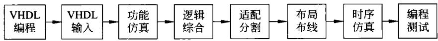  
图10-1利用VHDL语言设计开发数字电路流程

## 10.2.3 System C

## 1.概述

随着VLSI的集成度越来越高，设计也越趋复杂。传统的设计方法采用诸如原理图输人或HDL语言描述，在进行复杂系统设计时，设计效率往往比较低。特别是在算法由软件转化为硬件的环节上，传统的设计方法的效率也很低。设计者往往要耗费大量的时间和精力手工进行算法的转化。为解决这些问题，一种新的系统级的设计方法SystemC被提出。

SystemC的一个重要特性是它支持系统设计各个层次的模型抽象，包括算法层次的模型、无时间信息的功能模型、含时间信息的功能模型、业务级模型、行为级模型、寄存器传输级模型等。这样在系统开发的各个阶段，不同的设计开发者可以运用同一个设计语言，使用基于同一种设计语言描述的设计平台。

SystemC是建立在C++基础上的开放的系统级设计语言。实际上SystemC由一系列

用来进行系统描述的C++类构成，并包含了一个用来对系统行为进行模拟的仿真核。

目前，最新的版本为V2.0。它使SystemC成为真正的系统级设计语言，能够用来对SOC体系结构进行更加自然和有效的描述。这样就使SystemC语言涵盖了从系统概念直到实现的系统软、硬件建模的能力。它将软件算法与硬件实现很好地结合在一起，提高了整个系统设计的效率和正确性。

SystemC是一个C++库。设计者可以用SystemC开发工具或在标准C++开发工具中加人SystemC库制作系统级模型，快速地仿真和优化设计，并且为硬件和软件设计人员提供一个设计系统的可执行规范。这种规范本质上是一个C++程序，为软件设计人员和硬件设计人员提供了一个设计的标准。

## 2.SystemC的特点

SystemC支持对硬件和软件的协同设计，支持描述一个既包含硬件部分也包含软件部分的复杂系统结构。它也支持对接口的描述，有以下特点。

（1）SystemC可以为软件设计人员和硬件设计人员提供一个系统的可执行规范。设计人员使用该可执行规范可以避免设计中矛盾和错误的产生，并确保设计的完备性。

（2）设计人员利用可执行的系统规范，能够发现设计中概念模糊的地方。无论什么时候，设计人员对设计产生疑惑，都可以运行这个可执行程序以明确在这个问题上系统设计人员是如何处理的，从而确保系统设计的正确性。

（3）在系统设计被实现以前，设计人员还可以通过用SystemC设计的系统可执行规范来验证整个系统设计。这样可以避免在系统设计上的失误，实现系统的协同设计。

（4）SystemC设计的可执行规范所使用的TESTBENCH文件可以用于实现后的系统仿真。这将为设计人员带来很大的方便。

一种全新的设计流程被提出，这就是SystemC设计流程。它能很好地解决上面所提到的许多设计弊端，大大提高设计效率。

## （5）精炼的设计方法

使用SystemC设计系统，系统设计人员不必花费很大的精力将整个系统设计由C语言描述转换为HDL描述。系统设计人员可以通过在C模块中很小的范围内加人必要的硬件和时序结构描述，即可将C模块方便准确地转化为一个有效的硬件设计，从而避免另行设计一个硬件模块。

利用 SystemC设计方法，设计人员可以很轻松地实现一个设计的更改，而且能在优化算法时检测出设计错误并及时修改。

## （6）单一语言书写

使用SystemC设计系统，整个设计都用一种语言设计系统，降低了对设计人员的要求，减少了语言转换时所造成的错误。这一优点也使得设计人员可以在一个比较高的层次上进行系统模块设计。这种高层次的设计会产生小的设计代码，使设计和仿真的速度比传统的设计方法要快得多。

有关SystemC不再做更多的说明，只是请读者记得有这样一种功能甚好的系统级设计语言，在系统设计需要时可以选用。

## 10.2.4 QUARTUS Ⅱ

正如前面提到的那样，每一个FPGA/CPLD厂家都会为自己的产品提供开发环境。在这里，仅简单说明QUARTUSⅡ。其他还有许多厂家提供开发平台，此处不予说明。

QUARTUSⅡ是由厂家Altera提供的集成开发软件。它是早已广泛使用的MAXplus的更新换代产品，具有更好的性能。

QUARTUSⅡ的模块化的编译器包括：功能模块的分析及综合器（Analysis&Synthesis）、适配器（Fitter）、装配器（Assembler）、时序分析器（TimingAnalyzer）、设计辅助模块(Design Assistant）、EDA网表文件生成器(EDA NetlistWriter）、编译数据库接口(CompilerDatabaseInterface)等模块。

此外，QUARTUSⅡ还包含构建复杂系统时所需要的LPM(功能模件库)。该库中功能模块很丰富，在系统设计过程中可很方便地调用。

QUARTUSⅡ设计工具全面支持VHDL或Verilog设计流程,其内部包含VHDL或Verilog逻辑综合器。同时,QUARTUSⅡ也支持第三方的综合工具和仿真工具。在FPGA基础上，利用QUARTUSⅡ进行设计开发的流程与图10-1相似，现简略说明如下。

## 1.准备

（1）为设计建一个文件夹。文件夹用英文命名。

（2）设计输入。

QUARTUSⅡ软件在File菜单中选择New 选项。再在窗口引导下完成VHDL文件的输人。

（3）将输入的源文件存入文件夹中。

## 2.创建工程

利用QUARTUSI的NewProjectWizard工具的选项创建工程，将上述文件加入到工程中。同时，还要为工程选择目标芯片、综合器、仿真器等元件。

## 3.设计编译

QUARTUSⅡ编译器完成的功能有：检查设计错误、对逻辑进行综合、提取定时信息、在指定的Altera系列器件中进行适配分割，产生的输出文件用于设计仿真、定时分析及器件编程。

（1）首先确定软件处于Compile Mode,可以通过Processng菜单进行选择。

（2）在Processing菜单中选择Compiler Settings项。可以进行器件选择、模式设定、综合和适配选项设定及设计验证等功能。

（3）单击Processing莱单下的 Start Compilation项,开始编译过程。

（4）查看编译结果。在编译过程中会显示有关编译信息。若工程中的文件有错误也会显示出来。编译完成，可以得到详细的编译报告。

## 4.设计仿真

QUARTUSI软件允许设计者使用基于文本的向量文件(.vec)作为仿真器的激励，也可以在QUARTUSⅡ软件的波形编辑器中产生向量波形文件(.vwf)作为仿真器的激励。波形编辑方式与MAX+PLUSⅡ软件的操作相似。在Processing菜单下选择SimulateMode选项进入仿真模式，在SimulatorSettings对话框中进行仿真设置。在这里可以选择“激励文件”、“仿真模式"(功能仿真或时序仿真)等选项，单击RunSimulator按钮即开始仿真过程。

## 5.器件编程

设计者可以将配置数据通过MasterBlaster或ByteBlasterMV通信电缆下载到器件当中，通过被动串行配置模式或JTAG模式对器件进行配置编程，还可以在JTAG模式下给多个器件进行编程。利用QUARTUSⅡ软件给器件编程或配置时，首先需要打开编程器，在编程器中可以进行编程模式设置（Mode下拉框）、硬件配置（ProgrammingHardware对话框)及编程文件选择(AddFile按钮)，将以上配置存盘产生.cdf文件，其中存储了器件的名称、器件的设计及硬件设置等编程信息。当以上过程正确无误后，单击Start按钮即可开始对器件进行编程配置。

以上仅仅是概略地说明利用QUARTUSⅡ软件开发数字器件的过程，使读者对QUARTUSⅡ软件有所了解。详细情况可参阅相关资料。

有关其他研制开发数字器件、SOC等设计工具,在这里不再说明。本章后面的内容中涉及其他开发工具时，将在那里再予以说明。

## 10.3基于VHDL的CPU设计

在本节里，将简单介绍如何利用VHDL进行CPU设计。为此，首先说明在VHDL的支持下，一些与CPU有关的单元电路的设计，即底层电路的设计。在此基础上再描述CPU的总体结构、指令系统及总体设计，即CPU的顶层设计。

## 10.3.1单元电路的设计

在这里说明利用VHDL进行某些单元电路的设计。这种设计思路在以后的计算机系统(尤其是嵌人式系统)设计中，可用于系统部件(IP核)的设计。

## 1.8位双向三态驱动器

8位双向三态驱动器常用于系统的双向数据总线驱动。现以8位双向三态驱动器为例加以说明。根据8位三态驱动器的设计思路，可以推论，16位、32位双向三态驱动器也可以依照同样的思路进行设计。8位双向三态驱动器的逻辑图如图10-2所示，其真值表如表10-2所示。

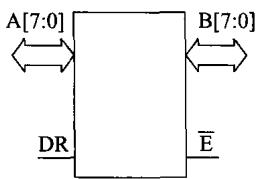  
图10-28位双向三态驱动器

表10-28位双向三态驱动器真值表
<table><tr><td>E</td><td>DR</td><td>传输特点</td></tr><tr><td>0</td><td>0</td><td>B→A</td></tr><tr><td>0</td><td>1</td><td>A→B</td></tr><tr><td>1</td><td>X</td><td>高阻</td></tr></table>

由图10-2及真值表可以看到，这就是经常使用的8位双向三态驱动器74245的特性，其VHDL 程序如下。

```vhdl
libraryieee;
use ieee.std_logic_ll64.all;
entity bi_dir_bus8 is
port(AIN:in std_logic_vector(7 downto 0);
BIN:in std_logic_vector(7 downto 0);
E:in std_logic;
DR:in std_logic;
AOUT :out std_logic_vector(7 downto 0);
BOUT :out std_logic_vector(7 downto 0));
end bi_dir_bus8;
architecturebehave ofbi_dir_bus8is
begin
BOUT<=AIN when E='O' and DR= '1'
else (others=>'z');
AOUT<=BIN when E='O' and DR='0'
else (others=>'z');
end behave;
```

在此基础上,利用厂家给出的支持软件如MAX十plus,就可以对程序进行编译、仿真等如图10-1所示的一系列工作，最终完成对该部件的设计。

但是，上面用VHDL语言设计的双向三态驱动器，实际上仅仅是一种设计的思路与方法。一般情况下，没有必要用这么复杂的过程去设计这么简单的电路。因为已有大量的具备这种功能的集成电路作为商品供设计者选用。

但是，这种VHDL程序所对应的部件，可以作为IP核，在设计其他系统时，可以将此核集成到系统中。这种集成IP核构成系统的细节将在本章的后面再仔细说明。

## 2.3-8译码器

在实际应用中经常会用到3-8译码器，例如芯片74138就是典型的3-8译码器。其引线及功能表分别如图10-3和表10-3所示。

从功能表可以看到，只有当译码器的三个控制端G、G2A和G2B同时有效时（即它们同时为100时)，译码器会对三个编码输入C、B、A译码，并且译码输出为低电平有效。

因此，当三控制端不同时有效时，8译码输出均为无效（高电平)状态。

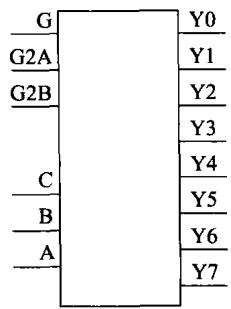  
图10-33-8译码器引线图

表10-33-8译码器功能表
<table><tr><td rowspan=1 colspan=1>G</td><td rowspan=1 colspan=1>G2A</td><td rowspan=1 colspan=1>G2B</td><td rowspan=1 colspan=1>C</td><td rowspan=1 colspan=1>B</td><td rowspan=1 colspan=1>A</td><td rowspan=1 colspan=1>Y0</td><td rowspan=1 colspan=1>Y1</td><td rowspan=1 colspan=1>Y2</td><td rowspan=1 colspan=1>Y3</td><td rowspan=1 colspan=1>Y4</td><td rowspan=1 colspan=1>Y5</td><td rowspan=1 colspan=1>Y6</td><td rowspan=1 colspan=1>Y7</td></tr><tr><td rowspan=1 colspan=1>X</td><td rowspan=1 colspan=1>1</td><td rowspan=1 colspan=1>X</td><td rowspan=1 colspan=1>X</td><td rowspan=1 colspan=1>X</td><td rowspan=1 colspan=1>X</td><td rowspan=1 colspan=1>1</td><td rowspan=1 colspan=1>1</td><td rowspan=1 colspan=1>1</td><td rowspan=1 colspan=1>1</td><td rowspan=1 colspan=1>1</td><td rowspan=1 colspan=1>1</td><td rowspan=1 colspan=1>1</td><td rowspan=1 colspan=1>1</td></tr><tr><td rowspan=1 colspan=1>X</td><td rowspan=1 colspan=1>X</td><td rowspan=1 colspan=1>1</td><td rowspan=1 colspan=1>X</td><td rowspan=1 colspan=1>X</td><td rowspan=1 colspan=1>X</td><td rowspan=1 colspan=1>1</td><td rowspan=1 colspan=1>1</td><td rowspan=1 colspan=1>1</td><td rowspan=1 colspan=1>1</td><td rowspan=1 colspan=1>1</td><td rowspan=1 colspan=1>1</td><td rowspan=1 colspan=1>1</td><td rowspan=1 colspan=1>1</td></tr><tr><td rowspan=3 colspan=1>011</td><td rowspan=2 colspan=1>X0</td><td rowspan=2 colspan=1>X0</td><td rowspan=1 colspan=1>X</td><td rowspan=1 colspan=1>X</td><td rowspan=1 colspan=1>X</td><td rowspan=1 colspan=1>1</td><td rowspan=1 colspan=1>1</td><td rowspan=1 colspan=1>1</td><td rowspan=1 colspan=1>1</td><td rowspan=1 colspan=1>1</td><td rowspan=1 colspan=1>1</td><td rowspan=1 colspan=1>1</td><td rowspan=1 colspan=1>1</td></tr><tr><td rowspan=1 colspan=1>0</td><td rowspan=1 colspan=1>0</td><td rowspan=1 colspan=1>0</td><td rowspan=1 colspan=1>0</td><td rowspan=1 colspan=1>1</td><td rowspan=1 colspan=1>1</td><td rowspan=1 colspan=1>1</td><td rowspan=1 colspan=1>1</td><td rowspan=1 colspan=1>1</td><td rowspan=1 colspan=1>1</td><td rowspan=1 colspan=1>1</td></tr><tr><td rowspan=1 colspan=1>0</td><td rowspan=1 colspan=1>0</td><td rowspan=1 colspan=1>0</td><td rowspan=1 colspan=1>0</td><td rowspan=1 colspan=1>1</td><td rowspan=1 colspan=1>1</td><td rowspan=1 colspan=1>0</td><td rowspan=1 colspan=1>1</td><td rowspan=1 colspan=1>1</td><td rowspan=1 colspan=1>1</td><td rowspan=1 colspan=1>1</td><td rowspan=1 colspan=1>1</td><td rowspan=1 colspan=1>1</td></tr><tr><td rowspan=1 colspan=1>1</td><td rowspan=1 colspan=1>0</td><td rowspan=1 colspan=1>0</td><td rowspan=1 colspan=1>0</td><td rowspan=1 colspan=1>1</td><td rowspan=1 colspan=1>0</td><td rowspan=1 colspan=1>1</td><td rowspan=1 colspan=1>1</td><td rowspan=1 colspan=1>0</td><td rowspan=1 colspan=1>1</td><td rowspan=1 colspan=1>1</td><td rowspan=1 colspan=1>1</td><td rowspan=1 colspan=1>1</td><td rowspan=2 colspan=1>11</td></tr><tr><td rowspan=1 colspan=1>1</td><td rowspan=1 colspan=1>0</td><td rowspan=1 colspan=1>0</td><td rowspan=1 colspan=1>0</td><td rowspan=1 colspan=1>1</td><td rowspan=1 colspan=1>1</td><td rowspan=1 colspan=1>1</td><td rowspan=1 colspan=1>1</td><td rowspan=1 colspan=1>1</td><td rowspan=1 colspan=1>0</td><td rowspan=1 colspan=1>1</td><td rowspan=1 colspan=1>1</td><td rowspan=1 colspan=1>1</td></tr><tr><td rowspan=2 colspan=1>11</td><td rowspan=1 colspan=1>o</td><td rowspan=1 colspan=1>0</td><td rowspan=1 colspan=1>1</td><td rowspan=1 colspan=1>0</td><td rowspan=1 colspan=1>0</td><td rowspan=1 colspan=1>1</td><td rowspan=1 colspan=1>1</td><td rowspan=1 colspan=1>1</td><td rowspan=1 colspan=1>1</td><td rowspan=1 colspan=1>0</td><td rowspan=1 colspan=1>1</td><td rowspan=1 colspan=1>1</td><td rowspan=1 colspan=1>1</td></tr><tr><td rowspan=1 colspan=1>0</td><td rowspan=1 colspan=1>0</td><td rowspan=1 colspan=1>1</td><td rowspan=1 colspan=1>0</td><td rowspan=1 colspan=1>1</td><td rowspan=1 colspan=1>1</td><td rowspan=1 colspan=1>1</td><td rowspan=1 colspan=1>1</td><td rowspan=1 colspan=1>1</td><td rowspan=1 colspan=1>1</td><td rowspan=1 colspan=1>0</td><td rowspan=1 colspan=1>1</td><td rowspan=1 colspan=1>1</td></tr><tr><td rowspan=2 colspan=1>11</td><td rowspan=1 colspan=1>0</td><td rowspan=1 colspan=1>0</td><td rowspan=1 colspan=1>1</td><td rowspan=1 colspan=1>1</td><td rowspan=1 colspan=1>0</td><td rowspan=1 colspan=1>1</td><td rowspan=1 colspan=1>1</td><td rowspan=1 colspan=1>1</td><td rowspan=1 colspan=1>1</td><td rowspan=1 colspan=1>1</td><td rowspan=1 colspan=1>1</td><td rowspan=1 colspan=1>0</td><td rowspan=2 colspan=1>10</td></tr><tr><td rowspan=1 colspan=1>0</td><td rowspan=1 colspan=1>0</td><td rowspan=1 colspan=1>1</td><td rowspan=1 colspan=1>1</td><td rowspan=1 colspan=1>1</td><td rowspan=1 colspan=1>1</td><td rowspan=1 colspan=1>1</td><td rowspan=1 colspan=1>1</td><td rowspan=1 colspan=1>1</td><td rowspan=1 colspan=1>1</td><td rowspan=1 colspan=1>1</td><td rowspan=1 colspan=1>1</td></tr></table>

3-8译码器的VHDL程序如下。

```vhdl
library ieee;
use ieee.std_logic_1l64.all;
entity decoder is
port(A:in std_logic;
B:in std_logic;
C:in std_logic;
G:in std_logic;
G2A :in std_logic;
G2B :in std_logic;
Y :out std_logic_vector(7 downto 0));
end decoder;
.architecture rtl of decoder is
begin
process(G,G2A,G2B,A,B,C)
variable szjh:std_logic_vector(2 downto 0);
begin
if(G='1'and G2A='0' and G2B='0')then
szjh:=C&B&A;
case szjh is
when "000"=>Y<="11111110";
when "001"=>Y<="11111101";
when "010"=>Y<="11111011";
when "011"=>Y<="11110111";
when "100"=>Y<="11101111";
when "101"=>Y<="11011111";
when "110"=>Y<="10111111";
when "111"=>Y<="01111111";
when others=>Y<="Xxxxxxxx";
```

```vhdl
end case;
else
Y<="11111111";
end if;
end process;
end rtl;
```

## 3.移位寄存器

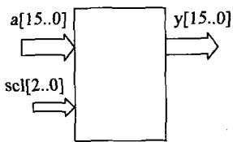

在数字电路中已经描述过，移位存器有多种结构形式。在CPU中常用的是并入并出的移位寄存器。一种16位的移位寄存器的结构图如图10-4所示，其运算功能说明如表10-4所示。

图10-4移位寄存器  
表10-4移位寄存器功能表
<table><tr><td>scl</td><td>功能</td><td>scl</td><td>功能</td></tr><tr><td>000</td><td>直通</td><td>100</td><td>循环左移</td></tr><tr><td>001</td><td>逻辑(算术)左移</td><td>101</td><td>循环右移</td></tr><tr><td>010</td><td>逻辑右移</td><td>其他</td><td>输出为0</td></tr><tr><td>011</td><td>算术右移</td><td></td><td></td></tr></table>

相应的VHDL程序如下。

```vhdl
library ieee;
use ieee.std_logic_1164.all;
entity shift is
port(a :in std_logic_vector(15downto 0);
y:out std_logic_vector(l5 downto 0);
scl :in std_logic_vector(2 downto 0));
end shift;
architecture rtl of shift is
begin
process(a,scl)
begin
case scl is
when "000"=>y<=a;
when "001"=>y<=a(14 downto 0)&'0';
when "010"=>y<='0'&a(15 downto 1);
when "011"=>y<='0'&a(15 downto 1);
when "100"=>y<=a(15)&a(15 downto 1);
when "10i"=>y<=a(14 downto 0)&a(15);
when "110"=>y<=a(0)&a(15 downto 1);
when others=>y<="0000000000000000";
end case;
end processi
end rtl;
```

## 4.比较器

设计一个16位的数字比较器，其结构图如图10-5所示。该比较器所能实现的功能逻列在表10-5中。

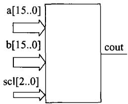  
图10-5比较器结构图

表10-5比较器功能表
<table><tr><td>sel</td><td>比较类型</td><td>功能</td></tr><tr><td>000</td><td>eq（等于）</td><td>若a=b，cout=1</td></tr><tr><td>001</td><td>neq(不等于）</td><td>若a&lt;&gt;b,cout=1</td></tr><tr><td>010</td><td>gt(大于）</td><td>若a&gt;b，cout=1</td></tr><tr><td>011</td><td>gte(大于等于）</td><td>若a&gt;=b,cout=1</td></tr><tr><td>100</td><td>lt(小于)</td><td>若a&lt;b，cout=1</td></tr><tr><td>101</td><td>lte(小于等于）</td><td>若a&lt;=b,cout=1</td></tr><tr><td>其他</td><td></td><td>cout=0</td></tr></table>

上述比较器的VHDL程序如下。

```vhdl
library ieee;
use ieee.std_logic_1164.all;
use ieee.std_logic_arith.all;
use ieee.std_logic_unsigned.all;
entity comp is
port(a :in std_logic_vector(l5downto 0);
b :in std_logic_vector(l5 downto 0);
sel :in std_logic_vector(2 downto 0);
cout :out std_logic);
end comp:
architecture rtl of comp is
begin
process(a,b,sel)
begin
case sel is
when "ooo"=>if a=b then cout<='1';
else cout<='0';endif;
when "oo1"=>if a/=b then cout<='1';
else cout<='O';endif;
when "01o"=>if a>b then cout<='1';
else cout<='0';endif;
when "011"=>if a>=b then cout<='1';
else cout<='0';endif;
when "10o"=>if a<b then cout<='1';
else cout<='0';endif;
when "101"=>if a<=b then cout<='1';
else cout<='0';endif;
end case;
```

end process;   
end rtl;

## 5.算术逻辑单元

如第3章所述，算术逻辑单元ALU可实现多种算术及逻辑运算。在这里要描述的ALU结构如图10-6所示，它所能实现的算术逻辑功能如表10-6所示。

表10-6算术逻辑单元功能表  
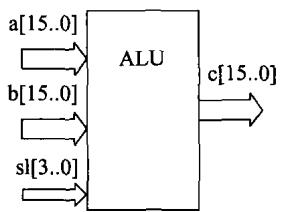

<table><tr><td>sl</td><td>操作</td><td>说明</td></tr><tr><td>0000</td><td>c=a</td><td>直通</td></tr><tr><td>0001</td><td>c=a and b</td><td>与</td></tr><tr><td>0010</td><td>c=a or b</td><td>或</td></tr><tr><td>0011</td><td>c=not a</td><td>取反</td></tr><tr><td>0100</td><td>c=a xor b</td><td>异或</td></tr><tr><td>0101</td><td>c=a+b</td><td>加法</td></tr><tr><td>0110</td><td>c=a-b</td><td>减法</td></tr><tr><td>0111</td><td>c=a+1</td><td>加1</td></tr><tr><td>1000</td><td>c=a-1</td><td>减1</td></tr><tr><td>1001</td><td>c=0</td><td>清零</td></tr></table>

图10-6 ALU结构图

上述算术逻辑单元ALU的VHDL程序如下。

```vhdl
libraryieee;
useieee.std_logic_1164.all;
useieee.std_logic_arith.all;
use ieee.std_logic_signed.all;
useieee.numeric_std.all;
entityaluis.
port(a:in std_logic_vector(l5downto 0);
b:in std_logic_vector(l5 downto 0);
c :out std_logic_vector(l5 downto 0);
sl :in std_logic_vector(3 downto 0));
end alu;
architecture behev of alu is
constant alupass:signed(3 downto 0):="ooo0";
constant aluand:signed(3 downto 0):="0o01";
constant aluor:signed(3 downto 0) :="oo10";
constant alunot:signed(3 downto 0):="oo11";
constant aluxor:signed(3 downto 0):="oi00";
constant aluadd:signed(3 downto 0):="0101";
constant alusub:signed(3 downto 0):="oi10";
constant aluinc:signed(3 downto 0):="o111";
constant aludec:signed(3 downto 0):="1o00";
constant aluclr:signed(3 downto 0):="1o01";
```

```vhdl
begin
process(a,b,sl)
begin
case sel is
when alupass=>
c<=a;
when aluand=>
c<=a and b;
when aluor=>
c<=a or b;
when alunot=>
c<=not a;
when aluxor=>
c<=a xor b;
when aluadd=>
c<=a+b;
when alusub=>
c<=a -b;
when aluinc=>
c<=a+ "0000000000000001";
when aludec=>
c<=a-"0000000000000001";
when aluclr=>
c<="0000000000000000";
when others=>
null;
end case;
end processi
end behav;
```

## 6.寄存器

寄存器可用于暂存各种信息，如地址、数据、指令、控制信号以及与外设交换数据等，在 寄存器可用于暂存各种信息，如地址、数据、指令、控制信号以，

CPU中常用做暂存器，而且还可以构成CPU内部的寄存器组。  
寄存器的结构如图10-7所示。

图10-7中描述的是一个16位的寄存器,其中a为寄存器的数字输入；b为寄存器的数字输出；clk为寄存器的控制输人，并且利用clk的上升沿将输人a保存在输出b端。

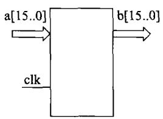

相应的寄存器VHDL程序如下。

图10-7寄存器结构图  
```vhdl
libraryieee;
use ieee.std_logic_1164.all;
entity reg is
port(a:in std_logic_vector(l5 downto 0);
b:in std_logic_vector(15 downto 0);
```

clk:in std\_logic);   
end reg:   
architecture rtl of reg is   
begin   
regproc:process   
begin   
wait unit clk'event and clk='1';   
b<=a;   
end process:   
end reg:

## 7.寄存器组

在CPU内部都会有一组寄存器,少则几个，多则几十个或更多。在RISC(精减指令集

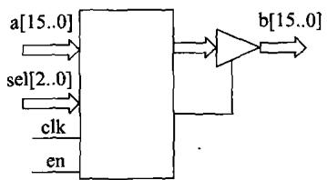  
图10-8寄存器组中寄存器结构示意图

计算机)中，寄存器组又称寄存器文件，一个寄存器组可以包括几十个甚至几百个寄存器。这种寄存器组可以看成是CPU内部的一组读写速度非常快的SRAM。在这里假定寄存器组是由8个16位的寄存器组成，其结构图如图10-8所示。

在图10-8中，sel是寄存器的地址选择信号，由于该寄存器组是由8个寄存器组成，则地址选择信号sel

只需3位即可。每个寄存器的输出都经过三态门，只有当三态门的控制端有效时，数据才能输出。若三态门的控制端无效，则其输出为高阻。

当sel选中某一寄存器时，clk的上升沿可将输入数据a存放在寄存器中。

当sel选中某一寄存器，且en有效时会使该寄存器的输出三态门的控制端有效，即可输出其存放的数据。

相应的VHDL程序如下：

```vhdl
libraryieee;
useieee.std_logic_1164.all;
useieee.std_logic_arith.all;
use ieee.std_logic_unsigned.all;
entity regf is
port(a :in std_logic_vector(l5 downto 0);
b :out std_logic_vector(l5 downto 0);
sel :in std_logic_vector(2 downto 0);
clk :in std_logic;
en :in std_logic);
end regf;
architecture rtl of regfis
type t ram is array(0 downto 7)of signed(l5 downto 0);
signal regfl:t_ram;
begin
process(clk,sel,en)
begin
```

```vhdl
if(rising_edge(clk)）then
regfl(to_integer(unsigned(sel)))<=a;
end if;
if(en='1') then
b<=regfl(to_integer(unsigned(sel)));
else b<="zzzzzzzzzzzzzzzz";
end if;
end process;
end rtl;
```

## 8.只读存储器

为了说明只读存储器VHDL设计，在这里用容量为128×16b的只读存储器为例，说明其构成。容量为128×16b的只读存储器如图10-9 所示。 fm r1r1

相应的VHDL程序如下：

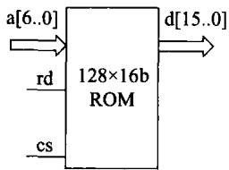  
图10-9只读存储器

```vhdl
library ieee;
use ieee.std_logic_1l64.all;
use ieee.std_logic_arith.all;
use ieee.std_logic_unsigned.all;
entity roml28_16 is
port(a : in std_logic_vector(6 downto 0);
d:out std_logic_vector(15 downto 0);
rd :in std_logic;
cs :in std_logic);
end rom128_16;
architecture rtl of roml28_16 is
subtye rom_word is std_logic_vector(15 downto 0);
type memory is array(0 downto l27)of rom_word;`
constant rom_table :memory:=(
(x"0000")，(x"1234"),(x"17e5"),(x"34ab"),
(x"4320")，(x"ae44"),(x"54fd")，(x"2fde"),
(x"3ed3"),(x"ae05"),(x"62fe"),(x"876d"),
(x"cb67"),(x"883e"),(x"a409"),(x"99eb"),
(x"b67d")，(x"35da"),(x"6ad5"),(x"89b6"),
(x"d2e3"),(x"6457"),(x"8bca"),(x"1679"),
(x"0324")，(x"7e9b"),(x"4a6b")，(x"3000"）,
(x"4f6b"),(x"45d0")，(x"3345"),(x"65ed"),
(x"4e5d"),(x"bb24")，(x"6bcd")，(x"37ba"),
(x"3e6d"),(x"ddbd"),(x"a00b"）,(x"45fc"),
(x"e36d"),(x"3456"),(x"23ae"),(x"689b"),
(x"d98f"),(x"143e"),(x"2dfa"),(x"4f7b"),
(x"a23d"),(x"f5a3"),(x"6bf2"),(x"a34b"),
(x"f074"),(x"1b7f"),(x"4f4a"),(x"a263"),
(x"3bc0"),(x"778b"),(x"56ba")，(x"a345"),
```

《计算机组成与设计》第10章

```vhdl
(x"d790"),(x"4fa2"),(x"9933")，(x"e4e5"),
(x"cd45")，(x"0000"),(x"0000")，(x"0000"),
(x"32ea")，(x"31a5"),(x"6e78")，(x"4f23")，
(x"143a")，(x"76f4")，(x"21a5"),(x"80b3"),
(x"le34")，(x"4fa5")，(x"2a45"),(x"663d")，
(x"5f6b")，(x"4321")，(x"879b")，(x"64e3")，
(x"3b45")，(x"34e6")，(x"5a32")，(x"23f6")，
(x"6ef0"),(x"2257")，(x"384f")，(x"5ae4"),
(x"89fe")，(x"321e")，(x"25ac")，(x"86d4"),
(x"3e5d")，(x"f56b")，(x"dc53")，(x"5eeb")，
(x"c467")，(x"4237")，(x"ddc4")，(x"89ba")，
(x"a32a")，(x"3dc5")，(x"53ea")，(x"7b2e")，
(x"2e89"),(x"1123")，(x"3345")，(x"ddfb")，
(x"e4db")，(x"4567")，(x"3456")，(x"adcb")，
(x"a39d")，(x"896b")，(x"de45")，(x"33ec")，
(x"44db")，(x"5e2a")，(x"8bf3")，(x"d6b7")，
(x"439d")，(x"e456")，(x"14ee")，(x"f65f"))i
begin
process(cs,rd,a)
begin
if(cs='0'and rd='O‘) then
d<=rom_table(conv_integer(a));
else
d<=(others=>'z');
end if;
end process;
end rtl;
```

只读存储器通常用来存储程序的目的码或不改变的常数，在VHDL程序中便可以写人相应指令码或常数。在上述只读存储器中，其存放的内容是随意写入的。

## 9.随机读写存储器

在前面的章节中已介绍过随机读写存储器。为了说明随机读写存储器VHDL设计，在

这里用容量为256×16b的存储器为例，说明其构成。容量为

256×16b的读写存储器如图10-10所示。

相应的随机读写存储器的VHDL程序如下。

```vhdl
libraryieee;
use ieee.std_logic_1164.all;
use ieee.std_logic_arith.all;
use ieee.std_logic_unsigned.all;
entity ram256_16is
port(a :in std_logic_vector(7 downto 0);
di :in std_logic_vector(l5 downto 0);
do :out std_logic_vector(l5 downto 0);
```

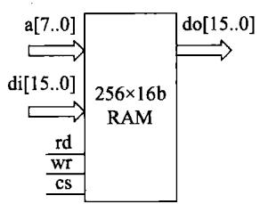  
图10-10随机读写存储器

rd :in std\_logic;  
wr :in std\_logic;  
cs :in std\_logic);  
end ram256\_16;  
architecture rtl of ram256\_16 is  
subtye ram\_word is std\_logic\_vector(15 downto 0);  
type memory is array(0 downto 255)of ram\_word;  
signal ram\_initial:memory:=(  
(x"0000"),(x"0000"),(x"0000")，(x"0000"),  
(x"0000"),(x"0000"),(x"0000"),(x"0000")，  
(x"0000")，(x"0000")，(x"0000")，(x"0000"),  
(x"0000"），(x"0000")，(x"0000")，(x"0000")，  
(x"0000"）,(x"0000")，(x"0000")，(x"0000")，  
(x"0000")，(x"0000")，(x"0000")，(x"0000"),  
(x"0000"),(x"0000"),(x"0000"),(x"0000")，  
(x"0000"），(x"0000"）,(x"0000"）,(x"0000"),  
(x"0000")，(x"0000"),(x"0000")，(x"0000")，  
(x"0000")，(x"0000")，(x"0000")，(x"0000")，  
(x"0000"),(x"0000")，(x"0000"）,(x"0000"),  
(x"0000"），(x"0000")，(x"0000")，(x"0000"),  
(x"0000"),(x"0000"),(x"0000"）,(x"0000")，  
(x"0000"),(x"0000"),(x"0000"),(x"0000"）,  
(x"0000"),(x"0000")，(x"0000")，(x"0000")，  
(x"0000")，(x"0000")，(x"0000")，(x"0000"),  
(x"0000")，(x"0000"）,(x"0000"）,(x"0000"）,  
(x"0000"），(x"0000"），(x"0000")，(x"0000"),  
(x"0000")，(x"0000")，(x"0000")，(x"0000"),  
(x"0000"),(x"0000"),(x"0000")，(x"0000"),  
(x"0000"）,(x"0000"）,(x"0000"）,(x"0000")，  
(x"0000"),(x"0000")，(x"0000"),(x"0000"),  
(x"0000")，(x"0000"），(x"0000"）,(x"0000"),  
(x"0000")，(x"0000"),(x"0000"),(x"0000")，  
(x"0000"),(x"0000")，(x"0000"),(x"0000"),  
(x"0000"),(x"0000"),(x"0000"),(x"0000"),  
(x"0000"),(x"0000"),(x"0000"),(x"0000")，  
(x"0000"),(x"0000"),(x"0000"),(x"0000")，  
(x"0000")，(x"0000")，(x"0000"),(x"0000"),  
(x"0000"),(x"0000")，(x"0000")，(x"0000")，  
(x"0000")，(x"0000")，(x"0000")，(x"0000"),  
(x"0000")，(x"0000")，(x"0000"),(x"0000")，  
(x"0000")，(x"0000")，(x"0000"),(x"0000")，  
(x"0000"),(x"0000")，(x"0000"),(x"0000"),  
(x"0000"),(x"0000")，(x"0000")，(x"0000")，  
(x"0000"）,(x"0000"），(x"0000"），(x"0000"）,  
(x"0000"),(x"0000")，(x"0000"),(x"0000"),

(x"0000")，(x"0000")，(x"0000")，(x"0000")，  
(x"0000")，(x"0000")，(x"0000")，(x"0000")，  
(x"0000"），(x"0000"），(x"0000")，(x"0000")，  
(x"0000")，(x"0000"），(x"0000")，(x"0000"），  
(x"0000")，(x"0000")，(x"0000")，(x"0000")，  
(x"0000"）,(x"0000"）,(x"0000")，(x"0000")，  
(x"0000"),(x"0000")，(x"0000")，(x"0000"),  
(x"0000")，(x"0000"），(x"0000")，(x"0000"),  
(x"0000")，(x"0000"),(x"0000"),(x"0000")，  
(x"0000")，(x"0000"),(x"0000"），(x"0000")，  
(x"0000")，(x"0000")，(x"0000"），(x"0000")，  
(x"0000")，(x"0000"），(x"0000")，(x"0000"),  
(x"0000")，(x"0000"），(x"0000")，(x"0000"),  
(x"0000")，(x"0000"),(x"0000"），(x"0000"),  
(x"0000"），(x"0000")，(x"0000")，(x"0000")，  
(x"0000"),(x"0000")，(x"0000")，(x"0000")，  
(x"0000")，(x"0000")，(x"0000")，(x"0000")，  
(x"0000"），(x"0000")，(x"0000")，(x"0000"）,  
(x"0000")，(x"0000")，(x"0000")，(x"0000")，  
(x"0000")，(x"0000"），(x"0000"),(x"0000"),  
(x"0000")，(x"0000")，(x"0000"），(x"0000")，  
(x"0000")，(x"0000")，(x"0000")，(x"0000"),  
(x"0000"),(x"0000"),(x"0000")，(x"0000")，  
(x"0000"），(x"0000")，(x"0000"),(x"0000"),  
(x"0000"),(x"0000")，(x"0000")，(x"0000"),  
(x"0000")，(x"0000"），(x"0000")，(x"0000"),  
(x"0000")，(x"0000")，(x"0000")，(x"0000"));

## begin begin

```vhdl
process (wr)
begin
if(wr'event and wr='O'） then
if(cs=!0')then
ram_initial(conv_integer(a))<=di;
end if;
end if;
end process;
process(cs,rd,a,ram_initial)
begin
if(cs='O'and rd='o') then
do<=ram_initial(conv_integer(a));
else
do<=(others=>'z');
end if;
end process;
end rtl;
```

在上面的VHDL程序中，随机读写存储器各单元的内容是可以写人的，也可以读出。程序中，它们的初始值均为0。上面的程序仅构造了一个容量为256×16b的RAM。显然，要构造更大容量的RAM同样可以参照上面的程序去做。

以上给出一些构成CPU的典型单元电路的VHDL程序。在此基础上，依照如图10-1所示的流程可以设计出相应的单元电路。尤其是目前的CPLD/FPGA已达到数千万门的集成度，而且各厂家提供了多种开发平台供开发者使用。因此，实现类似于上述单元电路的各种功能器件是可以很容易做到的。

## 10.3.2 CPU设计概要

在进行CPU设计时，由于CPU结构比较复杂，要实现多种寻址方式、多种指令的功能，因此，通常CPU设计是分成两个层次进行，即顶层设计和底层设计。在这种情况下，CPU的设计过程大致如下。

## 1.CPU结构及指令系统设计

CPU的顶层设计是在仔细描述CPU的结构、寻址方式、指令系统以及指令执行的详细时序的基础上，利用VHDL(或其他)语言描述CPU的外部输人/输出信号、内部各组成模块的输入/输出信号、CPU的指令功能等CPU的特征。在此，从顶层的角度来说明有关设计的内容。

## （1）CPU的结构

在这里要设计的是在第3章、第5章中所描述的一个16位CPU，为方便起见，再将其框图画出如图10-11所示，图中虚线所围起的部分就是要设计的CPU。

由图10-11可以看出，该CPU包括8个16位的通用寄存器组AX、BX、CX、DX、BP、SP、SI、DI。算术逻辑单元ALU，它能够完成各种算术和逻辑运算。两个暂存器T和S，其中T还可以实现移位和循环操作。

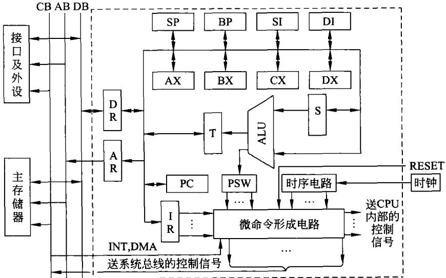  
图10-11某计算机简化框图

构成CPU的另一大部分就是控制器，它主要由程序计数器PC、指令寄存器IR、程序状态字PSW、时序部件及控制命令产生部件构成。在指令的执行过程中，控制器能够根据指令操作码产生相应的内部及外部控制信号，完成指令的功能。

此外，为了与外部系统总线接口，在CPU中设置单向地址寄存器AR 和双向数据寄存器DR。

在CPU内部采用单总线结构，CPU的各部件均连接在此内部总线上。同时，由于要设计的CPU是16位的，其内部总线的宽度也是16位的。总线上连接的各寄存器也是16位的。为简单起见，规定主存按字(16位)编址，每一主存地址存放16位二进制数。

## （2）寻址方式及指令系统

一个CPU的寻址方式越多、设置的指令种类越多，则两者组合起来构成的指令就越多，CPU的功能也就越强。当然，这必然使CPU内部的信号就越复杂，进而控制器也就越加复杂。

## ① 寻址方式

在第4章中已说明了要设计的CPU的寻址方式，在这里不再重复。但值得强调的是，这是CPU设计所必须做的前期工作，按照设计要求，认真设置指令的寻址方式。

## ②指令的设置

## a）指令分类

正如前面第4章中所提到的，考虑到指令的有效性、完备性、规整性、兼容性以及简便性，对所设计CPU进行指令的设置，以操作数的多少，以指令字长分类。第5章中已说明，包括如下几类。

双操作数指令。

单操作数指令。

转移指令。尽管这类指令也是单操作数指令，在这里单独列出。

## 无操作数指令。

指令系统中没有设置专门的输入/输出指令，是因为该CPU构成的系统中，采用主存与接口地址统一编址方案，用于内存的指令原则上均能用于接口。

## b）指令编码

在上述基础上，设计每条指令的指令操作码。在前面第5章已有描述，现将指令码字段重新画在图10-12上。

<table><tr><td>15</td><td>14</td><td>13</td><td>12</td><td>11</td><td>10</td><td>9</td><td>8</td><td>7</td><td>6</td><td>5</td><td>4</td><td>3</td><td>2</td><td></td><td>1</td><td>0</td></tr><tr><td>0</td><td>0</td><td>0</td><td>0</td><td>X</td><td>X</td><td>X</td><td>X</td><td></td><td></td><td></td><td></td><td></td><td>一定义双操作数指令</td><td></td><td></td><td></td></tr><tr><td>0</td><td>0</td><td>0</td><td>0</td><td>1</td><td>1</td><td>1</td><td>0</td><td>X</td><td>X</td><td>X</td><td></td><td></td><td></td><td></td><td>X→定义单操作数指令</td><td></td></tr><tr><td>0</td><td>0</td><td>0</td><td>0</td><td>1</td><td>1</td><td>1</td><td>1</td><td>X</td><td>X</td><td>X</td><td></td><td></td><td>X→定义转移指令</td><td></td><td></td><td></td></tr><tr><td>0</td><td>0</td><td>0</td><td>0</td><td>1</td><td>1</td><td>1</td><td>1</td><td>1</td><td>1</td><td>1</td><td>1</td><td></td><td>XX.</td><td></td><td>XX</td><td></td></tr><tr><td></td><td></td><td></td><td></td><td></td><td></td><td></td><td></td><td></td><td></td><td></td><td></td><td>定义无操作数指令</td><td></td><td></td><td></td><td></td></tr></table>

图10-12指令操作码的定义

尽管用指令编码字的高字节，可以构成256种编码。CPU设置的指令一共只有三十几条指令。因此,不采用扩展指令操作码的方法，仍然可以定义CPU的全部指令。但在第5

章中已经说明，采用扩展操作码的方法来规定指令操作码字段,如图10-12所示。

## ③指令分析

为了设计CPU,必须对所设置的每一条指令进行分析，从而弄清楚指令的执行过程。明确了指令的执行过程，才能对CPU中最复杂的部件—控制器进行设计。

有关指令分析及每一条指令执行的过程，也就是分析明确CPU执行每一条指令按时间顺序所需要的各种微命令。上面所说的这些方面的工作已经在前面第4章、第5章中做了详细说明，在后面的设计中，需要对指令的执行过程及其所需要的控制命令做深入分析理解。只有这样，才能利用VHDL编程实现CPU设计。但是，此后不会再用第5章的方法来设计CPU，而是用下面所描述的方法通过软件编程来设计CPU。

## 2.CPU的分层设计

由于CPU比较复杂，在设计过程中采用分层设计的方法是十分必要的。分层设计的方法就是将一个复杂的、规模比较大的数字系统划分成若干子系统，顶层设计描述各子系统接口条件及各子系统之间的关系。低层设计则描述各子系统的具体实现。显然，如果子系统仍然比较复杂，则子系统同样可再划分成更小的子系统。一直这样分下去，一直划分到比较简单的、设计方便的基本电路。

## （1）CPU的顶层设计

对于前述的CPU，尽管做了一些简化，但它基本上仍属于CISC(复杂指令集计算机)的范畴。也就是说这是一个复杂的数字系统。为此，将其设计分成两层：顶层设计和低层设计。

顶层设计包括CPU对外部的输入、输出信号，构成CPU各部件的输人、输出信号以及各部件间信号的相互关系。下面给出CPU顶层设计的部分VHDL程序。

```vhdl
libraryieee;
use ieee.std_logic_1l64.all;
use ieee.numeric_std.all;
use ieee.std_logic_unsigned.all;
entity cpu is
port(clk:in std_logic;
reset :in std_logic;
AR :out std_logic_vector(l5 downto 0);
DB :inout std_logic_vector(15 downto 0):
RD :in std_logic;
WR :in std_logic);
end cpu;
architecture behav of cpu is
signal ljxh1 :std_logic_vector(l5 downto 0);
signal psw :std_logic_vector(5 downto 0);
signal instr :std_logic_vector(15 downto 0);
```

signal alusl :std\_logic\_vector(3 downto 0);   
signal pci\_e : std\_logic:   
signal pco\_e :std\_logic;   
signal ssl :std\_logic\_vector(2 downto 0):   
signal rfsel : std\_logic\_vector(2 downto 0):   
signal rfi\_e:std\_logic;   
signal rfo\_e :std\_logic;   
signal tri\_e:std\_logici   
signal tro\_e :std\_logic;   
signal sri\_e :std\_logic;   
signal iri\_e :std\_logic:   
signal aro\_e :std\_logic;   
signal dri\_e :std\_logic;   
signal dro\_e :std\_logic;   
signal sp+1 :std\_logic;   
signal sp-1 :std\_logic;   
signal pc+1 : std\_logic;   
signal RD : std\_logic;   
signal WR :std\_logic;   
signal E:std\_logic;   
signal DR : std \_logic;   
componet alu   
port   
一   
a:in std\_logic\_vector(l5 downto 0);   
b :in std\_logic\_vector(15 downto 0):   
c :out std\_logic\_vector(15 downto 0);   
alusl :in std\_logic\_vector(3 downto 0)   
）；   
end component;   
component regf   
port(a :in std\_logic\_vector(l5 downto 0);   
b :out std\_logic\_vector(l5 downto 0):   
rfsel :in std\_logic\_vector(2 downto 0);   
rfi\_e :in std\_logic;   
rfo\_e :in std\_logic   
）；   
end component;   
component shift   
port(a :in std\_logic\_vector(l5 downto 0);   
y:out std\_logic\_vector(l5 downto 0);   
ssl :in std\_logic\_vector(2 downto 0)   
）；

```vhdl
component pc
port(reset :in std_logic;
pci_e :in std_logic;
pco_e:in std_logic;
pcin :in std_logic_vector(15 downto 0);
pcout :out std_logic_vector(15 downto 0)
）；
end component;
：
：
componet cu
port
（
clk :in std_logic;
reset :in std_logic;
psw :in std_logic_vector(5 downto 0);
instr :in std_logic_vector(15 downto 0);
alusl : out std_logic_vector(3 downto 0);
pci_e:out std_logic;
pco_e:out std_logic;
ssl :out std_logic_vector(2 downto 0):
rfsel :out std_logic_vector(2 downto 0):
rfi_e :out std_logic;
rfo_e : out std_logic;
tri_e :out std_logic;
tro_e :out std_logic;
sri_e : out std_logic;
iri_e :out std_logic;
aro_e :out std_logic:
dri_e :out std_logic;
dro_e :out std_logic;
sp+1 :out std_logic;
sp-1 :out std_logic;
pc+1 :out std_logic;
RD :out std_logic;
WR:out std_logic;
E:in std_logic:
DR:in st _logic
）；
end component;
```

```vhdl
instr :out std_logic_vector(l5 downto 0);
iri_e:in std_logic
）；
end component;
component bi_dir_bus
port(AIN :in std_logic_vector(15 downto 0);
BIN:in std_logic_vector(l5 downto 0);
E:in std_logic;
DR:in std_logic;
AOUT :out std_logic_vector(l5 downto 0);
BOUT :out std_logic_vector(l5 downto 0));
end component;
```

## begin in

hlsj\_1:alu   
port map (a(15 downto 0)=>sda(15 downto 0)，   
b(15 downto 0)=>ljxhl(15 downto 0),   
c(15 downto 0)=>trda(15 downto 0),   
alusl(3 downto 0)=>alusl(3 downto 0));   
hlsj\_2:regf   
port map (a(l5downto 0)=>ljxhl(15 downto 0),   
y(15 downto 0)=>ljxh1(15 downto 0),   
ssl(2 downto 0)=>ssl(2 downto 0));   
hlsj\_3:pc   
port map (reset=>reset,   
pci\_e=>pci\_e,   
pco\_e=>pco\_e,   
pc+1=>pc+1,   
pcin(15 downto 0)=>ljxhl(15 downto 0),   
pcout(15 downto 0)=>ljxh1(15 downto 0)):   
hlsj\_4:cu   
port map (clk=>clk,   
reset=>reset,   
psw(5 downto 0)=>psw(5 downto 0),   
instr(l5 downto 0)=>instr(15 downto 0),   
alusl(3 downto 0)=>alusl(3 downto 0),   
pci\_e=>pci\_e,   
pco\_e=>pco\_e,   
ssl(2 downto 0)=>ssl(2 downto 0),   
rfsel (2 downto 0)=>rfsel (2 downto 0),   
rfi\_e=>rfi\_e,   
rfo\_e=>rfo\_e   
tri\_e=>tri\_e,   
tro\_e=>tro\_e,

```julia
sri_e=>sri_e
iri_e=>iri_e,
aro_e=>aro_e ,
dri_e=>dri_e,
dro_e=>dro_e,
sp+1=>sp+1 ,
sp-1=>sp-1,
pc+1=>pc+1,
RD=>RD,
WR=>WR,
E=>E，
DR=> DR);
hlsj_5:ir
port map (buda(15 downto 0)=>ljxh1(15 downto 0),
instr(l5 downto 0)=>instr(l5 downto 0),
iri_e=>iri_e):
hlsj_5:bi_dir_bus
port map (AIN(15 downto 0)=>ljxh1(15 downto 0),
BIN(15 downto 0)=>ljxhl(15 downto 0),
E=>E
DR=>DR
AOUT(15 downto 0)=>ljxh1(15 downto 0),
BOUT(15 downto 0)=>ljxh1(15 downto 0));
end behav;
```

以上描述了CPU的顶层设计，在这里需要说明的是如下几点。

① 由于所描述的CPU结构比较复杂，设置的指令及寻址方式也比较多，属于CISC的范畴。顶层设计应当将构成CPU的所有部件均要例化，但由于复杂，上面的顶层设计是不全面的，还有一些部件没有描述(程序中用省略号表示）。

②在这里，顶层设计是用于描述有关概念和方法。也就是说，通过顶层设计来说明CPU的外部端口信号、内部各元部件端口以及在CPU内部各元部件端口之间通过何种信号实现相互连接的。某部件的输人信号是来自何处，其输出信号又加到哪个或哪些部件上。

③ 如果将CPU结构再加减化、寻址方式再减少，使设置的指令只有几条时，其设计必将会变得简单。

## （2）CPU低层设计

在低层设计中，要将顶层设计中所引用的元件逐一利用实体一一结构体加以描述。也就是说要将CPU顶层设计中所引用的元件的功能特征进行详细说明。

在10.3：1节中，设计了在CPU中经常用的单元电路。那些单元电路的设计可以是这里的低层设计的一部分。也就是说，在那一小节中所设计的电路中，凡是在CPU顶层设计中引用的电路均可以作为这里的低层设计的内容加以改造，使它们适合于使用，即可以直接放在CPU的低层设计之中。

如前面小节中的算术逻辑单元alu、寄存器组regf、寄存器reg、双向三态总线驱动器bi dirbus、移位寄存器 shift等单元电路可直接放在此处或者稍做修改即可放在此处作为低层设计的一部分。但为了节省篇幅，在此不再予以说明。

在这里只说明构成CPU的重要的部件—-程序计数器 PC 和控制器CU，下面写出有关的部分VHDL程序。

程序计数器PC的VHDL程序如下。

```vhdl
library ieee;
use ieee.std_logic_ll64.all;
use ieee.std_logic_arith.all;
use ieee.std_logic_unsigned.all;
entity pc is
port(reset :in std_logic;
pci_e :in std_logic;
pco_e:in std_logic;
pc+1 :in std_logic;
pcin :in std_logic_vector(l5 downto 0);
pcout :out std_logic_vector(l5 downto 0));
end pc;
architecture rtl of pc is
signal pc_tem :std_logic_vector(l5 downto 0):
begin
pcop:process(reset,pci_e,pco_e)
variable pcdata :std_logic_vector(l5 downto 0);
begin
if reset='1' then
pcdata<="0000000000000000";
pc_tem<=pcdata;
endif;
if pci_e='1' then
pcdata<=pcin):
pc_tem<=pcdata;endif;
if pco_e='1' then
pcout<=pc_tem;
else pcout<="zzzzzzzzzzzzzzzz";
end if;
end process;
pcinc:process (pc+1)
variable pcdata :std_logic_vector(15 downto 0);
begin
if pc+1='1'then
pcdata<=pcdata+1;
pc_tem<=pcdata;
endif;
end process;
end rtl;
```

从上面的程序可以看到,复位时,程序计数器PC被清零，也就是说CPU的复位启动地址将从0000H开始。功能描述中可以将CPU内总线上的16 位数据利用 pci\_e写人 PC中。也可以利用 pco\_e有效(为1),使 PC 的内容送出,加到CPU 的内部总线上。当 pco\_e无效时（为0),PC 的输出为高阻状态。

PC 的另一功能是可以利用 pc十1信号使其内容加1。显然,PC 是一个带有三态输出的并入/并出的加法计数器。

下面说明控制单元cu的VHDL程序，由于指令系统相对比较复杂,程序也只能是局部的，用以说明概念和方法。

```vhdl
library ieee;
use ieee.std_logic_1164.all;
use ieee.std_logic_arith.all;
use ieee.std_logic_unsigned.all;
entity cu_16 is
port（clk :in std_logic
reset :in std_logic
psw :in std_logic_vector(5 downto 0);
instr :in std_logic_vector(l5 downto 0);
alusl :out std_logic_vector(3 downto 0);
pci_e :out std_logic;
pco_e :out std_logic;
ssl :out std_logic_vector(2 downto 0);
rfsel :out std_logic_vector (2 downto 0);
rfi_e :out std_logic;
rfo_e :out std_logic;
tri_e :out std_logic;
tro_e :out std_logic;
sri_e :out std_logic;
iri_e :out std_logic;
aro_e :out std_logic;
dri_e :out std_logic;
dro_e :out std_logic;
sp+1 :out std_logic;
sp-1 :out std_logic;
pc+1 :out std_logic;
RD :out std_logic;
WR :out std_logic;
E :out std_logic;
DR :out std_logic);
end cu;
```

architecture behave of cu is   
type state is (finstc,finstc2,finstc3,finstc4,decex,addel,addel,addel,   
adde2,adde3,adde4,adde5,move1,move2,move3,move4,jmpe1,jmpe2,jmpe3,jmpe4,   
bgte1,bgte2,bgte3,bgte4,bgte5);   
signal current\_state,next\_state :state;

begin   
rstproc:process (reset,clk)   
begin   
if reset='1' then   
current\_state<=finstc;   
elsif clk'event and clk='1' then   
current\_state<=next\_state;   
end if;   
end process;   
nxtproc:process (current\_state,instr,psw)   
begin   
case current\_state is   
when finstc=>pco\_e<='1';ari\_e<='1';next\_state<=finstc2;   
when finstc2=>aro\_e<='1';pc+1<='1';next\_state<=finstc3;   
when finstc3=>RD<='0';dri\_e<='1';next\_state<=finstc4;   
when finstc4=>dro\_e<='1';iri\_e<='1';;next\_state<=decex;   
when decex=>   
if (instr(11 downto 9)/="11l")then   
next\_state<=execl;end if;   
if (instr(ll downto 8)="1110")then   
next\_state<=exec2;end if;   
if (instr(1l downto 8)&.instr(7 downto 4)/="11ll")then   
next\_state<=execj;end if;   
if (instr(ll downto 8)&instr(7 downto 4)="111l")then   
next\_state<=exec4;end if;   
：   
when execl=>case instr(11 downto 8)is   
when "oooo"=>next\_state<=and01;   
when "0001"=>next\_state<=or01;   
when "0o11"=>next state<=add01;   
：   
when "0100"=>next\_state<=mov01;   
end case;   
when exec2=>case instr(7 downto 4)is   
when "oooo"=>next\_state<=inc11;   
when "0oo1"=>next\_state<=decl1;   
：   
when "010"=>next\_state<=call11;   
end case;   
：   
when execj=>case instr(7 downto 4)is   
when "0ooo"=>next\_state<=jmp1;   
when "0001"=>next\_state<=jz1;   
：   
when "0101"=>next\_state<=jael;

end case;   
when exec4=>case instr(3 downto 0)is   
when "0ooo"=>next\_state<=nopl1;   
when "0ool"=>next\_state<=daal1;   
：   
when "010l"=>next\_state<=hlt1l;   
end case;   
：   
when addol=>case instr(7 downto 0)is   
when "100o0o01"=>next\_state<=add02;   
when "100o1o00"=>next\_state<=add04;   
：   
when "10o11l11"=>next\_state<=add0f;   
end case:   
：   
when jmpl=>   
pco\_e<='1';ari\_e<='1';next\_state<=jmp2;   
when jmp2=>   
aro\_e<='1';pc+1<='1';next\_state<=jmp3;   
when jmp3=>   
RD<='0';dri\_e<='1';next\_state<=jmp4;   
when jmp4=>   
dro\_e<='1';sri\_e<='1'; next\_state<=jmp5;   
when jmp5=>   
pco\_e<='1';alusl<="0101";next\_state<=jmp6;   
when jmp6=>   
tri\_e<='1';next\_state<=jmp7;   
when jmp7=>   
tro\_e<='1';pci\_e<='1'; next\_state<=finstc;   
when addof=>   
rfsel<="0111";tro\_e<='1';ari\_e<='1';   
next\_state<=add0f1;   
when addof1=>   
aro\_e<='1'; next\_state<=add0f2;   
when addof2=>   
RD<='0';dri\_e<='1'; next\_state<=add0f3;   
when add0f3=>   
dro\_e<='1';sri\_e<='1'; next\_state<=addof4;   
when addof4=>   
rfsel<="001";rfo\_e='1';alusl<="011";   
next\_state<=add0f5;   
when addof5=>   
tri\_e<='1'; next\_state<=add0f6;   
when addof6=>

```perl
tro_e<='1';rfsel<="001";rfi_e='1';
next_state<=finstc;
when jz1=>
pco_e<='1';ari_e<='1';next_state<=jz2;
when jz2=>
aro_e<='1';pc+1<='1';next_state<=jz3;
when jz3=>
RD<='0';dri_e<='1'; next_state<=jz4;
when jz4=>
dro_e<='1';sri_e<='1'; next_state<=jz5;
when jz5=>
if psw(0)="1" then --z标志为1
next_state<=jmp5;
else next_state<=finstc;
when movll=>case instr(7 downto 0） is
when "10000001"=>next_state<=mov12;--mov ax,bx
when "10001000"=>next_state<=mov14;--mov ax,imm
：
when "10010111"=>next_state<=movlf;--mov bx,[di]
end case
：
when mov14=>
pco_e<='1';ari_e<='1';next_state<=mov22;
when mov22=>
aro_e<='1';pc+1<='1';next_state<=mov23;
when mov23=>
RD<='0';dri_e<='1'; next_state<=mov24;
when mov24=>
dro_e<='1';rfsl<="000";rfi_e<='1';
next_state<=finstc;
：
end process ;
；
```

有关控制器cu的编程就到此为止。从上述程序可以看到，程序的功能就是根据前面设计时所设置指令的编码，产生完成指令功能的一系列控制信号。也就是说实现在前面指令分析中所要求的那一连串的控制信号。

根据指令分析的思路，利用有限状态机的概念进行分析与设计。一条指令由若干个状态周期来完成，在这里每一个时钟周期可产生一个状态。程序中可以看到，对于任一指令，取指令码的状态周期是一样的。但不同的指令，其译码和执行过程是不一样的。上面的程序只是写出了前面第5章中作为例子的指令的控制过程。由于寻址及指令系统比较复杂，上面的程序略去其他指令的控制编程。

在此低层设计中，还有一些功能和部件没有涉及，如中断响应、程序状态字PSW、堆栈寄存器 SP等。

同时，作为CPU的设计，上面仅仅是设计工作的前几步。后面还需要如10.2.4节中所描述的那样，逐步进行一系列的工作，以期达到CPU设计的目的。有关其他各步的设计细节,此处不再说明。

通过前面的描述，只是为了使读者建立CPU层次设计的概念及基本思路。

从上面所描述的CPU设计的过程可以看到，这种设计方法是建立在本书前面第4、第5两章的基础之上的。要设计CPU必须首先确定CPU的结构、寻址方式和指令系统，然后对每一条指令的执行过程进行详细分析。在此基础上进行顶层、低层甚至更多层的设计。实际设计起来还是比较杂的，尤其是当寻址方式和指令比较多时。

考虑到将来学生毕业走上工作岗位或现在已经在工作的技术人员，不太可能利用20 世纪80 年代的思路，从设计CPU、设计系统总线、设计内存到设计接口，最后，将所设计的各部分经系统总线连接在一起构成计算机系统。因为，在今天再从设计CPU开始去构成计算机的设计思路已不可取。这种设计思路无论从设计时间、代价、性能乃至可靠性、功耗等诸方面都是不好的。将来单独设计一片CPU芯片的可能性很小。因此，对于上述CPU 的设计只要了解其概念和大致的设计过程就可以了。将来若真的遇到CPU设计的问题，可以依照这样的思路和方法去应对。

读者在未来的工作中，设计包含CPU的SOC的可能性是非常大的，下面将强调 SOC的设计理念及设计过程。

## 10.4 SOC设计

从应用的角度出发，计算机可分为通用计算机和专用计算机两大类，而嵌入式计算机都属于专用计算机。学生在大学学习结束后的工作中，要设计的计算机绝大多数的情况下应当是嵌人式计算机系统。目前及未来的若干年里，尽管计算机的应用具有多样性(这是造就专用系统的原因)，但在绝大多数情况下，要构成嵌入式计算机系统，应采用片上系统 SOC（也称为系统芯片)，或者说要以 SOC为核心构成系统。因此，在本节中，将介绍 SOC的设计思路和方法。

今天的 SOC设计可以理解为利用IP核的集成技术来实现，即构成一片SOC就是将片内总线、CPU、DSP、SRAM、EEPROM、各种外设接口的IP核集成在一块芯片中。也就是说，如果在此之前计算机系统的设计是IC(集成电路)集成的话，今后的计算机系统的设计就应当是IP(知识产权)核的集成。它们的设计理念和设计方法是很不一样的。有关IP（知识产权)核集成的具体实现方法将在下面说明。

## 10.4.1概述

## 1.SOC的含义及组成

片上系统SOC并未见到严格的定义，可以理解为它是利用纳米技术制成的单片集成电路芯片，在此芯片中集成了一个或多个处理器以及与之相连接的RAM、ROM和多种数字与模拟接口，同时也集成芯片与外部器件相连接的接口总线。芯片中所含的各种部件还具

有可编程的能力。因此，利用这样的芯片可以方便地构成一个小的嵌入式计算机系统。一块芯片即可构成一个系统，也许这就是片上系统 SOC(也称为系统芯片)的由来。

根据上面的描述，可以想象 SOC的组成。一简化的 SOC的结构图如图10-13所示。SOC各组成部分说明如下。

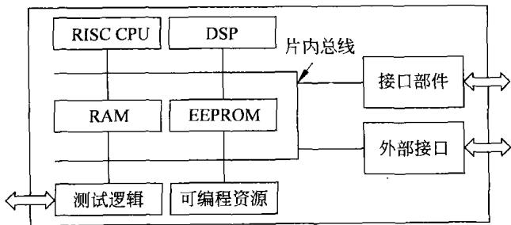  
图10-13片上系统 SOC结构框图

## （1）处理器

由图10-13可以看到，在SOC中包含有一个或多个处理器，一般来说是RISC处理器。同时，在许多SOC中为加速处理数字信号而经常集成数字信号处理器DSP。通过编译及操作系统，控制调度处理器有条不紊地、高效地工作。

## （2）存储器

在SOC内部，作为SOC的组成部分，总会设置RAM和ROM。其中ROM一般是EEPROM或闪存。其中RAM用于存放在SOC工作中的数据而ROM则用于固化程序及存放常数。图10-l3中尚未标出的cache是包含在RISC处理器中的。

## （3）接口部件

通常在 SOC中会集成构成嵌入式系统所需要的一系列接口：例如键盘接口、LCD显示接口、主控USB及从属USB接口、各种通信接口、A/D、D/A接口、各种定时器部件、语音接口、视频接口、网络接口、无线接口等。有了这样一些接口，很方便嵌人式系统设计者直接将有关外设接到这些接口上。

同时，接口部件还包括中断控制器、DMA控制器、总线仲裁器等有关接口部件。

除此之外，有的SOC内部还有模拟信号接口，如可编程增益运算放大器等。为了降低功耗，在 SOC中都会集成电源管理部件。

## （4）外部接口

外部接口可用于连接 SOC芯片外部的存储器或外设的接口。SOC包含外部接口是因为在SOC内部所集成的存储器及接口总是有限的，而应用的需求则是多样性的。在有些情况下，SOC芯片所包含的存储器及接口不能满足应用的需求时，可以利用外部接口所提供的信号（可以认为是外部总线信号)，连接SOC芯片外部的存储器或外设接口。

## （5）可编程资源

在 SOC中一般都会包含可供用户编程应用的时钟、电源、内部寄存器、引出线等资源。SOC的使用者可以通过编程来使用这些资源，构成嵌人式系统。

## （6）测试逻辑

由于 SOC结构十分复杂，功能非常强大。在设计 SOC时要通过测试，最终证明 SOC

工作的正确性。因此，测试就显得异常重要,利用设置在 SOC内部的测试逻辑，可以使测试得以简化。

## （7）片内总线

片内总线，也称为片上总线。在SOC内部的各功能部件通过这种芯片内部的总线连接在一起，构成 SOC。

从以上的SOC的结构可以看到，SOC类似于单片机，但与单片机相比，其结构更复杂、功能更强大、所包含的存储器及接口更多、具备可编程功能而且集成度也更高。毕竟SOC是在单片机的基础上开发出来的。

## 2.系统设计方法的演变

## （1）概述

在这里概略说明嵌人式系统设计在思路上的演变，进而说明了解SOC设计的必要性。

本章一开始就曾提到，20世纪80年代开始，计算机系统以CPU为核心，在规定的系统总线上开发各种电路板：如CPU板、ROM板、RAM板以及各种接口板，也就是将IC芯片集成于电路板中。然后，将这些电路板放在机箱内，插在总线上。从而构成硬件系统，再配上适当的软件构成系统。

对于一些小的简单的应用，则多用单片机来构成系统。这样的系统设计思路一直延续到20世纪末。这是一种传统的瀑布式的设计方法，很难实现系统的硬/软件的协同设计。只有当系统硬/软件全部完成之后，才能通过测试证明系统是否达到设计目的。一旦证明系统设计有问题，则损失就会非常严重。

从21世纪开始，由于SOC的出现，以CPU为核心，采用一系列电路板构成嵌入式计算机系统的设计方法已渐少采用。这是因为利用SOC构成系统要比利用CPU构成系统简单得多，可靠性高得多。过去用CPU，需要十来块电路板构成的系统，用SOC也许只要一块或两块电路板。从设计系统来说，实现同样的功能，采用SOC可以节省人力、节省时间、节省经费、增加系统可靠性、减少体积、降低功耗。

基于 SOC的计算机系统设计有两种思路。

## ①采用厂家生产的通用SOC

目前，已有多个厂家及系统设计者提供了数以百计的不同型号的SOC。这些SOC采用不同的处理器、具有不同容量的存储器、带有各种不同接口。但它们都可以认为是一种通用的SOC，只要设计者以这样的SOC为基础，再经过一定的工作，即可实现设计者所需要的功能。由系统设计者使用现成SOC构成系统，这种设计思路此处不再说明。但是，要特别强调的是，这种基于通用的SOC构成计算机系统的设计方法非常重要，这也是当前许多电子产品设计的首选方案。例如，目前的许多手机、GPS、MP4及控制系统都由通用的SOC构成。只是本章的目的是如何设计SOC，而利用现成的SOC构成计算机系统的细节就不再说明。

## ②自行设计专用SOC来构成系统

后面将会说明，采用通用的SOC设计专为某种应用服务的计算机系统，将会产生一些缺点。因此，在针对某种特定的应用进行系统设计时，为克服这些弊端多采用由嵌人系统的设计者自行设计适合这种应用的专用SOC。而后，再在此专用SOC的基础上构成计算机

系统。这种系统设计思路具有许多优点，而且有许多厂家公司提供功能强大的设计平台，支持设计工作。因此，一般工程技术人员都可以很方便地设计出适合自已需要的专用SOC。为此，在本节中特别说明SOC的设计。

## （2）SOC的设计方法

## ①三种设计方案

有三种设计 SOC 的方案。

## a）定制设计

采用全定制或半定制方式设计SOC。根据设计要求，提出设计构思，将细化的设计构思由具体程序代码来描述。再由代码综合出门级网表，生成掩膜板。再利用微细加工技术经多层掩膜制成SOC。这种方案中可以采用预先已经设计好的各种功能单元。但是，这种设计方案设计周期长、成本高、一次成功率低，适合于大批量生产。其过程类似于图10-1所描述的过程，是从20世纪80年代一直延续到现在的一种传统的集成电路设计方案，也有人称为ASIC的设计方法。

## b）基于FPGA的设计

可以认为FPGA是一种半成品，在此半成品的基础上设计开发SOC将会容易得多。这是因为，一来现在厂家为设计者提供了集成度高达数千万的FPGA芯片。二来是厂家及软件公司为支持这种设计提供了功能强大的设计开发平台。这就使得SOC的设计可以以天计完成，而定制设计所花费的时间则长达一年。同时,在成本上、成功率上、可重新编程等方面基于FPGA的设计都是十分优越的。

## c）基于HardCopy 的设计

这种设计思路是在基于FPGA设计成功的基础上，将成功实现于FPGA上的 SOC利用HardCopy技术直接转化为定制设计的形式，进行大批量生产。经转化的SOC只需两层掩膜，成本大大降低，而一次成功率可达100%。

下面仅对基于FPGA的设计予以说明。

## ②简单设计流程

基于FPGA的 SOC设计可以认为是以IP核为基础，将所需不同功能的IP核进行系统集成，从而构成 SOC。因此,IP核的系统集成是SOC设计的关键。本章的后面将对IP核进行更加详细地说明。

基于FPGA的系统芯片设计过程，一般先要进行软硬件划分，将设计分两部分：芯片硬件和软件协同设计。芯片硬件设计包括如下几点。

## a）功能设计阶段

对设计的需求进行分析，规划软件模块及硬件模块的划分，确定哪些功能应由硬件实现，哪些功能可由软件实现。对整个SOC的功能进行详细规划。

## b）SOC结构描述

在确定 SOC功能之后，可以依据功能将 SOC划分为若干功能模块，并决定实现这些功能将要使用的IP核。主要包括以下几点。

·在 SOC片内采用什么样的片内总线。

·采用什么样的处理器、采用一个处理器还是多个处理器。为实现功能是否需要使用DSP。

·片内的RAM需要多大的容量,地址范围如何、片内 ROM需要多大的容量,地址范围如何。

·需要整合在SOC中的接口有哪一些，如显示接口，采用不同的显示器，其接口也很不一样。键盘接口，同样应考虑采用编码键盘还是非编码键盘。通信接口，需要一种通信接口还是多种，这些接口的具体规范。其他数字及模拟接口等。

·SOC 的中断系统。有的处理器中已包括中断系统，但由于 SOC是构建嵌人式计算机系统的核心部件，对中断系统要求非常高。若已有的中断功能不能满足要求，则还需增加中断控制器，以便增加SOC的中断控制功能。

·DMA控制接口，在 SOC内部需构建多种功能模块，许多功能模块的功能是需要用DMA方式工作方可实现。因此，这就需要在SOC内部设置DMA控制器用以管理那些需要控制内部片内总线进行工作的部件，保证它们依据规定的优先级使用片内总线，不至于发生总线竞争。

## c）模块的IP核设计与集成

确定了SOC的结构，划分各功能模块(部件)的功能。同时还必须确定各模块的工作过程，工作过程中所需输人/输出信号。

在此基础上，审查所用模块是否有现成的IP核。尽管IP核目前还没有标准规范，但一些厂家与公司已提供了一些IP核可供选用。因此，在确定SOC的功能模块时，尽可能选用已有的IP核。

如果有的功能部件没有现成的IP核可供选用，则可以自行设计，利用VHDL或Verilog等硬件描述语言实现各模块的设计。接着，利用VHDL或Verilog的电路仿真器，对设计进行功能验证或行为验证。最后实现所需要的IP核。

将构成SOC的所有模块IP核，包括现成选用的和自行设计的，通过程序集成到一起，构成所要设计的SOC。

## d）程序编译与系统仿真

在 SOC设计平台的支持下，对构成的SOC软件进行编译。同时，要对 SOC进行仿真。

由于目前及今后所设计的SOC一般都是很复杂的，这就对系统仿真提出更高的要求。在这里进行的是系统级的模型仿真，这是一种系统的功能仿真。在此过程中如果发现问题，则需对设计进行修改，直到达到功能的要求。

## e）编程FPGA

对 SOC进行系统仿真后，即可将程序下载到FPGA中，对FPGA进行编程。此时FPGA已变成所要设计的SOC芯片。

## f）测试

这时，需要对SOC进行功能及性能上的全面测试，以验证设计的正确性。这是一项非常困难而又十分重要的工作。困难源于SOC是一种包含多种IP核结构的十分复杂的系统芯片，而重要就在于只有通过测试才能验证设计是否成功。

幸好，目前已有一些厂家提供了一些测试平台，包括一些测试器具并提供一些测试方法。在此测试平台上对所设计的 SOC进行测试将会方便一些。

以上简单说明基于FPGA的SOC设计过程，其思路如图10-14所示。

基于FPGA的 SOC设计最大的优点是FPGA可以多次编程。当设计不当需要修改或

SOC的功能需要改变、或需要增加某种功能时，可以很容易地进行重新设计，在同一片FPGA上完成新的SOC的设计。

另外，这种基于FPGA的设计方法更有利于实现SOC的硬/软件协同设计。

## 10.4.2 SOC片内总线

## 1．概述

SOC的设计过程中，最具特色的也是最关键的是IP复用技术。即将所选择的IP功能核整合到一起，集成到一块SOC芯片中。由于IP核的设计千差万别，IP核的连接就成为构造SOC的关键。片内总线也称为片上总线是实现SOC中IP核连接最常见的技术手段，它以总线方式实现IP核之间的通信。片内总线的这种功能类似于前面提到的计算机的内总线，该总线就是将构成计算机的不同部件连接在一起。由于片内总线在一块芯片内，故它不需要驱动底板上的信号和连接器，使用更简单，速度更快。

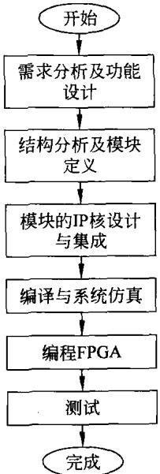  
图10-14基于FPGA的SOC设计过程

为了便于连接不同类型的IP模块，希望IP核标准化、规范化。同时，也希望片内总线能标准化、规范化。现在已有国际组织-《虚拟接口联盟VSIA》制定了《片内总线属性规范》OCB11.1。

VSIA提出SOC内部总线的层次化结构,将片内总线分层。一种典型的将片内总线分为两层的结构框图如图10-15所示。

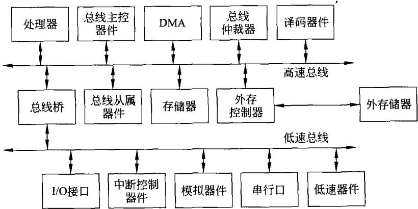  
图10-15SOC片内总线的层次结构

片内总线主要特点及要求如下。

（1）片内总线要尽可能简单

首先,结构要简单，这样可以占用较少的逻辑单元;其次时序要简单，以利于提高总线的速度；三是接口要简单，这可减少与IP核连接的复杂度。

（2）片内总线需有较大的灵活性

由于片上系统应用广泛，不同的应用对总线的要求是不同的。因此，片内总线应具有较大的灵活性。例如，多数片内总线的数据总线和地址总线的宽度都是可变的。AMBAAHB总线于支持32位～128位的数据总线宽度；同时，有些片内总线的互连结构可变，如Wishbone总线支持点到点、共享总线和交叉开关等多种互连方式。也有部分片内总线的仲裁机制灵活可变，如Wishbone总线的仲裁机制可以完全由用户定制。

## （3）片内总线要尽可能降低功耗

在实际应用时，总线上各种信号尽量保持不变，并且多采用单向信号线，以便降低功耗。同时，这也可简化时序。许多片内总线输入数据线和输出数据线都是分开的，且没有信号复用。

## （4）多采用主从结构

总线上可支持多个主控单元，各个主控单元可以同时与相应的从属单元传送数据，进行数据交换，从而提高了数据吞吐率。

## （5）应具可扩展性

总线应具有可扩展性，使各种功能的IP核模块的添加、修改和删除都非常容易。例如，可在总线上设置译码器件，使用其译码输出选择IP核模块将是方便的。

片内总线有两种实现方案：一种是选用公开的通用总线标准；另就是根据特定领域的需求，由系统设计者自主开发片内总线。这里仅就目前SOC设计中使用较多的几种片内总线标准做简单介绍。有关标准的细节可上网或查阅有关资料。

## 2.AMBA总线

AMBA总线规范是ARM公司设计研发的一种用于高性能SOC片内总线的标准。它独立于处理器和制造工艺技术，增强了各种应用中的外设和系统宏单元的可重用性。AMBA总线规范是一个开放标准，可免费从ARM获得。目前，AMBA拥有众多第三方支持，被ARM公司大多数合作伙伴所采用，在基于ARM处理器内核的SOC设计中，已经成为广泛支持的互连标准。AMBA总线规范引人的先进高性能总线(AHB)是现阶段AMBA实现的主要形式。AHB的关键是对接口和互连均进行定义，目的是在任何工艺条件下实现接口和互连的最大带宽。

AMBA总线规范主要设计目的如下。

（1）满足具有一个或多个处理器或DSP的嵌人式系统产品的快速开发要求。

（2）增加设计技术上的独立性，确保可重用的多种IP核可以成功地移植。

（3）促进系统模块化设计，以增加处理器的独立性。

（4）减少对底层硅的需求，以使片外的操作和测试通信更加有效。

AMBA总线是一个多总线系统。规范中定义了三种可以组合使用的不同类型的总线：AHB、ASB和APB。典型的基于AMBA总线的SOC结构框图如图10-16所示。

在图10-16中，高性能系统总线(AHB或ASB)主要用以满足CPU和存储器之间的带宽的要求。CPU、片内存储器和DMA设备等高速设备连接在其上，而系统的大部分低速外设则连接在低带宽总线APB上。系统总线和外设总线之间用一个桥接器进行连接。

AMBA的AHB适用于高性能和高时钟频率的系统模块。它作为高性能系统的骨干总线，主要用于连接高性能和高吞吐量设备之间的连接，如CPU、片上存储器、DMA设备和DSP或其他协处理器等。其主要特性如下。

·支持多个总线主设备控制器。

·支持猝发、流水等数据传输方式。

·单周期总线主设备控制权转换。

·32～128位数据总线宽度。

·具有访问保护机制，以区分特权模式和非特权模式访问，指令和数据读取等。

·数据猝发传输最大为16段。

·地址空间32位。

·支持字节、半字和字传输。

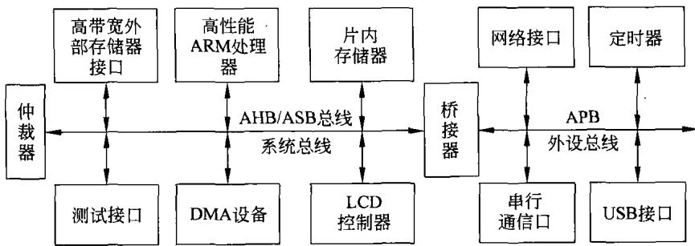  
图10-16SOC片内AMBA总线结构‘

AMBA的ASB适用于高性能的系统模块。在不必要使用AHB的高速特性的场合，可选择ASB作为系统总线。它同样支持处理器、片内存储器及其他高速部件之间的连接。其主要特性与AHB类似，不同点主要表现在它读数据和写数据采用同一条双向数据总线。

AMBA的APB适用于低功耗的外部设备，它已经过优化，以减少功耗和对外设接口的复杂度，它可连接在AHB或ASB两种系统总线上。其主要特性如下。

·低速、低功耗外部总线。

·单个总线主设备控制器。

·非常简单，加上clock和reset,总共只有4个控制信号。

·32位地址空间。

·最大32位数据总线。

·读数据总线与写数据总线分开。

多总线系统相对于单总线系统更适合于低功耗，高速度场合，连接在总线上的模块越多，速度就越慢，那么总线的延迟也就越长。有些模块需要高带宽来进行彼此间的数据交换，这些模块应该归为一组，接在系统总线上。而相互间通信较少的模块应该归并在一起，这样就可以降低那些连接低带宽模块总线的功耗。有关AMBA的其他细节，本书不再涉及。

## 3.Wishbone总线

Wishbone是由Silicore公司提出的，现在已被移交给OpenCores组织维护。由于其开放性,现在已有不少的用户群体。特别是有许多IP核的开发者，是基于Wishbone总线标准进行IP设计，在Wishbone总线上使用十分方便。

Wishbone总线规范是一种片上系统IP核互连体系结构。它定义了一种IP核之间公共的逻辑接口,减轻了系统组件集成的难度，提高了系统组件的可重用性、可靠性和可移植性，加快了产品市场化的速度。Wishbone 总线规范可用于软核、固核和硬核，对开发工具和目标硬件没有特殊要求，并且几乎兼容已有的所有综合工具，可以用多种硬件描述语言来实现。

Wishbone总线主要特征如下。

·一种简单、紧凑的逻辑IP核硬件接口，只需很少的逻辑单元即可实现。

·时序非常简单。

·一种主/从结构的总线，支持多个主控设备。

·8～64位数据总线，还可扩充。

·单周期读写。

·支持单字节读写、块传输、控制操作及其他的总线事务。

·支持多种IP核互连，如单向总线、双向总线、基于多路复用的互联网络、基于三态的互联网络等。

·支持总线周期的正常结束、重试结束和错误结束。

·支持使用用户自定义标记、数据传输类型、中断向量等。

·仲裁器机制由用户自定义。

·独立于硬件技术（FPGA、ASIC、bipolar、MOS 等）、IP核类型（软核、固核或硬核）、综合工具、布局和布线技术等。

·Wishbone总线的所有信号都与总线时钟同步。

·支持大/小端模式，用户可根据自己的需求定义总线操作模式为大/小端。

·Wishbone以主/从接口区分总线信号。

·具有 Master接口的模块是总线操作发起方，具有 Slave 接口的模块回应对 Master接口模块的操作。

Wishbone总线结构十分简单，它仅仅定义了一条高速总线。在一个复杂的系统中，可以采用两条Wishbone总线的多级总线结构：一条用于高性能系统部分，一条用于低速外设部分，两者之间需要一个接口。

灵活性是Wishbone总线的另一个优点。由于IP核种类多样，其间并没有一种统一的连接方式。为满足不同系统的需要，Wishbone总线提供了4种不同的IP核互连方式。

（1）点到点，用于两IP核直接互连。

（2）数据流，用于多个串行IP核之间的数据并发传输。

（3）共享总线，多个IP核共享一条总线。

（4）交叉开关，同时连接多个主从部件，提高系统吞吐量。

Wishbone总线的逻辑结构图如图10-17所示。

## 4.Avalon总线

Avalon总线是Altera公司设计的用于SOPC(可编程片上系统)的设计，它是连接片上处理器和其他IP模块的一种简单的总线协议，规定了主部件和从部件之间进行连接的端口和通信的时序。

Avalon总线的主要设计目的如下。

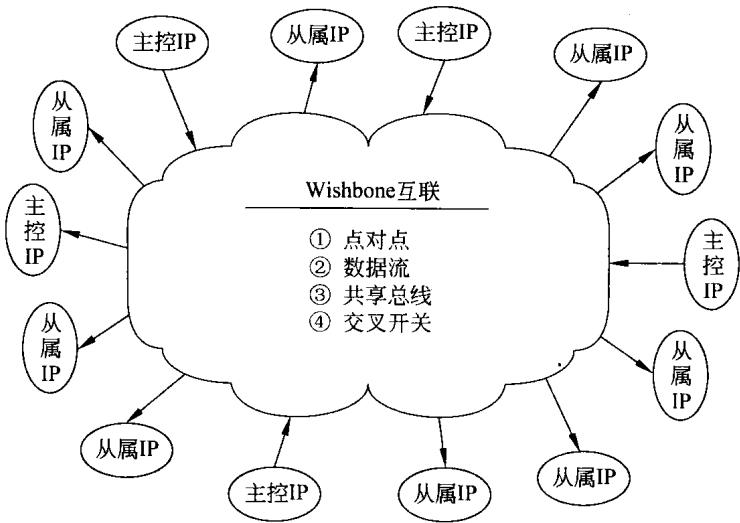  
图10-17Wisbone总线的逻辑结构图

（1）简单性，提供一种非常易于理解的协议。

（2）优化总线逻辑的资源使用率，将逻辑单元保存在FPGA中。

（3）同步操作，将其他的逻辑单元很好地集成到同一FPGA中。

（4）避免复杂的时序。

传统的总线结构中，一个中心仲裁器控制多个主设备和从设备之间的通信。这种结构会产生瓶颈，因为任何时候只允许一个主设备能访问系统总线。Avalon总线的开关构造使用一种称之为从设备仲裁的技术，允许多个主设备控制器真正地同步操作。当有多个主设备访问同一个从设备时，从设备仲裁器将决定哪个主设备获得访问权。图10-18是一个多主设备同时访问存储器的例子。在此系统中，高带宽外设,如100Mbps以太网卡，可以不需暂停CPU而直接访问存储器。通过允许存储访问独立于CPU。Avalon开关结构优化了数据流，从而提高了系统的吞吐量。

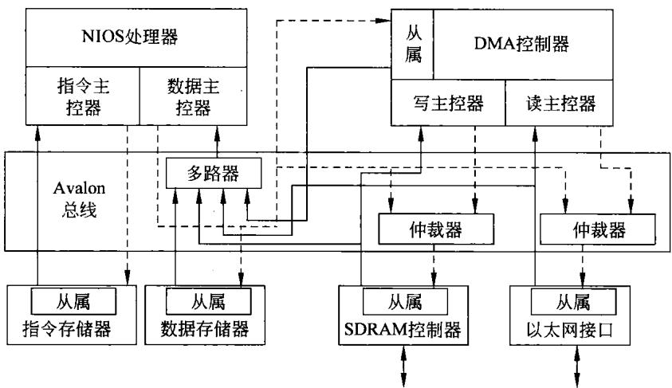  
图10-18Avalon 总线结构

Avalon总线主要特性如下。

·32 位寻址空间。

·支持字节、半字和字传输。

·同步接口。

·独立的地址线、数据线和控制线。

·设备内嵌译码部件。

·支持多个总线主设备，Avalon自动生成仲裁机制。

·多个主设备可同时使用一条总线。

·可变的总线宽度，即可自动调整总线宽度，以适应不同的数据。

·提供了基于图形界面的总线配置向导，简单易用。

有关Avalon总线的主控器、从属器的接口信号、工作时序等技术细节，请参阅该总线的技术手册，此处不做说明。

## 5.CoreConnect总线

CoreConnect总线是由 IBM公司开发，其逻辑结构如图10-19 所示。

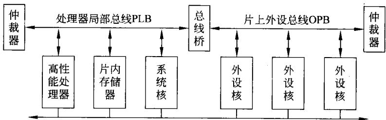  
设备控制寄存器总线DCR  
图10-19CoreConnect片内总线结构图

CoreConnect采用了总线分段的方式，提供了三种基本类型总线，即处理器局部总线PLB、片上外设总线OPB和设备控制寄存器总线DCR。

CoreConnect片上总线能使多个源的芯片核相互连接成为一个完整的新芯片。CoreConnect技术使整合变得更为容易,而且在标准产品平台设计中处理器、系统以及外围的核可以重复使用，以达到更高的整体系统性能。

三种基本总线的主要特征如下。

（1）PLB标准是为总线传输的主要发出者和接受者之间提供高带宽、低延迟的连接。其主要特点如下。

·高性能处理器内部总线。

·交叠的读和写功能(最快每周期两次传输)。

·支持分段传输。

·读和写数据线分开。

·32～64位数据总线。

·32 位地址空间。

·支持16～64 字节突发传输模式。

·4级仲裁优先权。

·特殊DMA模式。

（2）OPB标准为连接具有不同的总线宽度及时序要求的外设和内存提供了一条途径，并尽量减小对PLB 性能的影响。其主要特性如下。

·片上外围总线、支持多个主设备。

·32 位地址空间。

·读和写数据总线分开。

·8～32位数据总线。

·动态总线宽度。

·支持重试模式(如果主设备要求的从设备忙，主设备隔一段时间再次请求）。

·支持突发传输模式。

·支持DMA。

（3）DCR是用来规范CPU通用寄存器设备，控制寄存器之间传输数据。DCR总线在内存地址映射中取消了配置寄存器，减少取操作，增加处理器内部总线的带宽。其主要特征如下。

·7位地址总线。

·32位数据总线。

·同步和异步的传输。

·分布式结构。

CoreConnect拥有完备的一整套技术文档，在技术上可行性较强，可以应用在类似于工作站这样的高性能系统的设计中，对于简单的嵌入式应用来说可能有点复杂，提供的许多特性有可能用不到。

## 6.OCP总线

OCP总线规范是OCP-IP(开放式内核协议国际同盟)设计的一个规范，是为了在SOC设计中实现IP核的即插即用而制定的片上总线规范。OCP是一种不依赖于特定处理器内核的总线协议，只要IP核符合OCP标准，即使更换处理器的内核，也不需要重新设计IP核，因此，该标准具有灵活的适用性。OCP标准是目前唯一公开许可、并给出IP核系统级综合要求的协议，它在片上系统通信上定义了一个高效的、总线独立的、可配置和高度可扩展的接口。OCP协议以IP核为中心，克服了反复定义、校验、证明和兼容接口的复杂性。OCP的典型总线结构如图10-20所示。

在图10-20中包含三个独立的IP核实体和一个包装总线。OCP总线规范中不仅规定了数据总线信号和控制信号，而且规定了测试信号，并且OCP的数据总线和地址总线均是可配置的。OCP总线规范使用同步的单向信号来简化系统设计和时序分析，同时也采用了主/从结构。OCP总线支持流水线操作，并且通过线程标识符管理方式实现并发传送，大大增加了数据吞吐率。

有关片内总线只做最简单的介绍，将来读者在设计SOC时，总线也会像其他的IP核那样，做为SOC的一个构成部件直接引用。

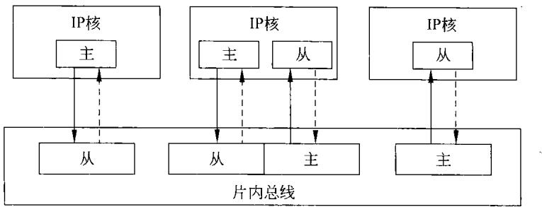  
图10-20OCP片内总线结构图

## 7．片内网络NOC

如前所述，目前SOC的设计多是利用分层片内总线，将各IP核模块连接在一起，构成人们所需要的SOC。不管是处理器IP核、存储器IP核还是外设接口IP核，对SOC的设计者来说，均将它们看成一个独立的部件，由研制开发者提供，而SOC的设计者可直接调用，将它们挂接在片内总线上，实现 SOC设计。而且可以在 SOC中设置多个处理器、多个总线的主控核。

随着SOC的发展，对SOC系统复杂性、优异的性价比和产品上市时间的需求日益增加。尤其是要求速度高、功能强的多处理器系统级芯片（MPSOC)，将集成多达数十亿个、频率高达几个GHz、工作电压低于1V的晶体管于一块芯片中。MPSOC中将包括多个存储部件、通用CPU和专用内核(如数字信号处理器或超长指令字内核)等处理器单元和嵌入式硬件，这些部件需要通过一个复杂的通信结构相互连接在一起，以便使 SOC能高效地工作。这就需要采用比片内总线更好的结构来实现片内各部件的高速通信。

从长远来看，片上光通信技术的前景很好，但就近期而言，人们一致看好全新的片上互连架构，这就是片上网络(NOC)。该技术能够降低 SOC的价格和功耗，并能提高系统的性能和可伸缩性。片上网络的结构图如图10-21所示。

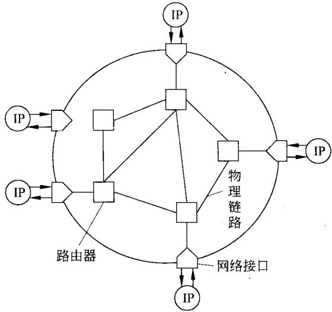  
图10-21NOC 的结构图

如图10-21所示的NOC结构是由意法半导体公司提出，用以替代片内总线。网络由三个主要组件构成。

（1）网络接口（NI)，通过把子系统的交易转换成在片上网络内传输数据包的方式连接各个IP模块。

（2）路由器，提供高效可靠地传输以飞块(flit)为单位的数据包。

（3）物理链路，实现路由器和/或网络接口之间的实际信号传播。

显然，具体的网络拓扑结构及NOC的细节此处不再涉及，只是说明这种设计 SOC的思路也许是今后设计SOC的发展方向。

## 10.4.3IP核设计与复用

## 1.IP核

SOC 设计的关键技术是IP核。因此,IP的开发和管理是至关重要的。IP核为知识产权模块，可定义为密封在硬件设计中的可重复利用的软件模块。按其功能也可定义为构成SOC的基本电路功能块或内核，也称为虚拟部件VC,或芯核，可由用户或专用IC公司或独立公司开发。

IP 核分为软核、硬核和固核。软核为能综合的HDL描述，硬核为芯片版图，固核为门级HDL描述。

## （1）软IP核

软IP核通常在抽象的、较高层次的功能描述，用硬件描述语言(HDL)或C语言写成，是对设计的算法级描述或功能级描述，包括逻辑描述、网表和用于功能仿真的行为模拟以及用于测试的文档。

软IP核的特点是灵活性大、可移植性好，用户能方便地把RTL(寄存器传输级)和门级HDL表达的软IP核移植到所需要的设计中，综合到选定的加工工艺上。但与硬IP核相比，可预测性差，设计时间长。

## （2）硬IP核

硬IP核的电路布局及其与特定工艺相联系的物理版图是固定的，包括全物理的晶体管和互连掩膜信息，完成了全部的前端和后端设计并已被投片验证正确，特点是提供可预测的性能和快速的设计，可以被新设计作为特定的功能模块直接调用。

## （3）固IP核

固IP核在软核基础上加以开发，是介于硬IP和软IP之间的IP,是一种可综合的、并带时序信息以及布局布线规划的设计，以RTL代码和对应具体工艺网表的混合形式提供。固IP核既不是独立的，也不是固定的，可以根据用户的需要进行修改，使它适合于某种可实现的工艺过程。

对 SOC的设计开发而言，硬核的功能最容易测定，具有工艺相关性，但是使用不灵活，修改不方便。软核的实用性最低，软核的质量以及硬件实现效率较难评估。固核具有一定的工艺独立性，由于在设计中考虑了时序等关键问题，因此能保证设计源码的可综合性和物理实现效率。

前面，已经介绍了有关IP核的三种形态。在这里将进一步说明IP 核的设计及复用的有关问题。

## 2.IP核的设计

前面已经提到，在进行SOC设计时，尽可能地使用厂家提供的现成的IP核，或者从IP核库中查找合适的IP核。当找不到适于应用的IP核时，则需自行设计。另外，也许设计者从事的工作就是设计IP核作为产品出售。这种情况下也需要自行设计IP核。

IP 核的设计，尤其是软核设计，实际上就是一种软件设计。按照软件工程的思路来开发IP核。

## （1）需求分析

需求分析包括IP核的功能需求、性能需求、物理需求。

## （2）方案设计

在需求分析的基础上，对IP核设计的总体方案进行设计。包括IP核的详细结构模块图，总体模块可划分的子模块(各子模块的功能、性能及接口定义)，对IP核外部系统的接口的详细定义，测试规划及验证方法等。

## （3）详细方案

在上面工作的基础上，需制定详细的总体设计方案。并对各子模块提出详细设计方案。而后对设计方案进行评估，确定其在规定时间的可行性、合理性及可实现性。

## （4）低层模块设计

根据总体方案对低层模块性能、功能、时序、接口等方面的要求，编写满足需求的RTL(寄存器传输级)程序。对子模块在测试平台上进行测试和验证。在通过代码规范性检查、测试覆盖率检查、功能覆盖率检查、性能分析、功耗分析等测评之后，还需形成相应的一系列文档。至此，低层模块设计暂告一段。

## （5）顶层模块设计

顶层模块设计就是将各低层设计好的子模块集成在一起，构成顶层模块，并进行综合处理和功能验证。

综合处理包括制定处理文件、在不同的IP参与库上进行综合、进行最终的性能分析和功耗分析。

验证功能测试、不同配置条件下的测试、利用仿真工具检验测试向量的覆盖率等。

在做完上述工作的同时需要形成IP核设计的完整的文档。

## （6）交付使用

IP 核设计完成即可交付使用,可作为产品的IP核交付时应包括如下几方面。

① 该IP核设计及测试所使用的开发平台。

②在哪些仿真器上做过仿真。

③在哪些工艺库上做综合、门级仿真及形式验证。

④提供源程序、模块图及接口信号说明。

③提供IP核设计开发的有关文档。

③将所设计的IP核通用化、规范化放于IP核库中。

以上仅就IP核的设计过程做了简单说明，在进行 SOC设计时，若不能获得现成的 IP

核用于设计中，则完全可以自行设计IP核，设计出来的IP核既可以自己使用也可以供他人使用。有关IP核开发设计的详细内容不再提及，有兴趣的读者可参阅其他文献资料。

## 3.IP核的复用

由于SOC芯片具有比较复杂的结构，在进行设计时需要集成一个复杂的系统。如果是从头开始完成芯片设计，显然将花费大量的人力物力。另外，现在电子产品的生命期正在不断缩短，这就要求芯片的设计必须在更短的周期内完成。为了加快SOC芯片设计的速度，人们将已有的IC电路以模块的形式，在SOC芯片设计中调用，从而简化芯片的设计，缩短设计时间，提高设计效率。这些可以被重复使用的IC模块就叫做IP核（模块或者系统宏单元、芯核、虚拟器件)。因此，SOC的设计基础是IP核的复用技术。

基于IP核复用技术的SOC设计会提高SOC的效率和可靠性，可以有效提高设计能力，节省设计人员，缩短产品上市的周期，能够充分利用现有的资源，降低产品的成本。IP核复用给SOC设计带来了很大的灵活性，使芯片的设计从以硬连线为设计中心转向以软件设计为中心，芯片设计不再是门级的设计，而是在IP核和IP接口的设计并在IP的复用设计的基础上进行。

## （1）IP核的规范标准

为了便于SOC在IP核基础上的设计，目前，有关部门正在制定有关IP核的规范标准，建立IP核库。只有有了标准，用户才好调用。现在，国内正在研制的IP核主要有如下几个方面。

## ①微处理器类IP核

计算机、通信、信息安全和家电产品领域芯片设计急需的微处理器核的开发。主要包括微处理器、微控制器、数字信号处理器及协处理器等。

## ②存储器类IP核

通信、家电、个人数字助理和智能卡等产品领域芯片设计急需的存储器核的开发。包括静态随机存储器、电擦除可多次编程只读存储器、闪速存储器等。

## ③混合信号电路类IP核

通信和家电等电子产品领域芯片设计急需的混合信号电路核的开发。包括模拟/数字转换器、数字/模拟转换器等。

## ④射频电路类IP核

无线通信，无线接人和非接触式智能卡等产品领域芯片设计急需的射频电路核的开发。如低噪声放大器等。

## ③接口电路类IP核

网络通信和信息安全等产品领域芯片设计急需的接口电路核的开发。包括外围控制器接口等。

## ③可编程逻辑电路类IP核

集成电路设计业急需的可编程逻辑电路核的开发。主要是现场可编程逻辑阵列(FPGA）等。

## ⑦智能电源电路类IP核

移动通信和智能卡等产品领域芯片设计急需的智能电源电路核的开发。主要是直流变

换器(DC-DC)等。

## ③超大规模集成电路IP核接口及相关设计技术

超大规模集成电路IP核接口标准及相关设计技术的系统研究，为建立国家级IP库和应用平台打下一定基础。

## （2）处理器IP核

众多的IP 提供商，包括纯IP 提供商、设计服务公司等都可以向设计者提供各种各样的处理器IP核。目前，比较著名的IP 提供商包括ARM、Rambus、Synopsys、TTPCom、ParthusCeva、Virage Logic、Artisan、MIPS、Mentor 和 Mosys 等公司。

现将几种最常用的处理器IP核罗列如下。

## ①ARM IP核

ARM作为业内领先的32位嵌人式RISC微处理器解决方案供应商。自1990年正式成立以来，ARM公司的无芯片(chipless)模式非常独特，它从不直接介人芯片的生产和销售领域，而一直是以IP核提供者的身份向各大半导体制造商出售知识产权。目前，采用ARM公司IP核的半导体公司已超过百家。

当前，ARM处理器核有6个系列产品ARM7，ARM9，ARM9E，ARM7E,SecurCore以及ARM11系列。另外还有一些与其合作伙伴共同研发的产品，如IntelXScale微体系结构和 StrongARM产品。其中每一类又根据其包含的不同功能模块而分成多种型号。

在 ARM内核中常有多种变种模块,分别用T、D、E、M、SIMD 和J来表示，它们可供生产厂商根据不同用户的需求来选择配置。

下面仅将ARM11的主要特征简述如下。

ARM11采用ARMV6结构，8级流水。动态分支预测。

ARM11的时钟速度达到550MHz,采用了0.13um的工艺技术，支持IEM技术,可以大大减少功耗。ARM11的运算速度一般为700MIPS。

ARM还发布了4个新的ARM11系列微处理器内核：ARM1156T2-S内核、ARM1156T2F-S内核、ARM1176JZ-S内核和 ARM11JZF-S内核。

## ② Nios处理器核

在200O 年，AItera发布了Nios处理器，推出了一个基于APEX系列FPGA的嵌人式处理器解决方案，这是AlteraExcalibur嵌人处理器计划中的第一个产品，它将可编程逻辑器件和处理器的能力结合到了一起，成为业界第一款为可编程逻辑进行优化的可配置处理器。

这种Nios处理器是一种参数化的软核，设计人员可以通过编写一些新的HDL模块或改写已有HDL模块中的参数来对软核进行优化，及增加外围电路的功能。

Nios 处理器软核使用上的主要特点如下。

a）可配置为32位或16位的处理器。

b）当设定为32位Nios处理器时，数据总线、地址总线、ALU的宽度均为32位，而指令字长为16 位。

c）当设定为16位Nios处理器时，数据总线、地址总线、ALU的宽度、指令字长均为16位。

d）带有大量的外设及接口库，如UART、时钟、DMA、SDRAM和并行I/O等。这就使

得 SOC的设计变得十分简单。从而提高了设计可靠性，降低了设计成本。

e）Nios软核主要面向对速度的要求不高的低端应用，因为Nios软核只占用芯片内部很少的一部分逻辑单元，可以应用于Altera公司其他的FPGA芯片上，如Stratix、APEX Ⅱ等。

f）Stratix 系列带有DSP 功能块，将 Nios 核嵌入其中,可以提供比一般的 DSP 更高的性能，加上本身具有的可编程功能，它将提供更高性能的DSP应用。

Altera提供了性能更高的NiosⅡ处理器核，给出了详细的资料及开发支持平台。NiosⅡ处理器核不仅具有强有力的指令系统，甚至允许用户自己在其基础上定制多达256条指令。

## ③ARM922T硬核

在速度要求较高的高端应用中，如通信、视频等领域，软核的处理速度有可能不够用。为此Altera推出了基于ARM硬核的SOPC解决方案。例如,ExcaliburEPXA1中就使用了嵌入的ARM922T硬核处理器，该处理器具有如下特点。

a）芯片内嵌入了200MHz（27MIPS)的 ARM922TRISC处理器，并带有容量各为8KB的指令和数据cache。

b）芯片内包含存储器管理单元(MMU)，可以给RTOS（实时操作系统)提供多线程的支持。

c）片上集成了存储器和多种外部设备接口，包括：SRAM/DSRAM、UART、32位时钟、存储器控制器等。Excalibur系列将ARM处理器的高速计算能力和可编程功能结合到一起，使设计人员从繁重的处理器设计工作中解脱出来，从而将大部分精力用在系统功能的实现上。

## ④Micro Blaze处理器

Micro Blaze是一个专门为 XilinxFPGA 优化的RISC嵌入式软处理器,符合IBMCoreConnect标准。

## 它具备以下基本特征。

a）Micro Blaze软处理器是一种具有5级流水线执行以减少每条指令占用的时钟数(CPI)的32位RISC处理器。

b）Micro Blaze v5.0 处理器以 27MHz 的速度运行。

c）32个32位通用寄存器。

d）硬件乘法器（仅限VirtexⅡ系列）。

e）32位地址总线和32位数据总线。

f）三操作数32位指令字，两种寻址模式。

g）独立的片内程序32位总线和数据总线。

h）片内总线遵循 OPB(On-chip Peripheral Bus)标准。

i）通过LMB(Local Memory Bus)访问片内 RAM。

Micro Blaze是一个非常简化，但有具有较高性能的软处理器内核，它可以在性价比很高的SpartanⅡ系列FPGA上，当系统时钟频率为75MHz时，仅占用400个Slice资源，相当于7万门FPGA容量的三分之一，而7万门的SpartanⅡ系列FPGA的批量目标市场价格仅为几十元，非常适合消费类嵌人式产品应用需求。

## ⑤ PPC405

在 Xilinx最新一代FPGAVirtexⅡ Pro 中,嵌人了IBM公司的PPC405RISC 结构硬处理器。该处理器内核具备以下基本特征。

a）32位、Harvard结构,300MHz以上工作频率。

b）支持IBMCore Connect 总线标准。

c）符合PowerPCUISA 标准。

d）低功耗：0.9mW/MHz。

e）硬件乘法和除法单元。

f）32个32位通用寄存器。

g）16KB双端口程序缓存。

h）16KB双端口数据缓存。

i）内存管理单元（MMU）。

j）独立的调试和跟踪接口。

PPC405硬处理器内核性能上与现有的EPPCCore完全一致，含有PPC405Core的VirtexⅡPro系列FPGA还附加了Gbit收发器和18×18位硬件乘法器以及庞大的可编程逻辑资源，非常适合于通信、图像信号处理以及复杂应用系统的设计，并提供了更加灵活的设计模式。

还有许多不同类型的处理器IP核，这里不再说明。要强调的是，在未来设计SOC时，最好复用IP核库中现成的处理器核，或者用下节所描述的方法对处理器进行配置。不要采用上节所提到的方法—利用HDL语言自行设计处理器。因为那样做太麻烦了。尤其是要想设计出像ARM处理器那样性能的处理器，那将需要很大的人力、物力和时间。既然有现成的处理器可以拿来就用，何乐而不为！

## （3）其他IP核

IP 核，除上面提到的处理器核外,还包括一系列的数字及模拟组件IP核。前面所列出的是国内正在研制开发的IP核，可以看到所包括的类型十分繁多。

目前许多厂家已为SOC设计者提供了许多用于SOC设计的IP核。如Flash存储器、SRAM、定时器Timer、并行输入/输出接口PIO、通用异步收发器UART、数码管数显示接口LED、LCD显示控制器、IC接口、三态桥接口、USB主控器、USB从属器、外部存储器接□、视频接口以及AD/DA接口等。

在设计SOC时，所用到的各种IP核原则上都能复用到所设计的SOC中。但是，由于目前IP核开发的标准与规范尚不统一，因此在具体复用IP核时会遇到一些困难。在复用IP核时会涉及IP规范、应用、性能和兼容性等方方面面的问题。

## （4）IP核的复用过程

IP 核复用过程可分为如下几步。

① 根据 SOC设计的需求：功能、功耗、速度、接口等对IP核进行检索。

② 对检索到的满足设计要求的IP核进行评估。评审在利用它们进行复用设计的工作量、难易程度确定选用的IP核。

③对选用的IP核进行复用设计，即对复用的IP的某些参数、某些功能、某一部分接口进行修改，重新进行某些部分的设计，以期达到SOC设计的要求。

④ 对进行复用设计的IP核进行测试与验证。

③将IP核用于SOC。

显然，如果所用的IP核完全满足SOC的设计要求，则这样的IP核可直接用于SOC中。例如，某些公司为用户提供了基于FPGA设计SOC的FPGA、提供了用于设计SOC的处理器IP核和其他IP核、同时还提供了用于设计开发SOC设计的开发平台。此时，在此开发平台上开发设计SOC将会非常方便。在这种情况下，IP核的复用就变得非常简单—直接调用。

## 10.4.4 SOC设计举例

## 1.概述

在这里，将要说明基于FPGA的SOC设计。设计步骤在本节的前面已经说明。这里要强调的是现阶段设计构成SOC的方案有多种。第一种是基于FPGA嵌人IP硬核的SOC系统，即在FPGA中事先植人嵌人式系统处理器，目前最常用的嵌人式处理器大多采用了含有ARM的32位知识产权处理器核的器件。第二种是基于FPGA嵌人IP软核的SOC系统，目前最有代表性的软核处理器分别是Altera公司的NiosⅡ核，以及Xilinx公司的MicroBlaze核。第三种是基于HardCopy技术的SOC系统，HardCopy就是利用原有的FPGA开发工具，将成功实现于FPGA器件上的SOC系统直接转化为ASIC。

设计SOC必须有平台的支持，在设计平台的支持下，国内外许多单位已成功地将51单片机、Nios、MicroBlaze、ARM和MIPSRISC等多种处理器内核嵌入到各种可编程逻辑器件中并实现了SOC的设计。其中在国内应用最多的要数Xilinx公司和Altera公司所提供的开发平台。

Xilinx提供了针对MicroBlaze核应用系统开发的集成开发环境MDK，该开发环境包含了用于硬件描述和系统生成的PlatformGenerator、用于软件设计和编译的MicroBlazeIDE。调试可通过FPGA配置JTAG接口进行，无需任何附加的调试硬件，配合FoundationISE4.2和FPGA目标板即可进行全功能开发。MDK还包含了UART、GPIO、Watchdog、Timer/Counter、EMC和中断控制等基本处理器外设库。同时，用户还可以添加兼容于OPB总线标准的任意IP核。Xilinx最近推出的系统生成器工具，可以直接连接使用第三方的MATLAB和Simulink系统工具。

Altera的QUARTUSI为设计者提供了功能齐全的开发平台。QUARTUSⅡ包括功能模块分析/综合器、适配器、装配器、时序分析器。EDA网表生成器、设计辅助模块及编辑数据接口等组成的编译器；还包括设计中十分有用的参数化模块库LPM。值得一提的是，在QUARTUSⅡ之下,利用Matlab和Altera 公司的DSPBuilder,设计者可以为 Nios I软核处理器设计各种类型的DSP硬件加速器，并以指令的方式加人NiosⅡ的指令集，从而可以构建自己的DSP处理器系统。QUARTUSI还可以利用第三方所提供的综合工具。同时，QUARTUSⅡ也支持第三方所提供的仿真工具。

因此，就目前情况而言，设计基于FPGA的SOC还是根据需求，采用上述某家公司的开发工具，同时采用其提供的合适型号的FPGA，这样做比较省事，可达到事半功倍的效果。

## 2.SOC的设计过程

下面以 AItera的QUARTUSⅡ为支撑平台，简要地说明基于FPGA的 SOC设计过程。由于利用了Altera的QUARTUSⅡ的开发工具，显然，在前面设计方案论证时已经决定在SOC中要使用Nios处理器及Altera 所提供的IP核。只有用到的IP核Altera暂不能提供时，才考虑使用第三方提供的或者自行开发。

基于 NiosⅡ处理器核的 SOC 框架图如图10-22所示。

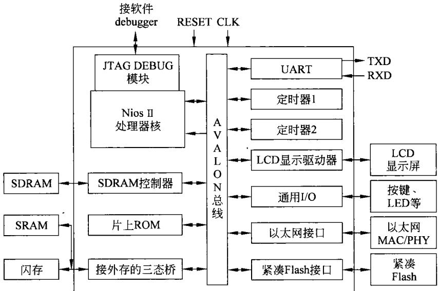  
图10-22以 NIOSⅡ为核心构成 SOC

设计过程需要有专门的开发平台支持，包括开发工具和开发电路板，其过程大致如下。

## （1）建立系统模块

QUARTUSⅡ软件支持下,建立SOC 系统的名称，设计者可自行定义,如Nios 32。

## （2）选用FPGA

进入SOPCBuilder,根据提示选择适合应用的FPGA。例如，选用EP1C6Q240C8，当使用32位Nios处理器时，其最高工作频率可达80MHz。

## （3）加人Nios处理器

在前面的界面下，选择32位的Nios作为处理器。而后，利用配置选择莱单选择Nios处理器的配置，对处理器进行多项必须的选择配置。

在这里，所设计SOC的片内总线是隐含确定了的，就是前面提到的Avalon总线。

加人Nios处理器后，工具软件会提供此时Avalon总线上处理器使用的接口。

## （4）加人监控程序的ROM

一般SOC系统中均需要上电的系统引导程序，而在调试SOC时需有小的监控程序的支持，以便于调试。因此，需要在系统中加人ROM(Flash）。

同时Altera为调试方便已准备好一个GERMS监控程序，此时可将此监控程序下载到ROM中，为将来调试所用。

## （5）加入通用异步收发器UART

这是一种异步串行通信接口，在软件工具的组件选择栏里，可以选择UART。当Nios32的主频为50MHz时，其最高速率为115200bps。接口的传输速率及通信时传送的数据格式都是可以设置的。

## （6）加人定时器Timer

同样，在软件工具的组件选择栏里，可以选择定时器Timer。在选择配置的界面上，可以选择定时器的各种参数。

## （7）加入键盘PIO

在组件选择栏里，可以选择加入键盘接口PIO，在选择界面上可以选择接口的位数、规定输人/输出的方向、是否采用中断、哪种方式有效等。

## （8）加入数码管PIO

与键盘接口PIO类似，可以设置7段数码管的相应设置。

（9）加入发光二极管LED的PIO

同样可以设置发光二极管LED接口。

## （10）加人Avalon三态总线桥

由于SRAM和闪存Flash的数据线是双向的，Nios处理器与它们相连接需要三态桥。通过组件选择器选择Avalon三态桥。实际上，可以认为此三态桥是在SOC中建立的外部存储器接口。也就是说大容量的存储器是接在SOC之外的。当然，若选用容量更大的FPGA，也可以将存储器放在SOC内部。不过，在这里是将SRAM和Flash接在外部的。

## （11）加入静态存储器SRAM

通过Avalon三态桥，可以设置外接SRAM。显然，外接SRAM的时序要满足Nios处理器的要求。

## （12）加入可擦写存储器Flash

同样，通过Avalon三态桥，还可以设置外接可擦写存储器Flash。

## （13）设置存储器地址

利用界面提示，设计者可以设定并调整存储器的地址。

## （14）设置 SOC的系统地址

设置系统的复位启动地址，显然这应当与前面的监控程序的ROM地址一致，以便在每次系统复位后都进人监控程序的管理之下。

同时，规定各接口的地址。Nios处理器的中断号可以自动分配或由设计者指定。

## （15）生成SOC系统

利用SOPCBuilder可以将前面的工作生成VHDL文件，该文件可用于QUARTUS Ⅱ进行编译。

## （16）编译SOC系统

将SOPCBuilder生成VHDL文件利用QUARTUS I进行编译。

在编译过程中需要对FPGA的引脚进行定义，锁定第几条引脚用于什么功能、是什么信号。例如，复位信号为Pin240、SRAM的读写控制信号分别是Pinl15、Pin116等。

当编译完成后，以Nios处理器为核心的SOC的设计工作已大部分完成了。

## （17）下载到FPGA

将编译好的文件通过开发板上的JTAG接口可以下载到FPGA上。这时的FPGA已成为所设计的 SOC,只不过它还需要认真调试、验证才能证明设计的正确与否。也就是说还需要做许多工作才能将此SOC设计成功。不过，有了开发系统的支持，完成后续的测试工作不是很困难的。

以上就是在开发系统支持下，基于FPGA的 SOC的设计过程。可以看到，在这样的设计思路下,处理器、内总线、存储器、多种接口均已由IP核的提供者准备妥当,SOC 的设计者只要拿来用就可以了。这将省去了多少麻烦事，试想，若要用本章前面所描述的VHDL语言开发功能如同Nios的32位处理器，谈何容易！即使开发一个简单的接口也要费很多时间和精力。而现在这种开发设计SOC的思路就简单多了，值得设计者重视。这就是IP集成！这就像想吃炒肉片不必从养猪开始，可以到超市去买配好的半成品，在超市已将炒肉片及各种原料全都配好，买回来后直接下锅，不要几分钟即可吃到炒肉片。

另外需要说明的是，上面的设计过程略去了许多细节，在真正设计SOC的时候必须注意这些细节。例如，UART接口要正常工作，除了数据格式、传输速率外，还有接收数据寄存器、发送数据寄存器、状态寄存器、通信控制寄存器等，要使用UART接口进行通信，测试该接口的功能，就必须用到这些寄存器。这就需要仔细地对这些寄存器进行设置。这也是前面所强调的，真正设计要 SOC还须做许多工作。

由于篇幅关系，上面上对 SOC的硬件设计进行了很简略的介绍，有关SOC设计的其他内容不再说明。

## 10.5基于可配置处理器的 SOC设计

上一节所提到的 SOC的设计方法里，处理器是作为一种IP核的形式直接调用，原则上讲这种处理器是事先设计好的、通用型的、功能（指令)不可改变的。尽管Nios处理器允许添加少量几条指令，总的来说，这类处理器是不可配置的。在本节里将说明基于可配置处理器的 SOC 设计。

## 10.5.1问题的由来

正如上面所描述的，在此之前的SOC都是用通用的处理器实现的。顾名思义，既然是通用处理器，原则上它能实现各种功能，能应付各种各样的应用要求。也就是说，以这样的处理器构成的 SOC什么都能做。事实上也是如此，以此SOC构成系统的基础上配上相应的软件，基本上可以做想让它做的任何事。

诚然，这种通用处理器构成SOC也有它的缺点。首先，通用处理器什么都能做，必然是什么都不精。因此，在针对完成某一种特定应用时，表现出速度慢、效率低。而且在完成这种特定应用时，通用处理器的其他大量的功能是闲置不用的。另外是通用处理器为满足其通用性，为追求功能的齐全，设计必定十分复杂，这就使得的构成的SOC芯片硅片面积大，功耗多。大的功耗对那些手持便携式电池供电的设备特别不利。第三是从头开始设计开发一种通用的处理器需要很高的开发成本。

鉴于上面的问题，人们在探求开发一种处理器的自动生成系统，能够根据设计者的特定需要，很方便地生成所要求的处理器，这就是可配置处理器的概念。到21世纪初已有这方面的商业化产品，并有多家公司的可配置处理器进入中国市场，其中最著名的就是Tensilica公司的可配置处理器Xtensa。另外还有 ARC公司和Improv System 公司的产品。

可以想象，利用厂家提供的处理器的自动生成系统，处理器的设计者完全可以根据不同的应用要求，很方便地生成专门适合自己所需要的处理器。也就是说，用户完全能够按照自己的应用需求设计有针对性的处理器一专用处理器。这就是可配置处理器。

Tensilica公司为其可配置处理器Xtensa提供了一系列的支持手段和工具，在公司提供的开发平台的支持下，按照用户自己的意愿，可以方便地定制处理器。在公司提供的资料中可以看到，利用Xtensa分别定制的用于消费类电子产品、电信类电子产品、网路类电子产品的专用处理器，由EEMBC(EDN嵌入式微处理器基准论坛)测试表明，Xtensa专用处理器在那些单项性能上比同时代时的主流嵌入式处理器（如ARM、MIPS等)高出几倍乃至百倍。同样,某一型号的.Pentium4采用130nm工艺，硅片面积为150mm²，其功耗达50W。该处理器各项功能(网络浏览、文字处理、图像处理等)都不错。但使用Xtensa配置专用的图像处理器，图像处理速度高于Pentium4，而硅面积只有1.5mm，功耗更低到只有0.1W。可见只针对图像处理，用可配置处理器比Pentium4要优越得多。

从上面的比较可以看出Xtensa可配置处理器的优势，这也是本书介绍这种处理器的原由。同时，这也是SOC设计的一种发展方向。

## 10.5.2 Tensilica Xtensa可配置处理器

上面提到进人国内市场的可配置处理器有多家，其中最好的要数Tensilica公司的Xtensa可配置处理器，下面将对该处理器做简要说明。

## 1.Xtensa可配置处理器

Xtensa可配置处理器是一个系列产品。Xtensa处理器在其基本配置的基础上，可以自由配置、可以灵活扩展并且能够自动生成。设计者能够根据特殊的应用灵活配置处理器，即对处理器结构进行相应的裁减，使处理器性能和特殊应用达到完美的结合。同时，利用Tensilica指令扩展(TIE)技术，可加人设计者自定义的指令及硬件辅助执行单元。Xtensa拥有300多项独立的配置选项，设计工程师可根据不同的应用选择恰当的功能进行组合。这些选项包括：乘法器、浮点运算单元、一个音频处理器、一个基本DSP引擎或一个4路VLIW(超长指令字)SIMD(单指令流多数据流)DSP引擎、处理器总线接口、MMU(存储器管理单元）、32个中断、优化的EDA脚本和操作系统支持等更多的选项。

## （1）Xtensa 的基本模型

Xtensa是一种RISC结构的32位处理器。Xtensa32位架构有5级流水线、32位ALU(算术逻辑单元)、高达64个通用通用寄存器、6个专用寄存器，其中一个32位的程序计数器，可实现32位(4G)的存储器寻址空间。可对内存实现字节、半字和字寻址。

Xtensa 的指令字长有两种16位和24位。指令包括读取、存储、条件及无条件转移、子程序调用及返回、算术/逻辑、移位、搬移及处理器控制等多类指令，共计有最基本的指令近80条。

随着技术的发展,Xtensa可配置处理器已发布了7代(Xtensa7及XtensaLX2)。后来者具备更高的性能和更低的功耗。

## （2）Xtensa处理器的可配置特征

Xtensa处理器给出了基本的结构及最基本的指令，设计者可以以此为基础对其进行重构。按照设计要求对处理器的硬件结构及指令重新进行配置，以满足应用的需要。图10-23表示了一个以Xtensa7可配置处理器构成系统的框图。

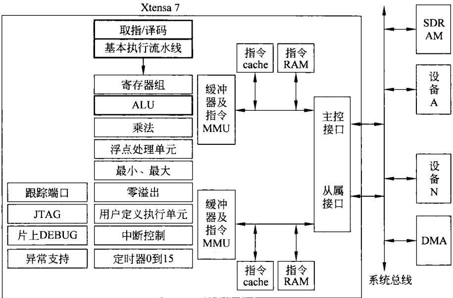  
图10-23可配置处理器Xtensa7结构框图

对于图10-23，要特别强调的是框中表示的是Xtensa7可配置处理器，该处理器中除了用粗黑线框起的部分之外，剩下的各部分全都是设计者可选用、可配置的。显然，多数设置是设计者能够自行配置的。

## 2.Xtensa的指令扩展技术TIE

开发者可从多个方面的技术途径优化这种配置的功能。从而，使利用该TIE的设计者可以描述非常复杂而效率又非常高的指令。

TIE允许使用者设置自己所需要的指令，指令的执行要用到寄存器、总线接口、存储器，也会涉及到外设接口。因此,TIE不仅允许使用者定义自己的各种指令，而且也允许使用者设置寄存器、接口等。

这里还需说明，在SOC片内总线互连时，尤其是在多个处理器以总线互联的方式构成SOC时，总线的传输速率将是非常重要指标。而TIE是一种描述语言，它是硬件描述语言Verilog的一个子集。TIE的主要用途就是使设计者能够利用这种语言来定制自己所需要的指令。下面可以看到，语言编译程序对总线的利用率便构成了系统的瓶颈。为了克服处理器总线所固有的局限性，Tensilica在Xtensa处理器中增加了另一个特性来消除总线瓶颈问题。这种新的特性称为TIE接口和队列技术。采样TIE接口和队列技术，设计者可以定义多达1024个接口直接与Xtensa处理器执行部件相连接。每个接口的宽度可以达到1024位。这种技术可以使系统以350000Gbps的速度与Xtensa处理器进行信息交换。从而可以充分满足所有处理器的输入/输出带宽需求。

TIE作为一种语言，由一系列的描述语句、参数、操作及语法等构成。有关TIE的细节不再做说明。下面用到TIE的具体语句时，只对语句做出解释。有关TIE的技术细节可查阅厂家的资料。

为了说明自定制指令，现举例如下。

regfile vec 128 8v   
operation vadd{in veca,in vecb,out vec c}{} {assign c=   
{a[127:96]+b[127:96],a[95:64]+b[95:64],a[63:32]+b[63:32],   
a[31:0]+b[31:0]};}   
operation vxor {in vec a,in vec b ,out vec c} {} {assign c=   
{a[127:96]^b[127:96],a[95:64]^b[95:64],   
a[63:32]^b[63:32],a[31:0]^b[31:0]};}

在上述程序中，首先用regfile语句定义新的内部寄存器组：宽度为128位，深度为8个。接着用operation定义了两条 simd 指令vadd 和vxor,分别完成128位数据的加法和异或运算。当然，上面所定义的指令只对128位的数据进行一次运算，若需处理多个这样的数据可利用设定的指令编写循环程序。

## 3.编译器XPRES

可配置Xtensa处理器能够让设计人员对处理器进行量身定做，以满足SOC设计中的特定任务。为此，Tensilica设计了一个称为XPRES的自动化定做工具，该工具可以对用C或者C++写的应用程序代码进行自动分析，然后转化为TIE定义并提交给Xtensa处理器生成器，进而产生所需要的处理器。

XPRES编译器采用三种技术来建立优化的Xtensa处理器配置：操作融合、单指令流多数据流SIMD和可变长度指令扩展FLIX。

## （1）操作融合

操作融合技术是把一系列简单而又相互有关联的指令合并成一条等价的指令。合并后的指令功能与前完全相同，这就能够消除读出、存储等许多对操作数的中间环节，使操作数共享与指令并行执行成为可能。例如，分析程序循环语句中简单操作出现的情况，XPRES编译器将这些指令序列合并成一条增强型指令，这种增强型指令通过减少循环内部的指令条数来加速程序代码的执行。

## （2）单指令多数据指令SIMD

应用程序中的许多循环语句对一个数据阵列(向量)执行相同的操作，XPRES编译器可以将这些循环语句进行向量化，建立一条由多个相同的处理部件，并行地处理多个数据项的指令。在许多应用中都会遇到这样的数据，例如数字图像处理、语音级信号处理、纠错编码等，处理向量数据都可用向量机或阵列机来实现。而在这里，是对Xtensa处理器增加

SIMD指令，实现对向量数据的加速处理，上面的TIE程序即可说明这种思路。同时，XPRES编译器能够将应用程序代码中的内循环展开并且进行向量化，通过向量化可以加速循环语句的执行。

## （3）可变长度指令扩展FLIX

为了提高速度，加强并行性处理，可以采用超长指令字VLIW。XPRES编译器采用的另一种加速程序代码执行的技术是类似于VLIW的FLIX技术。FLIX指令是一种类似于操作融合和SIMD指令的多操作指令。然而，FLIX指令由多个独立的操作组成，而操作融合和 SIMD指令则均为相关多操作。FLIX指令中的每一个操作都是和其他操作互相独立的，是将彼此独立的操作压缩成一条FLIX格式的指令，而这种压缩后的指令能够显著加速程序代码的执行速度。FLIX指令的长度是柔性可变的，可由指令的配置者自行决定其长度，故称为可变长度指令扩展FLIX。

可变长指令字FLIX的技术可以保证处理器每个时钟周期发射多个操作。该方法采用一个超长的指令字来对多个操作进行编码，有时每个指令字可以达到几百位，多个操作可以同时发射到处理器的多个执行部件。处理器的编译器负责找出应用程序代码中的指令级并行性，处理器编译器通常具有比较高的能力来识别程序中的并行性。和VLIW指令一样，FLIX指令可以将多个独立的指令操作进行编码，变成一个FLIX指令字，该指令字宽度为32 位或者64位。将FLIX指令分成若干部分，每一部分定义一组子指令，称为指令槽。一条FLIX指令可由用户指定为几个槽。例如具有三个槽的64位的FLIX指令格式如图10-24所示。

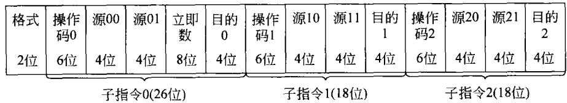  
图10-24FLIX变长指令编码示意图

由图10-24可以看，这条FLIX指令字长为64位，由三个槽组成。每一个槽都可以定义一个子指令集。定义一条包含三个槽的FLIX指令的TIE 程序如下。

```csv
1:format format1 64 {base_slot,ldst_slot,alu_slot}
2:slot Opcodes base_slot{ADD.N，ADDX2，ADDX4，SUB，SUBX2，SUBX4，ADDI.N,
3:AND,OR，XOR，BEQZ.N，BNEZ.N，BGEZ.N，BEQI，BNEI，BGEI，BLTI，BEQ，BNE，BGE，
4:BLT，BGEU，BLTU，L32I.N，L32R，L16UI，L16SI，L8UI，S32I.N，S16I，S8I，SLLI，SRAI，
5:SRA,SRL，SLL，J，JX，MOVI.N}
6:regfilex128 32 x
7:slot_opcodes ldst_slot{LOADx,STOREX}
8:immediate_range sim8 -128 127 1
9:operation LOADx{in x*a,in sim8 off，out x d}{out vaddr,
10:in memdataIn128}{
11:assign vaddr=a+off;assign d=memdataIn128;}
12:operation STOREX{inx*a,in sim8 off，inx s}{out vaddr，
13:out memdataIn128}{
```

14:assign vaddr=a+off;assign memdataOutl28=s;}  
15:slot\_opcodes alu\_slot{ADDX,ANDX，ORX}  
16:operation ADDx{inxa,inxb，outxc}{}{assign c=a+b;}  
17:operation ANDX {in x a ,in x b，out x c} {} {assign c=a&b ;}  
18:operation ORX{in xa,in xb，out x c}{}{assign c=a|b;}

由上面的TIE程序可以看到，程序设置了字长为64位的FLIX指令。该指令由三个槽组成，其中第一个槽规定的是Xtensa的基本指令。因为是基本指令，故程序不必再做说明。在说明第二个槽之前，定义了32个128位的寄存器组。第二个槽规定的是加载和存储指令，程序中只规定了两条指令（显然，还可以规定更多的指令）。一条是加载指令LOADX，其功能就是从寄存器加8位带符号偏移量所决定的存储单元中读128位数据到定义的寄存器中。同理，存储指令STOREX是将其128位寄存器的内容存储到寄存器加8位带符号偏移量所决定的存储地址中。第三个槽定义了三条128位的加、与及或指令。

值得说明的是每一个槽中必须设置一条空操作指令，以便保证可以设计出不用本槽指令的FLIX指令。

在 XPRES编译器的支持下，设计可配置处理器的设计流程如图10-25所示。

在图10-25中，系统的基本功能与配置可用C或C++来描述。由于C或C++是一般读者都很熟悉的，因此使用这种语言也是很方便的。系统的C/C++ 描述可由 XPRES 编译,XPRES在几分钟的时间里，经分析综合，可将其转换为TIE的处理器配置描述。

这时设计者可选择人工或自动将两者结合，使用TIE使设计方案最优化。

然后，利用Xtensa处理器的生成器产生处理器的最优配置，给出设计硬件及相应软件。此后便可进行系统仿真及调试。

如果设计的某些地方不能满足要求，还可以利用TIE添加和修改，直到达到要求，这时可以将设计制成芯片。

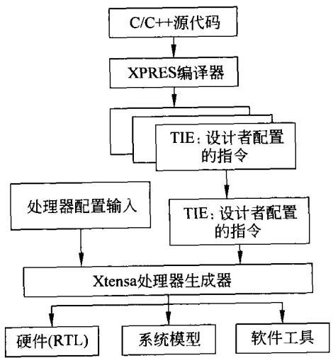  
图10-25利用XPRES编译器设计流程图

## 4.多处理器配置

在当今的应用中，很少只用一个处理器就能满足系统的性能要求，即使采用面向目标应用的可配置处理器有时也是很困难的。然而，利用集成多个可配置处理器于SOC中，就能够很容易达到高性能的要求。

SOC中，各处理器模块之间硬件互连机制的选择对系统性能和硅片成本产生很大影响，而且这些硬件互连机制必须直接支持多处理器系统设计的互连要求。在前面的内容中特别提到SOC的片内总线。利用片内总线及总线仲裁器可以将多个处理器连在一起，构成具有多个处理器的SOC系统。这种 SOC的结构形式也是目前经常采用的一种设计思路。

利用共享总线、共享存储器及共享接口构成的多机系统，在处理器对共享资源进行操作

时，总线必然会成为瓶颈，会直接影响到对共享资源的操作速度。

本书的前面已经提到，不使用共享总线还可以采用其他连接方式来克服上述问题。如多端口存储器、交叉开关等。在Xtensa可配置处理器中，除总线互联外,还可以采用下列方法互连，以期达到更高的性能。

## （1）直接接口互连

在Xtensa可配置处理器中,可以采用处理器直接通过接口相连的方式来减少通信开销和时间。这种连接方式将数据从一个处理器的寄存器传送到另一个处理器的寄存器和执行功能部件，直接互连的简单示意图如图10-26所示。

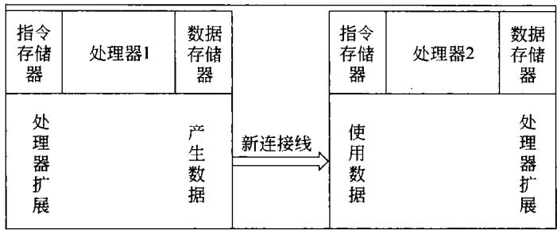  
图10-26处理器之间用接口直接连接示意图

由图10-26可以看到，当第一个处理器向输出接口寄存器写一个数据（通常作为计算的一部分)时，该数据将自动出现在另一个处理器的输入接口上，该数据可以立即由另一处理器进行相应的数据操作。

Xtensa可配置处理器可以利用TIE来设置这样的硬件接口，使处理器之间的数据传送速得到提高。

## （2）数据队列

处理器之间通信的最高带宽机制是利用数据队列的硬件来实现的。一个数据队列可以使系统获得每个时钟周期传输一次的数据速率，或者在宽操作数位数的情况下可以达到每秒7GB的传输速率。

Xtensa处理器允许数据队列作为指令集扩展的一部分直接利用硬件实现。数据队列可以通过一条专门指令来说明，队列既可以作为理器的结果也可以作为源输人队列来使用。利用数据队列这种形式的接口方式如图10-27所示。

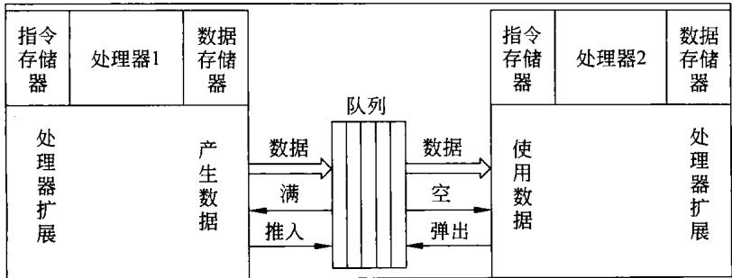  
图10-27处理器之间采用硬件队列示意图

在系统工作过程中，处理器1的数据可用一个时钟周期推入队列。同样，处理器2会直接利用队列的数据。

在采用数据队列方式传送数据时，会对任务间的性能产生一定的影响。如果数据队列的产生和使用的速率高度一致，那么队列长度可以比较短。如果队列产生和使用的速率具有很大的可变性，那么需要设计深度深的队列来解决二者速率之间的失配问题。

由于处理器执行部件的队列接口对处理器核具有极其重要的意义。因此对队列接口机制进行简单地说明。数据队列接口通过如下TIE语法格式添加到Xtensa可配置处理器中。

queue inlout

上面语法格式定义了数据队列的名称、宽度和队列的方向。一个Xtensa处理器可以包含多达1024个接口直接与Xtensa处理器执行部件相连接。每个队列宽度可以高达1024位。设计工程师可以采用数据队列来对处理器性能进行折中，即在快速、窄带处理器接口和慢速、宽带接口之间进行折中以获得系统高带宽和高性能的目的。

数据端口和数据队列与可配置处理器执行部件直接相连，这种互连允许处理器应用数据流直通技术进行处理，而在以前这种功能是利用手工编写的RTL代码逻辑块实现的。将数据队列和输出队列接口与设计者定义的执行部件相结合就可以建立一个在处理器内部由固件控制的处理模块，该模块可以从输入数据队列中读取数据，对这些数据执行计算，然后按照流水线方式每完成一个“输入-计算-输出"这样的周期将计算结果输出。

即使在处理器扩展中使用大量的硬件，但对设计者来说是透明的。设计者只需要利用TIE写出相应的语句，具体硬件的配置是由生成器自动完成。因此，对设计者而言，在定义时也只是仅仅写出几行TIE代码而已。下面是一简单的例子。

queue InDatal 256in   
queue InData2 256 in   
queue OutData 256 out   
operation QADD{}{inInDatal，inInData2，inSumCtrl，outOutData}{assign OutData   
=SumCtrl ？（InDatal+InData2）:InData1；}

前三行代码定义了二个256位的输人队列和一个256位的输出队列。第4行定义了一条新的处理器指令QADD，该指令执行256位的加法运算或者将256位的数据从输人队列送到输出队列。通过TIE语言定义的指令会使得Xtensa处理器生成器自动为处理器增加相应的硬件，同时为处理器软件开发工具增添一条新指令。

可配置处理器的出现使得SOC设计者可以建立起一种崭新，而且非常灵活的硬件模块构建方法。与传统的固定指令集架构处理器相比，可配置处理器通过添加用户定制的执行功能部件、寄存器和寄存器堆以及专用通信接口能够获得很高的系统性能。

由于可配置Xtensa处理器能够让设计人员对处理器进行量身定做以满足片上系统SOC中的特定任务，Xtensa处理器生成器同时可以针对特定配置和扩展，自动生成完整而有效的软件工具，包括编译器、指令集仿真器、调试器、操作系统接口等软件环境。在处理器配置信息完整的情况下，处理器生成器可以在很短的时间内(以小时计)生成一颗新处理器的RTL设计和软件环境。

就目前情况来看，短时间内，标准处理器和可配置处理器将共存，SOC的设计者可以根据设计任务的要求进行选择。长久看来，可配置处理器因为其可以进行架构的配置和扩展，在性能、功耗的方面的诸多优势，故而能更加适应今后技术发展的多种应用的需求，从而得到越来越广泛的应用。

当本章结束的时候，要说明的是在有限篇幅里只简单介绍处理器(CPU)、通用SOC及可配置处理器下的SOC设计问题。而且仅仅提出设计过程的概念、思路及方法，为读者建立有关的概念。还有大量的细节问题未能涉及，将来读者要进行SOC设计时还应参考其他资料。

## 习 题

1．说明软IP核与硬IP核的不同。

2．说明设计数字系统的三种方法。

3．描述EDA软件工具的分类。

4．在VHDL语言中，系统设计的层次化设计的含义是什么？

5．说明利用VHDL语言设计数字系统的设计流程。

6．说明利用QUARTUSI进行设计开发的大致步骤。

7．用VHDL语言编写4-16译码器程序。

8．用VHDL语言编写带有三态输出的D触发器程序。

9．依据本章中对指令及寻址方式定义，分析指令ADD AX,[SI];INC［DI],RET指令的执行过程。

10．说明本章里CPU顶层设计的主要内容。

11．说明SOC的含义，解释其各组成部分。

12．说明基于 SOC设计计算机系统的两种方法。

13．说明设计SOC的三种方法。

14．敘述基于FPGD的 SOC设计的过程。

15．描述VSIA提出的SOC内部总线的层次化结构以及对片内总线的基本要求。

16．简述IP核的设计过程。

17．目前国内正在研制的IP核主要有哪几个方面？

18．说明目前常用于SOC设计的处理器IP核有哪几种，它们的大致性能如何？

19．说明在Altera的QUARTUSⅡ为支撑平台下，利用Nios处理器软核设计基于FPGA的 SOC 的大致过程。

20．解释采用可配置处理器的原因。

21．说明 XPRES 编译器采用三项技术来优化Xtensa 处理器配置的具体技术内容。

## 参考文献

[1]常振启译.小型计算机系统接口(SCSI),计算机与信息处理标准化，NO.2,3,4,1990

[2]李伯成等.计算机组成与系统结构.北京：清华大学出版社,2010

[3]张毅忠等.微型电子计算机及外围设备电路图集.广州：广东科技出版社，1989

[4]侯伯亨，李伯成.十六位微型计算机原理.西安：西安电子科技大学出版社，1991

[5]沈美明等.IBM(0502)汇编语言程序设计，北京：清华大学出版社，1987

[6]李伯成等.IBMPC系列微机开发与应用.西安：西安电子科技大学出版社,1992

[7]陈谊等译.Intel系列微处理器结构、编程和接口技术大全.北京：机械工业出版社.1998

[8]胡汉才.单片机及其接口技术．北京：清华大学出版社,2000

[9]邵贝贝等译.嵌人式实时操作系统．北京：航空航天大学出版社,2003

[10]孙玉芳等译.嵌入式计算机设计原理．北京：机械工业出版社,2002

[11]王田苗.嵌入式系统设计与实例开发．北京：清华大学出版社,2002

[12]探矽工作室.嵌入式系统开发圣径．北京：中国铁道出版社,2003

[13]Intel:Mcs-51 Family of single chip Microcompufers user's Manual,1981

[14］裘雪红等.微型计算机原理及接口技术(第二版)．西安：西电科大出版社,2007

[15]白中英.计算机组成与体系结构(第三版)．北京：科学出版社,2006

[16]潘松等.SPOC技术实用教程．北京：清华大学出版社,2005

[18]侯伯亨等.现代数字系统设计．西安：西安电子科大学出版社,2004

[19]汤志忠等.开放式实验CPU设计．北京：清华大学出版社,2007

[20]任艳颖等.IC设计基础．西安：西安电子科技大学出版社,2003

[21]马光胜等.SOC设计与IP核重用技术．北京：国防工业出版社,2006

[22]吴武臣等译.复杂 SOC设计．北京：机械工业出版社,2006

[23]姜雪松等.VHDL设计实例与仿真．北京：机械工业出版社,2007

[25]Altera Corporation： Avalon Bus Speccification Reference Manual. 2003

[26]郑纬民等.计算机系统结构(第2版)．北京：清华大学出版社,2004

[27]李学干.计算机系统结构．西安：西安电子科大学出版社,2002

[28]王闵.计算机组成原理．北京：电子工业出版社,2001

[29] William Stallings. Computer Organization and Architecture:Designing for Performance.5'h edition(影印版)北京：高等教育出版社，2002

[30]Paterson,D.A..Computer Organization and Design.3 edition（影印版）北京：机械工业出版 社,2006

[31]白中英.计算机组成原理(第三版).北京：科学出版社，2004

[32]王爱英.计算机组成与结构(第三版)．北京：清华大学出版社,2007

## 内容简介

本书系统地介绍计算机系统的基本组成及基本的工作原理、计算机的运算原理及构成计算机的各组成部分的工作过程与设计。内容包括计算机中数据的表示基本的运算方法与运算器的构成，处理器的指令系统、寻址方式及控制器的构成等基础知识，阐述构成计算机的各组成部件（处理器、总线、存储器、输入输出技术与设备）。书中还讲述了流水线技术，多处理机系统及如何设计计算机等内容。同时，本书的内容还涵盖了全国硕士研究生入学考试大纲要求的内容。

本书内容充实、简明扼要、重点突出。可作为高校理工科专业“计算机组成原理”或“计算机组成与系统结构”课程的教材，也可为从事计算机行业的一般工程技术人员提供参考。

ISBN978-7-302-24463-9


定价：45.00元
