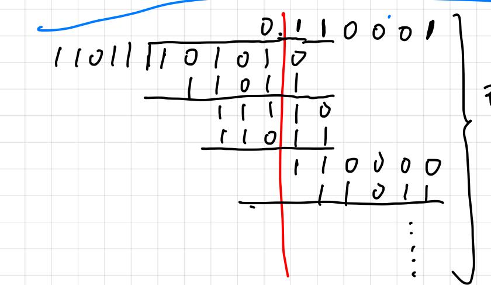
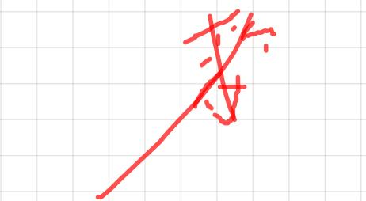

做加武交替除法或补存法时，

当商尾数为时，杀数为多少？

<table><tr><td colspan="2">符号</td><td colspan="8">被除数（余数） 操作</td></tr><tr><td>0</td><td>0</td><td>1 0</td><td>1</td><td>0</td><td>1</td><td>0 0</td><td>0</td><td>0</td><td>商</td></tr><tr><td>0</td><td>1</td><td>0</td><td>1 0</td><td>1</td><td>0 0</td><td>0</td><td>0</td><td>0</td><td>左移一位 1</td></tr><tr><td>1</td><td>1</td><td>0 0</td><td>1</td><td>0</td><td>1</td><td></td><td></td><td>0</td><td></td></tr><tr><td>0</td><td>0</td><td>0 1 1</td><td>1</td><td>1</td><td>1 0</td><td>0 0 0 ·</td><td>0 0 0 0</td><td></td><td>R≥0，商为1 左移一位</td></tr><tr><td>0 1</td><td>0 1</td><td>1 0 0</td><td>1 1</td><td>1 0</td><td>0 1</td><td></td><td></td><td></td><td></td></tr><tr><td>0</td><td>0</td><td>0 0</td><td>0</td><td>1</td><td>1</td><td>0 0</td><td>·· 0</td><td>1 1</td><td>R≥0，商为1</td></tr><tr><td></td><td>0 0</td><td>0</td><td>0 1</td><td>1</td><td>0</td><td>0 0</td><td>1</td><td>1 1</td><td>左移一位</td></tr><tr><td></td><td>1 1</td><td>0 0</td><td>1</td><td>0</td><td>1</td><td></td><td></td><td></td><td>-IYI</td></tr><tr><td></td><td>1 1</td><td>0 1</td><td>0</td><td>1</td><td>1 0</td><td>0</td><td></td><td>1 0</td><td>R&lt;0，商为0</td></tr><tr><td></td><td>1 0</td><td>0 1</td><td>1</td><td>1</td><td>0 0</td><td>1</td><td></td><td>0</td><td>左移一位</td></tr><tr><td>0</td><td>0</td><td>1 1</td><td>0</td><td>1 1</td><td></td><td></td><td></td><td></td><td>+YI .</td></tr><tr><td>1</td><td>1</td><td>1 0</td><td>0</td><td>0</td><td>1 0</td><td></td><td></td><td>0</td><td>R&lt;0，商为0</td></tr></table>

$$
\_ { \ / { 1 0 0 0 1 \times 2 ^ { - } } } = \_ { 0 . \ 1 1 0 0 0 1 \times 2 ^ { - } } \ \mathtt { Z } \_ { \ / { 2 0 } \_ { 1 } 1 1 0 0 } , \quad \mathtt { A } \_ { \ / { 3 0 } \_ { 0 } } \mathtt { \_ { 1 } } \mathtt { \_ { 0 } } \_ { 1 } \mathtt { 0 } \_ { 0 } 1 \times 2 ^ { - } \mathtt { d } \_ { \ / { 3 0 } \_ { 0 } } .
$$

这足错的!!！

红除法

不育0区是0.10

是0.100，手救命是21x

$$
x = - 0 . 1 0 1 0 1 , y = 0 . 1 1 0 1 1
$$

$$
\times \vert 3 \vert = 0 . 1 0 1 0 1 , ( \times 7 7 3 ) = 1 1 . 0 0 1 0 1
$$

$$
y _ { i } = 0 0 . 1 1 0 1 1
$$

$$
\frac { 1 0 0 1 0 1 0 1 } { 1 1 0 0 1 0 1 0 }
$$

当商尾救为0时，

手殺是最匠一次商1时

的!!!!!

这不是手数

$$
= - 1 - 1 + 1 + 1
$$

这也不爱手数

$$
\Rightarrow \frac { 1 } { \sqrt { 2 } } = 0 . 1 0 0 , \frac { 3 } { \sqrt { 2 } } = 0 . 1 1 \times 2 ^ { - 2 }
$$