# 新综合模一模焊接复印部，(还像写斜对面)

的：最大计数值为\_\_\_\_。

13. 可编程定时/计数器 8253 有 一个独立的计数器；每个计数器都是 \_\_\_\_ 应

送数据位，并且总是\_\_\_\_\_\_\_ $^{位在前}$ \_\_\_ $^{位在后}$ ，最后发送的高电平的\_\_\_\_\_\_\_ $^{位。}$ 。

12. 易步串行通信，每传送一个字符，总是首先发送1位低电平的\_\_\_\_位、接着发

和

11.8086CPU响应NTR请求需同时满足多个条件，其中有

10. 内总线的标准有多种,其中常见的有\_\_\_\_、\_\_\_\_、\_\_\_\_等。

• 故除

三 0 水体中，摩擦的夹手型有形，冠后密（AlVd）

、四种连接方式。

8. 在构成多机系统的互连网络时，所用到的的2×2开关有

7. 计算机系统中，磁盘接口总线有 \_\_\_\_；\_\_\_\_ 等。

度的定义为\_\_\_\_。

6. 赞益的道德度的定义为：位置

5. RAID2敏感阵列的含义是\_\_\_\_。

4. 若要使多个中断源具有相同的优先级，可采用的方法来实现。

3. 计算机中，内存与接口地址编此有 \_\_\_\_ 利 \_\_\_\_ 两种方式。

2. Cache 工作中，常用的数据一致性方法有 法和 法。

计算机中设置Cache的依据是。

1. 在主存和 CPU 之间增加 cache 存储器的目的是

一、填空题（每空1分，会对30空即可，本题共30分）

班级：…… 学号： 性名： 任课教师

1. 考试形式：网络；2. 考试日期：2010 年 月 日 3. 本试卷共七大题，满分 100 分。

<table><tr><td>分数</td><td></td><td></td><td></td><td></td><td></td><td></td></tr></table>

<table><tr><td>题号</td><td>一</td><td>二</td><td>三</td><td>四</td><td>五</td><td>六</td><td>七</td><td>总分</td></tr><tr><td>分数</td><td></td><td></td><td></td><td></td><td></td><td></td><td></td><td></td></tr></table>

《计算机组成与结构II》 试题

地址:老综合楼南方造型内(亲邸书店旁)

专业需要(价值优质选取)


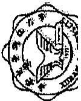

西安电子科技大学

# 计算机组成与结构

五、某计算机CPU的主帧为500MHz，CPI为6dB平均每条指令的执行周期为5个时钟周期。若某外设的数据传输速率为0.5MB/s，采用中断方式与主机进行数据传送，以32位为传送单位。对应的中断服务程序包含18条指令，中断服务过程中的其他开错相当于2条指

# 四. 画出对称多处理机系统的结构框图并说明其中的三个特点。(本题10分)

<table><tr><td>000</td><td>0C9H</td><td>00B</td></tr><tr><td>001</td><td>574H</td><td>01B</td></tr><tr><td>010</td><td>244H</td><td>10B</td></tr><tr><td>011</td><td>76EH</td><td>11B</td></tr><tr><td>100</td><td>76EH</td><td>10B</td></tr><tr><td>101</td><td>373H</td><td>10B</td></tr><tr><td>110</td><td>0C9H</td><td>00B</td></tr><tr><td>111</td><td>488H</td><td>00B</td></tr></table>

3. Cache-MN 阶级存储器采用图形相嵌映像（机间直读，组内全相联）。若 Cache 空且为 5128, 64 个字为一块，且共分为 2 个级。主存存其是 Cache 空且 2048 后。1. 主存区号 位，风内编号 位，组内块号 位，块内地址 化 位。每次进行 M-N-Cache 的地址变换时，需要参与相比较的位数是 2 若 Cache-MN 地址变换表的内容如下表，当 CPU 访问主存的地址分别为 9118H 和 OECDBAH 时，目的是可能命中 Cache，若能命中，指出相应的 Cache 地址。（每小题 5 分，此题共 10 分）

4. 说明中断控制器 8259 一极全极套（固定优化级）的含义。

2. 共硬磁盘有5个记录面，其余半径4cm，内半径1cm，道密度为10000道/mm，齿密度为10000bit/mm。试计算该硬磁盘的非格式化容量。
3. 若外部计数时钟为1MHz，说明如何利用一片可编程定时器8253，产生周期为1秒的对称方波。

1、简述在8088CPU上，外部非屏蔽中断NMI的响应过程。

三、简答题（每小题5分，本题共20分）

16. 现在市场上所见到的多核处理器是属于结构。

指令和\_\_\_\_指令。

15. 计算机中，接口与外设之间有三类信号，它们分别是\_\_\_\_。

制字写入——米实现的。

14. 可编程并接口 8255 有 神工方式，C口的校位操作是通过相接位操作控

# 新综合模一模焊接复印部（边德写斜对面）

(2) 则用上题的连接图, 若外设插出小于 96 度则使 CTL 为 1, 若不小于 96 度, 则使 CTL 为 0, 试填写此控制程序。(编程时 8255 不需要初始化, 赋认为 8255 已初始化好)

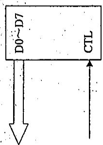

<details>
<summary>flowchart</summary>

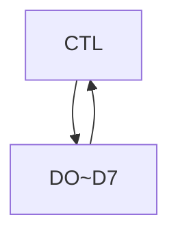
</details>

七、某外设如下图所示，其中D0\~D7可输出二进制铜的温度值，CTL为控制输入端，可控制其温度上升或下除。（每小数5分，本题共10分）（1）若接口地址8000H到800FH可随意使用，或利用8255将该外设接到系统总线上，四山连接图。

(1) 若每隔 3△1 向该流水线提供一个数据，连续提供 4 个。四出该流水线处理过程的时空图。(2) 许算此流水线的加速比和效率。

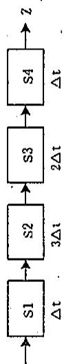

<details>
<summary>flowchart</summary>

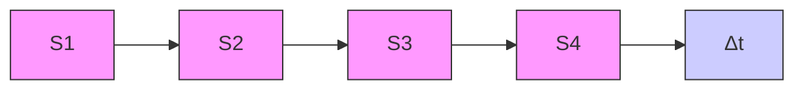
</details>

六、某流水线分为4段，如4图所示。（每小题5分，本题共10分）

令的执行时间。同卷下列问题并给出计算过程。（每小题5分，本题兴10分）

1. 在中断方式下，CPU用于该外设I/O时间占整个CPU时间的百分比是多少？

2. 当该外设的数据传递率达到5MB/s时，改用DMA方式传送数据。假定每次DMA传递的数据被为5000B，且DMA预处理及后处理的总开销为500个钟局周期，则CPU用下列外设I/O时间占整个CPU时间的百分比是多少？

# 专业照相 (价低 优质 速取) 地址:老综合楼南方造型内(秦琼书店旁)

# 参考答案及评分标准

一.（意思对即可给分）1. 使计算机既具有低的价格又发挥出了CPU的高速度；程序执行及数据访问的局部性原理。

2. 写问法 全写法

3. 内存与接口统一编址、内存与接口独立（隔离）编址

4. 自动循环优先级

5. RAID2 为位交叉海明编码阵列

6. 沿磁盘半径方向，单位长度内磁道的数目：最靠近盘中心的磁道上单位长度内存储的二进制位的个数

7.: SCSI、ATA、SAS、SATA、USB、IEEE-1394（任意二个均可）

8. 直通、上播、下播、交叉

9. 写后写（WAW）；写后读（WAR）

10. PC/XT、ISA、EISA、PCI、STD、CPCI、VESA（任意三个均可）

11. 一条指令执行结束；IF=1；没有比它优先级更高的请求存在；不是一条特殊指令 STI 或 IRET（任意二个均可）

12. 启动；低；高；打止

13. 三; 16; 65535

14. 三：控制寄存器

15. 数据、状态；控制

16. 对称多处理（器）机 SMP

\-

1. CPU 在一条指令执行结束时，检测 NMI 发生。CPU 内部硬件电路自动产生该中断的中断向量码 02H。（到此 1 分）接着就将 F、CS 和 IP 压入堆栈保护起来，并关中断。而后，将中断向量码 02H 乘 4 得到中断向量表地址（到此 3 分），从该地址开始的顺序两个单元的内容送 IP，下两个单元的内容送 CS。这就转向了中断服务程序。当然，在此之前，中断服务程序的入口地址早已填入中断向量表 0008H 到 000BH 中。（到此 5 分）

2. 容量=5×30×10000×2π×10×10000=942Gbit（注此处K=1000）

因为计数时钟为 1MHZ，而每个计数器的计数值是 16 位的。因此，一个计数器的最大计数时间只有 65.5mS 左右，无法满足要求。但 8253 有三个计数器，可以串联使用以解决问题。（到此 1 分）

例如，将时钟接到 CLK0 上，使 GATE0 有效（高电平）并将 OUT0 输出接到 CLK1 上做为计数器 1 的计数时钟，并使 GATE1 为高电平。这就将计数器 0 和计数器 1 串到一起。可使计数器 0 工作在方式 2 或方式 3，使其输出连续的脉冲。使计数器 1 工作在方式 3。且使两计数器的总计数值为 $1000 \times 1000$ ，可以使计数器 0 的计数值均为 1000，则 OUT0 的输出就是周期为 1ms 的对称方波或窄脉冲。使计数器 1 的计数值为 1000，则 OUT1 的输出即为周期 1 秒的对称方波。（到此 5 分）

4. 中断控制器 8259 的固定优先级规定 8259 所管理的个中断源（IR0～IR7）的 IR0 的优先级最高，IR1 次之，优先级依次降低，直至 IR7 优先级最低。并且，这一优先级

# 新综合模一模焊接复印部（边筏型料对面）

六. (1) 画出时空图如下: (画对图即可给5分)

1. 每中断一次，传送 48 用去 20 条指令的执行时间，即每个字符为 5 条指令的执行时
间。则传送 18 离 25 个时钟周期，即 50ns。  
- 外设要求每秒500KB的传递速率，利用中断方式所用时间约为25ms。因此，CPU用于该外设I/O时间占整个CPU时间的百分比是 $25/1000=2.5\%$ （每小题5分）  
2. 利用DMA传递5000B只需500个时钟周期1000ns，平均每1B只需0.2ns。同时，外设的传送速率为SMR/s，则需时间为1ms，故此种方式以CPU用于该外设1/0时间内整个  
CPU时间的百分比是1/1000=1%。(每小题5分)

·亚

2. 多个处理机通过总线或其他交互方式连接在一起。上图中，是利用系统总线将这些  
处理机迹在一起。  
3. 多个处理机共享同一主存隔离器。并且，每一个处理机访问主存隔离器的时间是相同的，也就是一致的。  
4. 所有的处理机通过相同的通道或不同的通道共享10设备。  
5. 每一处理机能能完成相同的功能，这或许是对称多处理机中对称的由米。  
6. 整个对称多处理机系统是在一个集中的操作系统统一管理下工作。操作系统能够为每一处理机按排过程或线程，对各处理机的工作进行统一地调度与控制。  
2. 多个处理机通过总线或其他方式连接在一起。上图中，是利用系统总线将这些  
处理机迹在一起。  
3. 多个处理机共享同一主存储器。并且，每一个处理机访问主存储器的时间是相同的，也就是一 致的。

对称多处理机系统结构
由图可以看到，构成的SMP中包含多个处理机。SMP最常见到的实例就是目前“为使

用的双核、四核等多核计算机。对称多处理机系统具有如下特点：（答对下面三个特点即可给5分）

1. 这样的系统是由两个以上的多个相同的处理机制成。

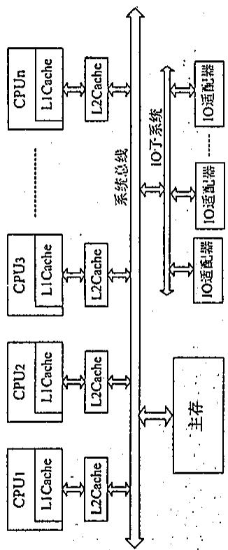

<details>
<summary>flowchart</summary>

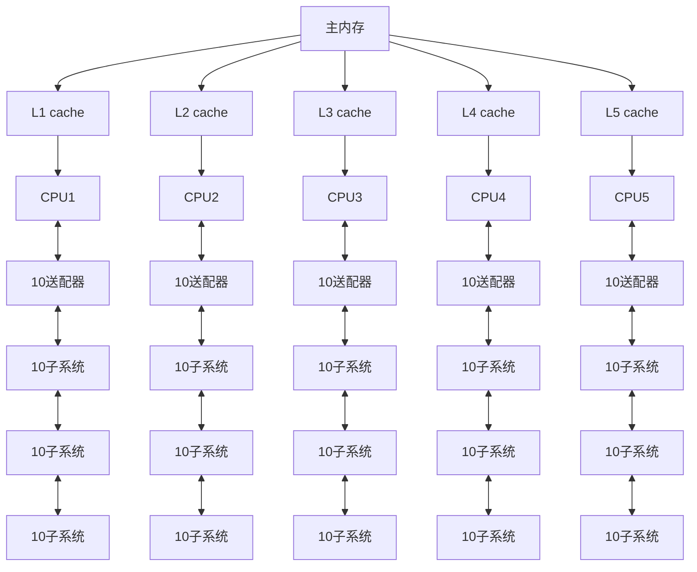
</details>

四. 对称多处理机系统的结构框图加图 $^{4}$ . 所示。(面对框图即可给 5 分)

三. (每小题5分。若结果错，有分析，分析时为3分。)  
1. 11位，1位，2位，6位， $13 \times 2 = 52$ 位(对一空1分)  
2. 9118H 命中，对应的 cache 地批 1D8H；OEDCBAH 地批水命中 (对 5 分)

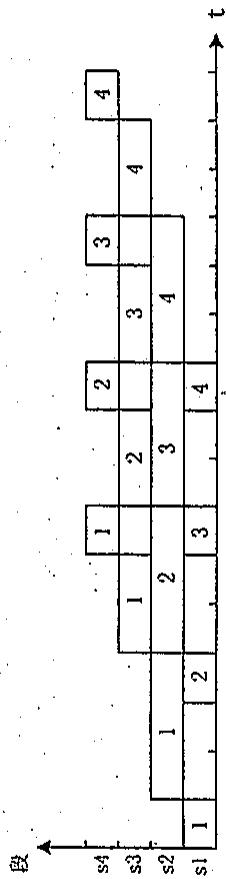  
(2) 顺序计算的时间为 $4 \times 7\Delta t = 28\Delta t$   
利用流水线为 $16\Delta t$   
故加速比 $\mathrm{Sp} = 28 / 16 = 1.75$ （此小题3分）

效率为： $\eta = (4\times 7\Delta t) / (4\times 16\Delta t) = 28 / 64 = 44\%$   
(以上全对5分)  
(1) 画出连接图如下：（译码对2分，其他连线对3分，共5分）  
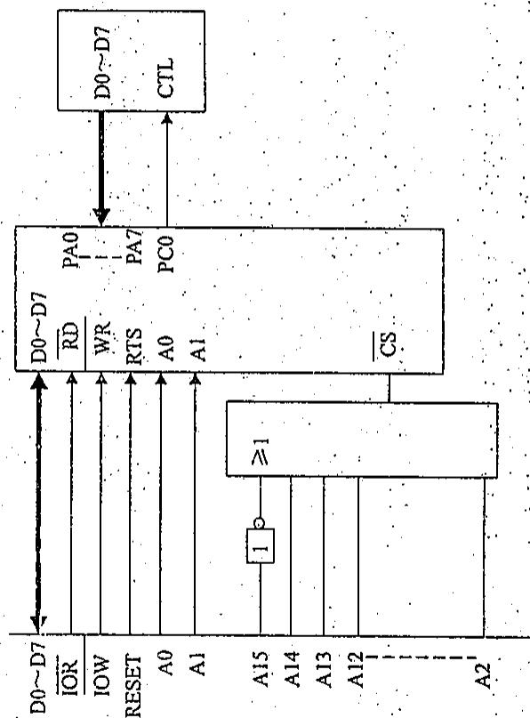

<details>
<summary>flowchart</summary>

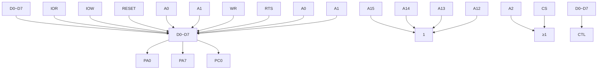
</details>

4. 程序如下：（程序思路对4分，指令错扣1分）  
MOV DX, 8000H   
IN AL, DX   
CMP AL, 96   
JNC .THIGH   
MOV DX, 8002H   
MOV AL, 01H   
OUT DX, A   
JMP CONTL

# 专业照相 (价低 优质 速取) 地址:老综合楼南方造型内(秦琼书店旁)

THIGH: MOV DX, 8002H   
AL 00H   
DX. AL   
CONTI   
THIGH: MOV   
MOV   
out   
JMP

第1页共9页

8. 程序计数器 PC 的位数决定于（）。

A. 金相联联像 B. 直接联像 C. 组相联联像 D. 无法确定

7. Cache 的地址映像方式中块冲突最小的是（）。

A. 顺序读写存储器 B. 半导体存储器 C. 随机读写存储器 D. 易失性存储器

6. 下列选项中不能用于描述计算机主存的是（）。

A. 无法实现减法 B. 进位传递延迟 C. 门电路的级延迟 D. 无法判断退出

5. 行读进位加法器的最大缺口在于（）。

A. 位 B. 字节 C. 字 D. 双字

4. 对于大多数计算机来说，（）是最小的可导性存储器单位。

$C_{\cdot}-(1-2^{-8}) \times 2^{63} \sim 2^{63}$

A. $-2^{63}\sim(1-2^{-8})\times2^{63}$ B. $-2^{64}\sim(1-2^{-8})\times2^{64}$

3. 共浮点数格式如下：7位阶码（包含一个符号位），9位尾数（包含一个符号位）。若阶码用移码、尾数用外码表示，则浮点数所能表示的范围是（）。

A. 原铝 B. 反铝 C. 外铝 D. 移铝

2. IEE754浮点数的尾数用（）表示。

A. 二进制 B. 程序和数据存储在一起

1. 下列选项中不属于四.请恢复计算机特点是（）。

<table><tr><td>1.</td><td>2.</td><td>3.</td><td>4.</td><td>5.</td></tr><tr><td>6.</td><td>7.</td><td>8.</td><td>9.</td><td>10.</td></tr><tr><td>II.</td><td>12.</td><td>13.</td><td>14.</td><td>15.</td></tr></table>

一、单项选择题（共30分，每小题2分，答案写在下表中）

请将所有答案写在试卷上，写在答题纸或草稿纸上的答案无效。

班级 学号 姓名 任课教师

1. 考试形式：因卷；2. 考试日期；3. 本试卷共7大题，满分100分。

<table><tr><td>题号</td><td>一</td><td>二</td><td>三</td><td>四</td><td>五</td><td>六</td><td>七</td><td>八</td><td>九</td><td>十</td><td>总分</td></tr><tr><td>分数</td><td></td><td></td><td></td><td></td><td></td><td></td><td></td><td></td><td></td><td></td><td></td></tr></table>

# 试

考试时间 120 分钟

西安电子科技大学

第2页共9页

。

是：采用虚拟存储器的目的；

4. 计算机存储系统中，采用高速缓冲存储器的目的

址O81FH所在芯片的最小地址为\_\_\_\_。

3. 用若干片容量为2K×4bit芯片构成8K×8bit的存储器，地址从0000H开给。则地

度则取决于。

2. 在规格化浮点数中，浮点数的数值范围主要取决于：而精

制真值分别为\_\_\_\_，\_\_\_\_，\_\_\_\_。

1. 若 80H 分别表示整数原码、整数补码、整数反码和整数移码时，则其对应的十进

C. 采用并行处理技术。D. 采用更先进的硅加工制造技术

A. 提高 CPU 主频 B. 扩大主存容量

A. mT B. T/2m C. 2mT D. T/m

流水线 CPU 稳定连续工作时每隔（）可流水完成一条指令。

14. 设一条指令完成时间为T，若将其分解成时间相等的m个子过程构成流水线，则

A. 20 MB/S B. 40 MB/S C. 60 MB/S D. 80 MB/S

13. 总线位宽为 16 位，时钟频率为 100MHz，若总线上每 5 个时钟周期传递一个 16 位的字，则该总线的带宽为（）。

A. 存储器 B. 建 C. 宿存器 D. 推枝

12. 为了实现多级中断，保存现场最有效的方法是采用（）。

D. 当乘数中连续两位是 01 或 10 时，进行加法和移位运算。

C. 当乘数中有连续的1或连续的0时，进行移位运算。

B. 当乘数中连续两位是 01 或 10 时，进行加法运算。

A. 当乘数中有连续的1或连续的0时，进行加法操作。

11. 一位Booth法是一种较好的乘法算法，其速度较快，这是因为（）。

A. 指令周期 C. 节拍周期 D. 时钟周期 B. CPU 周期

10. 一般情况下，时间最短的是（）。

A. 间接导址 B. 直接导址 C. 守存器导址 D. 相对导址

9. 下列导扯方式中取得操作数最快的是（）。

D. 数据总线的宽度

B. 可导扯的最大内存空间

A. 机器字长

3. 在上一步的基础上，试说明读写主存地址为02001H时是否命中？为什么？

2. 分析主存中顺序排列的第1024块（即若主存不分区，以第0块开始顺序排列时）应调入到cache的哪一块中？

1. 主存储器和cache.地处应如何划分, 每部分备需多少位?

三、(8分)设一直接映像方式的Cache容量为8KB, 以16B分块。主存储器容量为512KB。

10. 其计算机指令字长 16 位，有单地址和双地址指令两类，用扩展操作码技术。若每个地址字段均为 6 位，且双地址指令有 12 条，则单地址指令最多有一条。

结束时。

9. CPU响应中断请求发生在 \_\_\_\_ 结束时；CPU响应DMA请求发生在

8. 英 Web 服务器系统，采用新的 CPU 以提高其性能，新的 CPU 处理 Web 计算的运行速度是原来处理器的 10 等，同时假定此 CPU 有 40% 的时间用于计算，另外 60% 的时间用于 I/O 操作，则根据 Amdali 定律，增强性能后总的加速比是。

6. 互连网络是指由\_\_\_\_按照一定的拓扑结构和控制方式构成的网络。

为：

5. RAID 主要使用三种技术实现数据的存储，分别

<table><tr><td>X + Y</td><td></td></tr><tr><td>X - Y</td><td></td></tr><tr><td>X + Z</td><td></td></tr><tr><td>浮点数</td><td>阶码(含1位符号) 屁数(含1位符号)</td></tr></table>

X + Y 的结果是否应进行规格化？（是、否）。  
X - Y 的结果是否应进行规格化？（是、否）。  
最终的结果为:

$\lambda - X$

<table><tr><td>评点数</td><td>阶码(含1位符号)</td><td>尾数(含1位符号)</td></tr><tr><td>X</td><td></td><td></td></tr><tr><td>Y</td><td></td><td></td></tr></table>

对阶后的X和Y为：

<table><tr><td>字点数</td><td>阶号(含1位符号)</td><td>尾数(含1位符号)</td></tr><tr><td>X</td><td></td><td></td></tr><tr><td>Y</td><td></td><td></td></tr></table>

1. 将 X、Y 表示为符合上述格式的规格化序点数，填入下表。

x、y的阶钙和尾数均已用二进制表示。  
四、(10分)某规格化浮点数字长11位, 阶码4位(含1位符号), 用移码表示; 屁数7位(含1位符号), 所码表示。x=2 $^{-10}$ ×(-0.101100), y=2 $^{-10}$ ×(+0.101100),

<table><tr><td colspan="4">背指令公操作:</td></tr><tr><td>背指</td><td>微操作</td><td colspan="2">微命令</td></tr><tr><td>T1</td><td>AR→PC</td><td colspan="2">PCout, ARin</td></tr><tr><td>T2</td><td>DR→Memory[AR]</td><td colspan="2">ARout, Mread, DRSin</td></tr><tr><td>T3</td><td>PC→PC+I, IR→DR</td><td colspan="2">PC+I, DRIout, IRin</td></tr></table>

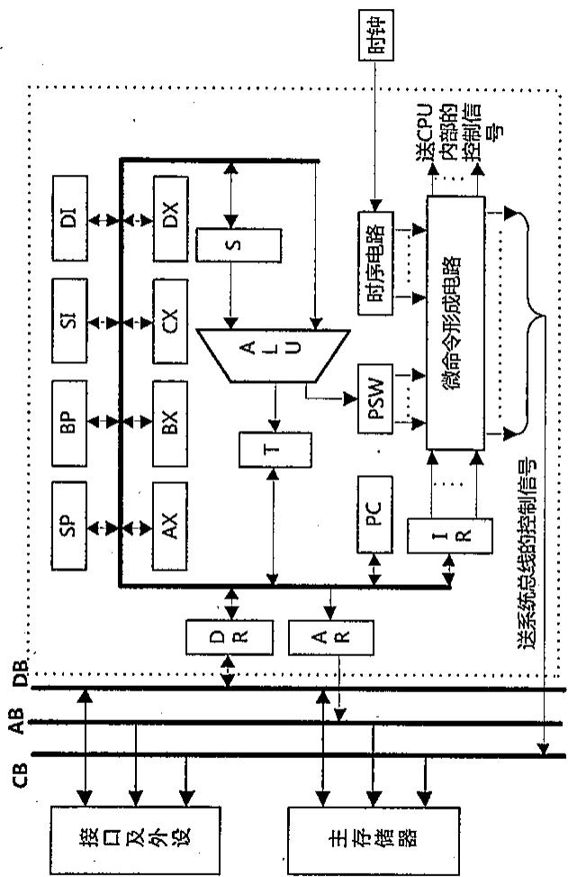

<details>
<summary>flowchart</summary>

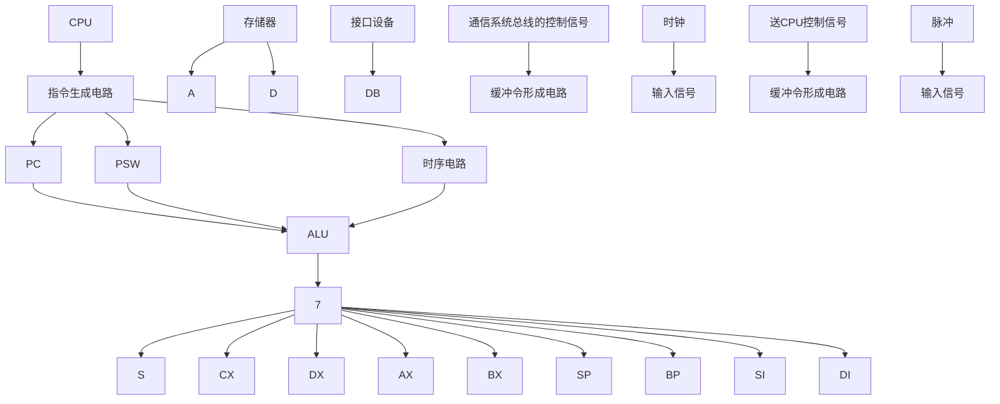
</details>

(1)POP AX：弹出指令，从堆栈按项弹出一个16位数放入AX寄存器。
(2) ADD AX, (X)：加法指令，X是内存地址，(X)表示间接导址，相加结果放入AX寄存器。

五、(12分)某计算机框图如下，包括CPU、主存、外设、总线等。CPU的寄存器有输入锁存控制信号AXin、BXin、CXin、DXin、SPin、Bpin、Sitin、Ditin、Pcin、IRin、DRitin、DRStin、ARin、SIN、PSwin；输出允许控制信号AXout、BXout、Cxout、DXout、SPout、Bpout、SIout、Dlout、Pcout、IRout、DRlout、DRsout、Arout、Tout、PSwout；还有PC自增信号PC+1，SP自增信号SP+1和SP自减信号SP-1。CPU的ALU有加(ADD)、读信号(Mread)、存储器写信号(Mwrite)、I/O读信号(Overad)、I/O写信号(IOwrite)。1. 试用微操作和对应的微命令表示以下计算机指令的执行流程：

# 3. 通过本题体能得到什么结论？

2. 若文件数据随机分布在磁盘上,请计算该文件的平均访问时间。

六、(8分)磁盘转速为15000rpm，平均导道时间4ms，每道512个扇区，每扇区512字节。若要读取磁盘上一个1.25MB大小的文件。磁头从一个磁道移动到紧相邻的另一个隧道的时间（道间导道时间）忽略不计，B、KB和MB间按1024换算。

ARlin 和 Spout （可以/不可）安排在同一字段；  
IROut 和 PCount （可以/不可）安排在同一字段。

2. 恢设要设计微程序控制器，指令（微操作）控制域按字段编辑进行设计，则

<table><tr><td></td><td></td><td>110</td></tr><tr><td></td><td></td><td>19</td></tr><tr><td></td><td></td><td>18</td></tr><tr><td></td><td></td><td>17</td></tr><tr><td></td><td></td><td>16</td></tr><tr><td></td><td></td><td>15</td></tr><tr><td></td><td></td><td>14</td></tr><tr><td colspan="3">ADD AX, (X)指令:</td></tr><tr><td></td><td></td><td>16</td></tr><tr><td></td><td></td><td>15</td></tr><tr><td></td><td></td><td>14</td></tr><tr><td colspan="3">POP AX指令:</td></tr></table>

POP AX 指令:

3. 若流水线瓶颈段可再细分，计算细分后加速比和效率。

2. 计算其加速比和效率。

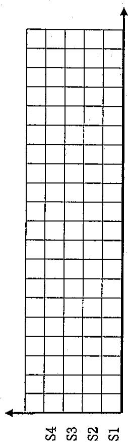

<details>
<summary>text_image</summary>

S4
S2
S1
</details>

同  
单位： $\Delta t$

1. 画出者吐家最高的流水线时空图。(将需要的方框深成☒，并在横坐标轴下添加必要的字母标注)。

七、(12分)向量A和B各有4个元素，计算 $AB=al\times b1+a2\times b2+a3\times b3+a4\times b4$ 。有静态双功能流水线，SI、S2、S3、S4各段时间分别为 $\Delta t,\Delta t,2\Delta t,\Delta t$ ，其中 $SI\rightarrow S3\rightarrow S4$ 组成乘法流水线；SI→S2→S4组成加法流水线。假定流水线输出可直接回送到输入端或暂存于缓冲容器器中，它们的延迟时间及功能切换时间均可忽略。

<table><tr><td>18</td><td>13</td><td>12</td><td>4</td><td>3</td><td>0</td></tr><tr><td colspan="2">主存区号6位(1分)</td><td colspan="2">区内块号9位</td><td colspan="2">块内地址4位</td></tr><tr><td colspan="6">2.主存第1024块为第02H区块第0块,按直接喷雾,应装入Cache的第0块中。(3分)</td></tr><tr><td colspan="6">3.主存地址02001H是第01H区块第0块,对应于Cache的第0块,但与第1024块不同区。</td></tr></table>

<table><tr><td>浮点数</td><td>阶码(含1位符号)</td><td>尾数(含1位符号)</td></tr><tr><td>X + Y</td><td>0010</td><td>0.10100(尾数左移1位,阶码减1)(1分)</td></tr><tr><td>X - Y</td><td>0100</td><td>1.01111(尾数左移1位,阶码加1)(1分)</td></tr></table>

10.1110 (1分)

001010 .II + 11.01010
010101 .II
A - x

$\Lambda - \lambda$

Λ + X

001101.00 +
010101.11
11.1010

(2) 屈数求和差。

<table><tr><td>浮点数</td><td>阶码(含1位符号)</td><td>尾数(含1位符号)</td></tr><tr><td>X</td><td>0011</td><td>1.1010(1分)</td></tr><tr><td>Y</td><td>0011</td><td>0.10100(对不给分,错扣1分)</td></tr></table>

<table><tr><td>学点数</td><td>阶码(含1位符号)</td><td>尾数(含1位符号)</td></tr><tr><td>X</td><td>0010</td><td>1.010100(1分)</td></tr><tr><td>Y</td><td>0011</td><td>0.101100(1分)</td></tr></table>

四、(共10分)
1.

二、(共20分)每空 Comp 对1分,错无分。

1. -0, -128, -127, 0
2. 阶码（指数），尾数

4. 解决生存与 CPU 之间的速度匹配问题，扩大内部存储器的导出空间
5. 条带化、镀膜、校验  
6. 高速开关元件  
7. 写后读 (RAW), 读后写 (WAR), 写后写 (WAW)
8. 1.5625 (或 1/0.64, 或 25/16)   
9. 指令周期，CPU周期（或总线周期）  
10.256

<table><tr><td>节拍</td><td>微操作</td><td>微命令</td></tr><tr><td colspan="3">取指令公操作:</td></tr><tr><td>T1</td><td>AR←PC</td><td> $PC_{out}$ ,  $AR_{in}$ </td></tr><tr><td>T2</td><td>DR←Memory[AR]</td><td> $AR_{out}$ , Mread,  $DRS_{in}$ </td></tr><tr><td>T3</td><td>PC←PC+I, IR←DR</td><td> $PC+1$ ,  $DRI_{out}$ ,  $IR_{in}$ </td></tr><tr><td colspan="3">POP AX 指令:</td></tr><tr><td>T4(1分)</td><td>AR←SP.</td><td> $SP_{out}$ ,  $AR_{in}$ </td></tr><tr><td>T5(1分)</td><td>DR←Memory[AR]</td><td> $AR_{out}$ , Mread,  $DRS_{in}$ </td></tr><tr><td>T6(1分)</td><td>AX←DR, SP←SP+n</td><td> $DRI_{out}$ ,  $AX_{in}$ ,  $SP+1$ </td></tr><tr><td colspan="3">ADD AX, (X) 指令:</td></tr><tr><td>T4(1分)</td><td>AR←IR(地址字段X)</td><td> $IR_{out}$ ,  $AR_{in}$ </td></tr><tr><td>T5(1分)</td><td>DR←Memory[AR]</td><td> $AR_{out}$ , Mread,  $DRS_{in}$ </td></tr><tr><td>T6(1分)</td><td>AR←DR</td><td> $DRI_{out}$ ,  $AR_{in}$ </td></tr><tr><td>T7(1分)</td><td>DR←Memory[AR]</td><td> $AR_{out}$ , Mread,  $DRS_{in}$ </td></tr><tr><td>T8(1分)</td><td>S←AX</td><td> $AX_{out}$ ,  $S_{in}$ </td></tr><tr><td>T9(1分)</td><td>T←S + DR</td><td> $DRI_{out}$ , ADD</td></tr><tr><td>T10(1分)</td><td>AX←T</td><td> $T_{out}$ ,  $AX_{in}$ </td></tr></table>

2. ARin 和 SPout 不可 (1 分) 安排在同一字段；IRout 和 PCout 可以 (1 分) 安排在同一字段。

六、(共8分)
1. 访问第1个磁道：平均寻道+平均旋转延迟+512个扇区数据传输时间=4ms+2ms+4ms=10ms (2分)  
访问其余每磁道：平均旋转延迟+512个扇区数据传输时间=2ms + 4ms = 6ms (1分)  
总时间：10ms + 6ms × 4 磁道 = 0.034s (1 分)

2. 访问每个扇区：平均寻道+平均旋转延迟+1个扇区数据传输时间=4ms+2ms+0.008ms=6.008ms（2分）
总时间：6.008ms × 2560 扇区=15.38048s(1 分)

3. 数据在磁盘上扇区的分布情况对 I/O 读取的性能有很大的影响。(1 分)

七、(共12分)
1.

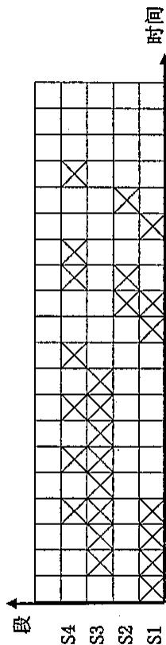  
17Δt   
2. $\mathrm{T} = 17\Delta t$ 或 $16\Delta t$

$\mathrm{Sp} = (4 * 4\Delta t + 3 * 3\Delta t) / T = 25\Delta t / 17\Delta t \approx 1.47(2\text{分})$ （按 $16\Delta t$ 算 $\approx 1.56$ ）  
$\eta = 25 / (17 * 4) \approx 36.76 \% (2 \text{分})$ （按 $16 \triangle t$ 算 $\approx 39.06 \%$ ）  
3.

$\mathrm{Sp} = (4 * 4\Delta t + 3 * 3\Delta t) / T = 25\Delta t / 14\Delta t \approx 1.78(2\text{分})$   
$\eta = 25 / (14 * 5) \approx 35.7 \% (1 \text{ 分})$ （按 $13\Delta t$ 算 $\approx 38.46\%$ ）

D. 数据总线的宽度

C. 指令字长

B. 可导址的最大内容空间

5. 程序计数器 PC 的位数决定了。

A.96% B.95% C.94% D.92%

时间为14.5ns，则Cache的命中率为\_\_\_\_。

4. 若 Cache 的存取时间为 10ns，主存的存取时间为 100ns，系统的平均存取

$C.-(1-2^{-8})\times2^{64}\sim(1-2^{-8})\times2^{64}$

B. $-2^{63} \sim (1 - 2^{-8}) \times 2^{63}$

A. $-2^{64} \sim (1 - 2^{-8}) \times 2^{64}$

3. 淳点数字长 16 位，其中阶 Switzerland 1 位、阶 Switzerland 6 位，数 Switzerland 1 位、层数 8 位。若阶 Switzerland 函数表示，层数用外幂表示。则该浮点数所能表示的数值范围

A.-1 B.-127 C.-0 D.-128

A. 主存 B. Cache C. CPU 中的通用寄存器 D. 硬磁盘

1. 在计算机中，CPU 对其访问速度最快的是 \_\_\_\_。

一、选掉题（每小题1分，本题共5分）

班次——姓名——学号——任课教师

3.本试卷几大题，满分100分

1. 考试形式：闭卷 2. 考试日期：

<table><tr><td>题号</td><td>一</td><td>二</td><td>三</td><td>四</td><td>五</td><td>六</td><td>七</td><td>八</td><td>总分</td></tr><tr><td>分数</td><td></td><td></td><td></td><td></td><td></td><td></td><td></td><td></td><td></td></tr></table>

# 试题

考试时间 120 分钟

西安电子科技大学

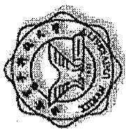

<details>
<summary>text_image</summary>

Scanned image of a Chinese official seal or emblem with text and a central emblem featuring stylized characters.
</details>

第2页共5页

15.8位整数原码的取值范围是\_\_\_\_。

14. 一个汉字的内钨是由\_\_\_\_位二进制位表示。

片，则分别需要\_\_\_\_片、\_\_\_\_片。

13. 桐成 32K×8bit 的内容，选用容量分别为 1K×4bit、4K×8bit 的内容态

真值分别为\_\_\_\_、\_\_\_\_、\_\_\_\_。

12. 若 80H 分别表示整数原码、整数外码和整数移码时，则其对应的十进制

围是

11. 浮点数中，n 位（包括 1 位符号位）外向表示的规格化负尾数的数值范围

和 三种情况。

10. 计算机流水线中，数据相关主要包括：写后续(RAW)、读后写(WAR)

9. ERROM 芯片擦除干净的标志为

接为

CPU既有自己的工作效率又能及时响应外设的输入输出要求，10方法应进

8. 一个慢速外设在满足一定条件时与计算机系统进行信息交换，如果希望

系的——指标得到提高。

7. 在 Cache-MM 两段存储体系中，提高 Cache 的命中率，可以使该存储体

器类型应连接为\_\_\_\_。

6. 在内存中，我们要设计一个存放自动程序的存储区，实现该存储区的存储

种连接方式。

5. 多机系统互连网络中用到的 2×2 开关有 \_\_\_\_、\_\_\_\_、\_\_\_\_、\_\_\_\_ 四

4. RAID 的中文称为

3. 采用多体交叉存储器的目的是为了

位元米码。

2. 若有效信源信息 $M(x) = 1011010$ ，若要构成具有到正1位错能力的校验码，

1. 计算机中设置 Cache 的依据是 \_\_\_\_。

二、典型题（每小题1分，本题共15分）

第3页共5页

五、(本题10分)某SRAM芯片如下图所示。若总线信号A0\~A19、D0\~D7、MEWR、MEMW可以利用，试用成这样的芯片构成88000H到97FRFH

1. 主存地址为 654E2H 时，高速缓存地址为 \_\_\_\_ H。主存地址为 D9D9DH 时，高速缓存地址为 \_\_\_\_ H。
2. 如何完善该地址变换表？该地址变换表用什么器件实现？该地址变换表的容量应为多大？

五、(本题10分)某SRAM芯片如下图所示。若总线信号A0\~A19、D0\~D7、MEWR、MEMW可以利用，或利用这样的芯片构成88000H到97FRH

<table><tr><td>388H</td></tr><tr><td>195H</td></tr><tr><td>222H</td></tr><tr><td>367H</td></tr></table>

地址变换表

四、(本题10分)高速缓存 Cache 与主存间采用全相联地址映像方式，高速缓存的容量为 4KB，分为 4 块每块 1KB，主存容量为 1MB。若地址变换表如下，试根据主存地址确定变换后的高速缓存地址。

5. 高速 RISC（精简指令集中算机）的主要特点。
6. 画一种对称多处理机器绘图，并说明这种多

4. 设序点数 $X = 0.110101 \times 2^{-2}$ 和 $Y = -0.101010 \times 2^{-1}$ , 其字长 12 位, 防码 4
位, 居数 8 位。若阶码、尾数均用双符号外码表示, 计算中采用 0 令 1 入,
请按序点运算步骤计算 $X + Y$ 。

3. CPU 执行一段程序，共完成对内存的存取 25000 次，其中对 Cache 的存取为 24200 次，对主存的存取为 800 次。已知 Cache 存取时间为 30ns，主存的存取时间为 300ns。试求 Cache 的命中率及平均存取时间。

2. 若某磁盘有两个记录面，外径为10cm，内径2cm。道密度为100道/mm。

每磁道为32个岛区，而每个岛区存放512字节，则该磁盘的容量为多少字符？

1. 画出集中式独立请求总线件数方式示意图，并说明其工作原理。

三、简答题（每小题5分，本题共30分）

第4页共5页  
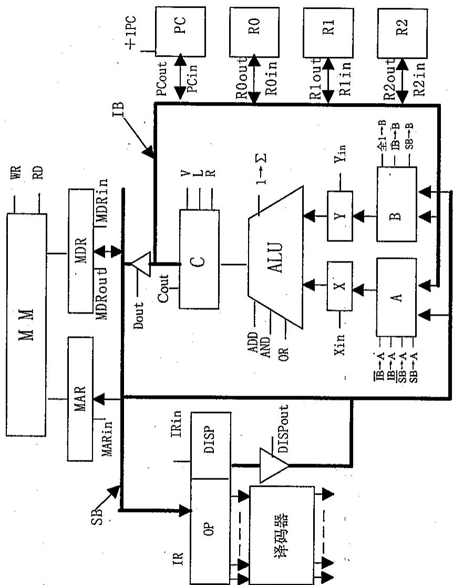

<details>
<summary>flowchart</summary>

```mermaid
graph TD
    A["Input Module"] --> B["Flip-Flop A"]
    A --> C["Flip-Flop B"]
    B --> D["AND Gate"]
    C --> E["X AND Gate"]
    D --> F["AND Gate"]
    E --> F
    F --> G["AND Gate"]
    G --> H["AND Gate"]
    H --> I["AND Gate"]
    I --> J["AND Gate"]
    J --> K["AND Gate"]
    K --> L["AND Gate"]
    L --> M["AND Gate"]
    M --> N["AND Gate"]
    N --> O["AND Gate"]
    O --> P["AND Gate"]
    P --> Q["AND Gate"]
    Q --> R["AND Gate"]
    R --> S["AND Gate"]
    S --> T["AND Gate"]
    T --> U["AND Gate"]
    U --> V["AND Gate"]
    V --> W["AND Gate"]
    W --> X["AND Gate"]
    X --> Y["AND Gate"]
    Y --> Z["AND Gate"]
    Z --> AA["AND Gate"]
    AA --> AB["AND Gate"]
    AB --> AC["AND Gate"]
    AC --> AD["AND Gate"]
    AD --> AE["AND Gate"]
    AE --> AF["AND Gate"]
    AF --> AG["AND Gate"]
    AG --> AH["AND Gate"]
    AH --> AI["AND Gate"]
    AI --> AJ["AND Gate"]
    AJ --> AK["AND Gate"]
    AK --> AL["AND Gate"]
    AL --> AM["AND Gate"]
    AM --> AN["AND Gate"]
    AN --> AO["AND Gate"]
    AO --> AP["AND Gate"]
    AP --> AQ["AND Gate"]
    AQ --> AR["AND Gate"]
    AR --> AS["AND Gate"]
    AS --> AT["AND Gate"]
    AT --> AU["AND Gate"]
    AU --> AV["AND Gate"]
    AV --> AW["AND Gate"]
    AW --> AX["AND Gate"]
    AX --> AY["AND Gate"]
    AY --> AZ["AND Gate"]
    AZ --> BA["AND Gate"]
    BA --> BB["AND Gate"]
    BB --> BC["AND Gate"]
    BC --> BD["AND Gate"]
    BD --> BE["AND Gate"]
    BE --> BF["AND Gate"]
    BF --> BG["AND Gate"]
    BG --> BH["AND Gate"]
    BH --> BI["AND Gate"]
    BI --> BJ["AND Gate"]
    BJ --> BK["AND Gate"]
    BK --> BL["AND Gate"]
    BL --> BM["AND Gate"]
    BM --> BN["AND Gate"]
    BN --> BO["AND Gate"]
    BO --> BP["AND Gate"]
    BP --> BQ["AND Gate"]
    BQ --> BR["AND Gate"]
    BR --> BS["AND Gate"]
    BS --> BT["AND Gate"]
    BT --> BU["AND Gate"]
    BU --> BV["AND Gate"]
    BV --> BW["AND Gate"]
    BW --> BX["AND Gate"]
    BX --> BY["AND Gate"]
    BY --> BZ["AND Gate"]
    BZ --> CA["AND Gate"]
    CA --> CB["AND Gate"]
    CB --> CC["AND Gate"]
    CC --> CD["AND Gate"]
    CD --> CE["AND Gate"]
    CE --> CF["AND Gate"]
    CF --> CG["AND Gate"]
    CG --> CH["AND Gate"]
    CH --> CI["AND Gate"]
    CI --> CJ["AND Gate"]
    CJ --> CK["AND Gate"]
    CK --> CR["AND Gate"]
    CR --> CS["AND Gate"]
    CS --> CT["AND Gate"]
    CT --> CU["AND Gate"]
    CU --> CV["AND Gate"]
    CV --> CW["AND Gate"]
    CW --> CX["AND Gate"]
    CX --> CY["AND Gate"]
    CY --> CZ["AND Gate"]
    CZ --> DA["AND Gate"]
    DA --> DB["AND Gate"]
    DB --> DC["AND Gate"]
    DC --> DD["AND Gate"]
    DD --> DE["OR"]
    DE --> EF["X AND Gate"]
    EF --> GF["X AND Gate"]
    GF --> GH["X AND Gate"]
```
</details>

七、（本题10分）累计算机系统分框图如下图所示。

2. 者流水线执行的 100 条指令中有 10% 的分支指令，且流水线未采取解决控制相关的策略，尝试该流水线执行这 100 条指令的实际加速比。

。

1. 若流水线连续执行 100 篷无分支指令，试求该流水线的实际吞吐率、加速

六、(本题10分)5级(段)指令流水线,各段运行时间均为1ns。

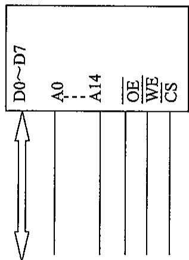

<details>
<summary>text_image</summary>

CS
W/E
OE
A14
0
DO~D7
</details>

的可用内存，清画出与8位机器总线的连接图。

3. 计算两种编码情况下的平均操作韧性长度。

操作箱的最短长度；

操作的最短长度；2. 试用扩展长度操作两端的方法为各类指令设计操作两端码，给出每类指令操作的最短长度；

随机类指令占20%，使用频度为15%；其余指令使用频度为10%。

占5%，使用频度为50%；运算类指令占10%，使用频度为25%；分支

儿、(本题10分)某指令系统共有200条指令,统计结果表明,传送类指令

将结果存入RI中。

址，实现功能为：寄存器 R1 中内容减去地址单元 mean\_addr 中的内容并

流程及相应的嵌命令流程。该指令中RI为寄存器，mem addr为主存地

2. 写出在该计算机系统中取得并执行减法指令SUB RL,mem\_addr的微操作

(相容/互斥)

⑤ Xin, Yin, AND

(相容/互斥)

4MDROUT, IRIN

③ IB→A, IB→A, SB→A (相容/互斥)

(相容/互斥)

② Roout, R2out

(相容 / 互斥)

1. 选择以下小题括号中的正确答案

为1的控制信号。

左移一位（L）、右移一位（R）的功能，1→3是加法器最低进位设置

加（ADD）、与（AND）、或（OR）的功能，C 部件具有直选（V）。

图中，寄存器用XXin锁存数据或用XXout控制数据输出，AUV仅具有

# 第6页共5页

3. $b=24200/25000=96.8\%$

(3分)
(2分)

2. $2 \times 40 \times 100 \times 32 \times 0.5KB = 128000KB$ (若有式子，或子对4分，全对5分)

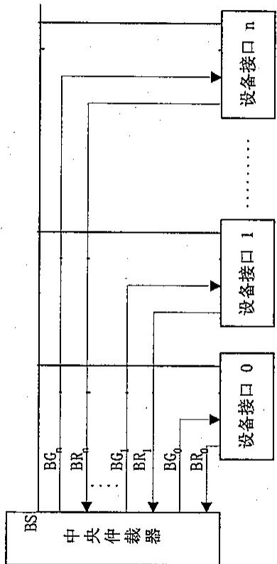

<details>
<summary>flowchart</summary>

```mermaid
graph TD
    A["设备接口 n"] --> B["设备接口 0"]
    A --> C["设备接口 1"]
    B --> D["中失停载器"]
    C --> D
    D --> E["设备接口 0"]
    D --> F["设备接口 1"]
    D --> G["..."]
    D --> H["设备接口 n"]
    D --> I["设备接口 0"]
    D --> J["设备接口 1"]
    D --> K["..."]
    D --> L["设备接口 n"]
    D --> M["设备接口 0"]
    D --> N["设备接口 1"]
    D --> O["..."]
    D --> P["设备接口 n"]
    D --> Q["设备接口 0"]
    D --> R["设备接口 1"]
    D --> S["..."]
    D --> T["设备接口 n"]
    D --> U["设备接口 0"]
    D --> V["设备接口 1"]
    D --> W["..."]
    D --> X["设备接口 n"]
    D --> Y["设备接口 0"]
    D --> Z["设备接口 1"]
    D --> AA["..."]
    D --> AB["设备接口 n"]
    D --> AC["设备接口 0"]
    D --> AD["设备接口 1"]
    D --> AE["..."]
    D --> AF["设备接口 n"]
    D --> AG["设备接口 0"]
    D --> AH["设备接口 1"]
    D --> AI["..."]
    D --> AJ["设备接口 n"]
```
</details>

三. 1. 给图如下：（绘图正确3分，说明2分）

8. 中断方式 9.FPH 10. 写后写 (WAW)  
12.-0-128 0 13.64 8 14.16

7. 平均读写时间（速度）
11. - 1 \~ -(1/2+2 $^{-(a-1)}$ )
15. - 127\~+127

2.4 3.提高存放(访问/访存)速度
5.直送、交叉、上播、下播 6.ROI

三、(盲目对即可给分)

1.C 2.C 3.B 4.B 5.B

一、(对则给分)

# 参考答案

# 第7页共5页

# 特点：

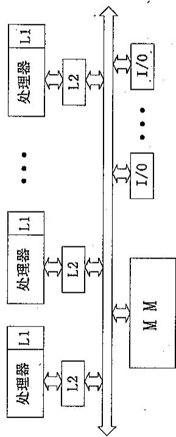

<details>
<summary>flowchart</summary>

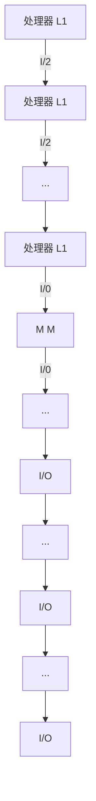
</details>

1. 由两个以上性能相同的处理器构成。  
2. 各处理器通过总线共享主存和 10。  
3. 所有处理器均能完成同样的功能。  
4. 用一个操作系统来统一指挥调度各处理器的工作。

[Non-Text]

[Non-Text]

2. 各处理器通过总线共享主存和 10。

3. 所有处理器均能完成同样的功能。

4. 用一个操作系统来统一指挥调度各处理器的工作。

6. (画出框图2分，特点是隔音会对2条即得3分)

⑩ 可简化硬件设计，降低设计成本。

⑨ 有利于优化编译程序。
⑧ 访存指令很少。多数指令的操作在速度快的内部通用寄存器间进行。

⑥ 控制器用硬件实现，采用组合逻辑控制器。

⑤ CPU 中设置大量的通用寄存器，一般有几十个甚至几百个。

③ 指令种类少，

①只设置使用频率

RUSC特点如下：（答出下列一条即可得1分，答对5条即可）①只设置使用频度高的一些简单指令。

④规格化
得到两数相加结果为： $[X+Y]^{\#}=1101; 11.000100$ (错一步扣1分，全对5分)

100011.11
11.110001
+ 11.01010

110110'00

尾数求和：

③ 相加

011010.11 : 1111= $^{嵌}$ [λ]

(YI) 0) IIIOII0.00 : III= $^{注}$ [X]

② 对称

011010·11 : 1111=兹[λ]

101011·00 :0111= $^{注}$ [X] ①

$Y = -0.101010 \times 2^{-1}$

$X=0.110101\times2.^{2}$

4. 已知

$Y = -0.101010 \times 2^{-1}$   
$X=0.110101\times2.^{2}$   
4. 已知

# 第8页共5页

# (4分)

# 加速比=500/144=3.47

2. 有停顿的流水线执行= $\sin s+(100-1)\times\ln s+10\times(5-1)\times\ln s=144ns$

# (3分)

# (3分)

实际吞吐率为=100÷104=961MPaS

流水线执行=5ns+(100-1)×1ns=104ns

# 六、1. 顺序执行=100×5ns=500ns

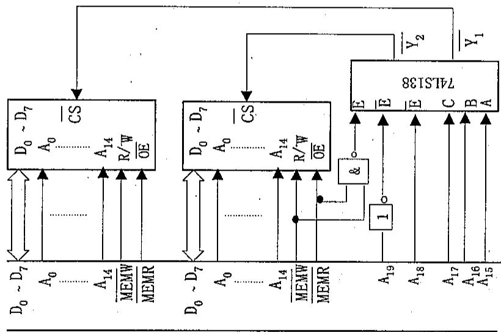

<details>
<summary>flowchart</summary>

```mermaid
graph TD
    A["74LS138"] -->|A0, A1, A2, A3, A4, A5, A6, A7, A8, A9, A10, A11, A12, A13, A14, A15, A16]
    A -->|C, B, C, E, F, G, H, I| G["Chip 1"]
    G -->|K| H["Chip 2"]
    H -->|A0, A1, A2, A3, A4, A5, A6, A7, A8, A9]
    H -->|A0, A1, A2, A3, A4, A5, A6, A7, A8, A9]
    H -->|A0, A1, A2, A3, A4, A5, A6, A7, A8, A9]
    H -->|A0, A1, A2, A3, A4, A5, A6, A7, A8]
    H -->|A0, A1, A2, A3, A4, A5, A6, A7, A8]
    H -->|A0, A1, A2, A3, A4, A5, A6, A7, A8]
    H -->|A0, A1, A2, A3, A4, A5, A6, A7, A8]
    H -->|A19| I["Chip 3"]
    I -->|A0, A1, A2, A3, A4, A5, A6| J["Chip 4"]
    J -->|A0, A1, A2, A3, A4, A5, A6| K["Chip 5"]
    K -->|A0, A1, A2, A3, A4, A5, A6| L["Chip 6"]
    L -->|A0, A1, A2, A3, A4, A5, A6| M["Chip 7"]
    M -->|A0, A1, A2, A3, A4, A5, A6| N["Chip 8"]
    N -->|A0, A1, A2, A3, A4, A5, A6| O["Chip 9"]
    O -->|A0, A1, A2, A3, A4, A5, A6| P["Chip 10"]
    P -->|A0, A1, A2, A3, A4, A5, A6| Q["Chip 11"]
    Q -->|A0, A1, A2, A3, A4, A5, A6| R["Chip 12"]
    R -->|A0, A1, A2, A3, A4, A5, A6| S["Chip 13"]
    S -->|A0, A1, A2, A3, A4, A5, A6| T["Chip 14"]
    T -->|A0, A1, A2, A3, A4, A5, A6| U["Chip 15"]
    U -->|A0, A1, A2, A3, A4, A5, A6| V["Chip 16"]
    V -->|A0, A1, A2, A3, A4, A5, A6| W["Chip 17"]
    W -->|A0, A1, A2, A3, A4, A5, A6| X["Chip 18"]
    X -->|A0, A1, A2, A3, A4, A5, A6| Y["Chip 19"]
```
</details>

五、(画一片若3分，画两片评错5分，全对10分)

(4分)   
(6分)   
2. 完善：增加有效位和修改位   
器件：用相联存储器  
容量：(10+2)×4bit   
H061   
、  
四、1. 8E2H 19DH
2. 完善：增加有效位和修改位 (6分)
器件：用相联存储器
容量：(10+2)×4 bit

# 七. 1. （对一条1分，全对5分）

① PCout, Dout, MARin （相容）

② R0out, R2out (互斥)

③ IB→A, $\overline{IB}$ →A, SB→A (互斥)

④ MDRout, IRin (相容)

⑤ Xin, Yin, AND

2. (5分)

T1 PC→MAR PCout, Dout, MARin

T2 M[MAR]→MDR RD

T3 MDR→IR MDRout, IRin

T4 IR[DISP]→MAR DISPout, MARin

T5 M[MAR]→MDR RD

T6 MDR→A MDRout, SB→A

T7 R1→B R1out, IB→B

T8 A→X, B→Y Xin, Yin

T9 X+Y+1→C 1→Σ, ADD, V

T10 C→R1 Cout, R1in

# 八、1. (2分) 8位

2. （6分）每类：4、6、10、13位

<table><tr><td>指令类</td><td>指令数</td><td>使用频度</td><td>操作码长度</td><td>操作码编码(参考)</td></tr><tr><td>传送</td><td>10</td><td>50%</td><td>4</td><td>0000~1001</td></tr><tr><td>运算</td><td>20</td><td>25%</td><td>6</td><td>101000~111011</td></tr><tr><td>分支</td><td>40</td><td>15%</td><td>10</td><td>1111000000~1111100111</td></tr><tr><td>其余</td><td>130</td><td>10%</td><td>13</td><td>1111101000000~1111111000001</td></tr></table>

# 3. （2分）定长：平均操作码长度=8位

变长：平均操作码长度=4×50%+6×25%+10×15%+13×10%=6.3位

# 新综合模一模焊接复印部（边筏、塑料对面）

容量，剩下的部分应记录在

约为，数据传输率约为

若一个文件超出一个被道的

100道/mm，每个隧道分16个岗区，每个岗区512字节，则该硬碰的格式化容量

区域的外直径为30cm，内直径为10cm，记录位密度为250位/mm，磁道密度为

7.假设一个有2个盘片的硬盘,共有4个记录面,转速为7200转/分,盘面有效记录

算

算法和

其中有

6. Cache工作中，替换算法有多种，

5. 廣价的冗余磁盘阵列的英文缩写是

4. 硬盤盘中，技术指标位密度的定义是

长度为 \_\_\_\_ 位的编码标识，该编码称为 \_\_\_\_ 。

$\downarrow$ 一由颤填中 $\downarrow$ 每 $^{'}$ 颤填中 $\downarrow$

并

2. 计算机系统中采用中断方式实现数据的输入输出，是因为中断方式比较其他I/O方式

和

1. 指令流水线中，通常有三种类型的相关，它们是

一、填空题（每空1.5分，只要答对30空即可，本题共45分）

任课教师

合点

1. 考误形式：闭卷；2. 考试日期：2010年11月 日；3. 本试卷共六天眼，满分100分。

<table><tr><td>题号</td><td>一</td><td>二</td><td>三</td><td>四</td><td>五</td><td>六</td><td>总分</td></tr><tr><td>分数</td><td></td><td></td><td></td><td></td><td></td><td></td><td></td></tr></table>

# 试题

考试时间 120 分钟

西安电子科技大学

地址:老综合楼南方造型内(茶碗书店旁)

# 专业聪明(价钱优质 速取)

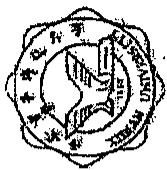

三（本题10分）高速缓存 Cache 与主存间采用组相联地址映像方式（即组间直接，组

4. 说明对称多处理机系统多个主要特点中的三个特点。

3. 叙述利用 DMA 方式，在外设需要时将内存中的一批数据连续传送到外设的一般过程。1个ASCII码大写英文字母‘B’（42H），画出该串口数据传送的波形图。

2. 某异步串行通信接口的数据格式为：7位数据位，奇校验，1位停止位，若要求传送1、简述在8088CPU上，外部中断INTR的响应过程。

二、简答题（每小题5分，选做其中三个小题即可，本题共15分）

都是\_\_\_\_位的。

18. 可编程定时/计数器 8253 有 \_\_\_\_ 种工作方式，其每个定时/计数器的计数器17. 多机系统中，2×2 开关有 \_\_\_\_、\_\_\_\_、\_\_\_\_、\_\_\_\_ 这四种控制状态。

16. USB 2.0 以下的标准规定 4 条传输线，其中 2 条用于 \_\_\_\_，另外 2 条用值总是正确的。(参看本试题四)

15. 采用先写入\_\_\_\_方法，可以保证从8253读出的计数写入8255的\_\_\_\_来实现。

14. 可编程并行接口 8255 的 C 口接位操作方式，是利用程序将 C 口的接位操作控制字I/O 口。三个口的 I/O 方向可有 \_\_\_\_ 种可供选择的方案。

13. 可编程并行接口 8255 工作在方式 0 时，其 A、B、C 三个口均被定义为8086CPU.硬件会自动保护\_\_\_\_、\_\_\_\_、\_\_\_\_这三个寄存器。

12. 在 8086 中，IF=1 是 \_\_\_\_ 中断能够得到响应的必要条件。中断响应过程中，段。概括起来，主要有三种形式 \_\_\_\_；

11. 并行处理技术已成为计算机技术发展的主流。它可贯穿于信息加工的各个步骤和阶10. 系统总线中地址线的功能是

9. 利用 8253 产生连续的对称方波，应用其工作方式 \_\_\_\_。

方式、\_\_\_\_ 方式和 \_\_\_\_ 方式。

8、在计算机系统中，I/O技术可分为：通道控制方式、外围处理机方式、

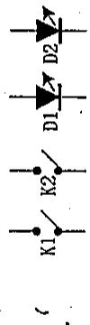

<details>
<summary>text_image</summary>

, K1 K2
</details>

①说明主区号、区内组号、组内换号、块内地址各用多少位表示？
②已知地址变换表如下，若主存地址为ABCDEH，试确定变换后的高速缓存
③说明主区号、区内组号、组内换号、块内地址各用多少位表示？  
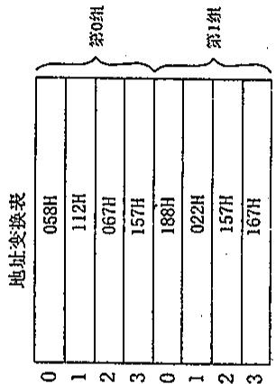

<details>
<summary>text_image</summary>

地址变换表
0
1
2
3
4
5
6
7
8
9
10
11
12
13
14
15
16
17
18
19
20
21
22
23
24
25
26
27
28
29
30
31
32
33
34
35
36
37
38
39
40
41
42
43
44
45
46
47
48
49
50
51
52
53
54
55
56
57
58
59
60
61
62
63
64
65
66
67
68
69
70
71
72
73
74
75
76
77
78
79
80
</details>

四.（本题10分）可编程定时/计数器8253的控制字如下图所示  
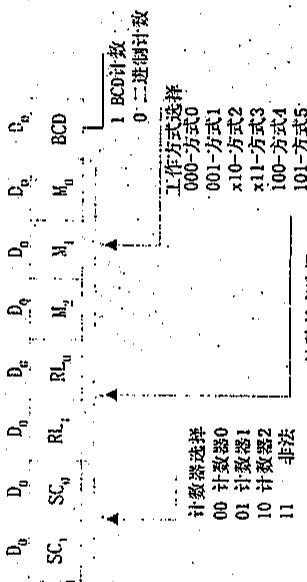

<details>
<summary>text_image</summary>

D0 D0 D0 D0 D0 D0 D0
SC SC RL RL RL RL RL RL
工作方法选择
1 BCD计数
0.二进制计数
01 计数器0
02 计数器1
10 计数器2
11 非法
x11-方式3
x10-方式2
x01-方式1
x00-方式0
100-方式4
101-方式5
</details>

计数长度选择   
00 将计数器中的数据保存于缓冲器  
01 这样计数器低8位读或写  
10 连样计数器高8位读或写
11 这样先低后高两个字为读或写  
系统总线连接图。

① 考规定该 8253 所用的接口地址可在 $\mathrm{FR00H} \sim \mathrm{FR00H}$ 内自由施用，试画出该芯片与

② 试说明当外部计数时钟频率为2MHz时，只用该8253如何产生周期为1s的对称方法，并填写相应的初始化程序。

五、(本题10分)开关K1、K2和发光二极管D1、D2如下图所示。若限定接口地址8000H到8003H可使用，试利用8255接口将开关K1、K2和发光二极管D1、D2接到系统总线上，画出连接图。

# 新综合模一模焊接复印部（边筏,塑料对面）

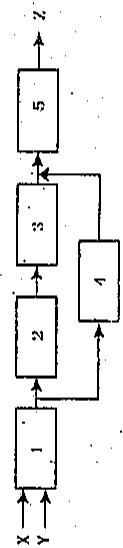

<details>
<summary>flowchart</summary>

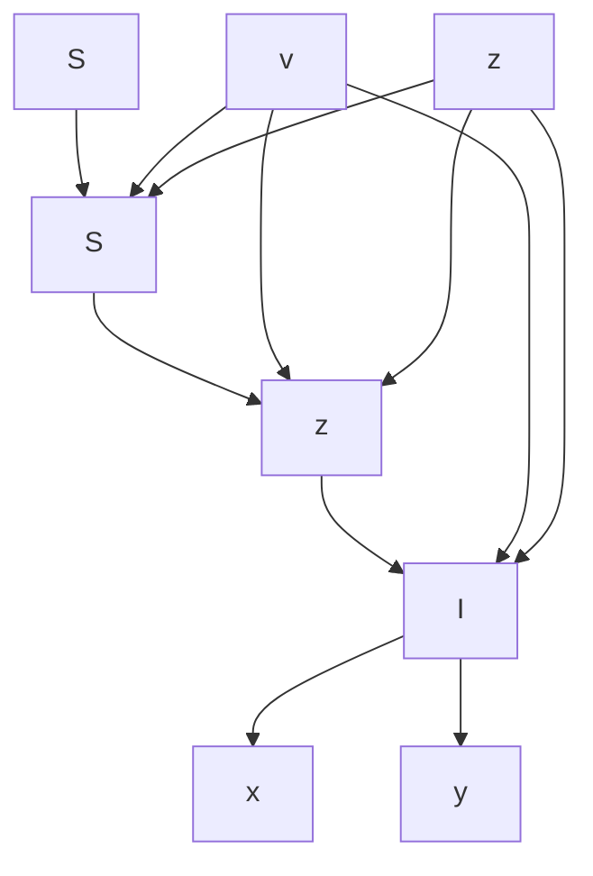
</details>

(1)画此流水线的时空图

及功能切换时间均可忽略。求

时间均为Δt，流水线输出可直接回送到插入端或暂存于缓冲容器中，它们的延迟时间

其中1-4-5组成乘法流水线，1-2-3-5组成加法流水线。假定流水线各段所经过的

A·B=∑a:b:

六.（本题10分）设向量A和B各有4个元素，在下图所示的静态双功能流水线上计

# 参考答案及评分标准

(答对一空1分对30空即可)

1. 结构相关、数据相关、控制相关

2. CPU效率高、对突发事件实时响应

3. 256, 8位，中断类型包

4. 最内圈被道上，单位长度（mm或英寸）上记录的二进制位数
5. RAID

6. 驰机替换算法 (RANQ)、先进先山算法 (FIFO)、近期最少使用算法 (LRQ)、最不

经常使用算法（JFU）、最优替换算法（OPF）（这五种方法中的任意二种）

7. 320MB, 1MB/S, 同一栏面的另一棱道上

8. 直接程序控制（查询）：中断、DMA

9.3

10. 用于指定主和I/O设备接口电路的地址

11. 时间重选、资源重复、资源共享

12. 可屏板中断 INTR: F (PSW)、CS、IP

13. 数据 16 种

14. 控制寄存器

15.写入bit4、bit5为00的控制字到8253的控制寄存器

16. 用于数据传送。用于提供5V500MA电源

17. 直述 上播 下播 交叉

18. 共 16

二

1. 外设在 CPU 的 INTR 输入端加上高电平，向 CPU 提出屏蔽中断请求。CPU 在一条指令执行结束，且满足 IF=1 等条件，对该中断请求作出响应；首先由 CPU 内部硬件从中断响应端 INTA 送出两个负脉冲，并在第二个负脉冲期间从数据线 DO\~DT 上获得提出请求外设所提供的中断向量（类型）四。（到此加1分）接着 CPU 将断点信息 F、CS 和 IP 的内容进入堆栈。（到比如2分）接着 CPU 将断点信息 F、CS 和 IP 的内容进入堆栈。（到比如1分）

# 新综合模一模焊接复印部（这像写料对面）

(只需要对上述三种即可)

④ 所有的处理机通过相同的通道或不同的通道共享10设备。⑤ 每一处理机能能远程或线程，对各处理机的工作进行统一⑥每一处理机能能完成相同的功能，这或许是对多处理机中

③多个处理机共章同一主存储器。并且，每一个处理机访问主存储器的时
间是相同的，也就是一致的。

① 这样的系统是由两个以上的多个相同的处理机构成。

对称多处理机系统具有如下特点：

(6) 当传送结束时, DMAC 使请求信号无效。CPU 重新获得总线的控制权, 继续执行指令。(容对一些 1 分)

内存读及接口的写，将数据直到传送到外设。同时，内存地址自动修改，传送数目动减1。重复上述过程在每一批数据传送完。

(4) DMAC向外受发响应信号，告诉外受其请求已获得响应。(5) DMAC获得总线的控制权开始进行DMA传递；DMAC送出内存地址、

(3) CP0 在一零点线高斯结束时对该请求点击响应；使 CP0 上的三感信号置高阻，即放弃了对总线的控制板。同时送出 HLDA 高电平加到 DMAC 上，让 DMAC 知道其请求已获得响应。

(2) DMAC 通过 CPU 上的 HOLD 向 CPU 提出请求。

(画错一处扣一分: 自动、数据顺序、数据位数、高校验、行正位)

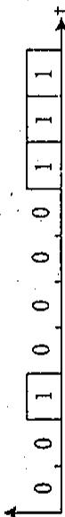

<details>
<summary>text_image</summary>

I I I 0 0 0 0 I 0 0
</details>

2. 四出波形图如下

然后关单步、关中断（即使 $I_{F}=0$ 、 $I_{F}=0$ ）。将中断向量阿乘4位或中断向量表的地址，由此开始的顺序4个地区中分别读出事先已放在中断向量表中的IWR的中断向量，放入IP和CS中(到比如1分)。从下一个总线周期开始，CPU转到IWR中断服务程序的入口地址 $CS\times16+IP$ ，开始执行IWR中断处理。(到比如1分)

三.各部分分布如下：（对一小题5分，全对10分） $①$ 主存区号：7位；区内组号：1位；组内块号：2位；块内地址号：10位 $②$ 101010111(157H)110001101111018DEH  
四. ①画连接图如下：（译码器对3分，其他连接2分。若用8位机的总线信号，只要逻辑对也可以）  
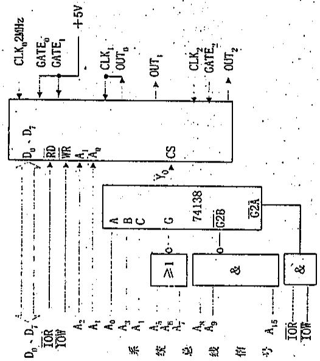

<details>
<summary>flowchart</summary>

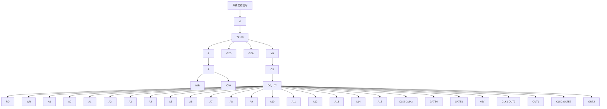
</details>

②因为计数时钟为 2MHz，而每个计数器的计数值只有 16 位。因此，一个计数器的最大计数时间只有 32.75mS 左右，无法满足要求。但 8253 有三个计数器，可以串联使用以解决问题。由于时钟周期为 0.5μS，而要求产生的方波周期为 1S，因而可求得要求的总计数值为： $1000 \times 1000 \mu S \div 0.5 \mu S = 2000000$ 。  
例如，将计数时钟接到计数器0的CLK0上，使GATE0有效（高电平）并将OUTO输出接到CLK1上作为计数器1的计数时钟，并使GATE1为高电平。这就将计数器0和计数器1串到一起。可使它们都工作在方式3，且总计数值为 $2000 \times 1000$ ，即可以使其中一个计数器0的计数值均为1000，另一个计数器1的计数值均为2000，将两者串起束，则可以得到OUT1输出就是周期为1S的对称方波。连接可见上题，程序如下：（到此1分）

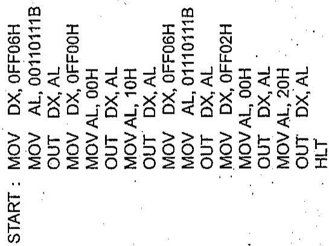

<details>
<summary>text_image</summary>

START : MOV DX, 0FF06H
MOV AL, 00110111B
OUT DX, AL
MOV DX, 0FF00H
MOV AL, 00H
OUT DX, AL
MOV AL, 10H
OUT DX, AL
MOV DX, 0FF06H
MOV AL, 01110111B
OUT DX, AL
MOV DX, 0FF02H
MOV AL, 00H
OUT DX, AL
MOV AL, 20H
OUT DX, AL
HLT
</details>

(程序对 4 分)

五. 画连接图如下:  
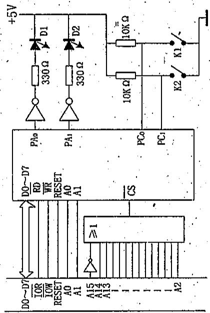

<details>
<summary>text_image</summary>

DO~D7
IOR
IOW
RESET
A0
A1
A15
A14
A13
≥1
CS
DO~D7
RD
WR
RESET
A0
A1
PA0
330 Ω
+5V
PA1
330 Ω
D1
D2
PC0
PC1
10K Ω
10K Ω
K2 K1
</details>

(译码器对5分，接口外设连接对3分，其他2分)

六. (1)画时空图如下：(时空图对5分，对接口外设连接3分，其他2分)  
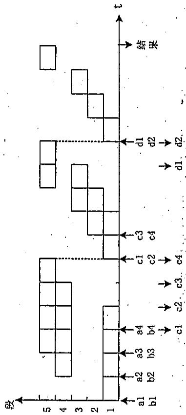  
(2)顺序执行时间为 $4 \times 3 \Delta t + 3 \times 4 \Delta t = 24 \Delta t$   
流水线执行时间为 $15\Delta t$   
SP=15△t/24△t=1.6   
效率 $\eta$ 为：  
$\eta = (12 + 8 + 4) / (15 \times 5) = 32\%$   
(对一问 2.5 分，全对 5 分)

# 新综合楼一楼辉扬复印部（迈德思斜对面）

①AX ②BX
③

8. 在 8088CPU 中，用于寄存器间接导址输入输出指令的寄存器是 O

. , 114 . 018

10② 00①

态必须是O

态必须是O

7. 当 8086CPU 读写内容的一个规则（对准）字（16位）时，BHE和A0的状

01010① 11000⑧

10110(2) 01111(1)

A. 1. 则14h 1. 2007. 1. 3. 4. 5.

中断处理程序中设置的中断屏数字为0

应的中断L1加以屏蔽，若要求中断响应的优先级顺序为 $L_{a} \rightarrow L_{a} \leftarrow L_{2} \leftarrow L_{1} \leftarrow L_{3}$ ，则在L1。

6. 聚计算机有上级中断L4\~L0。中断程序为M0,M3,M2,M,M0,其中M:=1则可将它对

(3) 理卡信号 ， （4）甲醇类型钙

(2) $\therefore m = \frac{3}{11}$ ，求 $\sqrt{3} + \frac{3}{11} = \frac{3}{11}$ 。

①指令……②操作数

5. 在系统总线的数据线上，不可能传输的信号是 0

③②24K ④②88K

①160K ②193K

4. 月份A rounded 到 DERTR, 共有 U

中车针 1000V

(1) $\therefore m = \frac{3}{2}$ (2) $\therefore m = \frac{3}{2}$

①INT nRH ②INTO

1 转 pSW 申的 15=0.8966Pd 不响应的申缩请求是

UV6000(⊕) UV7000(⊕)

10004H 00028H

2. 若某中断的中断类型为 0AH，则其中断向量表的首地址为 O

③ 2 个体

①不全性 ②小体

1. 8086PO热联闪针时，闪针需为0

1. 8096Ppll物或中定时 中方垂直方向

卡底面的O中。每小感1.5分，车感共15分）

The following table provides the original text: "The English Language (English) and Chinese Language (Chinese) in the Source Image.

单项连接题（在每小题的四个备选答案中选出一个正确的答案，并将其写四填写在

(1) $\therefore m = \frac{3}{11}$ .

班级 学号 性名 任课教师

1. 考试形式：因卷；2. 考试日期；2011 年 月 日 3. 本试卷共 大题，满分 100 分。

1.考试形式：用卷：2.考试日期：2011年月日3.本试卷共 大题，满分100分。

<table><tr><td>题号</td><td>一</td><td>二</td><td>三</td><td>四</td><td>五</td><td>六</td><td>七</td><td>总分</td></tr><tr><td>分数</td><td></td><td></td><td></td><td></td><td></td><td></td><td></td><td></td></tr></table>

# 《计算机组成与结构II》试题

考试时间 120 分钟

西安电子科技大学

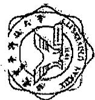

地址:老综合楼南方造型内(桑填书店等)

专业塑钢(价低优质速取)

张不辛

③CX 4DX
9.1SA总线是一种多少位的内（系统）总线？O

②16位

464位

10. 支持即插即用、热插拔的总线是 O

②SCSI

4USB

③RS-232C

二. 填空题 (每空 1 分, 本题共 15 分)

1. 计算机中，内存与接口地址编批方法有和

2. 8086CPU的中断系统最多可以容纳一个中断源，每个中断源用一个长度为\_\_\_\_位的编码标识，该编码称为\_\_\_\_。结构。3. 在市场上所见到的多核处理器是属于\_\_\_\_。

4. 恢设一个有2个益片的硬盖，共有4个记录面，转速为7200转/分，盘面有效记录区域的外直径为30cm，内直径为10cm，磁道密度为1000度/mm，每磁道分16个岛区，每岛区1K字节，则该硬盖的格式化容量约为\_\_\_\_，数据传输率约

为。若一个文件超出一个隧道容量，剩下的部分应记录

5. 磁益的道态度的定义为度的定义为

6. 动态存储器中的信息是存放在小上，为不使信息丢失，需要定

和

7. EPROM 中存储的信息需用 \_\_\_\_ 进行擦除。而 EPROM 的信息只需用

8. 为始终保持主存与 Cache 的数据一致性，可采用 \_\_\_\_ 法。

9. 在计算机与外设的数据传输中，查询方式不能保证数据的 \_\_\_\_ 传输。而传输 \_\_\_\_ 的速度最高的方式是 \_\_\_\_ 。

三.简单回答题(每小额4分,本题共24分)

1. 说明通用串行总线 USB 诸多特点中的三个特点。

2. 瓶迹利用 DNA 方式，在外设需要时将内存中的一批数据连续传送到外设的一般

过程。

3. 说明当 8253 的外部时钟为 1MHz 时，只用该 8253 如何产生一个周期为 1 秒的连线对称方法？

4. 试说明在 8088CPU 执行 INT、40H 指令的过程？

5. 8088 系统中，利用定时器每 20ms 产生一次中断，在内存中定义四个单元分别对 50 次、秒、分、小时进行计数。即每中断一次对 50 次计数单元加1。当加到 50 时，50 次计数单元清 0，秒计数单元加1。秒计数单元加到 60 时，秒计数单元清 0 分计数单元加到 24 时清 0。这样，利用中断可实现电子时钟。试分析在什么情况下，由主程序读出的时间误差会接近 1 小时？如何避免这种误差？

6. CPU执行一段程序，其完成对内存的存取25000次，其中对cache的存取为24200次，对主存的存取为800次。已知cache的存取时间为30ns，主存的存取时间为300ns。

1. 若规定接口地址为 0000H，试自选输出接口（锁存器、8255 均可）将按键和发光二极管接到 8088 入位机的最大模式下的总线上，画出连接图。
2. 设编程序，检测按钮 K 的状态，当 K 同合时使红发光二极管亮、绿色发光二极管亮；当 K 断开时使红发光二极管亮、绿色发光二极管亮；当 K 断开时使红发光二极管亮、绿色发光二极管亮。

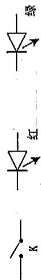

<details>
<summary>text_image</summary>

器
巧
K
</details>

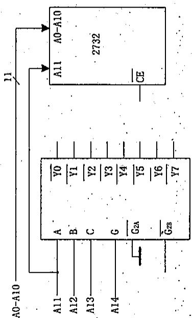

<details>
<summary>text_image</summary>

2732
A11 A0-A10
11
A
B
C
Y0
Y1
Y2
Y3
Y4
Y5
Y6
Y7
G2a
G2b
G
A14
A13
A12
A11
</details>

与非门或非门等）完成对3-8译码器GB的控制和对2732的CE的控制。

六.（本题共10分）设计存储器电路，其中部分电路如下图所示，规定该2732所占的内存地为FE000H到FEFPFt。利用基本的门电路（与门、或门、非门、

<table><tr><td>生存区号</td><td>组内块号</td></tr><tr><td>000</td><td>0C9H 00B</td></tr><tr><td>001</td><td>574H 01B</td></tr><tr><td>010</td><td>244H 10B</td></tr><tr><td>011</td><td>76EH 11B</td></tr><tr><td>100</td><td>76EH 10B</td></tr><tr><td>101</td><td>373H 10B</td></tr><tr><td>110</td><td>0C9H 00B</td></tr><tr><td>111</td><td>488H 00B</td></tr></table>

(2) 若 Cache-MM 地址变换表的内容如下表, 当 CPU 访间主存的地址分别为 9118H 和 0DECBAH 时, 同是可能命中 Cache, 若能命中, 指出相应的 Cache 地址。(3) 若主存以 Cache 的 64 个字符为一块, 从 0 块开始顺序分块并编号, 试决定 515 块应放在 cache 的哪一组中?

主.（三小题分别5分、3分、2分，本题共10分）Caché-MN两级存储器采用组相嵌
嵌像（组间直接，组内全相联）。若Caché容量为512B，64个字节为一块，且共分为2
个组。主存容量是Caché容量2048倍。
(1) 主存区号\_\_\_\_位，区内组号\_\_\_\_位，组内换号\_\_\_\_位，块内
地址\_\_\_\_位。每次进行MNI-Cache的地址变换时，需要参与相联比较的位数是

试求cache的命中率及平均存放时间。
四、(本题共6分)若写入代码为101011001，试画出NRZ1、FM、MPM的写电流形
（假设初始电流为低），分析它们的同步能力。

八.（每小题5分，本题共10分）读下面SRAM连接图，系统总线为8088CPU构成的8位机总线。

①现欲将此SRAM构成内存地址E0000H到FFFFFFH，试决定为获得此内存地址应预先向锁存器输出接口写入什么样的数据？

②若将此SRAM构成内存地址80000H到9FFFFH，此时为获得此内存地址应预先向锁

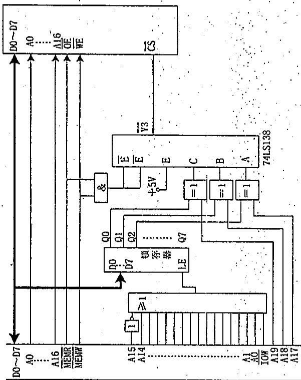

<details>
<summary>flowchart</summary>

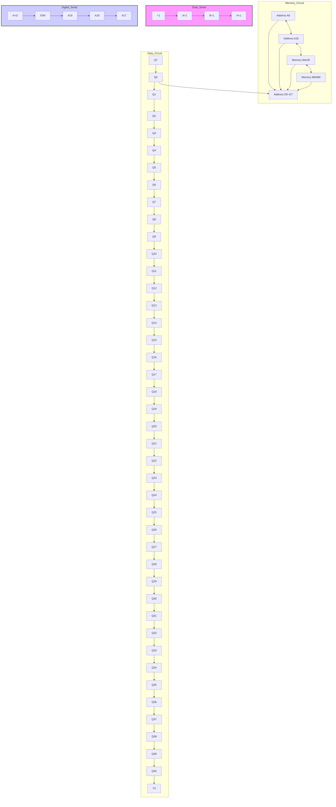
</details>

存器输出接口写入什么样的数据？  
九.(本题10分)本题与第八题可任选一题完成SRAM芯片与8088系统总线连接图如下：

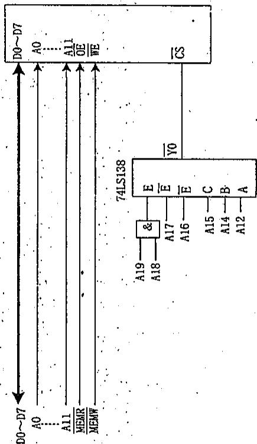

<details>
<summary>flowchart</summary>

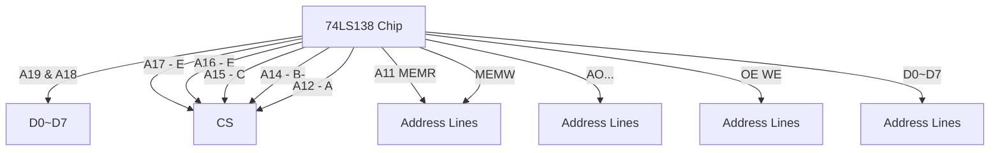
</details>

1. 试分析该 SRAM 占用的内存地址范围。  
2. 若用这样芯片构成地址范围为 38000H—39FFFH 的可用内存，试画出与 8088 系统总线的连接图

3. 因为计数时钟为 $1\mathrm{MHz}$ ，而每个计数器的计数值是 16 位的。因此，一个计数器的最大计数时间只有 65、5ms 左右，无法满足要求。但 8253 有三个计数器，可以串联使用以解决问题。（到此 2 分）例如，将时钟接到 CLKO 上，使 GATEO 有数（高电平）并将 OJTO 简出接到 CLKI 上做为计数器 1 的计数时钟，并使 GATEI 为高电平。这就将计数器 0 和计数器 1 单到一起。可使计数器 0 工作在方式 2 或方式 3，使其输出连续的脉冲。使计数器 1 工作在方式 0。且使两计数器的总计数值为空方式 2 或方式 3，使其输出连续的脉冲。使计数器 1 工作在方式 0。且使两计数器的总计数值为空方式 2 或方式 3，使其输出连续的脉冲。使计数器 1 工作在方式 0。且使两计数器的总计数值为空方式 2 或方式 3，使其输出连续的脉冲。使计数器1 工作在方式 0。且使两计数器的总计数值为空方式 2 或方式 3，使其输出连续的脉冲。使计数器1 工作在方式 0。且使两计数器的总计数值为空方式 2 或方式 3，使其输出连续的脉冲。使计数器1 工作在方式 0。且使两计数器的总计数值为空方式2 或方式3，使其输出连续的脉冲。使计数器1 工作在方式 0。且使两计数器的总计数值为空方式2 或方式3，使其输出连续的脉冲。使计数器1 工作在方式 0。且使两计数器的总计数值为空方式2 或方式3，使其输出连续的脉冲。使计数器1 工作在方式 0。且使两 计数器的总计数值为空方式2 或方式3，使其输出连续的脉冲。使计数器1 工作在方式 0。且使两 计数器的总计数值为空方式2 或方式3，使其输出连续的脉冲。使计数器1 工作在方式 0。且使两 计数器的总计数值为空方式2 或方式3，使其输出连续的脉冲。使计数者1 工作在方式 0。且使两 计数器的总计数值为空方式2 或方式3，使其输出连续的脉冲。使计数者1 工作在方式 0。且使两 计数器的总计数值为空方式2 或方式3，使其输出连续的脉冲。使计数者1 工作在方式 0。且使两 计数器的总计数值为空方式2或方式3，使其输出连续的脉冲。使计数者1 工作在方式 0。且使两 计数器的总计数值为空方式2或方式3，使其输出连续的脉冲。使计数者1 工作在方式 0。且使两 计数器的总计数值为空方式2或方式3，使其输出连续的脉冲。使计数者1 工作在方式 0。但 $8253$ 有三个计数器，可以串联使用以解决问题。(到此 2 分)

①传输速率高 ②支持即插印刷 ③支持执插拔 ④良好的扩展性 ⑤可靠性高
⑥统一标准 ⑦总线供电 ⑧传送距离 ⑨低成本  
1. (对一条1.5分, 对2条3分, 对3条4分)
USB具备许多优异的性能与特点:   
三

1. 统一 隔离（独立）

5. 道感度为磁盘沿半径方向上，单位长度（毫米或英寸）上的磁道数；位密度为磁盘最内磁道上，单位长度（毫米或英寸）上记录的二进制位数。

5.   
⑦ 9.②
8.④ 4.③
⑧ 3.④   
① 7.②   
③6.②1.

(对则2分，错则无分)

参考答案及评分标准

六.1.画出连接图如下：

(3) 515 块应放在 Cache 的 0 组中 (此对空 2 分)

主存地址 OECDBAH 未命中（此对空1分）

(2) 主存地址 91118H 命中，其 Cache 地址为 1D8H（此对空 2 分）

(1) 区导为 11 位；组导 1 位；夹导 2 位；夹内地址 6 位；相联比较 13 位。（对一室 1

王

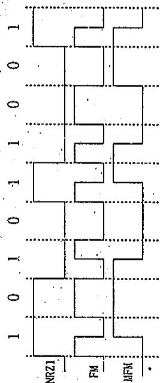

<details>
<summary>text_image</summary>

MFR
Fm
NRZ1
I 0 0 I I 0 I 0 I
</details>

四. 图图如下（对一种2分）

6. 命中率 H=24200/25000=96.8

XX+1:00:00:00
中端返回后再去读小时（或再去读分秒），必定产生近1小时的误差。（到此4分）

:

这时利用率从内存读出当前时间，必须用多余指令才能得时、分、秒读出。（到此1分）并且，倍数在读出59分、59秒（或在先读出时）时产生中断，在中断处理程序中会使内存中的时间计数变

XX: 59: 59: 49

计数计划49时，即电子时钟计数如下：

5. 根据题意可知，这是利用定时器和中断软件实现电子时钟。若发生在某时 59 分 59 秒且 50 次

4. CPU 欧出 INT 40H 指令，经指令逻辑求知这是一条中断指令。并且得到 40H 欧是该软件中
内的中断向量表中。(到达 4 分)
有两个单元的内容送 CS。这软转向了中断服务程序。当然，在此之前，中断服务程序的入口地址早已填入中断向量表中。(到达 4 分)

(到此4分)

1000×1000，可以计数器0的计数值为1000，则OUT0的输出就是周期为1ms的对称方法或窄体值。使计数器1工作在方式3，并使其计数值为1000，则OUT1的输出即为周期1秒的对称方波。

第6页共页

八. ①画图如下（画对左侧译码部分4分；右侧部分1分）  
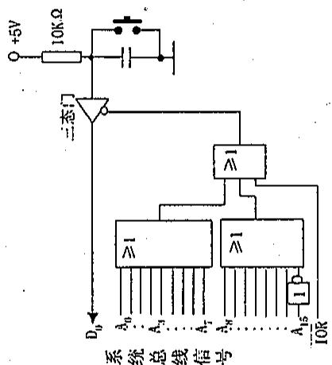

<details>
<summary>flowchart</summary>

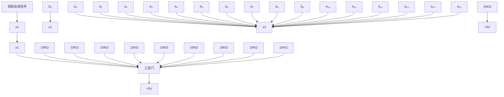
</details>

②编程序如下：（编程对5分）
DIPM: MOV DX, 8000H  
DIPM: MOV DX, 8000H   
IN AL, DX   
AND AL. OIH   
JZ CLOSE   
TMP OPEN   
$\therefore m : x = 1$ 或 ${3x} + {4y} + 1 = 0$

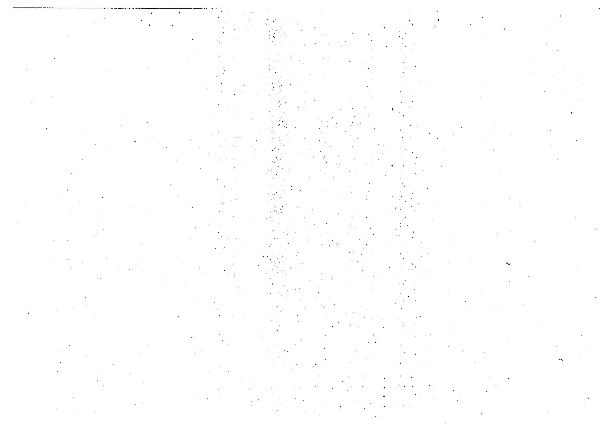

<details>
<summary>bar</summary>

| Year | Value |
|---|---|
| 2018 | 1.0 |
| 2019 | 1.5 |
| 2020 | 2.0 |
| 2021 | 2.5 |
| 2022 | 3.0 |
| 2023 | 3.5 |
</details>

(面对地址译码3分：其他对2分)  
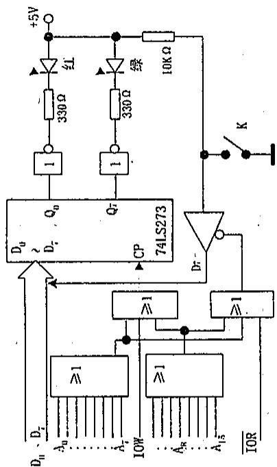

<details>
<summary>flowchart</summary>

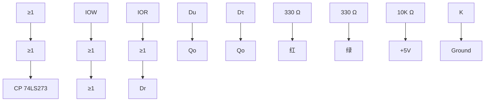
</details>

系统总线信号  
2. 编程序如下  
START: MOV DX,0000H   
IN AL,DX
AND AL,80H   
JZ NEXT   
MOV AL,80H
OUT DY AI

JMP START   
NEXT: MOV AL,01H.  
OUT DX,AL   
JMP START.   
(程序逻辑上对即得 5 分)  
七. (3-8译码对6分，2732连对4分，共计10分)  
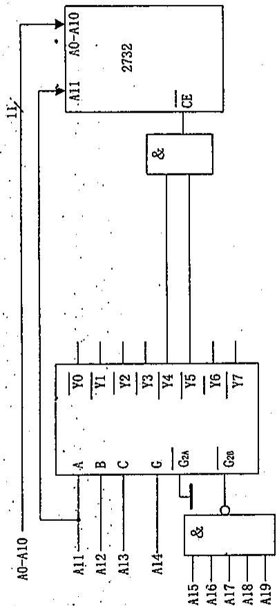

<details>
<summary>flowchart</summary>

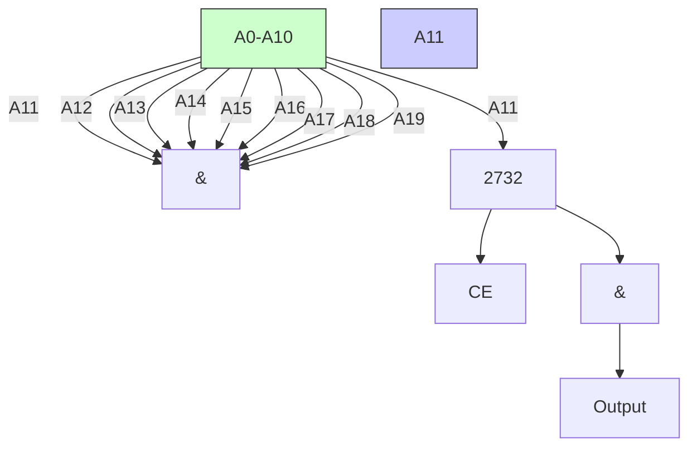
</details>

八. (对一小题5分)   
① ×××××001B   
② ×××××111B

4.   
1. C0000H-C0FFH: C2000H-C2FFH (对一个3分, 全对5分)
2. 电路图如下: (缩短逻辑对一个3分, 其他部分对2分)  


<details>
<summary>flowchart</summary>

```mermaid
graph TD
    subgraph_Channel_1["CS"]
        direction LR
        A["CS"] --> B["00~07"]
        C["CS"] --> D["00~07"]
        E["00"] --> F["11"]
        G["11"] --> H["11"]
        I["11"] --> J["11"]
        K["11"] --> L["11"]
        M["11"] --> N["11"]
        O["11"] --> P["11"]
        Q["11"] --> R["11"]
        S["11"] --> T["11"]
        U["11"] --> V["11"]
        W["11"] --> X["11"]
        Y["11"] --> Z["11"]
        AA["00"] --> AB["00~07"]
    end

    subgraph_Channel_2["74LS38"]
        direction LR
        B --> AC["A12"]
        B --> AD["A13"]
        B --> AE["A14"]
        B --> AF["A18"]
        B --> AG["A19"]
        B --> AH["A15"]
        B --> AI["A16"]
        B --> AJ["A17"]
        B --> AK["MEMN"]
        B --> AL["MEMNR"]
        B --> AM["00"]
    end

    Channel_2 -->|Y0| Channel_2
    Channel_2 -->|A12-B-C-YI| Channel_2
    Channel_2 -->|A19-G| Channel_2
    Channel_2 -->|A15-AI5| Channel_2
    Channel_2 -->|A0-MEMN| Channel_2
    Channel_2 -->|A0-MEMNR| Channel_2
```
</details>


# 西安电子科技大学

考试时间 120 分钟

# 《计算机组成与结构II》试题

<table><tr><td>题号</td><td>一</td><td>二</td><td>三</td><td>四</td><td>五</td><td>六</td><td>七</td><td>八</td><td>总分</td></tr><tr><td>分数</td><td></td><td></td><td></td><td></td><td></td><td></td><td></td><td></td><td></td></tr></table>

1. 考试形式：闭卷；2. 考试日期；20 11 年 6 月 日 3. 本试卷共 大题，满分 100 分。

# 班级 学号 性名 任课教师

一. 单项选择题（在每小型的四个备选答案中选出一个正确的答案，并将其写四填写在题子后面的O中。每小题2分，本题共20分）

①上开边 ②下 Jordan

③高电平 ④低电平

2. 若某中断的中断类型可为 0AH，则其中断向量表的首地址为 O
①0000AH ②00028H
③0002AH ④0004AH

. . . . . . . . . . . . . . . . . . . . . . . . . . . . . . . . . . . . . .

3. 名 PSW 中的 II=0，8086CPU 闪烁应的甲
①INJ nnH ②INTO ③MMI ④INTR

4. 内存从 B8000H 到 DBFFH, 共有 O

①144K ②198K ③224K ④288K

5. 采用中断方式来实现输入输出是因为它O

①速度最快 ②CPU 不参与操作

③实现起来比较容易 ④能对突发事件做出实时响应
6. 主存与 CPU 之间增加高速缓存 Cache 的目的是 \_\_\_\_。
① 解决主存与 CPU 之间的速度匹配问题。
② 解决主存与 CPU 之间的速度匹配问题。

②扩大主存的存储容量。

③ 扩大外存储器的导址空间

④ 提高外部存储器的速度

7.8086CPU 构成内存时，内存需分为O

①不分体。 ②2个体

③3个体 ④4个体
8. 在计算机中，CPU 对其访问速度最快的

① 主存

③CPU中的通用寄存器

9. 掉电后，下面说法中正确的是。

① RAM 的数据不会丢失
② ROM 的数据不会丢失

③ EPROM 的数据会丢失  
④ DRAM 的数据不会丢失  
支持即插即用、热插拔的总线是  
②SCSI.   
④USB   
③RS-232C

填空题（每空1分，本题共10分）

1. 8086CPU的中断系统最多可以容纳 \_\_\_\_ 个中断源，每个中断源用一个

长度为 \_\_\_\_ 位的编码标识，该编码称为 \_\_\_\_。

2. 相联存储器不按地址访问存储器，而是按 \_\_\_\_ 访问存储器。

3. 在市场上所见到的多核处理器是属于 \_\_\_\_ 结构。

4. Cache工作中，替换算法有多种，其中有\_\_\_\_算法和\_\_\_\_算

法。

5. 在主存采用多体存储器的目的是

6. 磁盘的道密度的定义为

密度的定义为

6.磁盘的道密度的定义为\_\_\_\_；位

三. 判断题（认为正确的在题后○中打“√”号，错误的打×”号。并写出正确的内容，否则不得分。每小题2分，本题共10分）

1. EEPROM 的内容可以利用紫外线照射擦除干净。

2. 在可编程并行接口 8255 中，利用将 C 口的按位操作控制字写入 C 口，可实现对

的按位操作。

3. 8086 (88)

无中断请求发生。

4. 在 8086 微机系统中, 可用多个主控中断控制器 8259 和多个从属中断控制器 8259

相连接，构成可管理多个外部中断源的中断系统。

5. 8086CPU 是 16 位的微处理器。因此，一个总线周期就能将一个 16 位的字写入

内存。

四. 简单回答题（每小题4分，本题共20分）

1. 说明在数据 Cache 中，保证数据一致性的方法。

2. 试叙述可编程定时器 8253 工作方式 3 的特点。

3. 说明 PCI 总线诸多特点中的三个特点。

4. 某硬磁盘有 5 个记录面，记录面上有效记录区域的内径为 2cm，外径为 12cm。磁道上记录的位密度为 2600B/mm，道密度为 1000 道/mm，每一磁道上分为 64 个扇区，每个扇区记录 2.4KB，磁盘旋转速度为 10000 转/分。则该硬磁盘的非格式化容量、格式化容量各为多少？该硬磁盘的数据传输速率约为多少？

5. CPU 执行一段程序, 共完成对内存的存取 25000 次, 其中对 Cache 的存取为 24200 次, 对主存的存取为 800 次。已知 Cache 存取时间为 30ns, 主存的存取时间为 300ns。试求 Cache 的命中率及平均存取时间。

五.（本题10分）在8086最大模式的系统总线上，存储器连接图如下图所示。试判断该连接图所构成的内存地址。  


<details>
<summary>flowchart</summary>


</details>

六、（三个小题分别为5分、3分、2分，本题共10分）设一直接映像方式的Cache，容量为8KB，以16B分块。主存储器容量为512KB，求：(1) Cache分为多少块，块号及块内地址各为多少位？为实现地址映像，主存地址应如何划分。

(2) 主存中顺序排列的第 513 块（即若主存不分区，以第 0 块开始顺序排列时）内容调入到 Cache 的哪一块中？
(3) 在上一步的基础上，若第 513 块的内容已调入。试说明主存地址为 04011H 时是否命中？

七. （本题10分）可编程定时计数器8253连接如下图所示：计数器1初始化为方式1，计数值为500；计数器2初始化为方式3，计数值为2000；计数器2外接时钟频率为 $2.5\mathrm{MHz}$ ，其输出OUT2经反相器用作计数器1的外部计数时钟。在开关K闭合（两计数器门控信号GATE接地）的情况下，将两计数器初始化。此后，某一时刻将开关K断开，试画出开关K断开之后OUT2的波形和OUT1反相器后的输出波形，并标出波形的宽度。


<details>
<summary>flowchart</summary>


</details>

八．（每小题5分，本题共10分）按钮开关如下图所示：按下时两接点短路，抬起时开路。


1. 定接口地址 8000H～800FH 可随意选用，试自选接口芯片，将该按钮开关接在 8088CPU 的最大模式下的系统总线上。画连接图。
2. 试编程序，读此按钮，若按钮按下，程序转向 CLOSE；若按钮抬起，程序转向 OPEN。

3. PCI 的一些特点: (答出下面 3 种即可)
① 高传输性能 ② 总线设备工作与 CPU 相对独立 ③ 即插即用 ④ 支持设备多主控 ⑤ 错误检测及报告 ⑥ 两种电压环境 ⑦ 两种兼容卡槽

2. 方式 3(方波发生器)
在这种方式下，可以从 OUT 得到对称的方波输出。当装入的计数值 N 为偶数时，则前 N/2 计数过程中，OUT 为高；后 N/2 计数过程中，OUT 为低，如此这般一直进行下去。若 N 为奇数，则(N+1)/2 计数过程中，OUT 保持高电平；而(N-1)/2 计数期间，OUT 为低电平。(到此 3 分)
在此方式下，GATE 信号为低电平时，强迫 OUT 输出高电平。当 GATE 为高电平时，OUT 输出对称方波。(到此 4 分)

四. 为了保证主存与 Cache 内容的一致性，可采取下面所描述的写策略：（答出下面 1 种即可）
① 写回法
写回法是当 CPU 写 Cache 命中时，只将数据写入 Cache 而不立即写入主存。只有当被 CPU 写入修改的块被替换出去时才写回到主存中。
② 全写法
全写法是当 CPU 写 Cache 命中时，在将数据写入修改 Cache 的同时写入修改主存，较好地保证了主存与 Cache 内容的一致性。

4. X 在 8086 微机系统中，只能用 1 个主控中断控制器 8259 和一个或多个从属中断控制器 8259 相连接，构成可管理多个外部中断源的中断系统。
5. X 8086 CPU 对于一个规则字或对准字，用一个总线周期就能将一个 16 位的字写入内存；而对于一个不规则字或未对准字，必须用两个总线周期才能将一个 16 位的字写入内存。

三.（对则4分，错无分）  
1. $\times$ EEPROM是用高电压来擦除其存储的内容。  
2. $\times C$ 口的按位操作是将按位操作控制字与入8255的控制寄存器来实现的。  
3.√

①随机替换算法（RAND）②先进先出算法（FIFO）③近期最少使用算法（LRU）④最不经常使用算法（LFU）⑤最优替换算法（OTP）

5. 道密度为磁盘沿半径方向上，单位长度（毫米或英寸）上的磁道数；位密度为磁盘最内磁道上，单位长度（毫米或英寸）上记录的二进制位数。

6. 提高速度

4. (答出下面2种即可)

3. 对称多处理机系统 SMP

1. 256 8 中断类型码或中断向量码

二、（意思对即可给分，每字1分，错则无分）

1.① 2.② 3.③ 4.① 5.④

一. (对则2分，错无分)

参考答案及评分标准

4.（近似下列数值即可，对一项1.5分，全对4分）非格式化容量 $= 50\times 1000\times 3.14\times 2\times 10\times 2600 = 8.16\mathrm{GB}$ 格式化容量 $= 50\times 1000\times 64\times 2.4 = 7.68\mathrm{GB}$ 传输速率 $= 120\times 64\times 2.4 = 18.4\mathrm{MB / S}$

5.(答出下面1项2分)
H=24200÷25000=0.968
SP=(24200×30+800)

五. 内存地址为 18000H～1BFFFH （头对或尾对给 3 分，全对 5 分）
58000H～5BFFFH （头对或尾对给 3 分，全对 5 分）

六
(1) Cache 分为 8KB/16B=512 块，Cache 块号 9 位，块内地址 4 位；主存区号 6 位，区内块号为 9 位；块内地址号为 4 位。
主存地址分为

<table><tr><td>区号</td><td>区内·块号</td><td>块内地址</td></tr></table>

(对一问1分，全对4分)

(2) 513 对 512 取模得 1，则主存第 513 块应装入 Cache 的第 1 块中。(本小题 3 分)

(3)主存地址04011H，对应的区号为02，区内块号为001H，它应当是第1025块，对应于Cache的第1块，但与第513块不是同一区的第1块，故未命中。（本小题3分）

七.

①计数器2的OUT2的输出波如下图：

连续的对称方波，周期为 $2000\times0.4\mu s=800\mu s$ （非对称扣2分，周期错扣3分）

②OUT1 反相后波形如下：

单个正脉冲，脉冲宽度为周期为 $800\mu \mathrm{s}\times 500 = 400\mathrm{ms}$ 对单个脉冲给2分，宽度错扣3分）