# 历年考试卷-计组2019

## 来源

- 分类：`试卷`
- 原始文件：`计组2019.pdf`
- 原始相对路径：`资料/历年考试卷/计组2019.pdf`
- 原始绝对路径：`D:\wzb\计算机组成原理\资料\历年考试卷\计组2019.pdf`

## 后续处理建议

- 从本整理稿中提取稳定知识点
- 检查公式、表格、结构图的提取效果
- 必要时补单独图像解读稿
- 如发现资料错误，转入勘误或分歧

## 提取结果

text_image

试题
题号	一	二	三	四	五	附	总分
分数
1. 考试形式: 闭卷 √ 开卷口
2. 考试日期: 2019年9月6日 (答题内容请写在装订线外)
一、简要分析与设计题（任选其中5小题，每小题8分，本题共40分）
说明：选作超过5小题时，评判前面5个小题
1. 若计算机系统有三个部件a、b、c是可改进的，它们的部件加速比分别为30、30、20。
它们在总执行时间中所占的比例分别是30%、30%、20%。试计算这三部件同时改进后
系统的加速比。
点加体化: 30×30×+70×30×+70×20×=72
2. 两规格化浮点数相乘，若结果需要规格化时，右规的右移位数最多是多少？简述理由。
3. 某计算机指令字长为20位，指令有双操作数、单操作数和无操作数3种格式，每个
操作数字段均用6位二进制表示。设该指令系统共有m条（m<256）双操作数指令，n
条无操作数指令，若采用扩展操作码技术，那么最多还可设计出多少条单操作数指令？
5. 分析下图所示的框
图并回答下列问题：
该框图所完成的功能
是什么？在运算开始
时，D、A、B寄存器中
分别存放的是什么？
6. 某计算机转移指令采用相对寻址，由两字节构成，第一字节为该指令的操作码。第二
个字节为8位带符号的相对位移量。取指令时，每从内存取出一个指令字节下自动加入。
若该转移指令操作码所在的主存地址为2000H，相对位移量为FCH，则转换成功后的值
的地址是多少？

4. 若有效信源信息 M(x) = 1101，选用生成多项式 G(x) = X3 + 1 = 1001。试构成该信源信息的循环冗余校验码。

# 二. (本题 15 分)

(本题 15 分) 设浮点数字长 2 所 4 位, 基值为 2 , 其中阶码 8 位、尾数 16 位, 均用补码表示, 各含一位数符。分析其能表示的规格化浮点数的范围, 填写下表。

<table><tr><td></td><td>阶码编码 (十六进制)</td><td>尾数编码 (十六进制)</td><td>浮点数真值(十进制)</td></tr><tr><td>最大正数</td><td>H</td><td>H</td><td></td></tr><tr><td>最小正数</td><td>H</td><td>H</td><td></td></tr><tr><td>最大负数</td><td>H</td><td>H</td><td></td></tr><tr><td>最小负数</td><td>H</td><td>H</td><td></td></tr></table>

# 三. (本题 15 分)

读下面的程序，说明程序完成的功能

START: MOV DX, 0000H

MOV BX, 0000H

MOV CX, 180

LEA SI, DATA

LEA DI, BUFFER

GOON: MOV AL, [SI]

CMP AL, 80

JB NEXT1

INC DH

JMP NEXT

NEXT1: CMP AL, 50

JC NEXT2

INC DL

JMP STOR

NEXT2: CMP AL, 30

JC NEXT3

INC BH

JMP STOR

NEXT3: INC BL

NEXT: INC SI

LOOP GOON

MOV [DI], DH

MOV [DI+1], DL

MOV [DI+2], BH

MOV [DI+3], BL

HLT

text_image

四．（本题15分）设两数X和Y需用浮点数运算，它们的阶码、尾数均用8位补码表示。已知X、Y分为：X=+53/64，Y=-42/64，给出X—Y=7的计算过程。

natural_image

Close-up of a textured surface with a teal-colored object in the background (no visible text or symbols)

表 1-5.2014年1月1日（星期六）向函的计算机构附图(1)

70/16/55

[Unreadable]

```mermaid
graph TD
    A["数据采集"] --> B["数据处理"]
    B --> C["模块1"]
    C --> D["模块2"]
    D --> E["模块3"]
    E --> F["模块4"]
    F --> G["模块5"]
    G --> H["模块6"]
    H --> I["模块7"]
    I --> J["模块8"]
    J --> K["模块9"]
    K --> L["模块10"]
    L --> M["模块11"]
    M --> N["模块12"]
    N --> O["模块13"]
    O --> P["模块14"]
    P --> Q["模块15"]
    Q --> R["模块16"]
    R --> S["模块17"]
    S --> T["模块18"]
    T --> U["模块19"]
    U --> V["模块20"]
    V --> W["模块21"]
    W --> X["模块22"]
    X --> Y["模块23"]
    Y --> Z["模块24"]
    Z --> AA["模块25"]
    AA --> AB["模块26"]
    AB --> AC["模块27"]
    AC --> AD["模块28"]
    AD --> AE["模块29"]
    AE --> AF["模块30"]
    AF --> AG["模块31"]
    AG --> AH["模块32"]
    AH --> AI["模块33"]
    AI --> AJ["模块34"]
    AJ --> AK["模块35"]
    AK --> AL["模块36"]
    AL --> AM["模块37"]
    AM --> AN["模块38"]
    AN --> AO["模块39"]
    AO --> AP["模块40"]
    AP --> AQ["模块41"]
    AQ --> AR["模块42"]
    AR --> AS["模块43"]
    AS --> AT["模块44"]
    AT --> AU["模块45"]
    AU --> AV["模块46"]
    AV --> AW["模块47"]
    AW --> AX["模块48"]
    AX --> AY["模块49"]
    AY --> AZ["模块50"]
```

flowchart

试用功能信号或控制信号或两者混合的形式，写出实现指令 SUB AX. [SI] 的整量流程（包括取指令和指令执行）。

# 五.（本题15分）某CPU构成的计算机框图如下：

```mermaid
graph TD
    A["接口及外设"] --> B["DB"]
    C["存储器"] --> D["DB"]
    D --> E["PC"]
    D --> F["PSW"]
    D --> G["时序电路"]
    E --> H["微命令形成电路"]
    F --> H
    G --> H
    H --> I["送系统总线的控制信号"]
    I --> J["CPU内部的控制信号"]
    J --> K["时钟"]
    L["接口及外设"] --> M["DB"]
    N["存储器"] --> O["DB"]
    P["接口及外设"] --> Q["DB"]
    R["存储器"] --> S["DB"]
    T["接口及外设"] --> U["DB"]
    V["存储器"] --> W["DB"]
    X["接口及外设"] --> Y["DB"]
    Z["接口及外设"] --> AA["DB"]
    AB["接口及外设"] --> AC["DB"]
    AD["接口及外设"] --> AE["DB"]
    AF["接口及外设"] --> AG["DB"]
    AH["接口及外设"] --> AI["DB"]
    AJ["接口及外设"] --> AK["DB"]
    AL["接口及外设"] --> AM["DB"]
    AN["接口及外设"] --> AO["DB"]
    AP["接口及外设"] --> AQ["DB"]
    AR["接口及外设"] --> AS["DB"]
    AT["接口及外设"] --> AU["DB"]
    AV["接口及外设"] --> AW["DB"]
    AX["接口及外设"] --> AY["DB"]
    AZ["接口及外设"] --> BA["DB"]
    BB["接口及外设"] --> BC["DB"]
    BD["接口及外设"] --> BE["DB"]
    BF["接口及外设"] --> BG["DB"]
    BH["接口及外设"] --> BI["DB"]
    BJ["接口及外设"] --> BK["DB"]
    BL["接口及外设"] --> BM["DB"]
    BN["接口及外设"] --> BO["DB"]
    BP["接口及外设"] --> BP1["SP"]
    BP --> BP2["BP"]
    BP --> BP3["S1"]
    BP --> BP4["D5"]
    BP1 & BP2 & BP3 & BP4 --> BR["AX"]
    BP3 & BP4 & BR --> BS["BX"]
    BP4 & BR --> BT["CX"]
    BP4 & BR --> BU["D8"]
    BR --> BV["T"]
    BV --> BW["ALE"]
    BW --> BX["S"]
    BX --> BY["S"]
    BY --> BW
    BW --> BZ["PW"]
    BZ --> BW
    BW --> BX
    BX --> BY
    BX --> BY
    BX --> BY
    BX --> BY
    BX --> BY
    BX --> BY
    BX --> BY
```

flowchart

试用功能信号或控制信号或两者混合的形式，写出实现指令SUB AX. [SI]的微操作流程（包括取指令和指令执行）。
