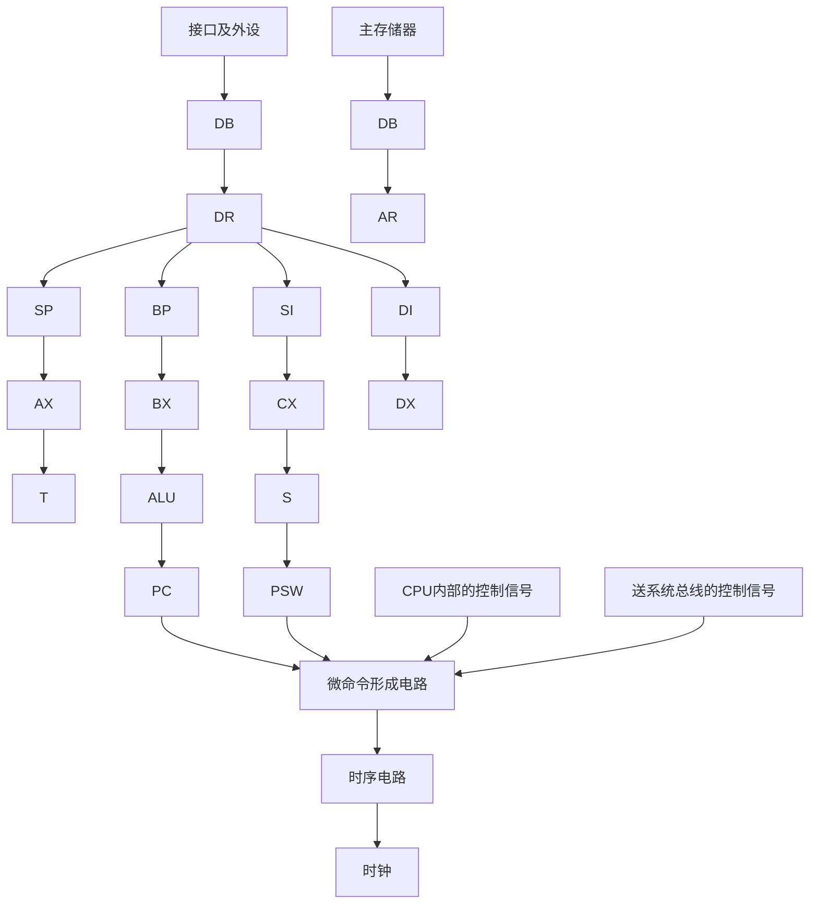

# 历年考试卷-计组2020

## 来源

- 分类：`试卷`
- 原始文件：`计组2020.pdf`
- 原始相对路径：`资料/历年考试卷/计组2020.pdf`
- 原始绝对路径：`D:\wzb\计算机组成原理\资料\历年考试卷\计组2020.pdf`

## 后续处理建议

- 从本整理稿中提取稳定知识点
- 检查公式、表格、结构图的提取效果
- 必要时补单独图像解读稿
- 如发现资料错误，转入勘误或分歧

## 提取结果

# 西 安 电 子 科 技 大 学

# 考试时间 120 分钟

# 试 题

<table><tr><td>题号</td><td>一</td><td>二</td><td>三</td><td>四</td><td>五</td><td>附</td><td>总分</td></tr><tr><td>分数</td><td></td><td></td><td></td><td></td><td></td><td></td><td></td></tr></table>

1.考试形式：闭卷  
2.考试日期：2020 年 8 月 日 (答题内容请写在装订线外)

# 一. 简要分析与设计题（任选其中 6 小题，每小题 7 分，本题共 42 分）

说明：选作超过 6小题时，评判前面6个小题

1. 假设机器字长为 8 位,已知[X]补=D5H，求[X]移、[-X]补、[X/2]补、[2X]补。

2．某计算机指令字24位，定长格式，指令类型有双操作数指令、单操作数指令和无操作数指令，每个操作数地址字段均用 8 位表示，采用扩展操作码。若该指令系统已设计出M条双操作数指令，N条无操作数指令（其中 0<M<28，0<N<216），那么最多还可设计出多少条单操作数指令？  
3．8088CPU 中，设（DS）=2000H,（BX）=0100H,（SI）=0002H,（20100H）=12H,（20101H）=34H,（20102H）=56H,（20103H）=78H,（21200H）=2AH,（21201H）=4CH,（21202H）=B7H,（21203H）=65H，试分别说明下列各条指令执行完后 AX 寄存器中的内容是多少?

① MOV AX，1200H  
② MOV AX，[1200H]   
③ MOV AX，[BX]   
④ MOV AX，1100H[BX]  
⑤ MOV AX，[BX][SI]   
⑥ MOV AX，1100H[BX][SI]  
⑦ LEA AX，1100H[BX][SI]

4．设浮点数字长 16位，基值为2（以 2 为底）。其中阶码7位(含一位阶符)，用移码表示；尾数9位(含一位数符)，用补码表示。请分该析规格化浮点数表示的最大正数、最小正数、最大负数、最小负数。

5. 简述RISC构架的主要特点。

6．某微程序控制器采用的微指令字长为 24 位。微命令生成部分由 4 个字段构成，各字段所包括的互斥微命令分别为 5 个、8 个、14 个和 3 个。另外控制产生后继（次）地址的条件有 3 种。试设计该微指令的格式，说明各个字段（包括次地址等字段）的划分方法，并指出控制存储器的最大容量为多少？

7. 简述冯·诺依曼机硬件的基本组成，其主要特点有哪些？

# 二.（本题 18 分）设浮点数字长 12 位，阶码 4 位（含 1 位符号位），尾数 8 位（含 1位符号位），阶码、尾数均用补码表示。

$$
[ \mathrm{X} ] _ {\text {浮}} = 0 1 1 0 \quad 0 1 0 0 1 0 1 1 \quad [ \mathrm{Y} ] _ {\text {浮}} = 0 1 0 1 \quad 0 1 0 1 0 1 1 0
$$

请按照浮点数运算规则，计算[X·Y]浮 的结果。（要求：给出浮点运算步骤；尾数相乘采用布斯法，运算过程也要给出）

# 三.（本题 15 分）读下面的程序，说明程序完成的功能

BUF DB 100 DUP(?)

RES1 DB 0

RES2 DB 0

START：MOV AX，SEG BUF

MOV DS，AX

LEA SI，BUF

MOV BL, 0

XOR AX，AX

MOV CX，100

GOON: MOV DL，[SI]

TEST DL, 01H

JNZ NEXT

MOV DH, 0

ADD AX, DX

INC BL

NEXT：INC SI

LOOP GOON

DIV BL

MOV RES1, BL

MOV RES2, AL

HLT

四.（本题 15 分）某 CPU 构成的计算机框图如下。其內部总线及內部寄存器均为 16位；主存储器按16位编址。

flowchart

采用数据通路描述方式、控制信号描述方式或两者混合的描述方式，写出在该计算机上，指令 OR [1500H],AX 的取指令、指令执行的微操作流程。(假设该指令由二个 16位的字构成，主存中占二个地址)

# 五.（本题 10 分）某计算机指令对应的微操作表如下所示

<table><tr><td>工作周期标记</td><td>节拍</td><td>状态条件</td><td>微操作命令信号</td><td>CAL</td><td>COM</td><td>SHR</td><td>CSL</td><td>STP</td><td>ADD</td><td>SAT</td><td>LDA</td><td>JMP</td><td>BAN</td></tr><tr><td rowspan="8">FE(取指)</td><td rowspan="2"> $T_0$ </td><td rowspan="2"></td><td>PC→MAR</td><td>1</td><td>1</td><td>1</td><td>1</td><td>1</td><td>1</td><td>1</td><td>1</td><td>1</td><td>1</td></tr><tr><td>1→R</td><td>1</td><td>1</td><td>1</td><td>1</td><td>1</td><td>1</td><td>1</td><td>1</td><td>1</td><td>1</td></tr><tr><td rowspan="2"> $T_1$ </td><td rowspan="2"></td><td>M(MAR)→MDR</td><td>1</td><td>1</td><td>1</td><td>1</td><td>1</td><td>1</td><td>1</td><td>1</td><td>1</td><td>1</td></tr><tr><td>(PC)+1→PC</td><td>1</td><td>1</td><td>1</td><td>1</td><td>1</td><td>1</td><td>1</td><td>1</td><td>1</td><td>1</td></tr><tr><td rowspan="4"> $T_2$ </td><td rowspan="2"></td><td>MDR→IR</td><td>1</td><td>1</td><td>1</td><td>1</td><td>1</td><td>1</td><td>1</td><td>1</td><td>1</td><td>1</td></tr><tr><td>OP(IR)→ID</td><td>1</td><td>1</td><td>1</td><td>1</td><td>1</td><td>1</td><td>1</td><td>1</td><td>1</td><td>1</td></tr><tr><td>I</td><td>1→IND</td><td></td><td></td><td></td><td></td><td></td><td>1</td><td>1</td><td>1</td><td>1</td><td>1</td></tr><tr><td>I</td><td>1→EX</td><td>1</td><td>1</td><td>1</td><td>1</td><td>1</td><td>1</td><td>1</td><td>1</td><td>1</td><td>1</td></tr><tr><td rowspan="5">IND(间址)</td><td rowspan="2"> $T_0$ </td><td rowspan="2"></td><td>Ad(IR)→MAR</td><td></td><td></td><td></td><td></td><td></td><td>1</td><td>1</td><td>1</td><td>1</td><td>1</td></tr><tr><td>1→R</td><td></td><td></td><td></td><td></td><td></td><td>1</td><td>1</td><td>1</td><td>1</td><td>1</td></tr><tr><td> $T_1$ </td><td></td><td>M(MAR)→MDR</td><td></td><td></td><td></td><td></td><td></td><td>1</td><td>1</td><td>1</td><td>1</td><td>1</td></tr><tr><td rowspan="2"> $T_2$ </td><td></td><td>MDR→Ad(IR)</td><td></td><td></td><td></td><td></td><td></td><td>1</td><td>1</td><td>1</td><td>1</td><td>1</td></tr><tr><td>IND</td><td>1→EX</td><td></td><td></td><td></td><td></td><td></td><td>1</td><td>1</td><td>1</td><td>1</td><td>1</td></tr><tr><td rowspan="15">EX(执行)</td><td rowspan="3"> $T_0$ </td><td rowspan="3"></td><td>Ad(IR)→MAR</td><td></td><td></td><td></td><td></td><td></td><td>1</td><td>1</td><td>1</td><td></td><td></td></tr><tr><td>1→R</td><td></td><td></td><td></td><td></td><td></td><td>1</td><td></td><td>1</td><td></td><td></td></tr><tr><td>1→W</td><td></td><td></td><td></td><td></td><td></td><td></td><td>1</td><td></td><td></td><td></td></tr><tr><td rowspan="2"> $T_1$ </td><td rowspan="2"></td><td>M(MAR)→MDR</td><td></td><td></td><td></td><td></td><td></td><td>1</td><td></td><td>1</td><td></td><td></td></tr><tr><td>AC→MDR</td><td></td><td></td><td></td><td></td><td></td><td></td><td>1</td><td></td><td></td><td></td></tr><tr><td rowspan="10"> $T_2$ </td><td rowspan="8"></td><td>(AC)+(MDR)→AC</td><td></td><td></td><td></td><td></td><td></td><td>1</td><td></td><td></td><td></td><td></td></tr><tr><td>MDR→M(MAR)</td><td></td><td></td><td></td><td></td><td></td><td></td><td>1</td><td></td><td></td><td></td></tr><tr><td>MDR→AC</td><td></td><td></td><td></td><td></td><td></td><td></td><td></td><td>1</td><td></td><td></td></tr><tr><td>0→AC</td><td>1</td><td></td><td></td><td></td><td></td><td></td><td></td><td></td><td></td><td></td></tr><tr><td>AC→AC</td><td></td><td>1</td><td></td><td></td><td></td><td></td><td></td><td></td><td></td><td></td></tr><tr><td>R(AC)→L(AC), AC, 不变</td><td></td><td></td><td>1</td><td></td><td></td><td></td><td></td><td></td><td></td><td></td></tr><tr><td>p&#x27;(AC)</td><td></td><td></td><td></td><td>1</td><td></td><td></td><td></td><td></td><td></td><td></td></tr><tr><td>Ad(IR)→PC</td><td></td><td></td><td></td><td></td><td></td><td></td><td></td><td></td><td>1</td><td></td></tr><tr><td>Aa</td><td>Ad(IR)→PC</td><td></td><td></td><td></td><td></td><td></td><td></td><td></td><td></td><td></td><td>1</td></tr><tr><td></td><td>0→G</td><td></td><td></td><td></td><td></td><td>1</td><td></td><td></td><td></td><td></td><td></td></tr></table>

根据上表可知I→IND 的触发逻辑为： $\mathrm { I \{  I N D = F E \bullet T 2 \bullet ( A D D + S A T + L D A + J M P + B A N ) } $ 请参照该形式，写出 M(MAR) →MDR的触发逻辑表达式。

# 1. 以IEEE754单精度浮点数格式表示以下三数：

$$
2 0 2 0. 0 8 2 0 _ {(1 0)}, - 1. 9 8 8 9 \times 1 0 ^ {3 0}
$$

注：IEEE754单精度浮点数格式如下图所示：

<table><tr><td colspan="2">31 30</td><td colspan="2">23 22</td><td>0</td></tr><tr><td>s</td><td colspan="2">E(30:23)</td><td colspan="2">f(22:0)</td></tr></table>

其中，

<table><tr><td>单精度格式位模式</td><td>IEEE浮点数的值</td></tr><tr><td> $0 < e < 255$ </td><td> $(-1)^{s} \times 2^{e-127} \times 1.f$ (正规数)</td></tr><tr><td> $e=0; f \neq 0 (f \text{中至少有一位不为零})$ </td><td> $(-1)^{s} \times 2^{-126} \times 0.f$ (次正规数)</td></tr><tr><td> $e=0; f=0 (f \text{的所有位均为零})$ </td><td> $(-1)^{s} \times 0.0$ (有符号的零)</td></tr><tr><td> $s=0; e=255; f=0 (f \text{的所有位均为零})$ </td><td>+INF(正无穷大)</td></tr><tr><td> $s=1; e=255; f=0 (f \text{的所有位均为零})$ </td><td>-INF(负无穷大)</td></tr><tr><td> $s=u; e=255; f \neq 0 (f \text{中至少有一位不为零})$ </td><td>NaN(非数值)</td></tr></table>

2. 写出 $[ x ] _ { \scriptscriptstyle \perp }  [ x ] _ { \scriptscriptstyle \sharp } ,$ 的转化规则，并证明。
