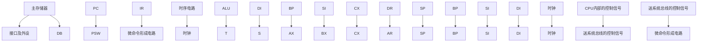

# 历年考试卷-计组2022

## 来源

- 分类：`试卷`
- 原始文件：`计组2022.pdf`
- 原始相对路径：`资料/历年考试卷/计组2022.pdf`
- 原始绝对路径：`D:\wzb\计算机组成原理\资料\历年考试卷\计组2022.pdf`

## 后续处理建议

- 从本整理稿中提取稳定知识点
- 检查公式、表格、结构图的提取效果
- 必要时补单独图像解读稿
- 如发现资料错误，转入勘误或分歧

## 提取结果

# 西 安 电 子 科 技 大 学

# 考试时间 120 分钟

# 试 题

<table><tr><td>题号</td><td>一</td><td>二</td><td>三</td><td>四</td><td>五</td><td>六</td><td>七</td><td>附</td><td>总分</td></tr><tr><td>分数</td><td></td><td></td><td></td><td></td><td></td><td></td><td></td><td></td><td></td></tr></table>

1.考试形式：闭卷  
2.考试日期：2022 年 6 月 24 日 (答题内容请写在装订线外)

# 一. 选择题（每题 2分，共 20分）

1．冯诺依曼计算机硬件能直接执行的只有 。

A．符号语言

B．机器语言

C．汇编语言

D．机器语言和汇编语言

2．8位二进制定点整数，可以表示的最小真值的补码为

A. 00000000

B. 01111111

C. 10000000

D. 11111111

3．如果规格化浮点数的基值已定，则浮点数的精度主要取决于 。

A．阶码的位数

B. 阶码的编码形式

C．尾数的位数

D．尾数的编码形式

4. 若［X］补＝1.x1x2x3x4 ，则当 时，X＞－1/2成立。

A. $\mathbf { x _ { 1 } }$ 必须为1，x2x3x4 至少有一个为1

B. $\mathbf { x _ { 1 } }$ 必须为 1，x2x3x4 任意

C. $\mathbf { x _ { 1 } }$ 必须为0， $\mathbf { X } 2 \mathbf { X } 3 \mathbf { X } 4$ 至少有一个为1

D. $\mathbf { x _ { 1 } }$ 必须为 0， $\mathbf { X } 2 \mathbf { X } 3 \mathbf { X } 4$ 任意

5. 指令 MOV AX，[2000H] 中源操作数的寻址方式是 。

A. 立即寻址

B. 直接寻址

C. 寄存器间接寻址

D. 基址变址寻址

6. 掉电后，下面说法中正确的是 。

A. SRAM的数据不会丢失

B. EEPROM 的数据不会丢失

C. EPROM 的数据会丢失

D. DRAM的数据不会丢失

7．下面关于CISC和 RISC计算机特征的描述中，错误的是 。

A. CISC机器指令类型很多

B. RISC 内部寄存器很多

C. RISC 寻址方式很多

D. CISC执行一条指令用的时钟周期很多

8．在 8086CPU 中, 执行指令 PUSH AX 后, 內容发生改变的寄存器是 C

A. AX

B. BX

C. SS

D. SP

9. CPU 执行程序时， 中存放着 CPU刚取回的指令，供指令译码使用。

A. AR

B. DR

C. IR

D. PC

10. 下面关于Cache和虚拟存储器的描述中，正确的是 。

A. Cache和虚拟存储器对系统程序和应用程序都是透明的  
B. Cache对系统程序是透明的，虚拟存储器对系统程序是不透明的  
C. Cache和虚拟存储器对系统程序都是透明的  
D. Cache对系统程序是不透明的，虚拟存储器对应用程序是透明的

# 二. 简要分析与设计题（任选其中 3小题，每小题 7分，本题共 21分）

1. 若机器字长为 8 位，已知 $\mathbf { [ X ] _ { * \mathrm { { i } } } } = \mathbf { 1 1 0 0 1 0 1 0 }$ , 求：[2X]补、 $[ \mathbf { X } / 2 ] _ { \ast \mathrm { t } }$ 和[-X]补。

2. 某微程序控制器采用的微指令字长为 28 位。微命令生成部分由 5 个字段构成，各字段所包括的互斥微命令分别为 3 个、14 个、5个、7个和8 个。另外控制产生后继（次）地址的条件有 4 种。试设计该微指令的格式，说明各个字段（包括次地址等字段）的划分方法，并指出控制存储器的最大容量为多少？

3. 8088CPU 系统总线上有地址信号 A0-A19、数据信号 D0-D7。内存 40000H 到 4FFFFH 共有多少KB？若采用32K×1b的DRAM芯片构成该内存应采用哪种扩展方式？共需要多少片？

4. 简述微指令设计中，字段译码法相比直接表示法的优势。

# 三.（本题 15 分）设规格化浮点数字长为16 位，尾数采用定点小数补码，10 位（含 1位符号位）；阶码采用定点整数移码，6位（含 1 位符号位）。

（1）分析该规格化浮点数的尾数、阶码的表示范围；  
（2）分析该规格化浮点数所能表示的最大正数、最小正数、最大负数、最小负数；  
（3）若 $\mathrm { X } { = \ - 0 . 0 0 1 1 0 1 \times 2 ^ { - 0 1 0 } }$ ，其中尾数和阶码均为二进制，请采用本题的格式定义，给出[X]浮的规格化浮点数表示。

四.（本题 12 分）已知 X = 0.1011，Y = -0.1110，请用布斯（Booth）法求[X\*Y]补，要求写出运算步骤，结果用补码表示。

五 .（本题 12 分）某计算机的Cache的容量为 2KB，采用直接映像方式，每个块为 256B，内存为4MB，按字节编址。

请问：

（1）主存和cache 的地址分别有多少位，各字段如何划分？  
（2）己知地址变换表如下，

<table><tr><td>0</td><td>127H</td></tr><tr><td>1</td><td>471H</td></tr><tr><td>2</td><td>389H</td></tr><tr><td>3</td><td>624H</td></tr><tr><td>4</td><td>238H</td></tr><tr><td>5</td><td>895H</td></tr><tr><td>6</td><td>278H</td></tr><tr><td>7</td><td>312H</td></tr></table>

① 主存地址 238956H的单元，会调入 cache 中的哪一块（块号从 0 开始编号）？试判断是否命中？若命中则给出变换后的 Cache 地址。  
② 主存地址 312789H的单元，会调入 cache 中的哪一块（块号从 0 开始编号）？试判断是否命中？若命中则给出变换后的 Cache 地址。

# 六.（本题 10分）

某 CPU 构成的计算 机框图如图。其內部 总线及內部寄存器均 为 16位；主存储器按 16位编址。

该计算机取指令阶段的微操作流程为：

$$
\mathrm{PC} \rightarrow \mathrm{AR}
$$

$$
\mathrm{AR} \rightarrow \mathrm{AB}, \quad \mathrm{RD}, \quad \mathrm{PC} + 1
$$

$$
\mathrm{DB} \rightarrow \mathrm{DR}
$$

$$
\mathrm{DR} \rightarrow \mathrm{IR}
$$


<details>
<summary>flowchart</summary>


</details>

请参照此流程，用微操作或控制信号或两者混合，，写出实现加法指令 ADD [SI]，AX 的微操作流程。

# 七.（本题 10 分）读下面的程序

```csv
START: MOV AX, 4000H
MOV DS, AX
MOV SI, 2000H
MOV DX, [SI]
MOV BX, 0
INC SI
INC SI
MOV CX, 99
```

```csv
AGAIN: MOV AX, [SI]
CMP AX, DX
JBE NEXT1
MOV BX, DX
MOV DX, AX
JMP NEXT2 
```

```asm
NEXT1: CMP AX, BX
JBE NEXT2
MOV BX, AX 
```

```txt
NEXT2: INC SI
INC SI
LOOP AGAIN
HLT 
```

说明（1）该程序完成的功能

（2）程序结束时，DX 和BX的结果是什么？

在8086系统总线上，用下图所示SRAM芯片构成80000H～8FFFFH 的内存区域，试画连接电路图。


<details>
<summary>text_image</summary>

SRAM
D0—D7
A0—A14
OE
WE
CS
</details>
