# 课件-CPU设计-Spring-2024

## 来源

- 分类：`课件`
- 原始文件：`CPU设计--Spring.2024.pdf`
- 原始相对路径：`资料/课件/CPU设计--Spring.2024.pdf`
- 原始绝对路径：`D:\wzb\计算机组成原理\资料\课件\CPU设计--Spring.2024.pdf`

## 后续处理建议

- 从本整理稿中提取稳定知识点
- 检查公式、表格、结构图的提取效果
- 必要时补单独图像解读稿
- 如发现资料错误，转入勘误或分歧

## 内容导读（基于整理稿归纳）

本讲是“处理器设计”专题的入口，先回顾指令系统，再把焦点转到 CPU 如何依靠寄存器与寻址方式定位代码和数据，为后续控制器与执行过程做铺垫。

## 关键知识点

- 程序执行位置与代码/数据定位：CPU 通过寄存器和寻址方式定位指令与操作数。
- 汇编程序的组织方式：串操作、循环、`procedure`、`macro` 等是从指令系统过渡到处理器设计的重要桥梁。
- “为什么叫寻址”这一点是本讲核心：不是只记名字，而是理解 CPU 如何找到目标。

## 典型例题 / 思考题

- `mov`、`lea`、`mov offset` 的关系与区别。
- 串操作所依赖的关键要素及相关寄存器。
- 循环、子程序、宏调用在汇编层面的典型写法。

## 例题理解层（基于课件整理）

### 题目簇 1：指令系统与指令执行

- 原题/原问：
  - 什么是指令系统?
  - 简述指令执行过程?
  - 如何设计指令格式?
- 题意：理解指令系统的定义（CPU可执行的全部指令集合），指令执行的完整流程，以及指令格式的设计原则。
- 所考知识点：
  - 指令系统（指令集）：一台计算机能识别和执行的全部指令的集合
  - 指令执行过程：取指→译码→取操作数→执行→写回
  - 指令格式设计：操作码长度、地址码数量、定长vs变长的权衡
  - 8086指令格式：1-6字节可变长度
- 解题关注点：
  - 指令系统是硬件与软件的接口
  - 取指阶段PC/IP自增是固定动作
  - 指令格式设计需平衡编码效率与译码复杂度
- 题型归类建议：概念辨析题
- 备注：信息完整

### 题目簇 2：数据传送指令与串操作

- 原题/原问：
  - 简述mov, lea, mov offset的关系?
  - 简述串操作所需的7个要素?
- 题意：区分MOV（数据传送）、LEA（取有效地址）、MOV OFFSET（取偏移地址）三条指令的语义差异，以及串操作指令（REP MOVS等）所需的7个要素。
- 所考知识点：
  - MOV：传送操作数的值
  - LEA：传送操作数的有效地址（偏移地址），不访存
  - MOV OFFSET：与LEA类似但仅限于直接寻址
  - 串操作7要素：源段(DS:SI)、目的段(ES:DI)、传送方向(DF)、传送长度(CX)、操作类型(MOVS/STOS/LODS等)、重复前缀(REP/REPE)、数据大小
- 解题关注点：
  - LEA vs MOV：LEA取地址，MOV取内容
  - 串操作中SI/DI自动增减由DF标志决定
  - REP前缀隐含LOOP（CX自减、非零重复）
- 题型归类建议：指令分析题
- 备注：信息完整，串操作7要素是高频简答题

## 提取结果

# 《计组I》

# 第五章 处理器设计

李瑞 教授

蒋志平 副教授

计算机科学与技术学院

# 温故 — 关于指令系统

- 简述mov, lea, mov offset的关系?
- 简述串操作所需的7个要素
- 简述JMP和其它条件跳转指令
- 汇编中实现循环的典型方案?
- 汇编中如何定义“变量”?
- 简述procedure，如何调用procedure?
- 简述marco，如何调用marco?

# 回顾一下指令系统一章学了啥？

- 我们知道了CPU的逻辑结构：

- CPU里面有通用寄存器，A/B/C/DX
- 有ALU
- 有段/偏移寄存器 CS:IP / DS:SI/DI/BX / SS:SP / ES
- 有标志位Flags (SF, CF, OF, IF, PF, ZF ...)
- CPU里面用总线方式连接这些部件...

# 回顾一下指令系统一章学了啥？

- 我们还知道了:

- 汇编其实是非常“简单”的语言...
- 汇编/机器程序就是“流水帐”，数据与指令无区分
- 运行时的程序在内存里，CPU从内存读指令执行
- CPU运行哪里的代码?

- CS:IP哪到哪就运行哪！

- 学习+使用了一些常见的指令(mov, add, int, halt, ret...)

●
■ ■ ■

# 回顾一下指令系统一章学了啥？

- 我们还知道了:

- 多种寻址方式(为什么叫寻址？)

- 指令的寻址方式（哪几种？）

- 数据的寻址方式（哪几种？）

●
■ ■ ■

# 回顾一下指令系统一章学了啥？

- 似乎，我们理解了...

- CPU是基于寄存器器
- CPU是基于地址运行的
- CPU可以对一些指令正确响应&工作
- 基于汇编语言的CPU操作方法

- 但是，

- CPU到底是什么样？
- 指令系统怎么设计的？
- CPU是如何分解并执行指令的?
- 以及最神秘的~“CPU内部的CPU”
- CPU内部的微指令/操作如何实现

# 回顾一下指令系统一章学了啥？

- 但是，

- CPU到底是什么样?
- 指令系统怎么设计的？
- CPU是如何分解并执行指令的?
- 以及最神秘的~“CPU内部的CPU”
- CPU内部的微指令/操作如何实现

- 第五章 CPU设计

5.1 CPU结构
5.2 CPU指令设计
5.3 指令执行过程
5.4 CPU部件设计

5.4.2 控制器的设计

- 组合逻辑控制器
- 微指令控制器

- 微指令编码设计

# CPU基本组成

# CPU基本组成

1. 部件：寄存器、ALU、控制器、其它
2. 数据通路(DataPath): 总线(BUS)、专用通路
3. 外部交互：外部总线

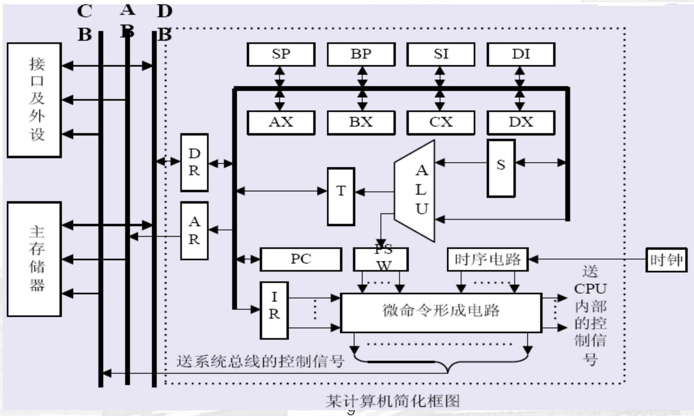

<details>
<summary>flowchart</summary>

```mermaid
graph TD
    A["主存储器"] --> B["接口及外设"]
    A --> C["接口及外设"]
    A --> D["接口及外设"]
    B --> E["接口及外设"]
    C --> F["接口及外设"]
    D --> G["接口及外设"]
    H["接口及外设"] --> I["D"]
    H --> J["A"]
    H --> K["B"]
    H --> L["B"]
    M["PC"] --> N["微命令形成电路"]
    O["I R"] --> N
    P["AR"] --> N
    Q["SP"] --> R["ALU"]
    S["BP"] --> R
    T["SI"] --> R
    U["DI"] --> R
    V["S"] --> R
    W["P S W"] --> N
    X["时序电路"] --> N
    Y["时钟"] --> Z["送CPU内部的控制信号"]
    AA["DS"] --> R
    AB["T"] --> R
    AC["AX"] --> R
    AD["BX"] --> R
    AE["CX"] --> R
    AF["S"] --> R
    AG["D"] --> AH["DR"]
    AH --> I
    AI["PSW"] --> N
    AJ["时序电路"] --> N
    AK["微命令形成电路"] --> N
    AL["主存储器"] --> AM["主存储器"]
    AN["主存储器"] --> AO["主存储器"]
    AP["主存储器"] --> AQ["主存储器"]
    AR["主存储器"] --> AS["主存储器"]
    AT["主存储器"] --> AU["主存储器"]
    AV["主存储器"] --> AW["主存储器"]
    AX["主存储器"] --> AY["主存储器"]
    AZ["主存储器"] --> BA["主存储器"]
    BB["主存储器"] --> BC["主存储器"]
    BD["主存储器"] --> BE["主存储器"]
    BF["主存储器"] --> BG["主存储器"]
    BH["主存储器"] --> BI["主存储器"]
    BJ["主存储器"] --> BK["主存储器"]
    BL["主存储器"] --> BM["主存储器"]
    BN["主存储器"] --> BO["主存储器"]
    BP["主存储器"] --> BP1["A"]
    BP1 --> R
    BP2["A"] --> R
    BP3["A"] --> R
    BP4["A"] --> R
    BP5["A"] --> R
    BP6["A"] --> R
    BP7["A"] --> R
    BP8["A"] --> R
    BP9["A"] --> R
    BP10["A"] --> R
    BP11["A"] --> R
    BP12["A"] --> R
    BP13["A"] --> R
    BP14["A"] --> R
    BP15["A"] --> R
    BP16["A"] --> R
    BP17["A"] --> R
    BP18["A"] --> R
    BP19["A"] --> R
    BP20["A"] --> R
    BP21["A"] --> R
    BP22["A"] --> R
    BP23["A"] --> R
    BP24["A"] --> R
    BP25["A"] --> R
    BP26["A"] --> R
    BP27["A"] --> R
    BP28["A"] --> R
    BP29["A"] --> R
    BP30["A"] --> R
```
</details>

# CPU基本组成

# 1. 部件：寄存器、ALU、控制器、其它

CPU内部范围

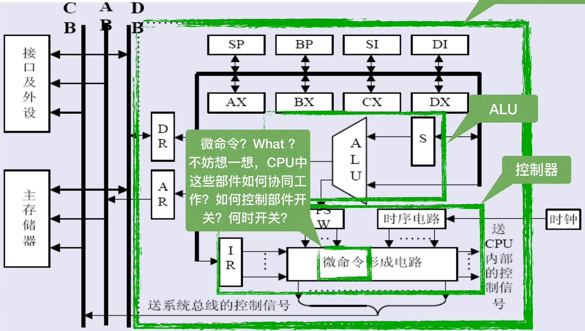

<details>
<summary>flowchart</summary>

```mermaid
graph TD
    A["接口及外设"] --> B["C"]
    A --> C["A"]
    A --> D["B"]
    A --> E["D"]
    F["主存储器"] --> G["D"]
    F --> H["A"]
    F --> I["A"]
    J["接口及外设"] --> K["D"]
    L["主存储器"] --> M["A"]
    L --> N["A"]
    O["接口及外设"] --> P["D"]
    Q["主存储器"] --> R["A"]
    S["接口及外设"] --> T["D"]
    U["接口及外设"] --> V["D"]
    W["接口及外设"] --> X["D"]
    Y["接口及外设"] --> Z["D"]
    AA["接口及外设"] --> AB["D"]
    AC["接口及外设"] --> AD["D"]
    AE["接口及外设"] --> AF["D"]
    AG["接口及外设"] --> AH["D"]
    AI["接口及外设"] --> AJ["D"]
    AK["接口及外设"] --> AL["D"]
    AM["接口及外设"] --> AN["D"]
    AO["接口及外设"] --> AP["D"]
    AQ["接口及外设"] --> AR["D"]
    AS["接口及外设"] --> AT["D"]
    AU["接口及外设"] --> AV["D"]
    AW["接口及外设"] --> AX["D"]
    AY["接口及外设"] --> AZ["D"]
    BA["接口及外设"] --> BB["D"]
    BC["接口及外设"] --> BD["D"]
    BE["接口及外设"] --> BF["D"]
    BG["接口及外设"] --> BH["D"]
    BI["接口及外设"] --> BJ["D"]
    BK["接口及外设"] --> BL["D"]
    BM["接口及外设"] --> BN["D"]
    BO["接口及外设"] --> BP["D"]
    BP --> BQ["SP"]
    BP --> BR["BP"]
    BP --> BS["SI"]
    BP --> BT["DI"]
    BU["接口及外设"] --> BV["AX"]
    BW["接口及外设"] --> BX["BX"]
    BX --> BY["CX"]
    BX --> BZ["CX"]
    BX --> CA["DX"]
    CB["接口及外设"] --> CC["D"]
    CD["接口及外设"] --> CE["D"]
    CF["接口及外设"] --> CG["D"]
    CH["接口及外设"] --> CI["D"]
    CJ["接口及外设"] --> CK["D"]
    CL["接口及外设"] --> CM["D"]
    CN["接口及外设"] --> CO["D"]
    CP["接口及外设"] --> CR["D"]
    CS["接口及外设"] --> CT["D"]
    CU["接口及外设"] --> DV["D"]
    DW["接口及外设"] --> DXD["CX"]
    DXD --> DU["S"]
    DU --> CV["S"]
    CV --> CW["ALU"]
    CW --> CU
    CX["接口及外设"] --> CY["S"]
    CY --> CU
    CZ["SX"] --> CU
    CU --> CV
    CV --> CW
    CW --> CY
    CY --> CU
    CU1["微命令？ What？ 不妨想一想，CPU中这些部件如何协同工作？如何控制部件开关？何时开关？"] --> CU2["微命令形成电路"]
    CU2 --> CY2["时序电路"]
    CY2 --> CU3["时序电路"]
    CU3 --> CY3["时序电路"]
    CU3 --> CY4["时序电路"]
    CU4["微命令形成电路"] --> CY5["微命令形成电路"]
    CU5 --> CY6["微命令形成电路"]
    CU6["微命令形成电路"] --> CY7["微命令形成电路"]
    CU7["微命令形成电路"] --> CY8["微命令形成电路"]
    CU8["微命令形成电路"] --> CY9["微命令形成电路"]
    CU9["微命令形成电路"] --> CY10["微命令形成电路"]
    CU10["微命令形成电路"] --> CY11["微命令形成电路"]
    CU11["微命令形成电路"] --> CY12["微命令形成电路"]
    CU12["微命令形成电路"] --> CY13["微命令形成电路"]
    CU13["微命令形成电路"] --> CY14["微命令形成电路"]
    CU14["微命令形成电路"] --> CY15["微命令形成电路"]
    CU15["微命令形成电路"] --> CY16["微命令形成电路"]
    CU16["微命令形成电路"] --> CY17["微命令形成电路"]
    CU17["微命令形成电路"] --> CY18["微命令形成电路"]
    CU18["微命令形成电路"] --> CY19["微命令形成电路"]
    CU19["微命令形成电路"] --> CY20["微命令形成电路"]
```
</details>

某计算机简化框图

# CPU基本组成

1. 部件：寄存器、ALU、控制器、其它
通用寄存器
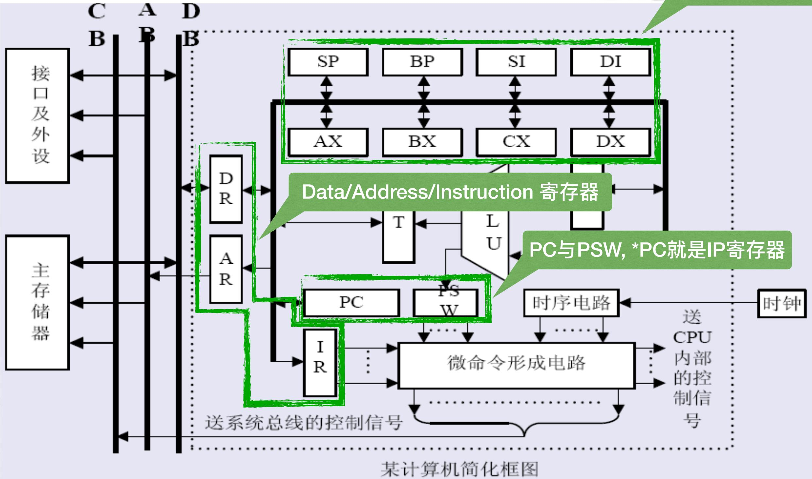

<details>
<summary>flowchart</summary>

```mermaid
graph TD
    A["接口及外设"] --> B["D"]
    C["主存储器"] --> D["A"]
    D --> E["B"]
    E --> F["C"]
    F --> G["D"]
    G --> H["B"]
    H --> I["D"]
    I --> J["B"]
    J --> K["C"]
    K --> L["D"]
    L --> M["B"]
    M --> N["D"]
    N --> O["B"]
    O --> P["C"]
    P --> Q["D"]
    Q --> R["B"]
    R --> S["C"]
    S --> T["D"]
    T --> U["B"]
    U --> V["C"]
    V --> W["D"]
    W --> X["B"]
    X --> Y["C"]
    Y --> Z["D"]
    Z --> AA["B"]
    AA --> AB["C"]
    AB --> AC["D"]
    AC --> AD["B"]
    AD --> AE["C"]
    AE --> AF["D"]
    AF --> AG["B"]
    AG --> AH["C"]
    AH --> AI["D"]
    AI --> AJ["B"]
    AJ --> AK["C"]
    AK --> AL["D"]
    AL --> AM["B"]
    AM --> AN["C"]
    AN --> AO["D"]
    AO --> AP["B"]
    AP --> AQ["C"]
    AQ --> AR["D"]
    AR --> AS["B"]
    AS --> AT["C"]
    AT --> AU["D"]
    AU --> AV["B"]
    AV --> AW["C"]
    AW --> AX["D"]
    AX --> AY["B"]
    AY --> AZ["C"]
    AZ --> BA["D"]
    BA --> BB["B"]
    BB --> BC["C"]
    BC --> BD["D"]
    BD --> BE["B"]
    BE --> BF["C"]
    BF --> BG["D"]
    BG --> BH["B"]
    BH --> BI["C"]
    BI --> BJ["D"]
    BJ --> BK["B"]
    BK --> BL["C"]
    BL --> BM["D"]
    BM --> BN["B"]
    BN --> BO["C"]
    BO --> BP["D"]
    BP --> BQ["BX"]
    BQ --> BR["T"]
    BR --> BS["LU"]
    BS --> BT["PC与PSW, *PC就是IP寄存器"]
    BT --> BU["时序电路"]
    BU --> BV["微命令形成电路"]
    BV --> BW["送CPU内部的控制信号"]
    BW --> BX["时钟"]
```
</details>

# CPU基本组成

2. 数据通路(DataPath): 总线(BUS)、专用通路
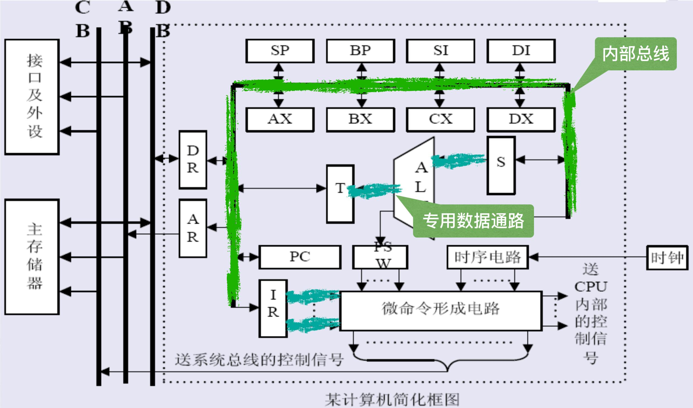

<details>
<summary>flowchart</summary>

```mermaid
graph TD
    A["主存储器"] --> B["接口及外设"]
    B --> C["C"]
    B --> D["A"]
    B --> E["B"]
    B --> F["D"]
    G["外部设备"] --> H["接口及外设"]
    H --> I["接口及外设"]
    I --> J["接口及外设"]
    J --> K["接口及外设"]
    K --> L["接口及外设"]
    L --> M["接口及外设"]
    M --> N["接口及外设"]
    N --> O["接口及外设"]
    O --> P["接口及外设"]
    P --> Q["接口及外设"]
    Q --> R["接口及外设"]
    R --> S["接口及外设"]
    S --> T["接口及外设"]
    T --> U["接口及外设"]
    U --> V["接口及外设"]
    V --> W["接口及外设"]
    W --> X["接口及外设"]
    X --> Y["接口及外设"]
    Y --> Z["接口及外设"]
    Z --> AA["接口及外设"]
    AA --> AB["接口及外设"]
    AB --> AC["接口及外设"]
    AC --> AD["接口及外设"]
    AD --> AE["接口及外设"]
    AE --> AF["接口及外设"]
    AF --> AG["接口及外设"]
    AG --> AH["接口及外设"]
    AH --> AI["接口及外设"]
    AI --> AJ["接口及外设"]
    AJ --> AK["接口及外设"]
    AK --> AL["接口及外设"]
    AL --> AM["接口及外设"]
    AM --> AN["接口及外设"]
    AN --> AO["接口及外设"]
    AO --> AP["接口及外设"]
    AP --> AQ["接口及外设"]
    AQ --> AR["接口及外设"]
    AR --> AS["接口及外设"]
    AS --> AT["接口及外设"]
    AT --> AU["接口及外设"]
    AU --> AV["接口及外设"]
    AV --> AW["接口及外设"]
    AW --> AX["接口及外设"]
    AX --> AY["接口及外设"]
    AY --> AZ["接口及外设"]
    AZ --> BA["接口及外设"]
    BA --> BB["接口及外设"]
    BB --> BC["接口及外设"]
    BC --> BD["接口及外设"]
    BD --> BE["接口及外设"]
    BE --> BF["接口及外设"]
    BF --> BG["接口及外设"]
    BG --> BH["接口及外设"]
    BH --> BI["接口及外设"]
    BI --> BJ["接口及外设"]
    BJ --> BK["接口及外设"]
    BK --> BL["接口及外设"]
    BL --> BM["接口及外设"]
    BM --> BN["接口及外设"]
    BN --> BO["接口及外设"]
    BO --> BP["接口及外设"]
    BP --> BP1["SP"]
    BP1 --> BP2["BP"]
    BP2 --> BP3["BP"]
    BP3 --> BP4["BP"]
    BP4 --> BP5["BP"]
    BP5 --> BP6["BP"]
    BP6 --> BP7["BP"]
    BP7 --> BP8["BP"]
    BP8 --> BP9["BP"]
    BP9 --> BP10["BP"]
    BP10 --> BP11["BP"]
    BP11 --> BP12["BP"]
    BP12 --> BP13["BP"]
    BP13 --> BP14["BP"]
    BP14 --> BP15["BP"]
    BP15 --> BP16["BP"]
    BP16 --> BP17["BP"]
    BP17 --> BP18["BP"]
    BP18 --> BP19["BP"]
    BP19 --> BP20["BP"]
    BP20 --> BP21["BP"]
    BP21 --> BP22["BP"]
    BP22 --> BP23["BP"]
    BP23 --> BP24["BP"]
    BP24 --> BP25["BP"]
    BP25 --> BP26["BP"]
    BP26 --> BP27["BP"]
    BP27 --> BP28["BP"]
    BP28 --> BP29["BP"]
    BP29 --> BP30["BP"]
    BP30 --> BP31["BP"]
    BP31 --> BP32["BP"]
    BP32 --> BP33["BP"]
    BP33 --> BP34["BP"]
    BP34 --> BP35["BP"]
    BP35 --> BP36["BP"]
    BP36 --> BP37["BP"]
    BP37 --> BP38["BP"]
    BP38 --> BP39["BP"]
    BP39 --> BP40["BP"]
    BP40 --> BP41["BP"]
    BP41 --> BP42["BP"]
    BP42 --> BP43["BP"]
    BP43 --> BP44["BP"]
    BP44 --> BP45["BP"]
    BP45 --> BP46["BP"]
    BP46 --> BP47["BP"]
    BP47 --> BP48["BP"]
    BP48 --> BP49["BP"]
    BP49 --> BP50["BP"]
    BP50 --> BP51["BP"]
    BP51 --> BP52["BP"]
    BP52 --> BP53["BP"]
    BP53 --> BP54["BP"]
    BP54 --> BP55["BP"]
    NP_专用数据通路
    A_L
    S
    PC
    PS
    W
    IR
    微命令形成电路
    专用数据通路
```
</details>

# CPU基本组成

# 3. 外部交互：外部总线

\*想一想：3个总线、DR/AR/IR各多少位？

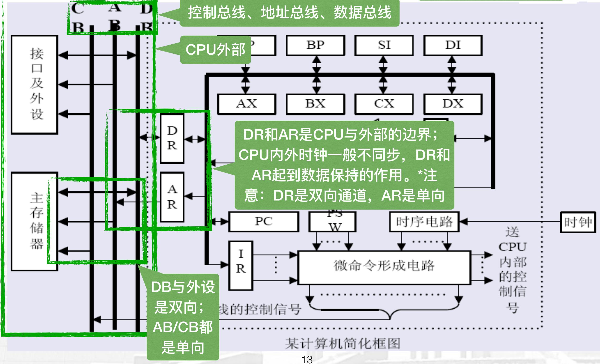

<details>
<summary>flowchart</summary>

```mermaid
graph TD
    A["接口及外设"] --> B["C"]
    A --> C["A"]
    A --> D["B"]
    A --> E["D"]
    A --> F["B"]
    G["主存储器"] --> H["DR"]
    G --> I["AR"]
    J["DB与外设是双向；AB/CB都是单向"] --> K["PC"]
    L["CPU外部"] --> M["BP"]
    L --> N["SI"]
    L --> O["DI"]
    P["时钟"] --> Q["时序电路"]
    R["微命令形成电路"] --> S["FSW"]
    R --> T["IR"]
    U["DR和AR是CPU与外部的边界；CPU内外时钟一般不同步，DR和AR起到数据保持的作用。*注意：DR是双向通道，AR是单向"] --> V["送CPU内部的控制信号"]
    W["线的控制信号"] --> X["DB与外设是双向；AB/CB都是单向"]
    Y["控制总线、地址总线、数据总线"] --> Z["接口及外设"]
    AA["控制总线、地址总线、数据总线"] --> AB["接口及外设"]
    AC["控制总线、地址总线、数据总线"] --> AD["接口及外设"]
    AE["控制总线、地址总线、数据总线"] --> AF["接口及外设"]
    AG["控制总线、地址总线、数据总线"] --> AH["接口及外设"]
    AI["控制总线、地址总线、数据总线"] --> AJ["接口及外设"]
    AK["控制总线、地址总线、数据总线"] --> AL["接口及外设"]
    AM["控制总线、地址总线、数据总线"] --> AN["接口及外设"]
    AO["控制总线、地址总线、数据总线"] --> AP["接口及外设"]
    AQ["控制总线、地址总线、数据总线"] --> AR["接口及外设"]
    AS["控制总线、地址总线、数据总线"] --> AT["接口及外设"]
    AU["控制总线、地址总线、数据总线"] --> AV["接口及外设"]
    AW["控制总线、地址总线、数据总线"] --> AX["接口及外设"]
    AY["控制总线、地址总线、数据总线"] --> AZ["接口及外设"]
    BA["控制总线、地址总线、数据总线"] --> BB["接口及外设"]
    BC["控制总线、地址总线、数据总线"] --> BD["接口及外设"]
    BE["控制总线、地址总线、数据总线"] --> BF["接口及外设"]
    BG["控制总线、地址总线、数据总线"] --> BH["接口及外设"]
    BI["控制总线、地址总线、数据总线"] --> BJ["接口及外设"]
    BK["控制总线、地址总线、数据总线"] --> BL["接口及外设"]
    BM["控制总线、地址总线、数据总线"] --> BN["接口及外设"]
    BO["控制总线、地址总线、数据总线"] --> BP["接口及外设"]
    BQ["控制总线、地址总线、数据总线"] --> BR["接口及外设"]
    BS["控制总线、地址总线、数据总线"] --> BT["接口及外设"]
    BU["控制总线、地址总线、数据总线"] --> BV["接口及外设"]
    BW["控制总线、地址总线、数据总线"] --> BX["接口及外设"]
    BY["控制总线、地址总线、数据总线"] --> BZ["接口及外设"]
    CA["控制总线、地址总线、数据总线"] --> CB["接口及外设"]
    CC["控制总线、地址总线、数据总线"] --> CD["接口及外设"]
    CE["控制总线、地址总线、数据总线"] --> CF["接口及外设"]
    CG["控制总线、地址总线、数据总线"] --> CH["接口及外设"]
    CI["控制总线、地址总线、数据总线"] --> CJ["接口及外设"]
    CK["控制总线、地址总线、数据总线"] --> CR["接口及外设"]
    CS["控制总线、地址总线、数据总线"] --> CT["接口及外设"]
    CU["控制总线、地址总线、数据总线"] --> CV["接口及外设"]
    CW["控制总线、地址总线、数据总线"] --> CX["接口及外设"]
    CY["控制总线、地址总线、数据总线"] --> CZ["接口及外设"]
    DA["控制总线、地址总线、数据总线"] --> DB["接口及外设"]
    DC["控制总线、地址总线、数据总线"] --> DD["接口及外设"]
    DJ["控制总线、地址总线、数据总线"] --> DE["接口及外设"]
    DF["控制总线、地址总线、数据总线"] --> DG["接口及外设"]
    DH["控制总线、地址总线、数据总线"] --> DI["接口及外设"]
    DJA["控制总线、地址总线、数据总线"] --> DJB["XX"]
    DJA --> DJC["XX"]
    DJA --> DJD["XX"]
    DJA --> DJE["XX"]
    DJA --> DJF["XX"]
    DJA --> DJG["XX"]
    DJA --> DJH["XX"]
    DJA --> DJI["XX"]
    DJA --> DJJ["XX"]
    DJA --> DJK["XX"]
    DJA --> DJL["XX"]
    DJA --> DJM["XX"]
```
</details>

# CPU基本组成

- 数据总线和CPU内部总线是双向的。
- 总线的条数称为数据总线宽度。比如，16位总线，指其数据总线为16根。
- 数据总线是三态的，是指0，1和高阻抗三个状态。由于总线是公共通道，在某一时刻，只允许接收某一设备的信号，其他一切设备都应和它断开。

# CPU基本组成

- 控制总线上传送一个部件对另一个部件的控制信号。
- 主设备与从设备:在总线上所连接的各类设备, 按其对总线有无控制功能可分为主设备和从设备。主设备对总线有控制权, 从设备只能响应。
- 三态？不一定~

# CPU基本组成

- 地址总线上传送地址信号，用来指定需要访问的地址/部件
- 总线上的所有部件接收到该地址信号，但只有经过译码电路选中的部件才接收控制信号。
- 地址总线是单向的
- 地址总线也是三态的

# 深入CPU指令执行过程

# 深入CPU指令执行过程

# 1、指令执行的基本过程

- 取指、执行
- 取指、取操作数、执行
- 取指、取操作数、执行、写结果

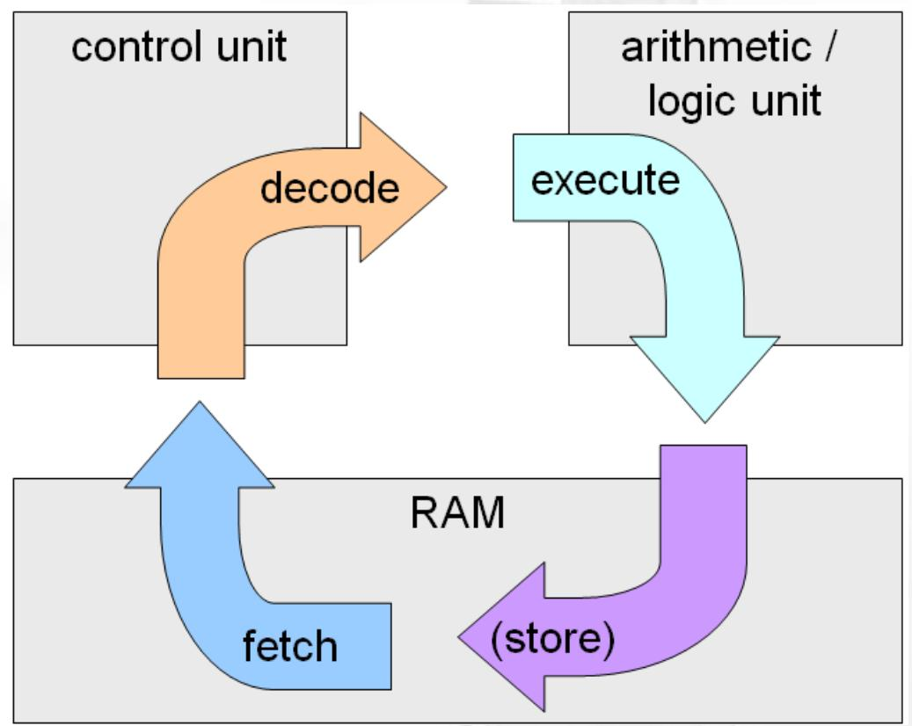

<details>
<summary>flowchart</summary>

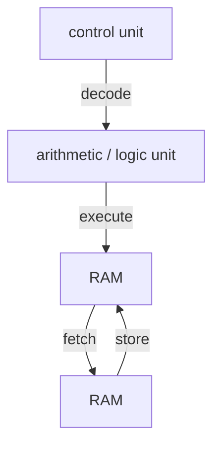
</details>

以指令add [2000h], ax为例，看看4个阶段的CPU内部执行流程

# 深入CPU指令执行过程

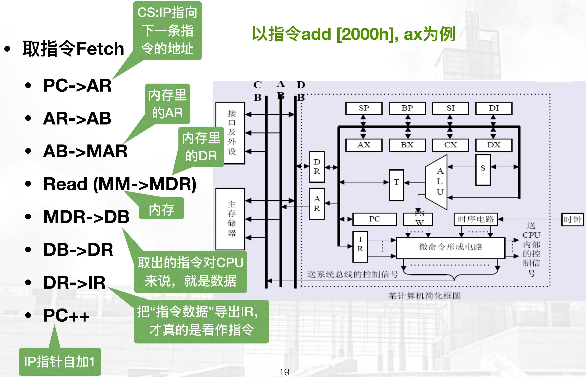

<details>
<summary>flowchart</summary>

```mermaid
graph TD
    A["取指令Fetch"] --> B["PC->AR"]
    A --> C["AR->AB"]
    A --> D["AB->MAR"]
    A --> E["Read (MM->MDR)"]
    A --> F["MDR->DB"]
    A --> G["DB->DR"]
    A --> H["DR->IR"]
    A --> I["PC++"]
    I --> J["IP指针自加1"]

    K["内存里的AR"] --> L["接口及外设"]
    M["内存"] --> N["主存储器"]
    O["内存里的DR"] --> P["主存储器"]

    Q["DS"] --> R["MR"]
    S["DR"] --> T["MR"]
    U["AP"] --> V["AP"]
    W["PS"] --> X["PSW"]
    Y["时序电路"] --> Z["微命令形成电路"]

    AA["时钟"] --> AB["CPU内部的控制信号"]

    AC["CS:IP指向下一条指令的地址"] --> AD["以指令add [2000h"], ax为例]

    AE["取出的指令对CPU来说，就是数据"] --> AF["把“指令数据”导出IR，才真的是看作指令"]

    AG["接线"] --> AH["接口及外设"]
    AI["接口"] --> AJ["主存储器"]

    AK["DAR"] --> AL["ALU"]
    AM["时序电路"] --> AN["微命令形成电路"]

    AO["SP"] --> AP["AX"]
    AQ["BP"] --> AR["BX"]
    AS["SI"] --> AT["CX"]
    AU["DI"] --> AV["DX"]

    AW["AR"] --> AX["T"]
    AY["DS"] --> AZ["S"]

    BA["PC"] --> BB["PIC"]
    BC["PB"] --> BD["PBX"]
    BE["SI"] --> BF["CX"]
    BG["DI"] --> BH["DX"]

    BI["时钟"] --> BJ["送系统总线的控制信号"]

    BK["IP指针自加1"] --> BL["IP指针自加1"]

    BM["IP指针自加1"] --> BN["IP指针自加1"]

    BO["IP指针自加1"] --> BP["IP指针自加1"]

    BP --> BP1["IP指针自加1"]

    BP2["IP指针自加1"] --> BP2["IP指针自加1"]

    BP3["IP指针自加1"] --> BP3["IP指针自加1"]

    BP4["IP指针自加1"] --> BP4["IP指针自加1"]

    BP5["IP指针自加1"] --> BP5["IP指针自加1"]

    BP6["IP指针自加1"] --> BP6["IP指针自加1"]

    BP7["IP指针自加1"] --> BP7["IP指针自加1"]

    BP8["IP指针自加1"] --> BP8["IP指针自加1"]

    BP9["IP指针自加1"] --> BP9["IP指针自加1"]

    BP10["IP指针自加1"] --> BP10["IP指针自加1"]

    BP11["IP指针自加1"] --> BP11["IP指针自加1"]

    BP12["IP指针自加1"] --> BP12["IP指针自加1"]

    BP13["IP指针自加1"] --> BP13["IP指针自加1"]

    BP14["IP指针自加1"] --> BP14["IP指针自加1"]

    BP15["IP指针自加1"] --> BP15["IP指针自加1"]

    BP16["IP指针自加1"] --> BP16["IP指针自加1"]

    BP17["IP指针自加1"] --> BP17["IP指针自加1"]

    BP18["IP指针自加1"] --> BP18["IP指针自加1"]

    BP19["IP指针自加1"] --> BP19["IP指针自加1"]

    BP20["IP指针自加1"] --> BP20["IP指针自加1"]

    B -->|内存里的AR| B
    B -->|内存里的DR| B
    B -->|主存储器| B
    B -->|接口及外设| B
    B -->|主存储器| B
```
</details>

# 深入CPU指令执行过程

以指令add [2000h], ax为例

# 取操作数Fetch Operands

- PC->AR
- AR->AB
- AB->MAR
- Read (MM->MDR)

- MDR->DB

- DB->DR

- DR->S

- PC++

CS:IP指向该指令的第二个字,[2000h]

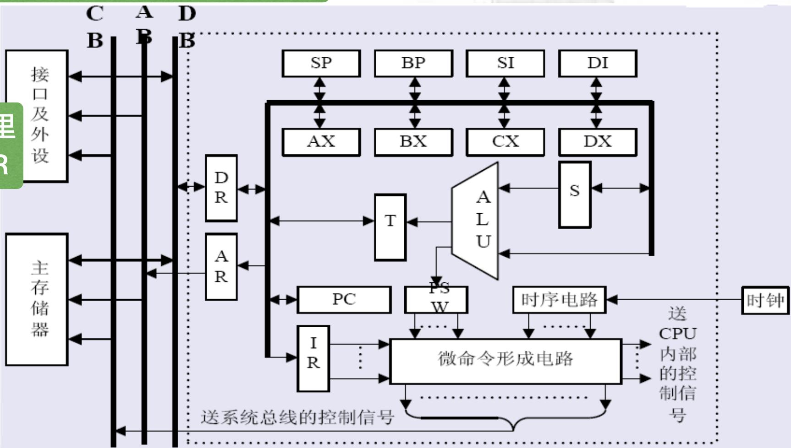

<details>
<summary>flowchart</summary>

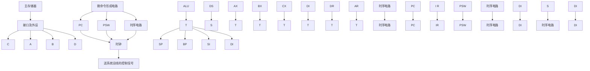
</details>

某计算机简化框图

IP指针自加1

# 深入CPU指令执行过程

- 执行Execute

- AX->ALU
- Add, ALU->T

加法结果放入T

以指令add [2000h], ax为例
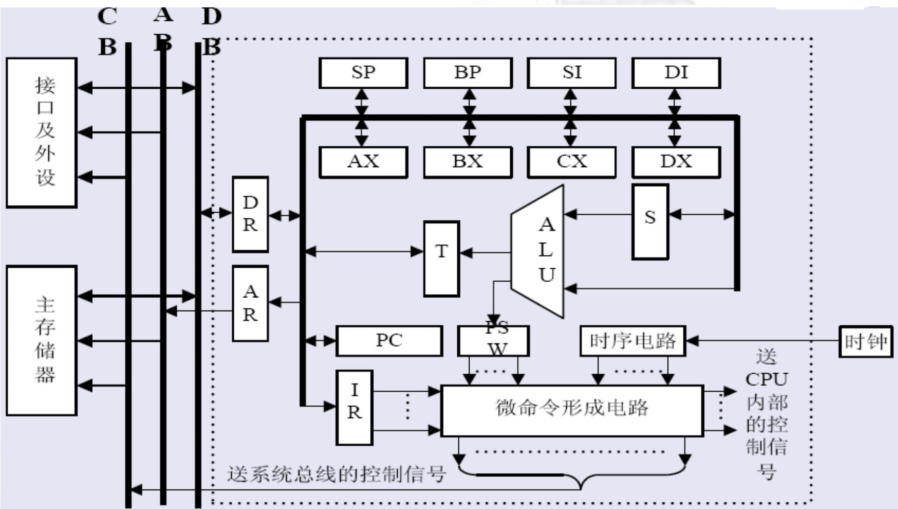

<details>
<summary>flowchart</summary>

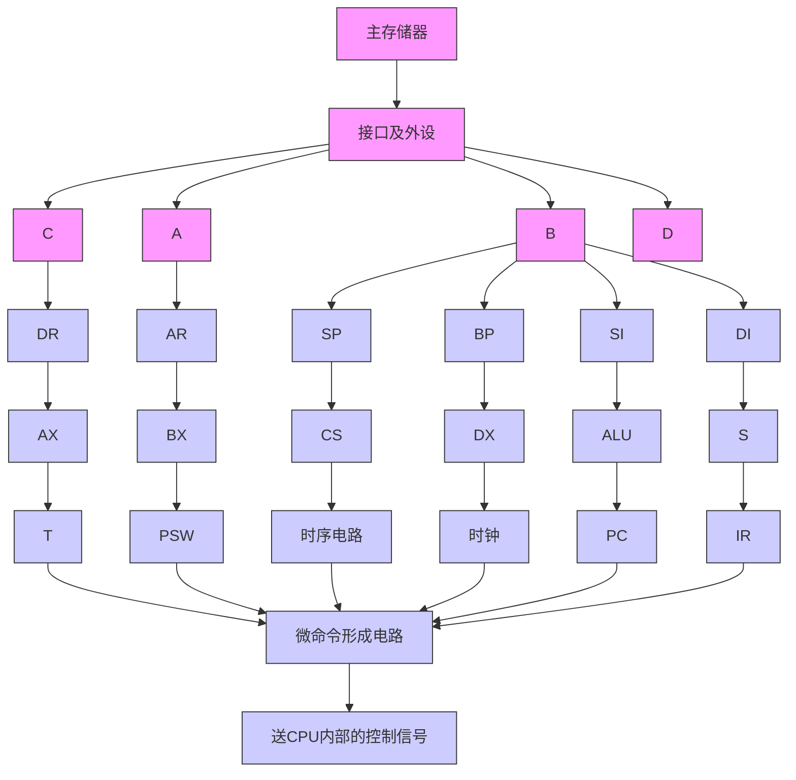
</details>

某计算机简化框图

# 深入CPU指令执行过程

# 以指令add [2000h], ax为例

# 存储Store

结果T送入DR

- T->DR
- DR->DB 从IR中取出
200000h，送入AR
- IR(2000h)->AR
- AR->AB
- DB->MDR
- AB->MAR
- Write

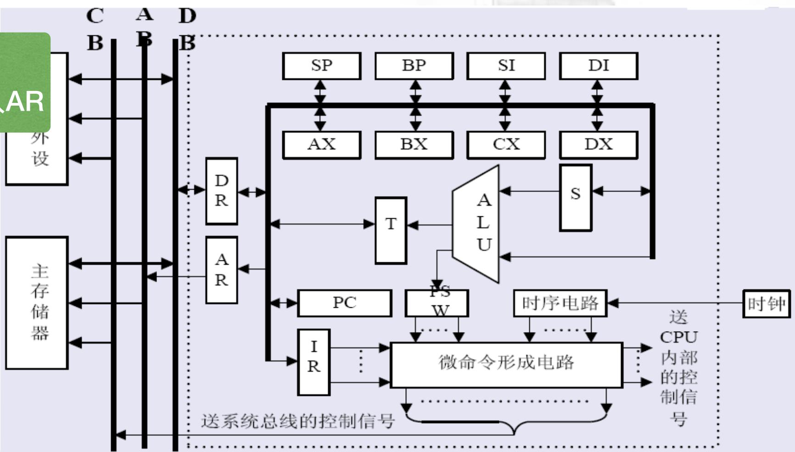

<details>
<summary>flowchart</summary>

微命令系统架构图，展示主存储器、外设、ALU、CPU内部控制信号与时钟交互流程
</details>

某计算机简化框图

# 深入CPU指令执行过程

- 这个例子给我们一些insights:

- 一条机器指令，大约由10-30个更基础的器件级的操作构成，called微操作

- 微操作需要按照顺序进行（微操作需要时序控制）

- 微操作谁在控制?

- CPU内的控制单元CU!

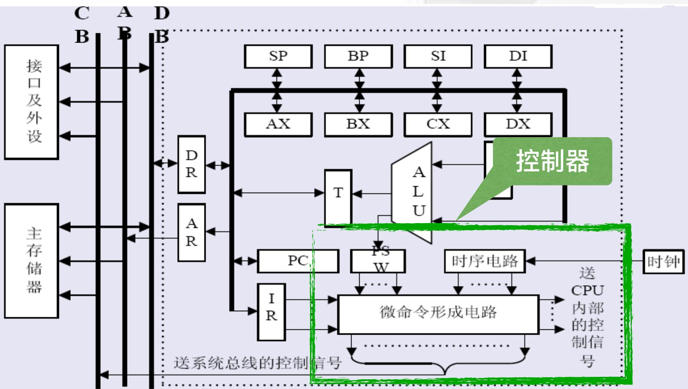

<details>
<summary>flowchart</summary>

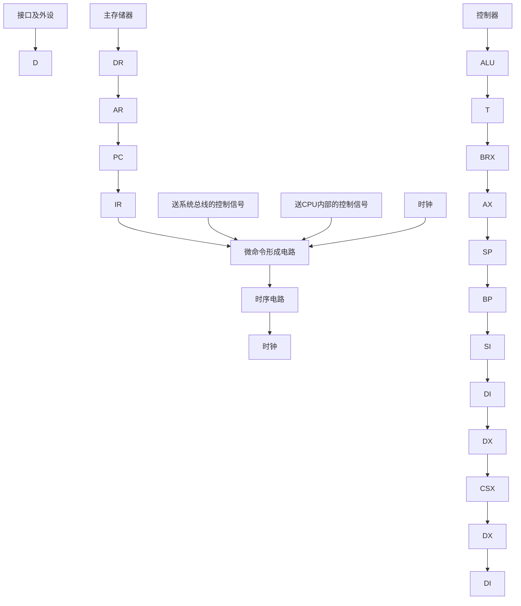
</details>

某计算机简化框图

# 关于时序与控制

- 时序系统的作用：将各种控制信号严格定时，在时间上相互配合完成某一功能。
- 时序信号通常划分为4级：

- 指令周期
- 机器周期（CPU周期）
- 时钟周期（节拍周期）
- [时钟脉冲、节拍脉冲]

# 关于时序与控制

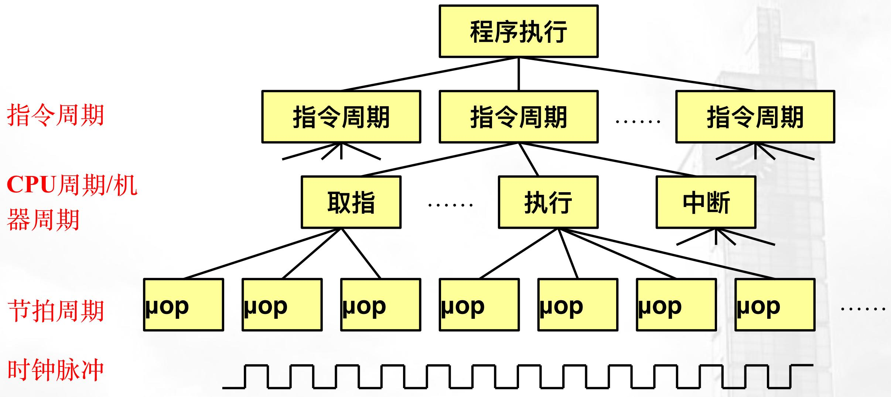

<details>
<summary>flowchart</summary>

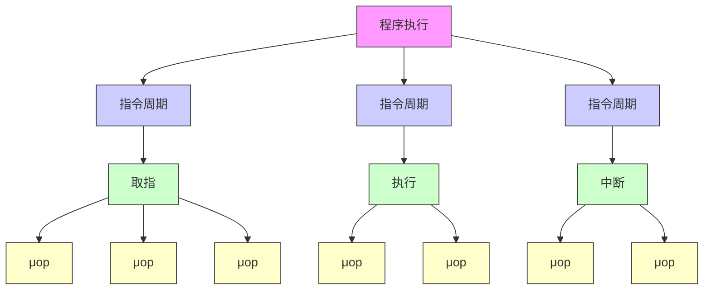
</details>

关于节拍周期：某种最复杂的微操作所需要的时间

关于CPU/机器周期：指令包含的微操作个数不等，不一定相同

# 关于时序与控制

指令周期

机器周期 FIC （取指）

机器周期 FDC （取数）

机器周期 EXEC（执行）

时钟周期 W0

P0

时钟周期 W1

P1

时钟周期 W2

P2

时钟周期 W3

P3

时钟脉冲 CLK

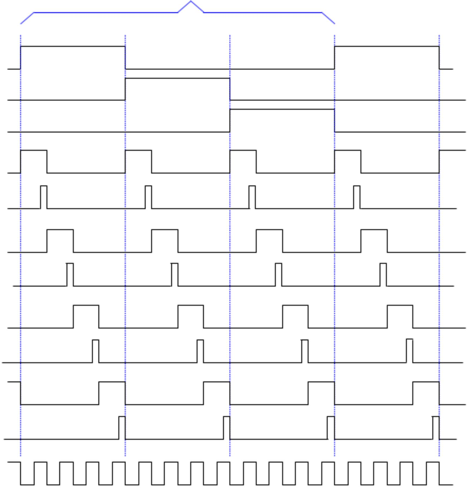

<details>
<summary>line</summary>

| Time | Signal Amplitude |
|------|------------------|
| 0    | 0                |
| 1    | 0                |
| 2    | 0                |
| 3    | 0                |
| 4    | 0                |
| 5    | 0                |
| 6    | 0                |
| 7    | 0                |
| 8    | 0                |
| 9    | 0                |
| 10   | 0                |
| 11   | 0                |
| 12   | 0                |
| 13   | 0                |
| 14   | 0                |
| 15   | 0                |
| 16   | 0                |
| 17   | 0                |
| 18   | 0                |
| 19   | 0                |
| 20   | 0                |
| 21   | 0                |
| 22   | 0                |
| 23   | 0                |
| 24   | 0                |
| 25   | 0                |
| 26   | 0                |
| 27   | 0                |
| 28   | 0                |
| 29   | 0                |
| 30   | 0                |
| 31   | 0                |
| 32   | 0                |
| 33   | 0                |
| 34   | 0                |
| 35   | 0                |
| 36   | 0                |
| 37   | 0                |
| 38   | 0                |
| 39   | 0                |
| 40   | 0                |
| 41   | 0                |
| 42   | 0                |
| 43   | 0                |
| 44   | 0                |
| 45   | 0                |
| 46   | 0                |
| 47   | 0                |
| 48   | 0                |
| 49   | 0                |
| 50   | 0                |
| 51   | 0                |
| 52   | 0                |
| 53   | 0                |
| 54   | 0                |
| 55   | 0                |
| 56   | 0                |
| 57   | 0                |
| 58   | 0                |
| 59   | 0                |
| 60   | 0                |
| 61   | 0                |
| 62   | 0                |
| 63   | 0                |
| 64   | 0                |
| 65   | 0                |
| 66   | 0                |
| 67   | 0                |
| 68   | 0                |
| 69   | 0                |
| 70   | 0                |
| 71   | 0                |
| 72   | 0                |
| 73   | 0                |
| 74   | 0                |
| 75   | 0                |
| 76   | 0                |
| 77   | 0                |
| 78   | 0                |
| 79   | 0                |
| 80   | 0                |
| 81   | 0                |
| 82   | 0                |
| 83   | 0                |
| 84   | 0                |
| 85   | 0                |
| 86   | 0                |
| 87   | 0                |
| 88   | 0                |
| 89   | 0                |
| 90   | 0                |
| 91   | 0                |
| 92   | 0                |
| 93   | 0                |
| 94   | 0                |
| 95   | 0                |
| 96   | 0                |
| 97   | 0                |
| 98   | 0                |
| 99   | 0                |
| Note: The actual data values are not provided in the code. The code generates a sample of the data using the `npmodulation` function. There is only one data series in this case. The output is estimated based on the input value and the number of samples specified in the code.
</details>

# 关于时序与控制

- 时序控制方式:

- 同步、异步、联合

- 同步控制

- 指令执行或指令中每个控制信号都由事先确定的统一的时序信号进行统一控制。

- 可能有具体差异:

- 定长的机器周期，定长的指令周期
- 定长的机器周期，变长的指令周期
- 变长的机器周期，变长的指令周期
- 折中方案

# 关于时序与控制

# 异步控制

当控制器发�