# 课件-CPU设计2-Spring-2024

## 来源

- 分类：`课件`
- 原始文件：`CPU设计2--Spring.2024.pdf`
- 原始相对路径：`资料/课件/CPU设计2--Spring.2024.pdf`
- 原始绝对路径：`D:\wzb\计算机组成原理\资料\课件\CPU设计2--Spring.2024.pdf`

## 后续处理建议

- 从本整理稿中提取稳定知识点
- 检查公式、表格、结构图的提取效果
- 必要时补单独图像解读稿
- 如发现资料错误，转入勘误或分歧

## 内容导读（基于整理稿归纳）

本讲进入 CPU 执行过程本身，围绕“取指、取数、执行、写回”展开，并把数据总线、地址总线、控制器、时序信号这些部件放回到统一执行链路中理解。

## 关键知识点

- 指令执行的基本阶段以及每一阶段对应的微命令。
- CPU 内部主要组成与总线特性，尤其是数据总线、地址总线与控制信号的作用分工。
- 指令周期、CPU 周期、时序周期、时钟周期之间的层次关系。

## 典型例题 / 思考题

- 说明取指、取数、执行、写回阶段分别发出哪些微命令。
- 比较数据总线与地址总线的特性。
- 说明控制器输入信号种类以及时序信号的用途。

## 例题理解层（基于课件整理）

### 题目簇 1：CPU内部结构与微操作

- 原题/原问：
  - CPU内部的主要组成?
  - 数据总线的特性?
  - 地址总线的特性?
  - 说明取指阶段CPU发出哪些微命令？
  - 说明取数阶段CPU发出哪些微命令？
  - 说明执行和写回阶段CPU发出哪些微命令？
  - CPU中的控制器什么用途?
  - 控制器有哪几类输入信号？
  - 时序信号的用途?
  - 指令周期、CPU周期、时序周期、时钟周期的层次关系?
- 题意：理解CPU的基本组成（运算器、控制器、寄存器组、内部总线），数据/地址总线特性，以及指令执行各阶段的微命令序列和时序层次。
- 所考知识点：
  - CPU组成：ALU、CU、寄存器组、内部总线
  - 数据总线：双向，宽度决定一次传输的数据量
  - 地址总线：单向（CPU→内存），宽度决定寻址空间
  - 微命令：控制器发出的控制信号，如 PC_out、AR_in、RD、WR
  - 时序层次：指令周期 > 机器周期(CPU周期) > 时钟周期(节拍) > 时钟脉冲
  - 取指微命令序列：PC_out→AR_in→AR→AB→RD→MM→DB→DR_in→DR_out→IR_in→PC+1
- 解题关注点：
  - 每个微命令对应一个寄存器的输入/输出控制信号
  - 取指阶段是所有指令共有的公共操作
  - 时序信号确保微命令按正确顺序和时刻发出
  - 数据总线宽度与地址总线宽度是不同概念
- 题型归类建议：原理解释题
- 备注：信息完整，CPU设计核心基础

### 题目簇 2：控制器设计——组合逻辑 vs 微程序

- 原题/原问：
  - 一条机器指令，大约由10-30个更基础的器件级的操作构成，called微操作
  - 微操作谁在控制? CPU内的控制单元CU!
  - 总结一下，为什么需要控制器&控制器到底干什么事？
  - 采用硬布线法设计控制器的特点？
  - 微程序控制器与组合逻辑控制器的比较
- 题意：理解控制器的设计动机（编排微操作时序），比较组合逻辑控制器（硬布线）和微程序控制器的实现方式、优缺点和适用场景。
- 所考知识点：
  - 控制器功能：根据指令操作码和时序信号，产生控制信号序列
  - 组合逻辑控制器：用与或门电路直接实现控制信号逻辑表达式
  - 微程序控制器：将控制信号编码为微指令，存入控制存储器（CM/ROM）
  - 组合逻辑：速度快、设计复杂、不可修改；用于RISC
  - 微程序：速度慢、设计规范、可修改扩充；用于CISC
  - 微操作→微命令→微指令→微程序→机器指令的层次关系
- 解题关注点：
  - 硬布线控制器的每个控制信号 = 与或逻辑方程
  - 微程序控制器的CM存放所有指令的微程序
  - 微指令格式：控制域（产生控制信号）+ 地址域（下条微指令地址）
  - 水平型微指令（并行度高、长度大）vs 垂直型微指令（并行度低、长度短）
- 题型归类建议：原理解释题 + 比较分析题
- 备注：控制器设计是CPU设计的核心考点，组合逻辑vs微程序是高频对比题

### 题目簇 3：微程序控制器细节

- 原题/原问：
  - 下一条微指令的地址有三种可能
  - 两地址格式（断定方式）的动机？
  - 单地址格式（计数方式）的特点？
  - 可变格式微指令的设计思想？
  - 水平型微指令控制域的编码方法（直接表示法 vs 字段译码法）
  - 垂直型微指令的特点
- 题意：深入理解微程序控制器的微地址形成方式（顺序/分支/跳转）、微指令编码方法（水平型/垂直型）和字段译码策略。
- 所考知识点：
  - 微地址三种来源：指令译码→微程序首地址、顺序（μPC+1）、分支跳转
  - 两地址格式：微指令同时含下址1和下址2，用AC位选择（快但CM大）
  - 单地址格式：用μPC计数，分支时覆盖μPC（硬件少但慢）
  - 可变格式：S=0为控制微指令，S=1为转移微指令
  - 水平型：直接表示法（每位对应一个控制信号）和字段译码法（分组编码）
  - 字段译码：互斥信号放同字段、相容信号放不同字段
- 解题关注点：
  - 互斥信号不能同时有效（如PC_out和SP_out）
  - 字段译码每字段需留一个NOP编码（全0）
  - m位字段可编码 2^m - 1 个控制信号
  - 间接译码：字段间有关联，需两级译码
- 题型归类建议：原理解释题 + 结构设计题
- 备注：微程序控制器的细节是难点，需结合原图理解结构

## 提取结果

# 《计组I》

# 第五章 处理器设计2

李瑞 教授

蒋志平 副教授

计算机科学与技术学院

# 温故 — 关于指令系统和CPU

- CPU内部的主要组成?
- 数据总线的特性?
- 地址总线的特性?
- 说明取指阶段CPU发出哪些微命令？
- 说明取数阶段CPU发出哪些微命令？
- 说明执行和写回阶段CPU发出哪些微命令？
- CPU中的控制器什么用途?
- 控制器有哪几类输入信号？
- 时序信号的用途?
- 指令周期、CPU周期、时序周期、时钟周期的层次关系?

# 深入CPU指令执行过程

# 深入CPU指令执行过程

# 1、指令执行的基本过程

- 取指、执行
- 取指、取操作数、执行
- 取指、取操作数、执行、写结果

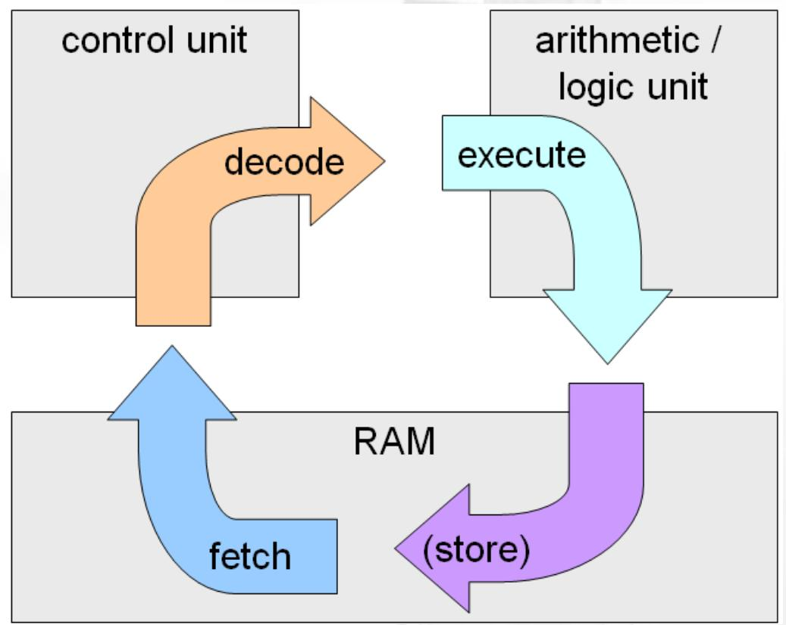

<details>
<summary>flowchart</summary>

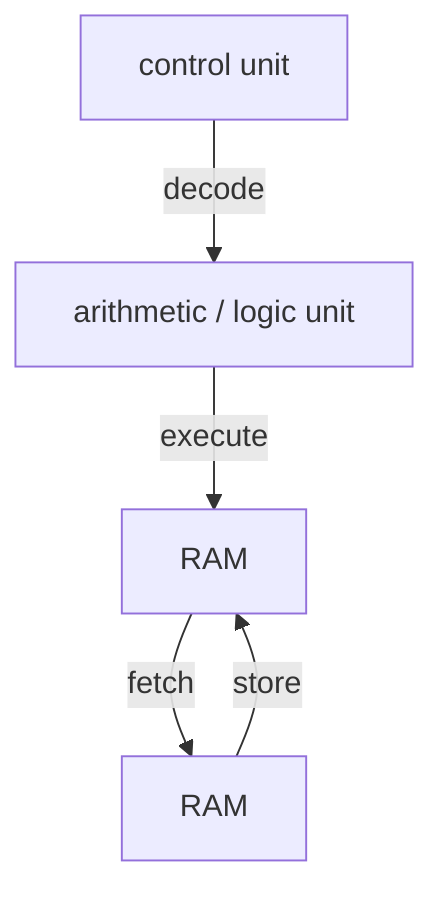
</details>

以指令add [2000h], ax为例，看看4个阶段的CPU内部执行流程

# 深入CPU指令执行过程

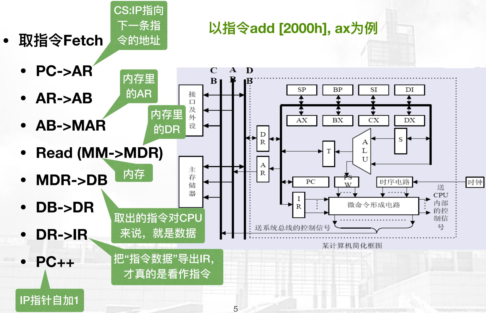

<details>
<summary>flowchart</summary>

```mermaid
graph TD
    A["取指令Fetch"] --> B["PC->AR"]
    A --> C["AR->AB"]
    A --> D["AB->MAR"]
    A --> E["Read (MM->MDR)"]
    A --> F["MDR->DB"]
    A --> G["DB->DR"]
    A --> H["DR->IR"]
    A --> I["PC++"]
    I --> J["IP指针自加1"]

    K["内存里的AR"] --> L["接口及外设"]
    M["内存"] --> N["主存储器"]
    O["内存里的DR"] --> P["主存储器"]

    Q["DS"] --> R["MR"]
    S["DR"] --> T["MR"]
    U["AP"] --> V["AP"]
    W["PS"] --> X["PSW"]
    Y["时序电路"] --> Z["微命令形成电路"]

    AA["时钟"] --> AB["CPU内部的控制信号"]

    AC["CS:IP指向下一条指令的地址"] --> AD["以指令add [2000h"], ax为例]

    AE["接线"] --> AF["接口及外设"]
    AG["端口"] --> AH["接口及外设"]
    AI["端口"] --> AJ["端口"]

    AK["DAR"] --> AL["主存储器"]
    AM["DAR"] --> AN["主存储器"]

    AO["SP"] --> AP["AX"]
    AQ["BP"] --> AR["BX"]
    AS["SI"] --> AT["CX"]
    AU["DI"] --> AV["DX"]

    AW["T"] --> AX["S"]

    AY["PIC"] --> AZ["IIR"]

    BA["PIC"] --> BB["PIC"]

    BC["PIC"] --> BD["PIC"]

    BE["PIC"] --> BF["PIC"]

    BG["PIC"] --> BH["PIC"]

    BI["PIC"] --> BJ["PIC"]

    BK["PIC"] --> BL["PIC"]

    BM["PIC"] --> BN["PIC"]

    BO["PIC"] --> BP["PIC"]

    BP --> BP1["送系统总线的控制信号"]

    BP1 --> BP2["送系统总线的控制信号"]

    BP2 --> BP3["送系统总线的控制信号"]

    BP3 --> BP4["送系统总线的控制信号"]

    BP4 --> BP5["送系统总线的控制信号"]

    BP5 --> BP6["送系统总线的控制信号"]

    BP6 --> BP7["送系统总线的控制信号"]

    BP7 --> BP8["送系统总线的控制信号"]

    BP8 --> BP9["送系统总线的控制信号"]

    BP9 --> BP10["送系统总线的控制信号"]

    BP10 --> BP11["送系统总线的控制信号"]

    BP11 --> BP12["送系统总线的控制信号"]

    BP12 --> BP13["送系统总线的控制信号"]

    BP13 --> BP14["送系统总线的控制信号"]

    BP14 --> BP15["送系统总线的控制信号"]

    BP15 --> BP16["送系统总线的控制信号"]

    BP16 --> BP17["送系统总线的控制信号"]

    BP17 --> BP18["送系统总线的控制信号"]

    BP18 --> BP19["送系统总线的控制信号"]

    BP19 --> BP20["送系统总线的控制信号"]

    BP20 --> BP21["送系统总线的控制信号"]

    BP21 --> BP22["送系统总线的控制信号"]

    BP22 --> BP23["送系统总线的控制信号"]

    BP23 --> BP24["送系统总线的控制信号"]

    BP24 --> BP25["送系统总线的控制信号"]

    BP25 --> BP26["送系统总线的控制信号"]

    BP26 --> BP27["送系统总线的控制信号"]

    BP27 --> BP28["送系统总线的控制信号"]

    BP28 --> BP29["送系统总线的控制信号"]

    BP29 --> BP30["送系统总线的控制信号"]

    BP30 --> BP31["送系统总线的控制信号"]

    BP31 --> BP32["送系统总线的控制信号"]

    BP32 --> BP33["送系统总线的控制信号"]

    BP33 --> BP34["送系统总线的控制信号"]

    BP34 --> BP35["送系统总线的控制信号"]

    BP35 --> BP36["送系统总线的控制信号"]

    BP36 --> BP37["送系统总线的控制信号"]

    BP37 --> BP38["送系统总线的控制信号"]

    BP38 --> BP39["送系统总线的控制信号"]

    BP39 --> BP40["送系统总线的控制信号"]

    BP40 --> BP41["送系统总线的控制信号"]

    BP41 --> BP42["送系统总线的控制信号"]

    BP42 --> BP43["送系统总线的控制信号"]

    BP43 --> BP44["送系统总线的控制信号"]

    BP44 --> BP45["送系统总线的控制信号"]

    BP45 --> BP46["送系统总线的控制信号"]

    BP46 --> BP47["送系统总线的控制信号"]

    BP47 --> BP48["送系统总线的控制信号"]

    BP48 --> BP49["送系统总线的控制信号"]

    BP49 --> BP50["送系统总线的控制信号"]

    BP50 --> BP51["送系统总线的控制信号"]

    B -->|内存里的AR| B
```
</details>

# 深入CPU指令执行过程

以指令add [2000h], ax为例

# 取操作数Fetch Operands

- PC->AR
- AR->AB
- AB->MAR
- Read (MM->MDR)

- MDR->DB

- DB->DR

- DR->S

- PC++

CS:IP指向该指令的第二个字,[2000h]

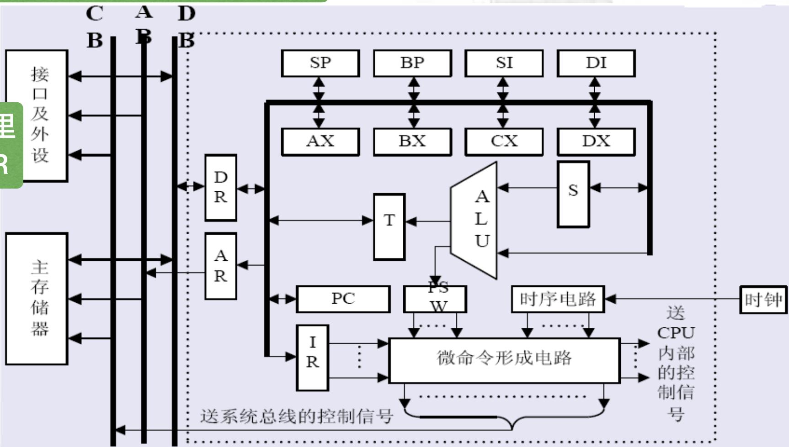

<details>
<summary>flowchart</summary>

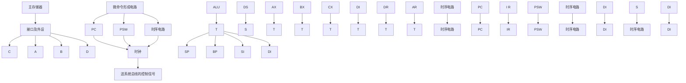
</details>

某计算机简化框图

IP指针自加1

# 深入CPU指令执行过程

- 执行Execute

- AX->ALU
- Add, ALU->T

加法结果放入T

以指令add [2000h], ax为例
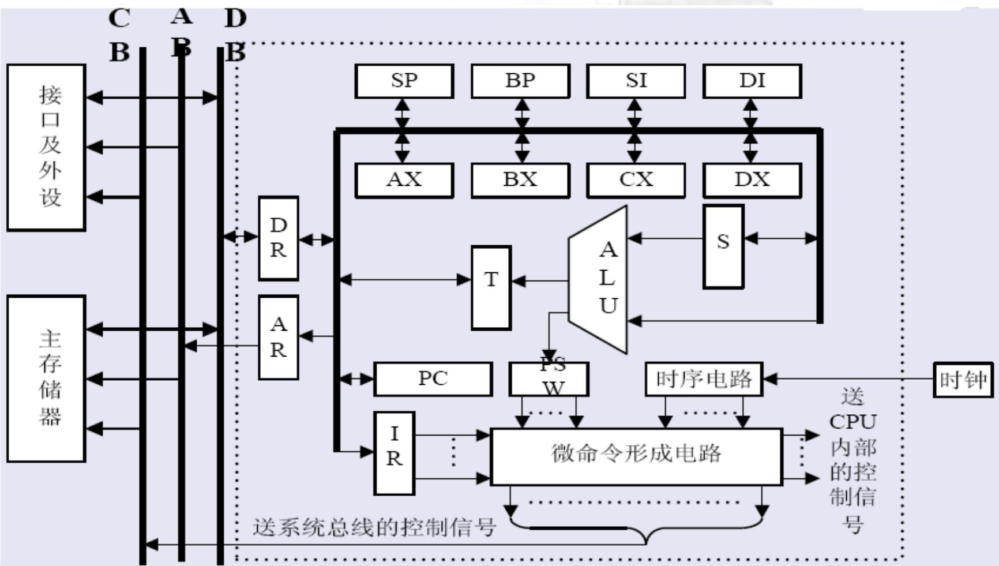

<details>
<summary>flowchart</summary>

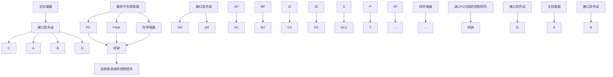
</details>

某计算机简化框图

# 深入CPU指令执行过程

# 以指令add [2000h], ax为例

# 存储Store

结果T送入DR

- T->DR
- DR->DB 从IR中取出
200000h，送入AR
- IR(2000h)->AR
- AR->AB
- DB->MDR
- AB->MAR
- Write

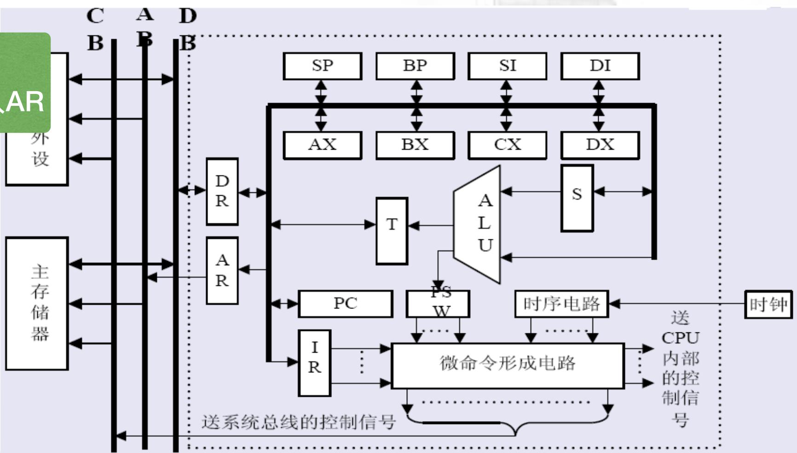

<details>
<summary>flowchart</summary>

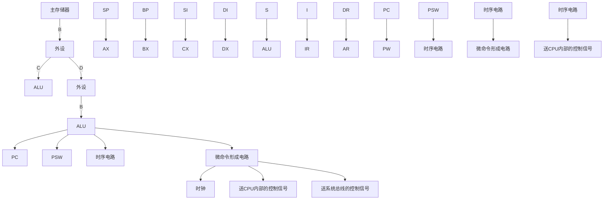
</details>

某计算机简化框图

# 深入CPU指令执行过程

- 这个例子给我们一些insights:

- 一条机器指令，大约由10-30个更基础的器件级的操作构成，called微操作

- 微操作需要按照顺序进行（微操作需要时序控制）

- 微操作谁在控制?

- CPU内的控制单元CU!

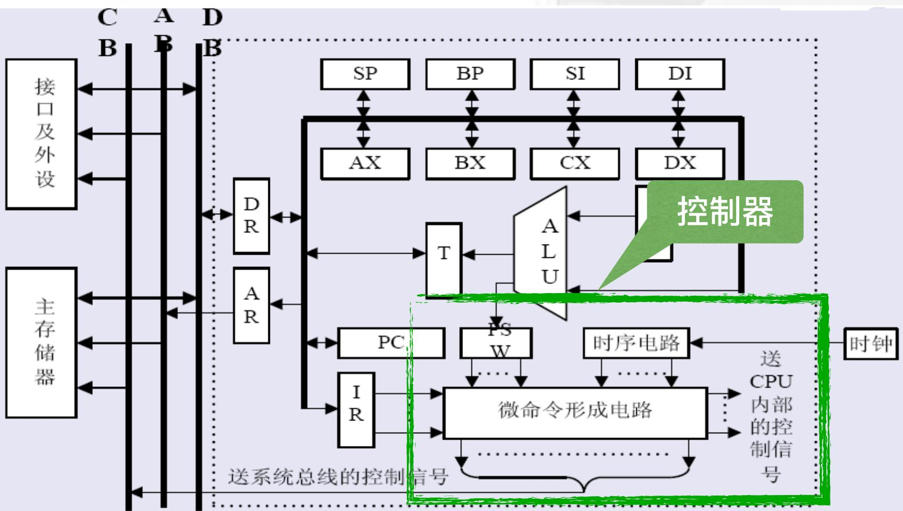

<details>
<summary>flowchart</summary>

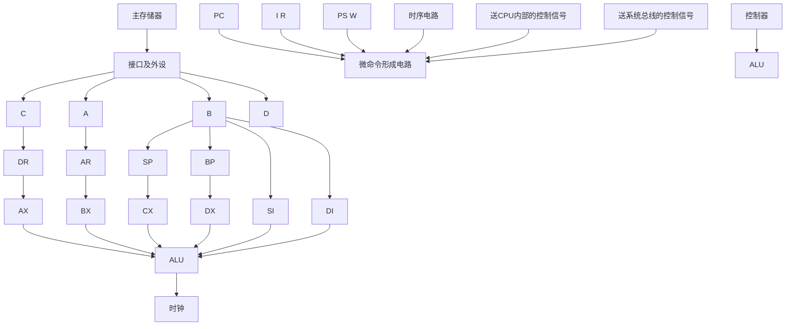
</details>

某计算机简化框图

# 关于时序与控制

- 时序系统的作用：将各种控制信号严格定时，在时间上相互配合完成某一功能。
- 时序信号通常划分为4级：

- 指令周期
- 机器周期（CPU周期）
- 时钟周期（节拍周期）
- [时钟脉冲、节拍脉冲]

# 关于时序与控制

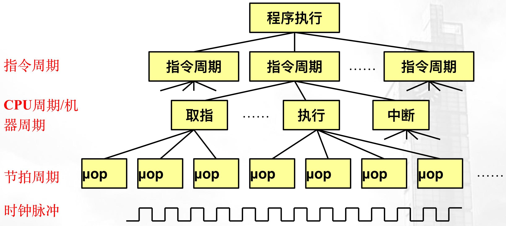

<details>
<summary>flowchart</summary>

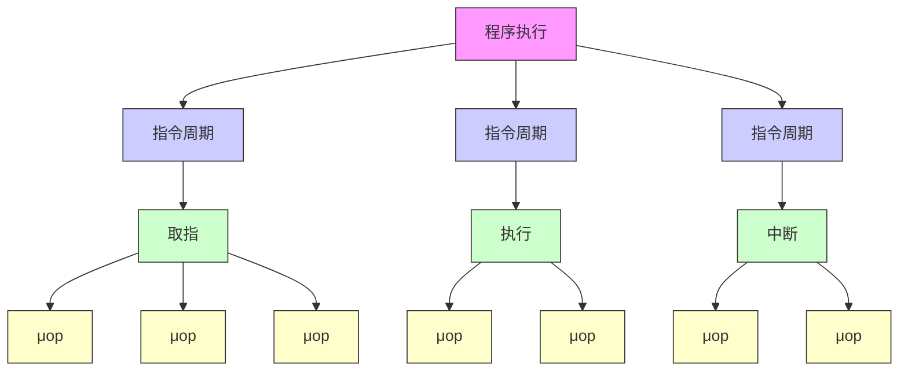
</details>

关于节拍周期：某种最复杂的微操作所需要的时间

关于CPU/机器周期：指令包含的微操作个数不等，不一定相同

# 关于时序与控制

指令周期

机器周期 FIC （取指）

机器周期 FDC （取数）

机器周期 EXEC（执行）

时钟周期 W0

P0

时钟周期 W1

P1

时钟周期 W2

P2

时钟周期 W3

P3

时钟脉冲 CLK

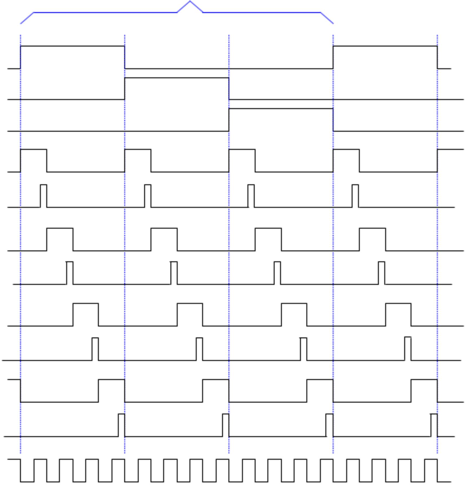

# 关于时序与控制

总结：指令执行过程涉及三种时序信号（或四种）

- 指令周期：执行一条指令所用的时间
- CPU周期：完成一个子周期（一组微操作）所用的时间
- 节拍周期：完成一个微操作所用的时间
- (时钟脉冲: 微操作过程中的最小动作单位)

Then, why timing matters ?

CPU执行程序有严格的时间顺序性，通常利用时序电路为控制器提供所需的时序信号。最基本的时序信号为节拍，它由节拍脉冲发生器产生。

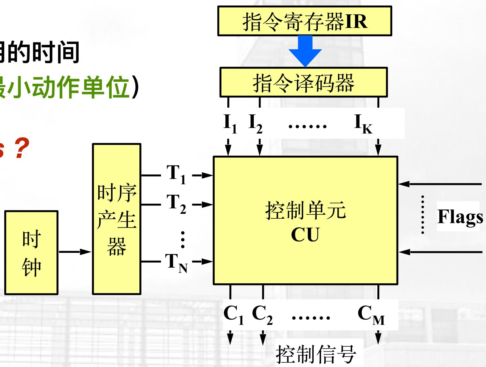

<details>
<summary>flowchart</summary>

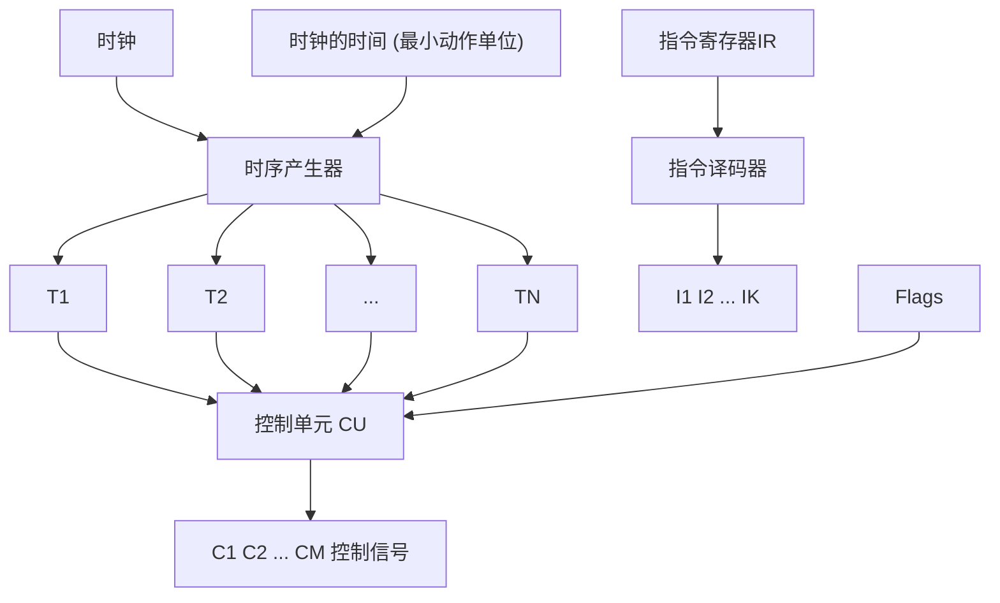
</details>

# 关于时序与控制

- 总结一下，为什么需要控制器&控制器到底干什么事？

- 一条汇编指令实现由一组微操作序列构成（时序+多个）
- 一个微操作由不同部件配合完成(CPU内/外)
- 部件之间也有时序关系(部件工作的先/后)

- 编排微操作时序和部件工作时序，是控制器的任务！

控制器内部根据时序信号和当前微操作命令对其

它部件的输入、输出和控制信号进行控制

# 控制器的设计

■ 微操作：处理器（CPU）的基本或原子操作。

- CPU可以实现的、不可分解的操作动作
- 以含有一个寄存器传递（移进、移出）操作为标志

■ 每一个微操作是通过控制器将控制信号发送到相关部件上引起部件动作而完成的。

- 这些控制微操作完成的控制信号称为微命令
- 微命令是由控制器产生的


<details>
<summary>text_image</summary>

AR←PC; PC_out, AR_in
</details>

微操作
微命令

# 控制器的设计

- Then, How the Controller controls?
- 相当多的一组并行的控制信号

- 系统总线控制信号
- CPU内部控制信号
- 如： $\mathsf{PC}_{\text {in}}, \mathsf{PC}_{\text {out}}, \mathsf{PC} + 1, \mathsf{IR}_{\text {in}}, \mathsf{IR}_{\text {out}}$

- 计算机简单框图
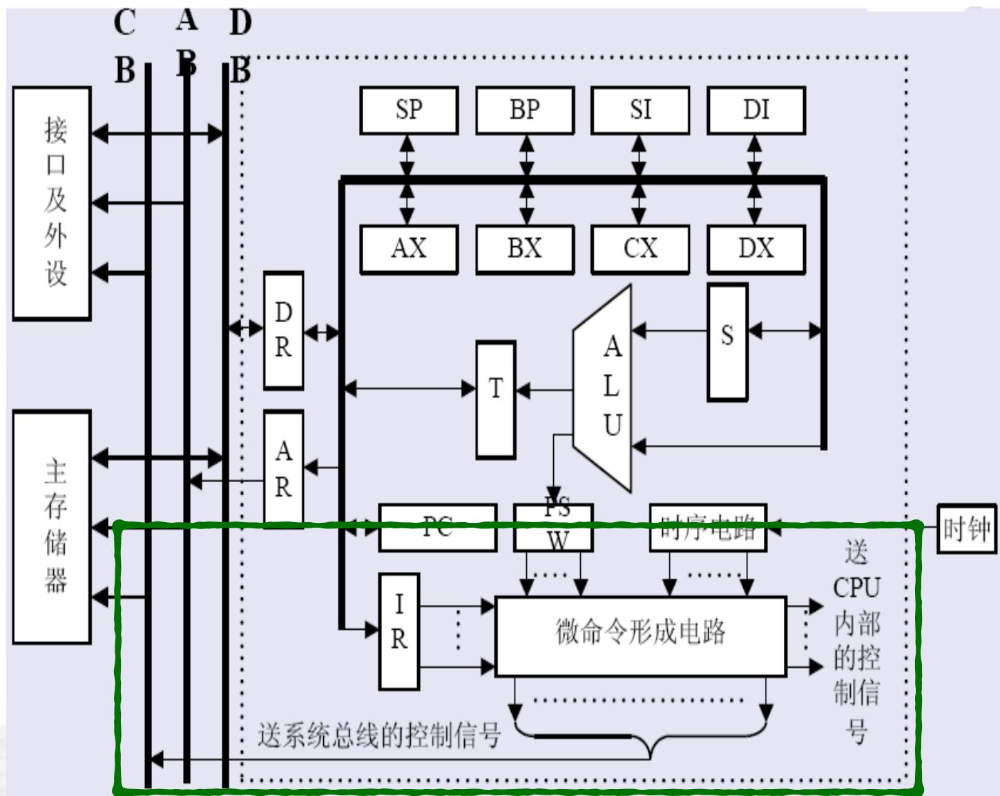

<details>
<summary>flowchart</summary>

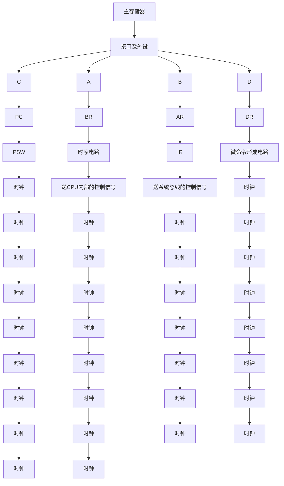
</details>

某计算机简化框图

# 控制器的设计

# ■ 8086处理器的控制信号：

$\mathsf{PC}_{\mathrm{in}}$ 为程序计数器的锁存输入控制信号；

$\mathsf{PC}_{\mathrm{out}}$ 为程序计数器的输出允许控制信号；

PC+1为程序计数器的自动增量（如自动加1）控制信号；

$\mathsf{IR}_{\mathsf{in}}$ 为指令寄存器的锁存输入控制信号；

$\mathsf{IR}_{\mathrm{out}}$ 为指令寄存器的输出允许控制信号；

$\mathbf{SP}_{\mathrm{in}}$ 为指令寄存器的锁存输入控制信号；

$\mathsf{SP}_{\mathrm{out}}$ 为指令寄存器的输出允许控制信号；

SP+1为堆栈指示器的自动增量（如自动加n）控制信号；

SP-1为堆栈指示器的自动减量（如自动减n）控制信号；

$\mathsf{Ri}_{\mathsf{in}}$ 为通用寄存器 $\mathsf{Ri}$ （ $0 \leq i \leq n - 1$ ）的锁存输入控制信号；

$\mathrm{Ri}_{\mathrm{out}}$ 为通用寄存器 $\mathrm{Ri}$ （ $0 \leq i \leq n - 1$ ）的输出允许控制信号；

# 控制器的设计

# ■ 8086处理器的控制信号：

$Y_{in}$ 为暂存器Y的锁存输入控制信号；

$Z_{out}$ 为暂存器Z的输出允许控制信号；

$AR_{in}$ 为地址寄存器向CPU内部总线的锁存输入控制信号；

$AR_{out}$ 为地址寄存器面向系统总线的输出允许控制信号；

$\mathsf{DRI}_{\mathrm{in}}$ 为双端口数据寄存器面向CPU内部总线的锁存输入控制信号；

$\mathsf{DRI}_{\mathrm{out}}$ 为双端口数据寄存器面向CPU内部总线的输出允许控制信号；

$\mathsf{DRS}_{\mathrm{in}}$ 为双端口数据寄存器面向系统总线的锁存输入控制信号；

$\mathsf{DRS}_{\mathrm{out}}$ 为双端口数据寄存器面向系统总线的输出允许控制信号；

Mread为从主存储器读出信息的读控制信号；

Mwrite为将信息写入到主存储器的写控制信号；

IOread为从I/O设备输入信息的读控制信号；

IOWrite为将信息写入到I/O设备的写控制信号；

# 控制器的设计

# ■ 8086处理器的控制信号：

ADD为加载至ALU的加法运算控制信号；
SUB为加载至ALU的减法运算控制信号；
AND为加载至ALU的逻辑与运算控制信号；
OR为加载至ALU的逻辑或运算控制信号；
SHL为加载至ALU的逻辑左移控制信号；
SHR为加载至ALU的逻辑右移控制信号；
ROL为加载至ALU的循环左移控制信号；
ROR为加载至ALU的循环右移控制信号；

(以上共31个控制信号)

■ ■ ■ ■ ■ ■

# 控制器的设计

- 揭晓这两种设计之前，想几个问题：

- 控制单元，它的输出是什么？
- 众多（汇编）指令对应的微操作需要存储，如何存储？
- 如何根据时序信号和操作码产生输出?

- 带有时序的逻辑关系如何表达出来?

# 控制器的设计

- 控制器有两种实现方式

- 组合逻辑控制器（硬布线/硬编码）

- 硬，真的硬~

- 微程序控制器

# 组合逻辑控制器

# 构成：

- 时序信号产生器

- 指令周期
- 节拍(W0, W1, W2 ...)
- 触发脉冲(P0, P1, P2...)

- 译码器

PSW

与或逻辑阵列

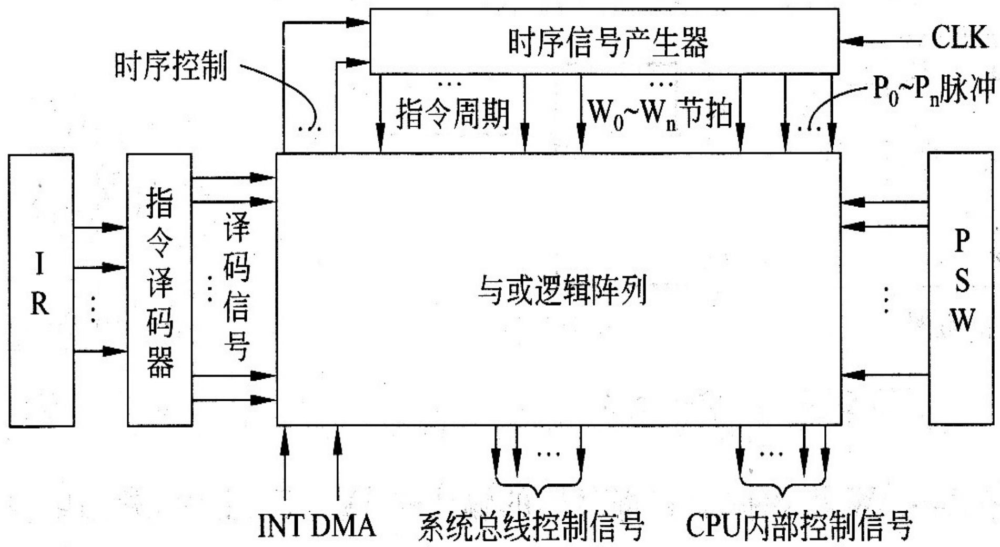

<details>
<summary>flowchart</summary>

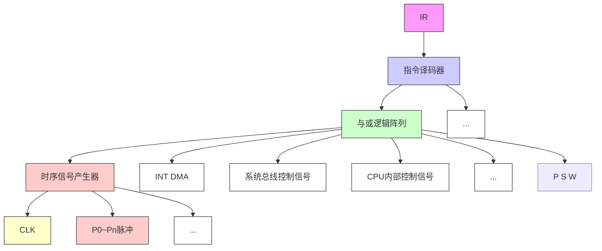
</details>

逻辑阵列极端复杂：把各种指

令的微指令序列/时序/控制/

反馈都要硬编码在阵列里！

# 组合逻辑控制器

# FIC 微操作命令

$$
\mathbf {W} _ {0} \quad \mathrm{PC} _ {\text {out}}, \quad \mathrm{AR} _ {\text {in}}
$$

$$
\begin{array}{r l}\mathbf {W} _ {1}&\mathbf {A R} \rightarrow \mathbf {A B},\\&\mathbf {R D}, \mathbf {P C} + \mathbf {1}\end{array}
$$

$$
\mathbf {W} _ {2} \quad \mathbf {M M} \rightarrow \mathbf {D B}, \quad \mathbf {D R} _ {\mathrm{in}}
$$

$$
\mathbf {W} _ {3} \quad \mathbf {D R} _ {\mathrm{out}}, \mathbf {I R} _ {\mathrm{in}}
$$

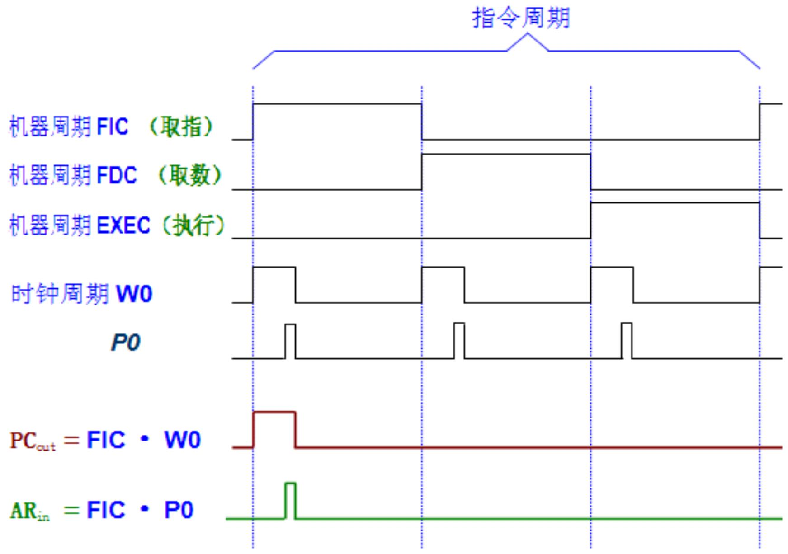

<details>
<summary>other</summary>

| Signal Type           | Description                     |
| --------------------- | --------------------------------- |
| FIC                   | 取指 (取指)                       |
| FDC                   | 取数 (取数)                       |
| EXEC                  | 执行 (执行)                      |
| W0                    | P0 (时钟周期 W0)                 |
| PCcut = FIC · W0      | PCcut = FIC · W0                |
| ARin = FIC · P0       | ARin = FIC · P0                 |
</details>

# 组合逻辑控制器

1. 取指周期中产生的控制信号相同。
2. 通常，一个控制信号在若干条指令的某些机器周期中都需要，应将它们组合起来。

如： $\mathrm{PC}_{\mathrm{out}} = \mathrm{FIC} \cdot \mathrm{W}_0 + \mathrm{FDC} \cdot$ 双字指令 $\cdot \mathrm{W}_0 + \dots$

所以，控制信号‘+’可以用两级门电路产生

——第一级为与门，第二级为或门。“组合逻辑电路”

3. 逻辑式的化简以减少逻辑电路规模。

4. 构成与或逻辑阵列。

# 组合逻辑控制器

- $\mathbf{PC}_{\mathrm{out}}$ 出现在:

- 取指周期的W0节拍
- 指令JZ执行周期（假设为第2个CPU周期M2）的T1节拍
- 指令CALL (X)执行周期的T1节拍
● ....

生成 $\mathrm{PC}_{\mathrm{out}}$ 的逻辑表达式为：

$$
\begin{array}{r l} \mathrm{PC} _ {\text {out}} & = \mathrm{FIC} \cdot \mathrm{W0} + \mathrm{T1} \cdot \mathrm{JZ} (\text {相对寻址}) \cdot (\mathrm{ZF} = 1) + \\ & \quad \mathrm{T4} \cdot \mathrm{CALL} (\text {间接寻址}) + \dots \dots \end{array}
$$

描述了“当aa周期的第y节拍或当bb指令的cc周期时…，发出PCout信号；

也就是说：组合逻辑控制器，是用非常机械的方式去描述其逻辑的：枚举所有微操作所需的发生的条件，将其描述为与或门逻辑。


<details>
<summary>text_image</summary>

举个栗子
</details>

# 组合逻辑控制器

# ■ AR $_{in}$ 出现在:

- 取指周期的T1节拍
- 指令MOV R0,X和指令MOV(R1),R0执行周期的T1节拍
- 指令 SUB R0,(X) 执行周期的T1和T3节拍
- 指令 IN R0,P 和指令 OUT P,R0 执行周期的T1节拍

- 指令 PUSH R0 执行周期的T2节拍

- 指令POP R0执行周期的T1节拍

- 指令 CALL (X) 执行周期的T2和T4节拍

- 指令 RET 执行周期的T1节拍

●
- • • • • •

# ■ 生成 $AR_{in}$ 的逻辑表达式为：


<details>
<summary>natural_image</summary>

Cartoon character wearing a hat with a surprised expression (no text or symbols)
</details>

举个栗子

# 组合逻辑控制器

# ■ 生成 $AR_{in}$ 的逻辑表达式为：

$AR_{in} = T1 + T4 \cdot MOV$ (源操作数直接寻址+目的操作数寄存器间接寻址) + (T4+T6) · SUB(源操作数间接寻址) + T4·(IN(直接寻址)+OUT(直接寻址)) + T5·PUSH + T4·POP + (T5+T7)·CALL(间接寻址) + T4·RET + ……

描述了“当aa周期的第y节拍或当bb指令的cc周期时…，发出PCout信号；

也就是说：组合逻辑控制器，是用非常机械的方式去描述其逻辑的：枚举所有微操作所需的发生的条件，将其描述为与或门逻辑。

# 组合逻辑控制器

- 组合逻辑控制器，它到底描述的是什么？

由控制单元产生并加载到CPU内外的全部控制信号均可用下述形式表述：第n个节拍

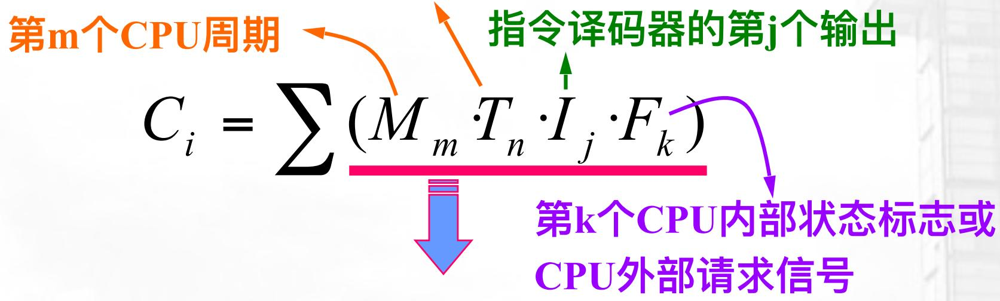

<details>
<summary>flowchart</summary>

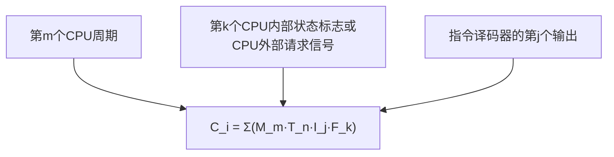
</details>

在执行指令 $\mathbf{I}_{\mathrm{j}}$ 时，若状态 $\mathbf{F}_{\mathrm{k}}$ 满足要求，则在第m个机器周期 $\mathbf{M}_{\mathrm{m}}$ 的第n个节拍 $\mathbf{T}_{\mathrm{n}}$ ，控制单元发出 $\mathbf{C}_{\mathrm{i}}$ 控制命令

所以称之为“基于组合逻辑的控制器”

# 组合逻辑控制器

- 组合逻辑控制单元，它的输出是什么？
- 总线和内部的控制信号
- 众多（汇编）指令对应的微指令需要存储，如何存储？
- 严格来说，组合逻辑控制单元并不单纯存储微程序；
- 如何根据时序信号和操作码产生输出？

- 带有时序的逻辑关系如何表达出来?

- 每一个控制信号的输出，由所有可能触发该信号的输入组合以“或”操作形式组合起来，每种输入组合内部是用“与”操作表达；

b.t.w“存储”了微程序和执行逻辑

# 组合逻辑控制器

# 小结:

- 每个控制信号的逻辑表达式就是一个与或逻辑方程式。
- 将所有控制信号的与或逻辑电路组合在一起就构成了硬布线控制单元。
- 时间信息、指令信息、状态信息是硬布线控制单元的输入，控制信号是硬布线控制单元的输出。

- 采用硬布线法设计控制器的特点：

- 一旦完成了控制器的设计，改变控制器行为的唯一方法就是重新设计控制单元 $\rightarrow$ 修改不灵活
- 使用PLD(PAL, PLA, GAL, FPGA)实现!
- 在现代复杂的处理器中，需要定义庞大的控制信号逻辑方程组 $\rightarrow$ 与或组合电路实现困难

微程序设计法

# 控制器设计——微程序控制器

# (基于) 微程序 (的) 控制器

- 看两条机器指令的微操作执行过程:

- 横向切割、面向器件的操作模式——组合逻辑控制器
- 纵向、面向流程的模式——微程序控制器

① ADD BX, [DI]

a) $\mathrm{PC}_{\mathrm{out}}, \mathrm{AR}_{\mathrm{in}}$

b) AR→AB, RD, PC+1

c) MD→DB,DR $_{in}$

d) $DR_{out}, IR_{in}$

e) $DI_{out}, AR_{in}$

f) AR→AB, RD

g) MD→DB,DR $_{in}$

h) $DR_{out}, S_{in}$

i) S→ALU

j) $\mathrm{BX}_{\mathrm{out}} \rightarrow \mathrm{ALU}$

k) ADD→T, T $_{in}$

1) $\mathrm{T}_{\mathrm{out}}, \mathrm{BX}_{\mathrm{in}}$

② INC [BX]

a) $\mathrm{PC}_{\mathrm{out}}, \mathrm{AR}_{\mathrm{in}}$

b) AR→AB, RD, PC+1

c) MD→DB,DR $_{in}$

d) $DR_{out}, IR_{in}$

e) $\mathrm{BX}_{\mathrm{out}}, \mathrm{AR}_{\mathrm{in}}$

f) AR→AB, RD

g) MD→DB,DR $_{in}$

h) $\mathrm{DR}_{\mathrm{out}}, \mathrm{S}_{\mathrm{in}}$

i) S→ALU

j) ALU+1→T, T $_{in}$

k) $T_{out}$ , $DR_{in}$

1) DR→DB, WR

# (基于) 微程序 (的) 控制器

# (1) 工作原理:

■ 指导思想：将程序控制的思想引入控制信号的形成和控制。
基本思想：按照微程序顺序，产生所需的控制信号。

相当于把控制信号存储起来，因此又称存储控制逻辑方法。

几方面要学习的内容:

原理
微地址形成
微指令编码
微指令设计
微程序编程

① ADD BX, [DI]
a) $\mathrm{PC}_{\mathrm{out}}, \mathrm{AR}_{\mathrm{in}}$
b) AR→AB,RD,PC+1
c) MD→DB, DR $_{in}$
d) $DR_{out}, IR_{in}$
e) $DI_{out}$ , $AR_{in}$
f) AR→AB, RD
g) MD→DB,DR $_{in}$
h) $DR_{out}, S_{in}$
i) S→ALU
j) $\mathrm{BX}_{\mathrm{out}} \rightarrow \mathrm{ALU}$
k) ADD→T, T $_{in}$
1) $T_{out}$ , $BX_{in}$

② INC [BX]
a) $\mathrm{PC}_{\mathrm{out}}, \mathrm{AR}_{\mathrm{in}}$
b) AR→AB, RD, PC+1
c) MD→DB,DR $_{in}$
d) $DR_{out}, IR_{in}$
e) $BX_{out}, AR_{in}$
f) AR→AB, RD
g) MD→DB,DR $_{in}$
h) $\mathrm{DR}_{\mathrm{out}}, \mathrm{S}_{\mathrm{in}}$
i) S→ALU
j) ALU+1→T, T $_{in}$
k) $T_{out}$ , $DR_{in}$
1) DR→DB, WR

# (基于) 微程序 (的) 控制器

■ 一个微指令序列称作微程序（microprogram）或固件（firmware）。
■ 通过一组微指令产生的控制信号，使一条机器指令中的所有微操作得以实现。
■ 机器指令、微程序、微指令的关系：

$$
\begin{array}{r}\left\{ \begin{array}{lll}T_{1}\colon & 微操作1 (命令1, 命令2, ...) \\ & 微操作2 (命令1, 命令2) \\ & \dots \\ T_{j}\colon & 微操作i (命令1, 命令2, ...) \\ & \dots \\ T_{m}\colon & 微操作n (命令1) \end{array} \right\} \text{微指令} 1\\ \left\{ \begin{array}{lll}T_{1}\colon & 微操作1 (命令1, 命令2, ...) \\ & 微操作2 (命令1, 命令2) \\ & \dots \\ T_{j}\colon & 微操作i (命令1, 命令2, ...) \\ & \dots \\ T_{m}\colon & 微操作n (命令1) \end{array} \text{微指令} j\right\} \text{微指令} m\\ \end{array}
$$

程序由机器指令组成，存放在主存Memory中;

每一条机器指令，由一个微程序实现；

微程序由微指令组成，存放在CPU内部的控制存储器(Control Memory)中

- 微操作！~?
- 微命令！~?
- 微指令！~?
- 微程序！~?


<details>
<summary>text_image</summary>

??? ???
</details>

# 微程序控制器：根据外部输入的信号，调

# 用内部由微指令组成的微程序，输出微命令，完成一系列微操作。

- 微操作！~?

- CPU中的一个原子的、基本的最小操作

- 微命令！~?

- 触发/发起以上最小操作的命令/信号，由控制器发出（就是个电信号）

- 微指令！~?

- 微程序控制器内，对微命令的指令化对应；经控制器尾部的译码器转换为微命令

- 微程序！~?

- 一组微指令，就是一微程序

# (基于) 微程序 (的) 控制器

■ 一条（机器）指令对应一个微程序，该微程序包含从取指令到执行指令一个完整微操作序列对应的全部微指令，它被存入一个称为控制存储器（control memory）的ROM中。

■ CM中存放着指令系统中定义的所有指令的微程序。
■ 微指令周期：一条微指令执行的时间（包括从控制存储器中取得微指令和执行微指令所用时间）。
■ 指令系统？<-->微指令系统？各种指令系统的逻辑无脑套用！

# (基于) 微程序 (的) 控制器

■ 一条（机器）指令对应一个微程序，该微程序包含从取指令到执行指令一个完整微操作序列对应的全部微指令，它被存入一个称为控制存储器（control memory）的ROM中。
■ CM中存放着指令系统中定义的所有指令的微程序。
■ 微指令周期：一条微指令执行的时间（包括从控制存储器中取得微指令和执行微指令所用时间）。
■ 微指令的一般格式：

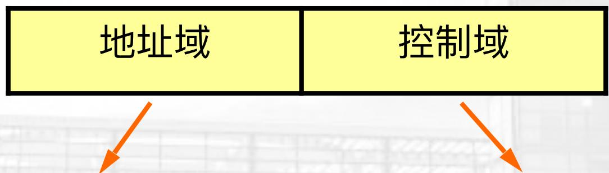

<details>
<summary>flowchart</summary>

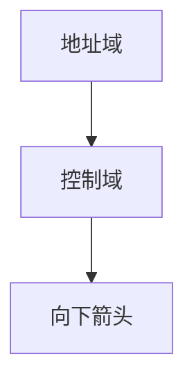
</details>

生成下条微指令地址

产生控制信号

# (基于) 微程序 (的) 控制器

- 核心结构:
■ 控制存储器（CM）

- 微指令长度
- 微程序占用的存储单元数

■ 微指令寄存器μIR、微地址寄存器μAR
■ 微地址形成电路
■ 时序逻辑

- 依据时钟按节拍为控制存储器提供读出控制信号。
- 在微程序运行时依据CPU内外状态（ALU标志、中断请求、DMA请求等）和当前微指令地址域的信息生成下一条微指令地址，并将其装入到微地址寄存器中。

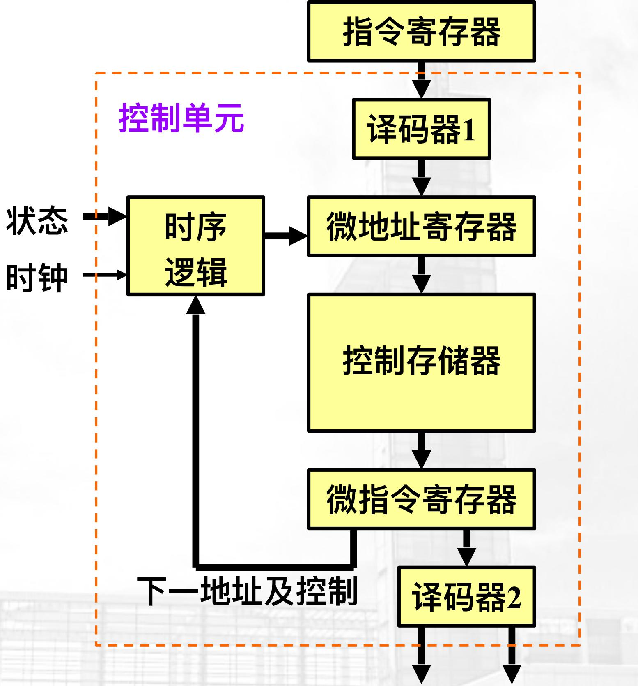

<details>
<summary>flowchart</summary>

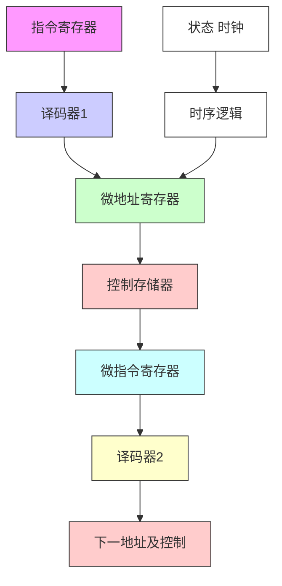
</details>

CPU内部 到系统总线的控制信号 控制信号

# (基于) 微程序 (的) 控制器

■ 微程序控制器在一个时钟周期内完成如下工作：

① 时序逻辑电路给控制存储器发出read命令；
② 从微地址寄存器μAR指定的控存单元读出微指令，送入微指令寄存器μIR；

③ 根据微指令寄存器的内容，产生控制信号，给时序逻辑提供下条微地址信息；

④ 时序逻辑根据来自微指令寄存器的下条微地址信息和CPU内外状态，给微地址寄存器加载一个新的微地址。

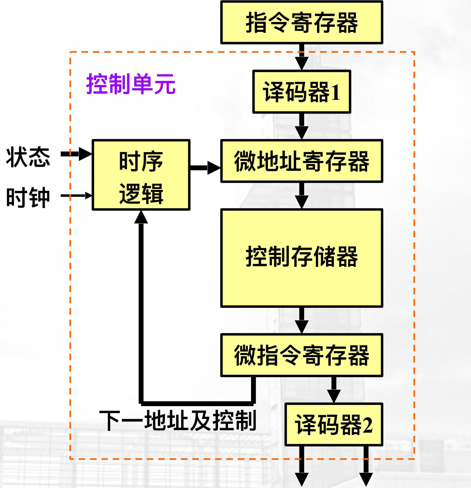

<details>
<summary>flowchart</summary>

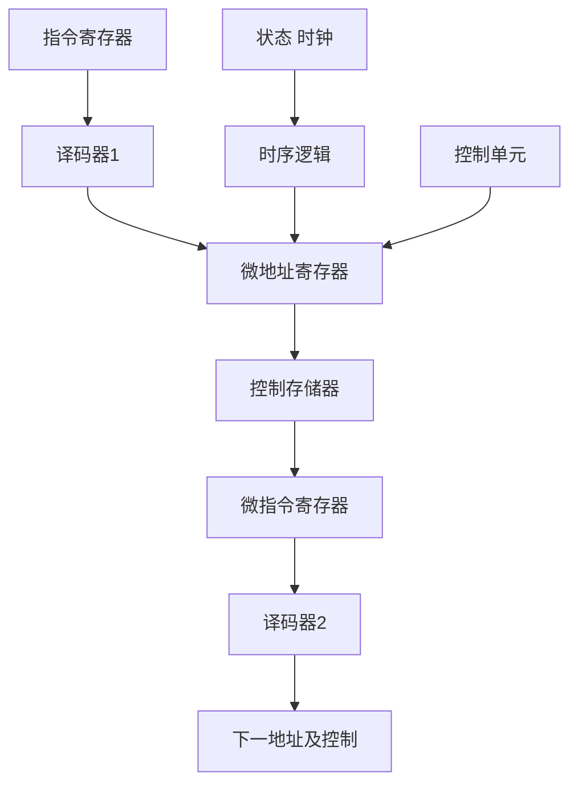
</details>

CPU内部 到系统总线的控制信号 控制信号

# (基于) 微程序 (的) 控制器

■ 微指令的一般格式：

- 地址域：决定如何取得微指令
- 控制域：微指令的执行

■ 设计微指令需要从两方面考虑：

- 微指令的长度 $\rightarrow$ 减少控制器占CPU集成芯片的面积
- 微指令的执行时间 $\rightarrow$ 提高CPU的工作速度

# (基于) 微程序 (的) 控制器: 地址形成

暂时，先不去操心微指令的内容，先想想微指令的运行时顺序如何控制...

- 当机器指令在内存时...

- 指令寻址

- 默认（PC自加1）

- 段内/段间转移

- 在CPU内部

- 有PC、IR、AR、DR四个

寄存器用于定位和缓存指令

- 当微指令在控制内存时，如何得到下一条微指令？

- 微指令寻址!

# (基于) 微程序 (的) 控制器: 地址形成

# ■ 下一条微指令的地址有三种可能:

①由指令寄存器确定的微程序首地址: 每一个指令周期仅出现一次, 且仅出现在刚刚获取一条指令之后。
②下一条顺序地址
下一条微指令地址=当前微指令地址+1
③分支跳转地址

无条件和条件跳转
◆ 两分支和多分支跳转

- 两地址格式（断定方式）
- 单地址格式（计数方式，增量方式）
- 可变格式

# (基于) 微程序 (的) 控制器: 地址形成

# 1. 两地址格式

# (断定方式)

逻辑电路K一般由ROM或PLA构成，它将输入的指令操作码映射为微指令地址（微程序首地址）并输出。

为什么会有这么古怪的 Addressing方式？其动机？

降低控制器复杂度，而且快！！

(AC/地址1/地址2全部静态存储，只有多路选择器一个逻辑部件；代价只是CM大一些而已)

条件选择

μIR

AC

地址1

地址2

控制域

两地址格式的分支控制逻辑

# (基于) 微程序 (的) 控制器: 地址形成

# 2. 单地址格式

(计数方式, 增量方式)

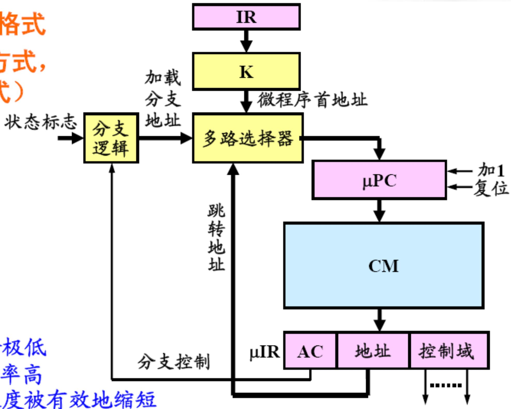

<details>
<summary>flowchart</summary>

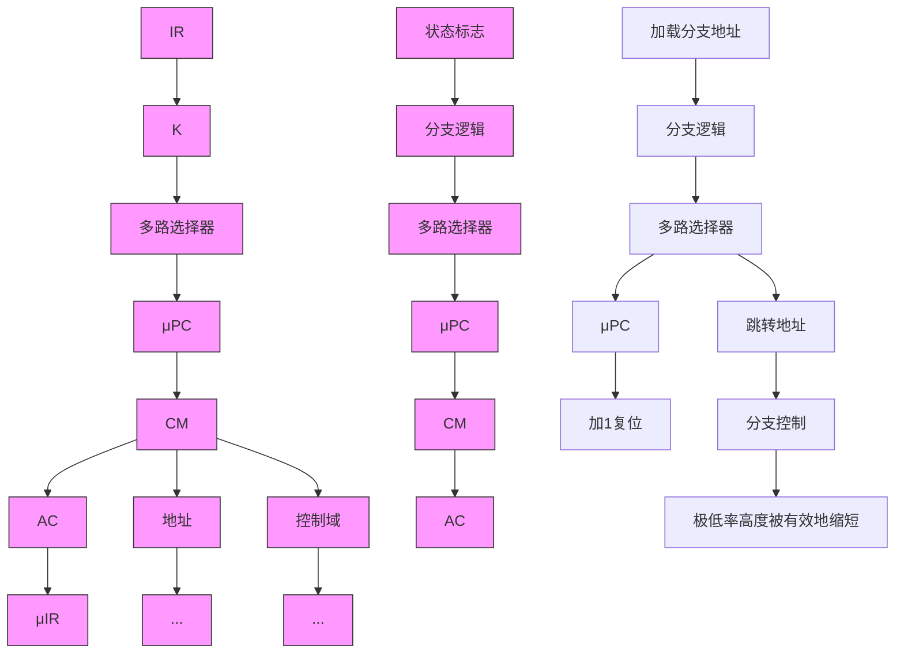
</details>

- 硬件代价极低
- μPC利用率高
- 微指令长度被有效地缩短

单地址格式的分支控制逻辑

# (基于) 微程序 (的) 控制器: 地址形成

# 3. 可变格式

■ 使任何微指令执行时不存在无用信息：让微指令在顺序执行时只提供控制信号的产生，需要分支时再提供跳转地址。→ 可变格式微指令
■ 两种微指令格式

- 控制微指令

$$
\mathbf {S} = \mathbf {0}
$$

<table><tr><td>标识S</td><td>控制域</td></tr></table>

- 转移微指令

$$
\mathbf {S} = \mathbf {1}
$$

<table><tr><td>标识S</td><td>分支控制</td><td>地址字段</td></tr></table>

# (基于) 微程序 (的) 控制器: 地址形成

# 3. 可变格式

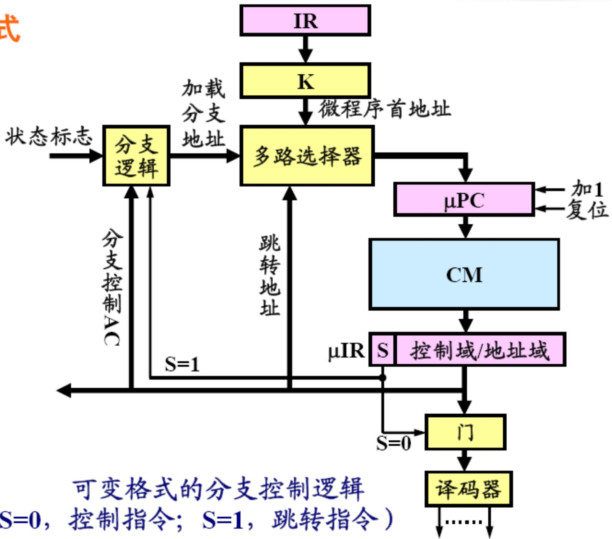

<details>
<summary>flowchart</summary>

```mermaid
graph TD
    A["IR"] --> B["K"]
    B --> C["多路选择器"]
    C --> D["μPC"]
    D --> E["CM"]
    E --> F["控制域/地址域"]
    F --> G["门"]
    G --> H["译码器"]
    H --> I["......"]
    J["状态标志"] --> K["分支逻辑"]
    K --> L["加载分支地址"]
    L --> C
    M["μIR"] --> N["S=1"]
    N --> K
    O["跳转地址"] --> C
    P["加1复位"] --> D
    Q["S=0"] --> F
    R[S=0, 控制指令; S=1, 跳转指令) --> G
    S[可变格式的分支控制逻辑\nS=0, 控制指令; S=1, 跳转指令) --> K
```
</details>

可变格式的分支控制逻辑
(设S=0，控制指令；S=1，跳转指令)

# (基于) 微程序 (的) 控制器: 控制信号编码

■ 水平型微指令 (horizontal microinstruction)
多个控制信号同时有效 → 多个微操作同时发生。

■ 垂直型微指令 (vertical microinstruction)

类似于机器指令，利用微操作码的不同编码来表示不同的微操作功能。

# 1. 水平型微指令控制域的编码

# (1) 直接表示法（水平编码）

- 可以在同一个时间有效的控制信号称为相容信号，具有相容性；
- 不能在同一个时间有效的控制信号称为互斥信号，具有互斥性。

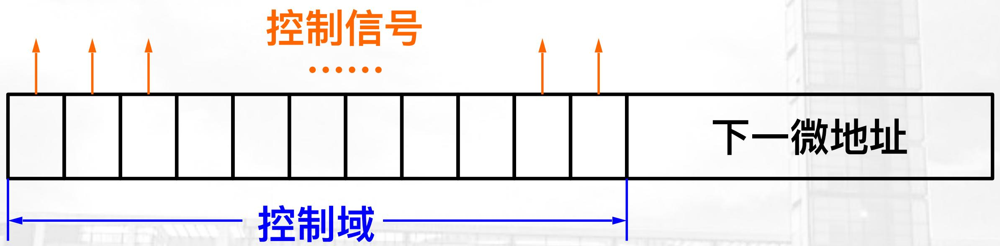

<details>
<summary>text_image</summary>

控制信号
……
下一微地址
控制域
</details>

图6.15 直接表示法

# 1. 水平型微指令控制域的编码

# (2) 字段译码法（字段编码）

将控制域分为若干字段，字段内垂直编码，字段间水平编码。


互斥的信号放在同一字段


相容的信号放在不同字段

- 若各字段的编码相互独立，则通过各字段独立译码就可以获得计算机系统的全部控制信号，这被称作直接译码方式。
- 若某些字段的编码相互关联，则关联字段要通过两级译码才能获得相关的控制信号，这被称作间接译码方式。

# (基于) 微程序 (的) 控制器: 控制信号编码

# 1. 水平型微指令控制域的编码

(2) 字段译码 （字段编码）

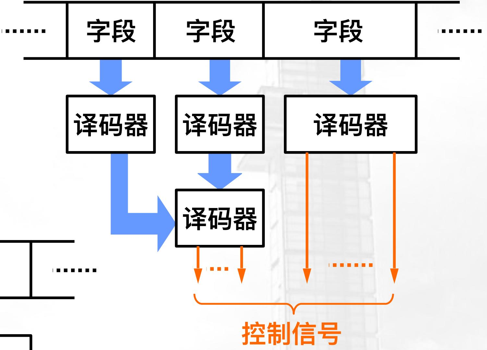

<details>
<summary>flowchart</summary>

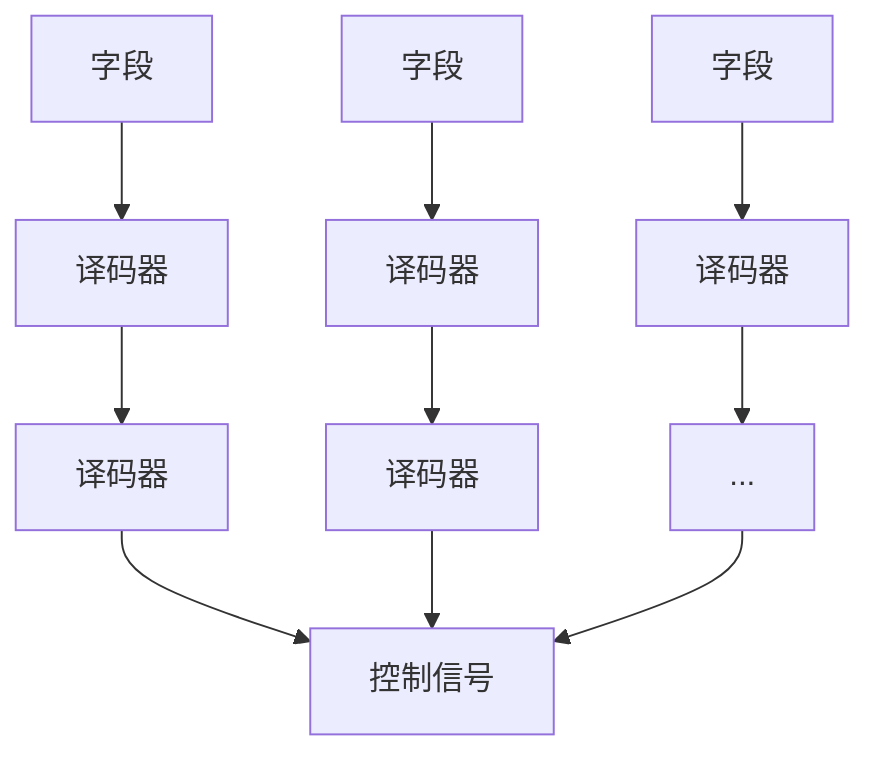
</details>

(b) 间接译码

控制信号

(a) 直接译码

图6.16 字段译码法

# 1. 水平型微指令控制域的编码

# (2) 字段译码法（字段编码）

- 每个字段中要设计一个无效控制信号的编码
- 若控制域的某字段有 $m$ 位，则可以提供 $2^{m} - 1$ 个控制信号的编码
- 字段组织的有效方法:

- 按功能组织：把功能类同的各控制信号放在同一字段中。
- 按资源组织：把加载到同一部件上的各控制信号放在同一字段中。

# (基于) 微程序 (的) 控制器: 控制信号编码

图6.2

图6.9

# 1. 水平型微指令控制域的编码

(2) 字段译码法（字段编码）

<table><tr><td>按功能</td><td>按功能</td><td>按资源</td><td>按资源</td><td>按功能</td><td>按资源</td><td>按资源</td><td></td></tr><tr><td>字段1(4位)</td><td>字段2(4位)</td><td>字段3(2位)</td><td>字段4(3位)</td><td>字段5(4位)</td><td>字段6(2位)</td><td>字段7(2位)</td><td>字段8</td></tr><tr><td>NOP 0000</td><td>NOP 0000</td><td>NOP 00</td><td>NOP 000</td><td>NOP 0000</td><td>NOP 00</td><td>NOP 00</td><td>其他信号</td></tr><tr><td> $R0_{in}$  0001</td><td> $R0_{out}$  0001</td><td> $PC_{in}$  01</td><td> $SP_{in}$  001</td><td>ADD 0001</td><td>Mread 01</td><td>IOread 01</td><td></td></tr><tr><td> $R1_{in}$  0010</td><td> $R1_{out}$  0010</td><td> $PC_{out}$  10</td><td> $SP_{out}$  010</td><td>SUB 0010</td><td>Mwrite 10</td><td>IOwrite 10</td><td></td></tr><tr><td>......</td><td>......</td><td>PC+1 11</td><td>SP+1 011</td><td>AND 0011</td><td></td><td></td><td></td></tr><tr><td> $R7_{in}$  1000</td><td> $R7_{out}$  1000</td><td></td><td>SP-1 100</td><td>OR 0100</td><td></td><td></td><td></td></tr><tr><td> $IR_{in}$  1001</td><td> $IR_{out}$  1001</td><td></td><td></td><td>SHL 0101</td><td></td><td></td><td></td></tr><tr><td> $Y_{in}$  1010</td><td> $Z_{out}$  1010</td><td></td><td></td><td>SHR 0110</td><td></td><td></td><td></td></tr><tr><td> $AR_{in}$  1011</td><td> $AR_{out}$  1011</td><td></td><td></td><td>ROL 0111</td><td></td><td></td><td></td></tr><tr><td> $DRI_{in}$  1100</td><td> $DRI_{out}$  1100</td><td></td><td></td><td>ROR 1000</td><td></td><td></td><td></td></tr><tr><td> $DRS_{in}$  1101</td><td> $DRS_{out}$  1101</td><td></td><td></td><td></td><td></td><td></td><td></td></tr></table>

表6.1 一种控制域字段的组织和编码

1. 水平型微指令控制域的编码

<table><tr><td>按功能</td><td>按功能</td><td>按功能/资源</td><td>按资源</td><td></td></tr><tr><td>字段1(4位)</td><td>字段2(4位)</td><td>字段3(4位)</td><td>字段4(3位)</td><td>字段5</td></tr><tr><td>NOP 0000</td><td>NOP 0000</td><td>NOP 0000</td><td>NOP 000</td><td rowspan="12">其他信号</td></tr><tr><td> $R0_{in}$  0001</td><td> $R0_{out}$  0001</td><td>ADD 0001</td><td>Mread 001</td></tr><tr><td> $R1_{in}$  0010</td><td> $R1_{out}$  0010</td><td>SUB 0010</td><td>Mwrite 010</td></tr><tr><td>......</td><td>......</td><td>AND 0011</td><td>IOread 011</td></tr><tr><td> $R7_{in}$  1000</td><td> $R7_{out}$  1000</td><td>OR 0100</td><td>IOwrite 100</td></tr><tr><td> $IR_{in}$  1001</td><td> $IR_{out}$  1001</td><td>SHL 0101</td><td></td></tr><tr><td> $Y_{in}$  1010</td><td> $Z_{out}$  1010</td><td>SHR 0110</td><td></td></tr><tr><td> $AR_{in}$  1011</td><td> $AR_{out}$  1011</td><td>ROL 0111</td><td></td></tr><tr><td> $DRI_{in}$  1100</td><td> $DRI_{out}$  1100</td><td>ROR 1000</td><td></td></tr><tr><td> $DRS_{in}$  1101</td><td> $DRS_{out}$  1101</td><td>PC+1 1001</td><td></td></tr><tr><td> $PC_{in}$  1110</td><td> $PC_{out}$  1110</td><td>SP+1 1010</td><td></td></tr><tr><td> $SP_{in}$  1111</td><td> $SP_{out}$  1111</td><td>SP-1 1011</td><td></td></tr></table>

优化后的字段组织和编码

# 1. 水平型微指令控制域的编码

# (2) 字段译码法（字段编码）

也可以
