# 课件-CPU设计3-Spring-2024

## 来源

- 分类：`课件`
- 原始文件：`CPU设计3--Spring.2024.pdf`
- 原始相对路径：`资料/课件/CPU设计3--Spring.2024.pdf`
- 原始绝对路径：`D:\wzb\计算机组成原理\资料\课件\CPU设计3--Spring.2024.pdf`

## 后续处理建议

- 从本整理稿中提取稳定知识点
- 检查公式、表格、结构图的提取效果
- 必要时补单独图像解读稿
- 如发现资料错误，转入勘误或分歧

## 内容导读（基于整理稿归纳）

本讲聚焦控制器设计，核心是对比“组合逻辑控制器”和“微程序控制器”两种实现路线，并解释微操作、微命令、微指令、微程序之间的层次关系。

## 关键知识点

- 组合逻辑控制器的结构、信号来源与实现思路。
- 微操作、微命令、微指令、微程序之间的对应关系。
- 微指令寻址、微指令跳转以及水平型/垂直型控制字段组织方式。

## 典型例题 / 思考题

- 组合逻辑控制器与微程序控制器的实现原理、优缺点比较。
- 说明在什么情况下需要微指令跳转。
- 说明微指令地址域、控制域分别承担什么作用。

## 例题理解层（基于课件整理）

### 题目簇 1：控制器实现方式比较

- 原题/原问：
  - 组合逻辑控制器的实现原理？
  - 组合逻辑控制器的优缺点？
  - 简述微程序控制器的原理？
  - 简述微程序控制器的优缺点？
- 题意：
  - 这一组题核心在于比较两类控制器如何产生控制信号，以及为什么一种更快、一种更灵活。
  - 不是只背定义，而是要把“控制信号怎么来”与“硬件代价/可修改性”一起说明。
- 所考知识点：
  - 组合逻辑控制器
  - 微程序控制器
  - 控制信号生成方式
  - 硬布线与控制存储器
- 解题关注点：
  - 先说明控制器的任务：根据操作码和时序产生微命令
  - 再分别写两类实现路线
  - 最后比较速度、设计复杂度、修改难度、适用场景
- 题型归类建议：
  - 原理解释 + 对比分析题
- 备注：
  - 若题目要求“比较”，答案必须成对写优缺点，不能只写单边特点

### 题目簇 2：微操作与微程序层次关系

- 原题/原问：
  - 微操作、微命令、微指令、微程序的关系？
  - 控制单元，它的输出是什么？
  - 众多（汇编）指令对应的微操作需要存储，如何存储？
- 题意：
  - 这组题考的是 CPU 控制层次的抽象关系，要把“最小操作”一路连到“机器指令执行”。
  - 重点是说清每一层是什么、谁控制谁、存在哪里。
- 所考知识点：
  - 微操作
  - 微命令
  - 微指令
  - 微程序
  - 控制单元输出
- 解题关注点：
  - 微操作是最小硬件动作
  - 微命令是触发微操作的控制信号
  - 微指令是对一组微命令的编码
  - 微程序是一组微指令，对应一条或一类机器指令的执行过程
- 题型归类建议：
  - 层次关系解释题
- 备注：
  - 这类题最容易把“微命令”和“微指令”混写，答题时必须明确区分“信号”和“编码后的指令”

### 题目簇 3：微指令寻址与编码方式

- 原题/原问：
  - 微指令中地址域和控制域的作用？
  - 如何实现微指令寻址？
  - 在哪些情况下，需要微指令跳转？举例说明？
  - 水平型控制域编码方法是什么？
  - 水平型编码中信号的组织特点？
- 题意：
  - 这组题聚焦微程序控制器内部“下一条微指令怎么来”和“控制字段怎么编码”两个核心问题。
  - 解题时既要说明地址形成机制，也要说明控制字段组织原则。
- 所考知识点：
  - 微地址形成
  - 微指令地址域
  - 微指令控制域
  - 水平型编码
  - 字段译码法
- 解题关注点：
  - 地址域负责给出后继微指令信息，控制域负责发出控制信号
  - 微指令寻址通常包括顺序执行、按判别位转移、按机器指令入口转移
  - 水平型编码强调并行控制能力强，但位数通常更长
- 题型归类建议：
  - 结构机制分析题
- 备注：
  - 如果题目要求“举例说明跳转”，应结合取指、条件转移或中断等场景写出触发条件

## 提取结果

# 《计组I》

# 第五章 处理器设计3

李瑞 教授

蒋志平 副教授

计算机科学与技术学院

# 温故 —关于指令系统和CPU(1/2)

组合逻辑控制器的实现原理？

组合逻辑控制器的优缺点？

简述微程序控制器的原理？

微操作、微命令、微指令、微程序的关系？

微指令中地址域和控制域的作用？

如何实现微指令寻址？

在哪些情况下，需要微指令跳转？举例说明？

水平型控制域编码方法是什么？

水平型编码中信号的组织特点？

简述微程序控制器的优缺点？

# 控制器的设计

- 揭晓这两种设计之前，想几个问题：

- 控制单元，它的输出是什么？
- 众多（汇编）指令对应的微操作需要存储，如何存储？
- 如何根据时序信号和操作码产生输出?

- 带有时序的逻辑关系如何表达出来?

# 控制器的设计

- 控制器有两种实现方式

- 组合逻辑控制器（硬布线/硬编码）

- 硬，真的硬~

- 微程序控制器

# 组合逻辑控制器

# 构成：

- 时序信号产生器

- 指令周期
- 节拍(W0, W1, W2 ...)
- 触发脉冲(P0, P1, P2...)

- 译码器

PSW

与或逻辑阵列

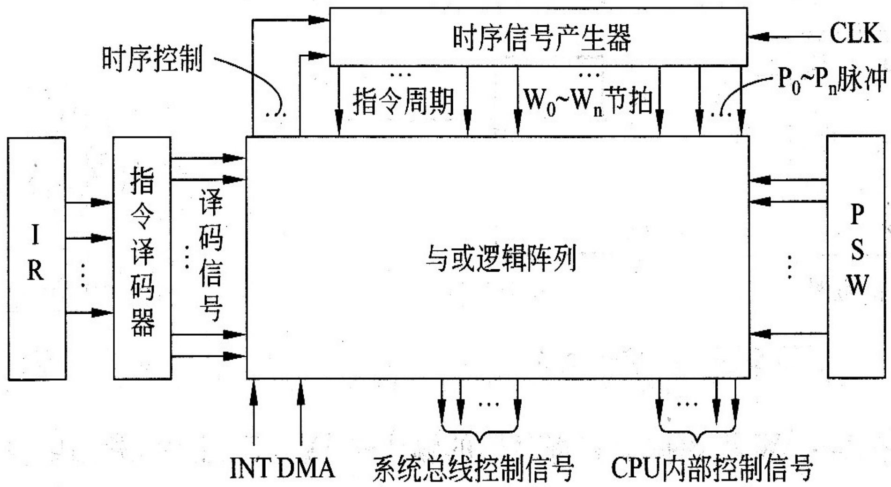

<details>
<summary>flowchart</summary>

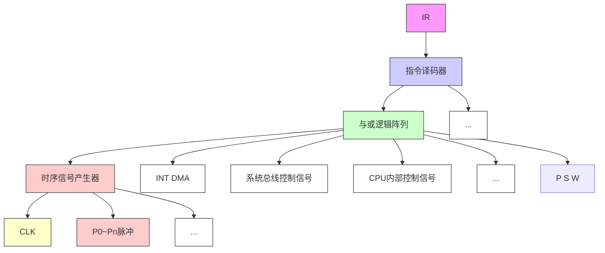
</details>

逻辑阵列极端复杂：把各种指

令的微指令序列/时序/控制/

反馈都要硬编码在阵列里！

# 组合逻辑控制器

- 组合逻辑控制器，它到底描述的是什么？

由控制单元产生并加载到CPU内外的全部控制信号均可用下述形式表述：第n个节拍

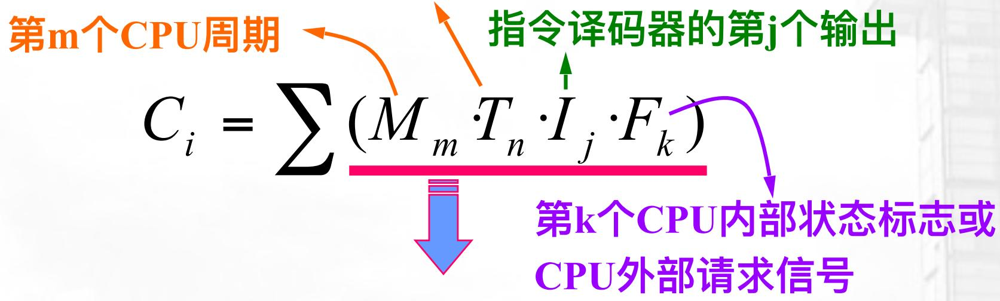

<details>
<summary>flowchart</summary>

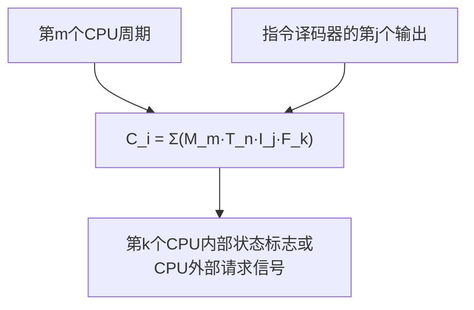
</details>

在执行指令 $\mathbf{I}_{\mathrm{j}}$ 时，若状态 $\mathbf{F}_{\mathrm{k}}$ 满足要求，则在第m个机器周期 $\mathbf{M}_{\mathrm{m}}$ 的第n个节拍 $\mathbf{T}_{\mathrm{n}}$ ，控制单元发出 $\mathbf{C}_{\mathrm{i}}$ 控制命令

所以称之为“基于组合逻辑的控制器”

# 组合逻辑控制器

- 组合逻辑控制单元，它的输出是什么？

- 总线和内部的控制信号

- 众多（汇编）指令对应的微指令需要存储，如何存储？

- 严格来说，组合逻辑控制单元并不单纯存储微程序；

- 如何根据时序信号和操作码产生输出？

- 带有时序的逻辑关系如何表达出来?

- 每一个控制信号的输出，由所有可能触发该信号的输入组合以“或”操作形式组合起来，每种输入组合内部是用“与”操作表达；

- b.t.w“存储”了微程序和执行逻辑

# 组合逻辑控制器

# 小结:

- 每个控制信号的逻辑表达式就是一个与或逻辑方程式。
- 将所有控制信号的与或逻辑电路组合在一起就构成了硬布线控制单元。
- 时间信息、指令信息、状态信息是硬布线控制单元的输入，控制信号是硬布线控制单元的输出。

- 采用硬布线法设计控制器的特点：

- 一旦完成了控制器的设计，改变控制器行为的唯一方法就是重新设计控制单元 $\rightarrow$ 修改不灵活
- 使用PLD(PAL, PLA, GAL, FPGA)实现!
- 在现代复杂的处理器中，需要定义庞大的控制信号逻辑方程组 $\rightarrow$ 与或组合电路实现困难

微程序设计法

# 控制器设计——微程序控制器

# (基于) 微程序 (的) 控制器

- 看两条机器指令的微操作执行过程:

- 横向切割、面向器件的操作模式——组合逻辑控制器
- 纵向、面向流程的模式——微程序控制器

① ADD BX, [DI]

a) $\mathrm{PC}_{\mathrm{out}}, \mathrm{AR}_{\mathrm{in}}$

b) AR→AB, RD, PC+1

c) MD→DB,DR $_{in}$

d) $DR_{out}, IR_{in}$

e) $DI_{out}, AR_{in}$

f) AR→AB, RD

g) MD→DB,DR $_{in}$

h) $DR_{out}, S_{in}$

i) S→ALU

j) $\mathrm{BX}_{\mathrm{out}} \rightarrow \mathrm{ALU}$

k) ADD→T, T $_{in}$

1) $\mathrm{T}_{\mathrm{out}}, \mathrm{BX}_{\mathrm{in}}$

② INC [BX]

a) $\mathrm{PC}_{\mathrm{out}}, \mathrm{AR}_{\mathrm{in}}$

b) AR→AB, RD, PC+1

c) MD→DB,DR $_{in}$

d) $DR_{out}, IR_{in}$

e) $\mathrm{BX}_{\mathrm{out}}, \mathrm{AR}_{\mathrm{in}}$

f) AR→AB, RD

g) MD→DB,DR $_{in}$

h) $DR_{out}, S_{in}$

i) S→ALU

j) ALU+1→T, T $_{in}$

k) $T_{out}$ , $DR_{in}$

1) DR→DB, WR

# (基于) 微程序 (的) 控制器

# (1) 工作原理:

■ 指导思想：将程序控制的思想引入控制信号的形成和控制。
基本思想：按照微程序顺序，产生所需的控制信号。

相当于把控制信号存储起来，因此又称存储控制逻辑方法。

几方面要学习的内容:

原理
微地址形成
微指令编码
微指令设计
微程序编程

① ADD BX, [DI]
a) $\mathrm{PC}_{\mathrm{out}}, \mathrm{AR}_{\mathrm{in}}$
b) AR→AB, RD, PC+1
c) MD→DB, DR $_{in}$
d) $DR_{out}, IR_{in}$
e) $DI_{out}$ , $AR_{in}$
f) AR→AB, RD
g) MD→DB,DR $_{in}$
h) $DR_{out}, S_{in}$
i) S→ALU
j) $\mathrm{BX}_{\mathrm{out}} \rightarrow \mathrm{ALU}$
k) ADD→T, T $_{in}$
1) $T_{out}$ , $BX_{in}$

② INC [BX]

a) $PC_{out}, AR_{in}$
b) AR→AB, RD, PC+1
c) MD→DB,DR $_{in}$
d) $DR_{out}, IR_{in}$
e) $BX_{out}, AR_{in}$
f) AR→AB, RD
g) MD→DB,DR $_{in}$
h) $\mathrm{DR}_{\mathrm{out}}, \mathrm{S}_{\mathrm{in}}$
i) S→ALU
j) ALU+1→T, T $_{in}$
k) $T_{out}$ , $DR_{in}$
1) DR→DB, WR

# (基于) 微程序 (的) 控制器

■ 一个微指令序列称作微程序（microprogram）或固件（firmware）。
■ 通过一组微指令产生的控制信号，使一条机器指令中的所有微操作得以实现。
■ 机器指令、微程序、微指令的关系：

$$
\begin{array}{l} \text {一条机器指令} \left\{ \begin{array}{l l} T _ {1}: & \text {微操作1(命令1,命令2,...)} \\ & \text {微操作2(命令1,命令2)} \end{array} \right. \\ \left. \begin{array}{l l} \dots \\ T _ {j}: & \text {微操作i(命令1,命令2,...)} \\ & \dots \\ T _ {m}: & \text {微操作n(命令1)} \end{array} \right. \end{array} \quad \left. \begin{array}{l l} \text {微指令1} \\ & \text {微指令j} \\ & \text {微指令m} \end{array} \right.
$$

}

一个微程序

程序由机器指令组成，存放在主存Memory中;

每一条机器指令，由一个微程序实现；

微程序由微指令组成，存放在CPU内部的控制存储器(Control Memory)中

# 微程序控制器：根据外部输入的信号，调

# 用内部由微指令组成的微程序，输出微命令，完成一系列微操作。

- 微操作！~?

- CPU中的一个原子的、基本的最小操作

- 微命令！~?

- 触发/发起以上最小操作的命令/信号，由控制器发出（就是个电信号）

- 微指令！~?

- 微程序控制器内，对微命令的指令化对应；经控制器尾部的译码器转换为微命令

- 微程序！~?

- 一组微指令，就是一微程序

# (基于) 微程序 (的) 控制器

■ 一条（机器）指令对应一个微程序，该微程序包含从取指令到执行指令一个完整微操作序列对应的全部微指令，它被存入一个称为控制存储器（control memory）的ROM中。

■ CM中存放着指令系统中定义的所有指令的微程序。
■ 微指令周期：一条微指令执行的时间（包括从控制存储器中取得微指令和执行微指令所用时间）。
■ 指令系统？<-->微指令系统？各种指令系统的逻辑无脑套用！

# (基于) 微程序 (的) 控制器

■一条（机器）指令对应一个微程序，该微程序包含从取指令到执行指令一个完整微操作序列对应的全部微指令，它被存入一个称为控制存储器（control memory）的ROM中。
■ CM中存放着指令系统中定义的所有指令的微程序。
■ 微指令周期：一条微指令执行的时间（包括从控制存储器中取得微指令和执行微指令所用时间）。
■ 微指令的一般格式：

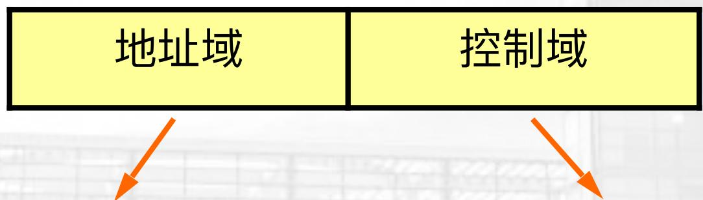

<details>
<summary>flowchart</summary>

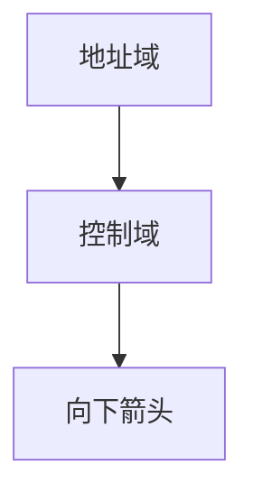
</details>

生成下条微指令地址

产生控制信号

# (基于) 微程序 (的) 控制器

- 核心结构:
■ 控制存储器（CM）

- 微指令长度
- 微程序占用的存储单元数

■ 微指令寄存器μIR、微地址寄存器μAR
■ 微地址形成电路
■ 时序逻辑

- 依据时钟按节拍为控制存储器提供读出控制信号。
- 在微程序运行时依据CPU内外状态（ALU标志、中断请求、DMA请求等）和当前微指令地址域的信息生成下一条微指令地址，并将其装入到微地址寄存器中。

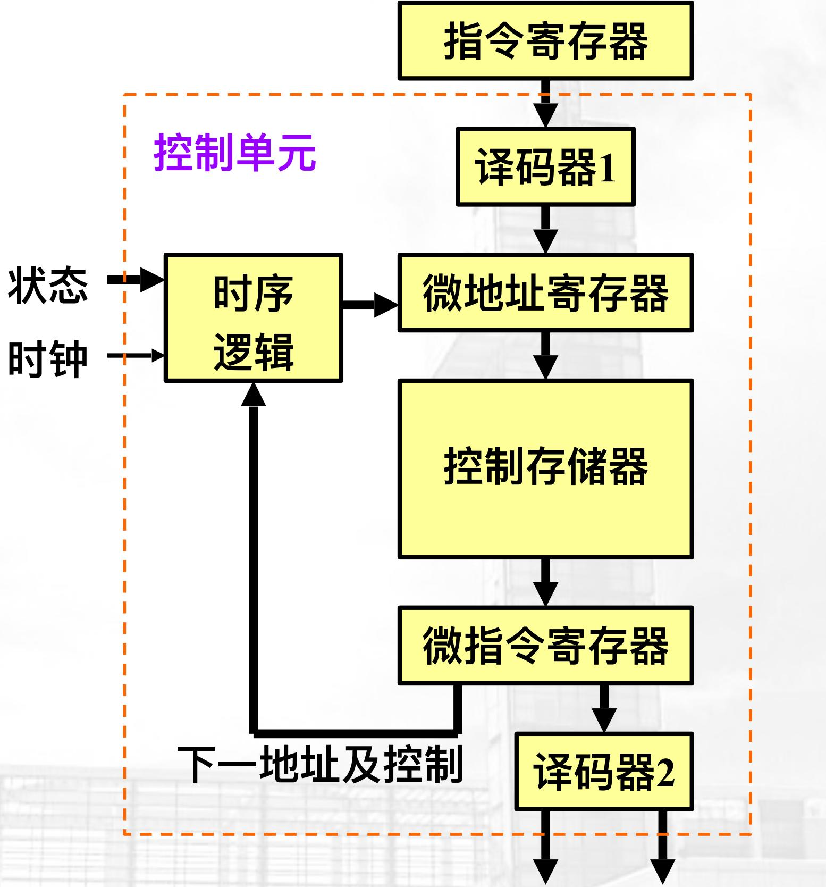

<details>
<summary>flowchart</summary>

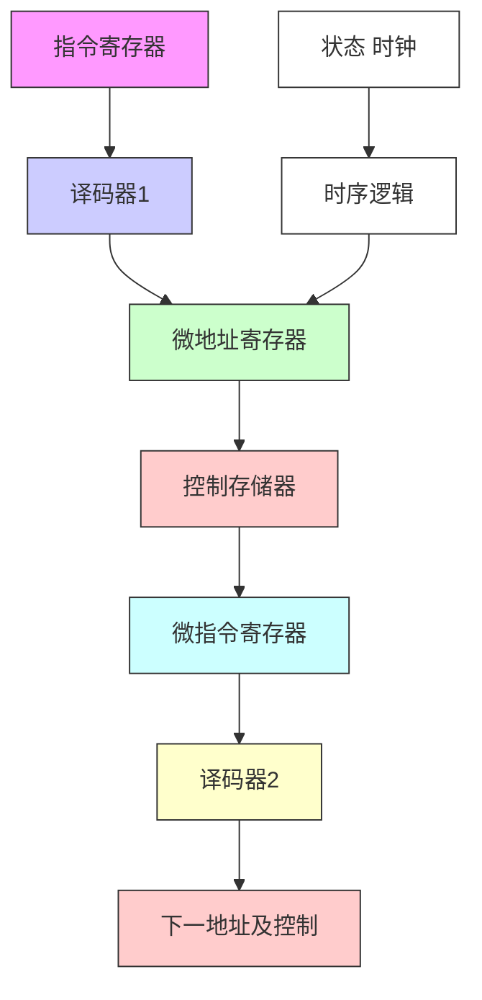
</details>

CPU内部 到系统总线的控制信号 控制信号

# (基于) 微程序 (的) 控制器

■ 微程序控制器在一个时钟周期内完成如下工作：

① 时序逻辑电路给控制存储器发出read命令；
② 从微地址寄存器μAR指定的控存单元读出微指令，送入微指令寄存器μIR；

③ 根据微指令寄存器的内容，产生控制信号，给时序逻辑提供下条微地址信息；

④ 时序逻辑根据来自微指令寄存器的下条微地址信息和CPU内外状态，给微地址寄存器加载一个新的微地址。

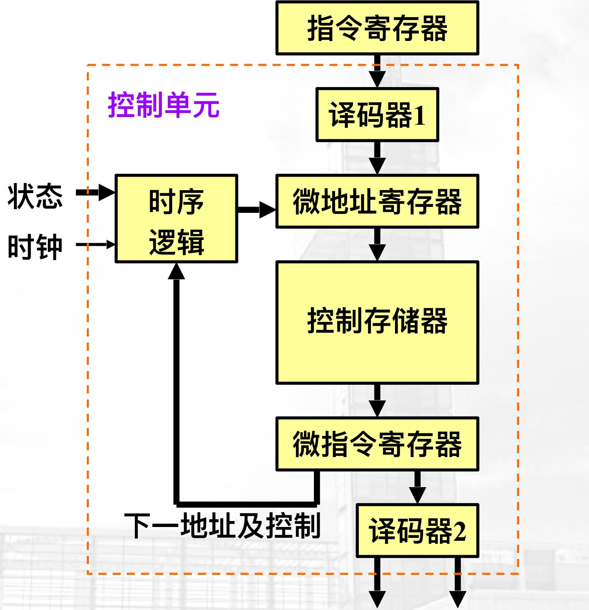

<details>
<summary>flowchart</summary>

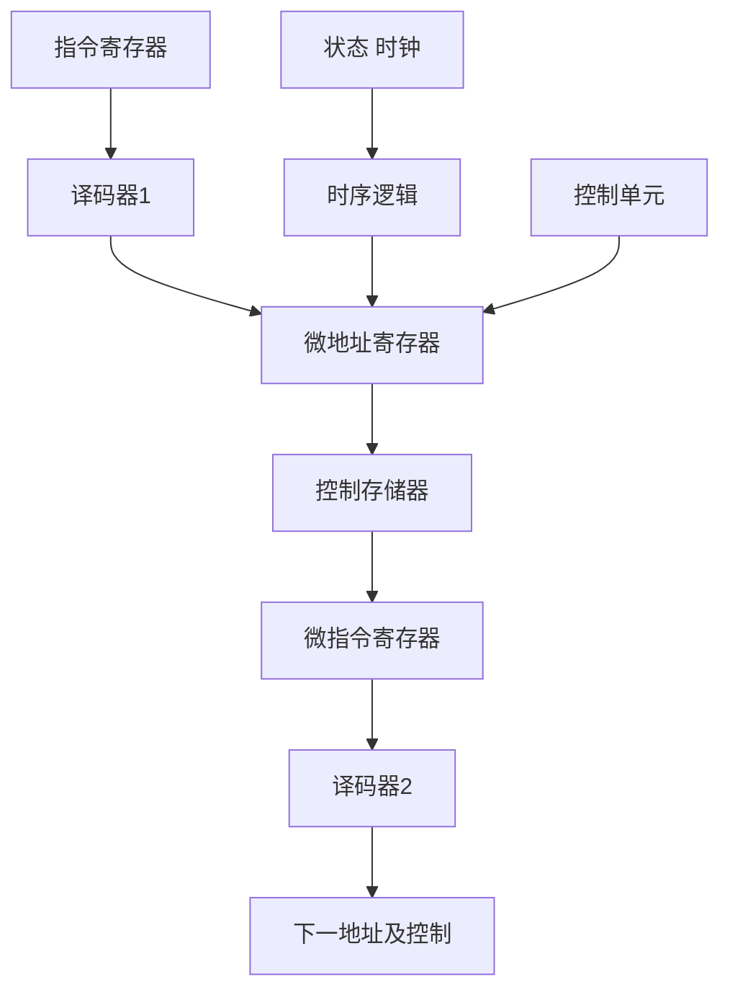
</details>

CPU内部 到系统总线的控制信号 控制信号

# (基于) 微程序 (的) 控制器

■ 微指令的一般格式：

- 地址域：决定如何取得微指令
- 控制域：微指令的执行

■ 设计微指令需要从两方面考虑：

- 微指令的长度 $\rightarrow$ 减少控制器占CPU集成芯片的面积
- 微指令的执行时间 $\rightarrow$ 提高CPU的工作速度

# (基于) 微程序 (的) 控制器: 地址形成

暂时，先不去操心微指令的内容，先想想微指令的运行时顺序如何控制...

- 当机器指令在内存时...

- 指令寻址

- 默认（PC自加1）

- 段内/段间转移

- 在CPU内部

- 有PC、IR、AR、DR四个

寄存器用于定位和缓存指令

- 当微指令在控制内存时，如何得到下一条微指令？

- 微指令寻址!

# (基于) 微程序 (的) 控制器: 地址形成

# ■ 下一条微指令的地址有三种可能:

①由指令寄存器确定的微程序首地址: 每一个指令周期仅出现一次, 且仅出现在刚刚获取一条指令之后。
②下一条顺序地址
下一条微指令地址=当前微指令地址+1
③分支跳转地址

无条件和条件跳转
◆ 两分支和多分支跳转

- 两地址格式（断定方式）
- 单地址格式（计数方式，增量方式）
- 可变格式

# (基于) 微程序 (的) 控制器: 地址形成

# 1. 两地址格式

# (断定方式)

逻辑电路K一般由ROM或PLA构成，它将输入的指令操作码映射为微指令地址（微程序首地址）并输出。

为什么会有这么古怪的 Addressing方式？其动机？

降低控制器复杂度，而且快！！

(AC/地址1/地址2全部静态存储，只有多路选择器一个逻辑部件；代价只是CM大一些而已)

条件选择

μIR

AC

地址1

地址2

控制域

两地址格式的分支控制逻辑

# (基于) 微程序 (的) 控制器: 地址形成

# 2. 单地址格式

(计数方式, 增量方式)

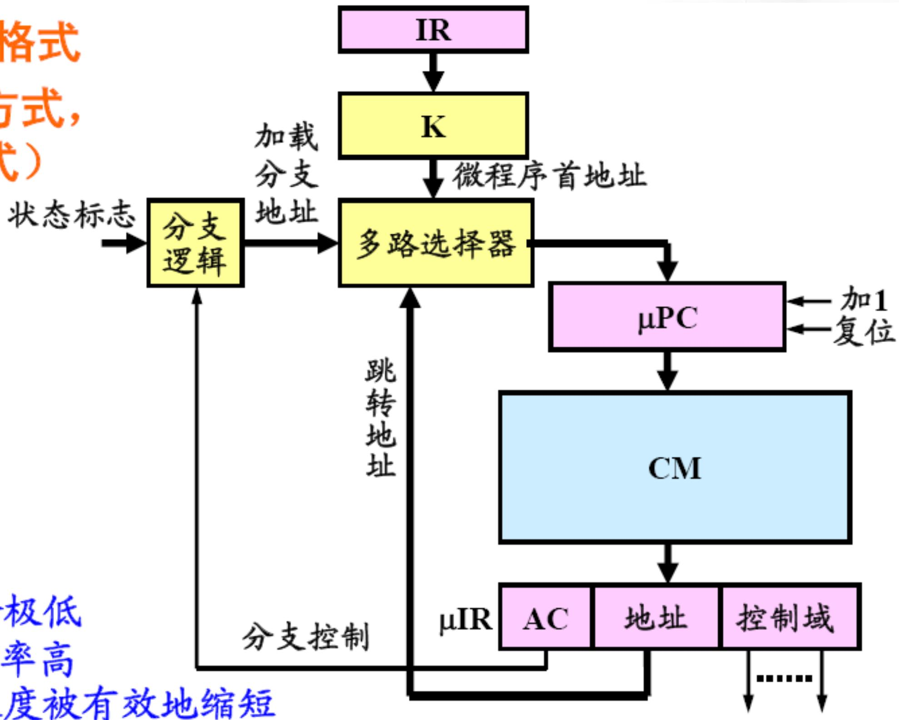

<details>
<summary>flowchart</summary>

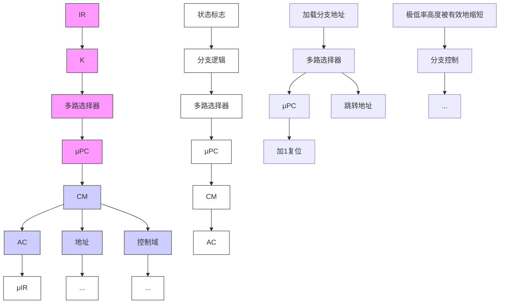
</details>

- 硬件代价极低
- μPC利用率高
- 微指令长度被有效地缩短

单地址格式的分支控制逻辑

# (基于) 微程序 (的) 控制器: 地址形成

# 3. 可变格式

■ 使任何微指令执行时不存在无用信息：让微指令在顺序执行时只提供控制信号的产生，需要分支时再提供跳转地址。→ 可变格式微指令
■ 两种微指令格式

- 控制微指令

$$
\mathbf {S} = \mathbf {0}
$$

<table><tr><td>标识S</td><td>控制域</td></tr></table>

- 转移微指令

$$
\mathbf {S} = \mathbf {1}
$$

<table><tr><td>标识S</td><td>分支控制</td><td>地址字段</td></tr></table>

# (基于) 微程序 (的) 控制器: 地址形成

# 3. 可变格式

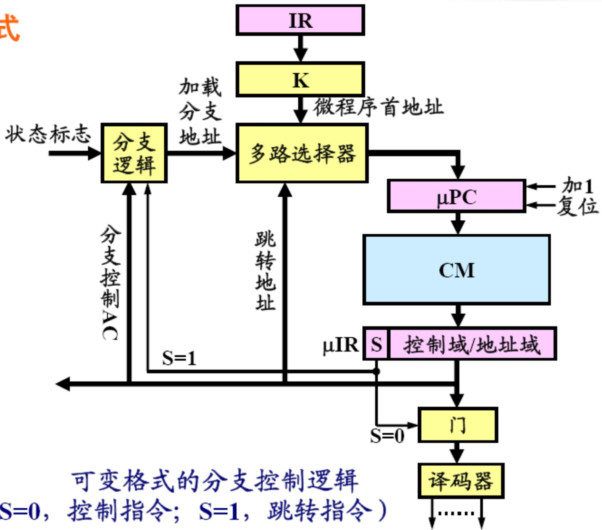

<details>
<summary>flowchart</summary>

```mermaid
graph TD
    A["IR"] --> B["K"]
    B --> C["多路选择器"]
    C --> D["μPC"]
    D --> E["CM"]
    E --> F["控制域/地址域"]
    F --> G["门"]
    G --> H["译码器"]
    H --> I["......"]
    J["状态标志"] --> K["分支逻辑"]
    K --> L["加载分支地址"]
    L --> C
    M["μIR"] --> N["S=1"]
    N --> K
    O["跳转地址"] --> C
    P["加1复位"] --> D
    Q["S=0"] --> F
    R[S=0, 控制指令; S=1, 跳转指令) --> G
    S[可变格式的分支控制逻辑\nS=0, 控制指令; S=1, 跳转指令) --> K
```
</details>

可变格式的分支控制逻辑
(设S=0，控制指令；S=1，跳转指令)

# (基于) 微程序 (的) 控制器: 控制信号编码

■ 水平型微指令 (horizontal microinstruction)
多个控制信号同时有效 → 多个微操作同时发生。

■ 垂直型微指令 (vertical microinstruction)

类似于机器指令，利用微操作码的不同编码来表示不同的微操作功能。

# 1. 水平型微指令控制域的编码

# (1) 直接表示法（水平编码）

- 可以在同一个时间有效的控制信号称为相容信号，具有相容性；
- 不能在同一个时间有效的控制信号称为互斥信号，具有互斥性。

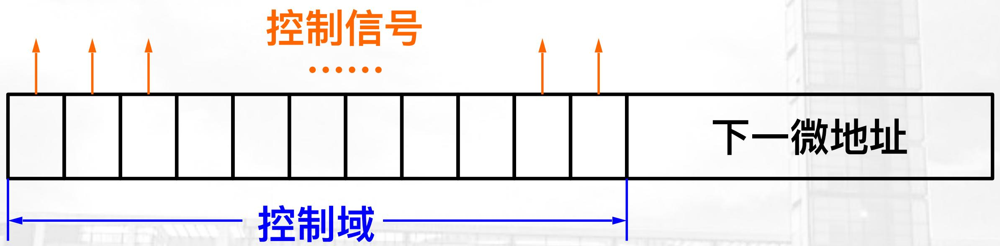

<details>
<summary>text_image</summary>

控制信号
……
下一微地址
控制域
</details>

图6.15 直接表示法

# 1. 水平型微指令控制域的编码

# (2) 字段译码法（字段编码）

将控制域分为若干字段，字段内垂直编码，字段间水平编码。


互斥的信号放在同一字段


相容的信号放在不同字段

- 若各字段的编码相互独立，则通过各字段独立译码就可以获得计算机系统的全部控制信号，这被称作直接译码方式。
- 若某些字段的编码相互关联，则关联字段要通过两级译码才能获得相关的控制信号，这被称作间接译码方式。

# (基于) 微程序 (的) 控制器: 控制信号编码

# 1. 水平型微指令控制域的编码

(2) 字段译码 （字段编码）
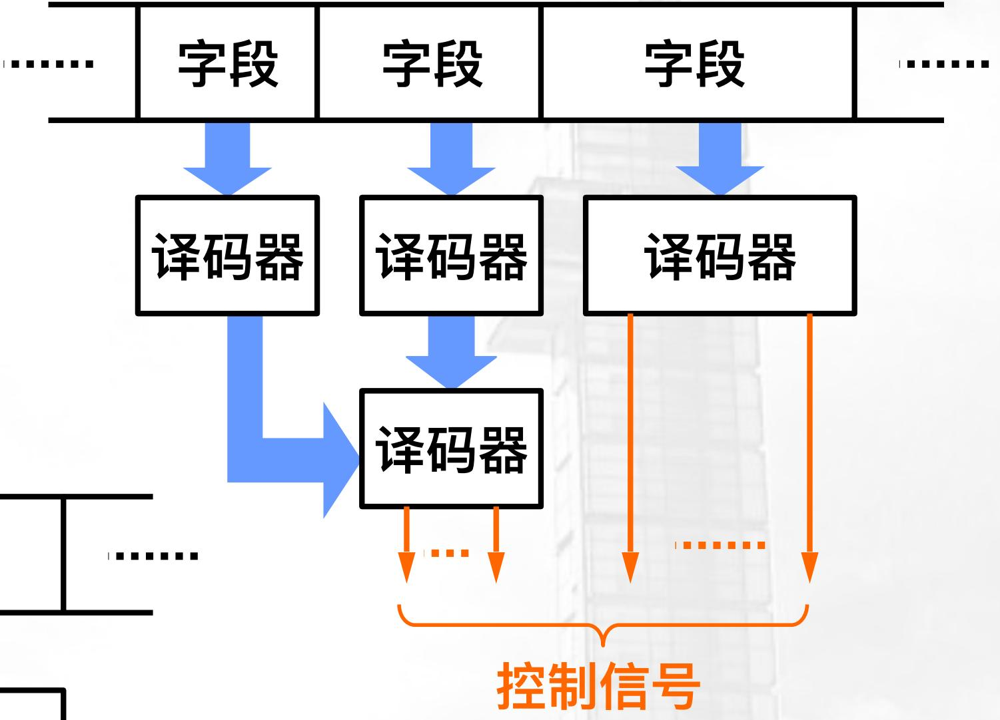

<details>
<summary>flowchart</summary>

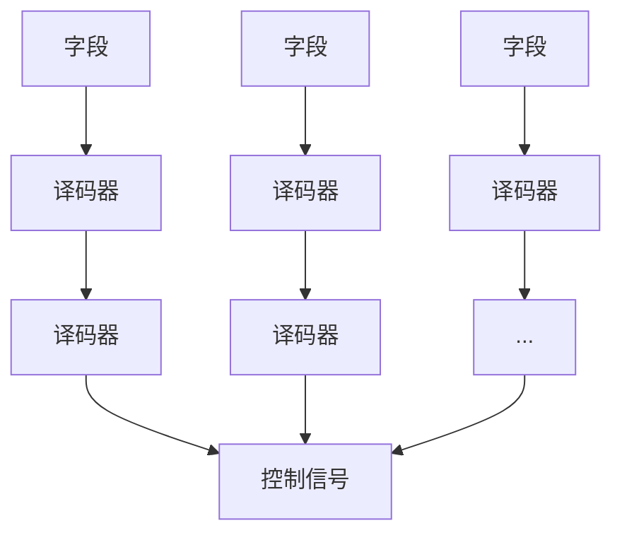
</details>

(b) 间接译码

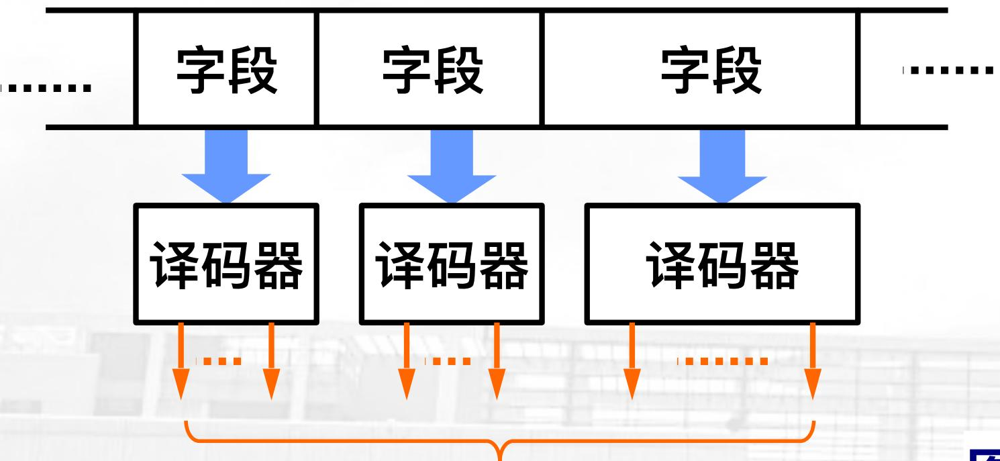

<details>
<summary>flowchart</summary>

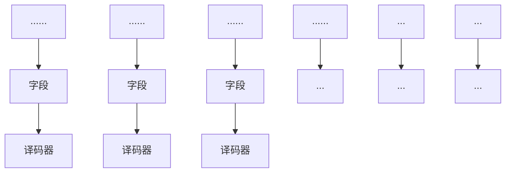
</details>

控制信号
(a) 直接译码
图6.16 字段译码法

# 1. 水平型微指令控制域的编码

# (2) 字段译码法（字段编码）

- 每个字段中要设计一个无效控制信号的编码
- 若控制域的某字段有 $m$ 位，则可以提供 $2^{m} - 1$ 个控制信号的编码
- 字段组织的有效方法:

- 按功能组织：把功能类同的各控制信号放在同一字段中。
- 按资源组织：把加载到同一部件上的各控制信号放在同一字段中。

# (基于) 微程序 (的) 控制器: 控制信号编码

图6.2

图6.9

# 1. 水平型微指令控制域的编码

(2) 字段译码法（字段编码）

<table><tr><td>按功能</td><td>按功能</td><td>按资源</td><td>按资源</td><td>按功能</td><td>按资源</td><td>按资源</td><td></td></tr><tr><td>字段1(4位)</td><td>字段2(4位)</td><td>字段3(2位)</td><td>字段4(3位)</td><td>字段5(4位)</td><td>字段6(2位)</td><td>字段7(2位)</td><td>字段8</td></tr><tr><td>NOP 0000</td><td>NOP 0000</td><td>NOP 00</td><td>NOP 000</td><td>NOP 0000</td><td>NOP 00</td><td>NOP 00</td><td>其他信号</td></tr><tr><td> $R0_{in}$  0001</td><td> $R0_{out}$  0001</td><td> $PC_{in}$  01</td><td> $SP_{in}$  001</td><td>ADD 0001</td><td>Mread 01</td><td>IOread 01</td><td></td></tr><tr><td> $R1_{in}$  0010</td><td> $R1_{out}$  0010</td><td> $PC_{out}$  10</td><td> $SP_{out}$  010</td><td>SUB 0010</td><td>Mwrite 10</td><td>IOwrite 10</td><td></td></tr><tr><td>......</td><td>......</td><td>PC+1 11</td><td>SP+1 011</td><td>AND 0011</td><td></td><td></td><td></td></tr><tr><td> $R7_{in}$  1000</td><td> $R7_{out}$  1000</td><td></td><td>SP-1 100</td><td>OR 0100</td><td></td><td></td><td></td></tr><tr><td> $IR_{in}$  1001</td><td> $IR_{out}$  1001</td><td></td><td></td><td>SHL 0101</td><td></td><td></td><td></td></tr><tr><td> $Y_{in}$  1010</td><td> $Z_{out}$  1010</td><td></td><td></td><td>SHR 0110</td><td></td><td></td><td></td></tr><tr><td> $AR_{in}$  1011</td><td> $AR_{out}$  1011</td><td></td><td></td><td>ROL 0111</td><td></td><td></td><td></td></tr><tr><td> $DRI_{in}$  1100</td><td> $DRI_{out}$  1100</td><td></td><td></td><td>ROR 1000</td><td></td><td></td><td></td></tr><tr><td> $DRS_{in}$  1101</td><td> $DRS_{out}$  1101</td><td></td><td></td><td></td><td></td><td></td><td></td></tr></table>

表6.1 一种控制域字段的组织和编码

1. 水平型微指令控制域的编码

<table><tr><td>按功能</td><td>按功能</td><td>按功能/资源</td><td>按资源</td><td></td></tr><tr><td>字段1(4位)</td><td>字段2(4位)</td><td>字段3(4位)</td><td>字段4(3位)</td><td>字段5</td></tr><tr><td>NOP 0000</td><td>NOP 0000</td><td>NOP 0000</td><td>NOP 000</td><td rowspan="12">其他信号</td></tr><tr><td> $R0_{in}$  0001</td><td> $R0_{out}$  0001</td><td>ADD 0001</td><td>Mread 001</td></tr><tr><td> $R1_{in}$  0010</td><td> $R1_{out}$  0010</td><td>SUB 0010</td><td>Mwrite 010</td></tr><tr><td>......</td><td>......</td><td>AND 0011</td><td>IOread 011</td></tr><tr><td> $R7_{in}$  1000</td><td> $R7_{out}$  1000</td><td>OR 0100</td><td>IOwrite 100</td></tr><tr><td> $IR_{in}$  1001</td><td> $IR_{out}$  1001</td><td>SHL 0101</td><td></td></tr><tr><td> $Y_{in}$  1010</td><td> $Z_{out}$  1010</td><td>SHR 0110</td><td></td></tr><tr><td> $AR_{in}$  1011</td><td> $AR_{out}$  1011</td><td>ROL 0111</td><td></td></tr><tr><td> $DRI_{in}$  1100</td><td> $DRI_{out}$  1100</td><td>ROR 1000</td><td></td></tr><tr><td> $DRS_{in}$  1101</td><td> $DRS_{out}$  1101</td><td>PC+1 1001</td><td></td></tr><tr><td> $PC_{in}$  1110</td><td> $PC_{out}$  1110</td><td>SP+1 1010</td><td></td></tr><tr><td> $SP_{in}$  1111</td><td> $SP_{out}$  1111</td><td>SP-1 1011</td><td></td></tr></table>

优化后的字段组织和编码

# 1. 水平型微指令控制域的编码

# (2) 字段译码法（字段编码）

也可以对字段进行关联设计，使一个域用于解释另一个域。

表6.3 采用间接译码方式的字段编码

<table><tr><td>......</td><td>字段i(2位)</td><td>字段i+1(2位)</td><td>......</td></tr><tr><td></td><td>NOP 00算术 01逻辑 10移位 11</td><td>ADD 00SUB 01AND 00OR 01SHL 00SHR 01ROL 10ROR 11</td><td></td></tr></table>

# 2. 垂直型微指令控制域的编码

# ■ 采用与机器指令相似的格式

- 微操作码：指示作何种微操作固定长度、可变长度
- 微操作对象：为微操作提供所需的操作数（常量或地址），一个、多个

# ■ 特点:

- 控制域紧凑、短小
- 并行能力差，微程序长，执行速度减慢
- 可扩展性强

<table><tr><td>微操作码</td><td>微操作对象</td></tr></table>

# (基于) 微程序 (的) 控制器: 控制信号编码

# 4. 微指令控制域编码设计实例

- IBM system/360 Model 50的微指令：由90位构成，其中有21个字段的控制域、5个字段的地址域和3个校验位。（水平型）

0 1 6 19 24 25 31 32

<table><tr><td>P1</td><td>3</td><td>2</td><td>6</td><td>4</td><td>3</td><td>5</td><td></td><td>3</td><td>3</td><td>P2</td><td>3</td><td>5</td><td>4</td><td>2</td><td>1</td><td>1</td><td>1</td><td>3</td><td>2</td><td>2</td></tr><tr><td>*</td><td colspan="2">控制域</td><td colspan="3">CM寻址信息</td><td>控制域</td><td>未用</td><td colspan="2">控制域</td><td>*</td><td colspan="10">控制域</td></tr></table>

\*P1: 1～30位的校验； P2: 32～55位的校验

<table><tr><td>56</td><td>57</td><td></td><td></td><td></td><td></td><td>72</td><td></td><td>83</td><td></td><td>89</td></tr><tr><td>P3</td><td>4</td><td>3</td><td>1</td><td>3</td><td>4</td><td>6</td><td>5</td><td></td><td colspan="2">6</td></tr><tr><td>*</td><td colspan="5">控制域</td><td colspan="2">CM寻址信息</td><td>未用</td><td colspan="2">控制域</td></tr></table>

\*P3: 57～89位的校验

# (基于) 微程序 (的) 控制器: 控制信号编码

# 4. 微指令控制域编码设计实例

- IBM system/370 Model 145的微指令：由32位构成（垂直型）

- 微操作码：指定应完成的微操作
- 微操作数：如CPU寄存器的地址
- 下一条微指令地址的信息

<table><tr><td>0</td><td>8</td><td>16</td><td>24</td><td>31</td></tr><tr><td>控制域(微操作码)</td><td>微操作数1</td><td>微操作数2</td><td colspan="2">CM寻址信息</td></tr></table>

图6.18 IBM system/370 Model 145的微指令格式

# (基于) 微程序 (的) 控制器: 控制信号编码

# (1) 一条指令对应一段完整的微程序

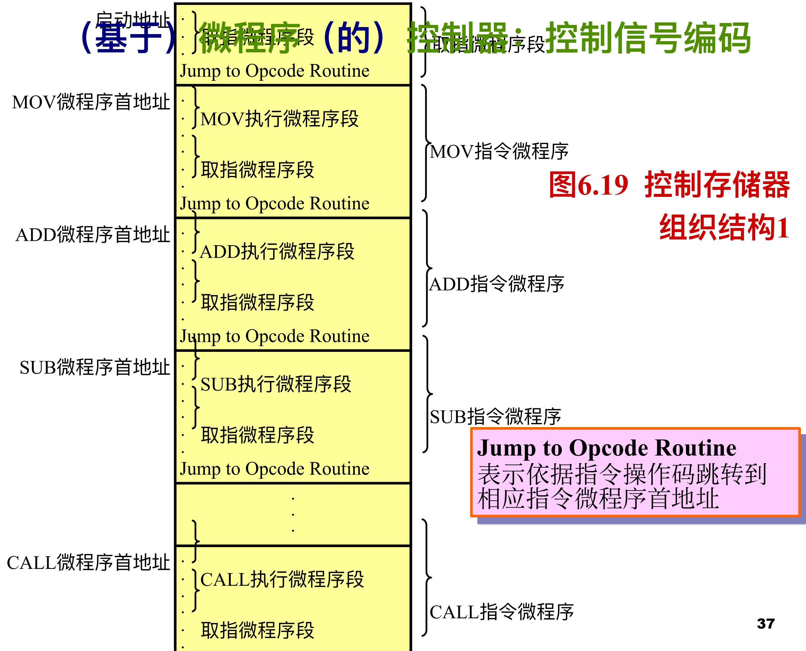

<details>
<summary>text_image</summary>

(基于)
(启动地址) { 微程序 (的) 控制器: 控制信号编码
    { 有指微程序段
    Jump to Opcode Routine
    } 取指微程序段
MOV微程序首地址
    { MOV执行微程序段
    { 取指微程序段
    Jump to Opcode Routine
    }
ADD微程序首地址
    { ADD执行微程序段
    { 取指微程序段
    Jump to Opcode Routine
    }
SUB微程序首地址
    { SUB执行微程序段
    { 取指微程序段
    Jump to Opcode Routine
    }
CALL微程序首地址
    { CALL执行微程序段
    { 取指微程序段
    }
}
</details>

# 6.3.3 微程序设计

1. 微程序结构

(2) 将微程序中的公共部分设计成微子程序进行公共调用

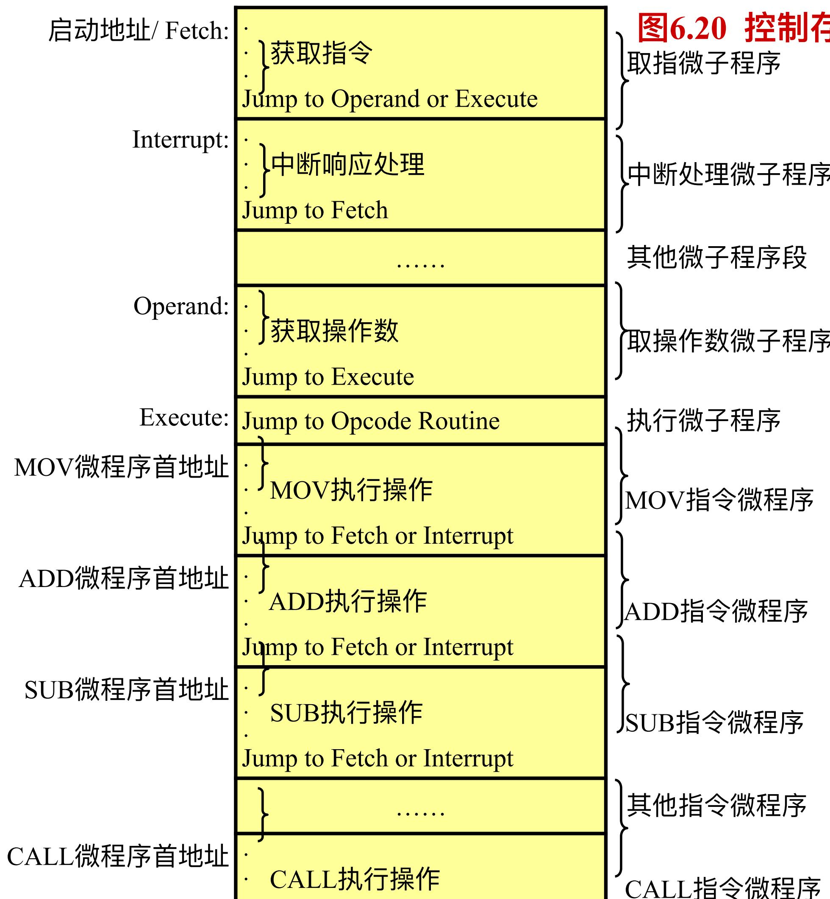

<details>
<summary>text_image</summary>

启动地址/ Fetch:
获取指令
Jump to Operand or Execute
Interrupt:
中断响应处理
Jump to Fetch
......
其他微子程序段
Operand:
获取操作数
Jump to Execute
Execute: Jump to Opcode Routine
MOV微程序首地址
MOV执行操作
Jump to Fetch or Interrupt
ADD微程序首地址
ADD执行操作
Jump to Fetch or Interrupt
SUB微程序首地址
SUB执行操作
Jump to Fetch or Interrupt
CALL微程序首地址
......
其他指令微程序
CALL指令微程序
图6.20 控制存
取指微子程序
中断处理微子程序
其他微子程序段
取操作数微子程序
执行微子程序
MOV指令微程序
ADD指令微程序
SUB指令微程序
</details>

图6.20 控制存储器组织结构2
Jump to Operand or Execute: 有操作数时跳转到取操作数微子程序，无操作数时跳转到执行微子程序
Jump to Fetch: 跳转到取指令微子程序
Jump to Execute: 跳转到执行微子程序
Jump to Opcode Routine: 依据指令操作码跳转到相应指令微程序首地址
Jump to Fetch or Interrupt: 无中断请求时跳转到取指令微子程序，有中断请求时跳转到中断处理子程序

# (基于) 微程序 (的) 控制器: 控制信号编码

# 编写微程序要做两件事：

1. 按照设计好的微指令格式，将指令微操作（微命令）序列按每节拍一条微指令写出每条微指令的具体编码；
2. 按照选定的微程序结构，将微指令组织成微程序或微子程

序。

# 微指令格式：

<table><tr><td colspan="4">控制域</td><td>地址域</td></tr><tr><td>字段1(4)</td><td>字段2(4)</td><td>字段3(4)</td><td>字段4(3)</td><td>AC(1)</td></tr></table>

表6.4 微程序首地址的生成

<table><tr><td>微程序首地址</td><td>指令操作码(4)</td><td>指令寻址方式(4)</td><td>JA(4)</td></tr><tr><td>控存启动地址</td><td>0</td><td>0</td><td>0</td></tr><tr><td>MOV R0, X</td><td>1</td><td>6</td><td>0</td></tr><tr><td>ADD R1, R0</td><td>2</td><td>1</td><td>0</td></tr><tr><td>SUB R0, (X)</td><td>3</td><td>7</td><td>0</td></tr><tr><td>...</td><td>...</td><td>...</td><td>...</td></tr></table>

# (基于) 微程序 (的) 控制器: 控制信号编码

表6.5 微程序段示例

<table><tr><td>微程序名</td><td>微地址</td><td colspan="5">微指令</td><td>节拍</td><td>微操作</td><td>微命令</td></tr><tr><td rowspan="3">取指</td><td>000H</td><td>1011</td><td>1110</td><td>0000</td><td>000</td><td>0</td><td>T1</td><td>AR←PC</td><td> $PC_{out}$ ,  $AR_{in}$ </td></tr><tr><td>001H</td><td>1101</td><td>1011</td><td>0000</td><td>001</td><td>0</td><td>T2</td><td>DR←Memory[AR]</td><td> $AR_{out}$ , Mread,  $DRS_{in}$ </td></tr><tr><td>002H</td><td>1001</td><td>1100</td><td>1001</td><td>000</td><td>1</td><td>T3</td><td>PC←PC+I, IR←DR</td><td> $PC+1$ ,  $DRI_{out}$ ,  $IR_{in}$ </td></tr><tr><td>MOV</td><td>160H</td><td>1011</td><td>1001</td><td>0000</td><td>000</td><td>0</td><td>T1</td><td>AR←IR (地址字段)</td><td> $IR_{out}$ ,  $AR_{in}$ </td></tr><tr><td rowspan="5">R0,X</td><td>161H</td><td>1101</td><td>1011</td><td>0000</td><td>001</td><td>0</td><td>T2</td><td>DR←Memory[AR]</td><td> $AR_{out}$ , Mread,  $DRS_{in}$ </td></tr><tr><td>162H</td><td>0001</td><td>1100</td><td>0000</td><td>000</td><td>0</td><td>T3</td><td>R0←DR</td><td> $DRI_{out}$ ,  $R0_{in}$ </td></tr><tr><td>163H</td><td>1011</td><td>1110</td><td>0000</td><td>000</td><td>0</td><td>T4</td><td>AR←PC</td><td> $PC_{out}$ ,  $AR_{in}$ </td></tr><tr><td>164H</td><td>1101</td><td>1011</td><td>0000</td><td>001</td><td>0</td><td>T5</td><td>DR←Memory[AR]</td><td> $AR_{out}$ , Mread,  $DRS_{in}$ </td></tr><tr><td>165H</td><td>1001</td><td>1100</td><td>1001</td><td>000</td><td>1</td><td>T6</td><td>PC←PC+I, IR←DR</td><td> $PC+1$ ,  $DRI_{out}$ ,  $IR_{in}$ </td></tr><tr><td>ADD</td><td>210H</td><td>1010</td><td>0001</td><td>0000</td><td>000</td><td>0</td><td>T1</td><td>Y←R0</td><td> $R0_{out}$ ,  $Y_{in}$ </td></tr><tr><td rowspan="5">R1,R0</td><td>211H</td><td>0000</td><td>0010</td><td>0001</td><td>000</td><td>0</td><td>T2</td><td>Z←R1+Y</td><td> $R1_{out}$ , ADD</td></tr><tr><td>212H</td><td>0010</td><td>1010</td><td>0000</td><td>000</td><td>0</td><td>T3</td><td>R1←Z</td><td> $Z_{out}$ ,  $R1_{in}$ </td></tr><tr><td>213H</td><td>1011</td><td>1110</td><td>0000</td><td>000</td><td>0</td><td>T4</td><td>AR←PC</td><td> $PC_{out}$ ,  $AR_{in}$ </td></tr><tr><td>214H</td><td>1101</td><td>1011</td><td>0000</td><td>001</td><td>0</td><td>T5</td><td>DR←Memory[AR]</td><td> $AR_{out}$ , Mread,  $DRS_{in}$ </td></tr><tr><td>215H</td><td>1001</td><td>1100</td><td>1001</td><td>000</td><td>1</td><td>T6</td><td>PC←PC+I, IR←DR</td><td> $PC+1$ ,  $DRI_{out}$ ,  $IR_{in}$ </td></tr></table>

# (基于) 微程序 (的) 控制器: 控制信号编码

表6.5 微程序段示例（续）

<table><tr><td>微程序名</td><td>微地址</td><td colspan="5">微指令</td><td>节拍</td><td>微操作</td><td>微命令</td></tr><tr><td rowspan="10">SUBR0,(X)</td><td>370H</td><td>1011</td><td>1001</td><td>0000</td><td>000</td><td>0</td><td>T1</td><td>AR←IR(地址字段)</td><td> $IR_{out}$ ,  $AR_{in}$ </td></tr><tr><td>371H</td><td>1101</td><td>1011</td><td>0000</td><td>001</td><td>0</td><td>T2</td><td>DR←Memory[AR]</td><td> $AR_{out}$ , Mread,  $DRS_{in}$ </td></tr><tr><td>372H</td><td>1011</td><td>1100</td><td>0000</td><td>000</td><td>0</td><td>T3</td><td>AR←DR</td><td> $DRI_{out}$ ,  $AR_{in}$ </td></tr><tr><td>373H</td><td>1101</td><td>1011</td><td>0000</td><td>001</td><td>0</td><td>T4</td><td>DR←Memory[AR]</td><td> $AR_{out}$ , Mread,  $DRS_{in}$ </td></tr><tr><td>374H</td><td>1010</td><td>0001</td><td>0000</td><td>000</td><td>0</td><td>T5</td><td>Y←R0</td><td> $R0_{out}$ ,  $Y_{in}$ </td></tr><tr><td>375H</td><td>0000</td><td>1100</td><td>0010</td><td>000</td><td>0</td><td>T6</td><td>Z←Y - DR</td><td> $DRI_{out}$ , SUB</td></tr><tr><td>376H</td><td>0001</td><td>1010</td><td>0000</td><td>000</td><td>0</td><td>T7</td><td>R0←Z</td><td> $Z_{out}$ ,  $R0_{in}$ </td></tr><tr><td>377H</td><td>1011</td><td>1110</td><td>0000</td><td>000</td><td>0</td><td>T8</td><td>AR←PC</td><td> $PC_{out}$ ,  $AR_{in}$ </td></tr><tr><td>378H</td><td>1101</td><td>1011</td><td>0000</td><td>001</td><td>0</td><td>T9</td><td>DR←Memory[AR]</td><td> $AR_{out}$ , Mread,  $DRS_{in}$ </td></tr><tr><td>379H</td><td>1001</td><td>1100</td><td>1001</td><td>000</td><td>1</td><td>T10</td><td> $PC \leftarrow PC+I$ ,  $IR \leftarrow DR$ </td><td> $PC+1$ ,  $DRI_{out}$ ,  $IR_{in}$ </td></tr><tr><td>.</td><td>.</td><td colspan="5">.</td><td>.</td><td>.</td><td>.</td></tr><tr><td>.</td><td>.</td><td colspan="5">.</td><td>.</td><td>.</td><td>.</td></tr><tr><td>.</td><td>.</td><td colspan="5">.</td><td>.</td><td>.</td><td>.</td></tr></table>

# (基于) 微程序 (的) 控制器: 控制信号编码

# 微程序控制器设计的基本原则：

# 速度快

□ 快速产生下条微指令地址
□ 快速获得微指令
□ 快速产生控制信号

# 体积小

☐ 控制器中使用的器件数量
控制存储器的规模

# 6.3.4 微程序控制器设计

# 微程序控制器设计的基本步骤：

1. 指令分析：得到指令微操作（微命令）序列
2. 微命令分析：归类，相容性/互斥性检查
3. 微指令及控制器结构设计

① 确定微指令地址域格式：两地址/单地址/可变格式
② 确定微指令控制域格式：水平/垂直/字段编码

# 4. 微程序与控制存储器设计

控制存储器容量 = 微指令长度 × (平均微程序长度 (微指令数) / 一条指令) × 指令数

① 选择微指令和微程序结构：结构1、结构2
② 确定微程序入口地址(首地址)的生成方法

# 5. 微程序控制器实现

设计硬件逻辑电路并实现
编写微程序并存储到控制存储器中

# 3. 水平型与垂直型微指令的比较

# ■ 水平型微指令特性：

- 需要较长的微指令控制域；
- 可以表示高度并行的控制信号；
- 对控制域提供的控制信息只需较少的译码电路，甚至不需要译码。

# ■ 垂直型微指令特性：

- 需要较短的微指令控制域；
- 并行微操作的表示能力有限；
- 对控制信息必须译码。

# 微指令的设计

<table><tr><td>4b</td><td>4b</td><td>2b</td><td>2b</td><td>4b</td><td>3b</td><td>2b</td><td>2b</td><td>2b</td><td>2b</td></tr><tr><td> $XX_{out}$ </td><td> $XX_{in}$ </td><td>DR</td><td>AR</td><td>ALU</td><td>T</td><td>PC</td><td>M</td><td>SP</td><td>响应</td></tr><tr><td>NOP</td><td>NOP</td><td>NOP</td><td>NOP</td><td>NOP</td><td>NOP</td><td>NOP</td><td>NOP</td><td>NOP</td><td>NOP</td></tr><tr><td> $AX_{out}$ </td><td> $AX_{in}$ </td><td>DB→DR</td><td>AR→AB</td><td>ADD</td><td>SAR</td><td>0→PC</td><td>RD</td><td>SP+1</td><td>INTA</td></tr><tr><td> $BX_{out}$ </td><td> $BX_{in}$ </td><td>DR→DB</td><td> $AR_{in}$ </td><td>ADC</td><td>SHL</td><td>PC+1</td><td>WR</td><td>SP-1</td><td>DACK</td></tr><tr><td> $CX_{out}$ </td><td> $CX_{in}$ </td><td></td><td></td><td>SUB</td><td>SHR</td><td></td><td></td><td></td><td></td></tr><tr><td> $DX_{out}$ </td><td> $DX_{in}$ </td><td></td><td></td><td>SBC</td><td>ROL</td><td></td><td></td><td></td><td></td></tr><tr><td> $SP_{out}$ </td><td> $SP_{in}$ </td><td></td><td></td><td>AND</td><td>ROR</td><td></td><td></td><td></td><td></td></tr><tr><td> $BP_{out}$ </td><td> $BP_{in}$ </td><td></td><td></td><td>XOR</td><td>RCL</td><td></td><td></td><td></td><td></td></tr><tr><td> $SI_{out}$ </td><td> $SI_{in}$ </td><td></td><td></td><td>NOT</td><td>RCR</td><td></td><td></td><td></td><td></td></tr><tr><td> $DI_{out}$ </td><td> $DI_{in}$ </td><td></td><td></td><td>INC</td><td></td><td></td><td></td><td></td><td></td></tr><tr><td> $PC_{out}$ </td><td> $PC_{in}$ </td><td></td><td></td><td>DEC</td><td></td><td></td><td></td><td></td><td></td></tr><tr><td> $DR_{out}$ </td><td> $IR_{in}$ </td><td></td><td></td><td>CMP</td><td></td><td></td><td></td><td></td><td></td></tr><tr><td> $S_{out}$ </td><td> $S_{in}$ </td><td></td><td></td><td>OR</td><td></td><td></td><td></td><td></td><td></td></tr><tr><td> $T_{out}$ </td><td> $T_{in}$ </td><td></td><td></td><td></td><td></td><td></td><td></td><td></td><td></td></tr><tr><td></td><td> $DR_{in}$ </td><td></td><td></td><td></td><td></td><td></td><td></td><td></td><td></td></tr></table>

图 5-29 控制字段各类微命令分布

<table><tr><td>9b</td><td>4b</td><td>4b</td><td>4b</td><td>2b</td><td>2b</td><td>4b</td><td>3b</td><td>2b</td><td>2b</td><td>2b</td><td>2b</td></tr><tr><td>NA</td><td>AC</td><td> $XX_{out}$ </td><td> $XX_{in}$ </td><td>DR</td><td>AR</td><td>ALU</td><td>T</td><td>PC</td><td>M</td><td>SP</td><td>响应</td></tr></table>

图 5-30 微指令各组成字段格式

# 微指令的设计

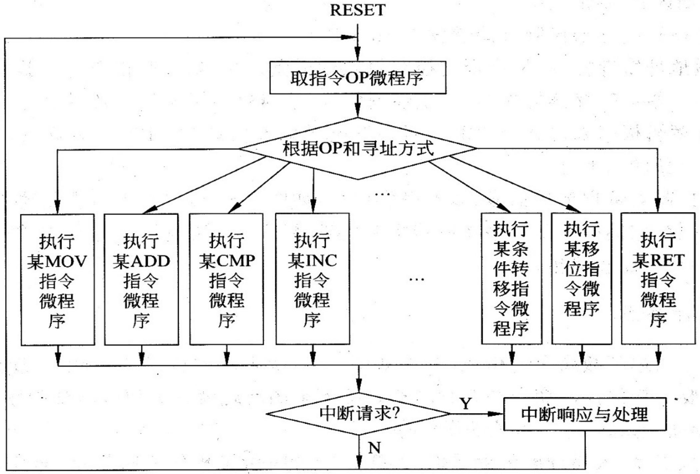

<details>
<summary>flowchart</summary>

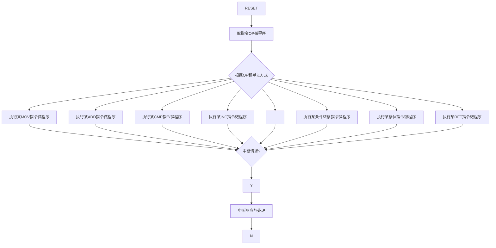
</details>

图5-31 微程序流程框图

# 微程序编程

# 取指:

① $PC_{out}$ , $AR_{in}$
② AR→AB,
RD, PC+1
③ MM→DB,
DR $_{in}$
④ $\mathbf{DR}_{\mathrm{out}}$ , IRin

<table><tr><td>NA</td><td>AC</td><td>XXout</td><td>XXin</td><td>DR</td><td>AR</td><td>ALU</td><td>T</td><td>PC</td><td>M</td><td>SP</td><td>响应</td></tr><tr><td>000000000</td><td>0000</td><td>1001</td><td>0000</td><td>00</td><td>10</td><td>0000</td><td>000</td><td>00</td><td>00</td><td>00</td><td>00</td></tr><tr><td colspan="12"></td></tr><tr><td>000000000</td><td>0000</td><td>0000</td><td>0000</td><td>00</td><td>01</td><td>0000</td><td>000</td><td>10</td><td>01</td><td>00</td><td>00</td></tr><tr><td colspan="12"></td></tr><tr><td>000000000</td><td>0000</td><td>0000</td><td>1101</td><td>01</td><td>00</td><td>0000</td><td>000</td><td>00</td><td>00</td><td>00</td><td>00</td></tr><tr><td colspan="12"></td></tr><tr><td>000000000</td><td>1001</td><td>1010</td><td>1010</td><td>00</td><td>00</td><td>0000</td><td>000</td><td>00</td><td>00</td><td>00</td><td>00</td></tr></table>

图 5-32 取指令操作码的微程序段

<table><tr><td>4b</td><td>4b</td><td>2b</td><td>2b</td><td>4b</td><td>3b</td><td>2b</td><td>2b</td><td>2b</td><td>2b</td></tr><tr><td> $XX_{out}$ </td><td> $XX_{in}$ </td><td>DR</td><td>AR</td><td>ALU</td><td>T</td><td>PC</td><td>M</td><td>SP</td><td>响应</td></tr><tr><td>NOP</td><td>NOP</td><td>NOP</td><td>NOP</td><td>NOP</td><td>NOP</td><td>NOP</td><td>NOP</td><td>NOP</td><td>NOP</td></tr><tr><td> $AX_{out}$ </td><td> $AX_{in}$ </td><td>DB→DR</td><td>AR→AB</td><td>ADD</td><td>SAR</td><td>0→PC</td><td>RD</td><td>SP+1</td><td>INTA</td></tr><tr><td> $BX_{out}$ </td><td> $BX_{in}$ </td><td>DR→DB</td><td> $AR_{in}$ </td><td>ADC</td><td>SHL</td><td>PC+1</td><td>WR</td><td>SP-1</td><td>DACK</td></tr><tr><td> $CX_{out}$ </td><td> $CX_{in}$ </td><td></td><td></td><td>SUB</td><td>SHR</td><td></td><td></td><td></td><td></td></tr><tr><td> $DX_{out}$ </td><td> $DX_{in}$ </td><td></td><td></td><td>SBC</td><td>ROL</td><td></td><td></td><td></td><td></td></tr><tr><td> $SP_{out}$ </td><td> $SP_{in}$ </td><td></td><td></td><td>AND</td><td>ROR</td><td></td><td></td><td></td><td></td></tr><tr><td> $BP_{out}$ </td><td> $BP_{in}$ </td><td></td><td></td><td>XOR</td><td>RCL</td><td></td><td></td><td></td><td></td></tr><tr><td> $SI_{out}$ </td><td> $SI_{in}$ </td><td></td><td></td><td>NOT</td><td>RCR</td><td></td><td></td><td></td><td></td></tr><tr><td> $DI_{out}$ </td><td> $DI_{in}$ </td><td></td><td></td><td>INC</td><td></td><td></td><td></td><td></td><td></td></tr><tr><td> $PC_{out}$ </td><td> $PC_{in}$ </td><td></td><td></td><td>DEC</td><td></td><td></td><td></td><td></td><td></td></tr><tr><td> $DR_{out}$ </td><td> $IR_{in}$ </td><td></td><td></td><td>CMP</td><td></td><td></td><td></td><td></td><td></td></tr><tr><td> $S_{out}$ </td><td> $S_{in}$ </td><td></td><td></td><td>OR</td><td></td><td></td><td></td><td></td><td></td></tr><tr><td> $T_{out}$ </td><td> $T_{in}$ </td><td></td><td></td><td></td><td></td><td></td><td></td><td></td><td></td></tr><tr><td></td><td> $DR_{in}$ </td><td></td><td></td><td></td><td></td><td></td><td></td><td></td><td></td></tr></table>

# 微程序编程

# 指令执行:

ADD BX, [DI]

① DIout, ARin
② AR→AB, RD
③ DB→DR, DRin
④ DRout, Sin
⑤ Sout → ALU
⑥ BXout → ALU
⑦ ADD, ALU→T, Tin
⑧ Tout, BXin

<table><tr><td>NA</td><td>AC</td><td> $XX_{out}$ </td><td> $XX_{in}$ </td><td>DR</td><td>AR</td><td>ALU</td><td>T</td><td>PC</td><td>M</td><td>SP</td><td>响应</td></tr><tr><td>000000000</td><td>0000</td><td>1000</td><td>0000</td><td>00</td><td>10</td><td>0000</td><td>000</td><td>00</td><td>00</td><td>00</td><td>00</td></tr><tr><td colspan="12"></td></tr><tr><td>000000000</td><td>0000</td><td>0000</td><td>0000</td><td>00</td><td>01</td><td>0000</td><td>000</td><td>00</td><td>01</td><td>00</td><td>00</td></tr><tr><td colspan="12"></td></tr><tr><td>000000000</td><td>0000</td><td>0000</td><td>1101</td><td>01</td><td>00</td><td>0000</td><td>000</td><td>00</td><td>00</td><td>00</td><td>00</td></tr><tr><td colspan="12"></td></tr><tr><td>000000000</td><td>0000</td><td>1010</td><td>1011</td><td>00</td><td>00</td><td>0000</td><td>000</td><td>00</td><td>00</td><td>00</td><td>00</td></tr><tr><td colspan="12"></td></tr><tr><td>000000000</td><td>0000</td><td>1011</td><td>0000</td><td>00</td><td>00</td><td>0000</td><td>000</td><td>00</td><td>00</td><td>00</td><td>00</td></tr><tr><td colspan="12"></td></tr><tr><td>000000000</td><td>0000</td><td>0010</td><td>0000</td><td>00</td><td>00</td><td>0000</td><td>000</td><td>00</td><td>00</td><td>00</td><td>00</td></tr><tr><td colspan="12"></td></tr><tr><td>000000000</td><td>0000</td><td>0000</td><td>1101</td><td>00</td><td>00</td><td>0001</td><td>000</td><td>00</td><td>00</td><td>00</td><td>00</td></tr><tr><td colspan="12"></td></tr><tr><td>110000000</td><td>0001</td><td>1100</td><td>0010</td><td>00</td><td>00</td><td>0000</td><td>000</td><td>00</td><td>00</td><td>00</td><td>00</td></tr></table>

图 5-33 ADD BX,[DI]指令执行过程的微程序

# (基于) 微程序 (的) 控制器

# 6、微程序控制器与组合逻辑（硬布线）控制器的比较

# ■ 微程序控制器

- 比硬布线控制器速度慢
- 设计简单化、规范化
- 功能可修改、可扩充
- 实现成本低，出错概率小
- 常用于CISC处理器控制器的实现

# ■ 硬布线控制器

- 速度快
- 当计算机系统复杂时，设计困难
- 一旦实现，不可修改和扩充
- 常用于RISC处理器控制器的实现

# CPU内部指令系统设计

- 假设我们正在造一个CPU

- 假设我们正在研发核心的指令系统....

- 两大步骤:

- 给指令编码（设计编码规则）
- 给指令解码（让机器按规则去识别编码）

# Designing a dummy CPU~

15 87 0

<table><tr><td>指令操作码字段</td><td>指令寻址方式字段</td></tr></table>

(a) 单字指令

15 87 0

<table><tr><td>指令操作码字段</td><td>指令寻址方式字段</td></tr></table>

15 0

<table><tr><td>16位偏移量、立即数或直接地址</td></tr></table>

(b) 双字指令

图5-3 指令码构成格式

# Designing a dummy CPU~

操作码字段的编排

<table><tr><td>指令操作码字段</td><td>指令寻址方式字段</td></tr></table>

<table><tr><td>15</td><td>14</td><td>13</td><td>12</td><td>11</td><td>10</td><td>9</td><td>8</td><td>7</td><td>6</td><td>5</td><td>4</td><td>3</td><td>2</td><td>1</td><td>0</td></tr></table>

<table><tr><td>0</td><td>0</td><td>0</td><td>0</td><td>X</td><td>X</td><td>X</td><td>X</td><td>双操作数指令</td></tr></table>

<table><tr><td>0</td><td>0</td><td>0</td><td>0</td><td>1</td><td>1</td><td>1</td><td>0</td><td>X</td><td>X</td><td>X</td><td>X</td><td>单操作数指令</td></tr></table>

<table><tr><td>0</td><td>0</td><td>0</td><td>0</td><td>1</td><td>1</td><td>1</td><td>1</td><td>X</td><td>X</td><td>X</td><td>X</td><td>转移指令</td></tr></table>

<table><tr><td>0</td><td>0</td><td>0</td><td>0</td><td>1</td><td>1</td><td>1</td><td>1</td><td>1</td><td>1</td><td>1</td><td>1</td><td>X</td><td>X</td><td>X</td><td>X</td></tr></table>

无操作数指令

# Designing a dummy CPU~

# 指令的设置

- 双操作数指令：11条
MOV、ADD、SUB、ADC、SBC、CMP、MUL、DIV、AND、OR、XOR
- 单操作数指令：13条
INC、DEC、PUSH、POP、NOT、SHL、SHR、SAR、ROL、ROR、RCL、RCR、CALL
- 转移指令: 9条
JMP、JZ、JNZ、JC、JNC、JG、JGE、JA、JAE
- 无操作数指令：7条
RET、IRET、NOP、CLI、STI、SWI、DAA

# Designing a dummy CPU~

- 双操作数指令：11条

<table><tr><td>15</td><td>14</td><td>13</td><td>12</td><td>11</td><td>10</td><td>9</td><td>8</td><td>7</td><td>6</td><td>5</td><td>4</td><td>3</td><td>2</td><td>1</td><td>0</td></tr></table>

<table><tr><td>0</td><td>0</td><td>0</td><td>0</td><td>X</td><td>X</td><td>X</td><td>X</td><td>双操作数指令</td></tr><tr><td rowspan="12">0</td><td rowspan="12">0</td><td rowspan="12">0</td><td rowspan="12">0</td><td>0</td><td>0</td><td>0</td><td>0</td><td>MOV</td></tr><tr><td>0</td><td>0</td><td>0</td><td>1</td><td>ADD</td></tr><tr><td>0</td><td>0</td><td>1</td><td>0</td><td>SUB</td></tr><tr><td>0</td><td>0</td><td>1</td><td>1</td><td>ADC</td></tr><tr><td>0</td><td>1</td><td>0</td><td>0</td><td>SBC</td></tr><tr><td>0</td><td>1</td><td>0</td><td>1</td><td>CMP</td></tr><tr><td>0</td><td>1</td><td>1</td><td>0</td><td>MUL</td></tr><tr><td>0</td><td>1</td><td>1</td><td>1</td><td>DIV</td></tr><tr><td>1</td><td>0</td><td>0</td><td>0</td><td>AND</td></tr><tr><td>1</td><td>0</td><td>0</td><td>1</td><td>OR</td></tr><tr><td>1</td><td>0</td><td>1</td><td>0</td><td>XOR</td></tr><tr><td>1</td><td>0</td><td>1</td><td>1</td><td></td></tr></table>

# Designing a dummy CPU~

- 单操作数指令：13条

<table><tr><td>15</td><td>14</td><td>13</td><td>12</td><td>11</td><td>10</td><td>9</td><td>8</td><td>7</td><td>6</td><td>5</td><td>4</td><td>3</td><td>2</td><td>1</td><td>0</td></tr></table>

<table><tr><td>0</td><td>0</td><td>0</td><td>0</td><td>X</td><td>X</td><td>X</td><td>X</td><td>双操作数指令</td></tr></table>

<table><tr><td>0</td><td>0</td><td>0</td><td>0</td><td>1</td><td>1</td><td>1</td><td>0</td><td>X</td><td>X</td><td>X</td><td>X</td><td>单操作数指令</td></tr></table>

<table><tr><td rowspan="16">0</td><td rowspan="16">0</td><td rowspan="16">0</td><td rowspan="16">0</td><td rowspan="16">1</td><td rowspan="16">1</td><td rowspan="16">1</td><td rowspan="16">0</td><td>0</td><td>0</td><td>0</td><td>CALL</td></tr><tr><td>0</td><td>0</td><td>0</td><td>1</td></tr><tr><td>0</td><td>0</td><td>1</td><td>0</td></tr><tr><td>0</td><td>0</td><td>1</td><td>1</td></tr><tr><td>0</td><td>1</td><td>0</td><td>0</td></tr><tr><td>0</td><td>1</td><td>0</td><td>1</td></tr><tr><td>0</td><td>1</td><td>1</td><td>0</td></tr><tr><td>0</td><td>1</td><td>1</td><td>1</td></tr><tr><td>1</td><td>0</td><td>0</td><td>0</td></tr><tr><td>1</td><td>0</td><td>0</td><td>1</td></tr><tr><td>1</td><td>0</td><td>1</td><td>0</td></tr><tr><td>1</td><td>0</td><td>1</td><td>1</td></tr><tr><td>1</td><td>1</td><td>0</td><td>0</td></tr><tr><td>1</td><td>1</td><td>0</td><td>1</td></tr><tr><td>1</td><td>1</td><td>1</td><td>0</td></tr><tr><td>1</td><td>1</td><td>1</td><td>1</td></tr></table>

# Designing a dummy CPU~

- 转移指令：9条

<table><tr><td>15</td><td>14</td><td>13</td><td>12</td><td>11</td><td>10</td><td>9</td><td>8</td><td>7</td><td>6</td><td>5</td><td>4</td><td>3</td><td>2</td><td>1</td><td>0</td></tr></table>

<table><tr><td>0</td><td>0</td><td>0</td><td>0</td><td>X</td><td>X</td><td>X</td><td>X</td><td>双操作数指令</td></tr></table>

<table><tr><td>0</td><td>0</td><td>0</td><td>0</td><td>1</td><td>1</td><td>1</td><td>0</td><td>X</td><td>X</td><td>X</td><td>X</td><td>单操作数指令</td></tr></table>

<table><tr><td>0</td><td>0</td><td>0</td><td>0</td><td>1</td><td>1</td><td>1</td><td>1</td><td>X</td><td>X</td><td>X</td><td>X</td><td>转移指令</td></tr></table>

<table><tr><td rowspan="10">0</td><td rowspan="10">0</td><td rowspan="10">0</td><td rowspan="10">0</td><td rowspan="10">1</td><td rowspan="10">1</td><td rowspan="10">1</td><td rowspan="10">1</td><td>0</td><td>0</td><td>0</td><td>0</td><td>JMP</td></tr><tr><td>0</td><td>0</td><td>0</td><td>1</td><td>JZ</td></tr><tr><td>0</td><td>0</td><td>1</td><td>0</td><td>JNZ</td></tr><tr><td>0</td><td>0</td><td>1</td><td>1</td><td>JC</td></tr><tr><td>0</td><td>1</td><td>0</td><td>0</td><td>JNC</td></tr><tr><td>0</td><td>1</td><td>0</td><td>1</td><td>JG</td></tr><tr><td>0</td><td>1</td><td>1</td><td>0</td><td>JGE</td></tr><tr><td>0</td><td>1</td><td>1</td><td>1</td><td>JA</td></tr><tr><td>1</td><td>0</td><td>0</td><td>0</td><td>JAE</td></tr><tr><td>1</td><td>0</td><td>0</td><td>1</td><td></td></tr></table>

# Designing a dummy CPU~

- 无操作数指令：7条

<table><tr><td>15</td><td>14</td><td>13</td><td>12</td><td>11</td><td>10</td><td>9</td><td>8</td><td>7</td><td>6</td><td>5</td><td>4</td><td>3</td><td>2</td><td>1</td><td>0</td></tr></table>

<table><tr><td>0</td><td>0</td><td>0</td><td>0</td><td>X</td><td>X</td><td>X</td><td>X</td><td>双操作数指令</td></tr></table>

<table><tr><td>0</td><td>0</td><td>0</td><td>0</td><td>1</td><td>1</td><td>1</td><td>0</td><td>X</td><td>X</td><td>X</td><td>X</td><td>单操作数指令</td></tr></table>

<table><tr><td>0</td><td>0</td><td>0</td><td>0</td><td>1</td><td>1</td><td>1</td><td>1</td><td>X</td><td>X</td><td>X</td><td>X</td><td>转移指令</td></tr></table>

<table><tr><td>0</td><td>0</td><td>0</td><td>0</td><td>1</td><td>1</td><td>1</td><td>1</td><td>1</td><td>1</td><td>1</td><td>1</td><td>X</td><td>X</td><td>X</td><td>X</td></tr></table>

无操作数指令

<table><tr><td rowspan="8">0</td><td rowspan="8">0</td><td rowspan="8">0</td><td rowspan="8">0</td><td rowspan="8">1</td><td rowspan="8">1</td><td rowspan="8">1</td><td rowspan="8">1</td><td rowspan="8">1</td><td rowspan="8">1</td><td>0</td><td>0</td><td>0</td><td>0</td><td>RET</td></tr><tr><td>0</td><td>0</td><td>0</td><td>1</td><td>IRET</td></tr><tr><td>0</td><td>0</td><td>1</td><td>0</td><td>NOP</td></tr><tr><td>0</td><td>0</td><td>1</td><td>1</td><td>CLI</td></tr><tr><td>0</td><td>1</td><td>0</td><td>0</td><td>STI</td></tr><tr><td>0</td><td>1</td><td>0</td><td>1</td><td>SWI</td></tr><tr><td>0</td><td>1</td><td>1</td><td>0</td><td>DAA</td></tr><tr><td>0</td><td>1</td><td>1</td><td>1</td><td></td></tr></table>

# Designing a dummy CPU~

设计一个简单的寻址方式编码


<details>
<summary>text_image</summary>

7	6	5	4	3	2	1	0
bit[3]=0为单字指令; bit[3]=1为双字指令
0: RY为源地址
1: RY为目的地址
000: AX
001: BX
010: CX
011: DX
100: BP
101: SP
110: SI
111: DI
RY
0000: AX
0001: BX
0010: CX
0011: DX
寄存器	1000: 立即
1001: 直接
1010: 保留
1011: 保留
0100: (BP)
0101: (BX)
0110: (SI)
0111: (DI)
寄存器	1100: [PC+disp]
1101: [DI+disp]
1110: [SI+disp]
1111: 保留
</details>

# Designing a dummy CPU~

- 根据以上指令规范，我们可以为下面的指令给出操作码编码：

- ADD AX [SI]
- ?

- Mov AX [2000H]
- ?

- INC [BX]
  - ?

<table><tr><td>0</td><td>0</td><td>0</td><td>0</td><td>X</td><td>X</td><td>X</td><td>X</td><td>双操作数指令</td></tr><tr><td rowspan="12">0</td><td rowspan="12">0</td><td rowspan="12">0</td><td rowspan="12">0</td><td>0</td><td>0</td><td>0</td><td>0</td><td>MOV</td></tr><tr><td>0</td><td>0</td><td>0</td><td>1</td><td>ADD</td></tr><tr><td>0</td><td>0</td><td>1</td><td>0</td><td>SUB</td></tr><tr><td>0</td><td>0</td><td>1</td><td>1</td><td>ADC</td></tr><tr><td>0</td><td>1</td><td>0</td><td>0</td><td>SBC</td></tr><tr><td>0</td><td>1</td><td>0</td><td>1</td><td>CMP</td></tr><tr><td>0</td><td>1</td><td>1</td><td>0</td><td>MUL</td></tr><tr><td>0</td><td>1</td><td>1</td><td>1</td><td>DIV</td></tr><tr><td>1</td><td>0</td><td>0</td><td>0</td><td>AND</td></tr><tr><td>1</td><td>0</td><td>0</td><td>1</td><td>OR</td></tr><tr><td>1</td><td>0</td><td>1</td><td>0</td><td>XOR</td></tr><tr><td>1</td><td>0</td><td>1</td><td>1</td><td></td></tr></table>

<table><tr><td>0</td><td>0</td><td>0</td><td>0</td><td>X</td><td>X</td><td>X</td><td>X</td><td colspan="5">双操作数指令</td></tr><tr><td>0</td><td>0</td><td>0</td><td>0</td><td>1</td><td>1</td><td>1</td><td>0</td><td>X</td><td>X</td><td>X</td><td>X</td><td>单操作数指令</td></tr><tr><td></td><td></td><td></td><td></td><td></td><td></td><td></td><td></td><td>0</td><td>0</td><td>0</td><td>0</td><td>CALL</td></tr><tr><td></td><td></td><td></td><td></td><td></td><td></td><td></td><td></td><td>0</td><td>0</td><td>0</td><td>1</td><td>INC</td></tr><tr><td></td><td></td><td></td><td></td><td></td><td></td><td></td><td></td><td>0</td><td>0</td><td>1</td><td>0</td><td>DEC</td></tr><tr><td></td><td></td><td></td><td></td><td></td><td></td><td></td><td></td><td>0</td><td>0</td><td>1</td><td>1</td><td>PUSH</td></tr><tr><td></td><td></td><td></td><td></td><td></td><td></td><td></td><td></td><td>0</td><td>1</td><td>0</td><td>0</td><td>POP</td></tr><tr><td></td><td></td><td></td><td></td><td></td><td></td><td></td><td></td><td>0</td><td>1</td><td>0</td><td>1</td><td>NOT</td></tr><tr><td></td><td></td><td></td><td></td><td></td><td></td><td></td><td></td><td>0</td><td>1</td><td>1</td><td>0</td><td>SHL</td></tr><tr><td></td><td></td><td></td><td></td><td></td><td></td><td></td><td></td><td>0</td><td>1</td><td>1</td><td>1</td><td>SHR</td></tr><tr><td></td><td></td><td></td><td></td><td></td><td></td><td></td><td></td><td>1</td><td>0</td><td>0</td><td>0</td><td>SAR</td></tr></table>

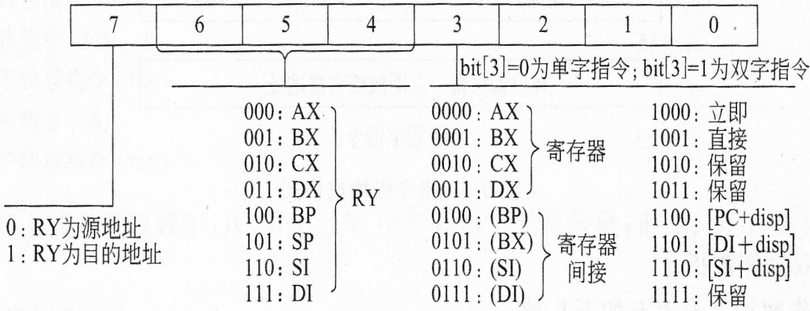

<details>
<summary>text_image</summary>

7
6
5
4
3
2
1
0
bit[3]=0为单字指令; bit[3]=1为双字指令
000: AX
000: BX
001: BX
010: CX
011: DX
100: BP
101: SP
110: SI
111: DI
RY
0000: AX
0001: BX
0010: CX
0011: DX
寄存器
1000: 立即
1001: 直接
1010: 保留
1011: 保留
0100: (BP)
0101: (BX)
0110: (SI)
0111: (DI)
寄存器
间接
1100: [PC+disp]
1101: [DI+disp]
1110: [SI+disp]
1111: 保留
0: RY为源地址
1: RY为目的地址
</details>

# Designing a dummy CPU~

- 根据以上指令规范，我们可以为下面的指令给出操作码编码：

- ADD AX [SI]

- 01 86 (单字)

- Mov AX [2000H]

- 00 89 40 00 (双字)

- INC [BX]

- 0E 15 (单字)

<table><tr><td>0</td><td>0</td><td>0</td><td>0</td><td>X</td><td>X</td><td>X</td><td>X</td><td>双操作数指令</td></tr><tr><td rowspan="12">0</td><td rowspan="12">0</td><td rowspan="12">0</td><td rowspan="12">0</td><td>0</td><td>0</td><td>0</td><td>0</td><td>MOV</td></tr><tr><td>0</td><td>0</td><td>0</td><td>1</td><td>ADD</td></tr><tr><td>0</td><td>0</td><td>1</td><td>0</td><td>SUB</td></tr><tr><td>0</td><td>0</td><td>1</td><td>1</td><td>ADC</td></tr><tr><td>0</td><td>1</td><td>0</td><td>0</td><td>SBC</td></tr><tr><td>0</td><td>1</td><td>0</td><td>1</td><td>CMP</td></tr><tr><td>0</td><td>1</td><td>1</td><td>0</td><td>MUL</td></tr><tr><td>0</td><td>1</td><td>1</td><td>1</td><td>DIV</td></tr><tr><td>1</td><td>0</td><td>0</td><td>0</td><td>AND</td></tr><tr><td>1</td><td>0</td><td>0</td><td>1</td><td>OR</td></tr><tr><td>1</td><td>0</td><td>1</td><td>0</td><td>XOR</td></tr><tr><td>1</td><td>0</td><td>1</td><td>1</td><td></td></tr></table>

<table><tr><td>0</td><td>0</td><td>0</td><td>0</td><td>X</td><td>X</td><td>X</td><td>X</td><td colspan="5">双操作数指令</td></tr><tr><td>0</td><td>0</td><td>0</td><td>0</td><td>1</td><td>1</td><td>1</td><td>0</td><td>X</td><td>X</td><td>X</td><td>X</td><td>单操作数指令</td></tr><tr><td></td><td></td><td></td><td></td><td></td><td></td><td></td><td></td><td>0</td><td>0</td><td>0</td><td>0</td><td>CALL</td></tr><tr><td></td><td></td><td></td><td></td><td></td><td></td><td></td><td></td><td>0</td><td>0</td><td>0</td><td>1</td><td>INC</td></tr><tr><td></td><td></td><td></td><td></td><td></td><td></td><td></td><td></td><td>0</td><td>0</td><td>1</td><td>0</td><td>DEC</td></tr><tr><td></td><td></td><td></td><td></td><td></td><td></td><td></td><td></td><td>0</td><td>0</td><td>1</td><td>1</td><td>PUSH</td></tr><tr><td></td><td></td><td></td><td></td><td></td><td></td><td></td><td></td><td>0</td><td>1</td><td>0</td><td>0</td><td>POP</td></tr><tr><td></td><td></td><td></td><td></td><td></td><td></td><td></td><td></td><td>0</td><td>1</td><td>0</td><td>1</td><td>NOT</td></tr><tr><td></td><td></td><td></td><td></td><td></td><td></td><td></td><td></td><td>0</td><td>1</td><td>1</td><td>0</td><td>SHL</td></tr><tr><td></td><td></td><td></td><td></td><td></td><td></td><td></td><td></td><td>0</td><td>1</td><td>1</td><td>1</td><td>SHR</td></tr><tr><td></td><td></td><td></td><td></td><td></td><td></td><td></td><td></td><td>1</td><td>0</td><td>0</td><td>0</td><td>SAR</td></tr></table>


<details>
<summary>text_image</summary>

7
6
5
4
3
2
1
0
bit[3]=0为单字指令; bit[3]=1为双字指令
000: AX
000: BX
001: BX
010: CX
011: DX
100: BP
101: SP
110: SI
111: DI
RY
0000: AX
0001: BX
0010: CX
0011: DX
寄存器
1000: 立即
1001: 直接
1010: 保留
1011: 保留
0100: (BP)
0101: (BX)
0110: (SI)
0111: (DI)
寄存器
间接
1100: [PC+disp]
1101: [DI+disp]
1110: [SI+disp]
1111: 保留
0: RY为源地址
1: RY为目的地址
</details>

# Simulating a dummy CPU~

# a) 取指令过程:

- 计算机简单框图
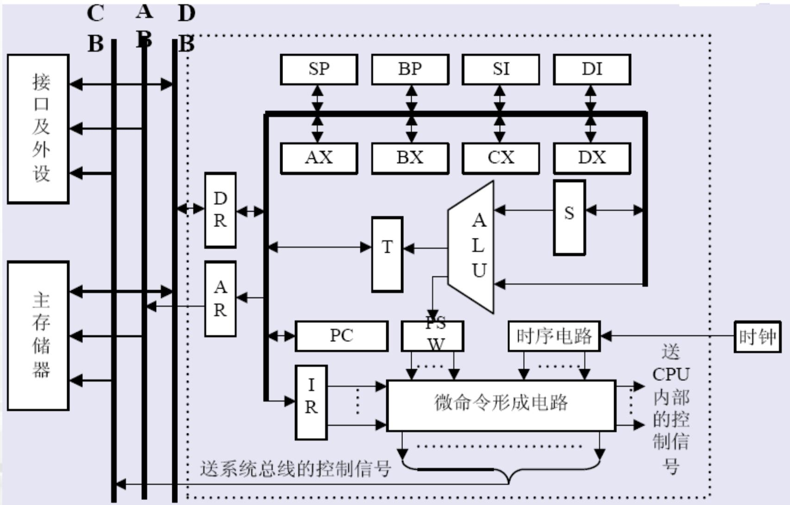

<details>
<summary>flowchart</summary>

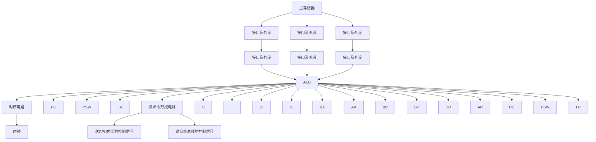
</details>

某计算机简化框图

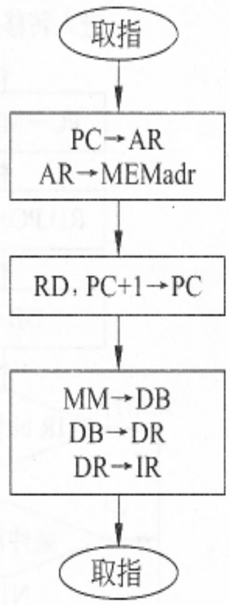

<details>
<summary>flowchart</summary>

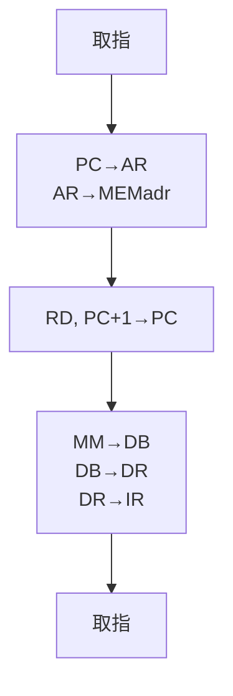
</details>

图5-7 取指过程

# Simulating a dummy CPU~

# b) 译码取操作码过程:

<table><tr><td>15</td><td>14</td><td>13</td><td>12</td><td>11</td><td>10</td><td>9</td><td>8</td><td>7</td><td>6</td><td>5</td><td>4</td><td>3</td><td>2</td><td>1</td><td>0</td></tr></table>

<table><tr><td>0</td><td>0</td><td>0</td><td>0</td><td>X</td><td>X</td><td>X</td><td>X</td><td>双操作数指令</td></tr></table>

<table><tr><td>0</td><td>0</td><td>0</td><td>0</td><td>1</td><td>1</td><td>1</td><td>0</td><td>X</td><td>X</td><td>X</td><td>X</td><td>单操作数指令</td></tr></table>

<table><tr><td>0</td><td>0</td><td>0</td><td>0</td><td>1</td><td>1</td><td>1</td><td>1</td><td>X</td><td>X</td><td>X</td><td>X</td><td>转移指令</td></tr></table>

<table><tr><td>0</td><td>0</td><td>0</td><td>0</td><td>1</td><td>1</td><td>1</td><td>1</td><td>1</td><td>1</td><td>1</td><td>1</td><td>X</td><td>X</td><td>X</td><td>X</td></tr></table>

无操作数指令

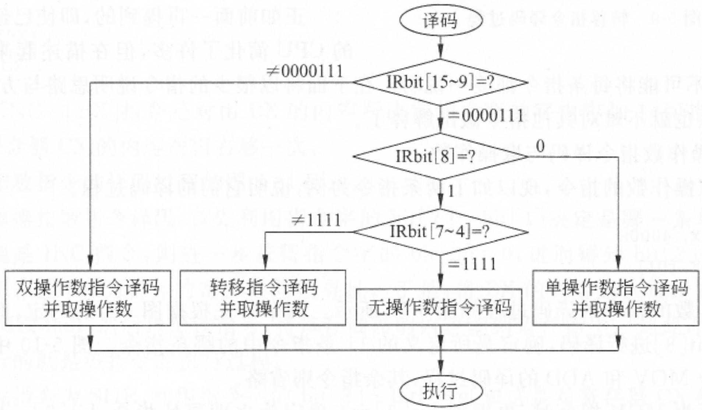

<details>
<summary>flowchart</summary>

```mermaid
graph TD
    A["译码"] --> B{IRbit["15~9"]=?}
    B -->|≠0000111| C["双操作数指令译码并取操作数"]
    B -->|=0000111| D{IRbit["8"]=?}
    D -->|0| E["单操作数指令译码并取操作数"]
    D -->|1| F{IRbit["7~4"]=?}
    F -->|≠1111| G["转移指令译码并取操作数"]
    F -->|=1111| H["无操作数指令译码"]
    C --> I["执行"]
    G --> I
    H --> I
```
</details>

图 2-6 误差不具性化法过程与图

# Simulating a dummy CPU~

# 双操作数指令译码取操作数过程（续）：


<details>
<summary>text_image</summary>

7	6	5	4	3	2	1	0
bit[3]=0为单字指令; bit[3]=1为双字指令
000: AX
001: BX
010: CX
011: DX
100: BP
101: SP
110: SI
111: DI
0000: AX
0001: BX
0010: CX
0011: DX
0100: (BP)
0101: (BX)
0110: (SI)
0111: (DI)
寄存器	1000: 立即
	1001: 直接
	1010: 保留
	1011: 保留
寄存器	1100: [PC+disp]
间接	1101: [DI+disp]
	1110: [SI+disp]
	1111: 保留
0: RY为源地址
1: RY为目的地址
</details>

- ADD AX [SI]
01 86 (单字)
- Mov AX [2000H]
- 00 89 40 00 (双字)
- INC [BX]
- 0E 15 (单字)

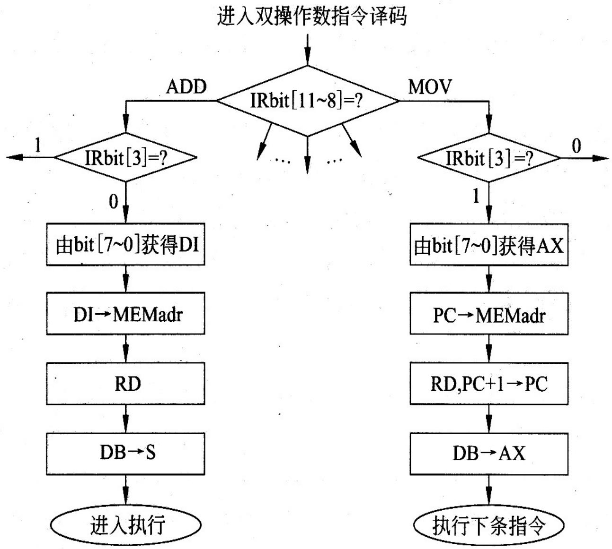

<details>
<summary>flowchart</summary>

```mermaid
graph TD
    A["进入双操作数指令译码"] --> B{IRbit["11~8"]=?}
    B -->|ADD| C{IRbit["3"]=?}
    B -->|MOV| D{IRbit["3"]=?}
    C -->|0| E["由bit[7~0"]获得DI]
    C -->|...| F["..."]
    D -->|1| G["由bit[7~0"]获得AX]
    E --> H["DI→MEMadr"]
    H --> I["RD"]
    I --> J["DB→S"]
    J --> K["进入执行"]
    G --> L["PC→MEMadr"]
    L --> M["RD,PC+1→PC"]
    M --> N["DB→AX"]
    N --> O["执行下条指令"]
```
</details>

图5-10 双操作数指令译码过程

# Simulating a dummy CPU~

# 单操作数指令译码取操作数过程:

<table><tr><td>15</td><td>14</td><td>13</td><td>12</td><td>11</td><td>10</td><td>9</td><td>8</td><td>7</td><td>6</td><td>5</td><td>4</td><td>3</td><td>2</td><td>1</td><td>0</td></tr><tr><td colspan="16"></td></tr><tr><td>0</td><td>0</td><td>0</td><td>0</td><td>1</td><td>1</td><td>1</td><td>0</td><td>X</td><td>X</td><td>X</td><td>X</td><td colspan="4">单操作数指令</td></tr><tr><td colspan="16"></td></tr><tr><td rowspan="15">0</td><td rowspan="15">0</td><td rowspan="15">0</td><td rowspan="15">0</td><td rowspan="15">1</td><td rowspan="15">1</td><td rowspan="15">1</td><td rowspan="15">0</td><td>0</td><td>0</td><td>0</td><td>0</td><td colspan="4">CALL</td></tr><tr><td>0</td><td>0</td><td>0</td><td>1</td><td colspan="4">INC</td></tr><tr><td>0</td><td>0</td><td>1</td><td>0</td><td colspan="4">DEC</td></tr><tr><td>0</td><td>0</td><td>1</td><td>1</td><td colspan="4">PUSH</td></tr><tr><td>0</td><td>1</td><td>0</td><td>0</td><td colspan="4">POP</td></tr><tr><td>0</td><td>1</td><td>0</td><td>1</td><td colspan="4">NOT</td></tr><tr><td>0</td><td>1</td><td>1</td><td>0</td><td colspan="4">SHL</td></tr><tr><td>0</td><td>1</td><td>1</td><td>1</td><td colspan="4">SHR</td></tr><tr><td>1</td><td>0</td><td>0</td><td>0</td><td colspan="4">SAR</td></tr><tr><td>1</td><td>0</td><td>0</td><td>1</td><td colspan="4">ROL</td></tr><tr><td>1</td><td>0</td><td>1</td><td>0</td><td colspan="4">ROR</td></tr><tr><td>1</td><td>0</td><td>1</td><td>1</td><td colspan="4">RCL</td></tr><tr><td>1</td><td>1</td><td>0</td><td>0</td><td colspan="4">RCR</td></tr><tr><td>1</td><td>1</td><td>0</td><td>1</td><td colspan="4"></td></tr><tr><td>1</td><td>1</td><td>1</td><td>0</td><td colspan="4"></td></tr></table>

- ADD AX [SI]
01 86 (单字)
- Mov AX [2000H]
- 00 89 40 00 (双字)
- INC [BX]
- 0E 15 (单字)

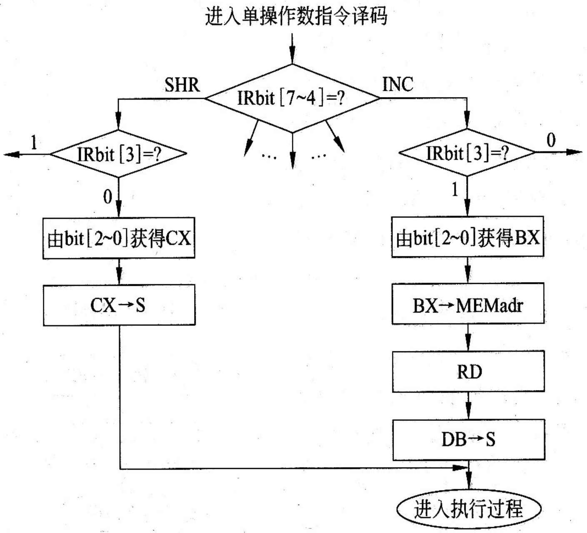

<details>
<summary>flowchart</summary>

```mermaid
graph TD
    A["进入单操作数指令译码"] --> B{IRbit["7~4"]=?}
    B -->|1| C["1"]
    B -->|0| D["0"]
    D --> E["由bit[2~0"]获得CX]
    E --> F["CX→S"]
    B -->|INC| G{IRbit["3"]=?}
    G -->|1| H["0"]
    G -->|0| I["1"]
    I --> J["由bit[2~0"]获得BX]
    J --> K["BX→MEMadr"]
    K --> L["RD"]
    L --> M["DB→S"]
    M --> N["进入执行过程"]
    N --> O["End"]
    B -->|SHR| P{IRbit["3"]=?}
    P -->|0| Q["0"]
    P -->|1| R["1"]
```
</details>

图5-11 单操作数指令译码过程

# Simulating a dummy CPU~

# 单操作数指令译码取操作数过程（续）：

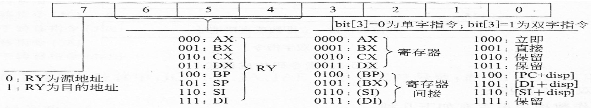

<details>
<summary>text_image</summary>

7	6	5	4	3	2	1	0
bit[3]=0为单字指令; bit[3]=1为双字指令
000: AX
001: BX
010: CX
011: DX
100: BP
101: SP
110: SI
111: DI
RY
0000: AX
0001: BX
0010: CX
0011: DX
寄存器	1000: 立即
1001: 直接
1010: 保留
1011: 保留
0: RY为源地址
1: RY为目的地址
0100: (BP)
0101: (BX)
0110: (SI)
0111: (DI)
寄存器	1100: [PC+disp]
1101: [DI+disp]
1110: [SI+disp]
1111: 保留
</details>

- ADD AX [SI]
01 86 (单字)
- Mov AX [2000H]
- 01 89 40 00 (双字)
- INC [BX]
- 0E 15 (单字)

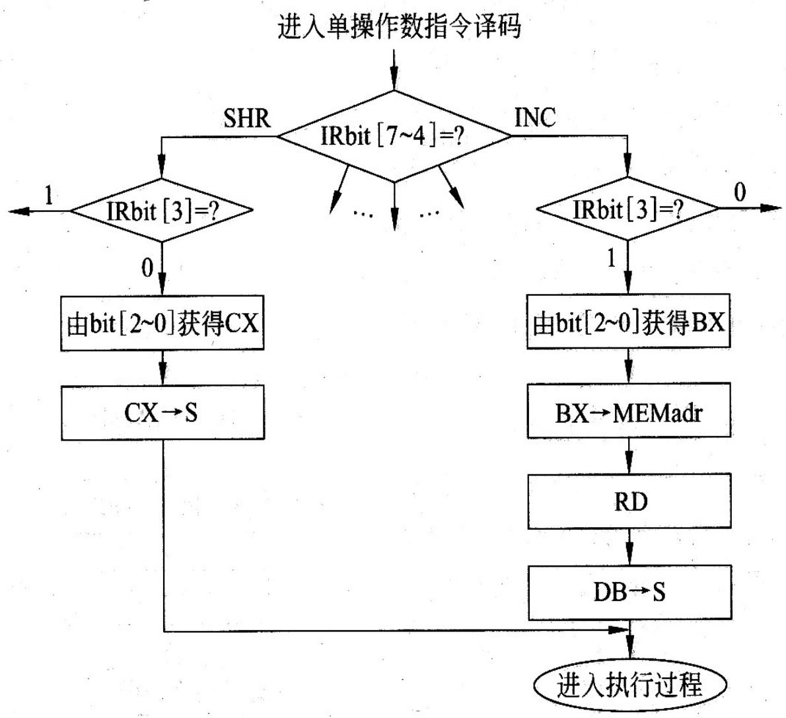

<details>
<summary>flowchart</summary>

```mermaid
graph TD
    A["进入单操作数指令译码"] --> B{IRbit["3"]=?}
    B -->|0| C["由bit[2~0"]获得CX]
    C --> D["CX→S"]
    B -->|1| E["SHR"]
    B -->|...| F["..."]
    B -->|INC| G{IRbit["7~4"]=?}
    G -->|0| H["0"]
    G -->|1| I["由bit[2~0"]获得BX]
    I --> J["BX→MEMadr"]
    J --> K["RD"]
    K --> L["DB→S"]
    L --> M["进入执行过程"]
```
</details>

# Simulating a dummy CPU~

# 无操作数指令译码取操作数过程:

<table><tr><td>15</td><td>14</td><td>13</td><td>12</td><td>11</td><td>10</td><td>9</td><td>8</td><td>7</td><td>6</td><td>5</td><td>4</td><td>3</td><td>2</td><td>1</td><td>0</td><td></td></tr><tr><td colspan="16"></td><td rowspan="3">无操作数指令</td></tr><tr><td>0</td><td>0</td><td>0</td><td>0</td><td>1</td><td>1</td><td>1</td><td>1</td><td>1</td><td>1</td><td>1</td><td>1</td><td>X</td><td>X</td><td>X</td><td>X</td></tr><tr><td colspan="16"></td></tr><tr><td rowspan="9">0</td><td rowspan="9">0</td><td rowspan="9">0</td><td rowspan="9">0</td><td rowspan="9">1</td><td rowspan="9">1</td><td rowspan="9">1</td><td rowspan="9">1</td><td rowspan="9">1</td><td rowspan="9">1</td><td rowspan="9">1</td><td rowspan="9">1</td><td>0</td><td>0</td><td>0</td><td>0</td><td>RET</td></tr><tr><td>0</td><td>0</td><td>0</td><td>1</td><td>IRET</td></tr><tr><td>0</td><td>0</td><td>1</td><td>0</td><td>NOP</td></tr><tr><td>0</td><td>0</td><td>1</td><td>1</td><td>CLI</td></tr><tr><td>0</td><td>1</td><td>0</td><td>0</td><td>STI</td></tr><tr><td>0</td><td>1</td><td>0</td><td>1</td><td>SWI</td></tr><tr><td>0</td><td>1</td><td>1</td><td>0</td><td>DAA</td></tr><tr><td>0</td><td>1</td><td>1</td><td>1</td><td></td></tr><tr><td></td><td></td><td></td><td></td><td></td></tr><tr><td></td><td></td><td></td><td></td><td></td><td></td><td></td><td></td><td></td><td></td><td></td><td></td><td></td><td></td><td></td><td></td><td></td></tr><tr><td></td><td></td><td></td><td></td><td></td><td></td><td></td><td></td><td></td><td></td><td></td><td></td><td></td><td></td><td></td><td></td><td></td></tr></table>

IRET

OF F1

NOP

OF F2

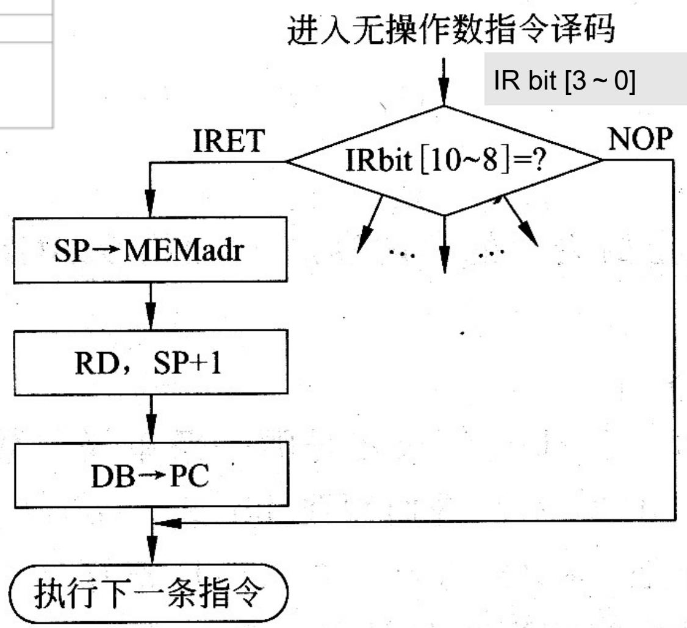

<details>
<summary>flowchart</summary>

```mermaid
graph TD
    A["进入无操作数指令译码"] --> B{IRbit["10~8"]=?}
    B --> C["IRET"]
    B --> D["NOP"]
    C --> E["SP→MEMadr"]
    D --> F["..."]
    E --> G["RD, SP+1"]
    F --> H["..."]
    G --> I["DB→PC"]
    H --> I
    I --> J["执行下一条指令"]
```
</details>

图5-12 无操作数指令的译码过程

# Simulating a dummy CPU~

# c) 指令执行过程:

- 计算机简单框图
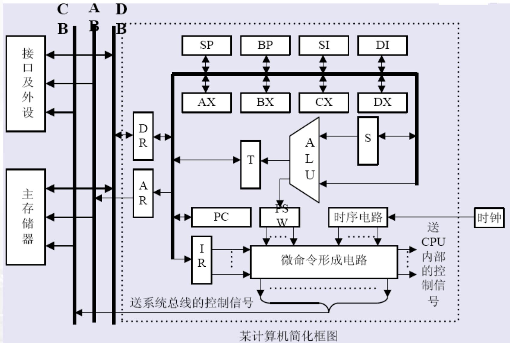

<details>
<summary>flowchart</summary>

```mermaid
graph TD
    A["主存储器"] --> B["接口及外设"]
    A --> C["接口及外设"]
    A --> D["接口及外设"]
    B --> E["接口及外设"]
    C --> F["接口及外设"]
    D --> G["接口及外设"]
    E --> H["ALU"]
    F --> H
    G --> H
    H --> I["时序电路"]
    I --> J["微命令形成电路"]
    J --> K["送CPU内部的控制信号"]
    J --> L["时钟"]
    M["PC"] --> N["PSW"]
    O["IR"] --> P["微命令形成电路"]
    Q["D_R"] --> R["ALU"]
    S["S"] --> T["ALU"]
    U["SP"] --> V["AX"]
    W["BP"] --> X["BX"]
    Y["SI"] --> Z["CX"]
    AA["DI"] --> AB["DX"]
    AC["D"] --> AD["ALU"]
    AE["AR"] --> AF["ALU"]
    AG["T"] --> AH["ALU"]
    AI["DS"] --> AJ["S"]
    AK["PC"] --> AL["微命令形成电路"]
    AM["I"] --> AN["微命令形成电路"]
    AO["IR"] --> AP["微命令形成电路"]
    AQ["S"] --> AR["ALU"]
    AS["S"] --> AT["ALU"]
    AU["DS"] --> AV["ALU"]
    AW["DS"] --> AX["ALU"]
    AY["主存储器"] --> AZ["接口及外设"]
    BA["接口及外设"] --> BB["接口及外设"]
    BC["A"] --> BD["接口及外设"]
    BE["B"] --> BF["接口及外设"]
    BG["D"] --> BH["接口及外设"]
    BI["B"] --> BJ["接口及外设"]
    BK["D"] --> BL["接口及外设"]
    BM["D"] --> BN["接口及外设"]
    BO["D"] --> BP["接口及外设"]
    BQ["D"] --> BR["接口及外设"]
    BS["D"] --> BT["接口及外设"]
    BU["D"] --> BV["接口及外设"]
    BW["D"] --> BX["接口及外设"]
    BY["D"] --> BZ["接口及外设"]
    CA["D"] --> CB["接口及外设"]
    CC["D"] --> CD["接口及外设"]
    CE["D"] --> CF["接口及外设"]
    BGD["D"] --> GF["接口及外设"]
    GH["D"] --> GF
    BIJ["D"] --> GF
    BQJ["D"] --> GF
    BCJ["D"] --> GF
```
</details>

JMP disp
进入转移指令执行
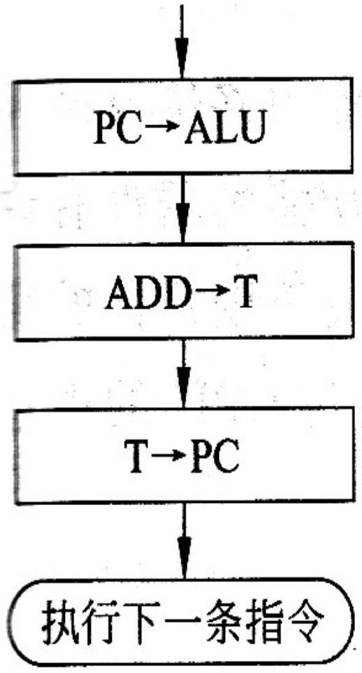

<details>
<summary>flowchart</summary>

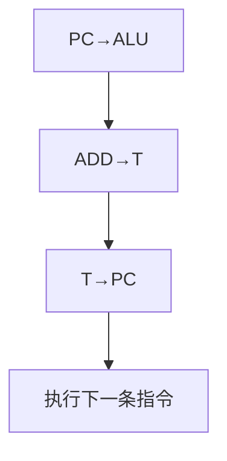
</details>

图5-13 转移指令执行

# Simulating a dummy CPU~

# c) 指令执行过程(续):

- 计算机简单框图
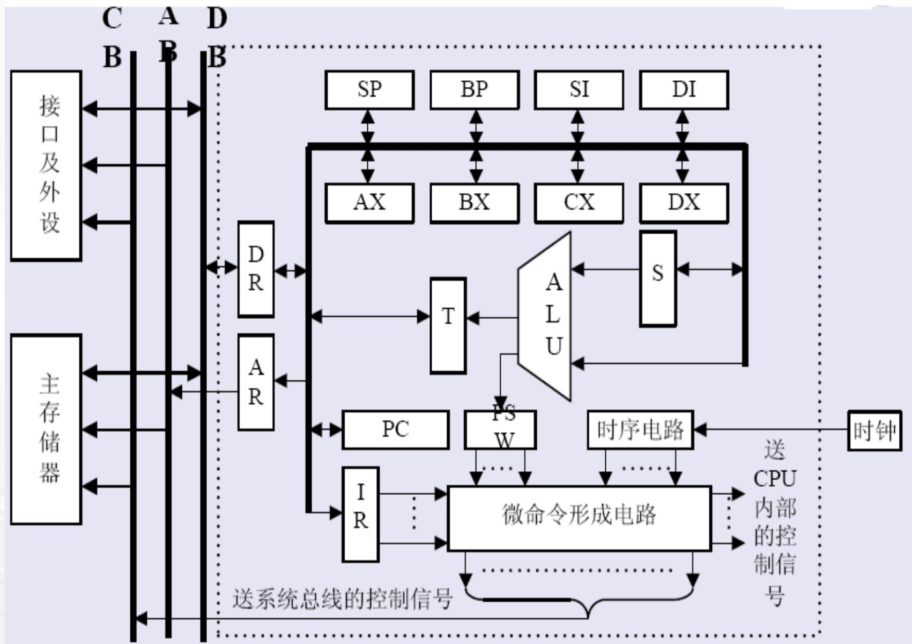

<details>
<summary>flowchart</summary>

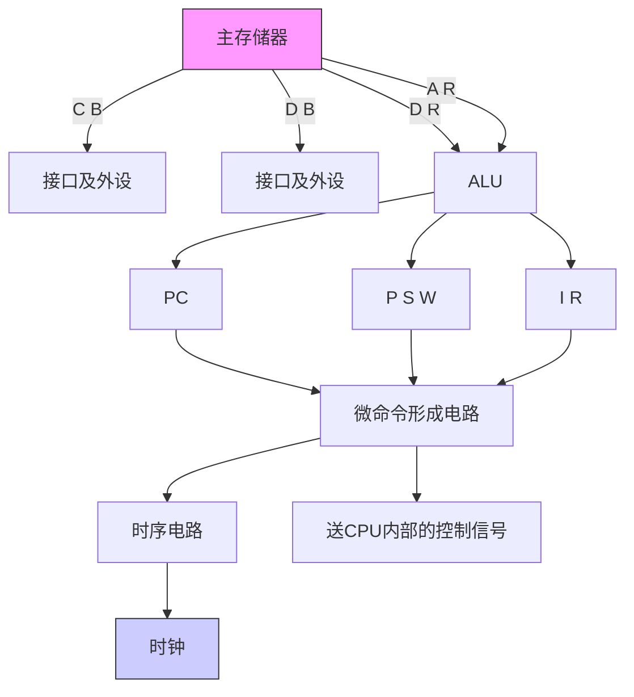
</details>

某计算机简化框图

# ADD BX, [DI]

进入ADD指令执行
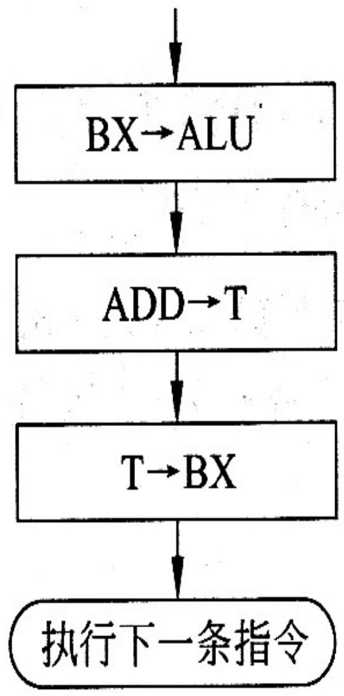

<details>
<summary>flowchart</summary>

```mermaid
graph TD
    A["BX→ALU"] --> B["ADD→T"]
    B --> C["T→BX"]
    C --> D["执行下一条指令"]
```
</details>

图5-14 ADD指令执行

# Simulating a dummy CPU~

# c) 指令执行过程(续):

- 计算机简单框图
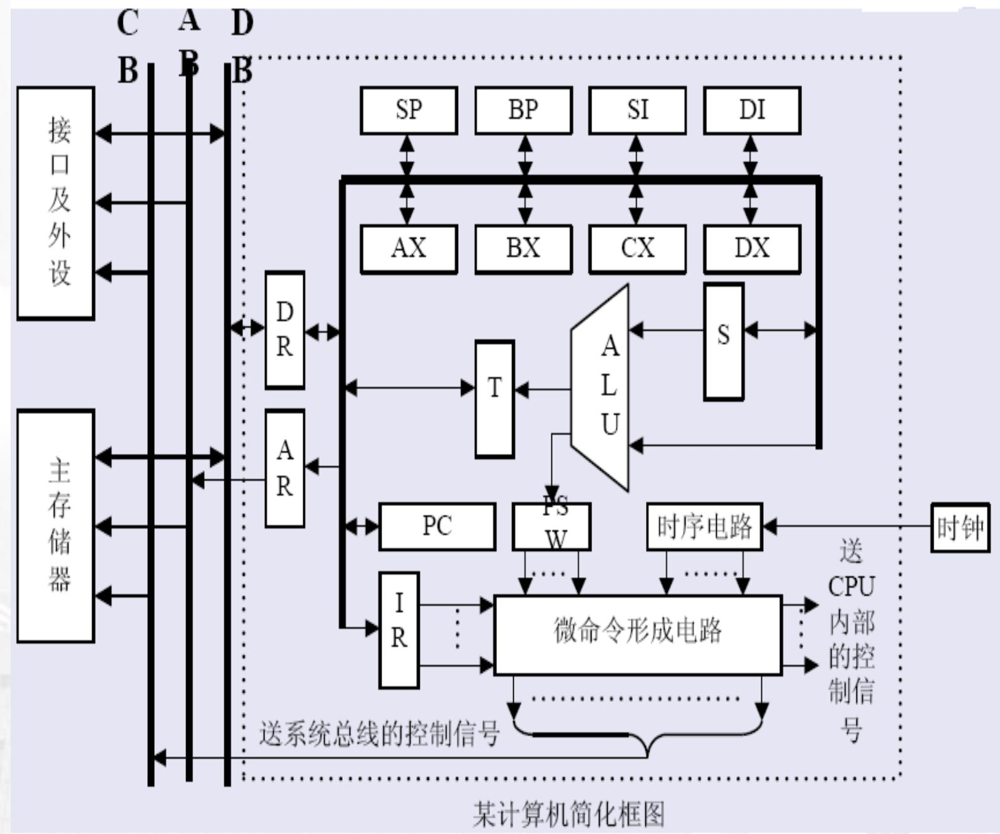

<details>
<summary>flowchart</summary>

```mermaid
graph TD
    A["主存储器"] --> B["接口及外设"]
    B --> C["C"]
    B --> D["A"]
    B --> E["B"]
    B --> F["D"]
    C --> G["接口及外设"]
    D --> H["接口及外设"]
    E --> I["接口及外设"]
    F --> J["接口及外设"]
    G --> K["接口及外设"]
    H --> L["接口及外设"]
    I --> M["接口及外设"]
    J --> N["接口及外设"]
    K --> O["接口及外设"]
    L --> P["接口及外设"]
    M --> Q["接口及外设"]
    N --> R["接口及外设"]
    O --> S["接口及外设"]
    P --> T["接口及外设"]
    Q --> U["接口及外设"]
    R --> V["接口及外设"]
    S --> W["接口及外设"]
    T --> X["接口及外设"]
    U --> Y["接口及外设"]
    V --> Z["接口及外设"]
    W --> AA["接口及外设"]
    X --> AB["接口及外设"]
    Y --> AC["接口及外设"]
    Z --> AD["接口及外设"]
    AA --> AE["接口及外设"]
    AB --> AF["接口及外设"]
    AC --> AG["接口及外设"]
    AD --> AH["接口及外设"]
    AE --> AI["接口及外设"]
    AF --> AJ["接口及外设"]
    AG --> AK["接口及外设"]
    AH --> AL["接口及外设"]
    AI --> AM["接口及外设"]
    AJ --> AN["接口及外设"]
    AK --> AO["接口及外设"]
    AL --> AP["接口及外设"]
    AM --> AQ["接口及外设"]
    AN --> AR["接口及外设"]
    AO --> AS["接口及外设"]
    AP --> AT["接口及外设"]
    AQ --> AU["接口及外设"]
    AR --> AV["接口及外设"]
    AS --> AW["接口及外设"]
    AT --> AX["接口及外设"]
    AU --> AY["接口及外设"]
    AV --> AZ["接口及外设"]
    AW --> BA["接口及外设"]
    AX --> BB["接口及外设"]
    AY --> BC["接口及外设"]
    AZ --> BD["接口及外设"]
    BA --> BE["接口及外设"]
    BB --> BF["接口及外设"]
    BC --> BG["接口及外设"]
    BD --> BH["接口及外设"]
    BE --> BI["接口及外设"]
    BF --> BJ["接口及外设"]
    BG --> BK["接口及外设"]
    BH --> BL["接口及外设"]
    BI --> BM["接口及外设"]
    BJ --> BN["接口及外设"]
    BK --> BO["接口及外设"]
    BL --> BP["接口及外设"]
    BM --> BPB["接口及外设"]
    BN --> BPB
    BO --> BPW["接口及外设"]
    BPW --> BPW1["PsW"]
    BPW1 --> BPW2["PsW"]
    BPW2 --> BPW3["PsW"]
    BPW3 --> BPW4["PsW"]
    BPW4 --> BPW5["PsW"]
    BPW5 --> BPW6["PsW"]
    BPW6 --> BPW7["PsW"]
    BPW7 --> BPW8["PsW"]
    BPW8 --> BPW9["PsW"]
    BPW9 --> BPW10["PsW"]
    BPW10 --> BPW11["PsW"]
    BPW11 --> BPW12["PsW"]
    BPW12 --> BPW13["PsW"]
    BPW13 --> BPW14["PsW"]
    BPW14 --> BPW15["PsW"]
    BPW15 --> BPW16["PsW"]
    BPW16 --> BPW17["PsW"]
    BPW17 --> BPW18["PsW"]
    BPW18 --> BPW19["PsW"]
    BPW19 --> BPW20["PsW"]
    BPW20 --> BPW21["PsW"]
    BPW21 --> BPW22["PsW"]
    BPW22 --> BPW23["PsW"]
    BPW23 --> BPW24["PsW"]
    BPW24 --> BPW25["PsW"]
    BPW25 --> BPW26["PsW"]
    BPW26 --> BPW27["PsW"]
    BPW27 --> BPW28["PsW"]
    BPW28 --> BPW29["PsW"]
    BPW29 --> BPW30["PsW"]
    BPW30 --> BPW31["PsW"]
    BPW31 --> BPW32["PsW"]
    BPW32 --> BPW33["PsW"]
    BPW33 --> BPW34["PsW"]
    BPW34 --> BPW35["PsW"]
    BPW35 --> BPW36["PsW"]
    BPW36 --> BPW37["PsW"]
    BPW37 --> BPW38["PsW"]
    BPW38 --> BPW39["PsW"]
    BPW39 --> BPW40["PsW"]
    BPW40 --> BPW41["PsW"]
    BPW41 --> BPW42["PsW"]
    BPW42 --> BPW43["PsW"]
    BPW43 --> BPW44["PsW"]
    BPW44 --> BPW45["PsW"]
    BPW45 --> BPW46["PsW"]
    BPW46 --> BPW47["PsW"]
    BPW47 --> BPW48["PsW"]
    BPW48 --> BPW49["PsW"]
    BPW49 --> BPW50["PsW"]
    BPw100["Ps"] <--> ALU
```
</details>

INC [ BX]

SHR CX

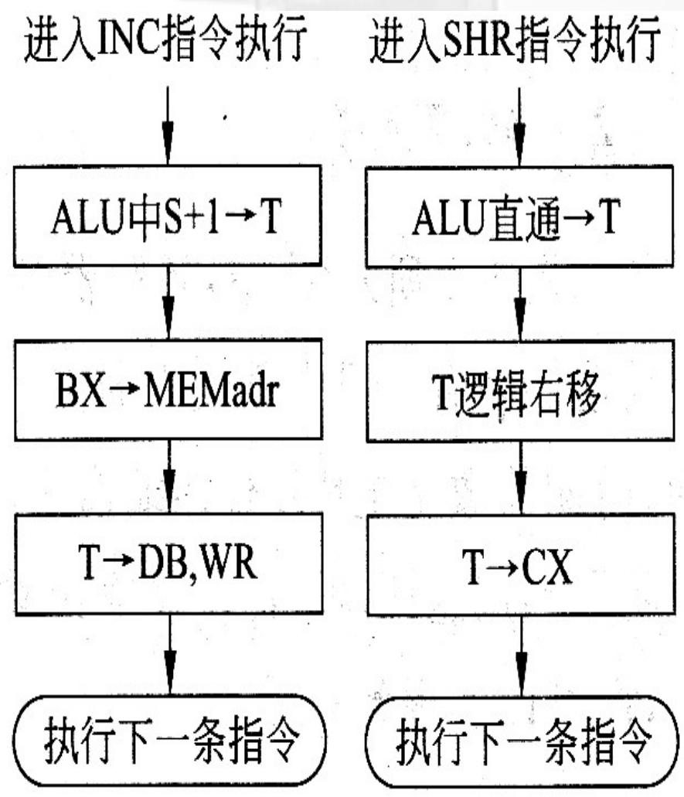

<details>
<summary>flowchart</summary>

```mermaid
graph TD
    A["进入INC指令执行"] --> B["ALU中S+1→T"]
    B --> C["BX→MEMadr"]
    C --> D["T→DB,WR"]
    D --> E["执行下一条指令"]
    F["进入SHR指令执行"] --> G["ALU直通→T"]
    G --> H["T逻辑右移"]
    H --> I["T→CX"]
    I --> J["执行下一条指令"]
```
</details>

(a)
(b)

# 作业

- 5.8
- 5.13
- 5.14
- 5.17
