# 课件-存储系统3-Spring-2023

## 来源

- 分类：`课件`
- 原始文件：`存储系统3--Spring.2023.pdf`
- 原始相对路径：`资料/课件/存储系统3--Spring.2023.pdf`
- 原始绝对路径：`D:\wzb\计算机组成原理\资料\课件\存储系统3--Spring.2023.pdf`

## 后续处理建议

- 从本整理稿中提取稳定知识点
- 检查公式、表格、结构图的提取效果
- 必要时补单独图像解读稿
- 如发现资料错误，转入勘误或分歧

## 内容导读（基于整理稿归纳）

本讲把抽象的主存原理落到具体芯片与接口上，内容集中在 SRAM 芯片、8086 内存接口、DRAM 典型工作方式以及大容量存储扩展。

## 关键知识点

- 6264 SRAM 芯片及典型存储芯片接口分析方法。
- 8086 内存接口与内存拼接思路。
- DRAM 的刷新、地址输入与大存储扩展思路。

## 典型例题 / 思考题

- 解释 8086 系统中内存拼接与奇偶体组织。
- 说明 DRAM 如何实现定时充电与地址输入。
- 比较几种扩展大存储的方法及其适用场景。

## 例题理解层（基于课件整理）

### 题目簇 1：存储器扩展与芯片连接

- 原题/原问：
  - 解释 8086 系统中内存拼接与奇偶体组织
  - 比较几种扩展大存储的方法及其适用场景
- 题意：理解如何用小容量存储芯片扩展为大容量存储器（位扩展、字扩展、字位同时扩展），以及8086的奇偶体组织方式。
- 所考知识点：
  - 位扩展：多芯片并联，地址线共用，数据线拼接（增加字长）
  - 字扩展：多芯片用译码器选片（增加字数）
  - 字位同时扩展：既增加字长又增加字数
  - 8086奇偶体：偶体接D0-D7（A0=0选中），奇体接D8-D15（BHE=0选中）
  - 6264 SRAM 芯片：8K×8位，13条地址线，8条数据线
- 解题关注点：
  - 位扩展：芯片数 = 目标字长 / 芯片字长
  - 字扩展：需译码器，高位地址做片选
  - 8086的A0和BHE配合实现字节/字访问
  - 地址线、数据线、控制线（CS/WE/OE）的连接规则
- 题型归类建议：存储器设计题
- 备注：信息完整，存储器扩展是考试必考计算题

## 提取结果

# 计算机组成与结构

# —存储系统3

李瑞 教授

蒋志平 讲师

计算机科学与技术学院

# 温故

- SRAM的工作原理?
- DRAM的工作原理?
- DRAM如何实现定时充电？
- 简述一维和二维地址译码机构
- 字线的作用？位线的作用？
- 概述6264芯片特点
- 简述3种扩展大存储的方式
- 简述8086系统内存拼接的特殊设计

# 6264 SRAM芯片

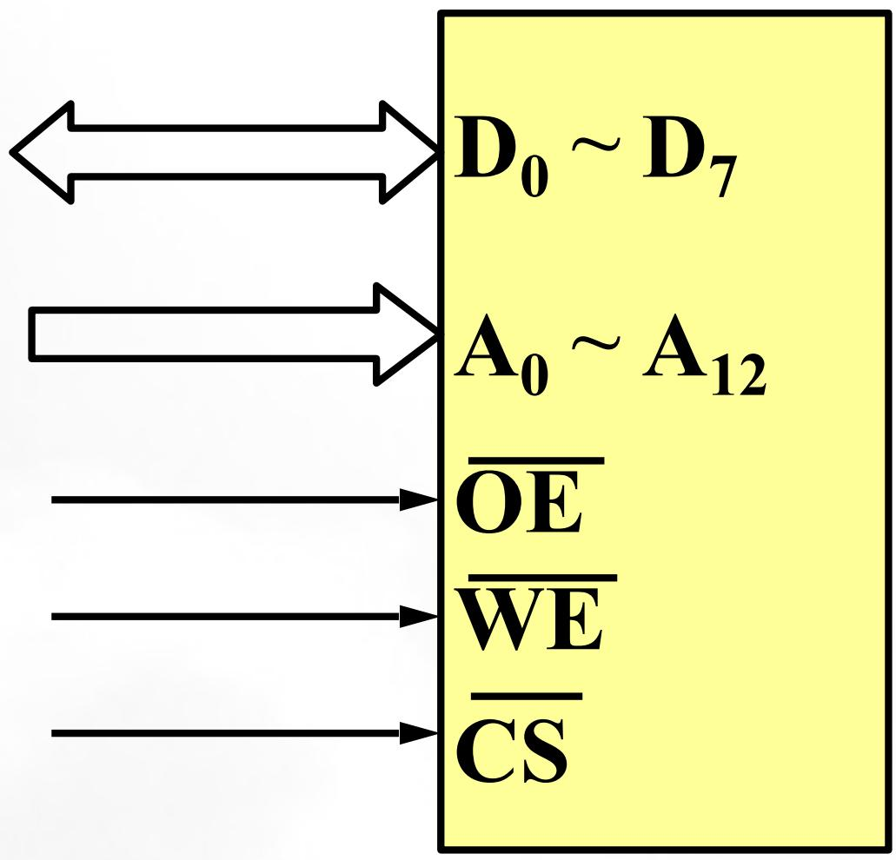

<details>
<summary>flowchart</summary>

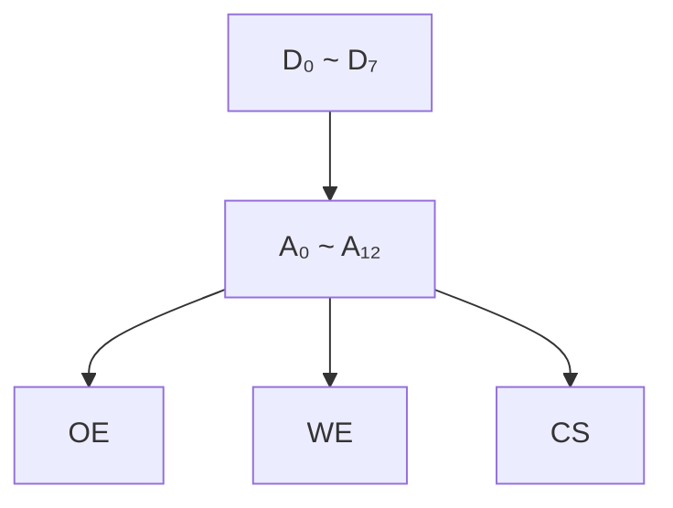
</details>

8K \* 8b

A0 ~ A12为13条地址信号线

D0 ~ D7为8条双向数据线

CS片选信号的引线，当片选信号同时有效时，即 $\overline{\mathbf{CS}} = 0$ ，时，才能选中该芯片。

OE为输出允许信号。只有当OE=0，

即其有效时，才允许该芯片将某单元的数据送到芯片外部的D0～D7上。

WE是写允许信号。

当 $\overline{WE}=0$ 时，允许将数据写入芯片；当 $\overline{WE}=1$ 时，允许芯片的数据读出。

- 拼接多个芯片，构造连续大存储
- 怎么拼?

- 字扩展
- 位扩展
- 字位同时扩展

- 利用 8K×8bit 的 SRAM, 构成 32KB 内存。

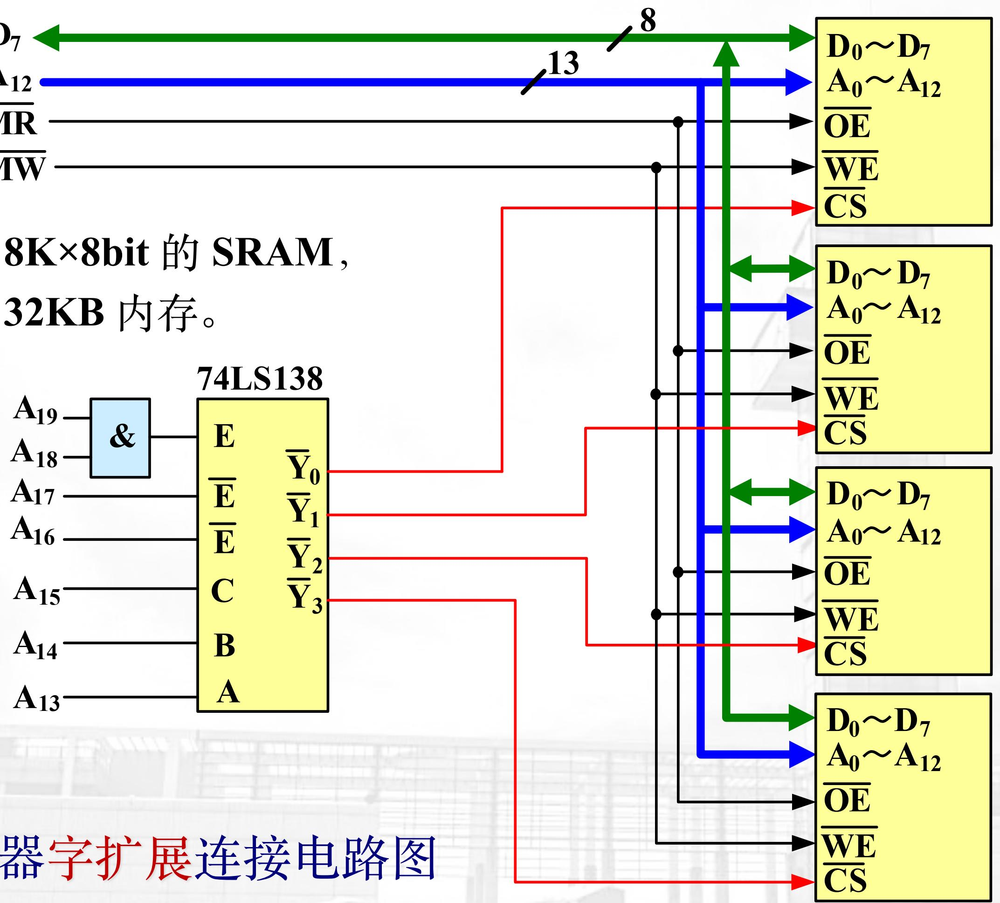

<details>
<summary>flowchart</summary>

```mermaid
graph TD
    A["A19"] --> B["&"]
    C["A18"] --> B
    D["A17"] --> E["E"]
    F["A16"] --> G["EA"]
    H["A15"] --> I["C"]
    J["A14"] --> K["B"]
    L["A13"] --> M["A"]
    N["74LS138"] --> O["&"]
    P["D0~D7"] --> Q["OE"]
    R["D0~D7"] --> S["OE"]
    T["D0~D7"] --> U["OE"]
    V["D0~D7"] --> W["OE"]
    X["D0~D7"] --> Y["OE"]
    Z["D0~D7"] --> AA["OE"]
    AB["D0~D7"] --> AC["OE"]
    AD["D0~D7"] --> AE["OE"]
    AF["D0~D7"] --> AG["OE"]
    AH["D0~D7"] --> AI["OE"]
    AJ["D0~D7"] --> AK["OE"]
    AL["D0~D7"] --> AM["OE"]
    AN["D0~D7"] --> AO["OE"]
    AP["D0~D7"] --> AQ["OE"]
    AR["D0~D7"] --> AS["OE"]
    AT["D0~D7"] --> AU["OE"]
    AV["D0~D7"] --> AW["OE"]
    AX["D0~D7"] --> AY["OE"]
    AZ["D0~D7"] --> BA["OE"]
    BB["D0~D7"] --> BC["OE"]
    BD["D0~D7"] --> BE["OE"]
    BF["D0~D7"] --> BG["OE"]
    BH["D0~D7"] --> BI["OE"]
    BJ["D0~D7"] --> BK["OE"]
    BL["D0~D7"] --> BLA["OE"]
    BN["D0~D7"] --> BO["OE"]
    BP["D0~D7"] --> BPB["OE"]
    BPB --> BPCC["OE"]
    BPCC --> BPCCB["OE"]
    BPCC --> BPCCC["OE"]
    BPCC --> BPCCD["OE"]
    BPCC --> BPCCE["OE"]
    BPCC --> BPCCF["OE"]
    BPCC --> BPCCG["OE"]
    BPCC --> BPCCH["OE"]
    BPCC --> BPCCI["OE"]
    BPCC --> BPCCJ["OE"]
    BPCC --> BPCCK["OE"]
    BPCC --> BPCCL["OE"]
    BPCC --> BPCCM["OE"]
    BPCC --> BPCCN["OE"]
    BPCC --> BPCCO["OE"]
    BPCC --> BPCCP["OE"]
    BPCC --> BPCCQ["OE"]
    BPCC --> BPCCQC["OE"]
    BPCC --> BPCCQF["OE"]
    BPCC --> BPCCQG["OE"]
    BPCC --> BPCCQH["OE"]
    BPCC --> BPCCQI["OE"]
    BPCC --> BPCCQJ["OE"]
    BPCC --> BPCCQK["OE"]
    BPCC --> BPCCQL["OE"]
    BPCC --> BPCCQK["OE"]
    BPCC --> BPCCQKQ["OE"]
```
</details>

存储器字扩展连接电路图

<table><tr><td> $A_{19}$ </td><td> $A_{18}$ </td><td> $A_{17}$ </td><td> $A_{16}$ </td><td> $A_{15}$ </td><td> $A_{14}$ </td><td> $A_{13}$ </td><td> $A_{12}$ </td><td>...</td><td> $A_0$ </td></tr><tr><td>1</td><td>1</td><td>0</td><td>0</td><td>0</td><td>0</td><td>0</td><td>x</td><td>...</td><td>x</td></tr><tr><td>1</td><td>1</td><td>0</td><td>0</td><td>0</td><td>0</td><td>1</td><td>x</td><td>...</td><td>x</td></tr><tr><td>1</td><td>1</td><td>0</td><td>0</td><td>0</td><td>1</td><td>0</td><td>x</td><td>...</td><td>x</td></tr><tr><td>1</td><td>1</td><td>0</td><td>0</td><td>0</td><td>1</td><td>1</td><td>x</td><td>...</td><td>x</td></tr></table>

.13

$$
\mathbf {D} _ {0} \sim \mathbf {D} _ {7}
$$

$$
\mathbf {A _ {0}} \sim \mathbf {A _ {1 2}}
$$

$$
\overline {{\mathbf {O E}}}
$$

$$
\overline {{\textbf {W E}}}
$$

$$
\overline {{\mathbf {C S}}}
$$

$$
\mathbf {D} _ {0} \sim \mathbf {D} _ {7}
$$

$$
\mathbf {A _ {0}} \sim \mathbf {A _ {1 2}}
$$

$$
\overline {{\mathbf {O E}}}
$$

$$
\overline {{\text { WE }}}
$$

$$
\overline {{\mathbf {C S}}}
$$

$$
\mathbf {D _ {0}} \sim \mathbf {D _ {7}}
$$

$$
\mathbf {A _ {0}} \sim \mathbf {A _ {1 2}}
$$

$$
\overline {{\mathbf {O E}}}
$$

$$
\overline {{\text { WE }}}
$$

$$
\overline {{\mathbf {C S}}}
$$

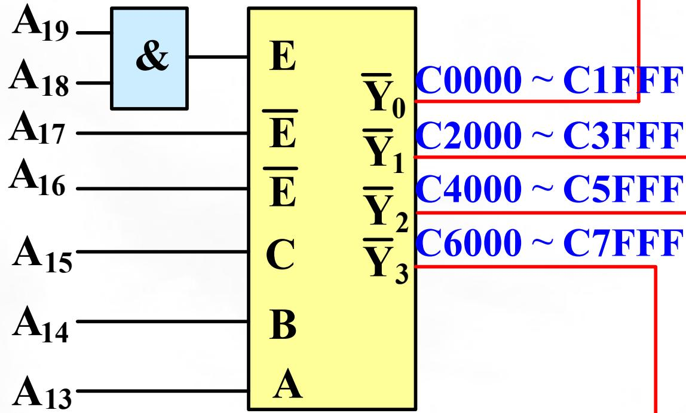

<details>
<summary>flowchart</summary>

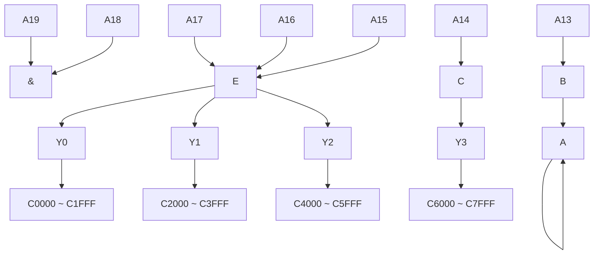
</details>

存储器字扩展连接电路图


$$
\mathbf {D} _ {0} \sim \mathbf {D} _ {7}
$$

$$
\mathbf {A _ {0}} \sim \mathbf {A _ {1 2}}
$$

$$
\overline {{\mathbf {O E}}}
$$

$$
\overline {{\text { WE }}}
$$

$$
\mathbf {A _ {0}} \sim \mathbf {A _ {1 2}}
$$

$$
\overline {{\mathbf {O E}}}
$$

$$
\overline {{\text { WE }}}
$$

$$
\overline {{\mathbf {C S}}}
$$

■利用 8K×8bit 的 SRAM，构成 8K×16bit 内存。

内存位扩展连接

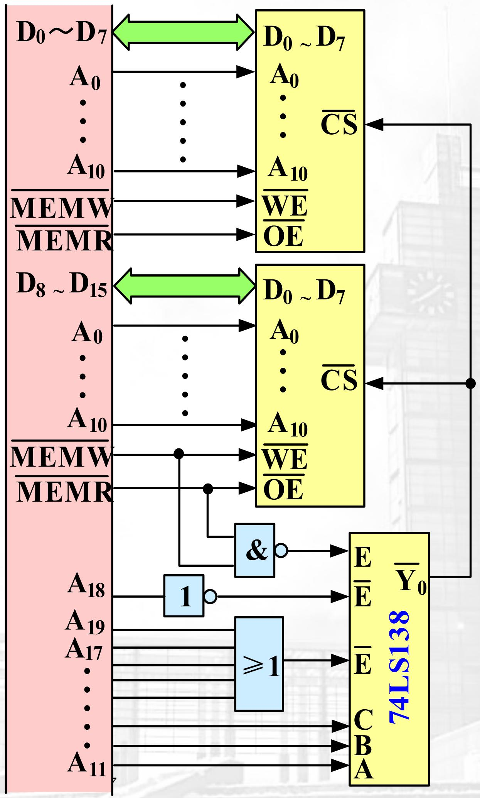

<details>
<summary>flowchart</summary>

```mermaid
graph TD
    subgraph_Memory_Days["Memory D0~D7"]
        A0["A0"] --> D0["D0~D7"]
        A10["A10"] --> D0
        MEMW["MEMW"] --> D0
        MEMR["MEMR"] --> D0
    end

    subgraph_Data_Days["Data D8~D15"]
        A0["A0"] --> D0_D0["D0~D7"]
        A10["A10"] --> D0_D0
        MEMW["MEMW"] --> D0_D0
        MEMR["MEMR"] --> D0_D0
    end

    subgraph_Decoder["74LS138 Y0"]
        A18["A18"] --> AND["&"]
        A19["A19"] --> OR["≥1"]
        A17["A17"] --> OR
        A11["A11"] --> OR
        AND --> E["E"]
        OR --> E["E"]
        E --> Y["Y0"]
        Y --> C["E"]
        C --> C
        C --> B["B"]
        B --> A
    end

    D0_D0 -->|CS| D0_D7
    D0_D7 -->|CS| D0_D8
    D0_D8 -->|CS| D0_D9
    D0_D9 -->|CS| D0_D15
    D0_D15 -->|CS| D0_D16
    D0_D16 -->|CS| D0_D17
    D0_D17 -->|CS| D0_D18
    D0_D18 -->|CS| D0_D19
    D0_D19 -->|CS| D0_D20
    D0_D20 -->|CS| D0_D21
    D0_D21 -->|CS| D0_D22
    D0_D22 -->|CS| D0_D23
    D0_D23 -->|CS| D0_D24
    D0_D24 -->|CS| D0_D25
    D0_D25 -->|CS| D0_D26
    D0_D26 -->|CS| D0_D27
    D0_D27 -->|CS| D0_D28
    D0_D28 -->|CS| D0_D29
    D0_D29 -->|CS| D0_D31
    D0_D31 -->|CS| D0_D32
    D0_D32 -->|CS| D0_D33
    D0_D33 -->|CS| D0_D34
    D0_D34 -->|CS| D0_D35
    D0_D35 -->|CS| D0_D36
    D0_D36 -->|CS| D0_D37
    D0_D37 -->|CS| D0_D38
    D0_D38 -->|CS| D0_D39
    D0_D39 -->|CS| D0_D40
    D0_D40 -->|CS| D0_D41
    D0_D41 -->|CS| D0_D42
    D0_D42 -->|CS| D0_D43
    D0_D43 -->|CS| D0_D44
    D0_D44 -->|CS| D0_D45
    D0_D45 -->|CS| D0_D46
    D0_D46 -->|CS| D0_D47
    D0_D47 -->|CS| D0_D48
    D0_D48 -->|CS| D0_D49
    D0_D49 -->|CS| D0_D51
    D0_D51 -->|CS| D0_D52
    D0_D52 -->|CS| D0_D53
    D0_D53 -->|CS| D0_D54
    D0_D54 -->|CS| D0_D55
    D0_D55 -->|CS| D0_D56
    D0_D56 -->|CS| D0_D57
    D0_D57 -->|CS| D0_D58
    D0_D58 -->|CS| D0_D59
    D0_D59 -->|CS| D0_D61
    D0_D61 -->|CS| D0_D62
    D0_D62 -->|CS| D0_D63
    D0_D63 -->|CS| D0_D64
    D0_D64 -->|CS| D0_D65
    D0_D65 -->|CS| D0_D66
    D0_D66 -->|CS| D0_D67
    D0_D67 -->|CS| D0_D68
    D0_D68 -->|CS| D0_D69
    D0_D69 -->|CS| D0_D71
    D0_D71 -->|CS| D0_D72
    D0_D72 -->|CS| D0_D73
    D0_D73 -->|CS| D0_D74
    D0_D74 -->|CS| D0_D75
    D0_D75 -->|CS| D0_D76
    D0_D76 -->|CS| D0_D77
    D0_D77 -->|CS| D0_D78
    D0_D78 -->|CS| D0_D79
    D0_D79 -->|CS| D0_D81
    A18["A18"] --> OR["≥1"]
    A19["A19"] --> OR["≥1"]
    A17["A17"] --> OR["≥1"]
    A11["A11"] --> OR["≥1"]
```
</details>

# 8086的内存接口

■ 8086 CPU是16位处理器。
■ 系统总线的数据线16位，即 $D_{0}$ $\sim D_{15}$
■ 内存奇偶分体。

- ~BHE(~代表低电位)
- A $_{0}$

<table><tr><td>~BHE A0</td><td>操作</td><td>所用数据线</td></tr><tr><td>0 0</td><td>从偶地址开始读/写一个字</td><td>AD15 ~ AD0</td></tr><tr><td>0 1</td><td>从奇地址读/写一个字节</td><td>AD15 ~ AD8</td></tr><tr><td>1 0</td><td>从偶地址读/写一个字节</td><td>AD7 ~ AD0</td></tr><tr><td>1 1</td><td>无效</td><td>无</td></tr></table>

8086 系统
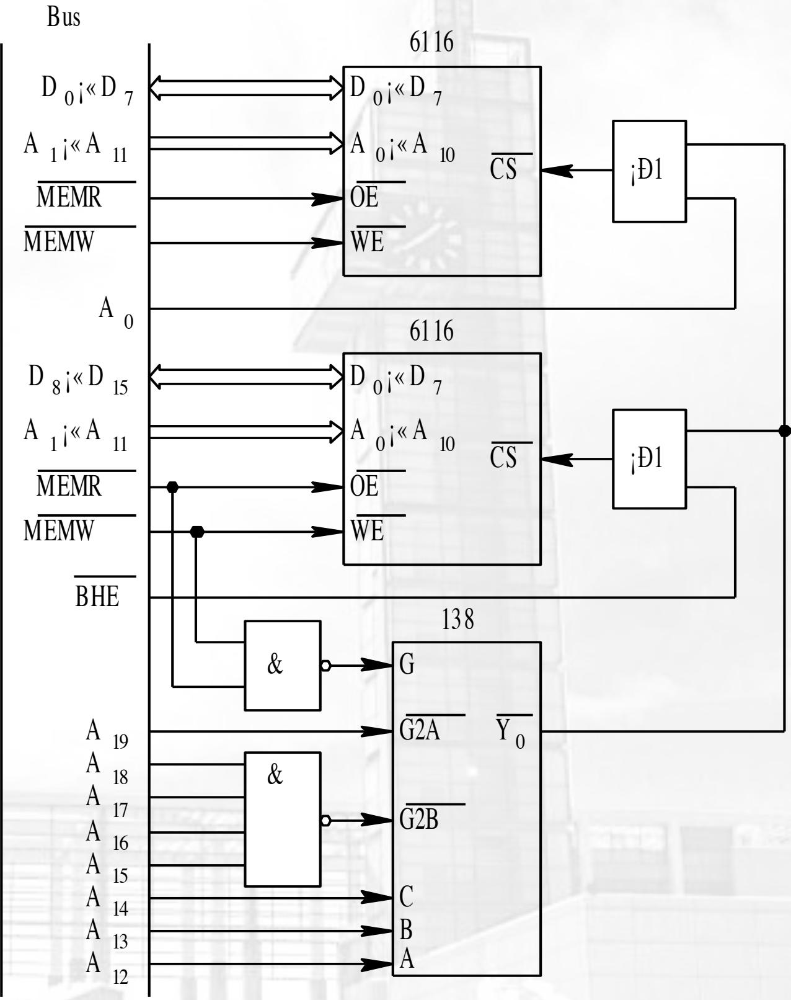

<details>
<summary>flowchart</summary>

```mermaid
graph TD
    subgraph Bus
        A1["Address D0i<<D7"] --> B1["D0i<<D7"]
        A2["A1i<<A11"] --> B2["A0i<<A10"]
        MEMR["MEMR"] --> B3["OE"]
        MEMW["MEMW"] --> B4["WE"]
    end
    subgraph Bus
        C1["Address D8i<<D15"] --> D1["D0i<<D7"]
        A3["A1i<<A11"] --> D2["A0i<<A10"]
        MEMR["MEMR"] --> D3["OE"]
        MEMW["MEMW"] --> D4["WE"]
    end
    subgraph Bus
        E1["Address D1"] --> F1["iD1"]
        G1["Address G"] --> H1["G2A"]
        G2["Address Y0"] --> H2["Y0"]
    end
    B1 --> CS["CS"]
    B2 --> CS
    B3 --> CS
    B4 --> CS
    C1 --> iD1["iD1"]
    C2 --> iD1
    C3 --> iD1
    C4 --> iD1
    C5 --> iD1
    C6 --> iD1
    C7 --> iD1
    C8 --> iD1
    C9 --> iD1
    C10 --> iD1
    C11 --> iD1
    C12 --> iD1
    C13 --> iD1
    C14 --> iD1
    C15 --> iD1
    C16 --> iD1
    C17 --> iD1
    C18 --> iD1
    C19 --> iD1
    C20 --> iD1
    C21 --> iD1
    C22 --> iD1
    C23 --> iD1
    C24 --> iD1
    C25 --> iD1
    C26 --> iD1
    C27 --> iD1
    C28 --> iD1
    C29 --> iD1
    C30 --> iD1
    C31 --> iD1
    C32 --> iD1
    C33 --> iD1
    C34 --> iD1
    C35 --> iD1
    C36 --> iD1
    C37 --> iD1
    C38 --> iD1
    C39 --> iD1
    C40 --> iD1
    C41 --> iD1
    C42 --> iD1
    C43 --> iD1
    C44 --> iD1
    C45 --> iD1
    C46 --> iD1
    C47 --> iD1
    C48 --> iD1
    C49 --> iD1
    C50 --> iD1
```
</details>

# 简单练习一下

- 将4片6264连接到8086系统，要求其内存范围70000h~77FFFh。

# DRAM的典型工作形态

■ 64K×1bit
■ 行地址选定RAS
■ 列地址CAS
■ 读写切换只使用WE控制
■ 工作过程

· 读
·写
- 刷新

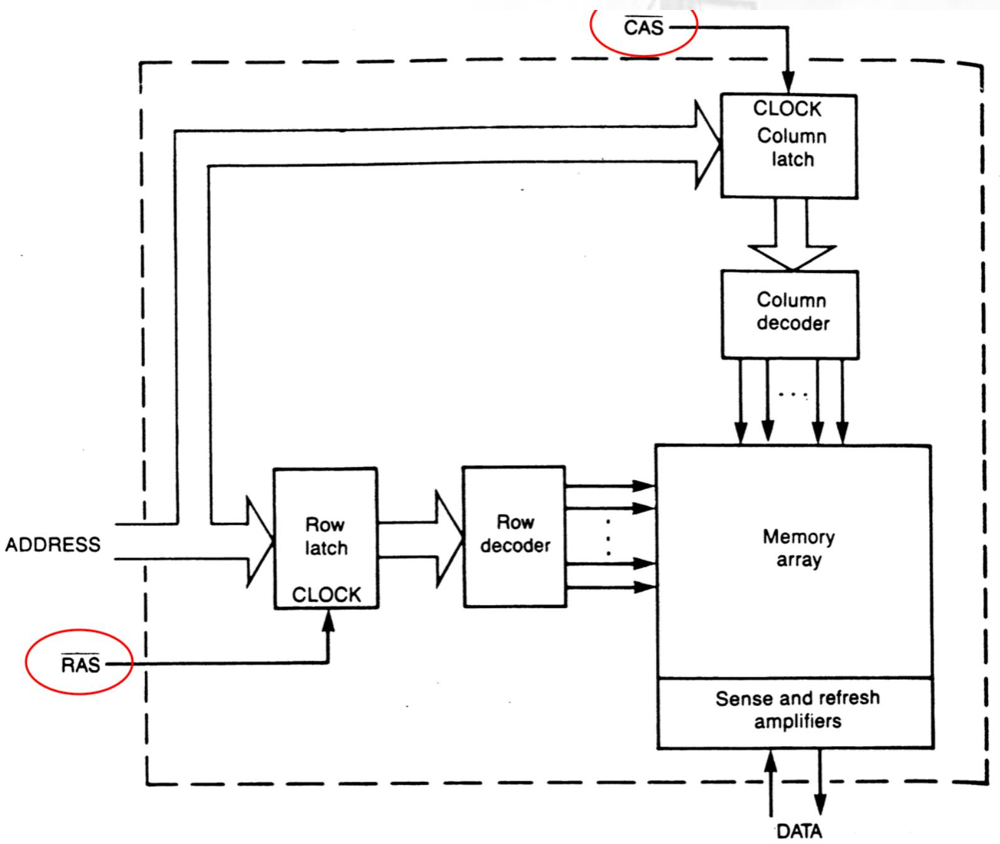

<details>
<summary>flowchart</summary>

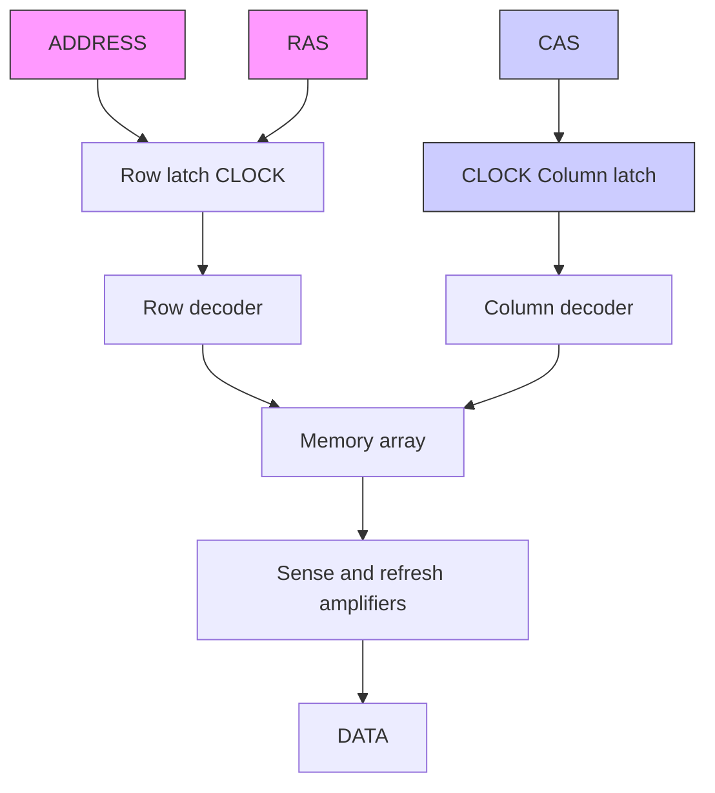
</details>

# DRAM的典型工作形态

■ 64K×1bit
■ 行地址选定RAS
■ 列地址CAS
■ 读写切换只使用WE控制
■ 工作过程

· 读
·写
- 刷新

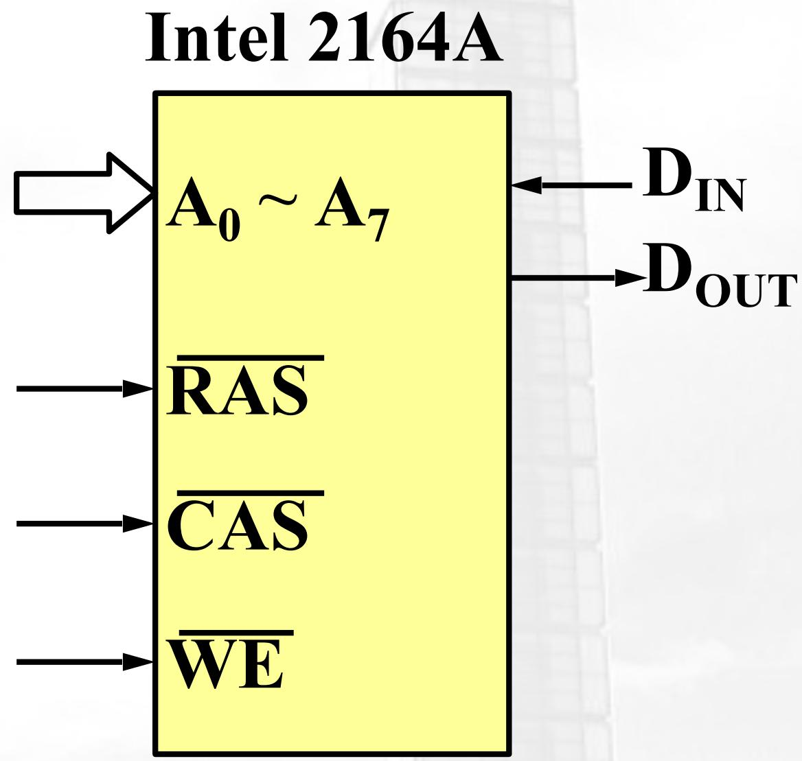

<details>
<summary>flowchart</summary>

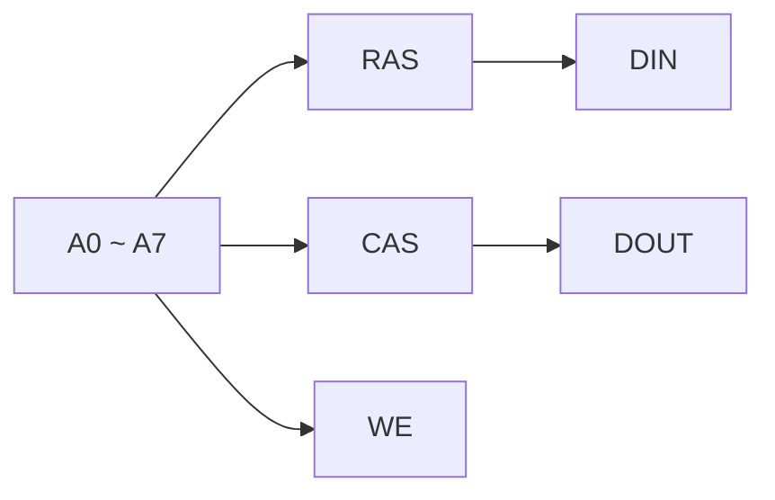
</details>

# DRAM的典型工作形态

读数据
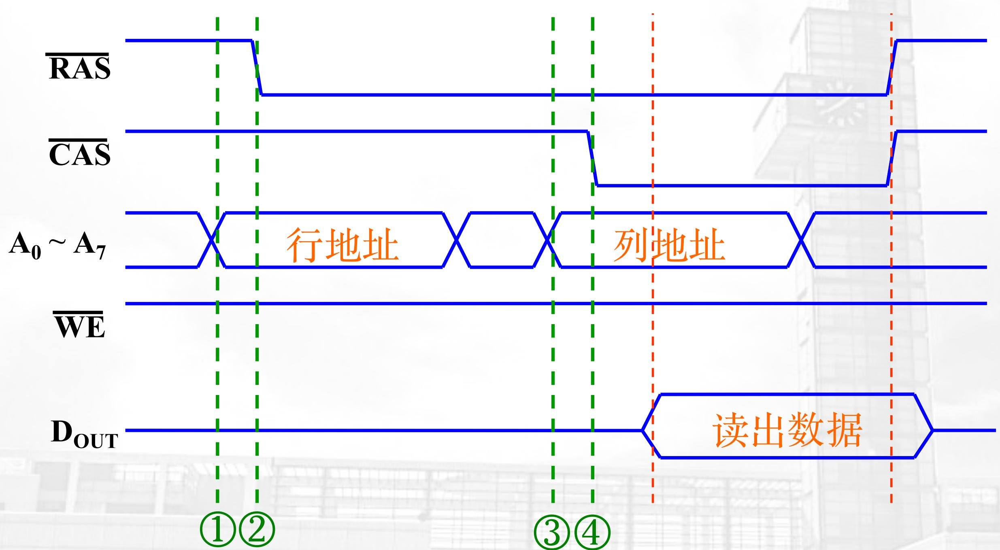

<details>
<summary>text_image</summary>

RAS
CAS
A₀ ~ A₇
行地址
列地址
WE
DOUT
①②
③④
读出数据
</details>

# DRAM的典型工作形态

写数据
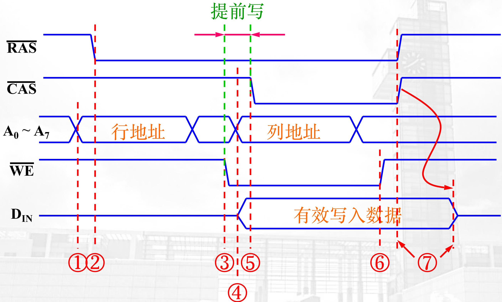

<details>
<summary>text_image</summary>

提前写
RAS
CAS
A₀ ~ A₇	行地址	列地址
WE
DIN	有效写入数据
①②	③⑤	⑥	⑦
</details>

# DRAM的典型工作形态

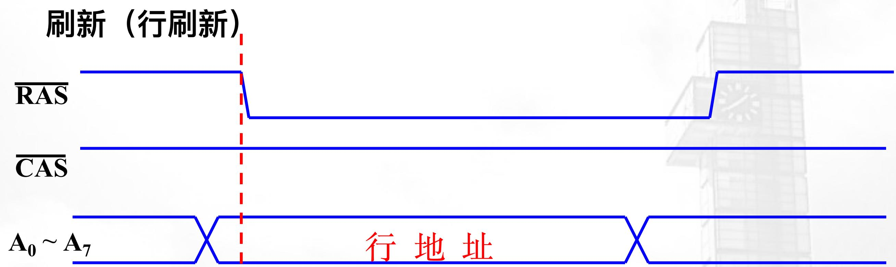

<details>
<summary>text_image</summary>

刷新（行刷新）
RAS
CAS
A₀ ~ A₇
行地址
</details>

# SDRAM: Synchronized DRAM

- 同步机制

- 同步时钟
- SDRAM内部采用流水线
- 减少握手开销

- 内部组织结构

- 多个存储体(Bank): 2个, 4个, ……

- 读写方式

- 突发(Burst)读写功能

- 连续传输所涉及到存储单元（列）的数量。

# SDRAM: Synchronized DRAM

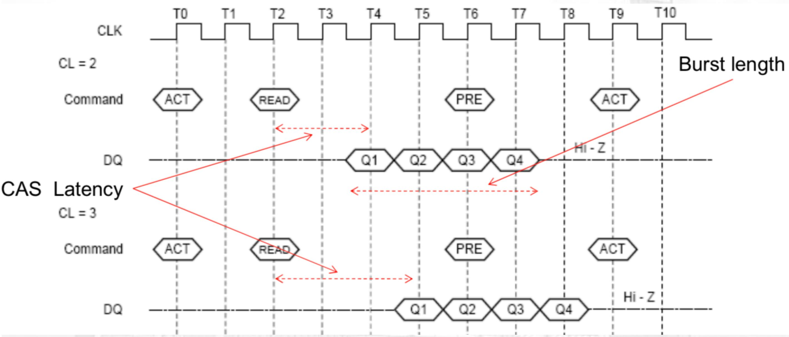

<details>
<summary>other</summary>

| Time | Event Type | Phase | Event Description |
|------|------------|-------|-------------------|
| T0   | ACT        | ACT   | Command           |
| T1   | READ       | READ  | Command           |
| T2   | PRE        | PRE   | Command           |
| T3   | PRE        | PRE   | Command           |
| T4   | PRE        | PRE   | Command           |
| T5   | PRE        | PRE   | Command           |
| T6   | PRE        | PRE   | Command           |
| T7   | PRE        | PRE   | Command           |
| T8   | PRE        | PRE   | Command           |
| T9   | ACT        | ACT   | Event             |
| T10  | ACT        | ACT   | Event             |
| T0   | Q1         | Q1    | Q1                |
| T1   | Q2         | Q2    | Q2                |
| T2   | Q3         | Q3    | Q3                |
| T3   | Q4         | Q4    | Q4                |
| T4   | PRE        | PRE   | Event             |
| T5   | PRE        | PRE   | Event             |
| T6   | PRE        | PRE   | Event             |
| T7   | PRE        | PRE   | Event             |
| T8   | PRE        | PRE   | Event             |
| T9   | PRE        | PRE   | Event             |
| T10  | PRE        | PRE   | Event             |
| T0   | Q1         | Q1    | Event             |
| T1   | Q2         | Q2    | Event             |
| T2   | Q3         | Q3    | Event             |
| T3   | Q4         | Q4    | Event             |
| T4   | PRE        | PRE   | Event             |
| T5   | PRE        | PRE   | Event             |
| T6   | PRE        | PRE   | Event             |
| T7   | PRE        | PRE   | Event             |
| T8   | PRE        | PRE   | Event             |
| T9   | PRE        | PRE   | Event             |
| T10  | PRE        | PRE   | Event             |
</details>

# DDR SDRAM: Double Data Rate SDRAM

- 时钟double
- 在信号上升和下降沿都传输信息

- DDR 3 SDRAM
- 时钟8倍

- DDR 2 SDRAM

- 时钟4倍

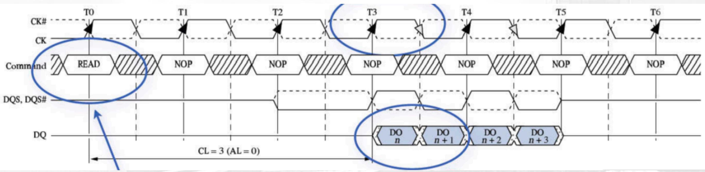

<details>
<summary>flowchart</summary>

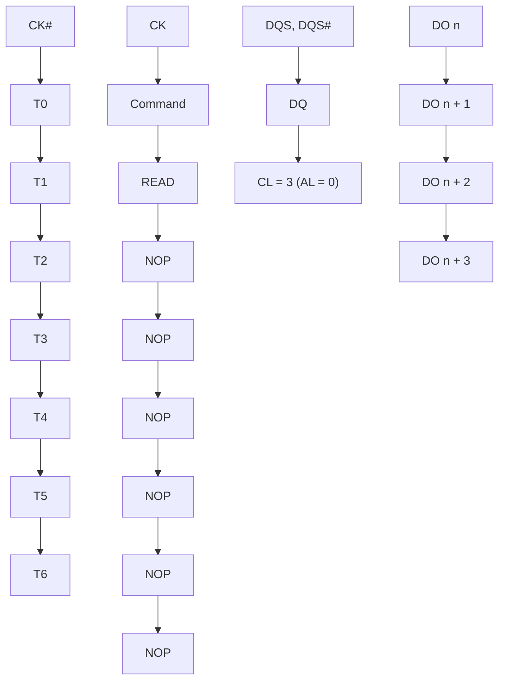
</details>

# 其它RAM变种

- PSRAM, Pseudo-static RAM

- 内置刷新电路，外部伪装成SRAM

- NVRAM, Non-Volatile RAM

- 基于电池

- SRAM自带电池...

- 基于Flash

- 掉电之前，赶紧写到Flash

- FeRAM

- 铁基存储...

# SRAM v.s DRAM

# • SRAM

- 用稳态电路存信息，不需刷新
相对于DRAM，速度快、集成度低、功耗大、成本高

# DRAM

- 用暂态电路（电容）存信息，需刷新
- 地址采用复用技术，分行列两次加载， $\overline{RAS}$ 、 $\overline{CAS}$
相对于SRAM，速度慢、集成度高、功耗小、成本低
- 刷新（再生）方法：集中式、分散式、异步式
- 刷新控制电路：刷新计数器、刷新/访存裁决、刷新控制逻辑，是CPU和DRAM的接口

# ROM, all kinds of ROMs...

■ 特点：存储信息的非易失性。
■ 分类:

- 掩膜型Mask ROM
- 可编程ROM

# OTP-ROM

- 可擦可编程ROM

- EPROM
E2PROM: 并行、串行

- 闪速(Flash)存储器

- 或非型（NOR）阵列
- 与非型（NAND）阵列

# Mask ROM

- 工厂使用Mask工艺制
造，所以称为Mask ROM
- 有连接，高压被接地，
下方测得低电压，代表0
- 反之，代表1

- 水平是字线
- 垂直是位线

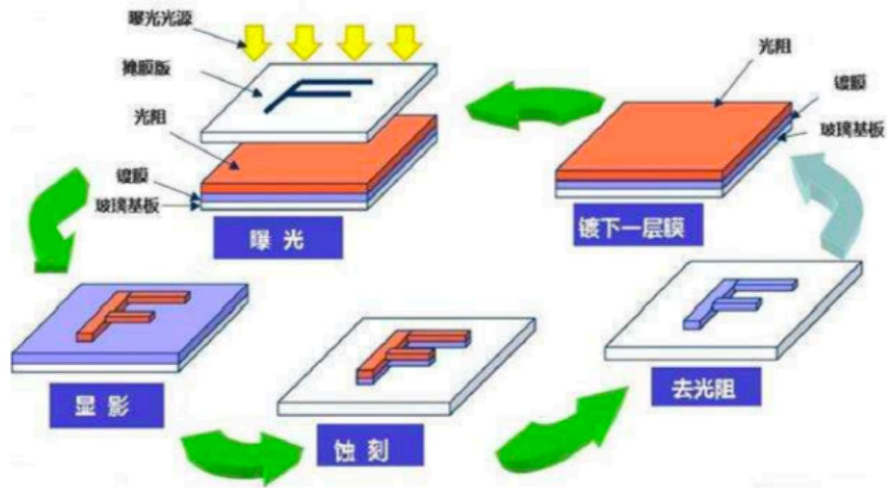

<details>
<summary>flowchart</summary>

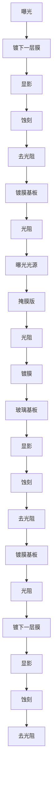
</details>

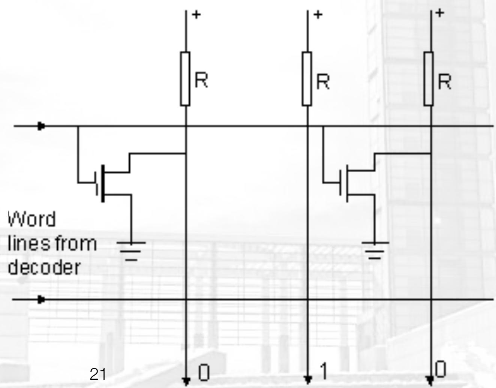

<details>
<summary>text_image</summary>

Word
lines from
decoder
21
0
1
0
</details>

# Mask ROM

- 一个8x4 ROM的例子

- word2输出为1010
- 物理连接在生产时固定，无法修改(ROM)

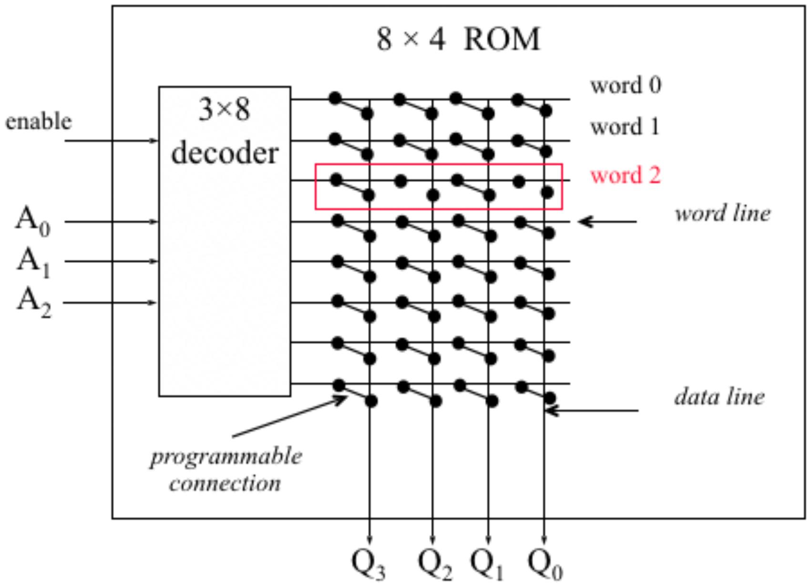

<details>
<summary>flowchart</summary>

```mermaid
graph TD
    A["enable"] --> B["3×8 decoder"]
    C["A0"] --> B
    D["A1"] --> B
    E["A2"] --> B
    B --> F["word line"]
    B --> G["data line"]
    F --> H["Q3"]
    G --> I["Q2"]
    H --> J["Q1"]
    I --> K["Q0"]
    L word0 --> M["3×8 decoder"]
    N word1 --> M
    O word2 --> M
    P programmable connection --> M
    style M fill:#f9f,stroke:#333,stroke-width:2px
```
</details>

# OTP ROM: One-time Programmable ROM

- 每一个bit位点都有一个fuse
- 根据是否烧熔fuse编程1/0
- 其实，理论上，可以非常多次编程，只是。。。

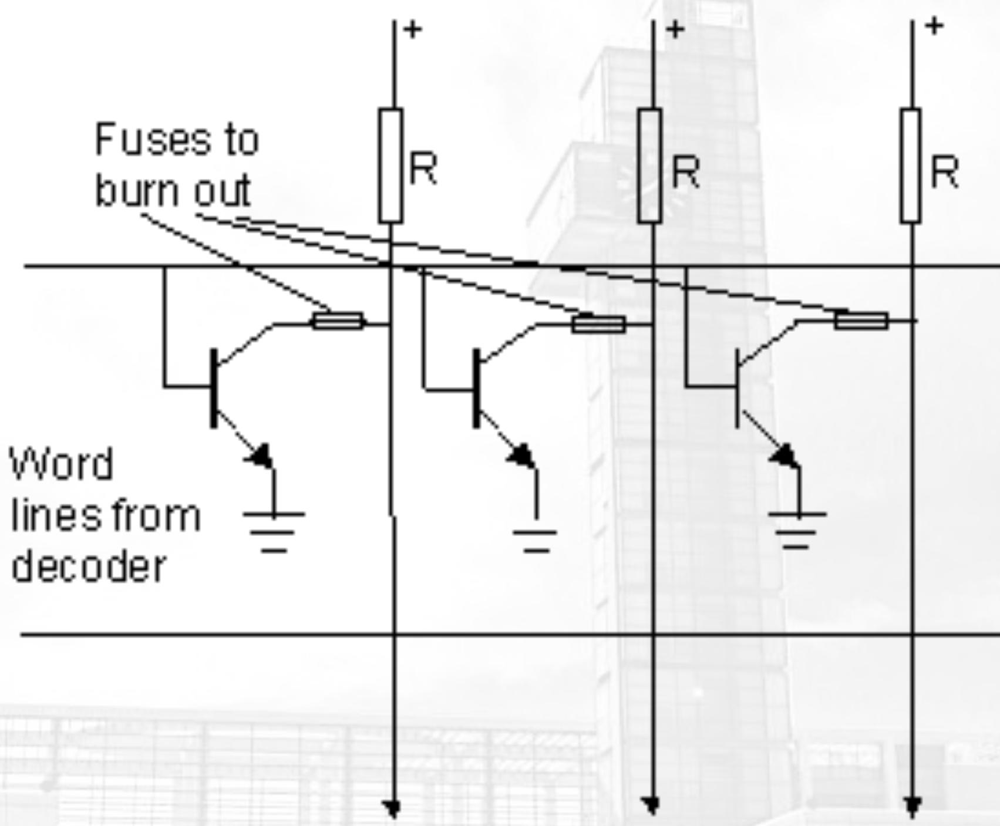

<details>
<summary>text_image</summary>

Fuses to
burn out
Word
lines from
decoder
</details>

# EPROM: Erasable programmable ROM

- 使用Floating gate Avalanche-injected MOS (FAMOS)
- 正高压(+20v)于Control和Drain，编程0；
- UV照射20分钟，擦除，编程1；

- 为什么用UV?

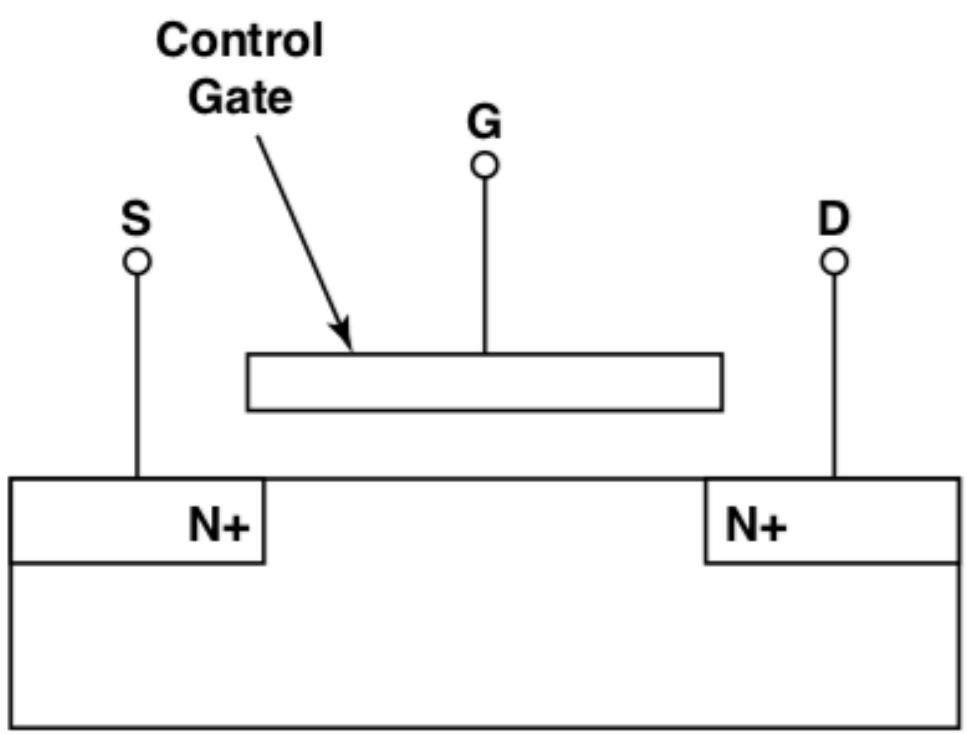

<details>
<summary>text_image</summary>

Control
Gate
S
G
D
N+
N+
</details>

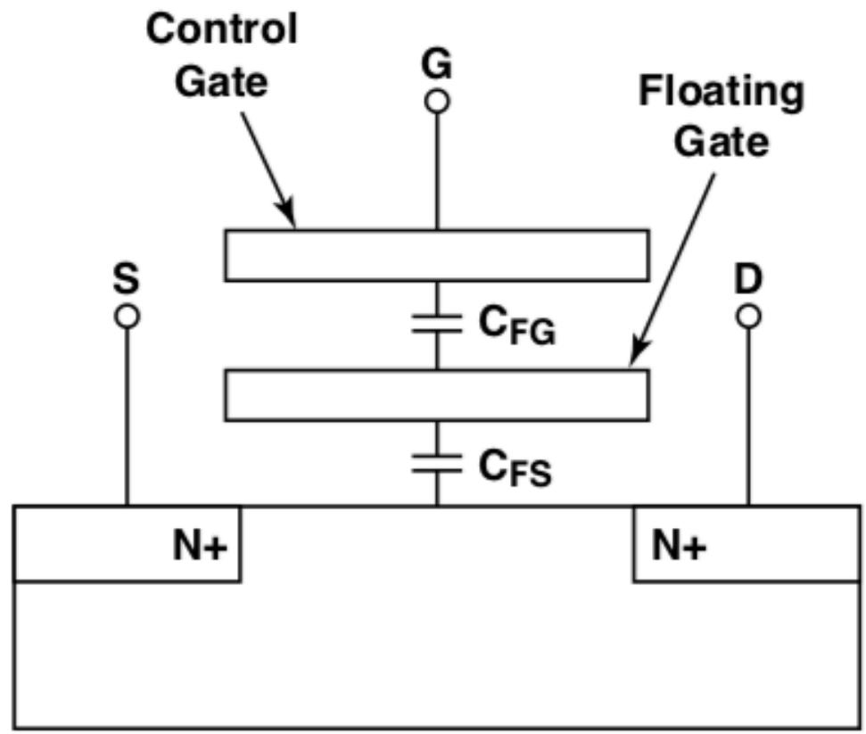

<details>
<summary>text_image</summary>

Control
Gate
G
Floating
Gate
S
CFG
D
CFS
N+
N+
</details>

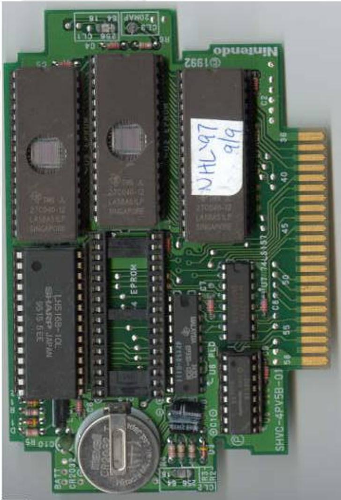

<details>
<summary>text_image</summary>

80
356
04
20MPB
S4 16
C12
70
N1992
80
356
04
20MPB
S4 16
C12
70
N1992
80
356
04
20MPB
S4 16
C12
70
N1992
80
356
04
20MPB
S4 16
C12
70
N1989-04L
SHANG-JIMM
195188-04L
SHANG-JIMM
195188-04L
SHANG-JIMM
195188-04L
SHANG-JIMM
195188-04L
SHANG-JIMM
195188-04L
SHANG-JIMM
195188-04L
SHANG-JIMM
195200-04L
SHANG-JIMM
195200-04L
SHANG-JIMM
195200-04L
SHANG-JIMM
195200-04L
SHANG-JIMM
195200-04L
SHANG-JIMM
195200-04L
SHANG-JIMM
195300-04L
SHANG-JIMM
195300-04L
SHANG-JIMM
195300-04L
SHANG-JIMM
195300-04L
SHANG-JIMM
195300-04L
SHANG-JIMM
195300-04L
SHANG-JIMM
1.65V 6A
U6 PDD
GND 6A
GND 6A
GND 6A
GND 6A
GND 6A
GND 6A
GND 6A
GND 6A
GND 6A
GND 6A
GND 6A
GND 6A
GND 6A
GND 6A
GND 6A
GND 6A
GND 6A
GND GND GND GND GND GND GND GND GND GND GND GND GND GND GND GND GND GND GND GND GND GND GND GND GND GND GND GND GND GND GND GND GND GND GND GND GND GND GND GND GND GND GND GND GND GND GND GND GND GND GND
</details>

# Flash Memory

- 是EEPROM的扩展

- 相同的floating gate结构
- 相同的读写持久性

- 主要改进

- 快速擦除（块擦除）

- 分Negate-OR和Negate-AND两类型

- NOR读取快，擦除慢，容量小
- NAND容量大，读写速度差小
- 适合作文件系统

# Flash Memory

- 是EEPROM的扩展

- 相同的floating gate结构
- 相同的读写持久性

- 主要改进

- 快速擦除（块擦除）

- Negate-OR和Negate-AND两类型

- NOR随机读取快，擦除慢，容量小
- 存储BIOS
- NVRAM

- NAND块读取，容量大，读写速度差小
- 适合作文件系统

NAND Flash || NOR Flash
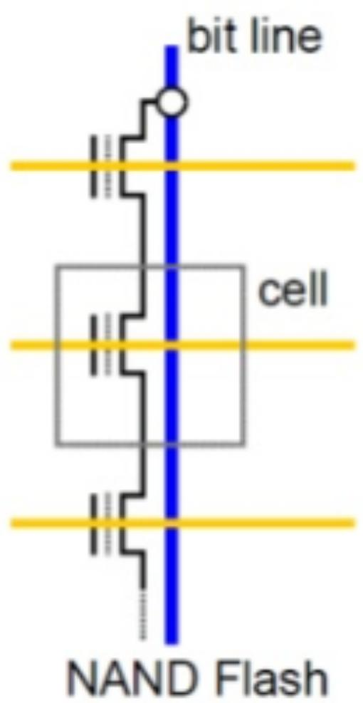

<details>
<summary>text_image</summary>

bit line
cell
NAND Flash
</details>

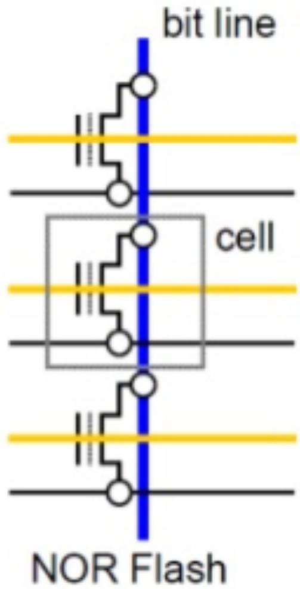

<details>
<summary>text_image</summary>

bit line
cell
NOR Flash
</details>

# EPROM/EEPROM连接

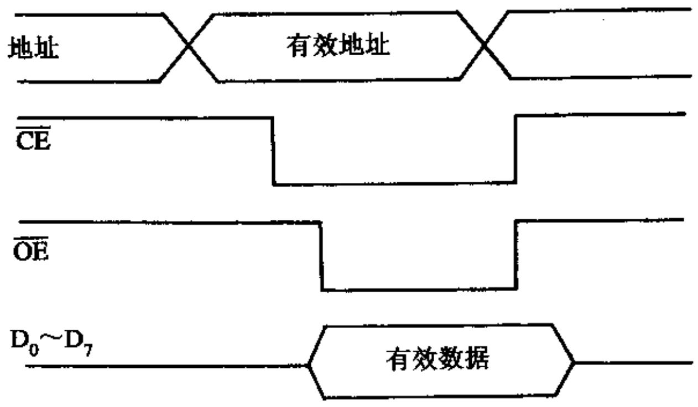

<details>
<summary>flowchart</summary>


</details>

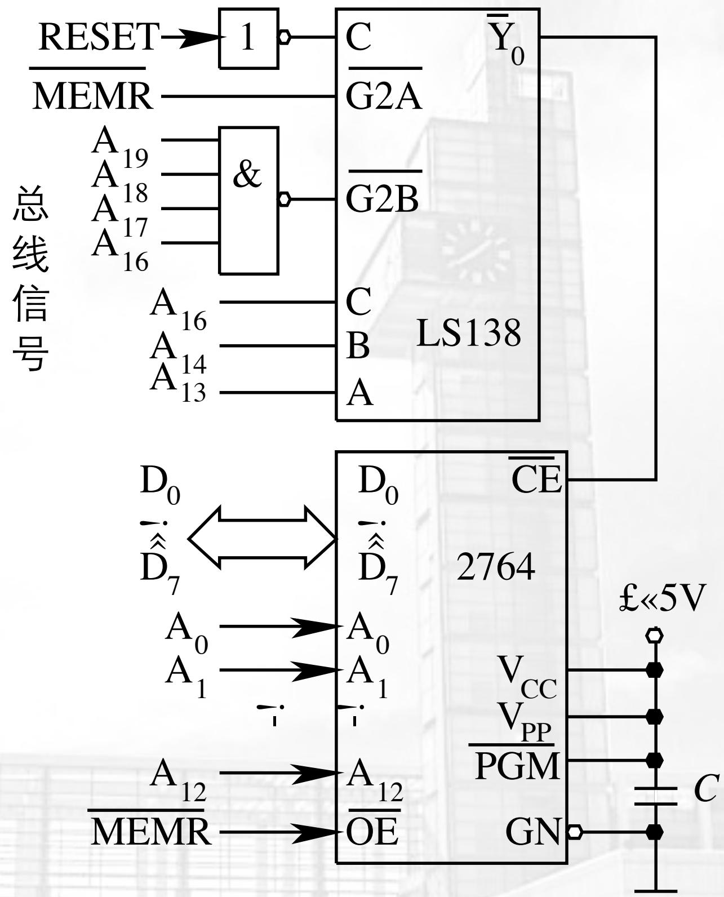

<details>
<summary>flowchart</summary>

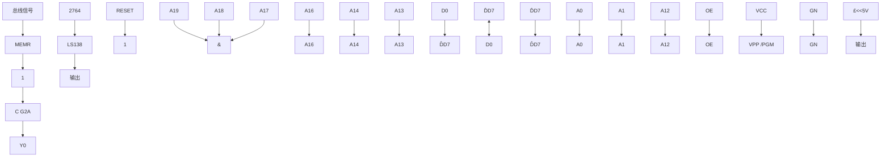
</details>

# 持久性v.s可写性

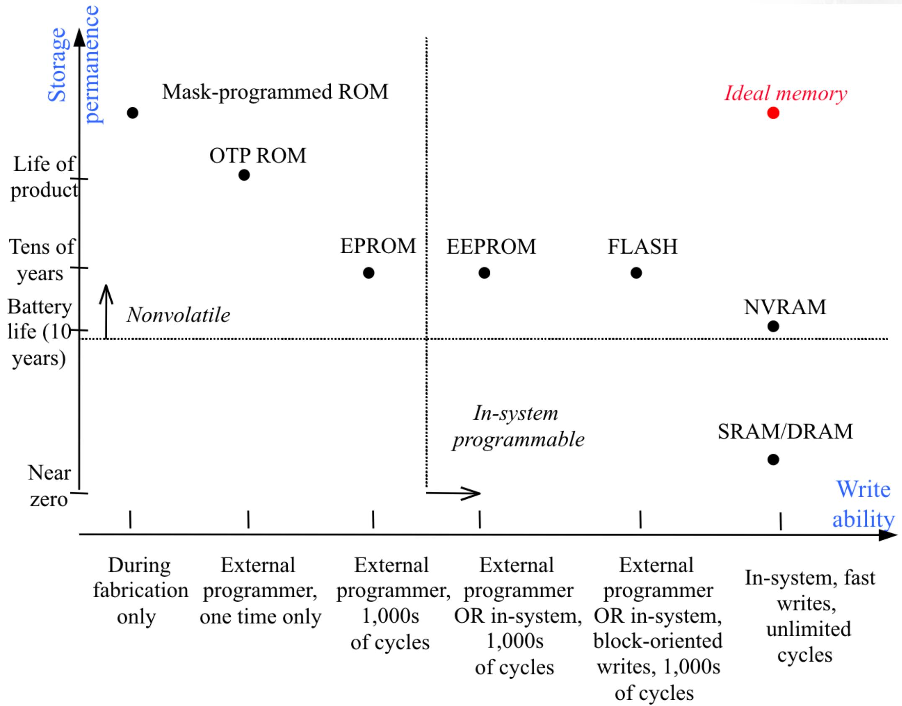

<details>
<summary>scatter</summary>

| System | Storage | Permanence | Battery Life (10 years) |
| :--- | :--- | :--- | :--- |
| Mask-programmed ROM | 10 | 100 | Nonvolatile |
| OTP ROM | 10 | 50 | Nonvolatile |
| EPROM | 10 | 20 | Nonvolatile |
| EEPROM | 10 | 20 | Nonvolatile |
| FLASH | 10 | 20 | Nonvolatile |
| NVRAM | 10 | 10 | Nonvolatile |
| SRAM/DRAM | 10 | 5 | Nonvolatile |
| Ideal memory | 10 | 100 | Nonvolatile |
| External programmer, one time only | 10 | 10 | Nonvolatile |
| External programmer, 1,000s of cycles | 10 | 10 | Nonvolatile |
| External programmer OR in-system, 1,000s of cycles | 10 | 10 | Nonvolatile |
| External programmer OR in-system, block-oriented writes, 1,000s of cycles | 10 | 10 | Nonvolatile |
| In-system programmable | 10 | 10 | Nonvolatile |
| In-system, fast writes, unlimited cycles | 10 | 5 | Nonvolatile |
| During fabrication only | 10 | 10 | Nonvolatile |
| Battery life (10 years) | 10 | 10 | Nonvolatile |
Write ability
</details>

# 其他存储器

- 多端口存储器
- 多体交叉存储器
- 相联存储器

# 多端口存储器

■ 应用：处理机之间的快速数据交换。
■ 分类:

- 双端口
- 三端口
- 四端口
●
■ ■ ■ ■ ■ ■

■ 双端口存储器

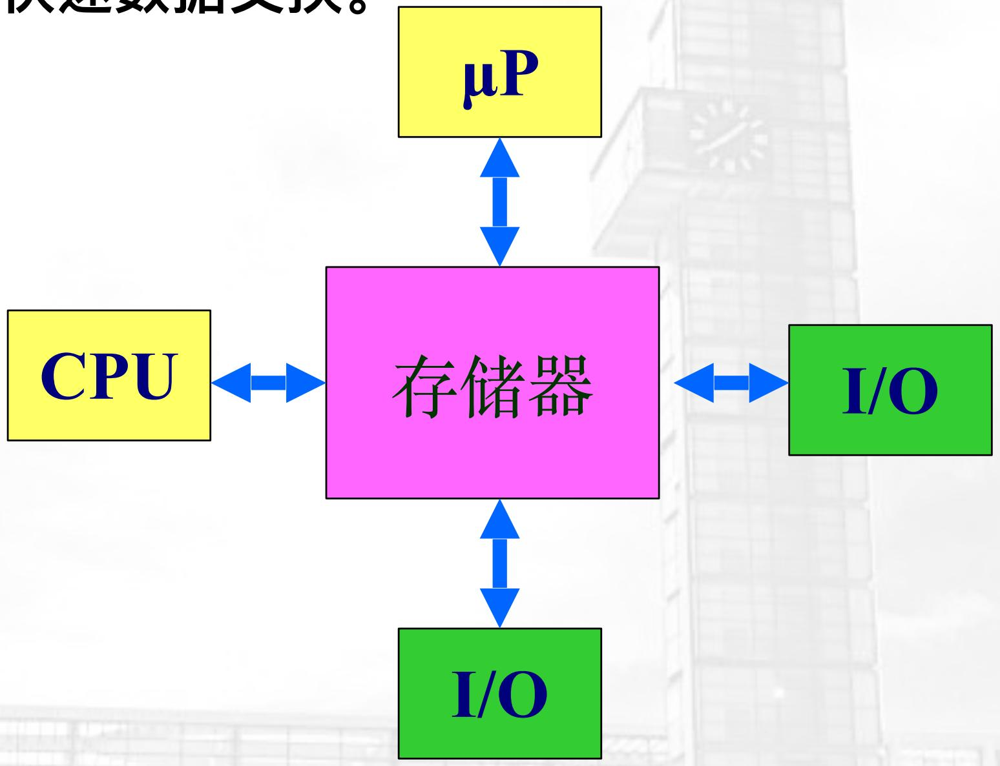

<details>
<summary>flowchart</summary>

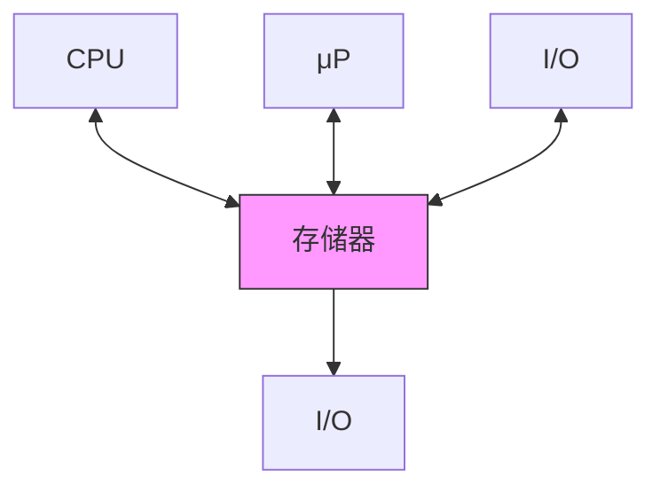
</details>

# 多端口存储器

# ■读/写操作

- 地址信号 $\Rightarrow \mathbf{AD}_0 \sim \mathbf{AD}_7$
- $\overline{\mathbf{CS}}$ 下降沿锁存地址于芯片内部。

- 在CS和OE同时为低电平时，相应地址单元中的内容被读出。

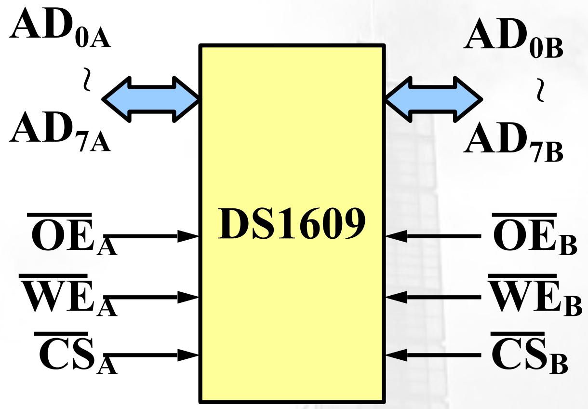

<details>
<summary>flowchart</summary>

```mermaid
graph LR
    A["AD0A"] --> B["DS1609"]
    C["AD7A"] <-- B
    D["OE_A"] --> B
    E["WE_A"] --> B
    F["CS_A"] --> B
    G["OE_B"] <-- B
    H["WE_B"] <-- B
    I["CS_B"] <-- B
    B --> J["AD0B"]
    B --> K["AD7B"]
```
</details>

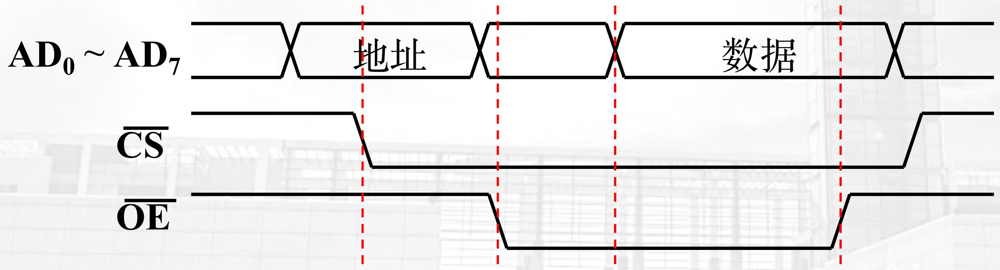

<details>
<summary>text_image</summary>

AD₀ ~ AD₇
地址
数据
CS
OE
</details>

# 多端口存储器

# ■读/写操作

- 允许:

- 对不同存储单元：

- 同时读。

- 同时写。

- 对同一存储单元：

- 同时读。

- 一个端口写，另一端口读。

- 不允许:

- 两个端口同时对同一存储单元写数据

- 消除竞争

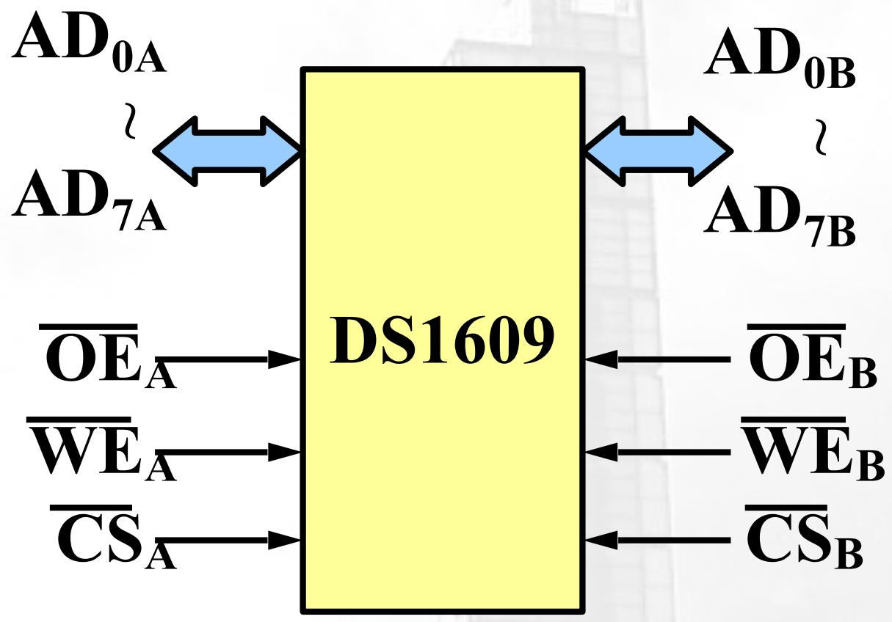

<details>
<summary>flowchart</summary>

```mermaid
graph LR
    A["AD0A"] --> B["DS1609"]
    C["AD7A"] <-- B
    D["OE_A"] --> B
    E["WE_A"] --> B
    F["CS_A"] --> B
    G["OE_B"] <-- B
    H["WE_B"] <-- B
    I["CS_B"] <-- B
    B --> J["AD0B"]
    B --> K["AD7B"]
```
</details>

# 多端口存储器

# ■竞争的消除

- 一边只写、一边只读
信号灯

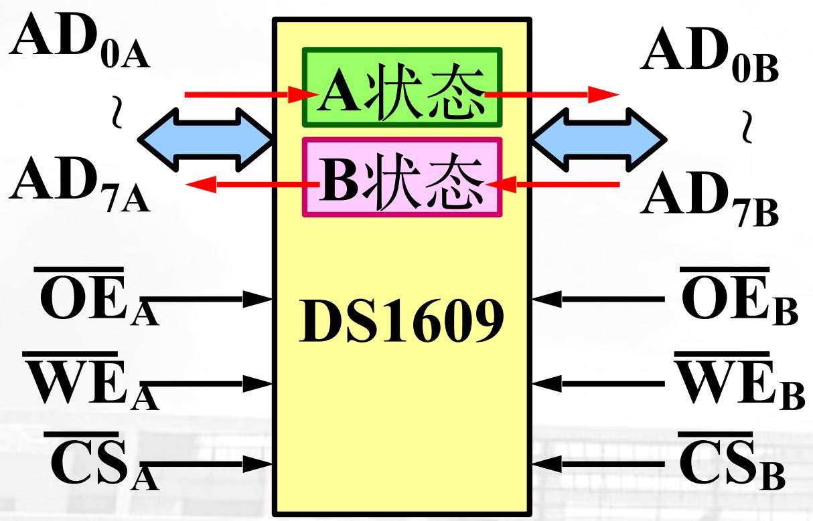

<details>
<summary>flowchart</summary>

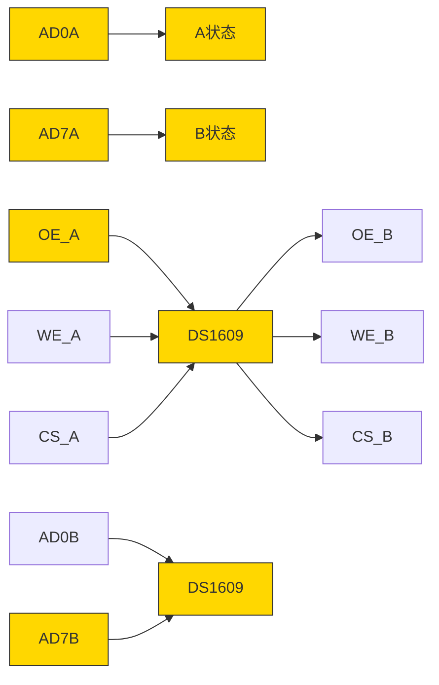
</details>

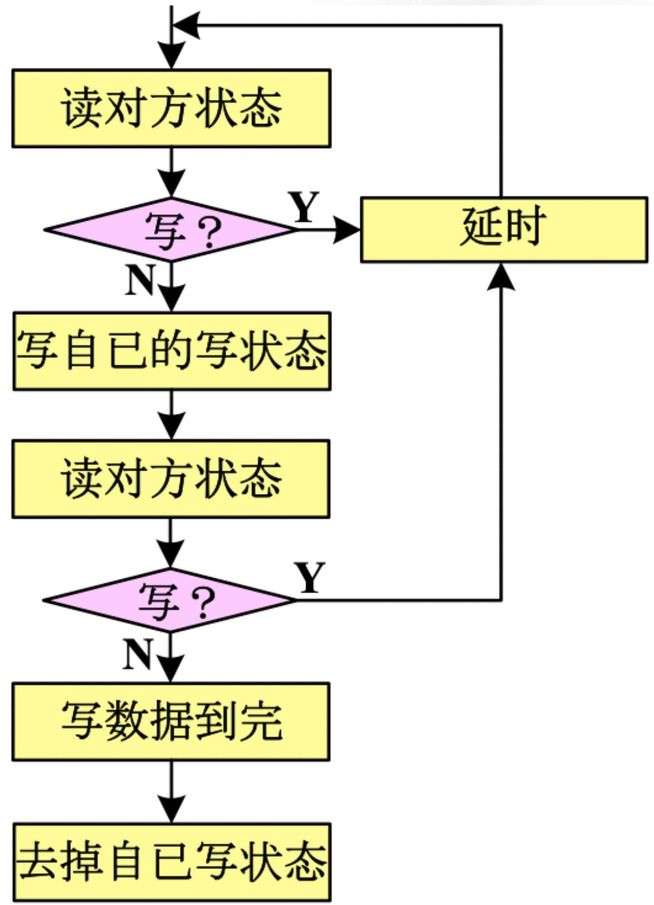

<details>
<summary>flowchart</summary>

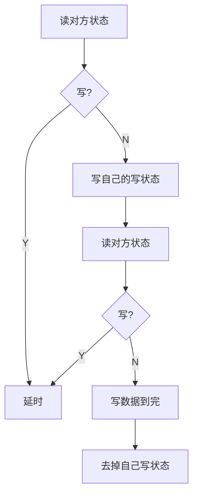
</details>

某一端口的写过程

# 多端口存储器

双端口存储器常用的场合：

■ CPU←→ DMA设备 或
CPU←→ IOP(IO处理机) }并行访问内存

■ 多机系统:


<details>
<summary>flowchart</summary>

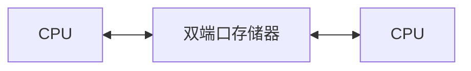
</details>

■ CPU内部：通用寄存器为运算器的两个输入端同时提供操作数。
■ 多级存储体系：Cache采用双端口结构。


<details>
<summary>flowchart</summary>

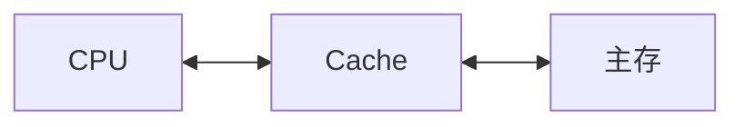
</details>

# 多体交叉存储器

仅靠一种工艺的单一存储器无法同时满足。

■ 多种不同工艺 → 存储体系

Cache，主存，辅存（系统结构）

速度、容量、价格

■ 并行存储系统（组成）

提高速度

并行主存系统：把主存储器分为多个存储体交叉或并行工作，在一个主存周期内能读写多个字。

# 多体交叉存储器

■ 多体交叉访问：
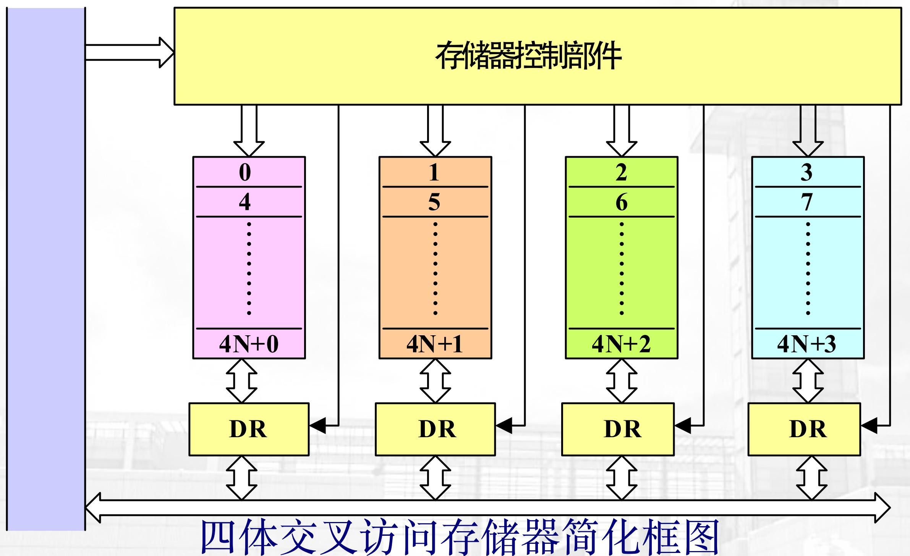

<details>
<summary>flowchart</summary>

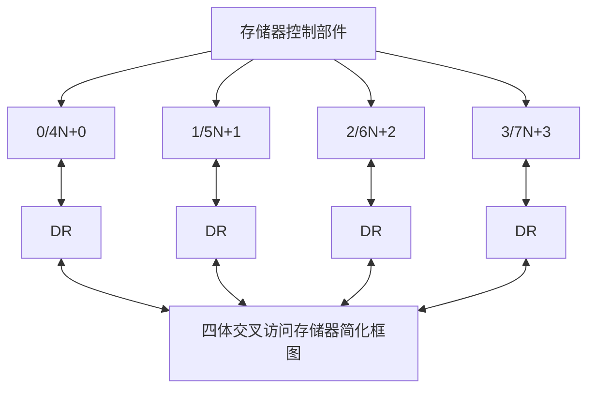
</details>

# 多体交叉存储器

连续读m个数据，需要的时间：T + (m - 1) · Δt

访问空间
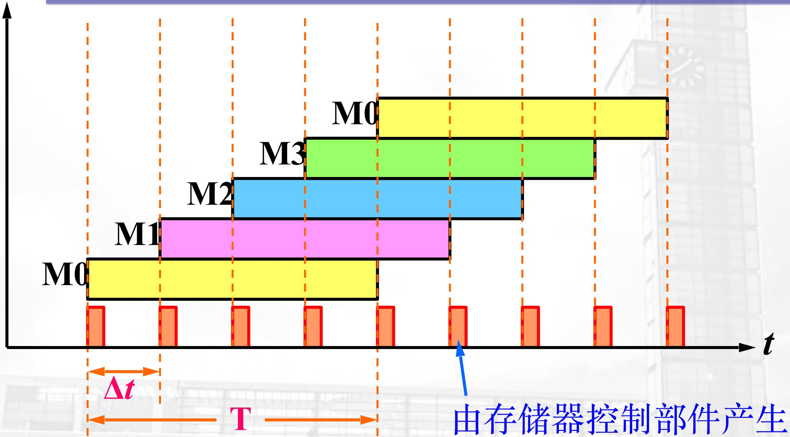

<details>
<summary>bar</summary>

| Time Segment | Phase | Value |
| ------------ | ----- | ----- |
| M0           | M0    | 1     |
| M0           | M1    | 2     |
| M0           | M2    | 3     |
| M0           | M3    | 4     |
</details>

$$
4 \cdot \Delta t \leq T
$$

四体存储器交叉访问示意图

# 相联存储器

相联存储器：

其中任一存储项内容作为地址来存取的存储器。

■ 格式：

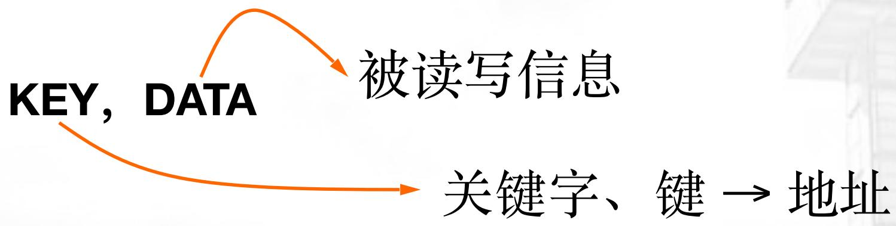

<details>
<summary>flowchart</summary>

```mermaid
graph TD
    A["KEY, DATA"] -->|被读写信息| B["关键字、键 → 地址"]
```
</details>

■ 原理：按内容访问

把存储单元所存内容的某一部分作为检索项(即关键字项)，去检索该存储器，并将存储器中与该检索项符合的存储单元内容进行读出或写入。

# 相联存储器

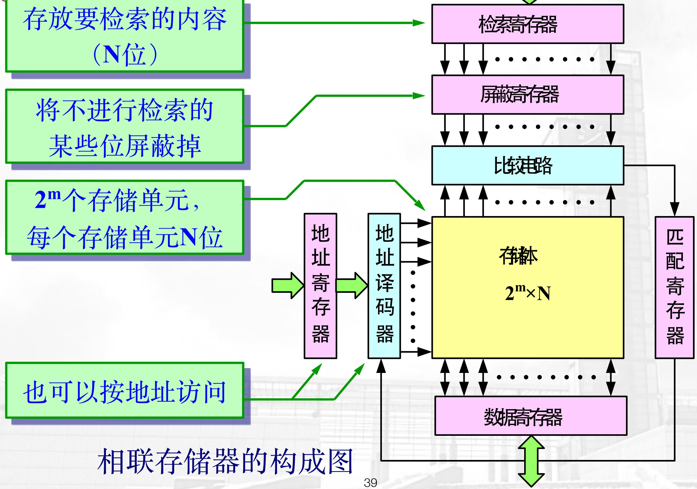

<details>
<summary>flowchart</summary>

```mermaid
graph TD
    A["存放要检索的内容 (N位)"] --> B["检索寄存器"]
    C["将不进行检索的某些位屏蔽掉"] --> D["屏蔽寄存器"]
    E["2^m个存储单元, 每个存储单元N位"] --> F["比较电路"]
    G["也可以按地址访问"] --> H["地址寄存器"]
    I["相联存储器的构成图"] --> J["地址译码器"]
    J --> K["存储体 2^m×N"]
    K --> L["匹配寄存器"]
    L --> M["数据寄存器"]
    M --> N["地址寄存器"]
    N --> O["比较电路"]
    O --> P["匹配寄存器"]
    P --> Q["数据寄存器"]
    Q --> R["地址译码器"]
    R --> S["比较电路"]
    S --> T["匹配寄存器"]
    T --> U["数据寄存器"]
    U --> V["地址译码器"]
    V --> W["比较电路"]
    W --> X["匹配寄存器"]
    X --> Y["数据寄存器"]
    Y --> Z["地址译码器"]
    Z --> AA["比较电路"]
    AA --> AB["匹配寄存器"]
    AB --> AC["数据寄存器"]
    AC --> AD["地址译码器"]
    AD --> AE["比较电路"]
    AE --> AF["匹配寄存器"]
    AF --> AG["数据寄存器"]
    AG --> AH["地址译码器"]
    AH --> AI["比较电路"]
    AI --> AJ["匹配寄存器"]
    AJ --> AK["数据寄存器"]
    AK --> AL["地址译码器"]
    AL --> AM["比较电路"]
    AM --> AN["匹配寄存器"]
    AN --> AO["数据寄存器"]
    AO --> AP["地址译码器"]
    AP --> AQ["比较电路"]
    AQ --> AR["匹配寄存器"]
    AR --> AS["数据寄存器"]
    AS --> AT["地址译码器"]
    AT --> AU["比较电路"]
    AU --> AV["匹配寄存器"]
    AV --> AW["数据寄存器"]
    AW --> AX["地址译码器"]
    AX --> AY["比较电路"]
    AY --> AZ["匹配寄存器"]
    AZ --> BA["数据寄存器"]
    BA --> BB["地址译码器"]
    BB --> BC["比较电路"]
    BC --> BD["匹配寄存器"]
    BD --> BE["数据寄存器"]
    BE --> BF["地址译码器"]
    BF --> BG["比较电路"]
    BG --> BH["匹配寄存器"]
    BH --> BI["数据寄存器"]
    BI --> BJ["地址译码器"]
    BJ --> BK["比较电路"]
    BK --> BL["匹配寄存器"]
    BL --> BM["数据寄存器"]
    BM --> BN["地址译码器"]
    BN --> BO["比较电路"]
    BO --> BP["匹配寄存器"]
    BP --> BQ["数据寄存器"]
    BQ --> BR["地址译码器"]
    BR --> BS["比较电路"]
    BS --> BT["匹配寄存器"]
    BT --> BU["数据寄存器"]
    BU --> BV["地址译码器"]
    BV --> BW["比较电路"]
    BW --> BX["匹配寄存器"]
    BX --> BY["数据寄存器"]
```
</details>

# 相联存储器

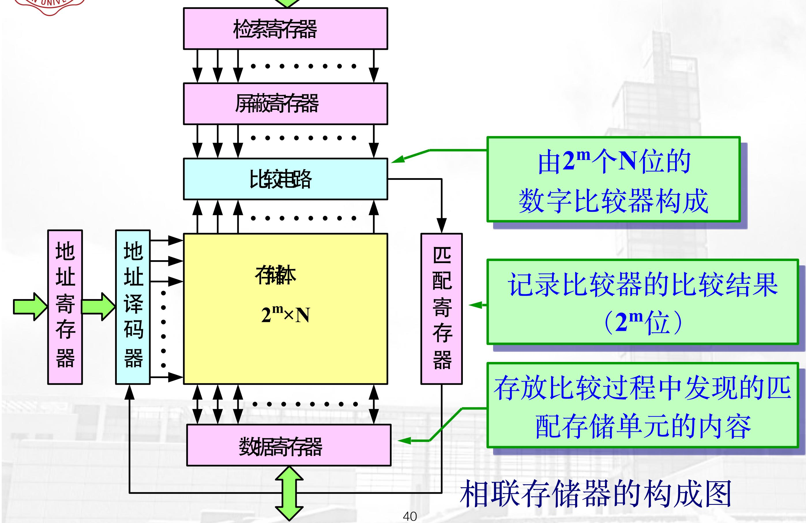

<details>
<summary>flowchart</summary>

```mermaid
graph TD
    A["地址寄存器"] --> B["地址译码器"]
    B --> C["存储体 2^m×N"]
    C --> D["数据寄存器"]
    D --> E["匹配寄存器"]
    E --> F["比较电路"]
    F --> G["屏蔽寄存器"]
    G --> H["检索寄存器"]
    H --> I["相联存储器的构成图"]
    C --> J["由2^m个N位的数字比较器构成"]
    C --> K["记录比较器的比较结果 (2^m位)"]
    C --> L["存放比较过程中发现的匹配存储单元的内容"]
```
</details>

# 相联存储器

相联存储器的用途：

快速查找、地址变换

■ Cache: Cache的目录表
■ 虚拟存储器：

页表，变换旁视缓冲器(TLB)

# So, Cache ...

# ■ Cache [kæʃ]

A hiding place used especially for storing provisions. 贮藏处，暗窖：一个隐秘的空间，尤指用于贮存预备货物

# ■ Cache

A cache memory is a small, temporary, but fast memory that the processor uses for information it is likely to need again in the very near future.

# All about Cache

- 为什么需要 Cache？
- 性能 & 结构两方面因素
- Cache 有效的根本原因：
- 局部性
- 存储系统
- Cache 的基本工作过程：


<details>
<summary>flowchart</summary>

```mermaid
graph TD
    A["MAIN MEMORY"] --> B["L2 Cache"]
    B --> C["L2 Bus Interface"]
    C --> D["I-Cache"]
    C --> E["Processor Core"]
    C --> F["D-Cache"]
    D <--> E
    E <--> F
```
</details>

# Why Cache?

- CPU性能在80386之后远超内存速度

- 10ns per instruction
- 60-120ns per memory read


<details>
<summary>line</summary>

| Year | Processor | Memory |
|------|-----------|--------|
| 1980 | 1         | 1      |
| 1981 | 1.5       | 1.2    |
| 1982 | 2         | 1.5    |
| 1983 | 3         | 1.8    |
| 1984 | 4         | 2      |
| 1985 | 5         | 2.2    |
| 1986 | 7         | 2.5    |
| 1987 | 10        | 2.8    |
| 1988 | 15        | 3      |
| 1989 | 20        | 3.2    |
| 1990 | 30        | 3.5    |
| 1991 | 40        | 3.8    |
| 1992 | 50        | 4      |
| 1993 | 70        | 4.2    |
| 1994 | 100       | 4.5    |
| 1995 | 150       | 4.8    |
| 1996 | 200       | 5      |
| 1997 | 300       | 5.2    |
| 1998 | 400       | 5.5    |
| 1999 | 500       | 5.8    |
| 2000 | 700       | 6      |
| 2001 | 800       | 6.2    |
| 2002 | 900       | 6.5    |
| 2003 | 1000      | 6.8    |
| 2004 | 1200      | 7      |
| 2005 | 1500      | 7.2    |
| 2006 | 1800      | 7.5    |
| 2007 | 2000      | 7.8    |
| 2008 | 2200      | 8      |
| 2009 | 2500      | 8.2    |
| 2010 | 3000      | 8.5    |
</details>

# Why Cache?

# 结构冲突

- 总线占用：CPU和I/O争抢内存访问
- 访问冲突：指令预取与数据读写
- 内存方面如何优化？


<details>
<summary>flowchart</summary>

```mermaid
graph TD
    A["主机"] --> B["processor"]
    A --> C["memory"]
    B <--> D["I/O Interface (adapter)"]
    C <--> E["I/O Interface (adapter)"]
    D --> F["I/O device"]
    E --> G["I/O device"]
    style A fill:#f9f,stroke:#333
    style B fill:#ccf,stroke:#333
    style C fill:#ccf,stroke:#333
    style D fill:#cfc,stroke:#333
    style E fill:#cfc,stroke:#333
    style F fill:#fcc,stroke:#333
    style G fill:#fcc,stroke:#333
```
</details>

# Why Cache works?

# 主要依据：程序的局部性原理

两种可预测的主存访问性质（Two predictable properties of memory references）：

- 时间局部性：某位置若被访问，则近期内很可能又被访问。
Temporal Locality: If a location is referenced it is likely to be referenced again in the near future.

- 空间局部性：某位置若被访问，则临近的位置也可能被访问。

Spatial Locality: If a location is referenced it is likely that locations near it will be referenced in the near future.

```lisp
for (auto i = 0 ; i < 100; i++) {
array[i] = i;
}
```

# 存储系统

# 存储系统

两个或两个以上速度、容量和价格各不相同的存储器用硬件、软件、或软件与硬件相结合的方法连接起来成为一个存储系统。

这个存储系统对应用程序员是透明的，并且，从应用程序员看，它是一个存储器，这个存储器的速度接近速度最快的那个存储器，存储容量与容量最大的那个存储器相等，单位容量的价格接近最便宜的那个存储器。

Cache存储系统：对系统程序员以上均透明

虚拟存储器系统：对应用程序员透明

# 存储系统

# 一般计算机系统中主要有两种存储系统：

Cache存储系统：由Cache和主存储器构成；主要目的是提高存储器速度。

虚拟存储系统：由主存储器和磁盘存储器构成；主要目的是扩大存储器容量。

# 存储系统

# 存储系统的多层次结构

cache-主存-辅存三级存储体系：三级存储层次

主存-辅存存储层次：大容量、低成本；

软硬件结合完成

cache-主存存储层次: 高速度、低成本;

纯硬件完成


<details>
<summary>flowchart</summary>

```mermaid
graph TD
    CPU["CPU"] -->|双向箭头| Cache["高速缓存 Cache"]
    Cache <-->|双向箭头| MainSet["主存"]
    MainSet <-->|双向箭头| Cache
    MainSet -->|横向箭头| CPU
    MainSet -->|横向箭头| 辅存["辅存"]
    MainSet -->|横向箭头| 辅助硬件["辅助硬件和软件"]
    MainSet -->|横向箭头| 辅助硬件
```
</details>

解决存储系统三个指标：容量、速度、价格/位的矛盾

# 存储系统

大型工作站、小型服务器中典型的存储层次结构

<table><tr><td>层次</td><td>1</td><td>2</td><td>3</td><td>4</td></tr><tr><td>名称</td><td>寄存器</td><td>Cache</td><td>内存</td><td>磁盘</td></tr><tr><td>典型容量</td><td>&lt; 1 KB</td><td>&lt; 16 MB</td><td>&lt; 512 GB</td><td>&gt;1 TB</td></tr><tr><td>实现技术</td><td>多端口定制存储器,CMOS</td><td>片内或片外,CMOS SRAM</td><td>CMOS DRAM</td><td>磁盘</td></tr><tr><td>访问时间(ns)</td><td>0.25 ~ 0.5</td><td>0.5 ~ 25</td><td>50 ~ 250</td><td>5,000,000</td></tr><tr><td>带宽(MB/sec)</td><td>50,000 ~ 500,000</td><td>5,000 ~ 20,000</td><td>2500 ~ 10000</td><td>50 ~ 500</td></tr><tr><td>管理</td><td>编译器</td><td>硬件</td><td>操作系统</td><td>操作系统/操作者</td></tr><tr><td>下一级</td><td>Cache</td><td>内存</td><td>磁盘</td><td>DVD-ROM 或 磁带</td></tr></table>

# How Cache works?

# Cache 的工作过程


<details>
<summary>flowchart</summary>

```mermaid
graph LR
    CPU --> Cache
    Cache <--> 字传送
    Cache <--> 块传送
    Cache <--> 主存
    subgraph "Burst模式"
        direction TB
        CPU <--> Cache
        字传送 <--> Cache
        块传送 <--> Cache
    end
```
</details>

# 1. Cache的工作过程

- 整块缓存、单字输出
- Cache-处理机通路

主存-处理机通路

- 流水处理：地址变换、访问Cache


<details>
<summary>flowchart</summary>

```mermaid
graph TD
    A["主存地址 (来自CPU)"] --> B["块号B"]
    A --> C["块内地址W"]
    B --> D["主存→Cache 地址变换"]
    C --> E["主存地址"]
    D --> F["块号b"]
    D --> G["块内地址w"]
    E --> H["Cache 替换策略"]
    H --> I["已满"]
    H --> J["未满"]
    K["高速存储器"] --> L["Cache"]
    L --> M["替换块"]
    L --> N["装入块"]
    M --> O["数据送CPU"]
    N --> O
    O --> P["主存储器"]
    Q["相联存储表"] --> D
    R["未命中"] --> H
```
</details>

# 主存与Cache的地址映射

# ■ 第一步：地址映象：

把主存中的数据按照某种规则装入到Cache中，并建立主存地址与Cache地址之间的对应关系。

# ■ 第二步：地址变换：

当主存数据已经装入到Cache之后，在程序运行过程中，把主存地址变换成Cache地址。

# ■ 在选取地址映象方法要考虑的主要因素:

- 地址变换的硬件高速、低价、易于实现；
- Cache空间利用率要高;
- 发生块冲突的概率要小。

# ■ 以“块”为单位进行调度。

全相联
直接映射
组相联

# 全相联映射

# ■ 映射规则：

主存的任意一块可以映象到Cache中的任意一块。

# 全相联映射


<details>
<summary>flowchart</summary>

```mermaid
graph TD
    A["目录表"] --> B["1010"]
    B --> C["主存块号 00"]
    B --> D["主存块号 01"]
    B --> E["主存块号 10"]
    B --> F["主存块号 11"]
    G["高速SRAM Cache"] --> H["块0"]
    G --> I["块1"]
    G --> J["块2"]
    G --> K["块3"]
    G --> L["块4"]
    G --> M["块5"]
    G --> N["块6"]
    G --> O["块7"]
    G --> P["块8"]
    G --> Q["块9"]
    G --> R["块10"]
    G --> S["块11"]
    G --> T["块12"]
    G --> U["块13"]
    G --> V["块14"]
    G --> W["块15"]
    X["主存"] --> Y["块0"]
    X --> Z["块1"]
    X --> AA["块2"]
    X --> AB["块3"]
    X --> AC["块4"]
    X --> AD["块5"]
    X --> AE["块6"]
    X --> AF["块7"]
    X --> AG["块8"]
    X --> AH["块9"]
    X --> AI["块10"]
    X --> AJ["块11"]
    X --> AK["块12"]
    X --> AL["块13"]
    X --> AM["块14"]
    X --> AN["块15"]
    AO["相联比较"] --> AP["命中"]
    AP --> AQ["10 Cache地址"]
    AQ --> AR["Cache块号"]
    AQ --> AS["Cache块内地址"]
    AR --> AT["主存块号 1010"]
    AR --> AU["主存块号 块内地址"]
    AV["主存块号 1010"] --> AW["不命中"]
    AX["主存块号 1010"] --> AY["主存块号 块内地址"]
```
</details>

# 全相联映射

# ■ 映射规则：

主存的任意一块可以映象到Cache中的任意一块。

# ■ 特点:

- 块冲突概率低，Cache空间利用率高。
- 相联目录表容量大 $\rightarrow$ 成本高、查表速度慢。
- 以上特点成立的原因：全相联方式允许主存块装入任意 Cache 行，因此冲突更少，但目录比较硬件更复杂。

# 直接映射

■ 映射规则：主存的每一块只能映象到Cache的一个特定的块中。
■ 整个Cache地址与主存地址的低位部分完全相同

# 直接映射


<details>
<summary>flowchart</summary>

```mermaid
graph TD
    A["目录表"] -->|01 1| B[" Cache"]
    B -->|块0| C["主存"]
    B -->|块1| C
    B -->|块2| C
    B -->|块3| C
    D["相等比较"] -->|不等| A
    D -->|相等| E["Cache地址"]
    E --> F["主存"]
    F --> G["区0"]
    F --> H["区1"]
    F --> I["区2"]
    F --> J["区3"]
    E --> K["块号"]
    E --> L["块内地址"]
    K --> M["01 11"]
    L --> N["01 11"]
    M --> O["区号"]
    M --> P["块号"]
    N --> Q["块内地址"]
    style A fill:#f9f,stroke:#333
    style B fill:#ccf,stroke:#333
    style C fill:#cfc,stroke:#333
    style D fill:#fcc,stroke:#333
    style E fill:#ffc,stroke:#333
    style F fill:#fcc,stroke:#333
    style G fill:#fcc,stroke:#333
    style H fill:#fcc,stroke:#333
    style I fill:#fcc,stroke:#333
    style J fill:#fcc,stroke:#333
```
</details>

# 直接映射

■ 映射规则：主存的每一块只能映象到Cache的一个特定的块中。
■ 整个Cache地址与主存地址的低位部分完全相同。
■ 优点:

- 硬件简单，不需要相联存储器，只要

- 容量较小的按地址访问的区号标志表存储器；
- 少量外比较电路。

- 访问速度快（无需地址变换）。

■ 缺点：

- Cache块冲突概率高;
- Cache空间利用率很低。

# 组相联映射

■ 目的：减小相联目录表的容量，降低成本，提高地址变换速度。
■ 映射规则：将主存和Cache都机械等分成相同大小的块，并将主存空间按照Cache大小等分成区，再将Cache和主存中的每一区都等分成大小相同的组，让主存各区中的某组中的任何一块均可直接映象装入到Cache中对应组的任何一块上。

从主存的组到Cache的组之间采用直接映象方式，在两个对应的组内部采用全相联映象方式——组间直接，组内全相联。

# 组相联映射


<details>
<summary>flowchart</summary>

```mermaid
graph TD
    A["目录表"] --> B["组0"]
    A --> C["组1"]
    B --> D["0"]
    B --> E["1"]
    C --> F["01"]
    C --> G["1"]
    D --> H[" Cache"]
    E --> H
    F --> H
    G --> H
    H --> I["主存区号"]
    H --> J["主存组内块号"]
    H --> K["主存组内块号"]
    H --> L[" Cache组内块号"]
    M[" Cache "] --> N["组0"]
    M --> O["组1"]
    N --> P["块0"]
    N --> Q["块1"]
    O --> R["块0"]
    O --> S["块1"]
    P & Q & R & S --> T["组1"]
    T --> U[" Cache地址"]
    U --> V["组号"]
    U --> W["组内块号"]
    V & W --> X["主存地址"]
    X --> Y["01"]
    X --> Z["1"]
    Y & Z --> AA["主存组内块号"]
    AA --> AB["63"]
    AC["相联比较"] --> AD["命中"]
    AD --> AE["不命中"]
    AF["按地址访问"] --> AG["指针指向左上箭头"]
```
</details>


<details>
<summary>text_image</summary>

主存
块0
块1
块0
块1
块0
块1
块0
块1
块0
块1
块0
块1
块0
块1
块0
块1
块0
块1
组0
组1
组0
组1
组0
组1
组0
组1
区0
区1
区2
区3
</details>

# 组相联映射

# ■ 优点:

- 块的冲突概率比较低；
- 块的利用率大幅度提高；
- 块的失效率明显降低。

# ■ 缺点：

实现难度和造价比直接映射方式高。

# [例1] 直接映射方式的Cache，初始内容为空。

# Cache容量为2KB，以128B分块。主存容量为1MB，求：

(1) Cache分为多少块？Cache块号及块内地址各为多少位？为实现地址映像，主存地址应如何划分？
(2) 主存中顺序排列的第129块（即若�