# 计算机组成与结构

# —存储系统3

李瑞 教授

蒋志平 讲师

计算机科学与技术学院

# 温故

- 概述6264芯片特点  
- 简述3种扩展大存储的方式  
- 简述8086系统内存拼接的特殊设计  
- 简述2164芯片特点  
- 简述2164芯片地址输入方法  
- ROM是什么，有哪些类型？  
- SSD/u盘属于哪类ROM?

# 持久性v.s可写性

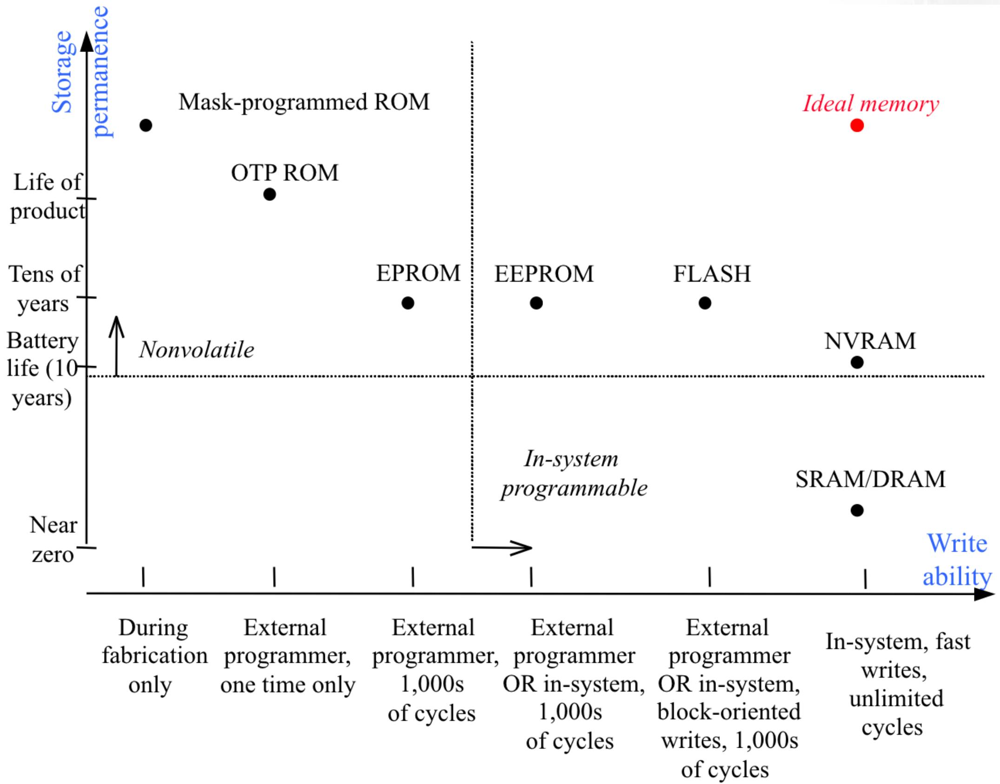

<details>
<summary>scatter</summary>

| System | Storage | Permanence | Battery Life (10 years) |
| :--- | :--- | :--- | :--- |
| Mask-programmed ROM | High | Low | Nonvolatile |
| OTP ROM | Medium | Low | Nonvolatile |
| EPROM | Medium | Low | Nonvolatile |
| EEPROM | Medium | Low | Nonvolatile |
| FLASH | Medium | Low | Nonvolatile |
| NVRAM | Low | Low | Nonvolatile |
| SRAM/DRAM | Low | Low | Nonvolatile |
| Ideal memory | High | Low | Nonvolatile |
| In-system programmable | Low | Low | Nonvolatile |
| External programmer OR in-system, 1,000s of cycles | Low | Low | Nonvolatile |
| External programmer, 1,000s of cycles | Low | Low | Nonvolatile |
| External programmer, one time only | Low | Low | Nonvolatile |
| During fabrication only | Low | Low | Nonvolatile |
| In-system, fast writes, unlimited cycles | Low | Low | Nonvolatile |
| External programmer, block-oriented writes, 1,000s of cycles | Low | Low | Nonvolatile |
| External programmer, 1,000s of cycles | Low | Low | Nonvolatile |
| External programmer, 1,000s of cycles | Low | Low | Nonvolatile |
| External programmer, 1,000s of cycles | Low | Low | Nonvolatile |
| External programmer, one time only | Low | Low | Nonvolatile |
| External programmer, one time only | Low | Low | Nonvolatile |
| External programmer, 1,000s of cycles | Low | Low | Nonvolatile |
| External programmer, 1,000s of cycles | Low | Low | Nonvolatile |
| External programmer, 1,000s of cycles | Low | Low | Nonvolatile |
| External programmer, 1,000s of cycles | Low | Low | Nonvolatile |
| External programmer, 1,000s of cycles | Low | Low | Nonvolatile |
| External programmer, 1,500s of cycles | Low | Low | Nonvolatile |
| External programmer, 1,500s of cycles | Low | Low | Nonvolatile |
| External programmer, 1,500s of cycles | Low | Low | Nonvolatile |
| External programmer, 1,500s of cycles | Low | Low | Nonvolatile |
| External programmer, 1,500s of cycles | Low | Low | Nonvolatile |
| External programming OR in-system, 1,000s of cycles | Low | Low | Nonvolatile |
| External programming OR in-system, 1,000s of cycles | Low | Low | Nonvolatile |
| External programming OR in-system, 1,000s of cycles | Low | Low | Nonvolatile |
| External programming OR in-system, 1,000s of cycles | Low | Low | Nonvolatile |
| External programming OR in-system, 1,500s of cycles | Low | Low | Nonvolatile |
| External programming OR in-system, 1,500s of cycles | Low | Low | Nonvolatile |
| External programming OR in-system, 1,500s of cycles | Low | Low | Nonvolatile |
| External programming OR in-system, 1,500s of cycles | Low | Low | Nonvolatile |
| External programming OR in-system, 2,500s of cycles | Low | Low | Nonvolatile |
| External programming OR in-system, 2,500s of cycles | Low | Low | Nonvolatile |
| External programming OR in-system, 2,500s of cycles | Low | Low | Nonvolatile |
| External programming OR in-system, 2,500s of cycles | Low | Low | Nonvolatile |
| External programming OR in-system, 2,507.5% write ability: In-system programmable / In-system programmable / In-system programmable / In-system programmable / In-system programmable / In-system programmable / In-system programmable / In-system programmable / In-system programmable / In-system programmable / In-system programmable / In-system programmable / In-system programmable / In-system programmable / In-system programmable / In-system programmable / In-system programmable / In-system programme / In-system programme / In-system programme / In-system programme / In-system programme / In-system programme / In-system programme / In-system programme / In-system programme / In-system programme / In-system programme / In-system programme / In-system programme / In-system programme / In-system programme / In-system programme / In-system programme / In-system programme / In-system programme / In-system programme / In-system programm / In-system programme / In-system programme / In-system programme / In-system programme / In-system programme / In-system programme / In-system programme / In-system programme / In-system programme / In-system programme / In-system programme / In-system programme / In-system programme / In-system programme / In-system programme / In-system programme / In-system programme / In-system programme / In-system programme / In-system programmen / In-system programmen / In-system programmen / In-system programmen / In-system programmen / In-system programmen / In-system programmen / In-system programmen / In-system programmen / In-system programmen / In-system programmen / In-system programmen / In-system programmen / In-system programmen / In-system programmen / In-system programmen / In-system programmen / In-system programmen / In-system programmen / In-system programmen / In-system programnies / In-system programmen / In-system programmen / In-system programmen / In-system programmen / In-system programmen / In-system programmen / In-system programmen / In-system programmen / In-system programmen / In-system programmen / In-system programmen / In-system programmen / In-system programmen / In-system programmen / In-system programmen / In-system programmen / In-system programmen / In-system programmen / In-system programmen / In-system programen / In-system programmen / In-system programmen / In-system programmen / In-system programmen / In-system programmen / In-system programmen / In-system programmen / In-system programmen / In-system programmen / In-system programmen / In-system programmen / In-system programmen / In-system programmen / In-system programmen / In-system programmen / In-system programmen / In-system programmen / In-system programmen / In-system programmen / In-system programmies / In-system programmen / In-system programmen / In-system programmen / In-system programmen / In-system programmen / In-system programmen / In-system programmen / In-system programmen / In-system programmen / In-system programmen /In system , fast writes , unlimited cycles; in system , fast writes , unlimited cycles; in system , fast writes , unlimited cycles; in system , fast writes , unlimited cycles; in system , fast writes , unlimited cycles; in system , fast writes , unlimited cycles; in system , fast writes , unlimited cycles; in system , fast writes , unlimited cycles; in system , fast writes , unlimited cycles; in system , fast writes , unlimited cycles; in system , fast writes , unlimited cycles; in system , fast writes , unlimited cycles; in System , fast writes , unlimited cycles; in System , fast writes , unlimited cycles; in System , fast writes , unlimited cycles; in System , fast writes , unlimited cycles; in System , fast writes , unlimited cycles; in System , fast writes , unlimited cycles; in System , fast writes , unlimited cycles; in System , fast writes , unlimited cycles; in System , fast writes , unlimited cycles; in System , fast writes , unlimited cycles; in System , fast writes , unlimited cycles; in System . Fast writes , unlimited cycles; in System . Fast writes , unlimited cycles; in System . Fast writes , unlimited cycles; in System . Fast writes , unlimited cycles; in System . Fast writes , unlimited cycles; in System . Fast writes , unlimited cycles; in System . Fast writes , unlimited cycles; in System . Fast writes , unlimited cycles; in System . Fast writes , unlimited cycles; in System . Fast writes , unlimited cycles; in System . Fast writes , unlimited cycles; in System . Fast Writes , unlimited cycles; in System . Fast Writes , unlimited cycles; in System . Fast Writes , unlimited cycles; in System . Fast Writes , unlimited cycles; in System . Fast Writes , unlimited cycles; in System . Fast Writes , unlimited cycles; in System . Fast Writes , unlimited cycles; in System . Fast Writes , unlimited cycles; in System . Fast Writes , Unlimited cycles; in System . Fast Writes , Unlimited cycles; in System . Fast Writes , Unlimited cycles; in System . Fast Writes , Unlimited cycles; in System . Fast Writes , Unlimited cycles; in System . Fast Writes , Unlimited cycles; in System . Fast Writing , Unlimited cycles; in System . Fast Writing , Unlimited cycles; in System . Fast Writing , Unlimited cycles; in System . Fast Writing , Unlimited cycles; in System . Fast Writing , Unlimited cycles; in System . Fast Writing , Unlimited cycles; in System . Fast Writing , Unlimited cycles; in System . Fast Writing , Unlimited cycles; in System . Fast Writing , Unlimited cycles; in System . Fast Writing , Unlimited cycles; in System . Fast Writing , Unlimited cycles; in System . Fast Writing <666666666666666666666666666666666666666666666666666666666666666666666666666666666666666666666666666684888888888888888888888888888888888888888888888888888888888888888888888888888888888888888888888888888893444444444444444444444444444444444444444444444444444444444444444444444444444444444444444444444444444453333333333333333333333333333333333333333333333333333333333333333333333333333333333333333333333333333
</details>

# 其他存储器

- 多端口存储器  
- 多体交叉存储器  
- 相联存储器

# 多端口存储器

■ 应用：处理机之间的快速数据交换。  
■ 分类:

- 双端口  
- 三端口  
- 四端口  
●
■ ■ ■ ■ ■ ■

■ 双端口存储器

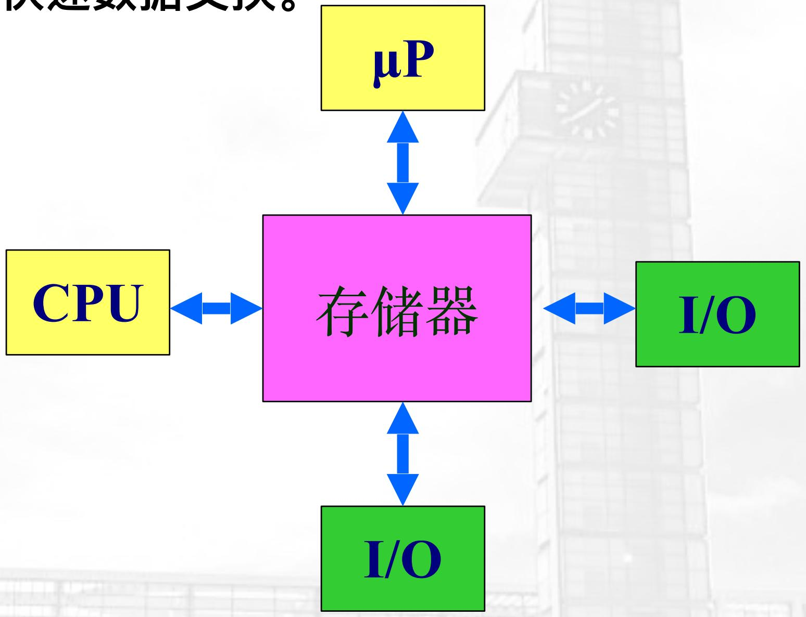

<details>
<summary>flowchart</summary>

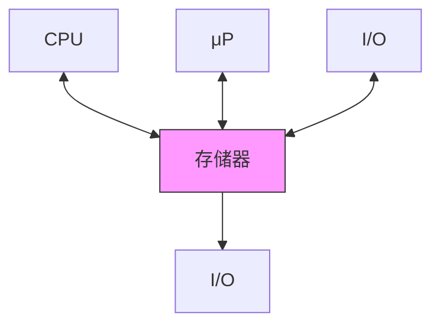
</details>

# 多端口存储器

# ■读/写操作

- 地址信号 $\Rightarrow \mathbf{AD}_0 \sim \mathbf{AD}_7$   
- $\overline{\mathbf{CS}}$ 下降沿锁存地址于芯片内部。

\- 在CS和OE同时为低电平时，相应地址单元中的内容被读出。

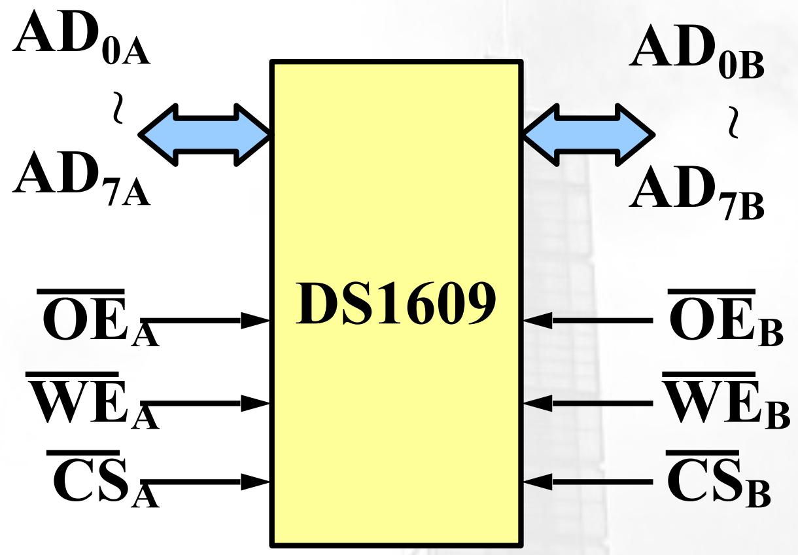

<details>
<summary>flowchart</summary>

```mermaid
graph LR
    A["AD0A"] --> B["DS1609"]
    C["AD7A"] <-- B
    D["OE_A"] --> B
    E["WE_A"] --> B
    F["CS_A"] --> B
    G["OE_B"] <-- B
    H["WE_B"] <-- B
    I["CS_B"] <-- B
    B --> J["AD0B"]
    B --> K["AD7B"]
```
</details>

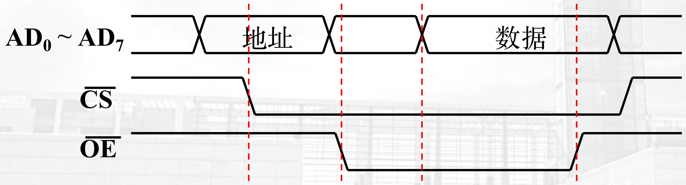

<details>
<summary>text_image</summary>

AD₀ ~ AD₇
地址
数据
CS
OE
</details>

# 多端口存储器

# ■读/写操作

\- 允许:

\- 对不同存储单元：

\- 同时读。

\- 同时写。

\- 对同一存储单元：

\- 同时读。

\- 一个端口写，另一端口读。

\- 不允许:

\- 两个端口同时对同一存储单元写数据

\- 消除竞争

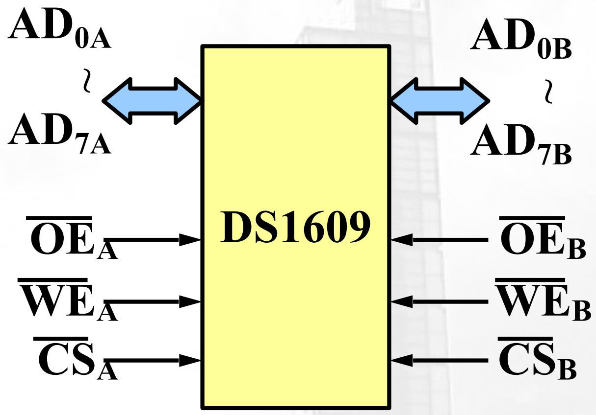

<details>
<summary>flowchart</summary>

```mermaid
graph LR
    A["AD0A"] --> B["DS1609"]
    C["AD7A"] <-- B
    D["OE_A"] --> B
    E["WE_A"] --> B
    F["CS_A"] --> B
    G["OE_B"] <-- B
    H["WE_B"] <-- B
    I["CS_B"] <-- B
    B --> J["AD0B"]
    B --> K["AD7B"]
```
</details>

# 多端口存储器

# ■竞争的消除

- 一边只写、一边只读  
信号灯

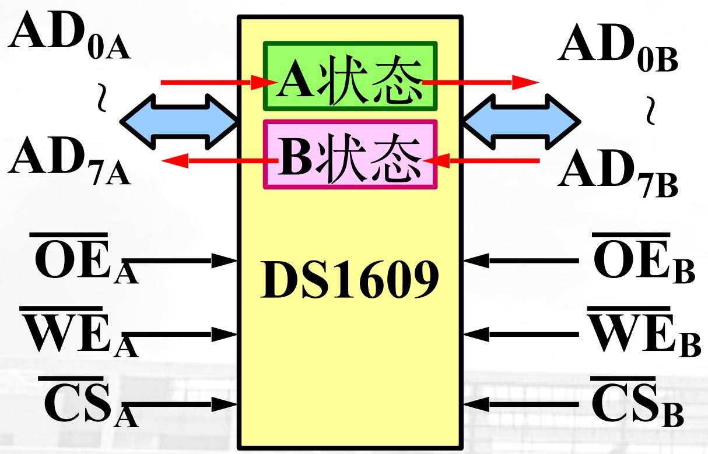

<details>
<summary>flowchart</summary>

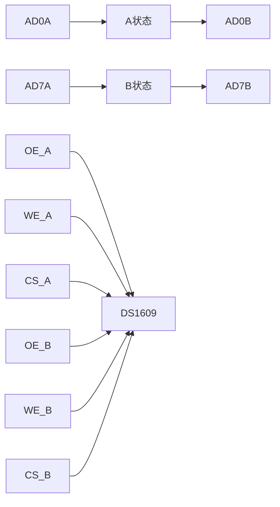
</details>

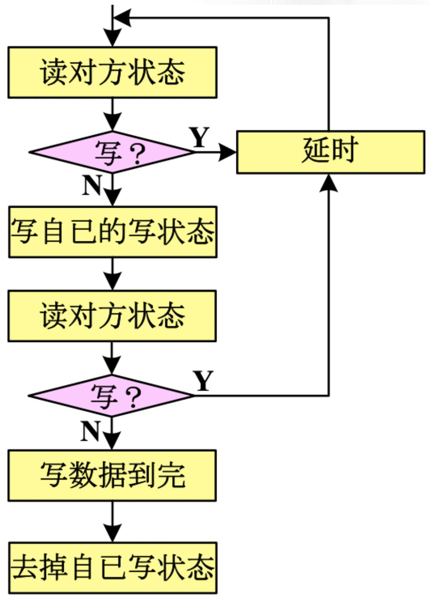

<details>
<summary>flowchart</summary>

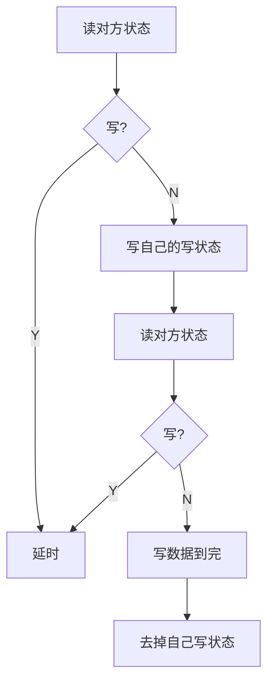
</details>

某一端口的写过程

# 多端口存储器

双端口存储器常用的场合：

■ CPU←→ DMA设备 或
CPU←→ IOP(IO处理机) }并行访问内存

■ 多机系统:


<details>
<summary>flowchart</summary>

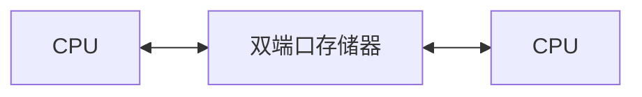
</details>

■ CPU内部：通用寄存器为运算器的两个输入端同时提供操作数。  
■ 多级存储体系：Cache采用双端口结构。


<details>
<summary>flowchart</summary>

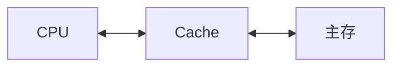
</details>

# 多体交叉存储器

仅靠一种工艺的单一存储器无法同时满足。

■ 多种不同工艺 → 存储体系

Cache，主存，辅存（系统结构）

速度、容量、价格

■ 并行存储系统（组成）

提高速度

并行主存系统：把主存储器分为多个存储体交叉或并行工作，在一个主存周期内能读写多个字。

# 多体交叉存储器

■ 多体交叉访问：  
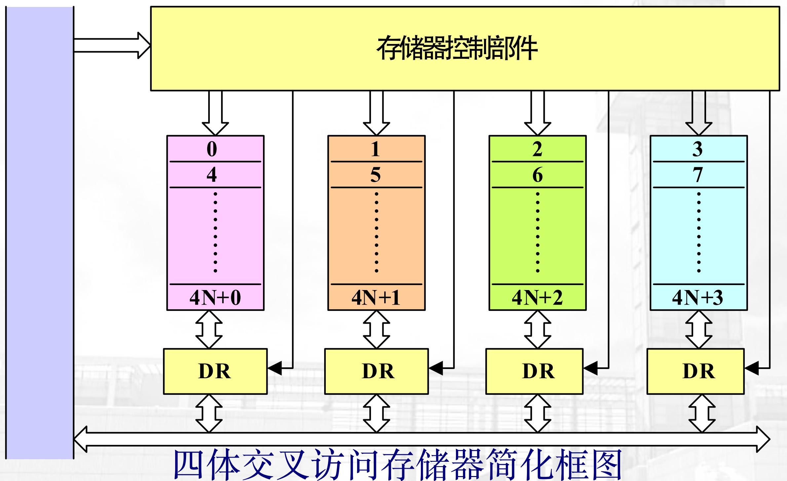

<details>
<summary>flowchart</summary>

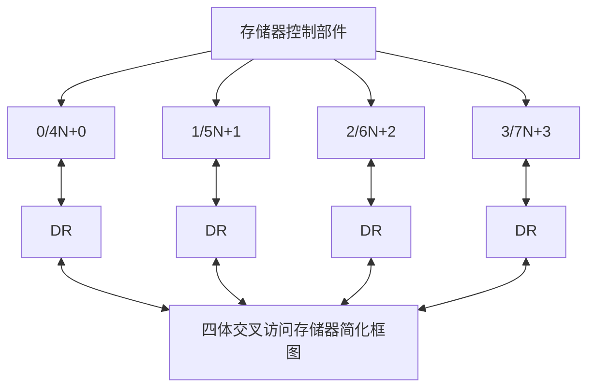
</details>

# 多体交叉存储器

连续读m个数据，需要的时间：T + (m - 1) · Δt

访问空间  
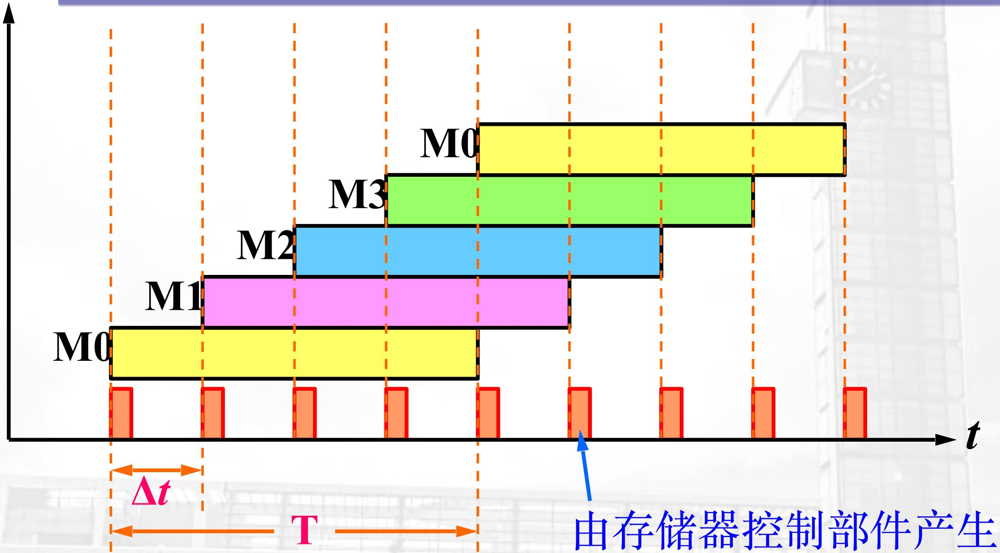

<details>
<summary>bar</summary>

| Time Segment | Phase | Value |
| ------------ | ----- | ----- |
| M0           | M0    | 1     |
| M0           | M1    | 2     |
| M0           | M2    | 3     |
| M0           | M3    | 4     |
</details>

$$
4 \cdot \Delta t \leq T
$$

四体存储器交叉访问示意图

# 相联存储器

相联存储器：

其中任一存储项内容作为地址来存取的存储器。

■ 格式：

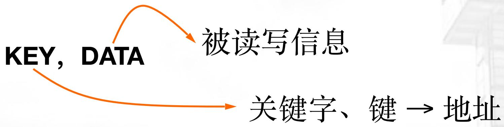

<details>
<summary>flowchart</summary>

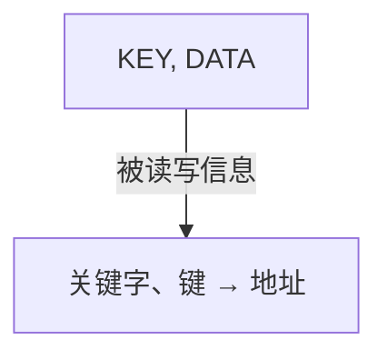
</details>

■ 原理：按内容访问

把存储单元所存内容的某一部分作为检索项(即关键字项)，去检索该存储器，并将存储器中与该检索项符合的存储单元内容进行读出或写入。

# 相联存储器

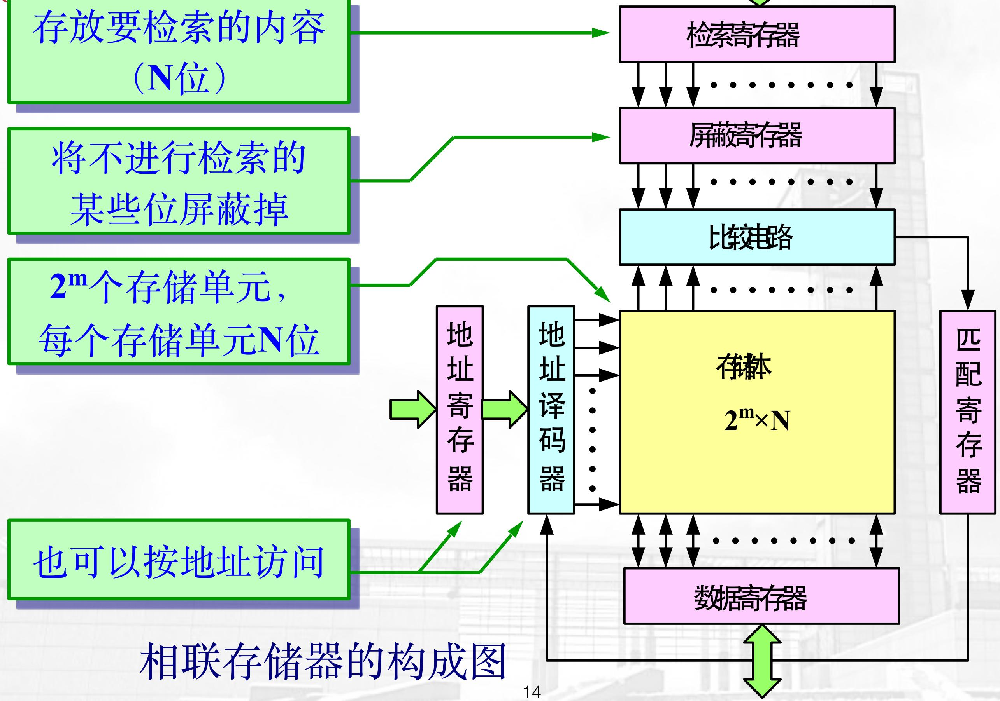

<details>
<summary>flowchart</summary>

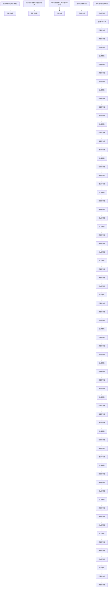
</details>

# 相联存储器

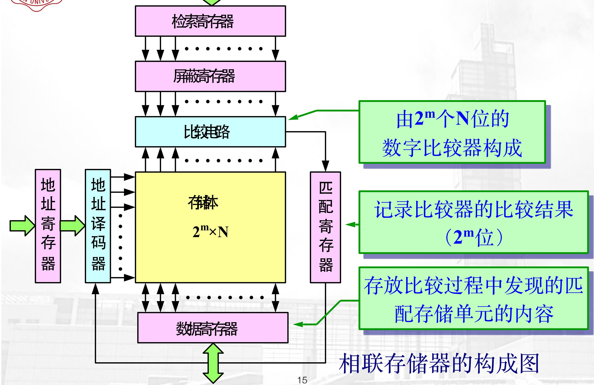

<details>
<summary>flowchart</summary>

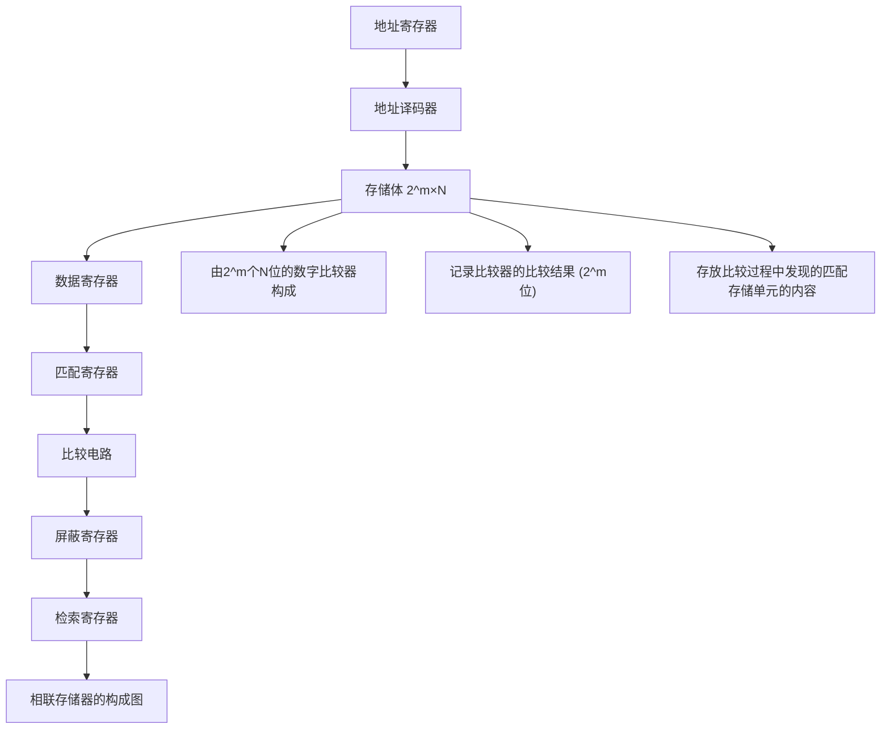
</details>

# 相联存储器

相联存储器的用途：

快速查找、地址变换

■ Cache: Cache的目录表  
■ 虚拟存储器：

页表，变换旁视缓冲器(TLB)

# So, Cache ...

# ■ Cache [kæʃ]

A hiding place used especially for storing provisions. 贮藏处，暗窖：一个隐秘的空间，尤指用于贮存预备货物

# ■ Cache

A cache memory is a small, temporary, but fast memory that the processor uses for information it is likely to need again in the very near future.

# All about Cache

• Why ?   
- 性能 & 结构两方面因素  
• Why it works?   
- 局部性  
- 存储系统  
• How it works?

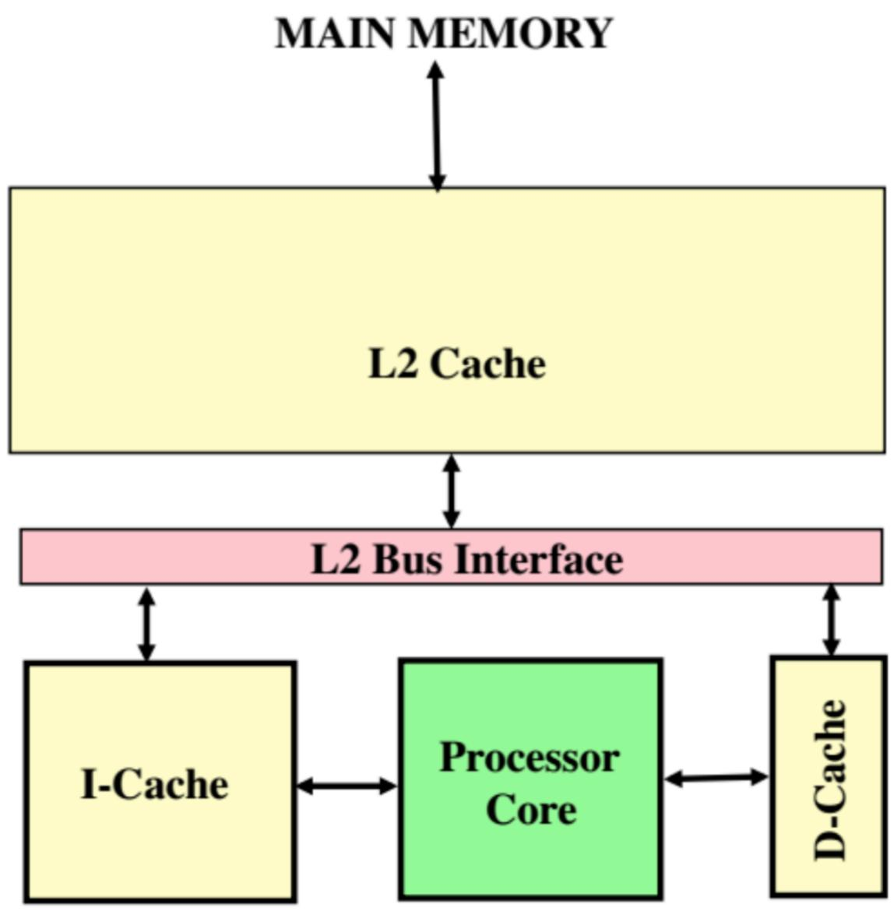

<details>
<summary>flowchart</summary>

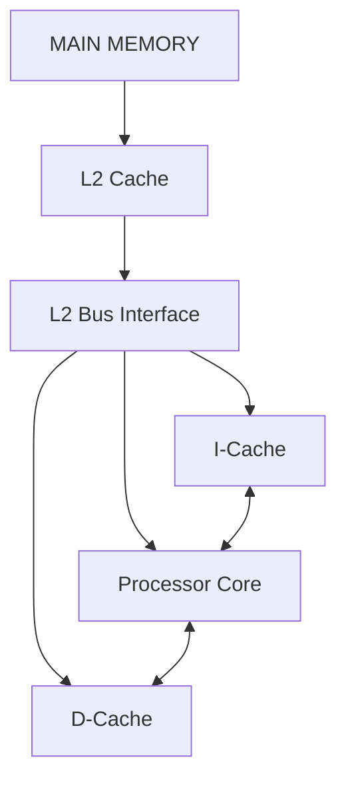
</details>

# Why Cache?

\- CPU性能在80386之后远超内存速度

• 10ns per instruction   
- 60-120ns per memory read

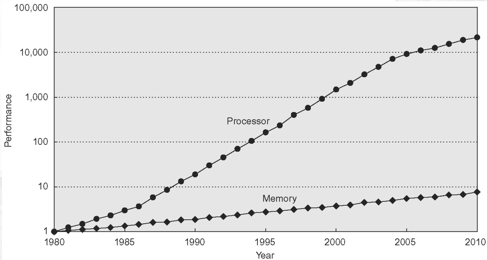

<details>
<summary>line</summary>

| Year | Processor | Memory |
|------|-----------|--------|
| 1980 | 1         | 1      |
| 1981 | 1.5       | 1.2    |
| 1982 | 2         | 1.5    |
| 1983 | 3         | 1.8    |
| 1984 | 4         | 2      |
| 1985 | 5         | 2.2    |
| 1986 | 7         | 2.5    |
| 1987 | 10        | 2.8    |
| 1988 | 15        | 3      |
| 1989 | 20        | 3.2    |
| 1990 | 30        | 3.5    |
| 1991 | 40        | 3.8    |
| 1992 | 50        | 4      |
| 1993 | 70        | 4.2    |
| 1994 | 100       | 4.5    |
| 1995 | 150       | 4.8    |
| 1996 | 200       | 5      |
| 1997 | 300       | 5.2    |
| 1998 | 400       | 5.5    |
| 1999 | 500       | 5.8    |
| 2000 | 700       | 6      |
| 2001 | 800       | 6.2    |
| 2002 | 900       | 6.5    |
| 2003 | 1000      | 6.8    |
| 2004 | 1200      | 7      |
| 2005 | 1500      | 7.2    |
| 2006 | 1800      | 7.5    |
| 2007 | 2000      | 7.8    |
| 2008 | 2500      | 8      |
| 2009 | 3000      | 8.2    |
| 2010 | 3500      | 8.5    |
</details>

# Why Cache?

# - 结构冲突

- 总线占用：CPU和I/O争抢内存访问   
- 访问冲突：指令预取与数据读写  
- 内存方面如何优化？

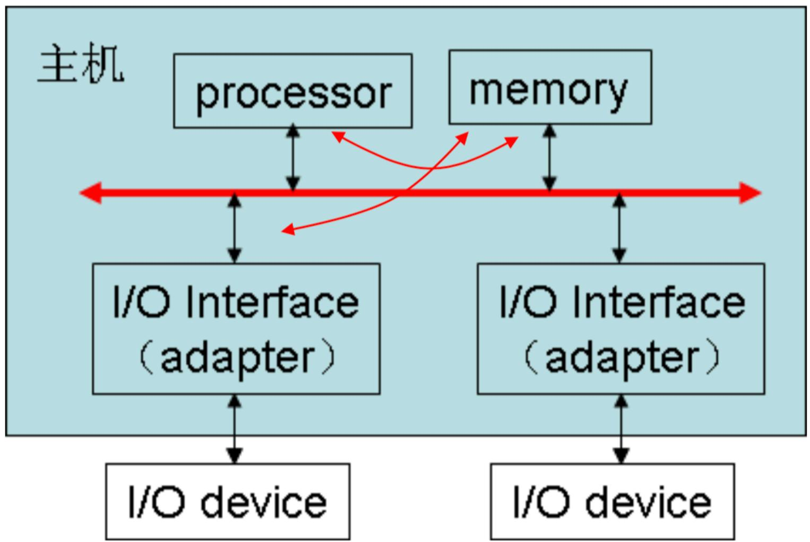

<details>
<summary>flowchart</summary>

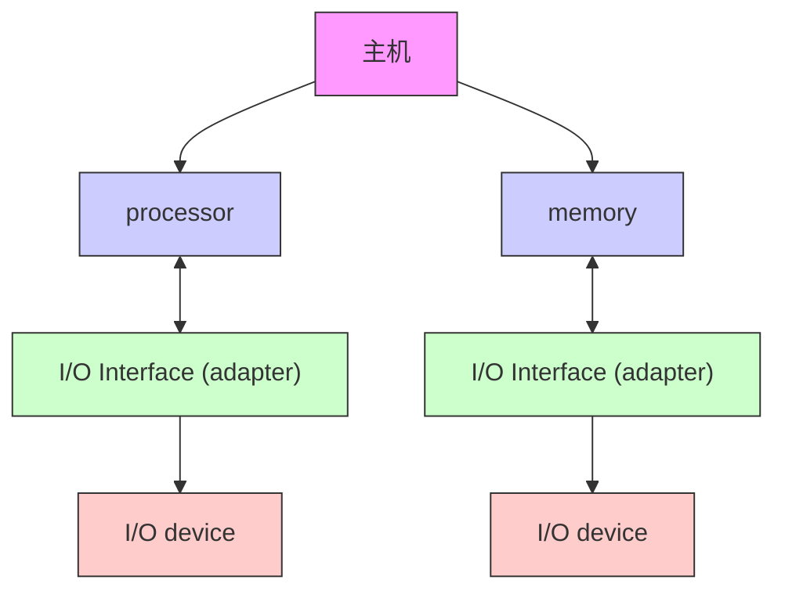
</details>

# Why Cache works?

# 主要依据：程序的局部性原理

两种可预测的主存访问性质（Two predictable properties of memory references）：

- 时间局部性：某位置若被访问，则近期内很可能又被访问。  
Temporal Locality: If a location is referenced it is likely to be referenced again in the near future.

\- 空间局部性：某位置若被访问，则临近的位置也可能被访问。

Spatial Locality: If a location is referenced it is likely that locations near it will be referenced in the near future.

```lisp
for (auto i = 0 ; i < 100; i++) {
array[i] = i;
} 
```

# 存储系统

# 存储系统

两个或两个以上速度、容量和价格各不相同的存储器用硬件、软件、或软件与硬件相结合的方法连接起来成为一个存储系统。

这个存储系统对应用程序员是透明的，并且，从应用程序员看，它是一个存储器，这个存储器的速度接近速度最快的那个存储器，存储容量与容量最大的那个存储器相等，单位容量的价格接近最便宜的那个存储器。

Cache存储系统：对系统程序员以上均透明

虚拟存储器系统：对应用程序员透明

# 存储系统

# 一般计算机系统中主要有两种存储系统：

Cache存储系统：由Cache和主存储器构成；主要目的是提高存储器速度。

虚拟存储系统：由主存储器和磁盘存储器构成；主要目的是扩大存储器容量。

# 存储系统

# 存储系统的多层次结构

cache-主存-辅存三级存储体系：三级存储层次

主存-辅存存储层次：大容量、低成本；

软硬件结合完成

cache-主存存储层次: 高速度、低成本;

纯硬件完成

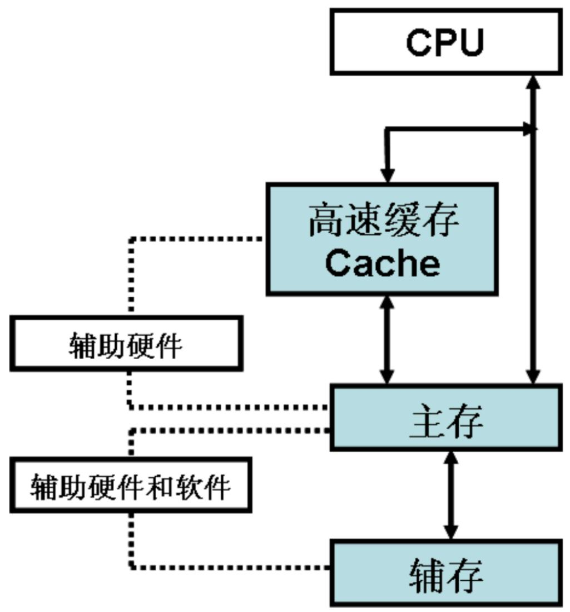

<details>
<summary>flowchart</summary>

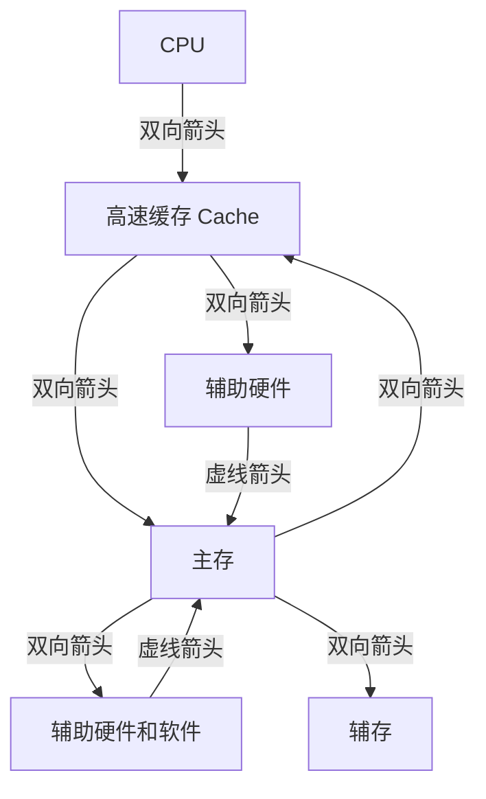
</details>

解决存储系统三个指标：容量、速度、价格/位的矛盾

# 存储系统

大型工作站、小型服务器中典型的存储层次结构

<table><tr><td>层次</td><td>1</td><td>2</td><td>3</td><td>4</td></tr><tr><td>名称</td><td>寄存器</td><td>Cache</td><td>内存</td><td>磁盘</td></tr><tr><td>典型容量</td><td>&lt; 1 KB</td><td>&lt; 16 MB</td><td>&lt; 512 GB</td><td>&gt;1 TB</td></tr><tr><td>实现技术</td><td>多端口定制存储器,CMOS</td><td>片内或片外,CMOS SRAM</td><td>CMOS DRAM</td><td>磁盘</td></tr><tr><td>访问时间(ns)</td><td>0.25 ~ 0.5</td><td>0.5 ~ 25</td><td>50 ~ 250</td><td>5,000,000</td></tr><tr><td>带宽(MB/sec)</td><td>50,000 ~ 500,000</td><td>5,000 ~ 20,000</td><td>2500 ~ 10000</td><td>50 ~ 500</td></tr><tr><td>管理</td><td>编译器</td><td>硬件</td><td>操作系统</td><td>操作系统/操作者</td></tr><tr><td>下一级</td><td>Cache</td><td>内存</td><td>磁盘</td><td>DVD-ROM 或 磁带</td></tr></table>

# How Cache works?

# How it works?

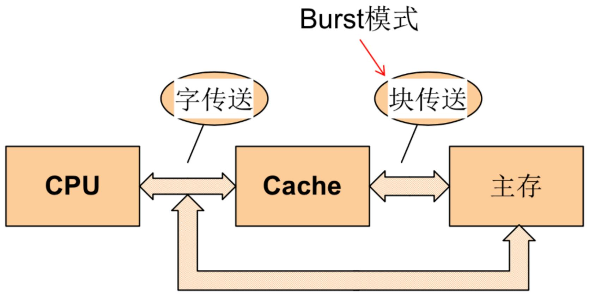

<details>
<summary>flowchart</summary>

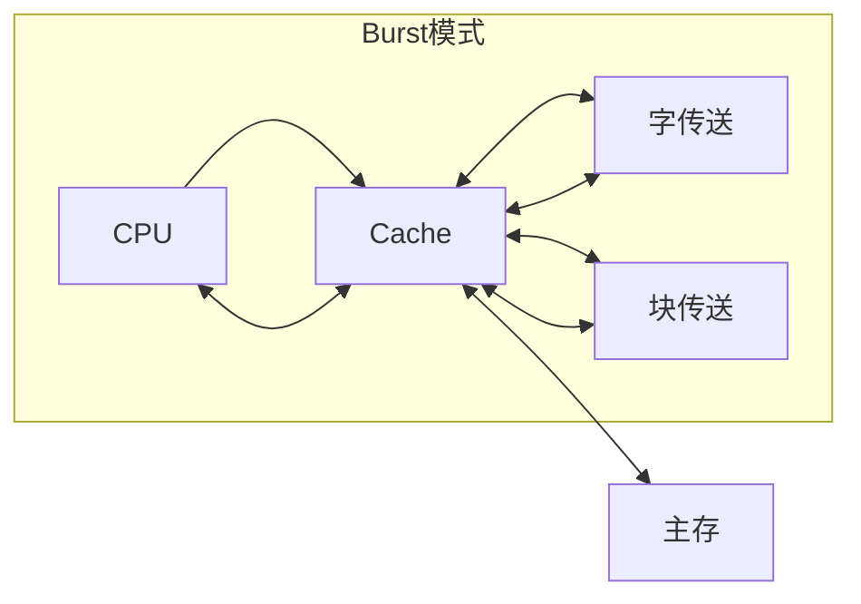
</details>

# 1. Cache的工作过程

- 整块缓存、单字输出  
- Cache-处理机通路

主存-处理机通路

\- 流水处理：地址变换、访问Cache


<details>
<summary>flowchart</summary>

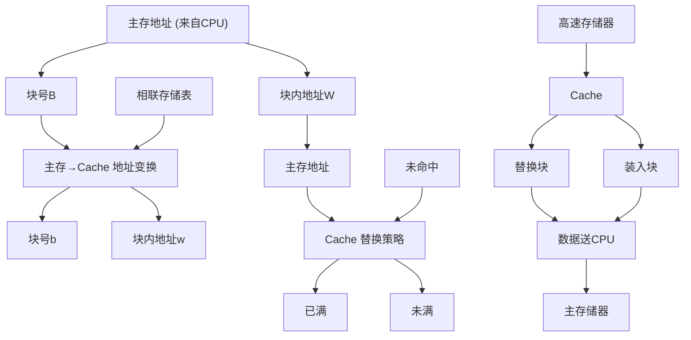
</details>

# 主存与Cache的地址映射

# ■ 第一步：地址映象：

把主存中的数据按照某种规则装入到Cache中，并建立主存地址与Cache地址之间的对应关系。

# ■ 第二步：地址变换：

当主存数据已经装入到Cache之后，在程序运行过程中，把主存地址变换成Cache地址。

# ■ 在选取地址映象方法要考虑的主要因素:

- 地址变换的硬件高速、低价、易于实现；  
- Cache空间利用率要高;  
- 发生块冲突的概率要小。

# ■ 以“块”为单位进行调度。

全相联  
- 直接映射  
组相联

# 全相联映射

# ■ 映射规则：

主存的任意一块可以映象到Cache中的任意一块。

# 全相联映射

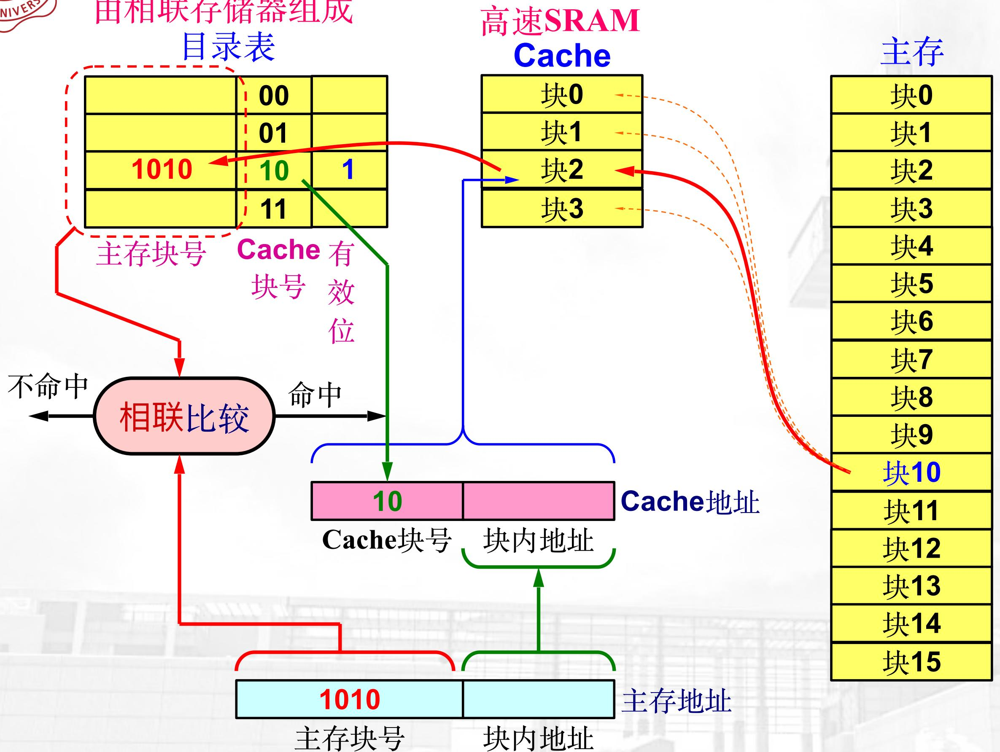

<details>
<summary>flowchart</summary>

```mermaid
graph TD
    A["目录表"] --> B["1010"]
    B --> C["主存块号 00"]
    B --> D["主存块号 01"]
    B --> E["主存块号 10"]
    B --> F["主存块号 11"]
    G["高速SRAM Cache"] --> H["块0"]
    G --> I["块1"]
    G --> J["块2"]
    G --> K["块3"]
    G --> L["块4"]
    G --> M["块5"]
    G --> N["块6"]
    G --> O["块7"]
    G --> P["块8"]
    G --> Q["块9"]
    G --> R["块10"]
    G --> S["块11"]
    G --> T["块12"]
    G --> U["块13"]
    G --> V["块14"]
    G --> W["块15"]
    X["主存"] --> Y["块0"]
    X --> Z["块1"]
    X --> AA["块2"]
    X --> AB["块3"]
    X --> AC["块4"]
    X --> AD["块5"]
    X --> AE["块6"]
    X --> AF["块7"]
    X --> AG["块8"]
    X --> AH["块9"]
    X --> AI["块10"]
    X --> AJ["块11"]
    X --> AK["块12"]
    X --> AL["块13"]
    X --> AM["块14"]
    X --> AN["块15"]
    AO["相联比较"] --> AP["命中"]
    AP --> AQ["10 Cache地址"]
    AQ --> AR["Cache块号"]
    AQ --> AS["Cache块内地址"]
    AR --> AT["主存块号 1010"]
    AR --> AU["主存块号 块内地址"]
    AV["主存块号 1010"] --> AW["不命中"]
    AX["主存块号 1010"] --> AY["主存块号 块内地址"]
```
</details>

# 全相联映射

# ■ 映射规则：

主存的任意一块可以映象到Cache中的任意一块。

# ■ 特点:

- 块冲突概率低，Cache空间利用率高。  
- 相联目录表容量大 $\rightarrow$ 成本高、查表速度慢。  
• why??

# 直接映射

■ 映射规则：主存的每一块只能映象到Cache的一个特定的块中。  
■ 整个Cache地址与主存地址的低位部分完全相同

# 直接映射

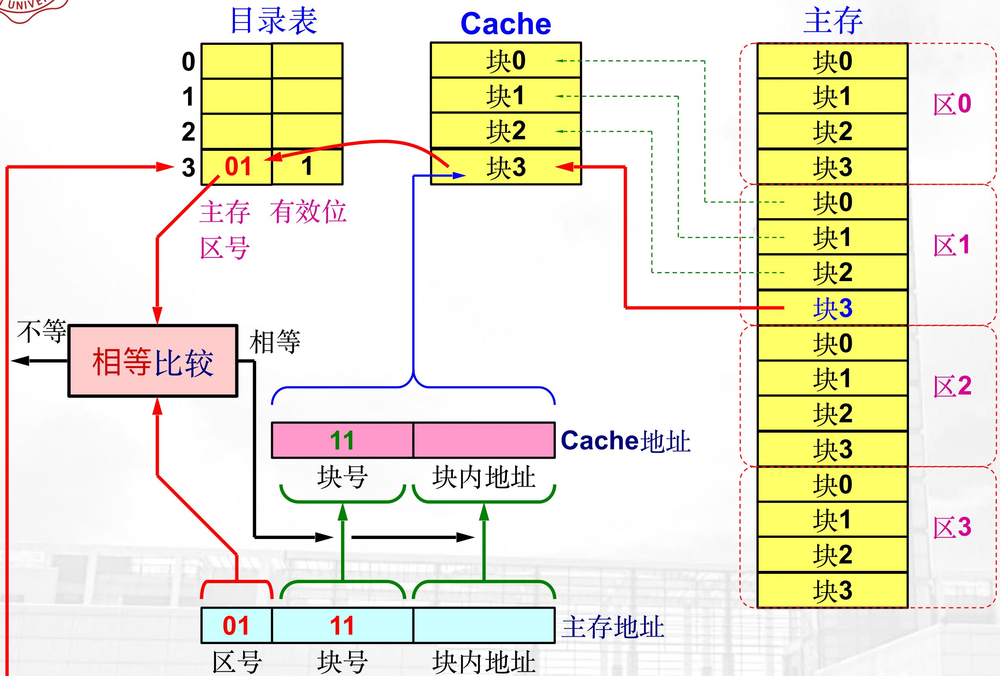

<details>
<summary>flowchart</summary>

```mermaid
graph TD
    A["目录表"] -->|01 1| B["Cache"]
    B -->|块0-3| C["主存"]
    C -->|块0-3| D["区0"]
    D --> E["主存地址"]
    E --> F[" Cache地址"]
    F --> G["主存地址"]
    G --> H["主存地址"]
    H --> I["主存地址"]
    I --> J["主存地址"]
    J --> K["主存地址"]
    K --> L["主存地址"]
    L --> M["主存地址"]
    M --> N["主存地址"]
    N --> O["主存地址"]
    O --> P["主存地址"]
    P --> Q["主存地址"]
    Q --> R["主存地址"]
    R --> S["主存地址"]
    S --> T["主存地址"]
    T --> U["主存地址"]
    U --> V["主存地址"]
    V --> W["主存地址"]
    W --> X["主存地址"]
    X --> Y["主存地址"]
    Y --> Z["主存地址"]
    Z --> AA["主存地址"]
    AA --> AB["主存地址"]
    AB --> AC["主存地址"]
    AC --> AD["主存地址"]
    AD --> AE["主存地址"]
    AE --> AF["主存地址"]
    AF --> AG["主存地址"]
    AG --> AH["主存地址"]
    AH --> AI["主存地址"]
    AI --> AJ["主存地址"]
    AJ --> AK["主存地址"]
    AK --> AL["主存地址"]
    AL --> AM["主存地址"]
    AM --> AN["主存地址"]
    AN --> AO["主存地址"]
    AO --> AP["主存地址"]
    AP --> AQ["主存地址"]
    AQ --> AR["主存地址"]
    AR --> AS["主存地址"]
    AS --> AT["主存地址"]
    AT --> AU["主存地址"]
    AU --> AV["主存地址"]
    AV --> AW["主存地址"]
    AW --> AX["主存地址"]
    AX --> AY["主存地址"]
    AY --> AZ["主存地址"]
    AZ --> BA["主存地址"]
    BA --> BB["主存地址"]
    BB --> BC["主存地址"]
    BC --> BD["主存地址"]
    BD --> BE["主存地址"]
    BE --> BF["主存地址"]
    BF --> BG["主存地址"]
    BG --> BH["主存地址"]
    BH --> BI["主存地址"]
    BI --> BJ["主存地址"]
    BJ --> BK["主存地址"]
    BK --> BL["主存地址"]
    BL --> BM["主存地址"]
    BM --> BN["主存地址"]
    BN --> BO["主存地址"]
    BO --> BP["主存地址"]
    BP --> BQ["主存地址"]
    BQ --> BR["主存地址"]
    BR --> BS["主存地址"]
    BS --> BT["主存地址"]
    BT --> BU["主存地址"]
    BU --> BV["主存地址"]
    BV --> BW["主存地址"]
```
</details>

# 直接映射

■ 映射规则：主存的每一块只能映象到Cache的一个特定的块中。  
■ 整个Cache地址与主存地址的低位部分完全相同。  
■ 优点:

\- 硬件简单，不需要相联存储器，只要

- 容量较小的按地址访问的区号标志表存储器；  
- 少量外比较电路。

\- 访问速度快（无需地址变换）。

■ 缺点：

- Cache块冲突概率高;   
- Cache空间利用率很低。

# 组相联映射

■ 目的：减小相联目录表的容量，降低成本，提高地址变换速度。  
■ 映射规则：将主存和Cache都机械等分成相同大小的块，并将主存空间按照Cache大小等分成区，再将Cache和主存中的每一区都等分成大小相同的组，让主存各区中的某组中的任何一块均可直接映象装入到Cache中对应组的任何一块上。

从主存的组到Cache的组之间采用直接映象方式，在两个对应的组内部采用全相联映象方式——组间直接，组内全相联。

# 组相联映射

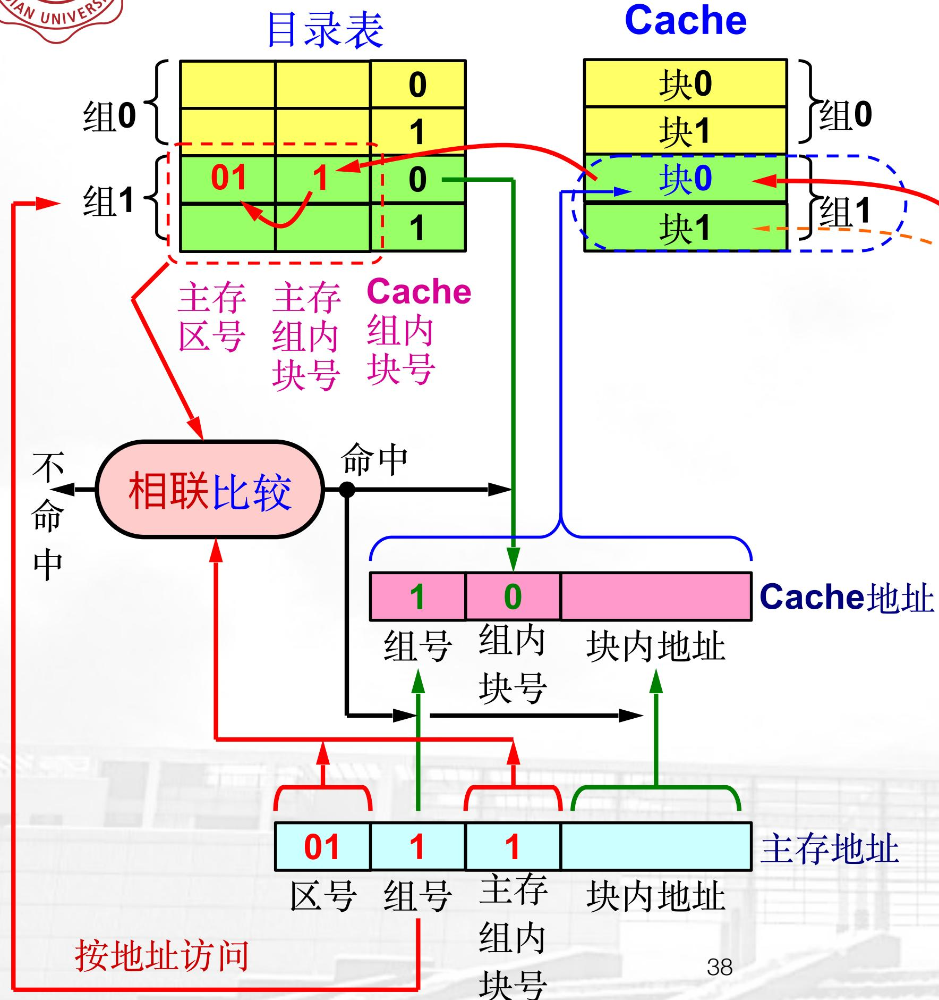

<details>
<summary>flowchart</summary>

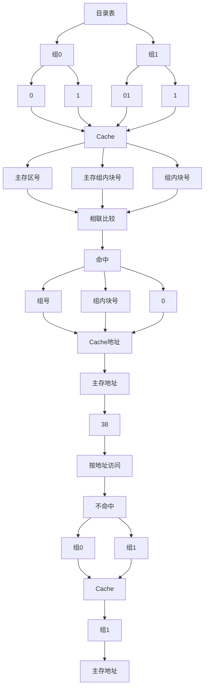
</details>

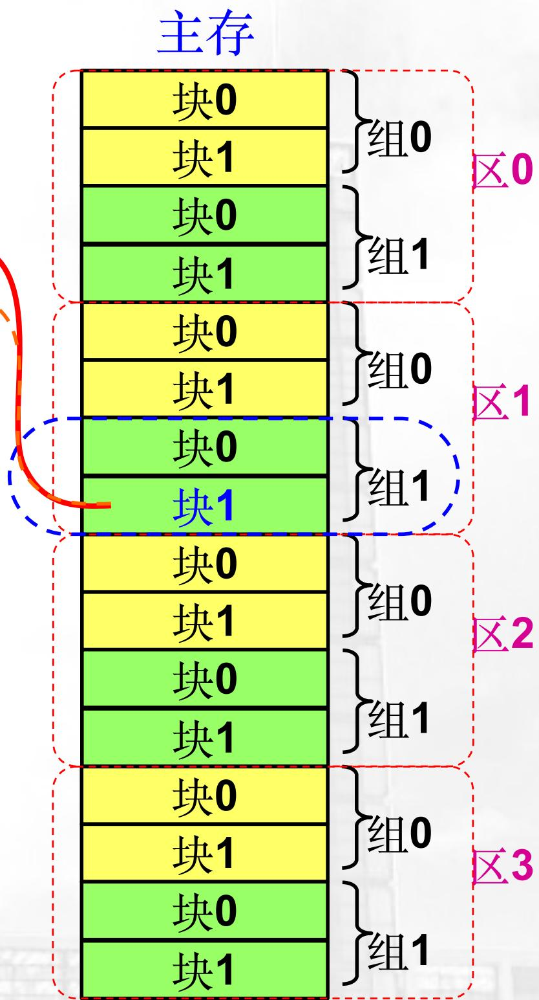

<details>
<summary>text_image</summary>

主存
块0
块1
块0
块1
块0
块1
块0
块1
块0
块1
块0
块1
块0
块1
块0
块1
块0
块1
组0
组1
组0
组1
组0
组1
区0
区1
区2
区3
</details>

# 组相联映射

# ■ 优点:

- 块的冲突概率比较低；  
- 块的利用率大幅度提高；  
- 块的失效率明显降低。

# ■ 缺点：

实现难度和造价比直接映射方式高。

# [例1] 直接映射方式的Cache，初始内容为空。

# Cache容量为2KB，以128B分块。主存容量为1MB，求：

(1) Cache分为多少块？Cache块号及块内地址各为多少位？为实现地址映像，主存地址应如何划分？  
(2) 主存中顺序排列的第129块（即若主存不分区，以第0块开始顺序排列时）内容调入到Cache的哪一块中？  
(3) 在上一步的基础上，读写主存地址328CBH时是否命中？

# 【解】

(1) Cache: 2KB/128B = 16块，主存8K块，共512个区。

19 11 10 7 6 0

<table><tr><td>主存区号(9位)</td><td>区内块号(4位)</td><td>块内地址(7位)</td></tr></table>

(2) $129 \div 16 = 8$ 余1，即主存第8区的第1块，因此应装入Cache的第1块。

(3) 虽然也对应Cache的第1块，但主存区号不同，不命中。

<table><tr><td>19</td><td>11</td><td>10</td><td>7</td><td>6</td><td>0</td></tr><tr><td colspan="2">0011 0010 1</td><td colspan="2">000 1</td><td colspan="2">100 1011</td></tr></table>

[例2] 组相连：主存1MB；Cache 2KB，128B为一块，一组2块。

→ Cache 16块，共8组；主存8K块，共512个区(每区8组)。

主存地址：40030H

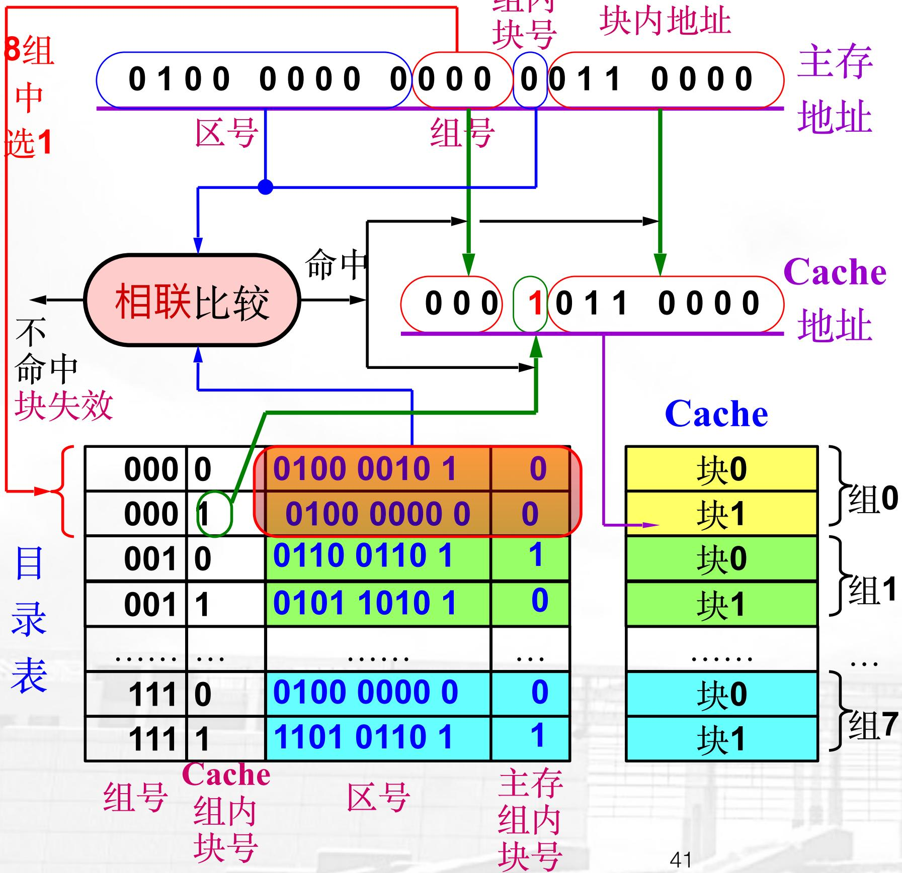

<details>
<summary>flowchart</summary>

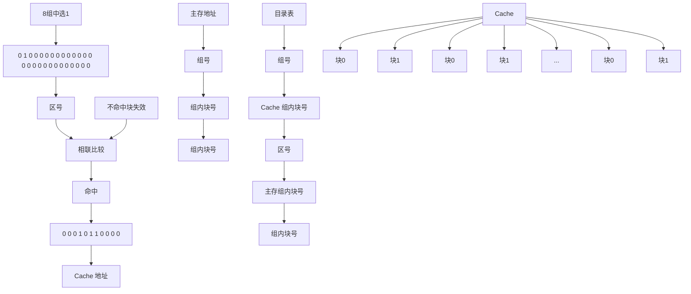
</details>

主存  
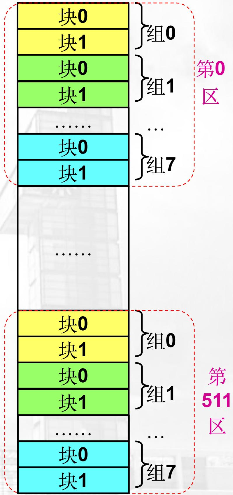

<details>
<summary>text_image</summary>

块0
块1
块0
块1
……
块0
块1
……
块0
块1
块0
块1
……
块0
块1
……
块0
块1
组0
组1
…
组7
第0区
第511区
</details>

[例3] 组相连：主存64MB；Cache 32KB，4KB为一块，一组4块。主存

→ Cache 8块，共2组；主存16K块，共2K个区(每区2组)。

主存地址：28B57A4H

主存

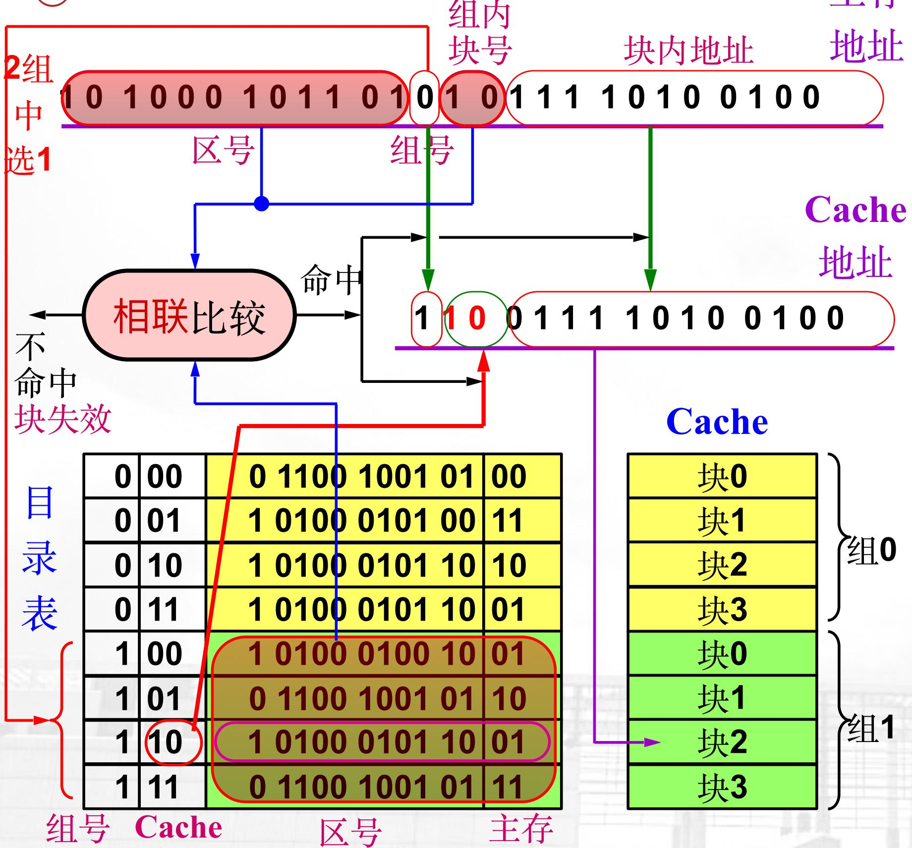

<details>
<summary>flowchart</summary>

```mermaid
graph TD
    A["相联比较"] -->|命中| B["组内块号"]
    A --> C["组内地址"]
    B --> D[" Cache 地址"]
    C --> D
    D --> E["主存"]
    F["目录表"] --> G["组号 Cache"]
    F --> H["组号 区号"]
    F --> I["组号 主存"]
    J["2组中选1"] --> K["10 100 0 101 1 01 01 01 01 1 1 1 1 0 1 0 0 1 0 0"]
    K --> L["区号"]
    L --> M["组号"]
    M --> N["11 0 0111 1010 0100"]
    N --> O["不命中块失效"]
    P["Cache"] --> Q["组0"]
    P --> R["组1"]
```
</details>

<table><tr><td>0</td><td>00</td><td>0 1100 1001 01</td><td>00</td></tr><tr><td>0</td><td>01</td><td>1 0100 0101 00</td><td>11</td></tr><tr><td>0</td><td>10</td><td>1 0100 0101 10</td><td>10</td></tr><tr><td>0</td><td>11</td><td>1 0100 0101 10</td><td>01</td></tr><tr><td>1</td><td>00</td><td>1 0100 0100 10</td><td>01</td></tr><tr><td>1</td><td>01</td><td>0 1100 1001 01</td><td>10</td></tr><tr><td>1</td><td>10</td><td>1 0100 0101 10</td><td>01</td></tr><tr><td>1</td><td>11</td><td>0 1100 1001 01</td><td>11</td></tr></table>

组号

Cache

组内块号

区号

主存

组内块号

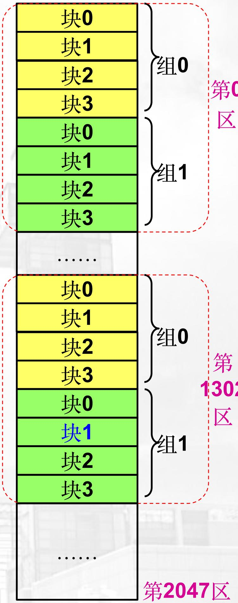

<details>
<summary>text_image</summary>

块0
块1
块2
块3
块0
块1
块2
块3
……
块0
块1
块2
块3
块0
块1
块2
块3
……
第2047区
组0
组1
组1
组0
第1302区
</details>

# 往年考题

# 四.（本题 15 分）某计算机系统的内存容量为 4GB, Cache 容量为 256KB, 均采用字节编址。Cache 与内存采用 8 路组相联映射, Cache 每块为 4KB。

请问：

1. 内存和 Cache 地址的各字段分别有多少位？  
2. 每次地址变换时，参与相联比较的位数是多少？  
3. 若当前地址变换表的部分有效内容如下（有效位为 1，表示 Cache 块有效）。当 CPU 访问内存地址分别为 01234567H 和 FEDCBA98H 时，请问是否能够命中，若命中则给出相应的 Cache 地址。

地址

000 000←

001 011

001 110

011 001

011 110

110 000

110 100

111 111

<table><tr><td>内存区号←</td><td>组内块号←</td><td>有效位←</td></tr><tr><td>0009 H←</td><td>000B←</td><td>1←</td></tr><tr><td>3FD7 H←</td><td>010B←</td><td>1←</td></tr><tr><td>2440 H←</td><td>101B←</td><td>1←</td></tr><tr><td>3FD7 H←</td><td>011B←</td><td>1←</td></tr><tr><td>076E H←</td><td>111B←</td><td>1←</td></tr><tr><td>0048 H←</td><td>100B←</td><td>1←</td></tr><tr><td>0009 H←</td><td>000B←</td><td>1←</td></tr><tr><td>0048 H←</td><td>100B←</td><td>1←</td></tr></table>

# 替换策略

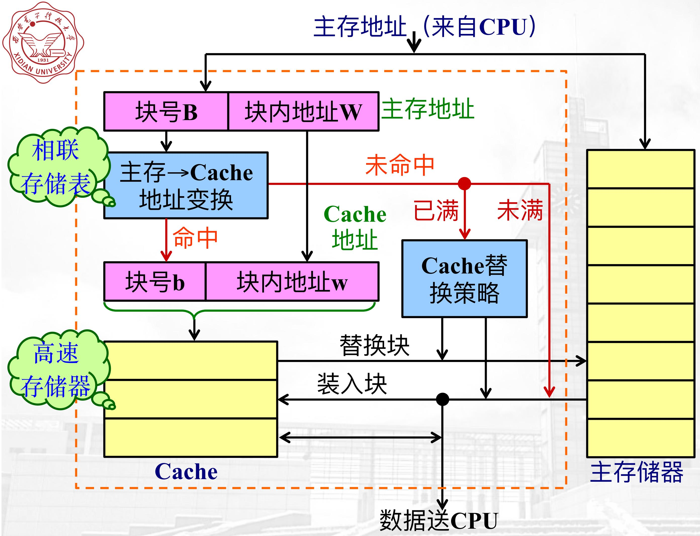

<details>
<summary>flowchart</summary>

```mermaid
graph TD
    A["主存地址 (来自CPU)"] --> B["块号B"]
    A --> C["块内地址W"]
    B --> D["主存→Cache 地址变换"]
    C --> E["主存地址"]
    D --> F["块号b"]
    D --> G["块内地址w"]
    E --> H["Cache 替换策略"]
    H --> I["已满"]
    H --> J["未满"]
    K["高速存储器"] --> L["Cache"]
    L --> M["替换块"]
    L --> N["装入块"]
    M --> O["数据送CPU"]
    N --> O
    O --> P["主存储器"]
    Q["相联存储表"] --> D
    R["未命中"] --> H
```
</details>

# 替换算法

直接映射的cache中，由于某个主存块只与一个cache字块有映射关系，因此替换策略很简单。而在全相连和组相连中，主存块可以写入cache中若干位置，这就有一个选择替换掉哪一个cache字块的问题，即所谓替换算法问题。

# 全相联、组相联：

■随机算法（RAND, Random Algorithm）  
■先进先出算法 (FIFO, First-in First-out Algorithm)

- 利用了历史信息  
- 没有反映局部性——最先调入的，可能也是要使用的。

■最不经常使用算法(LFU, Least Frequently Used Algorithm): 计数器位数多，实现困难。

■近期最少使用算法(LRU, Least Recently Used Algorithm): 多/少有/无。随机期法、定期法。  
■最佳替换算法(OPT, Optimal replacement algorithm, 作弊\~\~)

# 替换算法

FIFO策略

<table><tr><td>访问顺序</td><td>1</td><td>2</td><td>3</td><td>4</td><td>5</td><td>6</td><td>7</td><td>8</td></tr><tr><td>地址块号</td><td>2</td><td>11</td><td>2</td><td>9</td><td>7</td><td>6</td><td>4</td><td>3</td></tr><tr><td rowspan="4">块分配情况</td><td>2</td><td>2</td><td>2</td><td>2</td><td>2</td><td>6</td><td>6</td><td>6</td></tr><tr><td>-</td><td>11</td><td>11</td><td>11</td><td>11</td><td>11</td><td>4</td><td>4</td></tr><tr><td>-</td><td>-</td><td>-</td><td>9</td><td>9</td><td>9</td><td>9</td><td>3</td></tr><tr><td>-</td><td>-</td><td>-</td><td>-</td><td>7</td><td>7</td><td>7</td><td>7</td></tr><tr><td>操作状态</td><td>调进</td><td>调进</td><td>命中</td><td>调进</td><td>调进</td><td>替换</td><td>替换</td><td>替换</td></tr></table>

# 替换算法

FIFO策略导致的“颠簸” 

<table><tr><td>访问顺序</td><td>1</td><td>2</td><td>3</td><td>4</td><td>5</td><td>6</td><td>7</td><td>8</td></tr><tr><td>地址块号</td><td>2</td><td>11</td><td>9</td><td>7</td><td>6</td><td>2</td><td>11</td><td>9</td></tr><tr><td rowspan="4">块分配情况</td><td>2</td><td>2</td><td>2</td><td>2</td><td>6</td><td>6</td><td>6</td><td>6</td></tr><tr><td>-</td><td>11</td><td>11</td><td>11</td><td>11</td><td>2</td><td>2</td><td>2</td></tr><tr><td>-</td><td>-</td><td>9</td><td>9</td><td>9</td><td>9</td><td>11</td><td>11</td></tr><tr><td>-</td><td>-</td><td>-</td><td>7</td><td>7</td><td>7</td><td>7</td><td>9</td></tr><tr><td>操作状态</td><td>调进</td><td>调进</td><td>调进</td><td>调进</td><td>替换</td><td>替换</td><td>替换</td><td>替换</td></tr></table>

# 替换算法

LRU策略，将最近4次最少使用的块替换

<table><tr><td>访问顺序</td><td>1</td><td>2</td><td>3</td><td>4</td><td>5</td><td>6</td><td>7</td><td>8</td></tr><tr><td>地址块号</td><td>2</td><td>11</td><td>2</td><td>9</td><td>7</td><td>6</td><td>4</td><td>3</td></tr></table>

块分配情况

<table><tr><td>2</td><td>2</td><td>2</td><td>2</td><td>2</td><td>2*</td><td>4</td><td>4</td></tr><tr><td>-</td><td>11</td><td>11</td><td>11</td><td>11*</td><td>6</td><td>6</td><td>6</td></tr><tr><td>-</td><td>-</td><td>-</td><td>9</td><td>9</td><td>9</td><td>9*</td><td>3</td></tr><tr><td>-</td><td>-</td><td>-</td><td>-</td><td>7</td><td>7</td><td>7</td><td>7*</td></tr></table>

操作状态 调进 调进 命中 调进 调进 替换 替换 替换

# 替换算法

比较FIFO和LRU：Cache 3块，程序在内存中占5块，第一次执行。

<table><tr><td>时间</td><td>1</td><td>2</td><td>3</td><td>4</td><td>5</td><td>6</td><td>7</td><td>8</td><td>9</td><td>10</td><td>11</td><td>12</td></tr><tr><td>所执行程序块号</td><td>P2</td><td>P3</td><td>P2</td><td>P1</td><td>P5</td><td>P2</td><td>P4</td><td>P5</td><td>P3</td><td>P2</td><td>P5</td><td>P2</td></tr><tr><td rowspan="3">FIFO:命中率: $3/12 = 25\%$ </td><td>P2</td><td>P2</td><td>P2</td><td>P2</td><td>P5</td><td>P5</td><td>P5</td><td>P5</td><td>P3</td><td>P3</td><td>P3</td><td>P3</td></tr><tr><td></td><td>P3</td><td>P3</td><td>P3</td><td>P3</td><td>P2</td><td>P2</td><td>P2</td><td>P2</td><td>P2</td><td>P5</td><td>P5</td></tr><tr><td></td><td></td><td></td><td>P1</td><td>P1</td><td>P1</td><td>P4</td><td>P4</td><td>P4</td><td>P4</td><td>P4</td><td>P2</td></tr><tr><td rowspan="3">LRU:命中率: $5/12 = 42\%$ </td><td>P2</td><td>P2</td><td>P2</td><td>P2</td><td>P2</td><td>P2</td><td>P2</td><td>P2</td><td>P3</td><td>P3</td><td>P3</td><td>P3</td></tr><tr><td></td><td>P3</td><td>P3</td><td>P3</td><td>P5</td><td>P5</td><td>P5</td><td>P5</td><td>P5</td><td>P5</td><td>P5</td><td>P5</td></tr><tr><td></td><td></td><td></td><td>P1</td><td>P1</td><td>P1</td><td>P4</td><td>P4</td><td>P4</td><td>P2</td><td>P2</td><td>P2</td></tr></table>

# 替换算法

例：

假定程序在主存为5块，Cache 为3块。CPU执行程序的顺序为：P2、P3、P2、P1、P5、P2、P4、P5、P3、P2、P5、P2。画出FIFO算法和LRU算法的命中情况如图所示。

<table><tr><td>P2</td><td>P3</td><td>P2</td><td>P1</td><td>P5</td><td>P2</td><td>P4</td><td>P5</td><td>P3</td><td>P2</td><td>P5</td><td>P2</td></tr><tr><td>2</td><td>2</td><td>2</td><td>2</td><td>5</td><td>5</td><td>5</td><td>5</td><td>3</td><td>3</td><td>3</td><td>3</td></tr><tr><td></td><td>3</td><td>3</td><td>3</td><td>3</td><td>2</td><td>2</td><td>2</td><td>2</td><td>2</td><td>5</td><td>5</td></tr><tr><td></td><td></td><td></td><td>1</td><td>1</td><td>1</td><td>4</td><td>4</td><td>4</td><td>4</td><td>4</td><td>2</td></tr><tr><td></td><td></td><td>H</td><td></td><td></td><td></td><td></td><td>H</td><td></td><td>H</td><td></td><td></td></tr></table>

<table><tr><td>P2</td><td>P3</td><td>P2</td><td>P1</td><td>P5</td><td>P2</td><td>P4</td><td>P5</td><td>P3</td><td>P2</td><td>P5</td><td>P2</td></tr><tr><td>2</td><td>2</td><td>2</td><td>2</td><td>2</td><td>2</td><td>2</td><td>2</td><td>3</td><td>3</td><td>3</td><td>3</td></tr><tr><td></td><td>3</td><td>3</td><td>3</td><td>5</td><td>5</td><td>5</td><td>5</td><td>5</td><td>5</td><td>5</td><td>5</td></tr><tr><td></td><td></td><td></td><td>1</td><td>1</td><td>1</td><td>4</td><td>4</td><td>4</td><td>2</td><td>2</td><td>2</td></tr><tr><td></td><td></td><td>H</td><td></td><td></td><td>H</td><td></td><td>H</td><td></td><td></td><td>H</td><td>H</td></tr></table>

# 替换算法

三种Cache替换算法的比较:

<table><tr><td rowspan="3">Size</td><td colspan="9">Associativity</td></tr><tr><td colspan="3">Two-way</td><td colspan="3">Four-way</td><td colspan="3">Eight-way</td></tr><tr><td>LRU</td><td>Random</td><td>FIFO</td><td>LRU</td><td>Random</td><td>FIFO</td><td>LRU</td><td>Random</td><td>FIFO</td></tr><tr><td>16 KB</td><td>114.1</td><td>117.3</td><td>115.5</td><td>111.7</td><td>115.1</td><td>113.3</td><td>109.0</td><td>111.8</td><td>110.4</td></tr><tr><td>64 KB</td><td>103.4</td><td>104.3</td><td>103.9</td><td>102.4</td><td>102.3</td><td>103.1</td><td>99.7</td><td>100.5</td><td>100.3</td></tr><tr><td>256 KB</td><td>92.2</td><td>92.1</td><td>92.5</td><td>92.1</td><td>92.1</td><td>92.5</td><td>92.1</td><td>92.1</td><td>92.5</td></tr></table>

Data cache misses per 1000 instructions comparing least-recently used, random, and first in, first out replacement for several sizes and associativities. There is little difference between LRU and random for the largest size cache, with LRU outperforming the others for smaller caches. FIFO generally outperforms random in the smaller cache sizes. These data were collected for a block size of 64 bytes for the Alpha architecture using 10 SPEC2000 benchmarks. Five are from SPECint2000 (gap, gcc, gzip, mcf, and perl) and five are from SPECfp2000 (applu, art, equake, lucas, and swim).

# 数据来源于

《Computer Architecture: A Quantitative Approach》 Fourth Edition
John L. Hennessy, David A. Patterson

# Cache/内存一致性问题

# Cache/内存一致性问题

- 读数据是否存在一致性问题？  
- 写数据如何保持Cache/Memory一致?  
- 两种策略:

- 写回法(Write Back)   
- 全写法(Write Through)

# Cache/内存一致性问题

\- 写回法 (Write Back)

\- 当CPU写Cache命中时，只将数据写入Cache，不立即写入主存。只有当被修改的Cache块被替换时才写回主存中。

\- 当CPU写Cache未命中时，则写修改是将相应主存块调入Cache之后，在Cache中进行。对主存的修改仍留待该块替换出去时进行。

\- 用修改位(Dirty Bit)，追踪是否被CPU修改过。

# Cache/内存一致性问题

\- 全写法（Write Through）

- 当Cache命中时，在将数据写入修改Cache的同时写入修改主存，较好地保证了主存与Cache内容的一致性。  
- 当Cache未命中，直接向主存进行写入。这时可以采用两种方式进行处理：

• What a simple solution?!

# Cache/内存一致性问题

\- 全写法 (Write Through)

\- Cache 和内存速度不一致如何解决?

\- 速度不够Buffer凑!

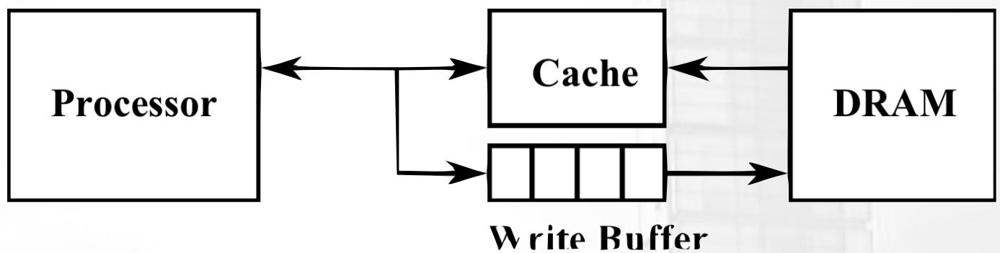

<details>
<summary>flowchart</summary>

```mermaid
graph LR
    A["Processor"] <--> B["Cache"]
    B <--> C["DRAM"]
    B --> D["Write Buffer"]
    D --> B
```
</details>

\- 但貌似还有问题....

\- 谁把Buffer数据搬到内存？

\- 加个控制器让内存主动取回来...

# Cache/内存一致性问题

\- 但貌似还有问题....

\- 谁把Buffer数据搬到内存？

\- 加个控制器让内存主动取回来...

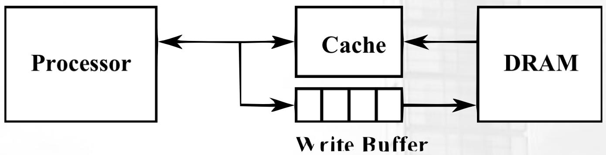

<details>
<summary>flowchart</summary>

```mermaid
graph LR
    A["Processor"] --> B["Cache"]
    B --> C["DRAM"]
    B --> D["Write Buffer"]
    D --> B
    A <--> B
    A <--> D
```
</details>

\- 但貌似还有！问题....

\- Buffer会不会爆掉?

\- 加2级Cache!

竞猜：L2 Cache的写策略是？

回写法(Write Back)!


<details>
<summary>flowchart</summary>

```mermaid
graph LR
    A["Processor"] --> B["Cache"]
    A --> C["Write Buffer"]
    B --> D["L2 Cache"]
    C --> D
    D --> E["DRAM"]
    style A fill:#f9f,stroke:#333
    style B fill:#ccf,stroke:#333
    style C fill:#cfc,stroke:#333
    style D fill:#fcc,stroke:#333
    style E fill:#cff,stroke:#333
```
</details>

# 7.3.3 主存与Cache内容的一致性问题

采用Cache的访存操作

<table><tr><td>Cache类型</td><td>操作</td><td>访存操作</td><td>访存时间</td></tr><tr><td rowspan="4">写直达Cache</td><td>读命中</td><td>只读Cache</td><td> $T_{C}$ </td></tr><tr><td>写命中</td><td>写Cache,同时写内存</td><td> $T_{C}(隐藏T_{M})$ </td></tr><tr><td>读不命中</td><td>调入Cache块,再读Cache</td><td> $T_{B}+T_{C}$ </td></tr><tr><td>写不命中</td><td>只写内存</td><td> $T_{M}$ </td></tr><tr><td rowspan="4">写回Cache</td><td>读命中</td><td>只读Cache</td><td> $T_{C}$ </td></tr><tr><td>写命中</td><td>只写Cache</td><td> $T_{C}$ </td></tr><tr><td>读不命中</td><td>调入Cache块,再读Cache</td><td> $T_{B}+T_{C}$ </td></tr><tr><td>写不命中</td><td>调入Cache块,再写Cache</td><td> $T_{B}+T_{C}$ </td></tr></table>

# Cache性能分析与优化

# Cache性能分析与优化

- Cache命中(Hit)   
- CPU欲访问的数据已在缓存中，即可直接访问 Cache  
- Cache非命中(Miss)   
- 数据不在Cache，需要将主存数据调入Cache  
- CPU被阻塞(Blocking)，等!  
- 命中率(Hit Rate)   
- 非命中率(Miss Rate)

# Cache性能分析:Miss的分类4C

# - Miss的4种类型(4C):

- Compulsory (必然)   
- 冷启动、过程转移、首次引用等不可避免的miss...

\- Capacity (容量)

\- 容量不够造成的

\- Conflict (冲突)

\- Cache块冲突

- 方案1：增加容量  
- 方案2：提升相联度

\- Coherence（相关）

\- 其它操作带来的结构相关（I/O操作等）

# Cache性能分析:Miss的分类4C

- Conflict Miss随容量提升而降低   
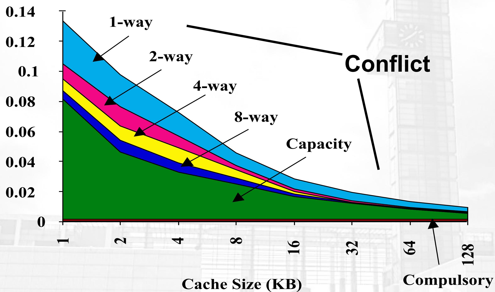

<details>
<summary>area</summary>

| Cache Size (KB) | 1-way  | 2-way  | 4-way  | 8-way  | Capacity |
| --------------- | ------ | ------ | ------ | ------ | -------- |
| 1               | 0.135  | 0.105  | 0.095  | 0.085  | 0.085    |
| 2               | 0.115  | 0.085  | 0.075  | 0.065  | 0.065    |
| 4               | 0.095  | 0.065  | 0.055  | 0.045  | 0.045    |
| 8               | 0.075  | 0.045  | 0.035  | 0.025  | 0.025    |
| 16              | 0.055  | 0.025  | 0.02   | 0.015  | 0.015    |
| 32              | 0.035  | 0.015  | 0.01   | 0.008  | 0.008    |
| 64              | 0.02   | 0.01   | 0.008  | 0.005  | 0.005    |
| 128             | 0.01   | 0.005  | 0.005  | 0.003  | 0.003    |
</details>

# Cache性能分析:Miss的分类4C

\- 多路组相联明显降低miss rate

\- 相同的miss rate，1-way组相联(直接映射)需要2倍的Cache size才能达到2-way组相联水平

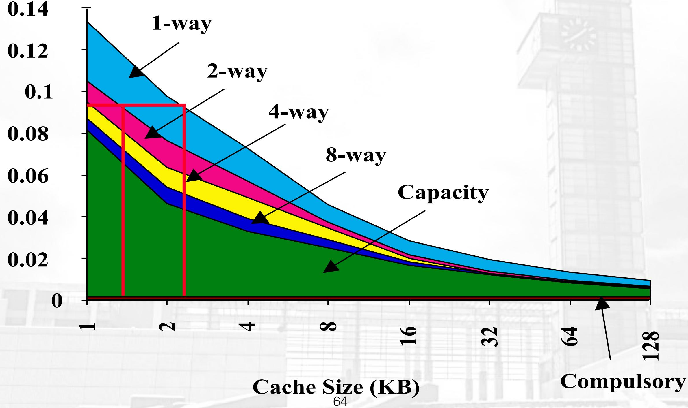

<details>
<summary>area</summary>

| Cache Size (KB) | 1-way  | 2-way  | 4-way  | 8-way  | Capacity |
| --------------- | ------ | ------ | ------ | ------ | -------- |
| 1               | 0.135  | 0.095  | 0.075  | 0.055  | 0.085    |
| 2               | 0.115  | 0.085  | 0.065  | 0.045  | 0.075    |
| 4               | 0.095  | 0.075  | 0.055  | 0.035  | 0.065    |
| 8               | 0.075  | 0.065  | 0.045  | 0.025  | 0.055    |
| 16              | 0.055  | 0.050  | 0.035  | 0.015  | 0.045    |
| 32              | 0.035  | 0.035  | 0.025  | 0.010  | 0.035    |
| 64              | 0.025  | 0.025  | 0.015  | 0.005  | 0.025    |
| Compulsory      | -      | -      | -      | -      | -        |
| Total           | -      | -      | -      | -      | -        |
</details>

# Cache性能分析:Miss的分类4C

- 3种miss的比例  
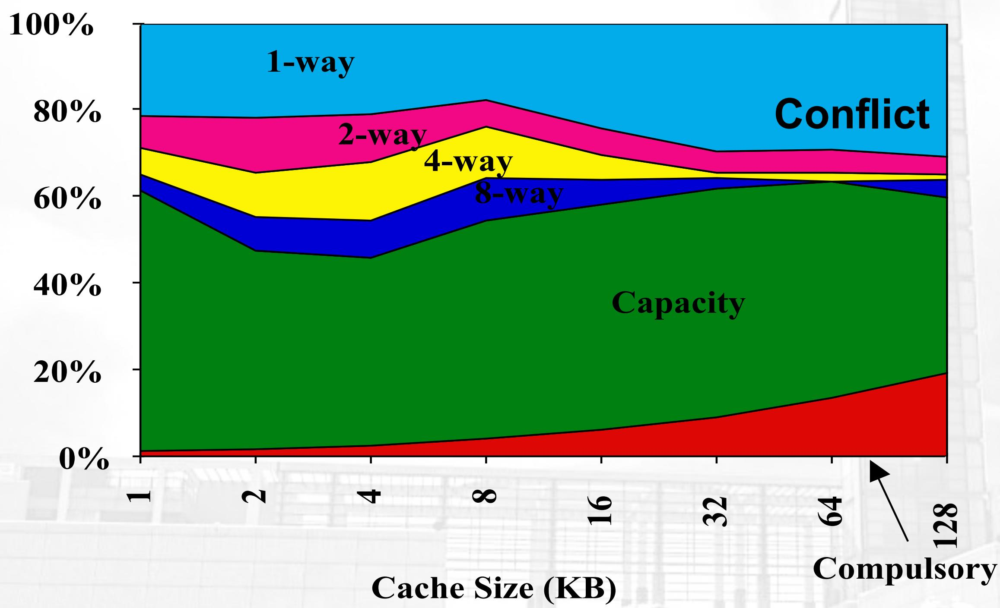

<details>
<summary>area_stacked</summary>

| Cache Size (KB) | 1-way | 2-way | 4-way | 8-way | Conflict |
| --------------- | ----- | ----- | ----- | ----- | -------- |
| 1               | ~65%  | ~10%  | ~10%  | ~10%  | ~10%     |
| 2               | ~50%  | ~15%  | ~15%  | ~15%  | ~15%     |
| 4               | ~45%  | ~15%  | ~20%  | ~20%  | ~20%     |
| 8               | ~55%  | ~10%  | ~25%  | ~25%  | ~25%     |
| 16              | ~60%  | ~5%   | ~20%  | ~30%  | ~30%     |
| 32              | ~65%  | ~5%   | ~10%  | ~35%  | ~35%     |
| 64              | ~70%  | ~5%   | ~5%   | ~40%  | ~40%     |
| 128             | ~75%  | ~5%   | ~5%   | ~45%  | ~45%     |
</details>

# Cache性能分析与优化

# 1. 加速比

■ Cache-主存系统的平均访问周期T:

$$
\mathsf {T} = \mathsf {H} \times \mathsf {T C} + (1 - \mathsf {H}) \times (\mathsf {T B} + \mathsf {T C})
$$

$$
T = T C + (1 - H) * T B
$$

\- Cache的访问周期为TC，主存的访问周期为TM，数据块调入
- Cache的块传输时间为TB，Cache的命中率为H。

■ Cache-主存系统的加速比SP: SP=TM/T <- (Old duration / new)

# Cache性能分析与优化

例如，设Cache的速度是主存的5倍，命中率为 $95\%$ ，则采用Cache后性能提升多少？

系统平均访问时间 $= t + 0.05^{*}5t = 1.25t$

性能提升=5t/1.25t=4倍

# Cache性能分析与优化

\- 如何提升Cache性能?

- 容量  
- 块数/块大小   
- 多路组相联  
- 多级Cache  
- Victim Cache   
- 代码层面  
●
...

\- 指令/数据独立Cache

# Cache性能分析与优化

# 优化方案1：提升Cache容量

- 边际效率降低   
- 成本问题...  
- 制成/热设计...

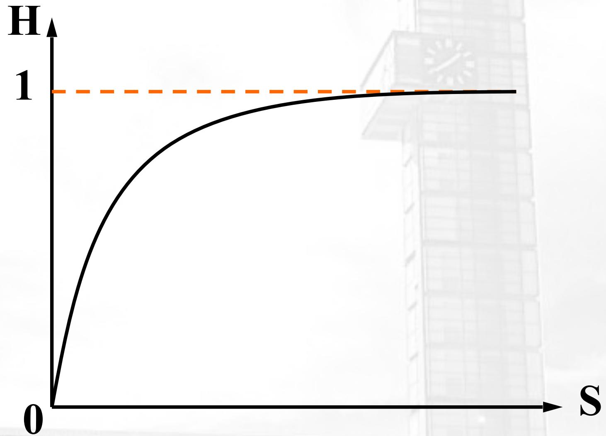

<details>
<summary>line</summary>

| S    | H   |
| ---- | --- |
| 0    | 0   |
| >0   | 1   |
</details>

Cache容量S与命中率H的关系

# Cache性能分析与优化

# 存储系统成本


<details>
<summary>text_image</summary>

■ C = (C1×S1 + C2×S2)/(S1 + S2)
主存价格 ↑
主存容量 ↑
Cache容量
Cache价格
</details>

S1>>S2

■ 尽管Cache的价格比主存高，但是当其容量很小时，存储器的平均价格C接近于主存的价格。  
■ 由于设置了Cache使CPU的访存速度接近Cache的速度，而使存储器的成本接近于主存的价格。

# Cache性能分析与优化

优化方案2：利用时空局部性原理，通过提升块大小，降低miss

rate   
Miss Rate   


<details>
<summary>line</summary>

| x    | Series 1 | Series 2 | Series 3 | Series 4 | Series 5 |
| ---- | -------- | -------- | -------- | -------- | -------- |
| 16   | 15%      | 8.5%     | 4%       | 2%       | 1%       |
| 32   | 13.5%    | 7%       | 3%       | 1.5%     | 0.5%     |
| 64   | 13.8%    | 7%       | 3%       | 1%       | 0.5%     |
| 128  | 16.5%    | 7.5%     | 3%       | 1%       | 0.5%     |
| 256  | 22%      | 9.5%     | 3.5%     | 1%       | 0.5%     |
</details>

Block Size (bytes)

Size of Cache   


<details>
<summary>bar</summary>

| Temperature (K) | Value |
| :--- | :--- |
| 1K | Red |
| 4K | Green |
| 16K | Blue |
| 64K | Yellow |
| 256K | Pink |
</details>

# Cache性能分析与优化

优化方案2：利用时空局部性原理，通过提升块大小，降低miss rate

- 降低Compulsory必然miss rate   
- 但太大的块有缺点

- miss的代价大;   
- Conflict冲突导致的miss高

\- 总结，差不多大就得了。

# Cache性能分析与优化

# 优化方案3：提升组相联级别

\- 级别高一些，还是好的...

\- 2:1规则，2路组相联只需要一半的Cache容量就可以达到1路组相联同等的miss rate/hit rate

\- 但级别提升的边际效率在下降

\- 级别也不要太高

- 相联比较复杂  
- 相联存取复杂->提高TC时间


<details>
<summary>area</summary>

| Step | 1-way | 2-way | 4-way | 8-way |
| ---- | ----- | ----- | ----- | ----- |
| 1    | 0.135 | 0.105 | 0.095 | 0.085 |
| 2    | 0.115 | 0.085 | 0.075 | 0.065 |
| 4    | 0.085 | 0.065 | 0.055 | 0.045 |
| 8    | 0.055 | 0.045 | 0.035 | 0.025 |
| 16   | 0.035 | 0.025 | 0.015 | 0.010 |
</details>

Cache Size (KB)

# Cache性能分析与优化

\- 例如一组典型数据...

Cache Size Associativity 

<table><tr><td>(KB)</td><td colspan="2">1-way</td><td colspan="2">2-way</td><td>4-way</td><td>8-way</td></tr><tr><td>1</td><td>7.65</td><td>6.60</td><td>6.22</td><td>5.44</td><td></td><td></td></tr><tr><td>2</td><td>5.90</td><td>4.90</td><td>4.62</td><td>4.09</td><td></td><td></td></tr><tr><td>4</td><td>4.60</td><td>3.95</td><td>3.57</td><td>3.19</td><td></td><td></td></tr><tr><td>8</td><td>3.30</td><td>3.00</td><td>2.87</td><td>2.59</td><td></td><td></td></tr><tr><td>16</td><td>2.45</td><td>2.20</td><td>2.12</td><td>2.04</td><td></td><td></td></tr><tr><td>32</td><td>2.00</td><td>1.80</td><td>1.77</td><td>1.79</td><td></td><td></td></tr><tr><td>64</td><td>1.70</td><td>1.60</td><td>1.57</td><td>1.59</td><td></td><td></td></tr><tr><td>128</td><td>1.50</td><td>1.45</td><td>1.42</td><td>1.44</td><td></td><td></td></tr></table>

红色说明8路组相联已经没有性能提升

# Cache性能分析与优化

# 优化方案4：多级Cache

■ 两级Cache的总未命中率(总失效率): 总失效率 = (失效率) 第一级 × (失效率) 第二级…… × (失效率) 第N级  
■ 【例】10000次访存，第一级Cache失效400次，第二级Cache失效4次。

- (失效率)第一级 $= 400 / 10000 = 4\%$   
- (失效率) $_{第二级}$ =4/400=1%   
- 利用两级Cache后总的失效率 $= 0.04\%$ 。

# Cache性能分析与优化

# 5. 多级Cache的命中率

【例】访问内存需50ns, L1 1ns 10%失效率, L2 5ns 1%失效率, L3 10ns 0.2%失效率, 求L1, L1+L2, L1+L2+L3构架下的平均访问时间。

$$
\mathrm{L1:} \qquad \mathrm{T=1ns+(0.1\times50ns)=6ns}
$$

$$
\mathrm{L1+2:} \quad \mathrm{T=1ns+(0.1\times[5ns+(0.01\times50ns)])=1.55ns}
$$

$$
\mathrm{L1+2+3:T=1ns+(0.1\times[5ns+(0.01\times[10ns+(0.002\times50ns)])])=1.5001ns}
$$

# Cache性能分析与优化

# 优化方案5：拆分出指令/数据独立Cache

# - 例如

- 16KB 指令/数据独立Cache  
- 指令 miss rate=0.64%, 数据 miss rate=6.47%  
- 32KB 统—Cache: miss rate=1.99%   
- 假设75%指令,25%数据，Hit time = 1, Miss time = 50

T独立=75%x(1+0.64%x50)+25%x(1+6.47%x50)=2.05

T统一=75%x(1+1.99%x50)+25%x(1+1+1.99%x50)=2.24


<details>
<summary>flowchart</summary>

```mermaid
graph TD
    A["Proc"] --> B["Unified Cache-1"]
    B --> C["Unified Cache-2"]
    D["Proc"] --> E["I-Cache-1"]
    E --> F["Unified Cache-2"]
    G["D-Cache-1"] --> F
    F --> H["77"]
```
</details>

# Cache性能分析与优化

- 优化方案6: Victim Cache   
- Miss的代价很大，如何优化？

\- Victim Cache, 在L1和L2/主存之间

- Victim Cache容量小，采用全相联   
• 例如，4个块的Victim Cache可以降  
低4KB直接映射miss rate 20-90%。


<details>
<summary>flowchart</summary>

```mermaid
graph TD
    A["MRU Entry"] --> B["LRU Entry"]
    B --> C["MRU Data"]
    C --> D["Data to processor 24"]
    D --> E["Address from processor 24"]
    E --> F["tags"]
    F --> G["data"]
    G --> H["Direct mapped cach"]
    H --> I["50"]
    I --> J["56"]
    J --> K["52"]
    K --> L["Address to next lower cache"]
    L --> M["Tag and comparator"]
    M --> N["One cache line of data"]
    M --> O["Tag and comparator"]
    O --> P["One cache line of data"]
    M --> Q["Tag and comparator"]
    Q --> R["One cache line of data"]
    M --> S["Tag and comparator"]
    S --> T["One cache line of data"]
    style A fill:#f9f,stroke:#333
    style B fill:#f9f,stroke:#333
    style C fill:#ccf,stroke:#333
    style D fill:#ccf,stroke:#333
    style E fill:#cfc,stroke:#333
    style F fill:#fcc,stroke:#333
    style G fill:#cff,stroke:#333
    style H fill:#ffc,stroke:#333
    style I fill:#ffc,stroke:#333
    style J fill:#ffc,stroke:#333
    style K fill:#ffc,stroke:#333
    style L fill:#ffc,stroke:#333
    style M fill:#cfc,stroke:#333
    style N fill:#cfc,stroke:#333
    style O fill:#cfc,stroke:#333
    style P fill:#cfc,stroke:#333
    style Q fill:#cfc,stroke:#333
    style R fill:#cfc,stroke:#333
    style S fill:#cfc,stroke:#333
```
</details>

# Cache性能分析与优化

- 优化方案7: 代码层面: 1) Row Major   
- 注意循环：大部分计算和访存都在循环中发生

- 按照数据对象在存储器中的存储顺序读取，最优  
- 否则，连续miss


<details>
<summary>text_image</summary>

1 2 3 4
5 6 7 8
9 10 11 12
13 14 15 16
4x4 array
Row major
</details>


<details>
<summary>text_image</summary>

1 2 3 4
5 6 7 8
9 10 11 12
13 14 15 16
Cache
blocks
</details>

\- 原程序(Column Major)

```txt
- a[100][5000]=...//初始化
for(j=0; j<5000; j=j+1) {
    for(i=0; i<100; i=i+1) {
    a[i][j] = 2 * a[i][j]; 每次都不命中
    }
} 
```

\- 优化后(Row Major)

```txt
a[100][5000]=...//初始化
for(i=0; i<100; i=i+1) {
    for(j=0; j<5000; j=j+1) {
    a[i][j] = 2 * a[i][j]; 可连续命中若干次[cache行大小] 
```

# Cache性能分析与优化

# - 优化方案7: 代码层面: 2) 循环合并

$$
\text { for } (i := 0; i <   N; i := i + 1)
$$

$$
\text { for } (j := 0; j <   N; j := j + 1)
$$

$$
a [ i ] [ j ] := 1 / b [ i ] [ j ] * c [ i ] [ j ];
$$

$$
\text { for } (i := 0; i <   N; i := i + 1)
$$

$$
\text { for } (j := 0; j <   N; j := j + 1)
$$

$$
d [ i ] [ j ] := a [ i ] [ j ] + c [ i ] [ j ];
$$

\- 原程序中a和c访问两次

\- 有可能不在cache中

$$
\text { for } (i := 0; i <   N; i := i + 1)
$$

$$
\text { for } (j := 0; j <   N; j := j + 1) \{
$$

优化后a和c第2次访问都在

cache里

$$
a [ i ] [ j ] := 1 / b [ i ] [ j ] * c [ i ] [ j ];
$$

$$
d [ i ] [ j ] := a [ i ] [ j ] + c [ i ] [ j ]; \}
$$

# Cache性能分析与优化

- 优化方案7: 代码层面: 3) 分块运算  
- 例如，矩阵.\*运算

\- 当3个矩阵无法全放在cache时，严重的Capacity Miss

$$
\begin{array}{l} \text { for } (i := 0; i <   N; i := i + 1) \\ \text { for } (j := 0; j <   N; j := j + 1) \{ \\ r := 0; \\ \text { for } (k := 0; k <   N; k := k + 1) \\ r := r + y [ i ] [ k ] * z [ k ] [ j ]; \\ x [ i ] [ j ] := r; \} \\ \end{array}
$$


<details>
<summary>heatmap</summary>

| i \ j | 0 | 1 | 2 | 3 | 4 | 5 |
|---|---|---|---|---|---|---|
| 0 | Light Gray | Light Gray | Light Gray | Light Gray | Light Gray | Light Gray |
| 1 | Light Gray | Light Gray | Dark Grey | Dark Grey | Dark Grey | Dark Grey |
| 2 | White | White | White | White | White | White |
| 3 | White | White | White | White | White | White |
| 4 | White | White | White | White | White | White |
| 5 | White | White | White | White | White | White |
</details>


<details>
<summary>heatmap</summary>

| i \ k | 0 | 1 | 2 | 3 | 4 | 5 |
|---|---|---|---|---|---|---|
| 0 | Light Gray | Light Gray | Light Gray | Light Gray | Light Gray | Light Gray |
| 1 | Dark Grey | Dark Grey | Dark Grey | Dark Grey | Dark Grey | Dark Grey |
| 2 | White | White | White | White | White | White |
| 3 | White | White | White | White | White | White |
| 4 | White | White | White | White | White | White |
| 5 | White | White | White | White | White | White |
</details>


<details>
<summary>heatmap</summary>

| k | 0 | 1 | 2 | 3 | 4 | 5 |
|---|---|---|---|---|---|---|
| 0 | Light Gray | Light Gray | Light Gray | Dark Grey | Dark Grey | Dark Grey |
| 1 | Light Gray | Light Gray | Light Gray | Dark Grey | Dark Grey | Dark Grey |
| 2 | Light Gray | Light Gray | Light Gray | Dark Grey | Dark Grey | Dark Grey |
| 3 | Light Gray | Light Gray | Light Gray | Dark Grey | Dark Grey | Dark Grey |
| 4 | Light Gray | Light Gray | Light Gray | Dark Grey | Dark Grey | Dark Grey |
| 5 | Light Gray | Light Gray | Light Gray | Dark Grey | Dark Grey | Dark Grey |
</details>

# Cache性能分析与优化

- 优化方案7: 代码层面: 3) 分块运算  
- 例如，矩阵.\*运算

\- 当3个矩阵无法全放在cache时，严重的Capacity Miss

After:

\- 把矩阵分成小块执行，充分避免Capacity Miss

$$
\text { for } (j j := 0; j j <   N; j j := j j + B)
$$

$$
\text { for } (k k := 0; k k <   N; k k := k k + B)
$$

$$
\text { for } (i := 0; i <   N; i := i + 1)
$$

$$
\text { for } (j := j j; j <   \min (j j + B - 1, N); j := j + 1) \{
$$

$$
r := 0;
$$

$$
\text { for } (k := k k; k <   \min (k k + B - 1, N); k := k + 1)
$$

$$
r := r + y [ i ] [ k ] * z [ k ] [ j ];
$$

$$
x [ i ] [ j ] := x [ i ] [ j ] + r; \}
$$


<details>
<summary>heatmap</summary>

| i \ j | 0 | 1 | 2 | 3 | 4 | 5 |
|---|---|---|---|---|---|---|
| 0 | Light Gray | Light Gray | Light Gray | White | White | White |
| 1 | Dark Gray | Dark Gray | Dark Gray | White | White | White |
| 2 | White | White | White | White | White | White |
| 3 | White | White | White | White | White | White |
| 4 | White | White | White | White | White | White |
| 5 | White | White | White | White | White | White |
</details>


<details>
<summary>heatmap</summary>

| i \ k | 0 | 1 | 2 | 3 | 4 | 5 |
|---|---|---|---|---|---|---|
| 0 | Light Gray | Light Gray | Light Gray | White | White | White |
| 1 | Dark Gray | Dark Gray | Dark Gray | White | White | White |
| 2 | White | White | White | White | White | White |
| 3 | White | White | White | White | White | White |
| 4 | White | White | White | White | White | White |
| 5 | White | White | White | White | White | White |
</details>


<details>
<summary>heatmap</summary>

| k | 0 | 1 | 2 | 3 | 4 | 5 |
|---|---|---|---|---|---|---|
| 0 | Light Gray | Dark Gray | Dark Gray | White | White | White |
| 1 | Light Gray | Dark Gray | Dark Gray | White | White | White |
| 2 | Light Gray | Dark Gray | Dark Gray | White | White | White |
| 3 | White | White | White | White | White | White |
| 4 | White | White | White | White | White | White |
| 5 | White | White | White | White | White | White |
</details>

# 7.3.5 Pentium的Cache

# Pentium II 处理器

# ■ 两级Cache

\- L1: 8 \~ 16KB, CPU内部集成

\- 数据 Cache：可随机读/写，双端口存储器

\- 指令 Cache: 只读

• L2: 容量大，在CPU外部

■ 地址映射：组相联。

\- 对于8K的L1 Cache:

• 128组，每组2块(行)，每块(行)32B。

■ 替换算法：LRU

# 7.3.5 Pentium的Cache


<details>
<summary>flowchart</summary>

```mermaid
graph TD
    A["指池 (重组缓中器 ROB)"] --> B["退回单元"]
    A --> C["分派与执行单元"]
    A --> D["指令读取与执行单元"]
    B --> E["L1魏 Cache (8~16K)"]
    C --> E
    D --> F["L1指 Cache (8~16K)"]
    E <--> G["总线接口单元"]
    F <--> G
    G --> H["L2Cache (256K~1M)"]
    H <--> I["系统总线"]
    I <--> J["主存"]
    style A fill:#e6f3ff,stroke:#333
    style J fill:#ffcc00,stroke:#333
```
</details>

# - Pentium 4 Cache

- L1 caches: 64 byte lines, 4 way set associative   
- L2 cache: 128 byte lines, 8 way set associative   
- L3 cache : on chip


<details>
<summary>flowchart</summary>

```mermaid
graph TD
    A["L1 cache (1 MB)"] -->|64 bits| B["Instruction fetch/decode unit"]
    B --> C["L1 instruction cache (12K mops)"]
    C --> D["Out-of-order execution logic"]
    D --> E["Integer register file"]
    E --> F["FP register file"]
    F --> G["FP/MMX unit"]
    F --> H["FP move unit"]
    G --> I["Load address unit"]
    G --> J["Store address unit"]
    G --> K["Simple integer ALU"]
    G --> L["Simple integer ALU"]
    G --> M["Complex integer ALU"]
    F --> N["L2 cache (512 KB)"]
    N --> O["L1 data cache (16 KB)"]
    O --> P["256 bits"]
    P --> Q["System Bus"]
    E <--> F
```
</details>