# 课件-存储系统5-Spring-2023

## 来源

- 分类：`课件`
- 原始文件：`存储系统5--Spring.2023.pdf`
- 原始相对路径：`资料/课件/存储系统5--Spring.2023.pdf`
- 原始绝对路径：`D:\wzb\计算机组成原理\资料\课件\存储系统5--Spring.2023.pdf`

## 后续处理建议

- 从本整理稿中提取稳定知识点
- 检查公式、表格、结构图的提取效果
- 必要时补单独图像解读稿
- 如发现资料错误，转入勘误或分歧

## 内容导读（基于整理稿归纳）

本讲正式进入 Cache 工作机制，是“存储系统”里最直接服务答题与考试的部分，重点是地址映射、命中过程以及一致性问题。

> 说明：原课件首页主标题仍显示为“存储系统3”。结合文件名与正文主题，本整理稿将它作为“存储系统5”批次资料处理；为保持可追溯性，正文保留原首页标题，不静默改写来源。

## 关键知识点

- Cache 存在的根本原因是局部性原理与主存速度瓶颈。
- 全相联、直接映射、组相联三种地址映射方式及其取舍。
- Cache 命中/失效流程与读写一致性问题。

## 典型例题 / 思考题

- 解释 Cache 的工作原理及其性能收益来源。
- 比较三种地址映射方式的优缺点。
- 说明读写时为什么会出现一致性问题。

## 例题理解层（基于课件整理）

### 题目簇 1：Cache 工作原理与地址映射

- 原题/原问：
  - 简述Cache的工作原理？基于什么原理?
  - 简述全相联映射。其特点?
  - 什么是直接映射?
  - 简述组相联映射?
  - Cache替换算法有哪些?
- 题意：理解Cache基于局部性原理的工作机制，掌握三种地址映射方式（全相联、直接、组相联）的映射规则和特点，以及常用替换算法。
- 所考知识点：
  - Cache原理：基于时间局部性和空间局部性，用少量高速SRAM缓存主存数据
  - 全相联映射：主存块可放入Cache任意行，灵活但比较电路多
  - 直接映射：主存块只能放入Cache的固定行（块号 mod Cache行数），简单但冲突多
  - 组相联映射：将Cache分组，主存块映射到固定组、可放入组内任意行（n路组相联）
  - 替换算法：FIFO（先进先出）、LRU（最近最少使用）、LFU（最不经常使用）、随机
- 解题关注点：
  - Cache地址拆分：标记(tag)+组号(index)+块内偏移(offset)
  - 全相联：index=0，tag=主存块号
  - 直接映射：index=log₂(Cache行数)，tag=剩余高位
  - 组相联：index=log₂(组数)，tag=剩余高位
  - LRU需要记录访问顺序，FIFO需要记录装入顺序
- 题型归类建议：Cache 分析题
- 备注：Cache映射是存储系统最高频考点，必须熟练掌握三种方式的地址划分

### 题目簇 2：Cache 读写策略

- 原题/原问：
  - 说明读写时为什么会出现一致性问题
- 题意：理解Cache的读/写策略以及写操作时Cache与主存的一致性问题。
- 所考知识点：
  - 读策略：读命中直接读Cache；读未命中从主存调入Cache后读
  - 写直达（write-through）：写Cache同时写主存，一致性好但速度慢
  - 写回（write-back）：只写Cache，替换时才写回主存，速度快但一致性差
  - 写分配（write-allocate）：写未命中时先调入再写
  - 非写分配（no-write-allocate）：写未命中时直接写主存
- 解题关注点：
  - 写直达+非写分配组合最简单
  - 写回+写分配组合性能最好
  - 多处理器环境下写回策略需要额外的一致性协议（MESI等）
- 题型归类建议：Cache 分析题
- 备注：读写策略是Cache设计的重要考点

## 提取结果

# 计算机组成与结构

# —存储系统3

李瑞 教授

蒋志平 讲师

计算机科学与技术学院

# 温故

- 概述6264芯片特点
- 简述8086系统内存拼接的特殊设计
- 简述2164芯片特点及其地址输入方法
- 简述多端口存储器？大概原理？
- 简述多体交叉存储，其原理？
- 简述相联存储，其原理？
- 简述Cache的工作原理？基于什么原理？
- 简述存储系统？有哪两类？目的是什么？
- 简述全相联映射？优缺点？
- 简述直接映射？优缺点？

# How Cache works?

# Cache 的工作过程

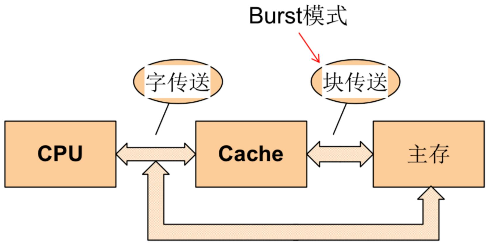

<details>
<summary>flowchart</summary>

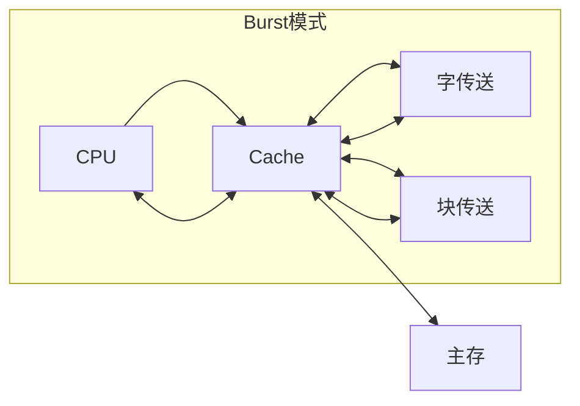
</details>

# 1. Cache的工作过程

- 整块缓存、单字输出
- Cache-处理机通路

主存-处理机通路

- 流水处理：地址变换、访问Cache

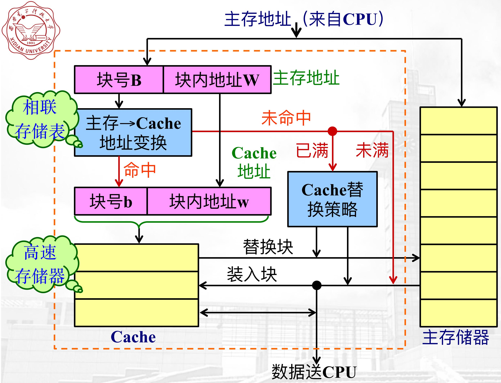

<details>
<summary>flowchart</summary>

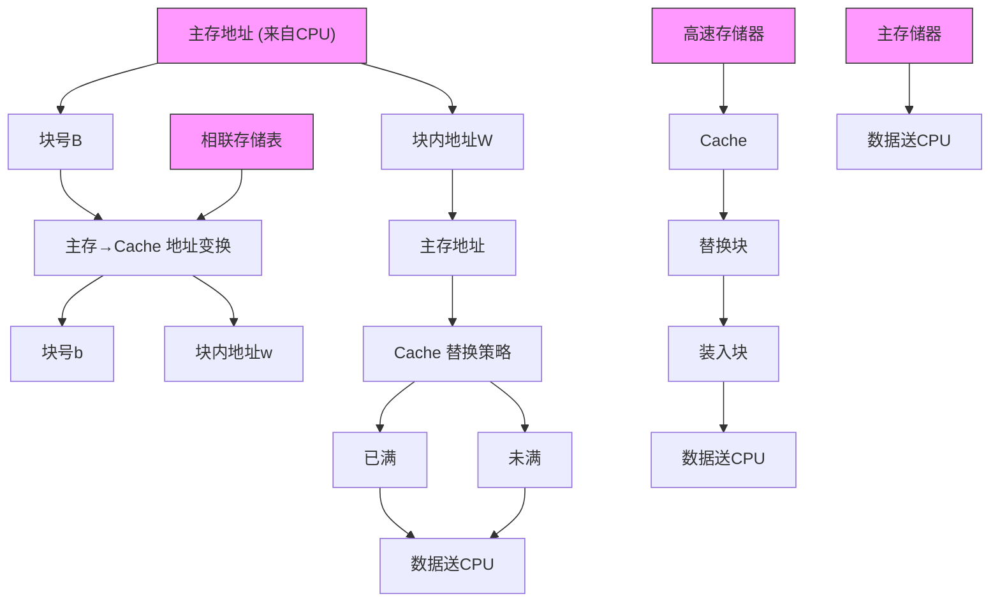
</details>

# 主存与Cache的地址映射

# ■ 第一步：地址映象：

把主存中的数据按照某种规则装入到Cache中，并建立主存地址与Cache地址之间的对应关系。

# ■ 第二步：地址变换：

当主存数据已经装入到Cache之后，在程序运行过程中，把主存地址变换成Cache地址。

# ■ 在选取地址映象方法要考虑的主要因素:

- 地址变换的硬件高速、低价、易于实现；
- Cache空间利用率要高;
- 发生块冲突的概率要小。

# ■ 以“块”为单位进行调度。

全相联
直接映射
组相联

# 全相联映射

# ■ 映射规则：

主存的任意一块可以映象到Cache中的任意一块。

# 全相联映射

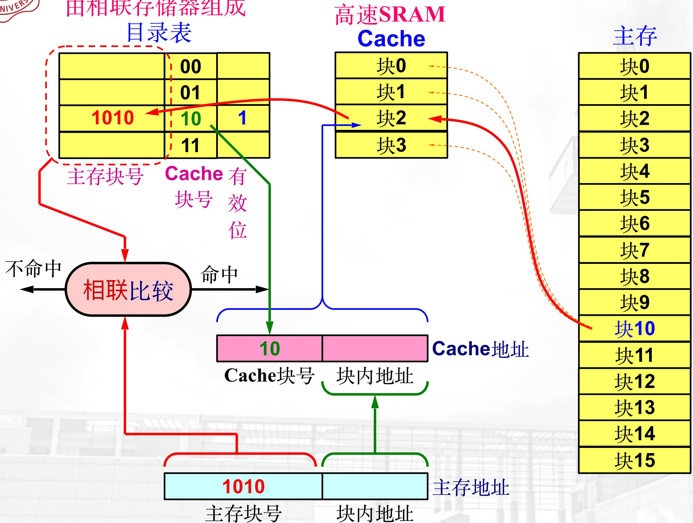

<details>
<summary>flowchart</summary>

```mermaid
graph TD
    A["由相联存储器组成目录表"] --> B["主存块号 00"]
    A --> C["主存块号 01"]
    A --> D["主存块号 1010"]
    A --> E["主存块号 11"]
    F["高速SRAM Cache"] --> G["块0"]
    F --> H["块1"]
    F --> I["块2"]
    F --> J["块3"]
    G --> K["块1"]
    H --> L["块2"]
    I --> M["块3"]
    N["主存"] --> O["块0"]
    N --> P["块1"]
    N --> Q["块2"]
    N --> R["块3"]
    N --> S["块4"]
    N --> T["块5"]
    N --> U["块6"]
    N --> V["块7"]
    N --> W["块8"]
    N --> X["块9"]
    N --> Y["块10"]
    N --> Z["块11"]
    N --> AA["块12"]
    N --> AB["块13"]
    N --> AC["块14"]
    N --> AD["块15"]
    E --> AE["主存块号 10"]
    E --> AF["主存块号 11"]
    E --> AG["主存块号 1010"]
    E --> AH["主存地址 1010"]
    E --> AI["主存地址 1010"]
    E --> AJ["主存地址 1010"]
    E --> AK["主存地址 1010"]
    style A fill:#f9f,stroke:#333
    style F fill:#f9f,stroke:#333
    style N fill:#ccf,stroke:#333
    style E fill:#ccf,stroke:#333
    style F fill:#ccf,stroke:#333
    style E fill:#ccf,stroke:#333
    style N fill:#ccf,stroke:#333
    style E fill:#ccf,stroke:#333
    style F fill:#ccf,stroke:#333
    style E fill:#ccf,stroke:#333
    style F fill:#ccf,stroke:#333
    style N fill:#ccf,stroke:#333
    style E fill:#ccf,stroke:#333
```
</details>

# 全相联映射

# ■ 映射规则：

主存的任意一块可以映象到Cache中的任意一块。

# ■ 特点:

- 块冲突概率低，Cache空间利用率高。
- 相联目录表容量大 $\rightarrow$ 成本高、查表速度慢。
- 以上特点成立的原因：全相联方式允许主存块装入任意 Cache 行，因此冲突更少，但目录比较硬件更复杂。

# 直接映射

■ 映射规则：主存的每一块只能映象到Cache的一个特定的块中。
■ 整个Cache地址与主存地址的低位部分完全相同

# 直接映射

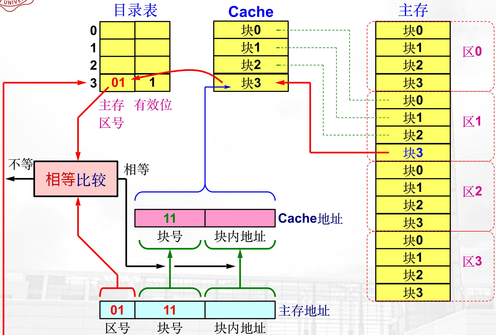

<details>
<summary>flowchart</summary>

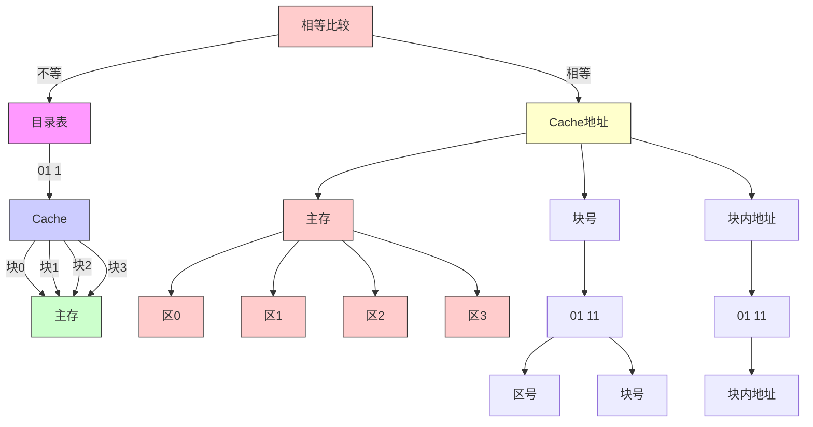
</details>

# 直接映射

■ 映射规则：主存的每一块只能映象到Cache的一个特定的块中。

■ 整个Cache地址与主存地址的低位部分完全相同。

■ 优点:

- 硬件简单，不需要相联存储器，只要

- 容量较小的按地址访问的区号标志表存储器；
- 少量外比较电路。

- 访问速度快（无需地址变换）。

■ 缺点：

- Cache块冲突概率高;
- Cache空间利用率很低。

# 组相联映射

■ 目的：减小相联目录表的容量，降低成本，提高地址变换速度。
■ 映射规则：将主存和Cache都机械等分成相同大小的块，并将主存空间按照Cache大小等分成区，再将Cache和主存中的每一区都等分成大小相同的组，让主存各区中的某组中的任何一块均可直接映象装入到Cache中对应组的任何一块上。

从主存的组到Cache的组之间采用直接映象方式，在两个对应的组内部采用全相联映象方式——组间直接，组内全相联。

# 组相联映射

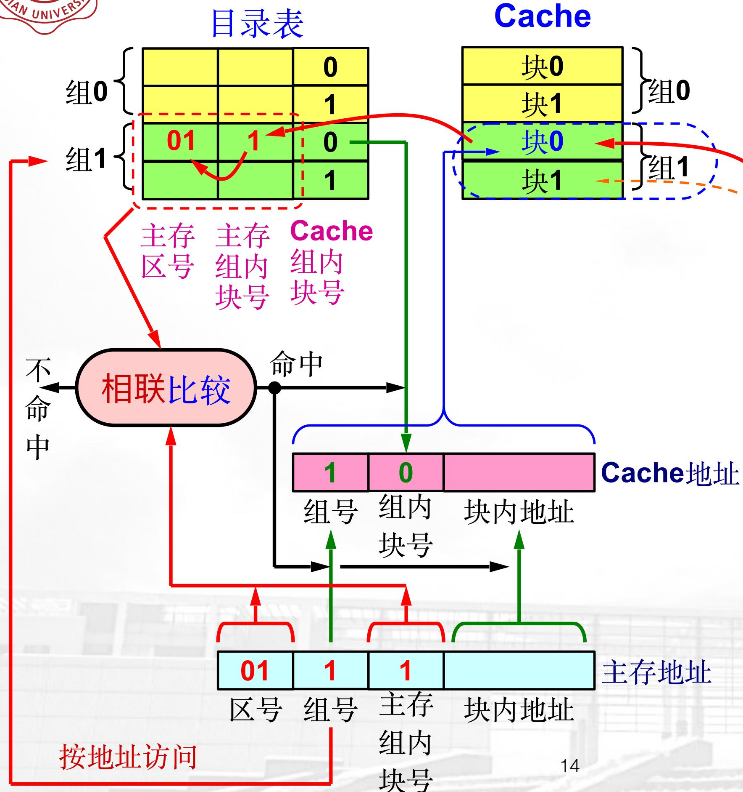

<details>
<summary>flowchart</summary>

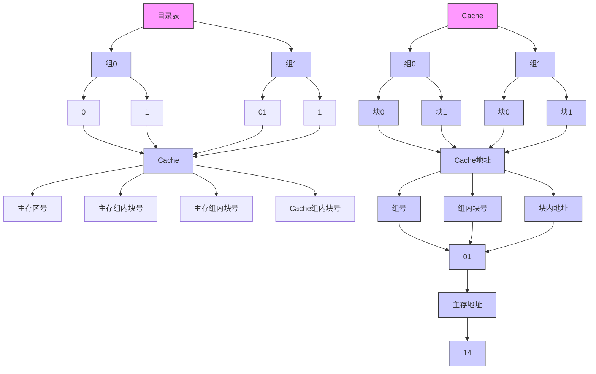
</details>

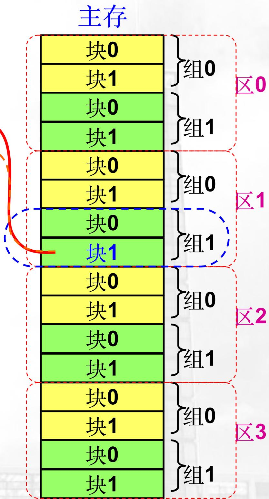

<details>
<summary>text_image</summary>

主存
块0
块1
块0
块1
块0
块1
块0
块1
块0
块1
块0
块1
块0
块1
块0
块1
块0
块1
组0
组1
组0
组1
组0
组1
区0
区1
区2
区3
</details>

# 组相联映射

# ■ 优点:

- 块的冲突概率比较低；
- 块的利用率大幅度提高；
- 块的失效率明显降低。

# ■ 缺点：

实现难度和造价比直接映射方式高。

# [例1] 直接映射方式的Cache，初始内容为空。

# Cache容量为2KB，以128B分块。主存容量为1MB，求：

(1) Cache分为多少块？Cache块号及块内地址各为多少位？为实现地址映像，主存地址应如何划分？
(2) 主存中顺序排列的第129块（即若主存不分区，以第0块开始顺序排列时）内容调入到Cache的哪一块中？
(3) 在上一步的基础上，读写主存地址328CBH时是否命中？

# 【解】

(1) Cache: 2KB/128B = 16块，主存8K块，共512个区。

19 11 10 7 6 0

<table><tr><td>主存区号(9位)</td><td>区内块号(4位)</td><td>块内地址(7位)</td></tr></table>

(2) $129 \div 16 = 8$ 余1，即主存第8区的第1块，因此应装入Cache的第1块。

(3) 虽然也对应Cache的第1块，但主存区号不同，不命中。

<table><tr><td>19</td><td>11</td><td>10</td><td>7</td><td>6</td><td>0</td></tr><tr><td colspan="2">0011 0010 1</td><td colspan="2">000 1</td><td colspan="2">100 1011</td></tr></table>

[例2] 组相连：主存1MB；Cache 2KB，128B为一块，一组2块。

→ Cache 16块，共8组；主存8K块，共512个区(每区8组)。

主存地址：40030H

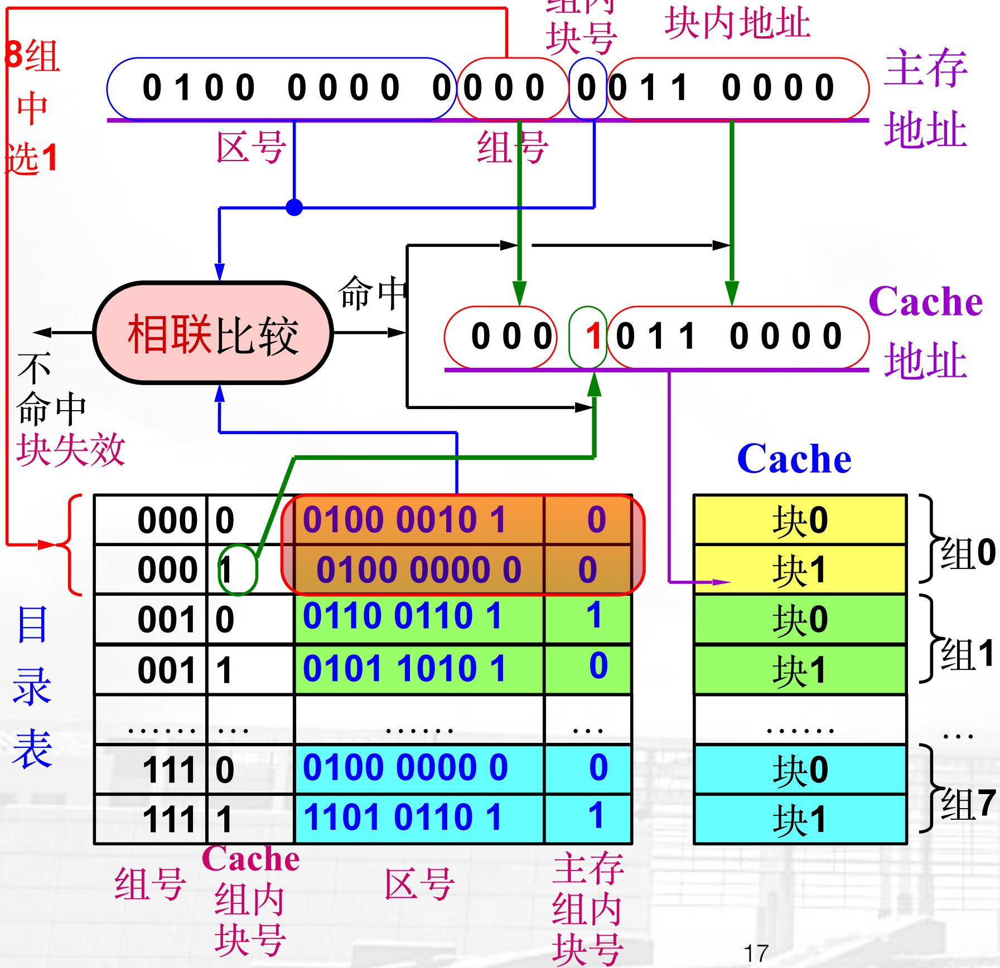

<details>
<summary>flowchart</summary>

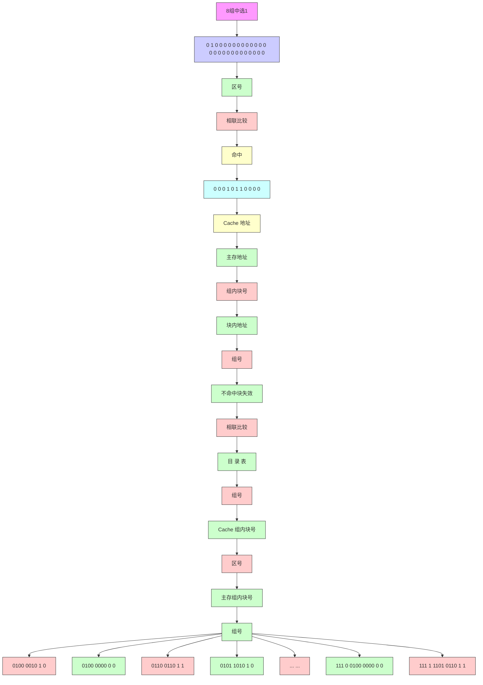
</details>

主存
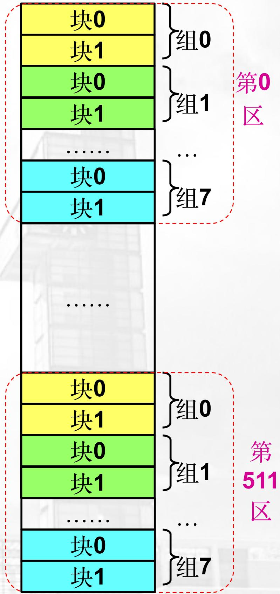

<details>
<summary>text_image</summary>

块0
块1
块0
块1
……
块0
块1
……
块0
块1
块0
块1
……
块0
块1
……
块0
块1
组0
组1
…
组7
第0区
第511区
</details>

[例3] 组相连：主存64MB；Cache 32KB，4KB为一块，一组4块。主存

→ Cache 8块，共2组；主存16K块，共2K个区(每区2组)。

主存地址：28B57A4H

主存

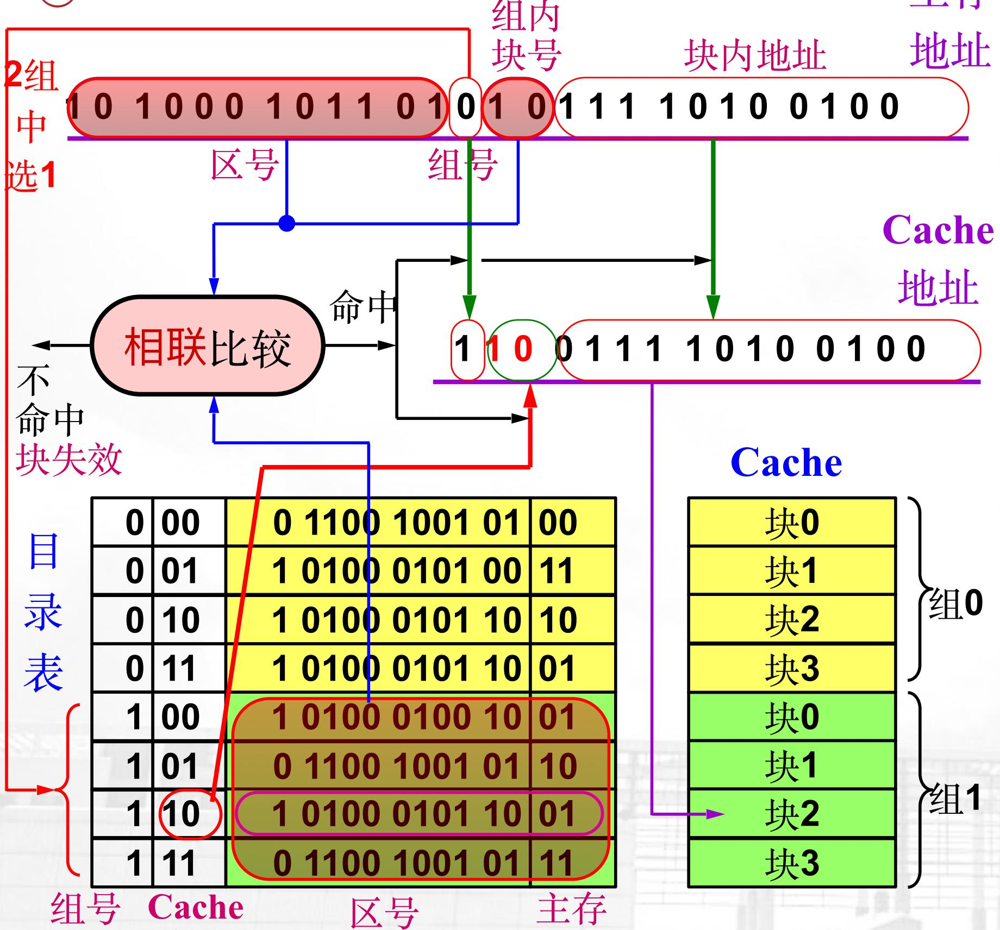

<details>
<summary>flowchart</summary>

```mermaid
graph TD
    A["相联比较"] -->|命中| B["组内块号"]
    A --> C["组内地址"]
    B --> D[" Cache 地址"]
    C --> D
    D --> E["主存"]
    F["目录表"] --> G["组号 Cache"]
    F --> H["组号 区号"]
    F --> I["组号 主存"]
    G --> J["0 00"]
    G --> K["0 01"]
    G --> L["0 10"]
    G --> M["0 11"]
    G --> N["1 00"]
    G --> O["1 01"]
    G --> P["1 10"]
    G --> Q["1 11"]
    H --> R["0 1100 1001 01 00"]
    H --> S["1 0100 0101 00 11"]
    H --> T["1 0100 0101 10 10"]
    H --> U["1 0100 0101 10 01"]
    H --> V["0 1100 1001 01 10"]
    H --> W["1 0100 0101 10 01"]
    H --> X["0 1100 1001 01 11"]
    I --> Y[" Cache 块0"]
    I --> Z[" Cache 块1"]
    I --> AA[" Cache 块2"]
    I --> AB[" Cache 块3"]
    I --> AC[" Cache 块4"]
    style A fill:#f9f,stroke:#333
    style B fill:#ccf,stroke:#333
    style C fill:#cfc,stroke:#333
    style D fill:#fcc,stroke:#333
    style E fill:#ffc,stroke:#333
    style F fill:#f9f,stroke:#333
    style G fill:#ccf,stroke:#333
    style H fill:#cfc,stroke:#333
    style I fill:#fcc,stroke:#333
    style J fill:#cff,stroke:#333
    style K fill:#ffc,stroke:#333
    style L fill:#cfc,stroke:#333
    style M fill:#fcc,stroke:#333
    style N fill:#ffc,stroke:#333
    style O fill:#cfc,stroke:#333
    style P fill:#fcc,stroke:#333
    style Q fill:#cfc,stroke:#333
    style R fill:#fcc,stroke:#333
    style S fill:#cfc,stroke:#333
    style T fill:#cfc,stroke:#333
    style U fill:#cfc,stroke:#333
    style V fill:#cfc,stroke:#333
```
</details>

<table><tr><td>0</td><td>00</td><td>0 1100 1001 01</td><td>00</td></tr><tr><td>0</td><td>01</td><td>1 0100 0101 00</td><td>11</td></tr><tr><td>0</td><td>10</td><td>1 0100 0101 10</td><td>10</td></tr><tr><td>0</td><td>11</td><td>1 0100 0101 10</td><td>01</td></tr><tr><td>1</td><td>00</td><td>1 0100 0100 10</td><td>01</td></tr><tr><td>1</td><td>01</td><td>0 1100 1001 01</td><td>10</td></tr><tr><td>1</td><td>10</td><td>1 0100 0101 10</td><td>01</td></tr><tr><td>1</td><td>11</td><td>0 1100 1001 01</td><td>11</td></tr></table>

组号

Cache

组内块号

区号

主存

组内块号

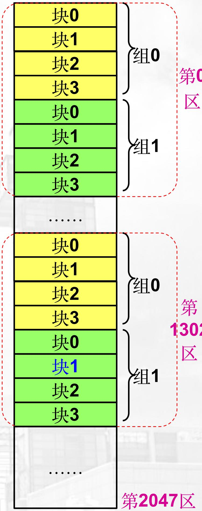

<details>
<summary>text_image</summary>

块0
块1
块2
块3
块0
块1
块2
块3
……
块0
块1
块2
块3
块0
块1
块2
块3
……
第2047区
组0
组1
组1
组0
第1302区
</details>

# 往年考题

# 四.（本题 15 分）某计算机系统的内存容量为 4GB, Cache 容量为 256KB, 均采用字节编址。Cache 与内存采用 8 路组相联映射, Cache 每块为 4KB。

请问：

1. 内存和 Cache 地址的各字段分别有多少位？
2. 每次地址变换时，参与相联比较的位数是多少？
3. 若当前地址变换表的部分有效内容如下（有效位为 1，表示 Cache 块有效）。当 CPU 访问内存地址分别为 01234567H 和 FEDCBA98H 时，请问是否能够命中，若命中则给出相应的 Cache 地址。

←

<table><tr><td>地址←</td><td>内存区号←</td><td>组内块号←</td><td>有效位←</td></tr><tr><td>000 000←</td><td>0009 H←</td><td>000B←</td><td>1←</td></tr><tr><td>001 011←</td><td>3FD7 H←</td><td>010B←</td><td>1←</td></tr><tr><td>001 110←</td><td>2440 H←</td><td>101B←</td><td>1←</td></tr><tr><td>011 001←</td><td>3FD7 H←</td><td>011B←</td><td>1←</td></tr><tr><td>011 110←</td><td>076E H←</td><td>111B←</td><td>1←</td></tr><tr><td>110 000←</td><td>0048 H←</td><td>100B←</td><td>1←</td></tr><tr><td>110 100←</td><td>0009 H←</td><td>000B←</td><td>1←</td></tr><tr><td>111 111←</td><td>0048 H←</td><td>100B←</td><td>1←</td></tr></table>

# 替换策略


<details>
<summary>flowchart</summary>

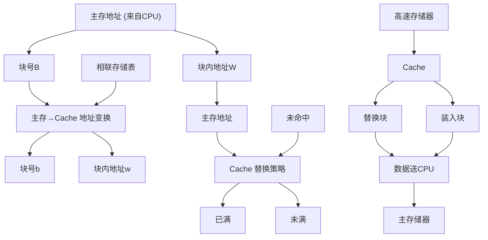
</details>

# 替换算法

直接映射的cache中，由于某个主存块只与一个cache字块有映射关系，因此替换策略很简单。而在全相连和组相连中，主存块可以写入cache中若干位置，这就有一个选择替换掉哪一个cache字块的问题，即所谓替换算法问题。

# 全相联、组相联：

■随机算法（RAND, Random Algorithm）
■先进先出算法 (FIFO, First-in First-out Algorithm)

- 利用了历史信息
- 没有反映局部性——最先调入的，可能也是要使用的。

■最不经常使用算法(LFU, Least Frequently Used Algorithm): 计数器位数多，实现困难。

■近期最少使用算法(LRU, Least Recently Used Algorithm): 多/少有/无。随机期法、定期法。
■最佳替换算法(OPT, Optimal replacement algorithm, 作弊~~)

# 替换算法

FIFO策略

<table><tr><td>访问顺序</td><td>1</td><td>2</td><td>3</td><td>4</td><td>5</td><td>6</td><td>7</td><td>8</td></tr><tr><td>地址块号</td><td>2</td><td>11</td><td>2</td><td>9</td><td>7</td><td>6</td><td>4</td><td>3</td></tr><tr><td rowspan="4">块分配情况</td><td>2</td><td>2</td><td>2</td><td>2</td><td>2</td><td>6</td><td>6</td><td>6</td></tr><tr><td>-</td><td>11</td><td>11</td><td>11</td><td>11</td><td>11</td><td>4</td><td>4</td></tr><tr><td>-</td><td>-</td><td>-</td><td>9</td><td>9</td><td>9</td><td>9</td><td>3</td></tr><tr><td>-</td><td>-</td><td>-</td><td>-</td><td>7</td><td>7</td><td>7</td><td>7</td></tr><tr><td>操作状态</td><td>调进</td><td>调进</td><td>命中</td><td>调进</td><td>调进</td><td>替换</td><td>替换</td><td>替换</td></tr></table>

# 替换算法

FIFO策略导致的“颠簸”

<table><tr><td>访问顺序</td><td>1</td><td>2</td><td>3</td><td>4</td><td>5</td><td>6</td><td>7</td><td>8</td></tr><tr><td>地址块号</td><td>2</td><td>11</td><td>9</td><td>7</td><td>6</td><td>2</td><td>11</td><td>9</td></tr><tr><td rowspan="4">块分配情况</td><td>2</td><td>2</td><td>2</td><td>2</td><td>6</td><td>6</td><td>6</td><td>6</td></tr><tr><td>-</td><td>11</td><td>11</td><td>11</td><td>11</td><td>2</td><td>2</td><td>2</td></tr><tr><td>-</td><td>-</td><td>9</td><td>9</td><td>9</td><td>9</td><td>11</td><td>11</td></tr><tr><td>-</td><td>-</td><td>-</td><td>7</td><td>7</td><td>7</td><td>7</td><td>9</td></tr><tr><td>操作状态</td><td>调进</td><td>调进</td><td>调进</td><td>调进</td><td>替换</td><td>替换</td><td>替换</td><td>替换</td></tr></table>

# 替换算法

LRU策略，将最近4次最少使用的块替换

<table><tr><td>访问顺序</td><td>1</td><td>2</td><td>3</td><td>4</td><td>5</td><td>6</td><td>7</td><td>8</td></tr><tr><td>地址块号</td><td>2</td><td>11</td><td>2</td><td>9</td><td>7</td><td>6</td><td>4</td><td>3</td></tr></table>

块分配情况

<table><tr><td>2</td><td>2</td><td>2</td><td>2</td><td>2</td><td>2*</td><td>4</td><td>4</td></tr><tr><td>-</td><td>11</td><td>11</td><td>11</td><td>11*</td><td>6</td><td>6</td><td>6</td></tr><tr><td>-</td><td>-</td><td>-</td><td>9</td><td>9</td><td>9</td><td>9*</td><td>3</td></tr><tr><td>-</td><td>-</td><td>-</td><td>-</td><td>7</td><td>7</td><td>7</td><td>7*</td></tr></table>

操作状态 调进 调进 命中 调进 调进 替换 替换 替换

# 替换算法

比较FIFO和LRU：Cache 3块，程序在内存中占5块，第一次执行。

<table><tr><td>时间</td><td>1</td><td>2</td><td>3</td><td>4</td><td>5</td><td>6</td><td>7</td><td>8</td><td>9</td><td>10</td><td>11</td><td>12</td></tr><tr><td>所执行程序块号</td><td>P2</td><td>P3</td><td>P2</td><td>P1</td><td>P5</td><td>P2</td><td>P4</td><td>P5</td><td>P3</td><td>P2</td><td>P5</td><td>P2</td></tr><tr><td rowspan="3">FIFO:命中率: $3/12 = 25\%$ </td><td>P2</td><td>P2</td><td>P2</td><td>P2</td><td>P5</td><td>P5</td><td>P5</td><td>P5</td><td>P3</td><td>P3</td><td>P3</td><td>P3</td></tr><tr><td></td><td>P3</td><td>P3</td><td>P3</td><td>P3</td><td>P2</td><td>P2</td><td>P2</td><td>P2</td><td>P2</td><td>P5</td><td>P5</td></tr><tr><td></td><td></td><td></td><td>P1</td><td>P1</td><td>P1</td><td>P4</td><td>P4</td><td>P4</td><td>P4</td><td>P4</td><td>P2</td></tr><tr><td rowspan="3">LRU:命中率: $5/12 = 42\%$ </td><td>P2</td><td>P2</td><td>P2</td><td>P2</td><td>P2</td><td>P2</td><td>P2</td><td>P2</td><td>P3</td><td>P3</td><td>P3</td><td>P3</td></tr><tr><td></td><td>P3</td><td>P3</td><td>P3</td><td>P5</td><td>P5</td><td>P5</td><td>P5</td><td>P5</td><td>P5</td><td>P5</td><td>P5</td></tr><tr><td></td><td></td><td></td><td>P1</td><td>P1</td><td>P1</td><td>P4</td><td>P4</td><td>P4</td><td>P2</td><td>P2</td><td>P2</td></tr></table>

# 替换算法

例：

假定程序在主存为5块，Cache 为3块。CPU执行程序的顺序为：P2、P3、P2、P1、P5、P2、P4、P5、P3、P2、P5、P2。画出FIFO算法和LRU算法的命中情况如图所示。

<table><tr><td>P2</td><td>P3</td><td>P2</td><td>P1</td><td>P5</td><td>P2</td><td>P4</td><td>P5</td><td>P3</td><td>P2</td><td>P5</td><td>P2</td></tr><tr><td>2</td><td>2</td><td>2</td><td>2</td><td>5</td><td>5</td><td>5</td><td>5</td><td>3</td><td>3</td><td>3</td><td>3</td></tr><tr><td></td><td>3</td><td>3</td><td>3</td><td>3</td><td>2</td><td>2</td><td>2</td><td>2</td><td>2</td><td>5</td><td>5</td></tr><tr><td></td><td></td><td></td><td>1</td><td>1</td><td>1</td><td>4</td><td>4</td><td>4</td><td>4</td><td>4</td><td>2</td></tr><tr><td></td><td></td><td>H</td><td></td><td></td><td></td><td></td><td>H</td><td></td><td>H</td><td></td><td></td></tr></table>

<table><tr><td>P2</td><td>P3</td><td>P2</td><td>P1</td><td>P5</td><td>P2</td><td>P4</td><td>P5</td><td>P3</td><td>P2</td><td>P5</td><td>P2</td></tr><tr><td>2</td><td>2</td><td>2</td><td>2</td><td>2</td><td>2</td><td>2</td><td>2</td><td>3</td><td>3</td><td>3</td><td>3</td></tr><tr><td></td><td>3</td><td>3</td><td>3</td><td>5</td><td>5</td><td>5</td><td>5</td><td>5</td><td>5</td><td>5</td><td>5</td></tr><tr><td></td><td></td><td></td><td>1</td><td>1</td><td>1</td><td>4</td><td>4</td><td>4</td><td>2</td><td>2</td><td>2</td></tr><tr><td></td><td></td><td>H</td><td></td><td></td><td>H</td><td></td><td>H</td><td></td><td></td><td>H</td><td>H</td></tr></table>

# 替换算法

三种Cache替换算法的比较:

<table><tr><td rowspan="3">Size</td><td colspan="9">Associativity</td></tr><tr><td colspan="3">Two-way</td><td colspan="3">Four-way</td><td colspan="3">Eight-way</td></tr><tr><td>LRU</td><td>Random</td><td>FIFO</td><td>LRU</td><td>Random</td><td>FIFO</td><td>LRU</td><td>Random</td><td>FIFO</td></tr><tr><td>16 KB</td><td>114.1</td><td>117.3</td><td>115.5</td><td>111.7</td><td>115.1</td><td>113.3</td><td>109.0</td><td>111.8</td><td>110.4</td></tr><tr><td>64 KB</td><td>103.4</td><td>104.3</td><td>103.9</td><td>102.4</td><td>102.3</td><td>103.1</td><td>99.7</td><td>100.5</td><td>100.3</td></tr><tr><td>256 KB</td><td>92.2</td><td>92.1</td><td>92.5</td><td>92.1</td><td>92.1</td><td>92.5</td><td>92.1</td><td>92.1</td><td>92.5</td></tr></table>

Data cache misses per 1000 instructions comparing least-recently used, random, and first in, first out replacement for several sizes and associativities. There is little difference between LRU and random for the largest size cache, with LRU outperforming the others for smaller caches. FIFO generally outperforms random in the smaller cache sizes. These data were collected for a block size of 64 bytes for the Alpha architecture using 10 SPEC2000 benchmarks. Five are from SPECint2000 (gap, gcc, gzip, mcf, and perl) and five are from SPECfp2000 (applu, art, equake, lucas, and swim).

# 数据来源于

《Computer Architecture: A Quantitative Approach》 Fourth Edition
John L. Hennessy, David A. Patterson

# Cache/内存一致性问题

# Cache/内存一致性问题

- 读数据是否存在一致性问题？
- 写数据如何保持Cache/Memory一致?
- 两种策略:

- 写回法(Write Back)
- 全写法(Write Through)

# Cache/内存一致性问题

- 写回法 (Write Back)

- 当CPU写Cache命中时，只将数据写入Cache，不立即写入主存。只有当被修改的Cache块被替换时才写回主存中。

- 当CPU写Cache未命中时，则写修改是将相应主存块调入Cache之后，在Cache中进行。对主存的修改仍留待该块替换出去时进行。

- 用修改位(Dirty Bit)，追踪是否被CPU修改过。

# Cache/内存一致性问题

- 全写法（Write Through）

- 当Cache命中时，在将数据写入修改Cache的同时写入修改主存，较好地保证了主存与Cache内容的一致性。
- 当Cache未命中，直接向主存进行写入。这时可以采用两种方式进行处理：

- What a simple solution?!

# Cache/内存一致性问题

- 全写法 (Write Through)

- Cache 和内存速度不一致如何解决?

- 速度不够Buffer凑!

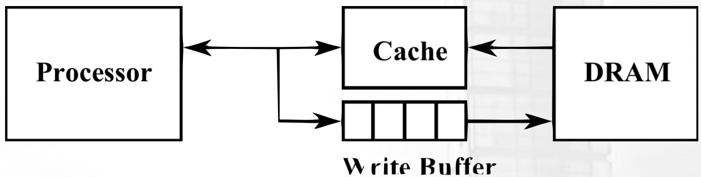

<details>
<summary>flowchart</summary>

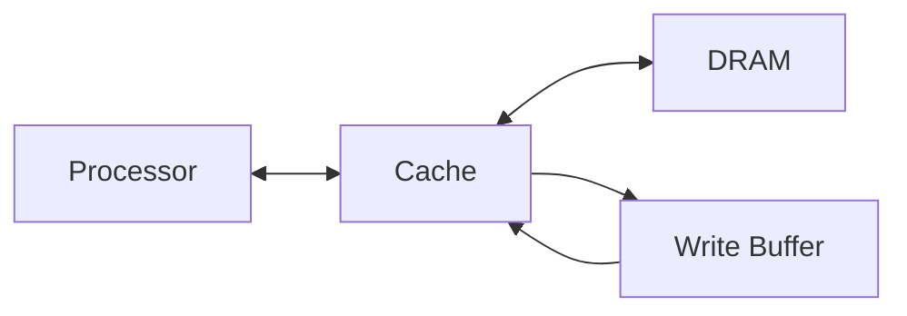
</details>

- 但貌似还有问题....

- 谁把Buffer数据搬到内存？

- 加个控制器让内存主动取回来...

# Cache/内存一致性问题

- 但貌似还有问题....

- 谁把Buffer数据搬到内存？

- 加个控制器让内存主动取回来...

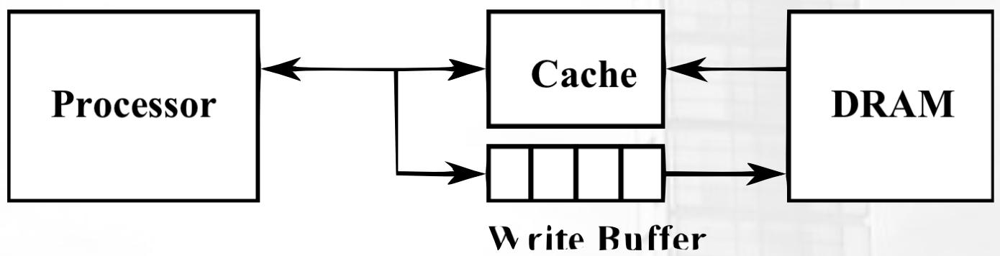

<details>
<summary>flowchart</summary>

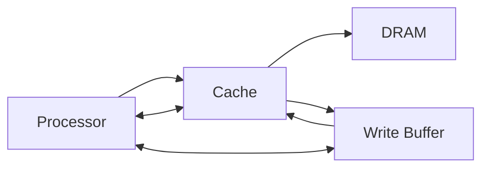
</details>

- 但貌似还有！问题....

- Buffer会不会爆掉?

- 加2级Cache!

竞猜：L2 Cache的写策略是？

回写法(Write Back)!


<details>
<summary>flowchart</summary>

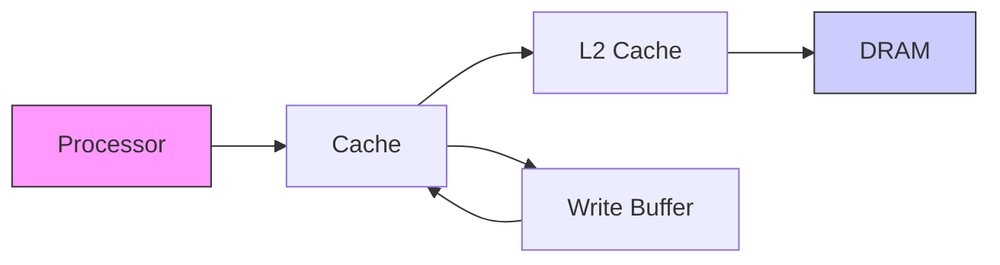
</details>

# 7.3.3 主存与Cache内容的一致性问题

采用Cache的访存操作

<table><tr><td>Cache类型</td><td>操作</td><td>访存操作</td><td>访存时间</td></tr><tr><td rowspan="4">写直达Cache</td><td>读命中</td><td>只读Cache</td><td> $T_{C}$ </td></tr><tr><td>写命中</td><td>写Cache,同时写内存</td><td> $T_{C}(隐藏T_{M})$ </td></tr><tr><td>读不命中</td><td>调入Cache块,再读Cache</td><td> $T_{B}+T_{C}$ </td></tr><tr><td>写不命中</td><td>只写内存</td><td> $T_{M}$ </td></tr><tr><td rowspan="4">写回Cache</td><td>读命中</td><td>只读Cache</td><td> $T_{C}$ </td></tr><tr><td>写命中</td><td>只写Cache</td><td> $T_{C}$ </td></tr><tr><td>读不命中</td><td>调入Cache块,再读Cache</td><td> $T_{B}+T_{C}$ </td></tr><tr><td>写不命中</td><td>调入Cache块,再写Cache</td><td> $T_{B}+T_{C}$ </td></tr></table>

# Cache性能分析与优化

# Cache性能分析与优化

- Cache命中(Hit)
- CPU欲访问的数据已在缓存中，即可直接访问 Cache
- Cache非命中(Miss)
- 数据不在Cache，需要将主存数据调入Cache
- CPU被阻塞(Blocking)，等!
- 命中率(Hit Rate)
- 非命中率(Miss Rate)

# Cache性能分析:Miss的分类4C

# Miss的4种类型(4C):

- Compulsory (必然)
- 冷启动、过程转移、首次引用等不可避免的miss...

- Capacity (容量)

- 容量不够造成的

- Conflict (冲突)

- Cache块冲突

- 方案1：增加容量
- 方案2：提升相联度

- Coherence（相关）

- 其它操作带来的结构相关（I/O操作等）

# Cache性能分析:Miss的分类4C

- Conflict Miss随容量提升而降低
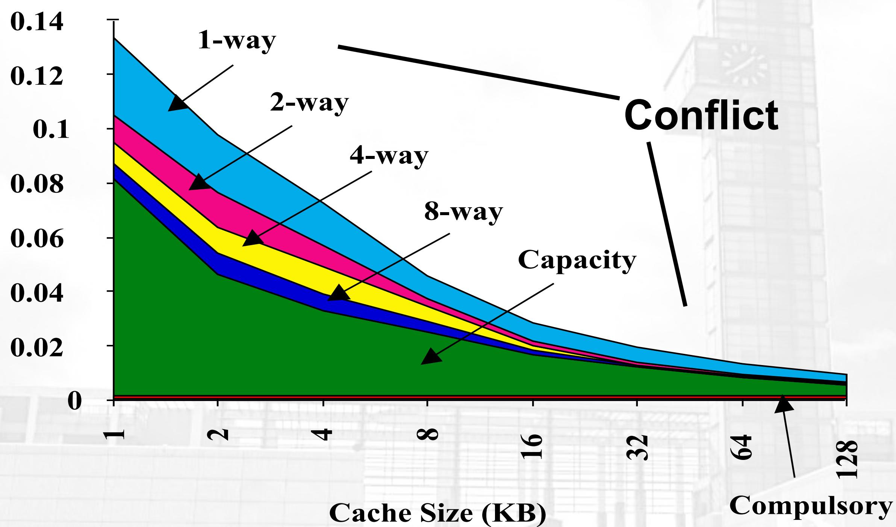

<details>
<summary>area</summary>

| Cache Size (KB) | 1-way  | 2-way  | 4-way  | 8-way  | Capacity |
| --------------- | ------ | ------ | ------ | ------ | -------- |
| 1               | 0.135  | 0.105  | 0.095  | 0.085  | 0.085    |
| 2               | 0.115  | 0.085  | 0.075  | 0.065  | 0.065    |
| 4               | 0.095  | 0.065  | 0.055  | 0.045  | 0.045    |
| 8               | 0.075  | 0.045  | 0.035  | 0.025  | 0.025    |
| 16              | 0.055  | 0.025  | 0.02   | 0.015  | 0.015    |
| 32              | 0.035  | 0.015  | 0.01   | 0.008  | 0.008    |
| 64              | 0.02   | 0.01   | 0.008  | 0.005  | 0.005    |
| 128             | 0.01   | 0.005  | 0.005  | 0.003  | 0.003    |
</details>

# Cache性能分析:Miss的分类4C

- 多路组相联明显降低miss rate

- 相同的miss rate, 1-way组相联(直接映射)需要2倍的Cache size才能达到2-way组相联水平

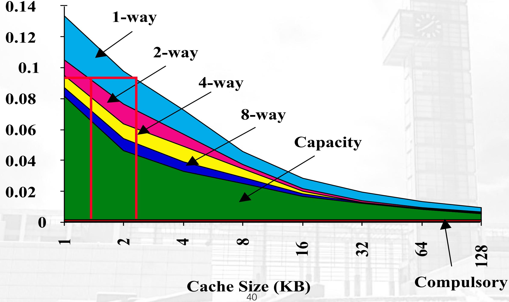

<details>
<summary>area</summary>

| Cache Size (KB) | 1-way  | 2-way  | 4-way  | 8-way  | Capacity |
| --------------- | ------ | ------ | ------ | ------ | -------- |
| 1               | 0.135  | 0.095  | 0.075  | 0.065  | 0.085    |
| 2               | 0.115  | 0.085  | 0.065  | 0.055  | 0.075    |
| 4               | 0.095  | 0.075  | 0.055  | 0.045  | 0.065    |
| 8               | 0.075  | 0.065  | 0.045  | 0.035  | 0.055    |
| 16              | 0.055  | 0.050  | 0.035  | 0.025  | 0.045    |
| 32              | 0.035  | 0.035  | 0.025  | 0.015  | 0.035    |
| 64              | 0.025  | 0.025  | 0.015  | 0.010  | 0.025    |
| 128             | 0.015  | 0.015  | 0.010  | 0.005  | 0.015    |
</details>

# Cache性能分析:Miss的分类4C

- 3种miss的比例
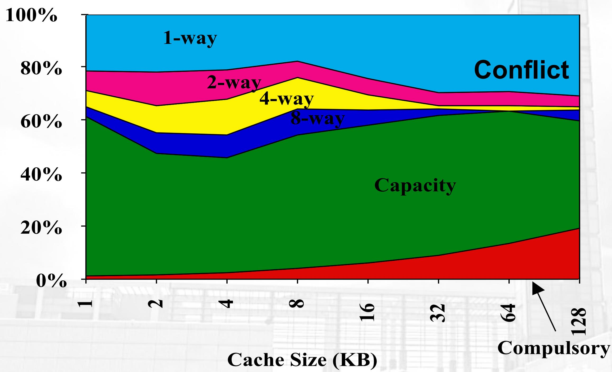

<details>
<summary>area_stacked</summary>

| Cache Size (KB) | 1-way | 2-way | 4-way | 8-way | Conflict |
| --------------- | ----- | ----- | ----- | ----- | -------- |
| 1               | ~35%  | ~15%  | ~10%  | ~10%  | ~15%     |
| 2               | ~30%  | ~15%  | ~10%  | ~10%  | ~15%     |
| 4               | ~30%  | ~15%  | ~10%  | ~10%  | ~15%     |
| 8               | ~30%  | ~15%  | ~10%  | ~10%  | ~15%     |
| 16              | ~30%  | ~15%  | ~10%  | ~10%  | ~15%     |
| 32              | ~30%  | ~15%  | ~10%  | ~10%  | ~15%     |
| 64              | ~30%  | ~15%  | ~10%  | ~10%  | ~15%     |
| 128             | ~30%  | ~15%  | ~10%  | ~10%  | ~15%     |
</details>

# Cache性能分析与优化

# 1. 加速比

■ Cache-主存系统的平均访问周期T:

$$
\mathsf {T} = \mathsf {H} \times \mathsf {T C} + (1 - \mathsf {H}) \times (\mathsf {T B} + \mathsf {T C})
$$

$$
T = T C + (1 - H) * T B
$$

- Cache的访问周期为TC，主存的访问周期为TM，数据块调入
- Cache的块传输时间为TB，Cache的命中率为H。

■ Cache-主存系统的加速比SP: SP=TM/T <- (Old duration / new)

# Cache性能分析与优化

例如，设Cache的速度是主存的5倍，命中率为 $95\%$ ，则采用Cache后性能提升多少？

系统平均访问时间 $= t + 0.05^{*}5t = 1.25t$

性能提升=5t/1.25t=4倍

# Cache性能分析与优化

- 如何提升Cache性能?

- 容量
- 块数/块大小
- 多路组相联
- 多级Cache
- Victim Cache
- 代码层面
●
...

- 指令/数据独立Cache

# Cache性能分析与优化

# 优化方案1：提升Cache容量

- 边际效率降低
- 成本问题...
- 制成/热设计...

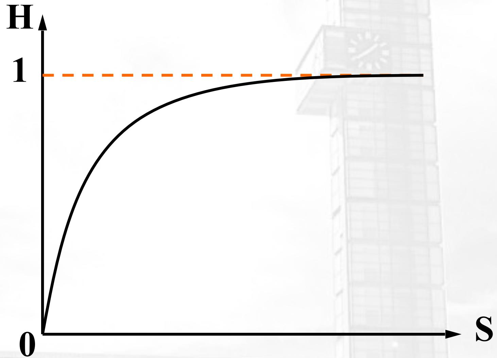

<details>
<summary>line</summary>

| S    | H   |
| ---- | --- |
| 0    | 0   |
| >0   | 1   |
</details>

Cache容量S与命中率H的关系

# Cache性能分析与优化

# 存储系统成本

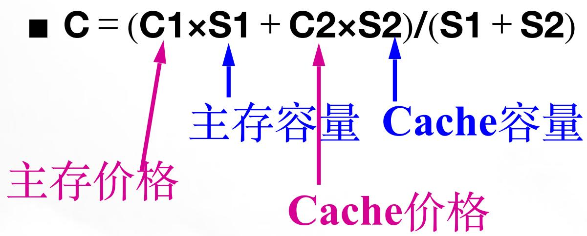

<details>
<summary>text_image</summary>

■ C = (C1×S1 + C2×S2)/(S1 + S2)
主存价格 ↑
主存容量 ↑
Cache容量
Cache价格
</details>

S1>>S2

■ 尽管Cache的价格比主存高，但是当其容量很小时，存储器的平均价格C接近于主存的价格。
■ 由于设置了Cache使CPU的访存速度接近Cache的速度，而使存储器的成本接近于主存的价格。

# Cache性能分析与优化

优化方案2：利用时空局部性原理，通过提升块大小，降低miss

rate
Miss Rate
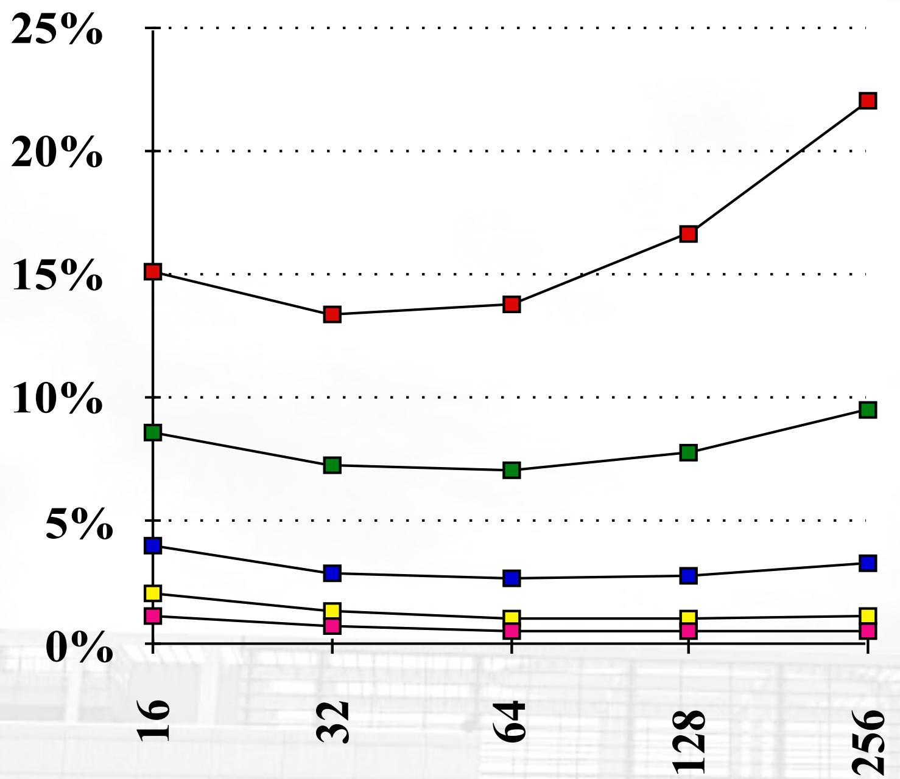

<details>
<summary>line</summary>

| x    | Series 1 | Series 2 | Series 3 | Series 4 | Series 5 |
| ---- | -------- | -------- | -------- | -------- | -------- |
| 16   | 15%      | 8.5%     | 4%       | 2%       | 1%       |
| 32   | 13.5%    | 7%       | 3%       | 1.5%     | 0.5%     |
| 64   | 13.8%    | 7%       | 3%       | 1%       | 0.5%     |
| 128  | 16.5%    | 7.5%     | 3%       | 1%       | 0.5%     |
| 256  | 22%      | 9.5%     | 3.5%     | 1%       | 0.5%     |
</details>

Block Size (bytes)

Size of Cache
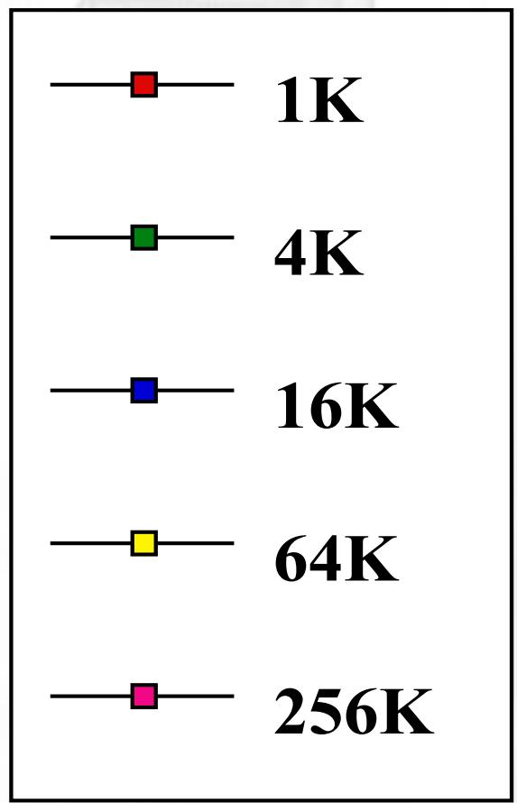

<details>
<summary>bar</summary>

| Temperature (K) | Value |
| :--- | :--- |
| 1K | Red |
| 4K | Green |
| 16K | Blue |
| 64K | Yellow |
| 256K | Pink |
</details>

# Cache性能分析与优化

优化方案2：利用时空局部性原理，通过提升块大小，降低miss rate

- 降低Compulsory必然miss rate
- 但太大的块有缺点

- miss的代价大;
- Conflict冲突导致的miss高

- 总结，差不多大就得了。

# Cache性能分析与优化

# 优化方案3：提升组相联级别

- 级别高一些，还是好的...

- 2:1规则，2路组相联只需要一半的Cache容量就可以达到1路组相联同等的miss rate/hit rate

- 但级别提升的边际效率在下降

- 级别也不要太高

- 相联比较复杂
- 相联存取复杂->提高TC时间

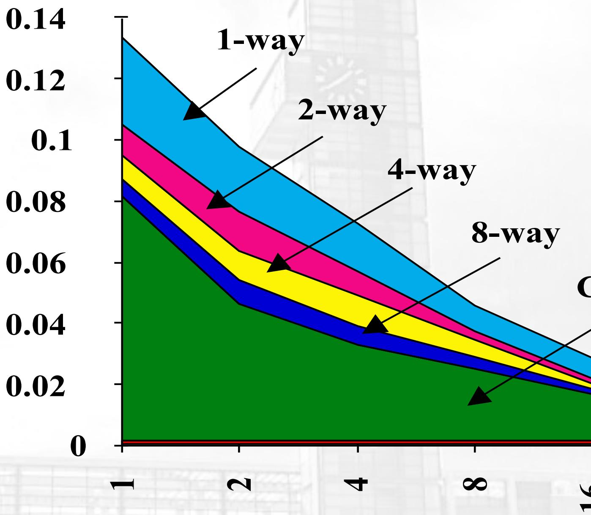

<details>
<summary>area</summary>

| Step | 1-way  | 2-way  | 4-way  | 8-way  |
|------|--------|--------|--------|--------|
| 1    | 0.135  | 0.105  | 0.095  | 0.085  |
| 2    | 0.115  | 0.085  | 0.075  | 0.065  |
| 4    | 0.085  | 0.065  | 0.055  | 0.045  |
| 8    | 0.055  | 0.045  | 0.035  | 0.025  |
| 16   | 0.035  | 0.025  | 0.015  | 0.010  |
</details>

Cache Size (KB)

# Cache性能分析与优化

- 例如一组典型数据...

Cache Size Associativity

<table><tr><td>(KB)</td><td colspan="2">1-way</td><td colspan="2">2-way</td><td>4-way</td><td>8-way</td></tr><tr><td>1</td><td>7.65</td><td>6.60</td><td>6.22</td><td>5.44</td><td></td><td></td></tr><tr><td>2</td><td>5.90</td><td>4.90</td><td>4.62</td><td>4.09</td><td></td><td></td></tr><tr><td>4</td><td>4.60</td><td>3.95</td><td>3.57</td><td>3.19</td><td></td><td></td></tr><tr><td>8</td><td>3.30</td><td>3.00</td><td>2.87</td><td>2.59</td><td></td><td></td></tr><tr><td>16</td><td>2.45</td><td>2.20</td><td>2.12</td><td>2.04</td><td></td><td></td></tr><tr><td>32</td><td>2.00</td><td>1.80</td><td>1.77</td><td>1.79</td><td></td><td></td></tr><tr><td>64</td><td>1.70</td><td>1.60</td><td>1.57</td><td>1.59</td><td></td><td></td></tr><tr><td>128</td><td>1.50</td><td>1.45</td><td>1.42</td><td>1.44</td><td></td><td></td></tr></table>

红色说明8路组相联已经没有性能提升

# Cache性能分析与优化

# 优化方案4：多级Cache

■ 两级Cache的总未命中率(总失效率): 总失效率 = (失效率) 第一级 × (失效率) 第二级…… × (失效率) 第N级
■ 【例】10000次访存，第一级Cache失效400次，第二级Cache失效4次。

- (失效率)第一级 $= 400 / 10000 = 4\%$
- (失效率) $_{第二级}$ =4/400=1%
- 利用两级Cache后总的失效率 $= 0.04\%$ 。

# Cache性能分析与优化

# 5. 多级Cache的命中率

【例】访问内存需50ns, L1 1ns 10%失效率, L2 5ns 1%失效率, L3 10ns 0.2%失效率, 求L1, L1+L2, L1+L2+L3构架下的平均访问时间。

$$
\mathrm{L1:} \qquad \mathrm{T=1ns+(0.1\times50ns)=6ns}
$$

$$
\mathrm{L1+2:} \quad \mathrm{T=1ns+(0.1\times[5ns+(0.01\times50ns)])=1.55ns}
$$

$$
\mathrm{L} 1 + 2 + 3: \mathrm{T} = 1 \mathrm{ns} + (0. 1 \times [ 5 \mathrm{ns} + (0. 0 1 \times [ 1 0 \mathrm{ns} + (0. 0 0 2 \times 5 0 \mathrm{ns}) ]) ]) = 1. 5 0 0 1 \mathrm{ns}
$$

# Cache性能分析与优化

# 优化方案5：拆分出指令/数据独立Cache

# 例如

- 16KB 指令/数据独立Cache
- 指令 miss rate=0.64%, 数据 miss rate=6.47%
- 32KB 统—Cache: miss rate=1.99%
- 假设75%指令,25%数据，Hit time = 1, Miss time = 50

T独立=75%x(1+0.64%x50)+25%x(1+6.47%x50)=2.05

T统一=75%x(1+1.99%x50)+25%x(1+1+1.99%x50)=2.24

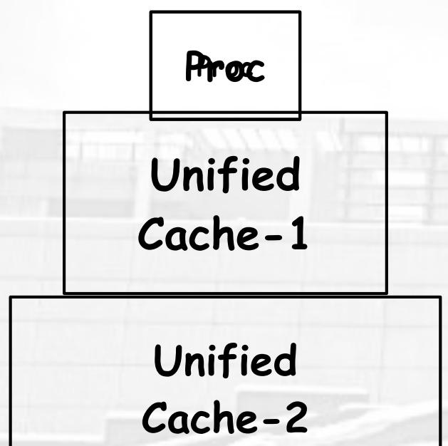

<details>
<summary>flowchart</summary>

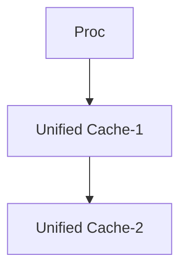
</details>

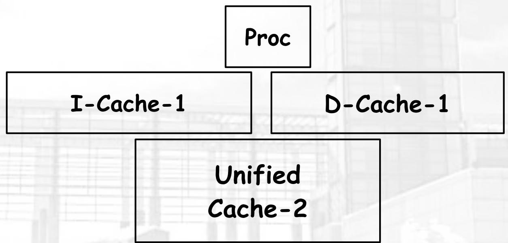

<details>
<summary>flowchart</summary>

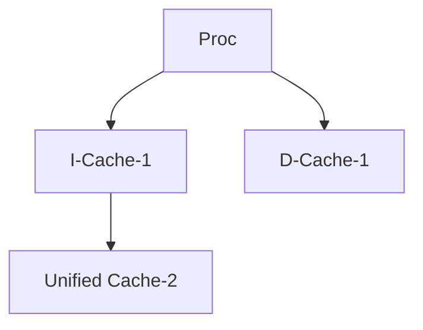
</details>

# Cache性能分析与优化

- 优化方案6: Victim Cache
- Miss的代价很大，如何优化？

- Victim Cache, 在L1和L2/主存之间

- Victim Cache容量小，采用全相联
- 例如，4个块的Victim Cache可以降
低4KB直接映射miss rate 20-90%。

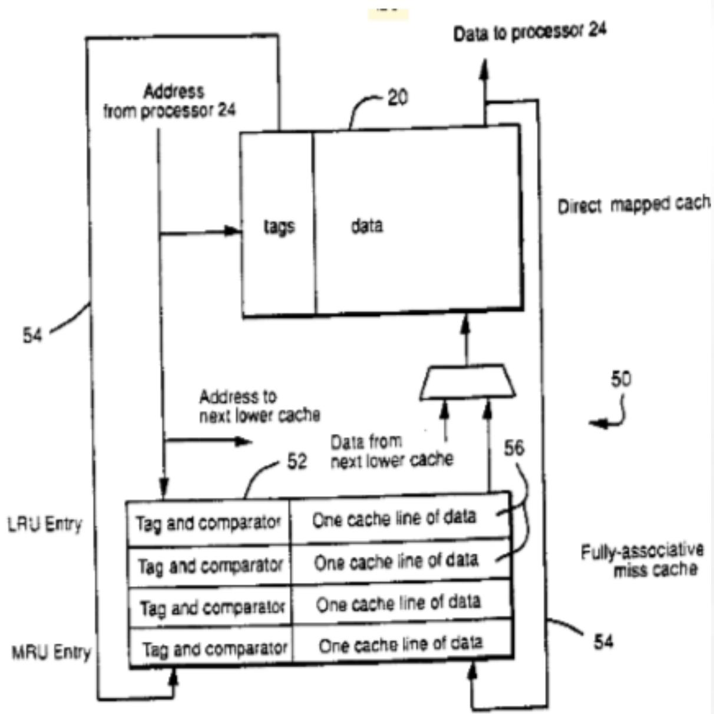

<details>
<summary>flowchart</summary>

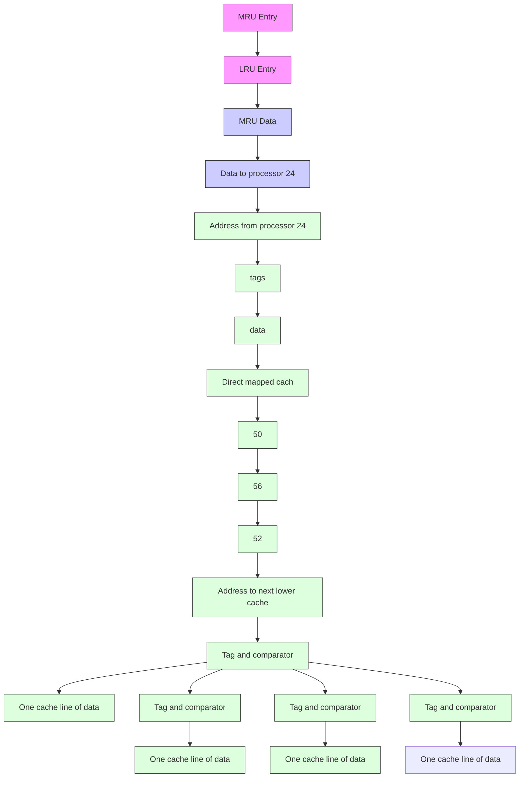
</details>

# Cache性能分析与优化

- 优化方案7: 代码层面: 1) Row Major
- 注意循环：大部分计算和访存都在循环中发生

- 按照数据对象在存储器中的存储顺序读取，最优
- 否则，连续miss

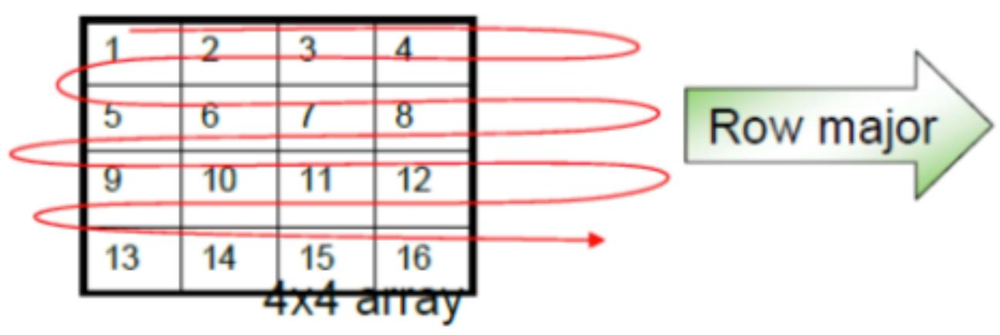

<details>
<summary>text_image</summary>

1 2 3 4
5 6 7 8
9 10 11 12
13 14 15 16
4x4 array
Row major
</details>

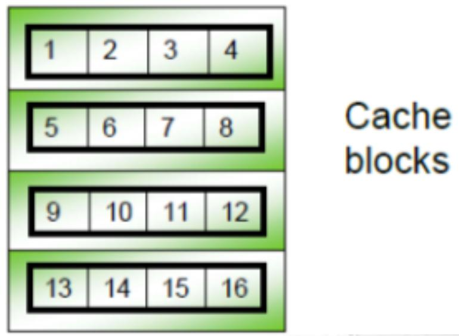

<details>
<summary>text_image</summary>

1 2 3 4
5 6 7 8
9 10 11 12
13 14 15 16
Cache
blocks
</details>

- 原程序(Column Major)

```txt
- a[100][5000]=...//初始化
for(j=0; j<5000; j=j+1) {
    for(i=0; i<100; i=i+1) {
    a[i][j] = 2 * a[i][j]; 每次都不命中
    }
}
```

- 优化后(Row Major)

```txt
a[100][5000]=...//初始化
for(i=0; i<100; i=i+1) {
    for(j=0; j<5000; j=j+1) {
    a[i][j] = 2 * a[i][j]; 可连续命中若干次[cache行大小]
```

# Cache性能分析与优化

# 优化方案7: 代码层面: 2) 循环合并

$$
\text { for } (i := 0; i <   N; i := i + 1)
$$

$$
\text { for } (j := 0; j <   N; j := j + 1)
$$

$$
a [ i ] [ j ] := 1 / b [ i ] [ j ] * c [ i ] [ j ];
$$

$$
\text { for } (i := 0; i <   N; i := i + 1)
$$

$$
\text { for } (j := 0; j <   N; j := j + 1)
$$

$$
d [ i ] [ j ] := a [ i ] [ j ] + c [ i ] [ j ];
$$

- 原程序中a和c访问两次

- 有可能不在cache中

$$
\text { for } (i := 0; i <   N; i := i + 1)
$$

$$
\text { for } (j := 0; j <   N; j := j + 1) \{
$$

优化后a和c第2次访问都在

cache里

$$
a [ i ] [ j ] := 1 / b [ i ] [ j ] * c [ i ] [ j ];
$$

$$
d [ i ] [ j ] := a [ i ] [ j ] + c [ i ] [ j ]; \}
$$

# Cache性能分析与优化

- 优化方案7: 代码层面: 3) 分块运算
- 例如，矩阵.\*运算

- 当3个矩阵无法全放在cache时，严重的Capacity Miss

$$
\begin{array}{l} \text { for } (i := 0; i <   N; i := i + 1) \\ \text { for } (j := 0; j <   N; j := j + 1) \{ \\ r := 0; \\ \text { for } (k := 0; k <   N; k := k + 1) \\ r := r + y [ i ] [ k ] * z [ k ] [ j ]; \\ x [ i ] [ j ] := r; \} \\ \end{array}
$$

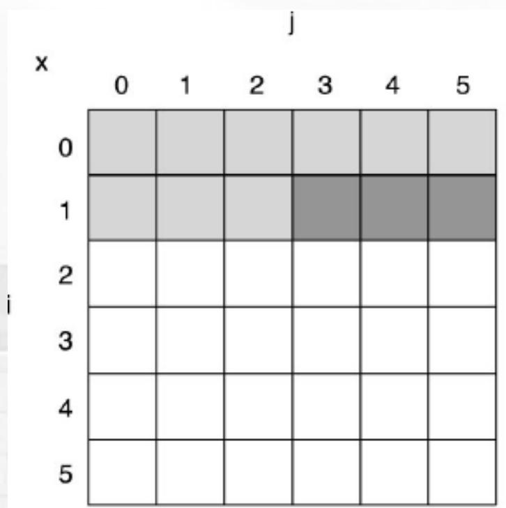

<details>
<summary>heatmap</summary>

| i \ j | 0 | 1 | 2 | 3 | 4 | 5 |
|---|---|---|---|---|---|---|
| 0 | Light Gray | Light Gray | Light Gray | Light Gray | Light Gray | Light Gray |
| 1 | Light Gray | Light Gray | Dark Grey | Dark Grey | Dark Grey | Dark Grey |
| 2 | White | White | White | White | White | White |
| 3 | White | White | White | White | White | White |
| 4 | White | White | White | White | White | White |
| 5 | White | White | White | White | White | White |
</details>

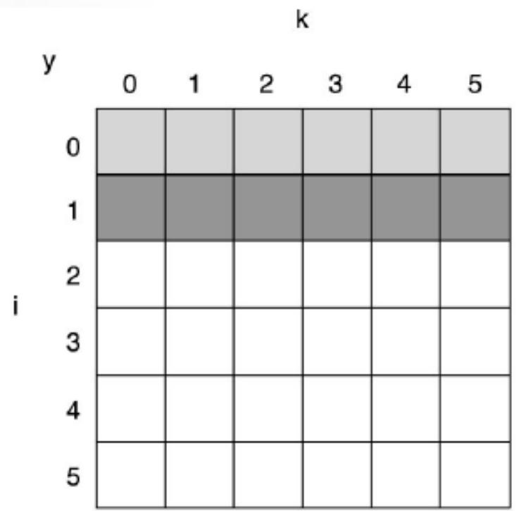

<details>
<summary>heatmap</summary>

| i \ k | 0 | 1 | 2 | 3 | 4 | 5 |
|---|---|---|---|---|---|---|
| 0 | Light Gray | Light Gray | Light Gray | Light Gray | Light Gray | Light Gray |
| 1 | Dark Grey | Dark Grey | Dark Grey | Dark Grey | Dark Grey | Dark Grey |
| 2 | White | White | White | White | White | White |
| 3 | White | White | White | White | White | White |
| 4 | White | White | White | White | White | White |
| 5 | White | White | White | White | White | White |
</details>

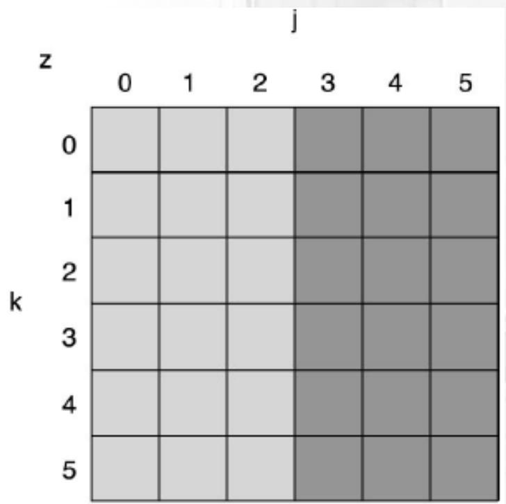

<details>
<summary>heatmap</summary>

| k | 0 | 1 | 2 | 3 | 4 | 5 |
|---|---|---|---|---|---|---|
| 0 | Light Gray | Light Gray | Light Gray | Dark Gray | Dark Gray | Dark Gray |
| 1 | Light Gray | Light Gray | Light Gray | Dark Gray | Dark Gray | Dark Gray |
| 2 | Light Gray | Light Gray | Light Gray | Dark Gray | Dark Gray | Dark Gray |
| 3 | Light Gray | Light Gray | Light Gray | Dark Gray | Dark Gray | Dark Gray |
| 4 | Light Gray | Light Gray | Light Gray | Dark Gray | Dark Gray | Dark Gray |
| 5 | Light Gray | Light Gray | Light Gray | Dark Gray | Dark Gray | Dark Gray |
</details>

# Cache性能分析与优化

- 优化方案7: 代码层面: 3) 分块运算
- 例如，矩阵.\*运算

- 当3个矩阵无法全放在cache时，严重的Capacity Miss

After:

- 把矩阵分成小块执行，充分避免Capacity Miss

$$
\text { for } (j j := 0; j j <   N; j j := j j + B)
$$

$$
\text { for } (k k := 0; k k <   N; k k := k k + B)
$$

$$
\text { for } (i := 0; i <   N; i := i + 1)
$$

$$
\text { for } (j := j j; j <   \min (j j + B - 1, N); j := j + 1) \{
$$

$$
