# 课件-存储系统6-Spring-2023

## 来源

- 分类：`课件`
- 原始文件：`存储系统6--Spring.2023.pdf`
- 原始相对路径：`资料/课件/存储系统6--Spring.2023.pdf`
- 原始绝对路径：`D:\wzb\计算机组成原理\资料\课件\存储系统6--Spring.2023.pdf`

## 后续处理建议

- 从本整理稿中提取稳定知识点
- 检查公式、表格、结构图的提取效果
- 必要时补单独图像解读稿
- 如发现资料错误，转入勘误或分歧

## 内容导读（基于整理稿归纳）

本讲继续围绕 Cache 做性能分析与优化，属于前一讲“Cache 会工作”之后的性能深化部分，重点转向 miss 分类、替换策略和一致性代价。

## 关键知识点

- Cache miss 的 4C 分类及其成因。
- FIFO、LRU 等替换策略的行为差异。
- Cache 性能优化与写一致性控制。

## 典型例题 / 思考题

- 说明 4C miss 分类分别代表什么问题。
- 比较 FIFO 与 LRU 的替换行为。
- 解释为什么命中一次后，替换顺序在不同策略下可能变化或不变。

## 例题理解层（基于课件整理）

### 题目簇 1：Cache 性能分析

- 原题/原问：
  - 为什么需要Cache，从性能和结构两方面简述?
  - 比较 FIFO 与 LRU 的替换行为
  - 解释为什么命中一次后，替换顺序在不同策略下可能变化或不变
- 题意：从性能（减少CPU等待）和结构（弥补CPU-内存速度差距）角度理解Cache存在的必要性，深入对比FIFO和LRU替换策略的行为差异。
- 所考知识点：
  - Cache存在的原因：CPU速度远快于主存（"存储墙"），Cache缓解速度不匹配
  - FIFO：按装入时间排序，最早装入的先替换（不考虑访问频率）
  - LRU：最近最少使用的先替换（考虑访问频率和时间局部性）
  - LRU性能优于FIFO但实现复杂（需记录访问顺序或使用近似算法）
  - Cache命中率对系统性能的影响：平均访存时间 = h×t_c + (1-h)×t_m
- 解题关注点：
  - FIFO的替换顺序只与装入有关，命中后不变
  - LRU的替换顺序随每次访问更新，命中后被访问块移到最近位置
  - 性能分析题需要计算命中率、平均访存时间、加速比
- 题型归类建议：Cache 分析题 + 计算题
- 备注：Cache性能计算是考试必考，需掌握公式

### 题目簇 2：虚拟存储器

- 原题/原问：
  - 什么是虚拟存储器?
  - 简述页表的作用?
- 题意：理解虚拟存储器的基本概念（由操作系统和MMU共同实现的地址转换机制）和页表在虚实地址转换中的作用。
- 所考知识点：
  - 虚拟存储器：用磁盘扩展逻辑地址空间，程序使用虚拟地址，由MMU转换为物理地址
  - 页表：记录虚拟页号→物理页号的映射关系
  - 页表项内容：物理页号、有效位、修改位、访问权限
  - TLB（快表）：页表的高速缓存，减少访存次数
  - 缺页中断：访问的页不在主存时触发，需从磁盘调入
- 解题关注点：
  - 虚拟地址 = 虚页号 + 页内偏移
  - 地址转换过程：查TLB→命中直接得到物理页号；未命中→查页表→可能缺页
  - 页表基址寄存器（PTBR）指向当前进程的页表起始地址
- 题型归类建议：概念辨析题
- 备注：虚拟存储是存储系统的收尾考点，与Cache映射有相似之处

## 提取结果

# 《计组II》

# 第七章——存储系统(6)

李瑞 教授

蒋志平 讲师

计算机科学与技术学院

# 温故 — 关于存储系统(1/2)

- 为什么需要Cache，从性能和结构两方面简述
- 什么是局部性原理？
- 什么是存储系统？典型计算机有哪几个存储系统？
- Cache系统中，地址变换/映射机构的作用？可能采用的物理器件是？
- 简述全相联映射。其特点？
- 简述直接映射，其特点？
- 简述组相联映射，其特点？

# 温故 — 关于存储系统(2/2)

- 简述Cache替换策略FIFO
- 简述Cache替换策略LRU
- 当某一内存块进入Cache之后又命中一次，FIFO及LRU策略下，这一块被踢出的顺序是否受影响？
- 简述Cache/内存写一致性问题
- 简述写回(Write Back)法
- 简述全写/写直达(Write Through)法
- 写直达方法存在的速度不匹配指什么？如何处理？

# Cache性能分析与优化

# Cache性能分析与优化

- Cache命中(Hit)
- CPU欲访问的数据已在缓存中，即可直接访问 Cache
- Cache非命中(Miss)
- 数据不在Cache，需要将主存数据调入Cache
- CPU被阻塞(Blocking)，等!
- 命中率(Hit Rate)
- 非命中率(Miss Rate)

# Cache性能分析:Miss的分类4C

# Miss的4种类型(4C):

- Compulsory (必然)
- 冷启动、过程转移、首次引用等不可避免的miss...

- Capacity (容量)

- 容量不够造成的

- Conflict (冲突)

- Cache块冲突

- 方案1：增加容量
- 方案2：提升相联度

- Coherence（相关）

- 其它操作带来的结构相关（I/O操作等）

# Cache性能分析:Miss的分类4C

- Conflict Miss随容量提升而降低
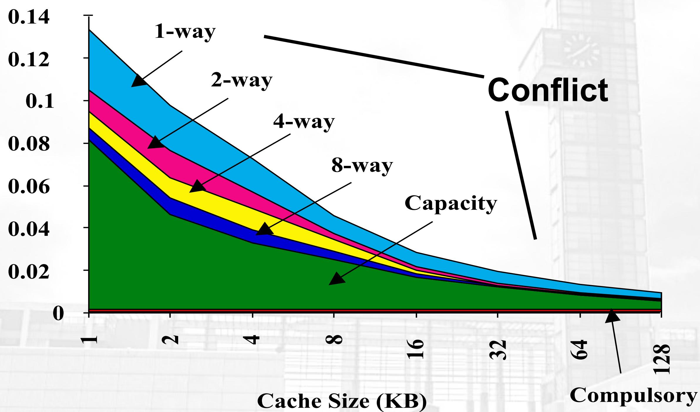

<details>
<summary>area</summary>

| Cache Size (KB) | 1-way  | 2-way  | 4-way  | 8-way  | Capacity |
| --------------- | ------ | ------ | ------ | ------ | -------- |
| 1               | 0.135  | 0.105  | 0.095  | 0.085  | 0.085    |
| 2               | 0.115  | 0.085  | 0.075  | 0.065  | 0.065    |
| 4               | 0.095  | 0.065  | 0.055  | 0.045  | 0.045    |
| 8               | 0.075  | 0.045  | 0.035  | 0.025  | 0.025    |
| 16              | 0.055  | 0.025  | 0.02   | 0.015  | 0.015    |
| 32              | 0.035  | 0.015  | 0.01   | 0.008  | 0.008    |
| 64              | 0.02   | 0.01   | 0.008  | 0.005  | 0.005    |
| 128             | 0.01   | 0.005  | 0.005  | 0.003  | 0.003    |
</details>

# Cache性能分析:Miss的分类4C

- 多路组相联明显降低miss rate

- 相同的miss rate, 1-way组相联(直接映射)需要2倍的Cache size才能达到2-way组相联水平

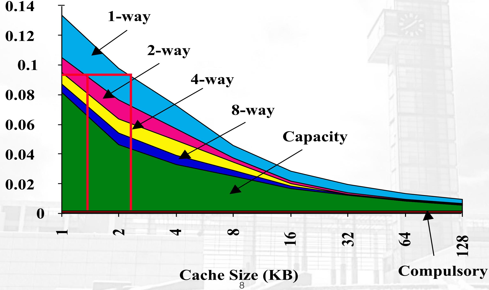

<details>
<summary>area</summary>

| Cache Size (KB) | 1-way  | 2-way  | 4-way  | 8-way  | Capacity |
| --------------- | ------ | ------ | ------ | ------ | -------- |
| 1               | 0.135  | 0.095  | 0.075  | 0.065  | 0.085    |
| 2               | 0.115  | 0.085  | 0.065  | 0.055  | 0.075    |
| 4               | 0.095  | 0.075  | 0.055  | 0.045  | 0.065    |
| 8               | 0.075  | 0.065  | 0.045  | 0.035  | 0.055    |
| 16              | 0.055  | 0.045  | 0.035  | 0.025  | 0.045    |
| 32              | 0.035  | 0.030  | 0.025  | 0.015  | 0.035    |
| 64              | 0.020  | 0.015  | 0.015  | 0.010  | 0.025    |
| 128             | 0.010  | 0.010  | 0.010  | 0.010  | 0.015    |
</details>

# Cache性能分析:Miss的分类4C

- 3种miss的比例
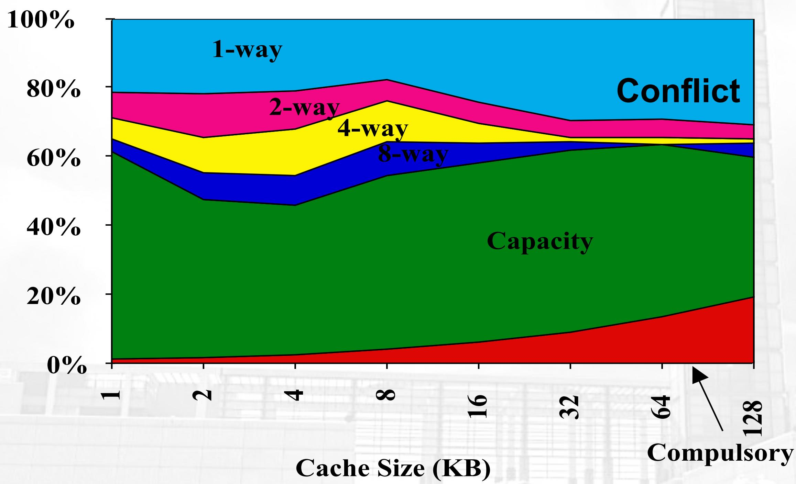

<details>
<summary>area_stacked</summary>

| Cache Size (KB) | 1-way | 2-way | 4-way | 8-way | Conflict |
| --------------- | ----- | ----- | ----- | ----- | -------- |
| 1               | ~65%  | ~10%  | ~10%  | ~10%  | ~10%     |
| 2               | ~50%  | ~15%  | ~15%  | ~15%  | ~15%     |
| 4               | ~45%  | ~15%  | ~20%  | ~20%  | ~20%     |
| 8               | ~40%  | ~15%  | ~25%  | ~25%  | ~25%     |
| 16              | ~35%  | ~10%  | ~20%  | ~30%  | ~30%     |
| 32              | ~30%  | ~5%   | ~15%  | ~35%  | ~35%     |
| 64              | ~25%  | ~5%   | ~10%  | ~40%  | ~40%     |
| 128             | ~20%  | ~5%   | ~5%   | ~45%  | ~45%     |
</details>

# Cache性能分析与优化

# 1. 加速比

■ Cache-主存系统的平均访问周期T:

$$
\mathsf {T} = \mathsf {H} \times \mathsf {T C} + (1 - \mathsf {H}) \times (\mathsf {T B} + \mathsf {T C})
$$

$$
T = T C + (1 - H) * T B
$$

- Cache的访问周期为TC，主存的访问周期为TM，数据块调入
- Cache的块传输时间为TB，Cache的命中率为H。

■ Cache-主存系统的加速比SP: SP=TM/T <- (Old duration / new)

# Cache性能分析与优化

例如，设Cache的速度是主存的5倍，命中率为 $95\%$ ，则采用Cache后性能提升多少？

系统平均访问时间 $= t + 0.05^{*}5t = 1.25t$

性能提升=5t/1.25t=4倍

# Cache性能分析与优化

- 如何提升Cache性能?

- 容量
- 块数/块大小
- 多路组相联
- 多级Cache
- Victim Cache
- 代码层面
●
...

- 指令/数据独立Cache

# Cache性能分析与优化

# 优化方案1：提升Cache容量

- 边际效率降低
- 成本问题...
- 制成/热设计...

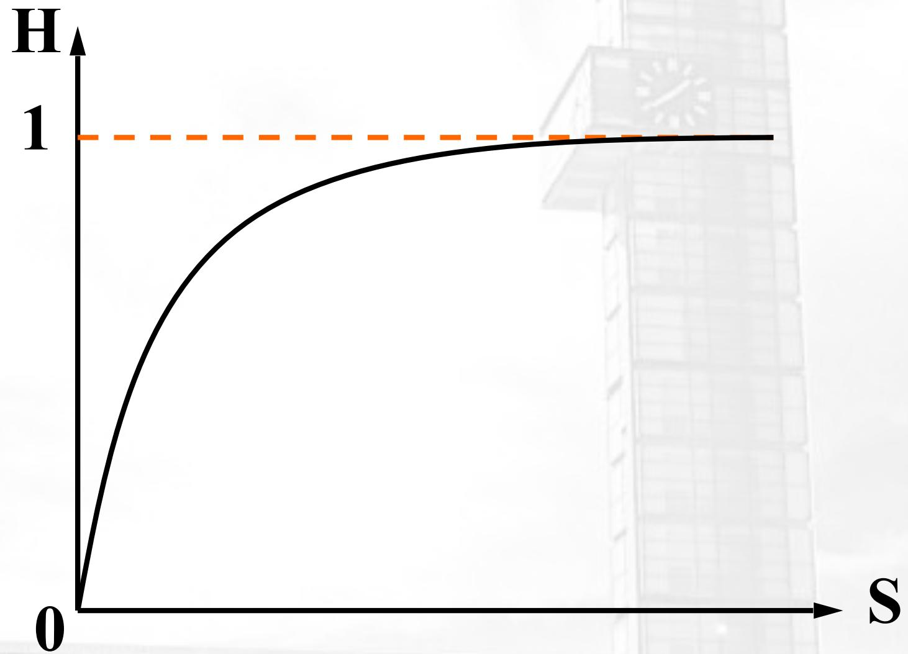

<details>
<summary>line</summary>

| S    | H   |
| ---- | --- |
| 0    | 0   |
| >0   | 1   |
</details>

Cache容量S与命中率H的关系

# Cache性能分析与优化

# 存储系统成本

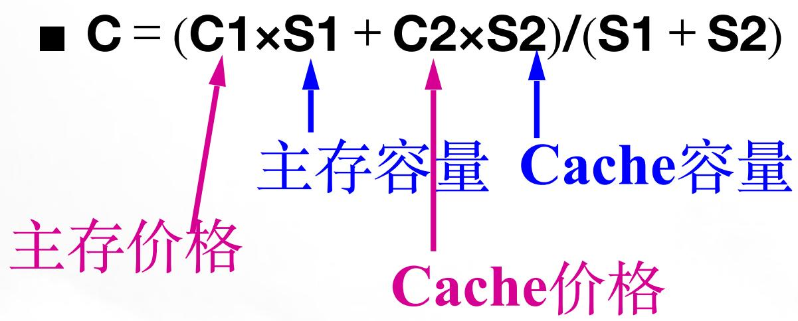

<details>
<summary>text_image</summary>

■ C = (C1×S1 + C2×S2)/(S1 + S2)
主存价格 ↑
主存容量 ↑
Cache容量
Cache价格
</details>

S1>>S2

■ 尽管Cache的价格比主存高，但是当其容量很小时，存储器的平均价格C接近于主存的价格。
■ 由于设置了Cache使CPU的访存速度接近Cache的速度，而使存储器的成本接近于主存的价格。

# Cache性能分析与优化

优化方案2：利用时空局部性原理，通过提升块大小，降低miss

rate
Miss Rate
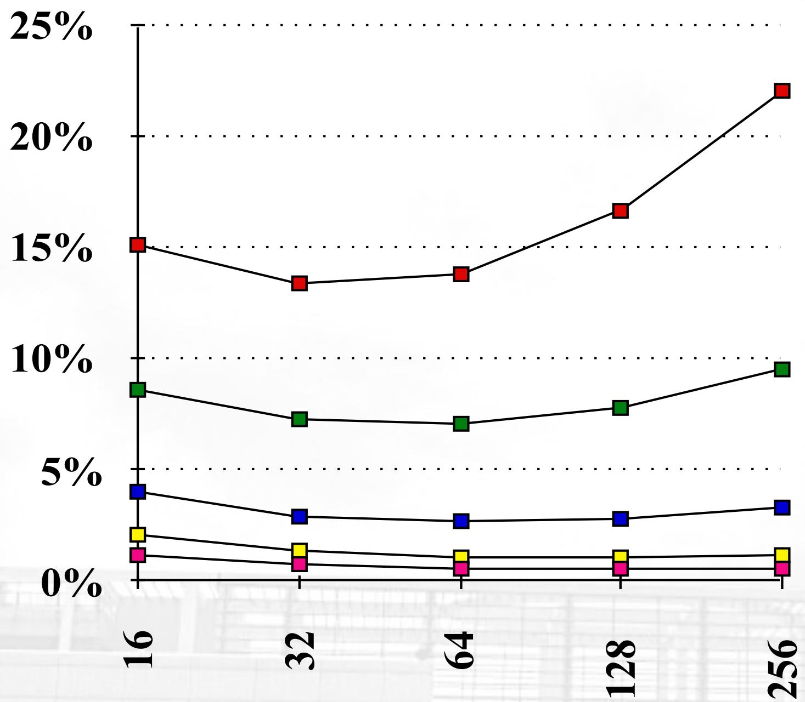

<details>
<summary>line</summary>

| x    | Series 1 | Series 2 | Series 3 | Series 4 | Series 5 |
| ---- | -------- | -------- | -------- | -------- | -------- |
| 16   | 15%      | 8.5%     | 4%       | 2%       | 1%       |
| 32   | 13.5%    | 7%       | 3%       | 1.5%     | 0.5%     |
| 64   | 14%      | 7%       | 3%       | 1%       | 0.5%     |
| 128  | 16.5%    | 8%       | 3%       | 1%       | 0.5%     |
| 256  | 22%      | 9.5%     | 3.5%     | 1%       | 0.5%     |
</details>

Block Size (bytes)

Size of Cache
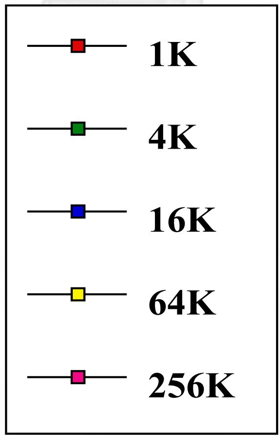

<details>
<summary>bar</summary>

| Temperature (K) | Value |
| :--- | :--- |
| 1K | Red |
| 4K | Green |
| 16K | Blue |
| 64K | Yellow |
| 256K | Pink |
</details>

# Cache性能分析与优化

优化方案2：利用时空局部性原理，通过提升块大小，降低miss rate

- 降低Compulsory必然miss rate
- 但太大的块有缺点

- miss的代价大;
- Conflict冲突导致的miss高

- 总结，差不多大就得了。

# Cache性能分析与优化

# 优化方案3：提升组相联级别

- 级别高一些，还是好的...

- 2:1规则，2路组相联只需要一半的Cache容量就可以达到1路组相联同等的miss rate/hit rate

- 但级别提升的边际效率在下降

- 级别也不要太高

- 相联比较复杂
- 相联存取复杂->提高TC时间

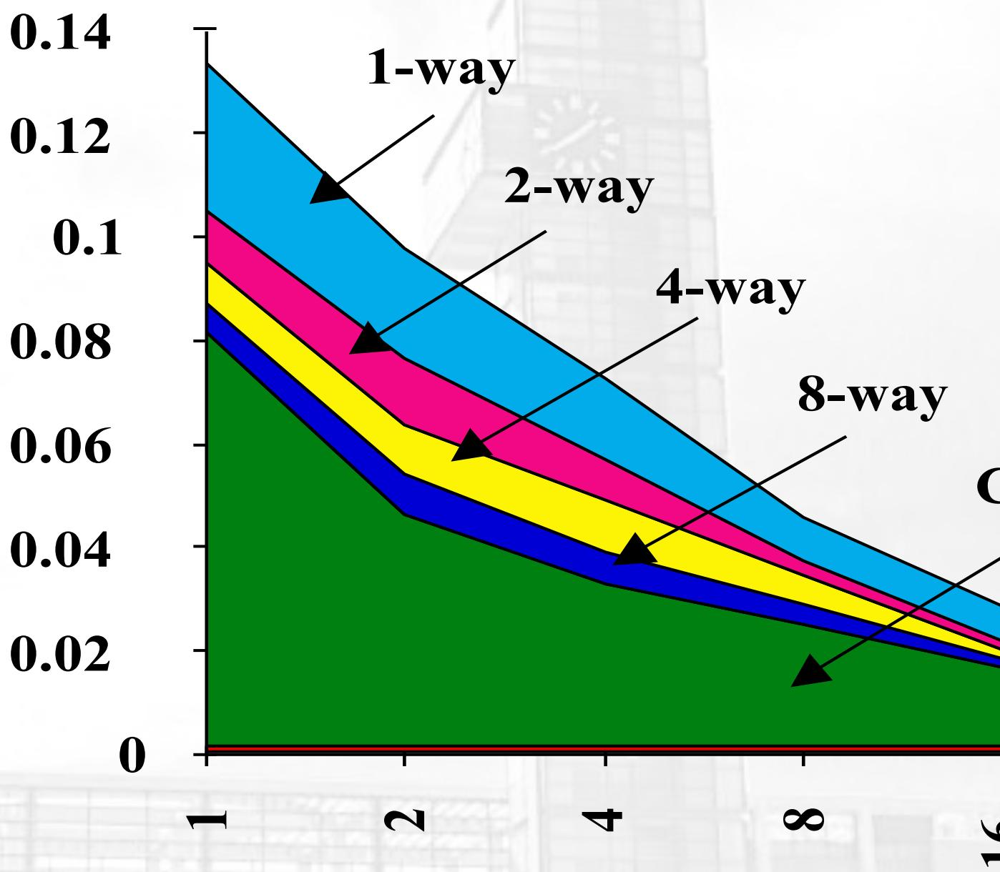

<details>
<summary>area</summary>

| Step | 1-way | 2-way | 4-way | 8-way |
| ---- | ----- | ----- | ----- | ----- |
| 1    | 0.135 | 0.105 | 0.095 | 0.085 |
| 2    | 0.115 | 0.085 | 0.075 | 0.065 |
| 4    | 0.085 | 0.065 | 0.055 | 0.045 |
| 8    | 0.055 | 0.045 | 0.035 | 0.025 |
| 16   | 0.035 | 0.025 | 0.015 | 0.010 |
</details>

Cache Size (KB)

# Cache性能分析与优化

- 例如一组典型数据...

Cache Size Associativity

<table><tr><td>(KB)</td><td colspan="2">1-way</td><td colspan="2">2-way</td><td>4-way</td><td>8-way</td></tr><tr><td>1</td><td>7.65</td><td>6.60</td><td>6.22</td><td>5.44</td><td></td><td></td></tr><tr><td>2</td><td>5.90</td><td>4.90</td><td>4.62</td><td>4.09</td><td></td><td></td></tr><tr><td>4</td><td>4.60</td><td>3.95</td><td>3.57</td><td>3.19</td><td></td><td></td></tr><tr><td>8</td><td>3.30</td><td>3.00</td><td>2.87</td><td>2.59</td><td></td><td></td></tr><tr><td>16</td><td>2.45</td><td>2.20</td><td>2.12</td><td>2.04</td><td></td><td></td></tr><tr><td>32</td><td>2.00</td><td>1.80</td><td>1.77</td><td>1.79</td><td></td><td></td></tr><tr><td>64</td><td>1.70</td><td>1.60</td><td>1.57</td><td>1.59</td><td></td><td></td></tr><tr><td>128</td><td>1.50</td><td>1.45</td><td>1.42</td><td>1.44</td><td></td><td></td></tr></table>

红色说明8路组相联已经没有性能提升

# Cache性能分析与优化

# 优化方案4：多级Cache

■ 两级Cache的总未命中率(总失效率): 总失效率 = (失效率) 第一级 × (失效率) 第二级…… × (失效率) 第N级
■ 【例】10000次访存，第一级Cache失效400次，第二级Cache失效4次。

- (失效率)第一级 $= 400 / 10000 = 4\%$
- (失效率) $_{第二级}$ =4/400=1%
- 利用两级Cache后总的失效率 $= 0.04\%$ 。

# Cache性能分析与优化

# 5. 多级Cache的命中率

【例】访问内存需50ns, L1 1ns 10%失效率, L2 5ns 1%失效率, L3 10ns 0.2%失效率, 求L1, L1+L2, L1+L2+L3构架下的平均访问时间。

$$
\mathrm{L1:} \qquad \mathrm{T=1ns+(0.1\times50ns)=6ns}
$$

$$
\mathrm{L1+2:} \quad \mathrm{T=1ns+(0.1\times[5ns+(0.01\times50ns)])=1.55ns}
$$

$$
\mathrm{L} 1 + 2 + 3: \mathrm{T} = 1 \mathrm{ns} + (0. 1 \times [ 5 \mathrm{ns} + (0. 0 1 \times [ 1 0 \mathrm{ns} + (0. 0 0 2 \times 5 0 \mathrm{ns}) ]) ]) = 1. 5 0 0 1 \mathrm{ns}
$$

# Cache性能分析与优化

# 优化方案5：拆分出指令/数据独立Cache

# 例如

- 16KB 指令/数据独立Cache
- 指令 miss rate=0.64%, 数据 miss rate=6.47%
- 32KB 统—Cache: miss rate=2.99%
- 假设75%指令,25%数据，Hit time = 1, Miss time = 50

T独立=75%x(1+0.64%x50)+25%x(1+6.47%x50)=2.05

T统一=75%x(1+2.99%x50)+25%x(1+2.99%x50)=2.50

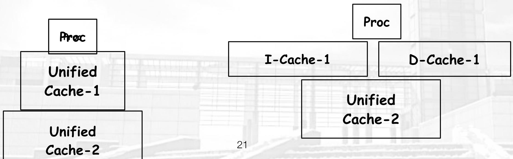

<details>
<summary>flowchart</summary>

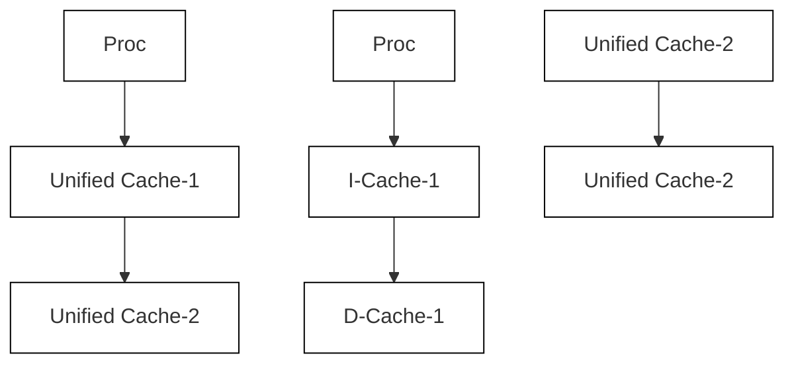
</details>

# Cache性能分析与优化

- 优化方案6: Victim Cache
- Miss的代价很大，如何优化？

- Victim Cache, 在L1和L2/主存之间

- Victim Cache容量小，采用全相联
- 例如，4个块的Victim Cache可以降
低4KB直接映射miss rate 20-90%。

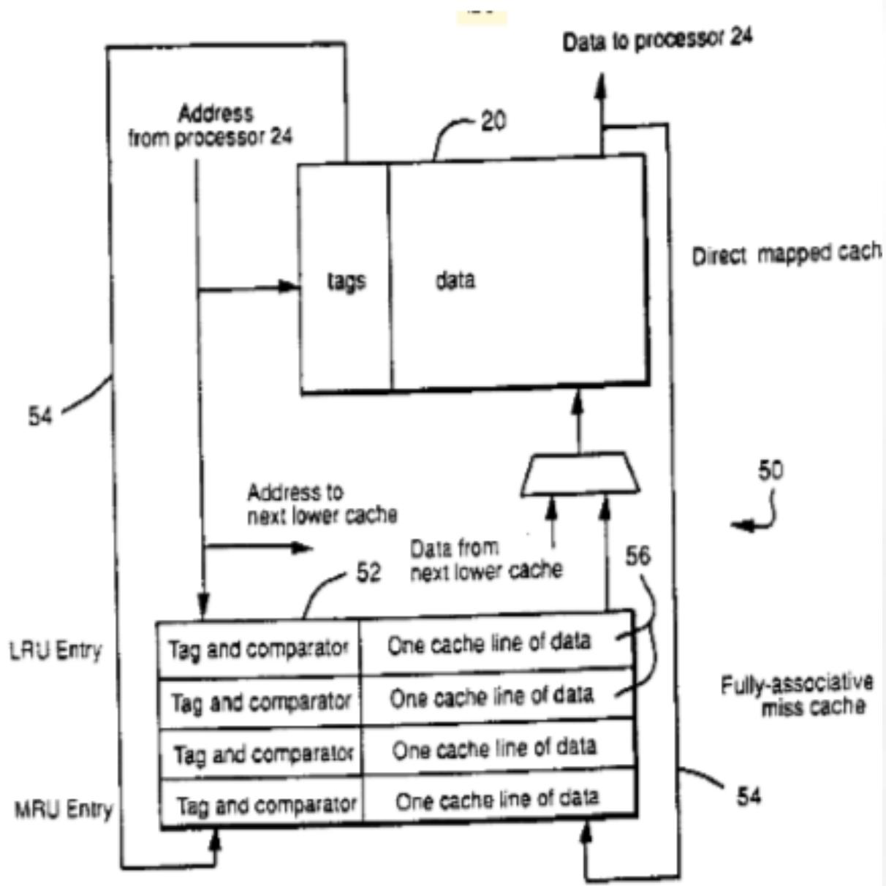

<details>
<summary>flowchart</summary>

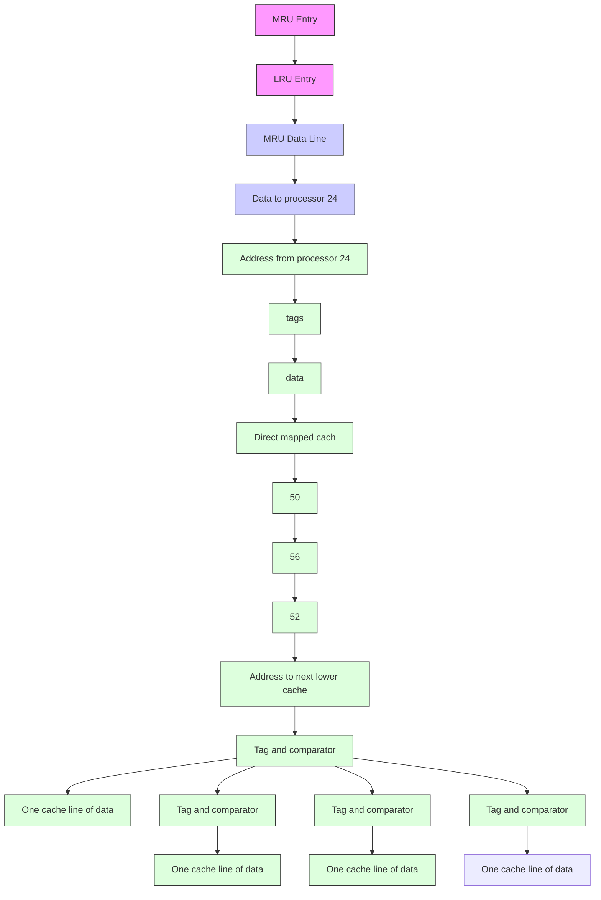
</details>

# Cache性能分析与优化

- 优化方案7: 代码层面: 1) Row Major
- 注意循环：大部分计算和访存都在循环中发生

- 按照数据对象在存储器中的存储顺序读取，最优
- 否则，连续miss

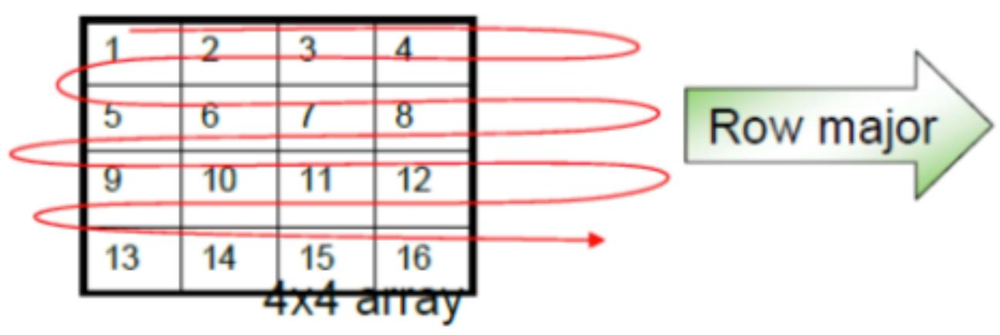

<details>
<summary>text_image</summary>

1 2 3 4
5 6 7 8
9 10 11 12
13 14 15 16
4x4 array
Row major
</details>

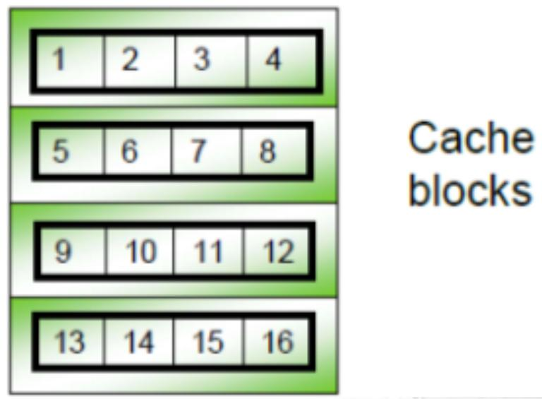

<details>
<summary>text_image</summary>

1 2 3 4
5 6 7 8
9 10 11 12
13 14 15 16
Cache
blocks
</details>

- 原程序(Column Major)

```txt
- a[100][5000]=...//初始化
for(j=0; j<5000; j=j+1) {
    for(i=0; i<100; i=i+1) {
    a[i][j] = 2 * a[i][j]; 每次都不命中
    }
}
```

- 优化后(Row Major)

```txt
a[100][5000]=...//初始化
for(i=0; i<100; i=i+1) {
    for(j=0; j<5000; j=j+1) {
    a[i][j] = 2 * a[i][j]; 可连续命中若干次[cache行大小]
```

# Cache性能分析与优化

# 优化方案7: 代码层面: 2) 循环合并

$$
\text { for } (i := 0; i <   N; i := i + 1)
$$

$$
\text { for } (j := 0; j <   N; j := j + 1)
$$

$$
a [ i ] [ j ] := 1 / b [ i ] [ j ] * c [ i ] [ j ];
$$

$$
\text { for } (i := 0; i <   N; i := i + 1)
$$

$$
\text { for } (j := 0; j <   N; j := j + 1)
$$

$$
d [ i ] [ j ] := a [ i ] [ j ] + c [ i ] [ j ];
$$

- 原程序中a和c访问两次

- 有可能不在cache中

$$
\text { for } (i := 0; i <   N; i := i + 1)
$$

$$
\text { for } (j := 0; j <   N; j := j + 1) \{
$$

优化后a和c第2次访问都在

cache里

$$
a [ i ] [ j ] := 1 / b [ i ] [ j ] * c [ i ] [ j ];
$$

$$
d [ i ] [ j ] := a [ i ] [ j ] + c [ i ] [ j ]; \}
$$

# Cache性能分析与优化

- 优化方案7: 代码层面: 3) 分块运算
- 例如，矩阵.\*运算

- 当3个矩阵无法全放在cache时，严重的Capacity Miss

$$
\begin{array}{l} \text { for } (i := 0; i <   N; i := i + 1) \\ \text { for } (j := 0; j <   N; j := j + 1) \{ \\ r := 0; \\ \text { for } (k := 0; k <   N; k := k + 1) \\ r := r + y [ i ] [ k ] * z [ k ] [ j ]; \\ x [ i ] [ j ] := r; \} \\ \end{array}
$$

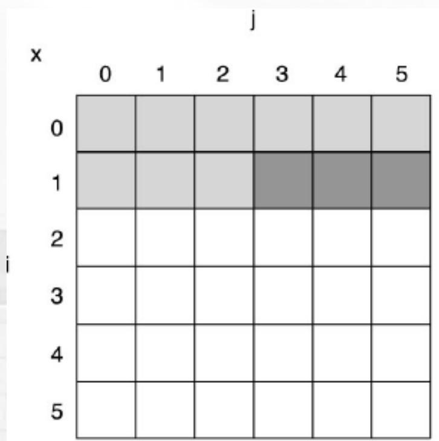

<details>
<summary>heatmap</summary>

| i \ j | 0 | 1 | 2 | 3 | 4 | 5 |
|---|---|---|---|---|---|---|
| 0 | Light Gray | Light Gray | Light Gray | Light Gray | Light Gray | Light Gray |
| 1 | Light Gray | Light Gray | Dark Grey | Dark Grey | Dark Grey | Dark Grey |
| 2 | White | White | White | White | White | White |
| 3 | White | White | White | White | White | White |
| 4 | White | White | White | White | White | White |
| 5 | White | White | White | White | White | White |
</details>

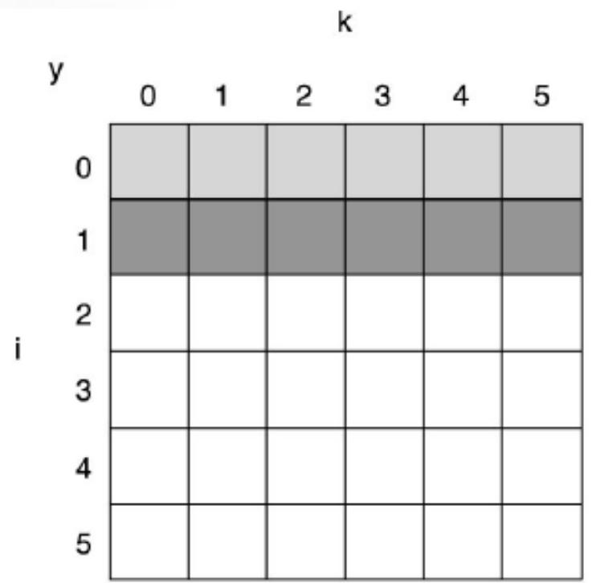

<details>
<summary>heatmap</summary>

| i \ k | 0 | 1 | 2 | 3 | 4 | 5 |
|---|---|---|---|---|---|---|
| 0 | Light Gray | Light Gray | Light Gray | Light Gray | Light Gray | Light Gray |
| 1 | Dark Grey | Dark Grey | Dark Grey | Dark Grey | Dark Grey | Dark Grey |
| 2 | White | White | White | White | White | White |
| 3 | White | White | White | White | White | White |
| 4 | White | White | White | White | White | White |
| 5 | White | White | White | White | White | White |
</details>

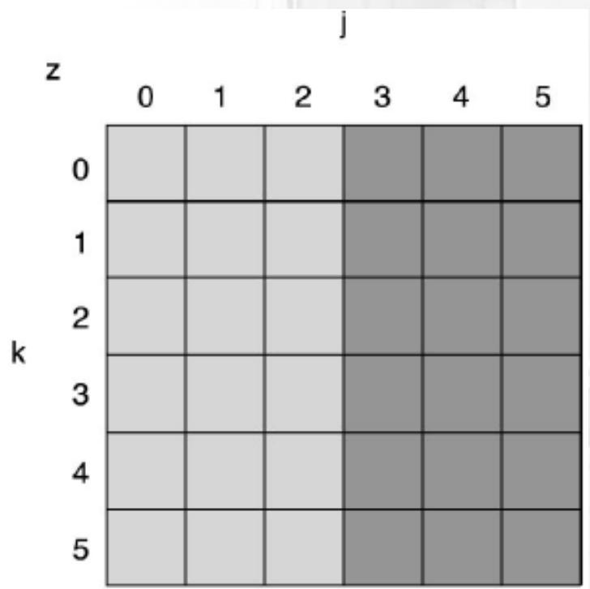

<details>
<summary>heatmap</summary>

| k | 0 | 1 | 2 | 3 | 4 | 5 |
|---|---|---|---|---|---|---|
| 0 | Light Gray | Light Gray | Light Gray | Dark Grey | Dark Grey | Dark Grey |
| 1 | Light Gray | Light Gray | Light Gray | Dark Grey | Dark Grey | Dark Grey |
| 2 | Light Gray | Light Gray | Light Gray | Dark Grey | Dark Grey | Dark Grey |
| 3 | Light Gray | Light Gray | Light Gray | Dark Grey | Dark Grey | Dark Grey |
| 4 | Light Gray | Light Gray | Light Gray | Dark Grey | Dark Grey | Dark Grey |
| 5 | Light Gray | Light Gray | Light Gray | Dark Grey | Dark Grey | Dark Grey |
</details>

# Cache性能分析与优化

- 优化方案7: 代码层面: 3) 分块运算
- 例如，矩阵.\*运算

- 当3个矩阵无法全放在cache时，严重的Capacity Miss

After:

- 把矩阵分成小块执行，充分避免Capacity Miss

$$
\text { for } (j j := 0; j j <   N; j j := j j + B)
$$

$$
\text { for } (k k := 0; k k <   N; k k := k k + B)
$$

$$
\text { for } (i := 0; i <   N; i := i + 1)
$$

$$
\text { for } (j := j j; j <   \min (j j + B - 1, N); j := j + 1) \{
$$

$$
r := 0;
$$

$$
\text { for } (k := k k; k <   \min (k k + B - 1, N); k := k + 1)
$$

$$
r := r + y [ i ] [ k ] * z [ k ] [ j ];
$$

$$
x [ i ] [ j ] := x [ i ] [ j ] + r; \}
$$

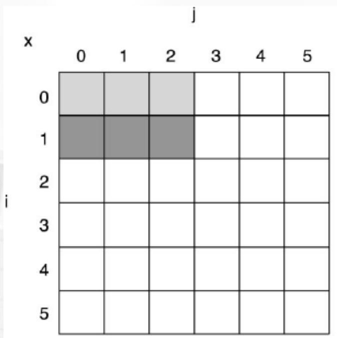

<details>
<summary>heatmap</summary>

| i \ j | 0 | 1 | 2 | 3 | 4 | 5 |
|---|---|---|---|---|---|---|
| 0 | Light Gray | Light Gray | Light Gray | White | White | White |
| 1 | Dark Gray | Dark Gray | Dark Gray | White | White | White |
| 2 | White | White | White | White | White | White |
| 3 | White | White | White | White | White | White |
| 4 | White | White | White | White | White | White |
| 5 | White | White | White | White | White | White |
</details>

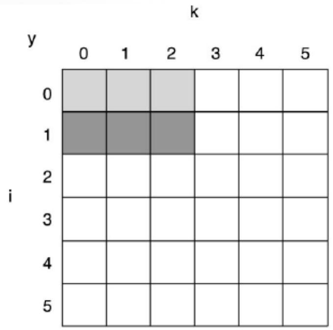

<details>
<summary>heatmap</summary>

| i \ k | 0 | 1 | 2 | 3 | 4 | 5 |
|---|---|---|---|---|---|---|
| 0 | Light Gray | Light Gray | Light Gray | White | White | White |
| 1 | Dark Grey | Dark Grey | Dark Grey | White | White | White |
| 2 | White | White | White | White | White | White |
| 3 | White | White | White | White | White | White |
| 4 | White | White | White | White | White | White |
| 5 | White | White | White | White | White | White |
</details>

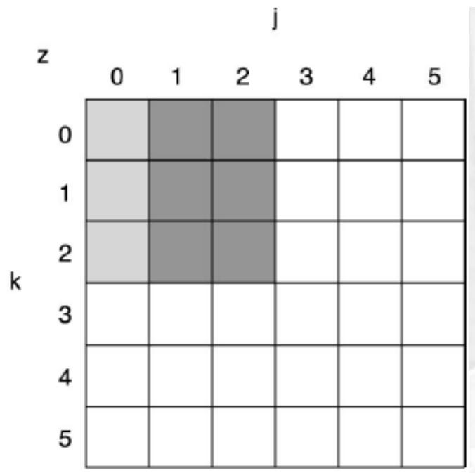

<details>
<summary>heatmap</summary>

| k | 0 | 1 | 2 | 3 | 4 | 5 |
|---|---|---|---|---|---|---|
| 0 | 1 | 1 | 1 | 0 | 0 | 0 |
| 1 | 1 | 1 | 1 | 0 | 0 | 0 |
| 2 | 1 | 1 | 1 | 0 | 0 | 0 |
| 3 | 0 | 0 | 0 | 0 | 0 | 0 |
| 4 | 0 | 0 | 0 | 0 | 0 | 0 |
| 5 | 0 | 0 | 0 | 0 | 0 | 0 |
</details>

# On Spectre Vulnerability

# Spectre攻击技术

- 背景知识:

- CPU早已是乱序执行构架（OoO-E），而且预测执行（Speculative Execution），原理很简单：

- 多路分支同时执行（同时执行if/switch/for的多分支）
- 但结果临时存放在CPU中，并不写回内存
- 直到确定哪条分支真正被执行，才写内存，丢弃其它分支结果

- 看似是完美的性能倍增技术：性能提升，正确性有保证

# Pentium 4 Cache

- L1 caches: 64 byte lines, 4 way set associative
- L2 cache: 128 byte lines, 8 way set associative
- L3 cache : on chip

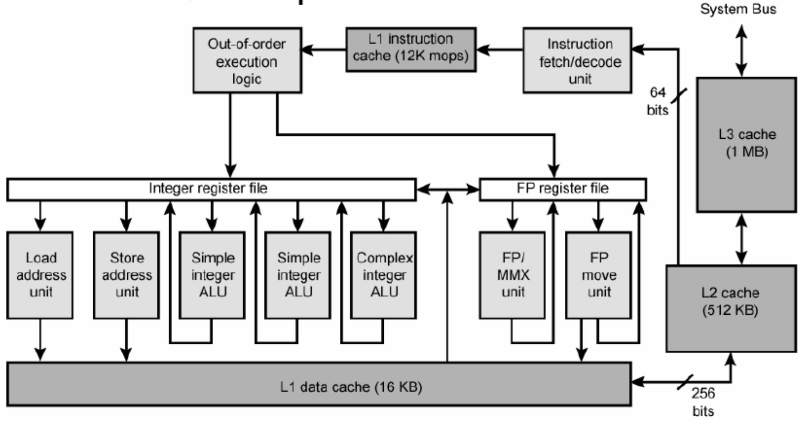

<details>
<summary>flowchart</summary>

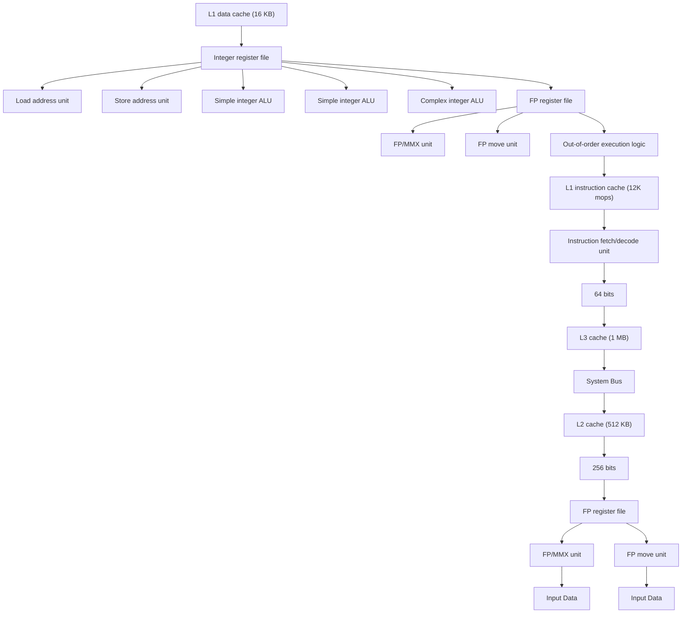
</details>

# Spectre攻击技术

- 但预测执行还是会有“痕迹”的

- 不同分支访问内存，Cache会留痕迹

- 痕迹: 有些并未被正确分支使用到的内存块被加速了 (放入cache)！

- 这就可以被用来实施攻击了!

# Spectre攻击技术

- 如何攻击？攻击什么？

- 在正常情况下，有些权限操作是不能被执行的，比如通过通过系统的特殊API访问其它进程的内存...
- 但在预测执行时，其实这些API被真实地调用过！

- 结果并没有写回内存

- 如何获取这些没有写回内存的结果？

- cache的加速痕迹!

# Spectre攻击技术

- 如何攻击？攻击什么？

- 在正常情况下，有些权限操作是不能被执行的，比如通过通过系统的特殊API访问其它进程的内存...
- 但在预测执行时，其实这些API被真实地调用过！

- 结果并没有写回内存
- 如何获取这些没有写回内存的结果？

- cache的加速痕迹!

- 访问一处根据API返回结果转变出的内存!

# Spectre攻击技术

- 如何获得最后的结果?

- 扫描内存!

- 检查每一个块的访问速度!
- 被访问过的快访问速度快，反之慢。

- 得到一张内存访问速度表

- 反求出权限API返回的结果!

# 虚拟存储器

# Virtual Memory, VM

# VM: 两种地址空间

- 虚拟地址空间

- 每个进程独占的“巨大 + 连续”的虚拟内存上的地址

- 物理地址空间

- 实际的物理内存上的地址
- 被操作系统+硬件完全屏蔽

# VM的原理

- 1. 把内存（物理&虚拟）分为同样大小的块或段
- 2. 每个进程在各自的互相隔离的VM中占用一些内存块或段
- 3. 通过“地址变换表”Address Translation Table，将VM中的块或段映射到物理内存
- 虚拟地址<->物理地址变换由硬件完成

# VM的原理

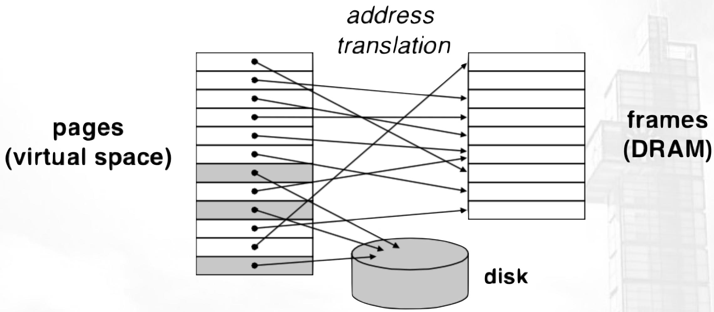

<details>
<summary>flowchart</summary>

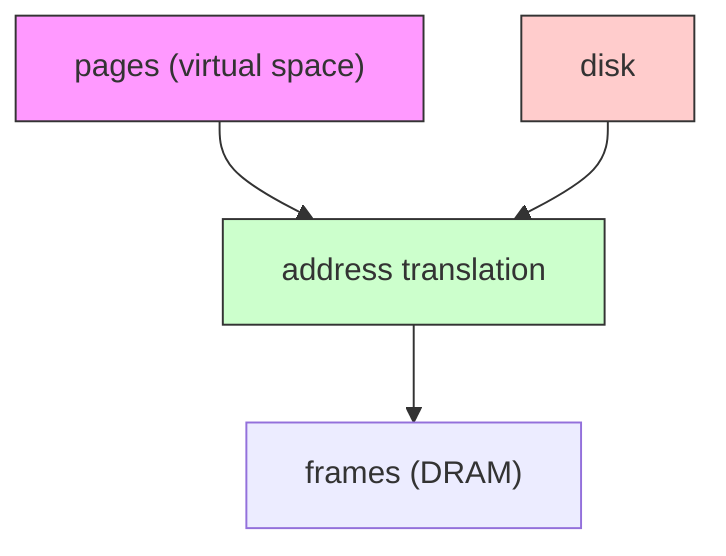
</details>

- 某种角度来说，内存成了外存的Cache

- 实现“进程连续并且更大”的内存
- 程序在内存中的实际位置无意味
- 进程隔离、进程共享、内存动态管理等优势

# 存储系统

# 存储系统的多层次结构

cache-主存-辅存三级存储体系：三级存储层次

主存-辅存存储层次：大容量、低成本；

软硬件结合完成

cache-主存存储层次: 高速度、低成本;

纯硬件完成

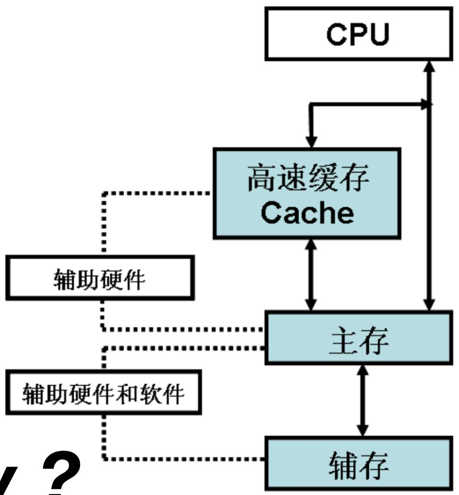

<details>
<summary>flowchart</summary>

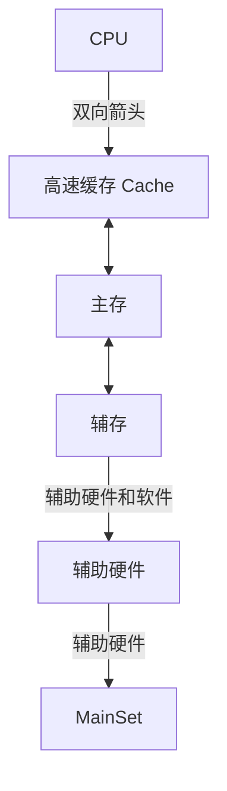
</details>

解决存储系统三个指标：容量、速度、价格/位的矛盾

# 7.4 虚拟存储器

# ■ 三种地址映象和变换方法

- 段式虚拟存储器
- 页式虚拟存储器
- 段页式虚拟存储器

# ■ 段式存储管理方式:

将程序按逻辑意义分成段，按段进行调入、调出和管理。

# 段式虚拟存储器

# 地址映象方法:

每个程序段都从0地址开始编址，长度可长可短，可以在程序执行过程中动态改变程序段的长度。

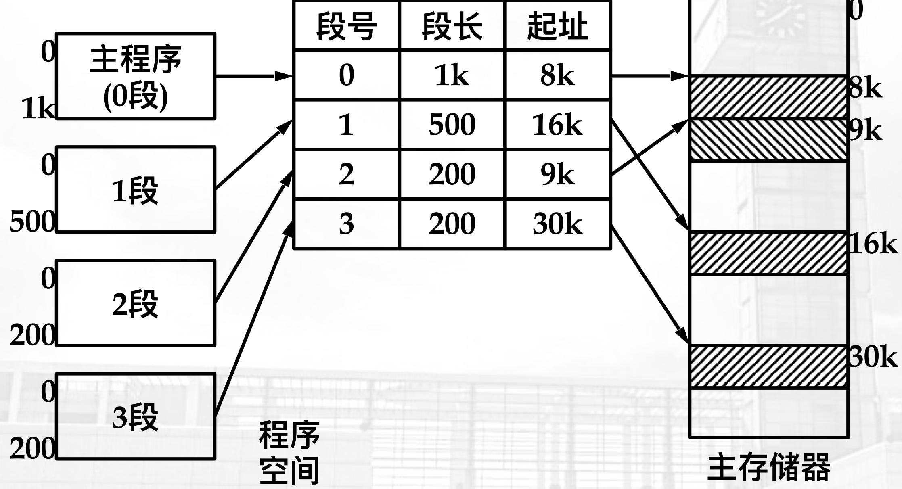

<details>
<summary>flowchart</summary>

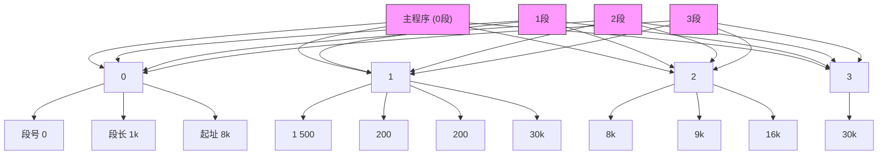
</details>

# 段式虚拟存储器

# ■ 地址变换方法:

① 由用户号找到基址寄存器；
② 从基址寄存器中读出段表起始地址；
③ 把段表起始地址与虚地址中段号S相加得到段表中S段的地址；
④ 把S段的物理内存起始地址与段内偏移D相加就能得到主存实地址。

# 段式虚拟存储器

段式虚拟存储器的地址变换
程序号（基号）
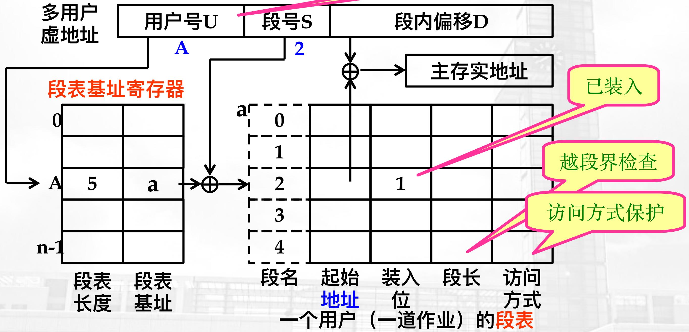

<details>
<summary>flowchart</summary>

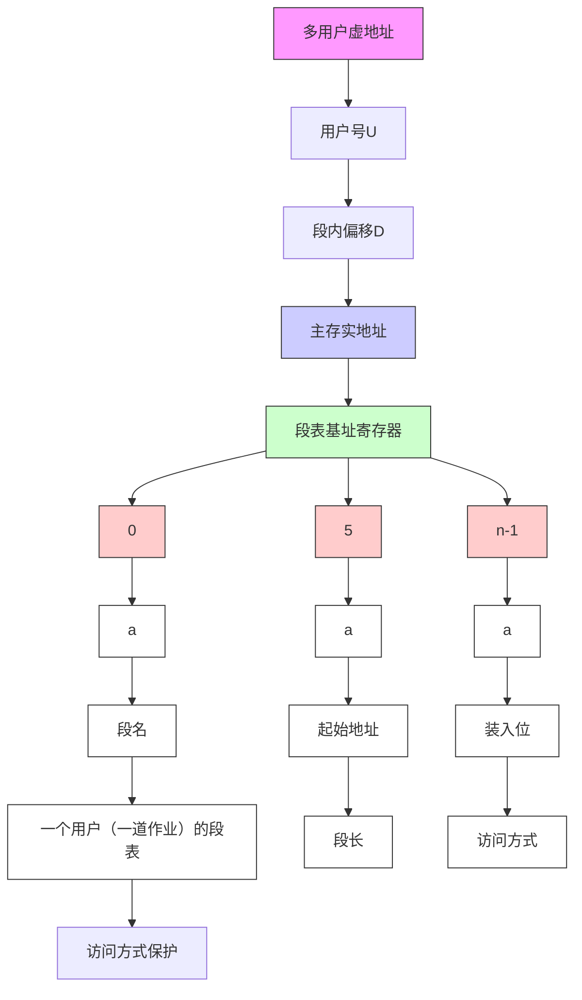
</details>

# 段式虚拟存储器

# ■ 主要优点:

① 程序的模块化性能好。
② 便于多道程序共享主存中的某些段。
③ 程序的动态链接和调度比较容易。
④ 便于按逻辑意义实现存储器的访问方式保护。

# ■ 主要缺点:

① 地址变换所花费的时间长，两次加法。
② 段映象表庞大，地址、段长字段太长。
③ 主存储器的利用率往往比较低——存储管理复杂；段间“零头”。
④ 对辅存（磁盘存储器）的管理比较困难。

# 段式虚拟存储器

首先分配法
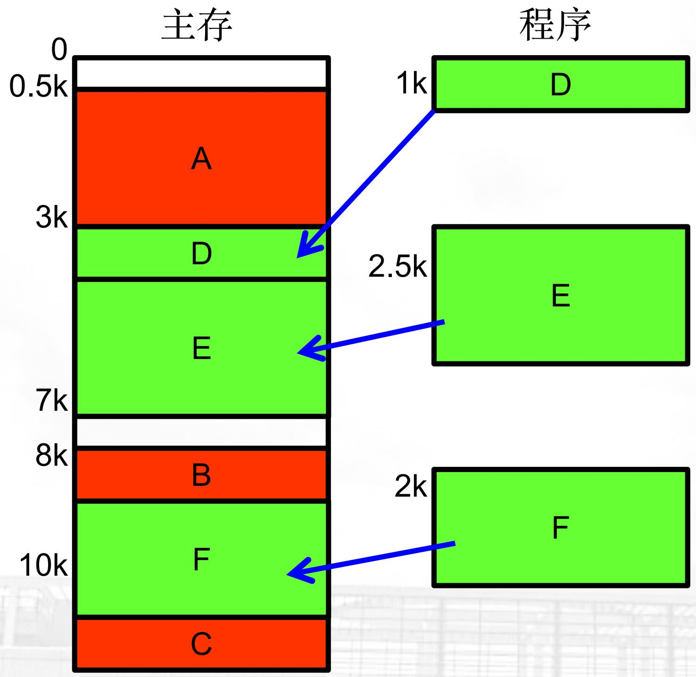

<details>
<summary>bar_stacked</summary>

| Category | Start (k) | End (k) |
| -------- | --------- | ------- |
| A        | 0.5       | 3       |
| D        | 3         | 7       |
| E        | 7         | 8       |
| F        | 10        | 10      |
| D        | 1         | -       |
| E        | 2.5       | -       |
| F        | 2         | -       |
</details>

# 段式虚拟存储器

最佳分配法
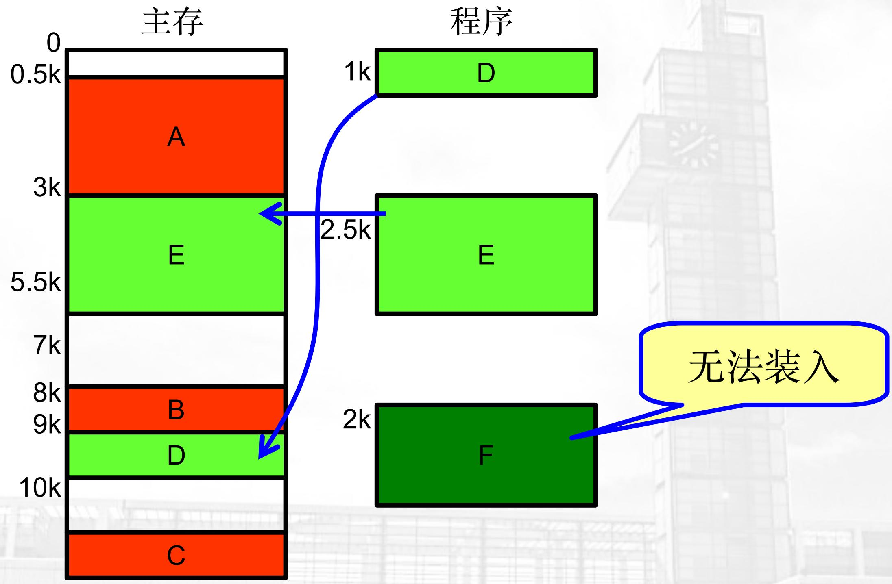

<details>
<summary>flowchart</summary>

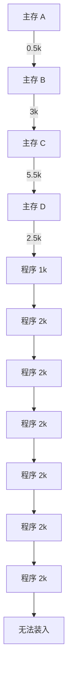
</details>

# 页式虚拟存储器

# ■ 页式存储管理方式:

将物理空间和VM空间都等分成相同大小的页面(Page)，按页顺序编号，让程序的起点必须处在主存中某一个页面位置的起点上。

任一主存单元的地址由页号和页内位移两个字段组成。

# 页式虚拟存储器

# 虚页/逻辑页

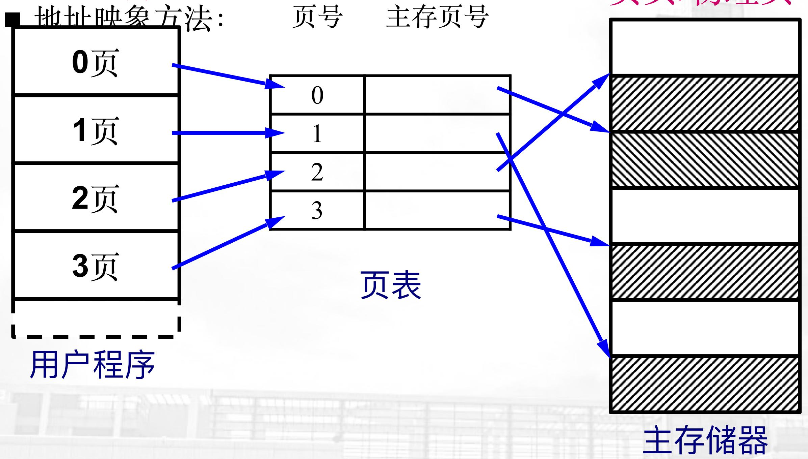

<details>
<summary>flowchart</summary>

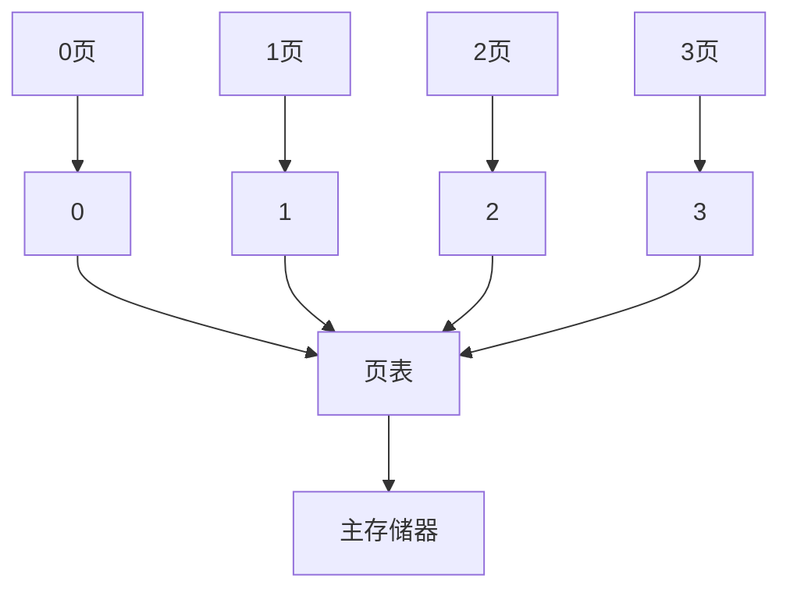
</details>

# 页式虚拟存储器

■ 地址变换方法:
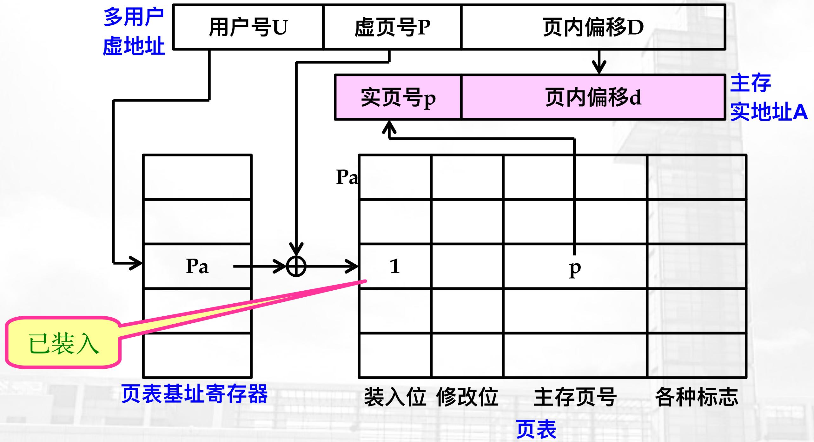

<details>
<summary>flowchart</summary>

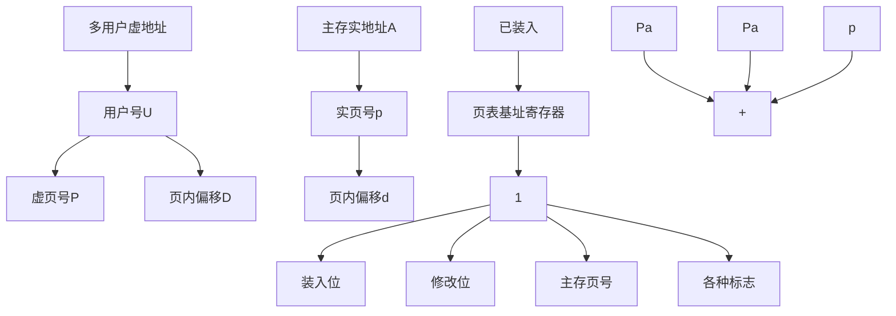
</details>

# 7.4 虚拟存储器

# 三、页式虚拟存储器

# ■主要优点：

① 主存储器的利用率比较高。
② 页表相对比较简单，使用硬件少。
③ 地址变换的速度比较快。
④ 对磁盘的管理比较容易。

# ■ 主要缺点:

① 程序的模块化性能不好
② 页表很长，需要占用很大的存储空间

例如：虚拟存储空间4GB，页大小1KB，则页表的容量为4M存储字。如果每个页表存储字占用4个字节，则页表的存储容量为16MB。

# 段页式虚拟存储器

# ■ 段页式存储管理方式：

将程序按逻辑意义先分成段，再让各段和实主存都机械等分成相同大小的页面。每道程序通过一个段表和相应的一组页表来进行程序在主存空间中的定位。

# 段页式虚拟存储器

# 地址映象方法:

每个程序段在段表中占一行，在段表中给出页表长度和页表的起始地址，页表中给出每一页在主存储器中的实页号。

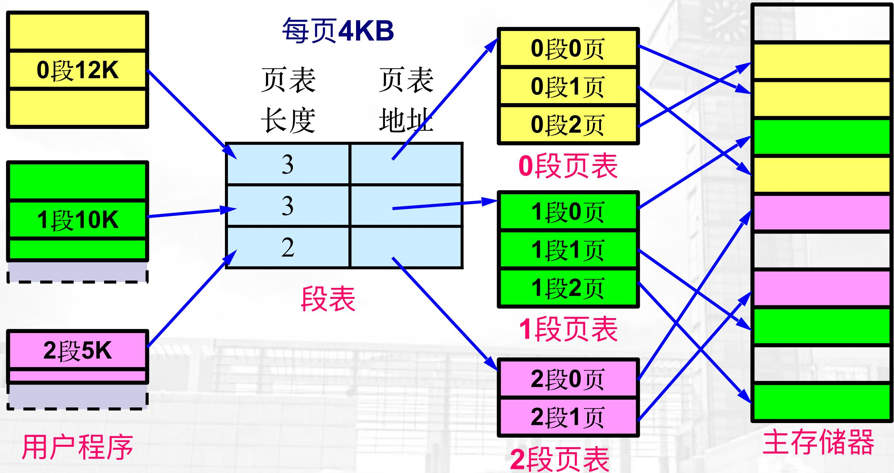

<details>
<summary>flowchart</summary>

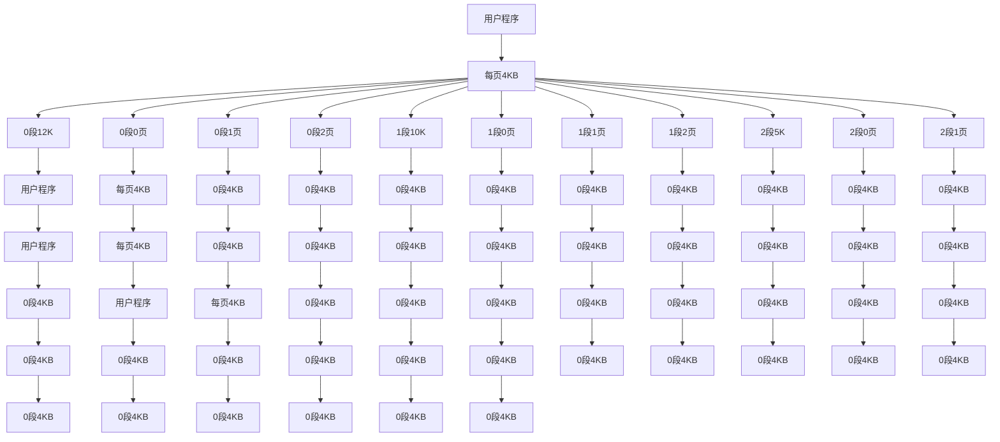
</details>

# 7.4 虚拟存储器

# 四、段页式虚拟存储器

# ■ 地址变换方法:

① 先查段表，得到页表起始地址和页表长度；
② 再查页表找到要访问的主存实页号;
③ 把实页号p与页内偏移d拼接得到主存实地址。

# 段页式虚拟存储器

“C”

“1”

“2”

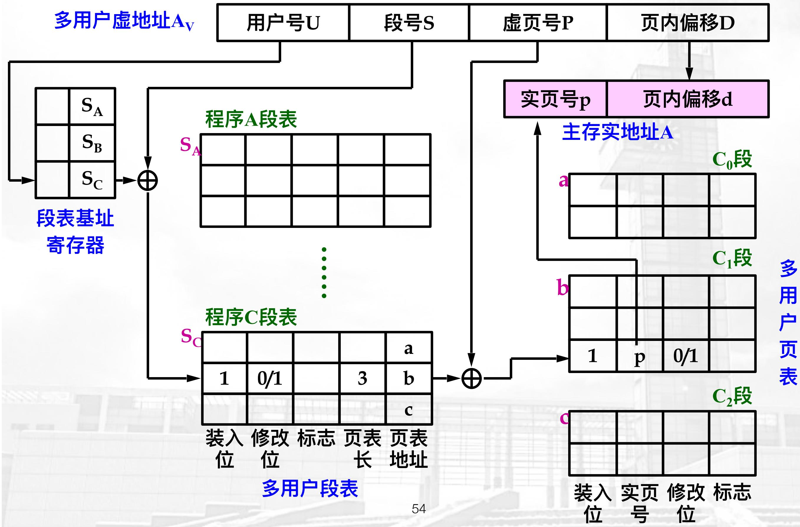

<details>
<summary>flowchart</summary>

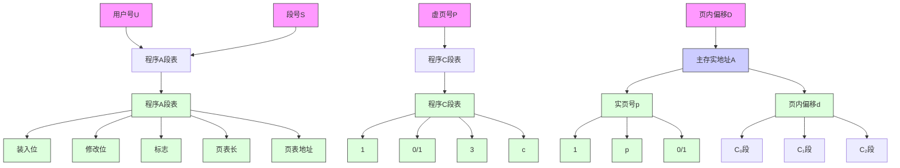
</details>

# Linux的内存管理

- 严格来说，是段页式（兼容x86-386构架）
- 但是，所有的页都在段0

- 因此，Linux实际是页式内存管理

# Big Picture of VM

- 映射方式
- 段、页、段页
- 替换：主存空间不够时置换部分页到外存
- VM实现机制
- 查表 + Page Fault缺页中断
- 访存过程：映射、查找、读写、替换

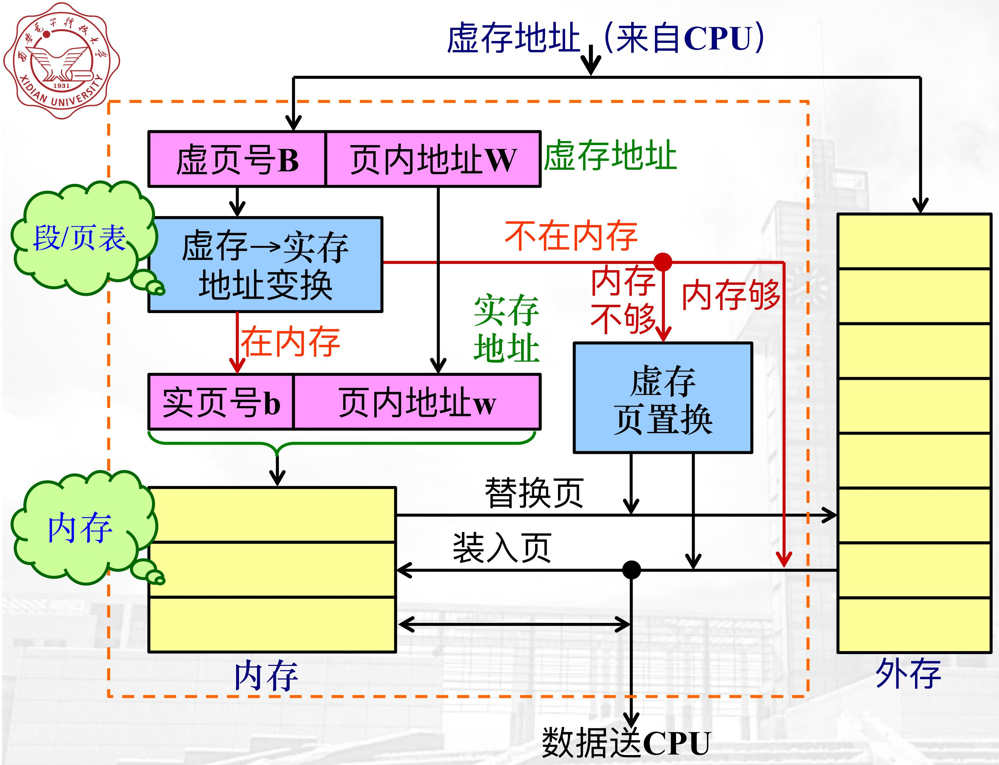

<details>
<summary>flowchart</summary>

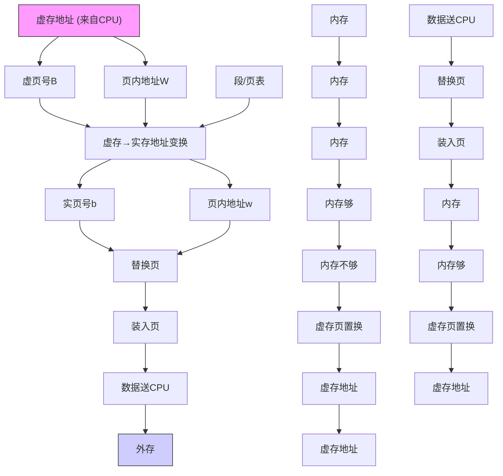
</details>

# VM访存流程

# CPU给出虚拟地址

# 查段/页表

- 如果在内存(有效位=0)，访问
- 如果所需页面不在内存(有效位=0)...

- CPU发出Page Fault(PF)中断
- 启动操作系统注册的FP中断处理程序
- 中断处理程序从外存调数据进内存（文件系统等...）
- 操作系统更新页表（有效位=1）
- 操作系统让切换回原进程

# VM页替换

- 物理内存不足时，将暂时不用的物理页替换到外存
- 虽然慢，但可以维持系统运行
- 常规策略

- LRU，最近最少使用
- 需要为每一页记录时间戳
- FIFO，先进先出

# VM模型下的内存访问


<details>
<summary>flowchart</summary>

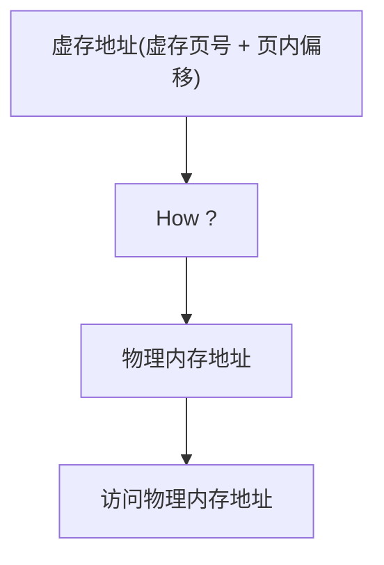
</details>

# VM模型下的内存访问


<details>
<summary>flowchart</summary>


</details>

1. 找到当前进程的页表/段页

2. 查表 + 计算

# So How to accelerate ?

1. 地址转换(or 计算)成为CPU极频繁的工作；
2. 页表被极频繁的访问;
3. so, 大量页表内容进驻cache;
4. cache容量有限，进程指令/数据的cache被挤占；
5. 更可能的情况是，页表体积常远大于cache，使页表本身都无法快速访问；
6. 系统性能严重下降
7. 极端情况：页表都无法完全放在内存中，可能被置换到外存

# VM模型下的内存访问

- 优化一：用专用的内存管理单元(MMU)硬件处理VM地址变换

- MMU是专用硬件
- 页表被存储在特殊内存位置PTBR

# VM模型下的内存访问

- 优化二：单极页表太大，怎么办？

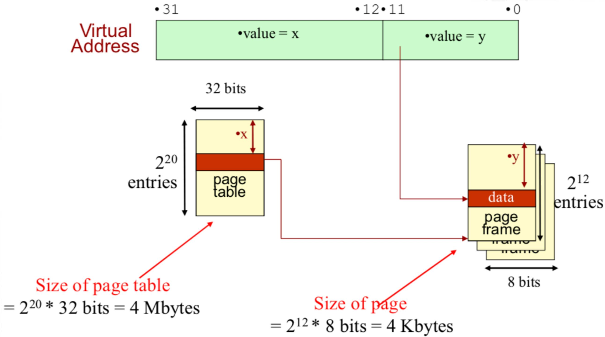

<details>
<summary>other</summary>

Virtual Address
| Segment | Value (bits) |
|---|---|
| Virtual Address - 31 | x = value = x |
| Virtual Address - 0 | y = value = y |
| Page Table - 2^20 entries | x |
| Page Table - 8 bits | y |
| Data Frame - 2^12 entries | y |
| Page Frame - 8 bits | y |
| Size of page table = 2^20 * 32 bits = 4 Mbytes
Size of page = 2^12 * 8 bits = 4 Kbytes
</details>

# VM模型下的内存访问

- 优化二：两级页表！
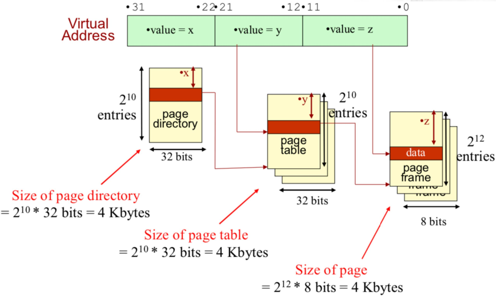

<details>
<summary>flowchart</summary>

```mermaid
graph TD
    A["Virtual Address"] --> B["page directory"]
    B --> C["page table"]
    C --> D["data frame"]
    D --> E["2^12 entries"]
    style A fill:#f9f,stroke:#333
    style B fill:#ccf,stroke:#333
    style C fill:#cfc,stroke:#333
    style D fill:#fcc,stroke:#333
    style E fill:#ffc,stroke:#333
    note1["Size of page directory = 2^10 * 32 bits = 4 Kbytes"]
    note2["Size of page table = 2^10 * 32 bits = 4 Kbytes"]
    note3["Size of page = 2^12 * 8 bits = 4 Kbytes"]
    note4["2^10 entries"]
    note5["2^10 entries"]
    note6["32 bits"]
    note7["32 bits"]
    note8["8 bits"]
    note9["0"]
    note10["value = x"]
    note11["value = y"]
    note12["value = z"]
    note13["2^10 entries"]
    note14["2^12 entries"]
    note15["2^10 entries"]
    note16["32 bits"]
    note17["2^10 entries"]
    note18["2^10 entries"]
    note19["32 bits"]
    note20["2^10 entries"]
    note21["2^10 entries"]
    note22["32 bits"]
    note23["8 bits"]
    note24["0"]
    note25["0"]
    note26["31"]
    note27["-31"]
```
</details>

# VM模型下的内存访问

- 优化三：页表在内存访问慢，在Cache挤程序空间，怎么办？

# VM模型下的内存访问

- 优化三：给页表加一个专用的Cache——TLB

- Translation Look-aside Buffers
- 比L1 Cache的级别更高!

- 在CPU和Cache之间

- 同样有hit rate/ miss rate的指标

TLB
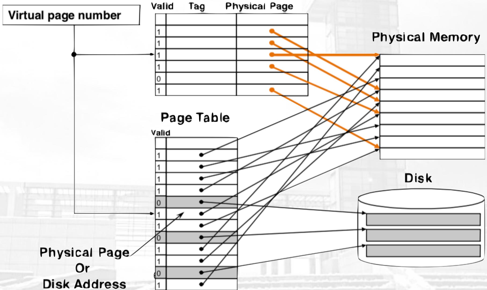

<details>
<summary>flowchart</summary>

```mermaid
graph TD
    A["Virtual page number"] --> B["Valid"]
    B --> C["Tag"]
    C --> D["Physical P