# 课件-指令系统1-Spring-2024

## 来源

- 分类：`课件`
- 原始文件：`指令系统1--Spring.2024.pdf`
- 原始相对路径：`资料/课件/指令系统1--Spring.2024.pdf`
- 原始绝对路径：`D:\wzb\计算机组成原理\资料\课件\指令系统1--Spring.2024.pdf`

## 后续处理建议

- 从本整理稿中提取稳定知识点
- 检查公式、表格、结构图的提取效果
- 必要时补单独图像解读稿
- 如发现资料错误，转入勘误或分歧

## 内容导读（基于整理稿归纳）

本讲是“指令系统”专题序言，主要建立高级语言、汇编语言、机器代码三层代码表示之间的关系，并说明本章后续要解决什么问题。

## 关键知识点

- 指令系统是软件与硬件之间的重要接口。
- 高级语言、汇编语言、机器代码之间的转译关系。
- 本章后续重点会落到指令格式、寻址方式和汇编程序组织。

## 典型例题 / 思考题

- 说明不同层级代码表示的差异与联系。
- 解释为什么学习指令系统必须同时看“编码”和“执行”。
- 从章节导言把握本章知识框架。

## 例题理解层（基于课件整理）

### 题目簇 1：原子操作分析

- 原题/原问：
  - 试分析一下，为了执行乘法，至少需要哪些原子操作？
- 题意：从硬件执行角度分析一条乘法指令需要分解为哪些不可再分的基本操作（微操作），理解指令执行与微操作的关系。
- 所考知识点：
  - 原子操作（微操作）的概念：CPU可执行的最小不可分解操作
  - 乘法指令的微操作分解：取指→取操作数→逐位判断→部分积累加→移位→写回结果
  - 寄存器传递操作作为微操作的标志
  - 指令周期、机器周期、时钟周期的层次关系
- 解题关注点：
  - 区分"指令级"和"微操作级"的粒度
  - 乘法涉及循环操作（多次部分积累加+移位），微操作数量远多于加法
  - 每个微操作对应一个或多个控制信号
- 题型归类建议：原理解释题
- 备注：本题反复出现6次（逐步展开），信息完整

## 提取结果

# 计算机组成与结构

# 指令系统1

李瑞 教授

蒋志平 副教授

计算机科学与技术学院

# 指令系统序言

# Code, 2 Code

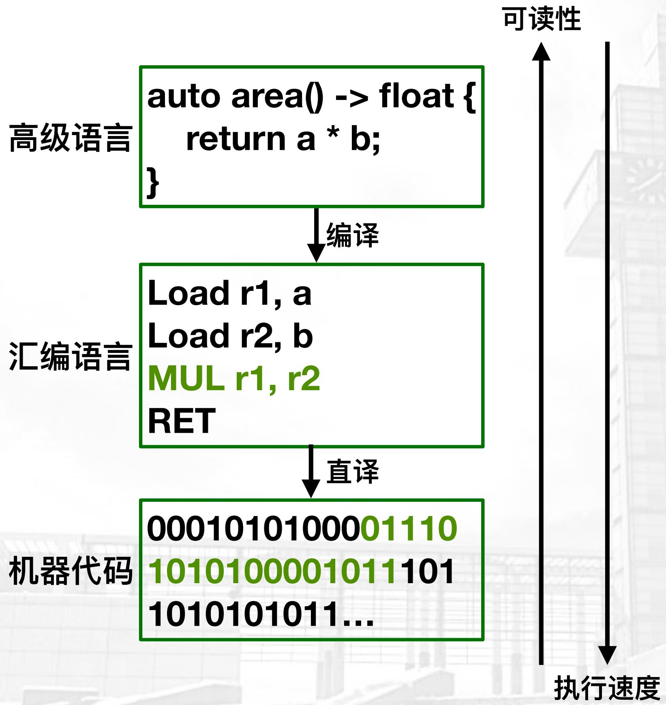

flowchart

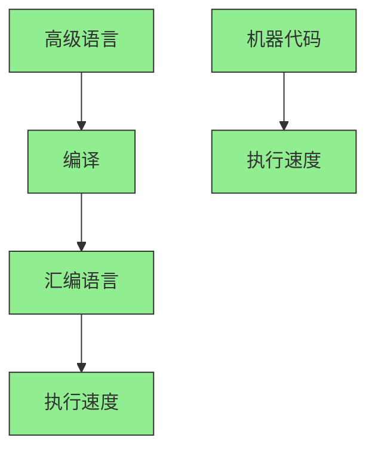

# Code, 2 Code

Your Code to Machine Code
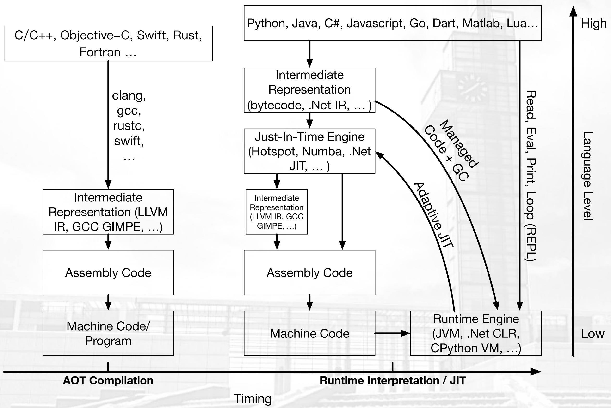

flowchart

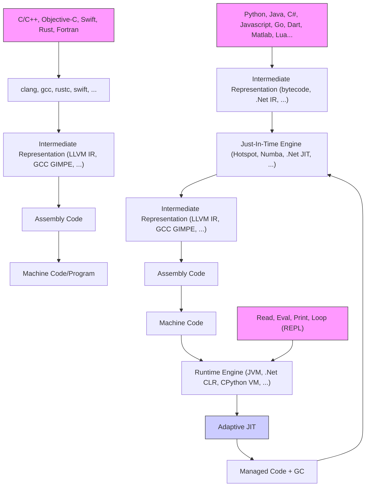

# 本章内容简介

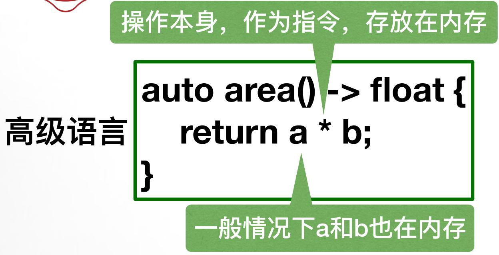

text_image

操作本身，作为指令，存放在内存
高级语言
auto area() -> float {
    return a * b;
}
一般情况下a和b也在内存

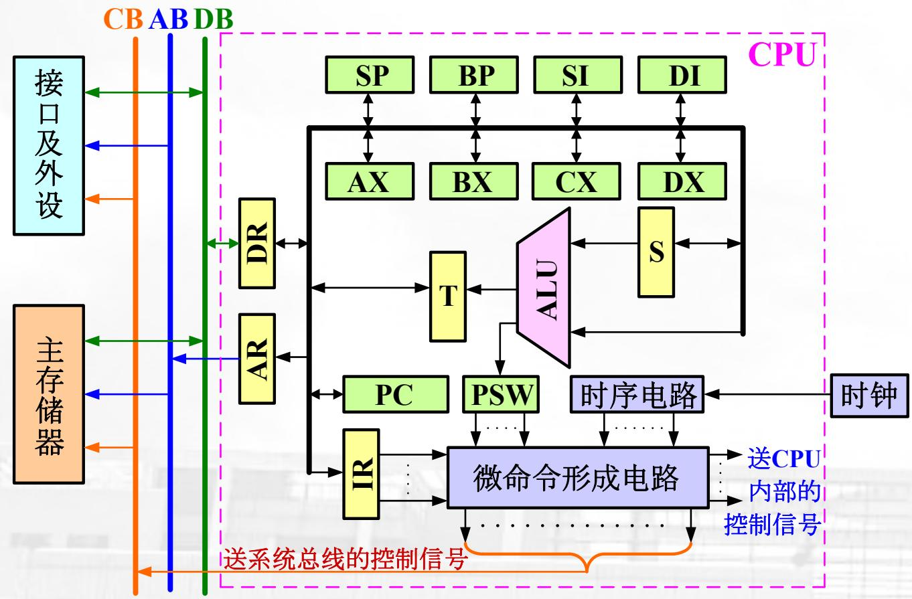

flowchart

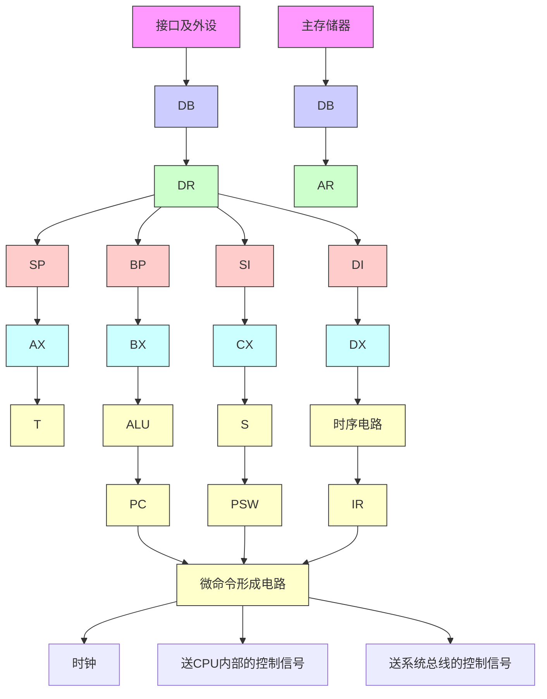

试分析一下，为了执行乘法，至少需要哪些原子操作？

1. 需要从PC所指的内存中，取出当前指令
2. 识别这个指令，发现它有两个操作数
3. 从内存&a地址取a，放在ALU的输入寄存器S;
4. 从内存&b地址取b，放在一个靠近ALU的某个临时寄存器，如AX;
5. 把AX的值送入ALU
6. ALU计算乘法，结果存在临时寄存器T；
7. 把T赋值给其它寄存器
8. 结束函数/子程序，返回

# 本章内容简介

试分析一下，为了执行乘法，至少需要哪些原子操作？

1. 需要从PC所指的内存中，取出当前指令
2. 识别这个指令，发现它有两个操作数。
3. 从内存&a地址取a，放在ALU的输入寄存器S;
4. 从内存&b地址取b，放在一个靠近ALU的某个临时寄存器，如AX;
5. 把AX的值送入ALU
6. ALU计算乘法，结果存在临时寄存器T；
7. 把T赋值给其它寄存器
8. 结束函数/子程序，返回

4.1 机器指令的格式与编码

# 本章内容简介

试分析一下，为了执行乘法，至少需要哪些原子操作？

1. 需要从PC所指的内存中，取出当前指令
2. 识别这个指令，发现它有两个操作数
3. 从内存&a地址取a，放在ALU的输入寄存器S;
4. 从内存&b地址取b，放在一个靠近ALU的某个临时寄存器，如AX;

5. 把AX的值送入ALU

6. ALU计算乘法，结果存在临时寄存器T；

7. 把T赋值给其它寄存器

8. 结束函数/子程序，返回

4.1 机器指令的格式与编码

4.2 操作数的取值/取址

# 本章内容简介

试分析一下，为了执行乘法，至少需要哪些原子操作？

1. 需要从PC所指的内存中，取出当前指令
2. 识别这个指令，发现它有两个操作数
3. 从内存&a地址取a，放在ALU的输入寄存器S;
4. 从内存&b地址取b，放在一个靠近ALU的某个临时寄存器，如AX;

5. 把AX的值送入ALU

6. ALU计算乘法，结果存在临时寄存器T；

7. 把T赋值给其它寄存器

8. 结束函数/子程序，返回

4.1 机器指令的格式与编码
4.2 操作数的取值/取址
4.3 8086系统的指令系统

# 本章内容简介

试分析一下，为了执行乘法，至少需要哪些原子操作？

1. 需要从PC所指的内存中，取出当前指令
2. 识别这个指令，发现它有两个操作数。
3. 从内存&a地址取a，放在ALU的输入寄存器S;
4. 从内存&b地址取b，放在一个靠近ALU的某个临时寄存器，如AX;
5. 把AX的值送入ALU
6. ALU计算乘法，结果存在临时寄存器T；
7. 把T赋值给其它寄存器
8. 结束函数/子程序，返回

- 4.1 机器指令的格式与编码
4.2 操作数的取值/取址
- 4.3 8086系统的指令系统
4.4 汇编语言程序设计

# 本章内容简介

试分析一下，为了执行乘法，至少需要哪些原子操作？

1. 需要从PC所指的内存中，取出当前指令
2. 识别这个指令，发现它有两个操作数。
3. 从内存&a地址取a，放在一个靠近ALU的某个临时寄存器，如AX;
4. 从内存&b地址取b，放在ALU的输入寄存器S;
5. 把AX的值送入ALU
6. ALU计算乘法，结果存在临时寄存器T；
7. 把T赋值给其它寄存器
8. 结束函数/子程序，返回

本章所有内容:

- 4.1 机器指令的格式与编码
4.2 操作数的取值/取址
- 4.3 8086系统的指令系统
- 4.4 汇编语言程序设计
- 4.5 RISC/CISC科普

# 本章内容简介

# CPU执行指令的3(4)流程循环:

取指令

译码

执行

(存储)

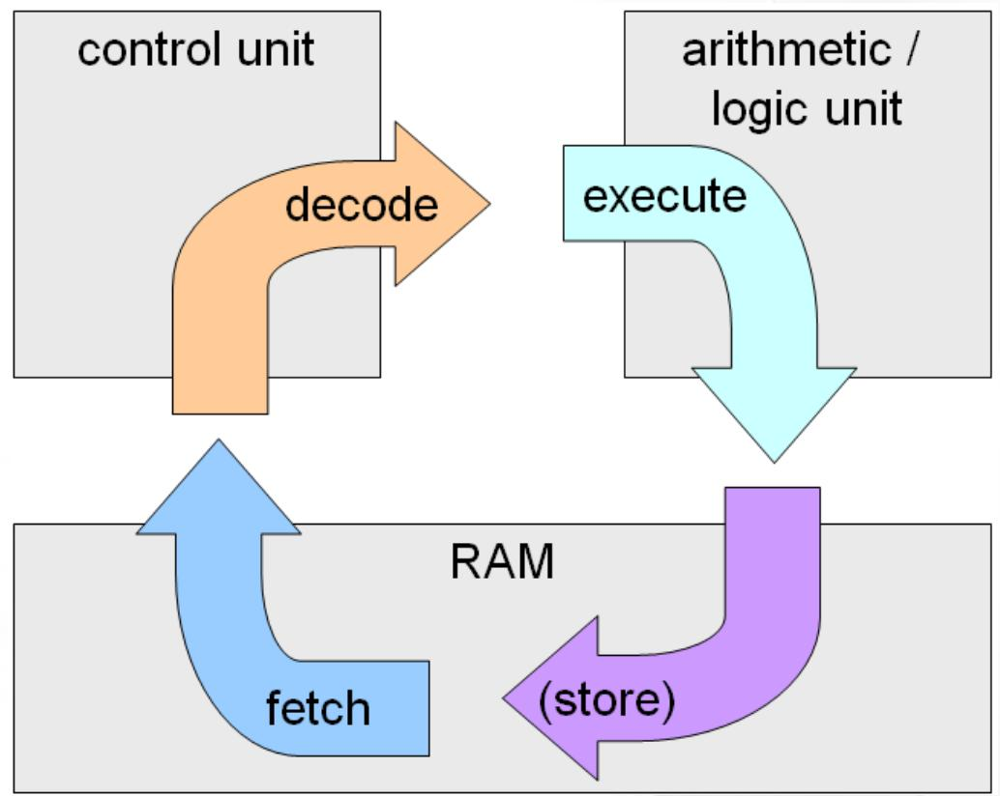

flowchart

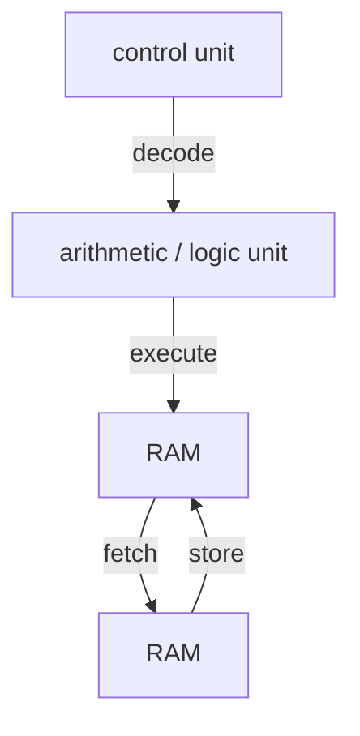

CPU访问主存/外设
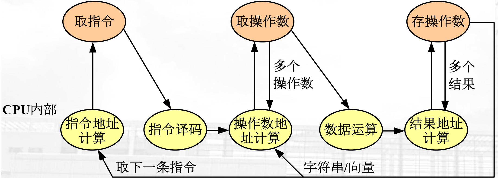

flowchart

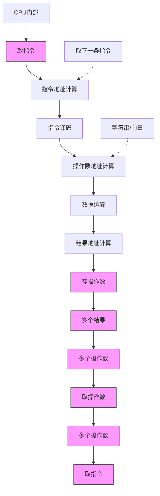

图5.1 机器指令执行状态

# 指令格式

# 指令格式

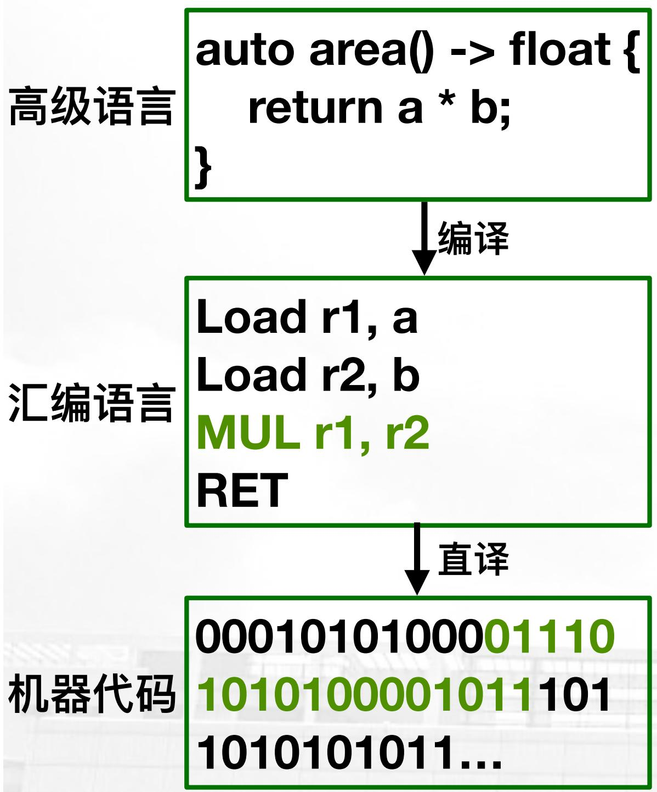

flowchart

> 图意说明：此图想表达“高级语言程序经过编译/翻译逐步变成汇编表示与机器代码”。  
> 当前自动转写出的图结构含 OCR 噪声，因此不保留错误 mermaid 细节；精确关系请以原图和下方正文解释为准。

MUL r1, r2被转译为

这是瞎编的~

“011101010100001011”

这一条指令包含以下4条信息：

- MUL指令的编号
- MUL指令能支持两个操作数
- 操作数1指向r1寄存器
- 操作数2指向r2寄存器

# 指令格式

■ 指令 = 操作码Opcode + 操作数

Operand (0~N)

■ 操作数，也叫地址码

地址码的内容可以是：地址、数值

地址码的目标可以是:

源/目的操作数，结果，下一条指令

地址（顺序/跳转）

例如，某定长指令格式

<table><tr><td>操作码4位</td><td>操作数8位</td><td>操作数8位</td></tr></table>

20位

# 指令格式

# ■ 常用的地址码数目：

- 三地址: ADD Y, A, B ; Y=A+B
- 双地址：ADD Y, A ; Y=Y+A
- 单地址: ADD C ; AC=AC+C
- 零地址

# 指令格式

例如：计算一个典型的算术表达式：

$$
x = \frac {a \times b + c - d}{e + f}
$$

用三地址指令编写的程序如下:

MUL X, A, B ;X←(A)×(B)

ADD X, X, C ;X←(X) + (C)

SUB X, X, D ; 分子的计算结果在x中

ADD Y, E, F ;计算分母,存入Y

DIV X, X, Y ; 最后结果在x单元中

# 指令格式

$$
x = \frac {a \times b + c - d}{e + f}
$$

# 用普通二地址指令编写的程序：

MOVE X, A ;复制临时变量到X中

MUL X, B

ADD X, C

SUB X, D ;X中存放分子运算结果

MOVE Y, E ;复制临时变量到Y中

ADD Y, F ;Y中存放分母运算结果

DIV X, Y ;最后结果在x单元中

# 指令格式

$$
x = \frac {a \times b + c - d}{e + f}
$$

# 用多寄存器结构的二地址指令编写程序：

MOVE R1, A ;操作数a取到寄存器R1中

MUL R1, B

ADD R1, C

SUB R1, D ;R1中存放分子运算结果

MOVE R2 , E

ADD R2, F ;R2中存放分母运算结果

DIV R1, R2 ;最后结果在R1中

MOVE X, R1 ;最后结果存入X中

# 指令格式

$$
x = \frac {a \times b + c - d}{e + f}
$$

# 用一地址指令编写的程序：

LOAD E ; 先计算分母,
;取一个操作数到累加器中
ADD F ;分母运算结果在累加器中
STORE X ;保存分母运算结果到x中
LOAD A ;开始计算分子
MUL B
ADD C
SUB D ;累加器中是分子运算结果
DIV X ;最后运算结果在累加器中
STORE X ;保存最后运算结果到x中

# 指令格式

# 用0地址指令编写程序：

PUSH A ;操作数a压入堆栈

PUSH B ;操作数b压入堆栈

MUL ; 栈顶两数相乘 , 结果压回堆顶

PUSH C

ADD

PUSH D

SUB ; 栈顶是分子运算的结果

PUSH E

PUSH F

ADD

DIV ; 栈顶是最后运算的结果

POP X ;保存最后运算结果

$$
x = \frac {a \times b + c - d}{e + f}
$$

$$
a b ^ {*} c + d - e f + /
$$

# 指令格式

不同地址个数指令的特点及适用场合

<table><tr><td>地址数目</td><td>程序的长度</td><td>程序存储量</td><td>程序执行速度</td><td>适用场合</td></tr><tr><td>三地址</td><td>最短</td><td>最大</td><td>一般</td><td>向量,矩阵运算为主</td></tr><tr><td>二地址</td><td>较短</td><td>很大</td><td>很低</td><td>一般不宜采用</td></tr><tr><td>一地址</td><td>较长</td><td>较大</td><td>较快</td><td>连续运算,硬件结构简单</td></tr><tr><td>零地址</td><td>最长</td><td>最小</td><td>最低</td><td>嵌套,递归,变量较多</td></tr></table>

# 指令格式

# 关于地址码个数结论:

■ 对于一般商用处理机，采用多寄存器结构的二地址指令是最理想的。
■ 如果强调硬件结构简单，并且以连续运算（如求累加和等）为主，宜采用一地址结构。
■ 对于以向量、矩阵运算为主的处理机，最好采用三地址结构。
■ 部分RISC处理机也采用三地址指令。
■ 对于解决递归问题为主的处理机，宜采用零地址结构。编程容易、节省程序存储量。

# 指令编码

# 指令编码

- 指令操作码(Op code)编码方式:
- 编码的考量因素
- 编码方法

- 定长编码
- 不定长编码

- 霍夫曼Huffman Coding
- 扩展操作码

# 指令编码

构成一条指令的二进制的位数称为指令长度，一般都是字节的整数倍。

■内存大小与组织
■CPU数据总线宽度
■CPU内部寄存器的数量
■寻址方式
■指令数量

# 指令编码

# 定长指令编码:

- 所有指令的编码Opcode长度相同!

- 不管几操作数的指令，opcode都一样长！

- 显然，会有指令bit浪费，或指令容量受限

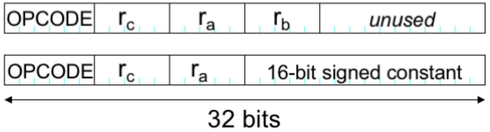

other

| OPCODE | r_c | r_a | r_b | unused |
|--------|-----|-----|-----|--------|
| Bottom  |     |     |     |        |
| Top    | r_c | r_a | r_b | unused |

# 指令编码

# Huffman指令编码：

- 让高频指令的opcode更短！（不care操作数长度！）

# 指令编码

例：假设一台模型计算机共有7种不同的操作码，已知各种操作码在程序中出现的概率如下表，利用固定长度编码法进行操作码编码。

<table><tr><td>指令</td><td> $I_1$ </td><td> $I_2$ </td><td> $I_3$ </td><td> $I_4$ </td><td> $I_5$ </td><td> $I_6$ </td><td> $I_7$ </td></tr><tr><td>概率</td><td>0.45</td><td>0.30</td><td>0.15</td><td>0.05</td><td>0.03</td><td>0.01</td><td>0.01</td></tr></table>

解：由于N=7 因此，指令操作码固定长度为

$$
[ \mathrm{lbN} ] = [ \mathrm{lb7} ] = 3
$$

编码结果:

<table><tr><td>指令序号</td><td>概率</td><td>编码</td><td>操作码长度</td></tr><tr><td> $I_1$ </td><td>0.45</td><td>000</td><td>3位</td></tr><tr><td> $I_2$ </td><td>0.30</td><td>001</td><td>3位</td></tr><tr><td> $I_3$ </td><td>0.15</td><td>010</td><td>3位</td></tr><tr><td> $I_4$ </td><td>0.05</td><td>011</td><td>3位</td></tr><tr><td> $I_5$ </td><td>0.03</td><td>100</td><td>3位</td></tr><tr><td> $I_6$ </td><td>0.01</td><td>101</td><td>3位</td></tr><tr><td> $I_7$ </td><td>0.01</td><td>110</td><td>3位</td></tr></table>

# 指令编码

例：利用Huffman 编码法进行操作码编码。

<table><tr><td>指令</td><td> $I_1$ </td><td> $I_2$ </td><td> $I_3$ </td><td> $I_4$ </td><td> $I_5$ </td><td> $I_6$ </td><td> $I_7$ </td></tr><tr><td>概率</td><td>0.45</td><td>0.30</td><td>0.15</td><td>0.05</td><td>0.03</td><td>0.01</td><td>0.01</td></tr></table>

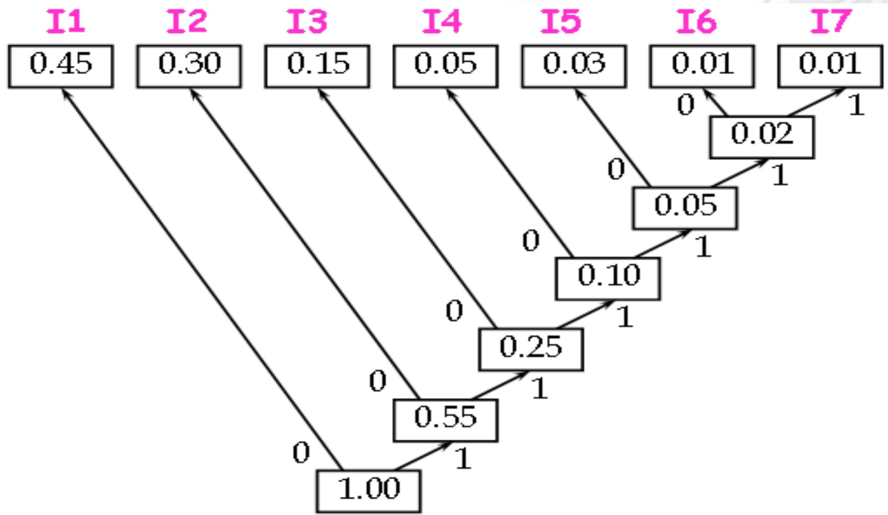

flowchart

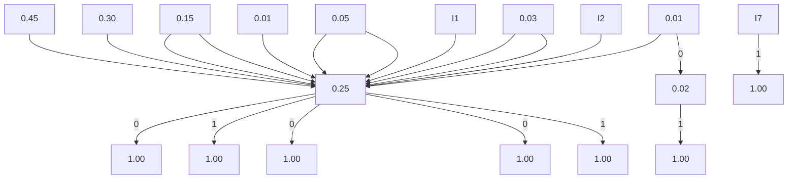

Huffman编码树生成过程

# 指令编码

编码结果:

<table><tr><td>指令序号</td><td>概率</td><td>Huffman编码法</td><td>操作码长度</td></tr><tr><td> $I_1$ </td><td>0.45</td><td>0</td><td>1位</td></tr><tr><td> $I_2$ </td><td>0.30</td><td>10</td><td>2位</td></tr><tr><td> $I_3$ </td><td>0.15</td><td>110</td><td>3位</td></tr><tr><td> $I_4$ </td><td>0.05</td><td>1110</td><td>4位</td></tr><tr><td> $I_5$ </td><td>0.03</td><td>11110</td><td>5位</td></tr><tr><td> $I_6$ </td><td>0.01</td><td>111110</td><td>6位</td></tr><tr><td> $I_7$ </td><td>0.01</td><td>111111</td><td>6位</td></tr></table>

采用 Huffman 编码法的操作码平均长度:

$$
\begin{array}{l} 0. 4 5 \times 1 + 0. 3 0 \times 2 + 0. 1 5 \times 3 + 0. 0 5 \times 4 + 0. 0 3 \times 5 + 0. 0 1 \times 6 + 0. 0 1 \times 6 \\ = 1. 9 7 (\text {位}) \end{array}
$$

# 指令编码

# Huffman操作码的主要缺点：

1) 操作码长度很不规整，硬件译码困难
2) 与地址码共同组成固定长的指令比较困难

# 解决方法之一：指令操作码的扩展技术

# 指令编码

# 扩展指令编码：

- 让操作数多的指令opcode更短，
- 操作数少的指令opcode最长

# 指令编码

原则：短码不能是长码的前缀。

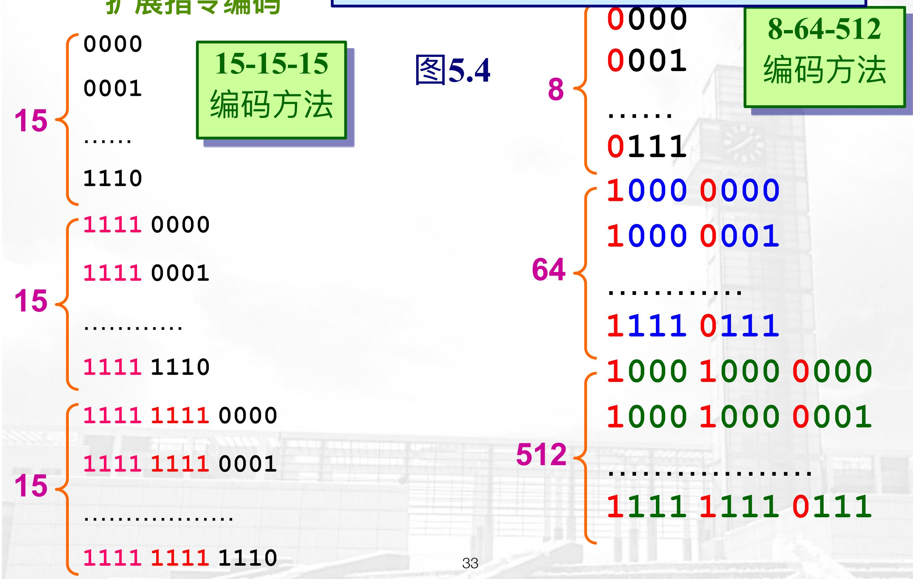

tree

| Category | Value |
| -------- | ----- |
| 8        | 8     |
| 8        | 9     |
| 8        | 9     |
| 8        | 9     |
| 8        | 9     |
| 8        | 9     |
| 8        | 9     |
| 8        | 9     |
| 8        | 9     |
| 8        | 9     |
| 8        | 9     |
| 8        | 9     |
| 8        | 9, 9, 9, 9, 9, 9, 9, 9, 9, 9, 9, 9, 9, 9, 9, 9, 9, 9, 9, 9, 9, 9, 9, 9, 9, 9, 9, 9, 9, 9, 9, 9, 9, 9, ...

# 指令编码

■ 短的操作码与多种地址码配合
■ 长的操作码与简单地址码组合
■ 指令长度一般设计为总线宽度的整数倍
■ 指令的长度为最小可寻址单位的整数倍
■ 影响寻址位的因素：

- 寻址方式的个数
- 操作数数目
- 寄存器数目
- 地址范围

- 地址可寻址最小单元

# 指令编码

例：假设某型号的计算机共有14条指令，各条指令的使用频

率分别为：0.01、0.15、0.12、0.03、0.02、0.04、0.02、

0.04、0.01、0.13、0.15、0.14、0.11、0.03。

试给出定长、只能有两种码长的扩展操作码的两种编码方案，

并计算各种方案的平均码长。

【解】

<table><tr><td>指令</td><td> $I_1$ </td><td> $I_2$ </td><td> $I_3$ </td><td> $I_4$ </td><td> $I_5$ </td><td> $I_6$ </td><td> $I_7$ </td></tr><tr><td>概率</td><td>0.15</td><td>0.15</td><td>0.14</td><td>0.13</td><td>0.12</td><td>0.11</td><td>0.04</td></tr><tr><td>指令</td><td> $I_8$ </td><td> $I_9$ </td><td> $I_{10}$ </td><td> $I_{11}$ </td><td> $I_{12}$ </td><td> $I_{13}$ </td><td> $I_{14}$ </td></tr><tr><td>概率</td><td>0.04</td><td>0.03</td><td>0.03</td><td>0.02</td><td>0.02</td><td>0.01</td><td>0.01</td></tr></table>

# 指令编码

定长编码：

<table><tr><td>指令</td><td> $I_1$ </td><td> $I_2$ </td><td> $I_3$ </td><td> $I_4$ </td><td> $I_5$ </td><td> $I_6$ </td><td> $I_7$ </td></tr><tr><td>概率</td><td>0.15</td><td>0.15</td><td>0.14</td><td>0.13</td><td>0.12</td><td>0.11</td><td>0.04</td></tr><tr><td>扩展编码</td><td>0000</td><td>0001</td><td>0010</td><td>0011</td><td>0100</td><td>0101</td><td>0110</td></tr><tr><td>码长</td><td>4</td><td>4</td><td>4</td><td>4</td><td>4</td><td>4</td><td>4</td></tr><tr><td>指令</td><td> $I_8$ </td><td> $I_9$ </td><td> $I_{10}$ </td><td> $I_{11}$ </td><td> $I_{12}$ </td><td> $I_{13}$ </td><td> $I_{14}$ </td></tr><tr><td>概率</td><td>0.04</td><td>0.03</td><td>0.03</td><td>0.02</td><td>0.02</td><td>0.01</td><td>0.01</td></tr><tr><td>扩展编码</td><td>0111</td><td>1000</td><td>1001</td><td>1010</td><td>1011</td><td>1100</td><td>1101</td></tr><tr><td>码长</td><td>4</td><td>4</td><td>4</td><td>4</td><td>4</td><td>4</td><td>4</td></tr></table>

其操作码的平均码长: $\mathrm{H} = 4$ (位)。

# 指令编码

两种码长的扩展操作码：（方法一）

<table><tr><td>指令</td><td> $I_1$ </td><td> $I_2$ </td><td> $I_3$ </td><td> $I_4$ </td><td> $I_5$ </td><td> $I_6$ </td><td> $I_7$ </td></tr><tr><td>概率</td><td>0.15</td><td>0.15</td><td>0.14</td><td>0.13</td><td>0.12</td><td>0.11</td><td>0.04</td></tr><tr><td>扩展编码</td><td>000</td><td>001</td><td>010</td><td>011</td><td>100</td><td>101</td><td>110</td></tr><tr><td>码长</td><td>3</td><td>3</td><td>3</td><td>3</td><td>3</td><td>3</td><td>3</td></tr><tr><td>指令</td><td> $I_8$ </td><td> $I_9$ </td><td> $I_{10}$ </td><td> $I_{11}$ </td><td> $I_{12}$ </td><td> $I_{13}$ </td><td> $I_{14}$ </td></tr><tr><td>概率</td><td>0.04</td><td>0.03</td><td>0.03</td><td>0.02</td><td>0.02</td><td>0.01</td><td>0.01</td></tr><tr><td>扩展编码</td><td>111000</td><td>111001</td><td>111010</td><td>111011</td><td>111100</td><td>111101</td><td>111110</td></tr><tr><td>码长</td><td>6</td><td>6</td><td>6</td><td>6</td><td>6</td><td>6</td><td>6</td></tr></table>

其操作码平均码长为： $\mathbf{H} = \sum_{i=1}^{n} p_i l_i$

$$
\mathrm{H} = (0. 1 5 + 0. 1 5 + 0. 1 4 + 0. 1 3 + 0. 1 2 + 0. 1 1 + 0. 0 4) \times 3 +
$$

$$
(0. 0 4 + 0. 0 3 + 0. 0 3 + 0. 0 2 + 0. 0 2 + 0. 0 1 + 0. 0 1) \times 6
$$

$$
= 0. 8 4 \times 3 + 0. 1 6 \times 6 = 3. 4 8 (\text {位})
$$

# 指令编码

大概率

<table><tr><td>指令</td><td> $I_1$ </td><td> $I_2$ </td><td> $I_3$ </td><td> $I_4$ </td><td> $I_5$ </td><td> $I_6$ </td><td> $I_7$ </td></tr><tr><td>概率</td><td>0.15</td><td>0.15</td><td>0.14</td><td>0.13</td><td>0.12</td><td>0.11</td><td>0.04</td></tr><tr><td>扩展编码</td><td></td><td></td><td></td><td></td><td></td><td></td><td></td></tr><tr><td>码长</td><td></td><td></td><td></td><td></td><td></td><td></td><td></td></tr><tr><td>指令</td><td> $I_8$ </td><td> $I_9$ </td><td> $I_{10}$ </td><td> $I_{11}$ </td><td> $I_{12}$ </td><td> $I_{13}$ </td><td> $I_{14}$ </td></tr><tr><td>概率</td><td>0.04</td><td>0.03</td><td>0.03</td><td>0.02</td><td>0.02</td><td>0.01</td><td>0.01</td></tr><tr><td>扩展编码</td><td></td><td></td><td></td><td></td><td></td><td></td><td></td></tr><tr><td>码长</td><td></td><td></td><td></td><td></td><td></td><td></td><td></td></tr></table>

小概率

# 指令编码

大概率

两种码长的扩展操作码：（方法二）

<table><tr><td>指令</td><td> $I_1$ </td><td> $I_2$ </td><td> $I_3$ </td><td> $I_4$ </td><td> $I_5$ </td><td> $I_6$ </td><td> $I_7$ </td></tr><tr><td>概率</td><td>0.15</td><td>0.15</td><td>0.14</td><td>0.13</td><td>0.12</td><td>0.11</td><td>0.04</td></tr><tr><td>扩展编</td><td>000</td><td>001</td><td>010</td><td>011</td><td>100</td><td>101</td><td>11000</td></tr><tr><td>码长</td><td>3</td><td>3</td><td>3</td><td>3</td><td>3</td><td>3</td><td>5</td></tr><tr><td>指令</td><td> $I_8$ </td><td> $I_9$ </td><td> $I_{10}$ </td><td> $I_{11}$ </td><td> $I_{12}$ </td><td> $I_{13}$ </td><td> $I_{14}$ </td></tr><tr>