# 计算机组成与结构

# 一指令系统2

李瑞 教授

蒋志平 副教授

计算机科学与技术学院

# 温故 一关于指令系统

- 虚拟存储系统有哪些功能？  
- 虚拟存储的工作原理？  
- 简述段式虚拟存储转换的原理和优缺点  
- 简述页式虚拟存储转换的原理和优缺点  
- 简述有哪些优化虚拟存储性能的方法？  
- CPU执行指令的4个步骤是?   
- 指令的格式是什么?

# 本节学习要点

- 指令格式  
- 可执行程序的结构  
- 对Emu8086做简单使用介绍  
- CPU是如何定位程序的？(寄存器)  
- CPU是如何定位程序中的代码或数据的？（寻址方式）

# 指令格式

# 指令格式

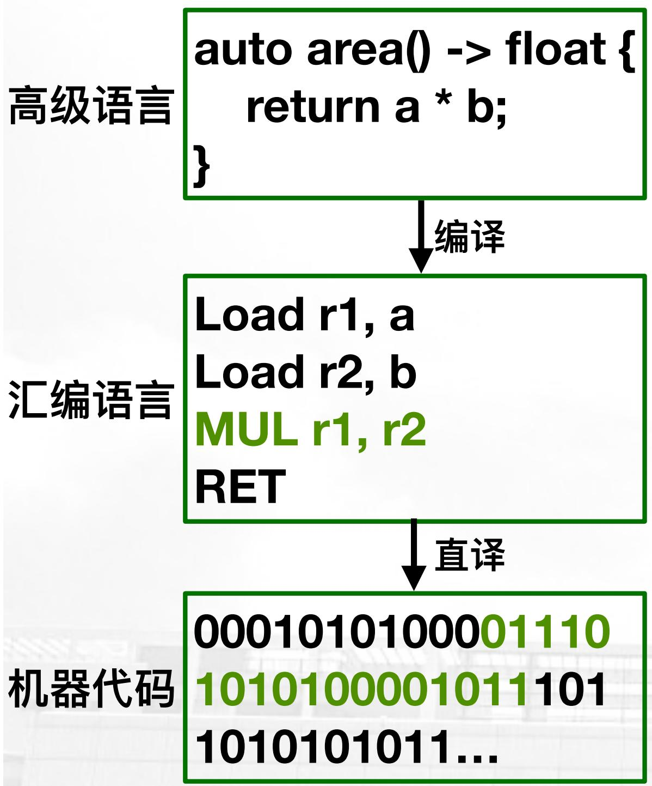

<details>
<summary>flowchart</summary>

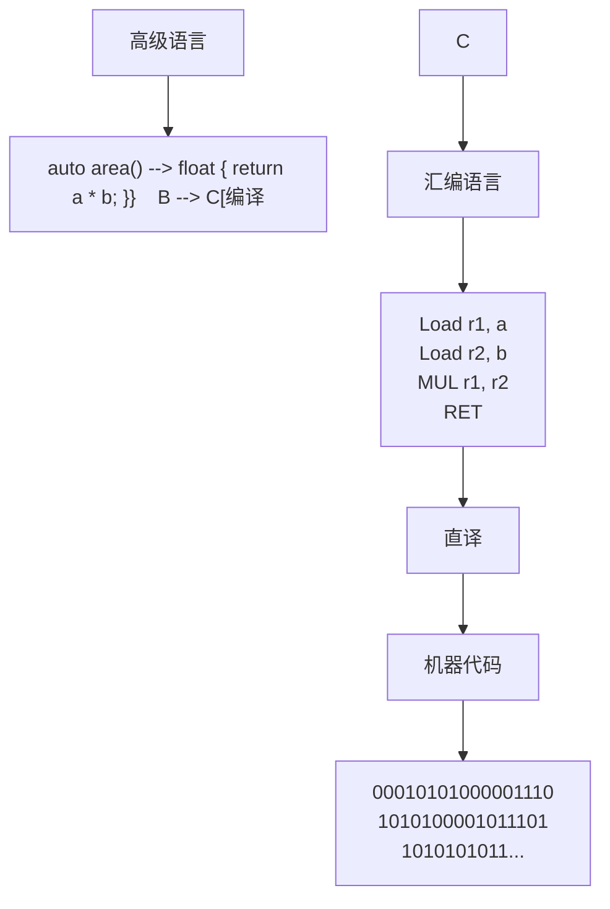
</details>

MUL r1, r2被转译为

这是瞎编的\~

“011101010100001011”

这一条指令包含以下4条信息：

- MUL指令的编号  
- MUL指令能支持两个操作数  
- 操作数1指向r1寄存器  
- 操作数2指向r2寄存器

# 指令格式

■ 指令 = 操作码Opcode + 操作数

Operand (0\~N)

■ 操作数，也叫地址码

地址码的内容可以是：地址、数值

地址码的目标可以是:

源/目的操作数，结果，下一条指令

地址（顺序/跳转）

例如，某定长指令格式

<table><tr><td>操作码4位</td><td>操作数8位</td><td>操作数8位</td></tr></table>

20位

# 指令格式

# ■ 常用的地址码数目：

- 三地址: ADD Y, A, B ; Y=A+B  
- 双地址：ADD Y, A ; Y=Y+A  
- 单地址: ADD C ; AC=AC+C  
- 零地址

# 指令格式

例如：计算一个典型的算术表达式：

$$
x = \frac {a \times b + c - d}{e + f}
$$

用三地址指令编写的程序如下:

MUL X, A, B ;X←(A)×(B)

ADD X, X, C ;X←(X) + (C)

SUB X, X, D ; 分子的计算结果在x中

ADD Y, E, F ;计算分母,存入Y

DIV X, X, Y ; 最后结果在x单元中

# 指令格式

$$
x = \frac {a \times b + c - d}{e + f}
$$

# 用普通二地址指令编写的程序：

MOVE X, A ;复制临时变量到X中

MUL X, B

ADD X, C

SUB X, D ;X中存放分子运算结果

MOVE Y, E ;复制临时变量到Y中

ADD Y, F ;Y中存放分母运算结果

DIV X, Y ;最后结果在x单元中

# 指令格式

$$
x = \frac {a \times b + c - d}{e + f}
$$

# 用多寄存器结构的二地址指令编写程序：

MOVE R1, A ;操作数a取到寄存器R1中

MUL R1, B

ADD R1, C

SUB R1, D ;R1中存放分子运算结果

MOVE R2, E

ADD R2, F ;R2中存放分母运算结果

DIV R1, R2 ;最后结果在R1中

MOVE X, R1 ;最后结果存入X中

# 指令格式

$$
x = \frac {a \times b + c - d}{e + f}
$$

# 用一地址指令编写的程序：

LOAD E ; 先计算分母,  
;取一个操作数到累加器中  
ADD F ;分母运算结果在累加器中  
STORE X ;保存分母运算结果到x中  
LOAD A ;开始计算分子  
MUL B   
ADD C   
SUB D ;累加器中是分子运算结果  
DIV X ;最后运算结果在累加器中  
STORE X ;保存最后运算结果到x中

# 指令格式

# 用0地址指令编写程序：

PUSH A ;操作数a压入堆栈

PUSH B ;操作数b压入堆栈

MUL ; 栈顶两数相乘 , 结果压回堆顶

PUSH C

ADD

PUSH D

SUB ; 栈顶是分子运算的结果

PUSH E

PUSH F

ADD

DIV ; 栈顶是最后运算的结果

POP X ;保存最后运算结果

$$
x = \frac {a \times b + c - d}{e + f}
$$

$$
a b ^ {*} c + d - e f + /
$$

# 指令格式

不同地址个数指令的特点及适用场合

<table><tr><td>地址数目</td><td>程序的长度</td><td>程序存储量</td><td>程序执行速度</td><td>适用场合</td></tr><tr><td>三地址</td><td>最短</td><td>最大</td><td>一般</td><td>向量,矩阵运算为主</td></tr><tr><td>二地址</td><td>较短</td><td>很大</td><td>很低</td><td>一般不宜采用</td></tr><tr><td>一地址</td><td>较长</td><td>较大</td><td>较快</td><td>连续运算,硬件结构简单</td></tr><tr><td>零地址</td><td>最长</td><td>最小</td><td>最低</td><td>嵌套,递归,变量较多</td></tr></table>

# 指令格式

# 关于地址码个数结论:

■ 对于一般商用处理机，采用多寄存器结构的二地址指令是最理想的。  
■ 如果强调硬件结构简单，并且以连续运算（如求累加和等）为主，宜采用一地址结构。  
■ 对于以向量、矩阵运算为主的处理机，最好采用三地址结构。  
■ 部分RISC处理机也采用三地址指令。  
■ 对于解决递归问题为主的处理机，宜采用零地址结构。编程容易、节省程序存储量。

# 指令编码

# 指令编码

- 指令操作码(Op code)编码方式:  
- 编码的考量因素  
- 编码方法

- 定长编码  
- 不定长编码

- 霍夫曼Huffman Coding   
- 扩展操作码

# 指令编码

构成一条指令的二进制的位数称为指令长度，一般都是字节的整数倍。

■内存大小与组织  
■CPU数据总线宽度  
■CPU内部寄存器的数量  
■寻址方式  
■指令数量

# 指令编码

# 定长指令编码:

\- 所有指令的编码Opcode长度相同!

\- 不管几操作数的指令，opcode都一样长！

\- 显然，会有指令bit浪费，或指令容量受限

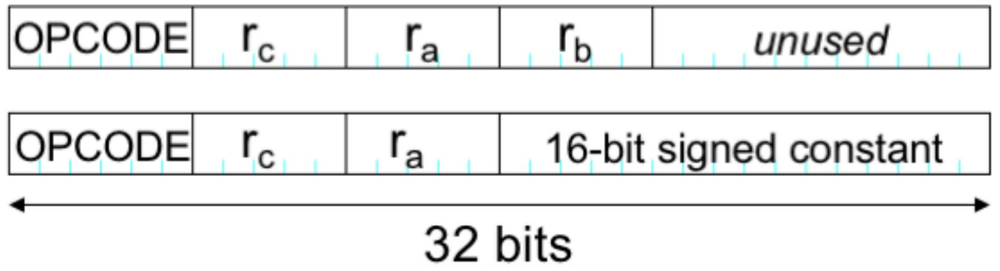

<details>
<summary>other</summary>

| OPCODE Field | Value |
| ------------ | ----- |
| r_c          | 32 bits |
| r_a          | 32 bits |
| r_b          | 32 bits |
| unused       | 32 bits |
</details>

# 指令编码

# Huffman指令编码:

\- 让高频指令的opcode更短！（不care操作数长度！）

# 指令编码

例：假设一台模型计算机共有7种不同的操作码，已知各种操作码在程序中出现的概率如下表，利用固定长度编码法进行操作码编码。

<table><tr><td>指令</td><td> $I_1$ </td><td> $I_2$ </td><td> $I_3$ </td><td> $I_4$ </td><td> $I_5$ </td><td> $I_6$ </td><td> $I_7$ </td></tr><tr><td>概率</td><td>0.45</td><td>0.30</td><td>0.15</td><td>0.05</td><td>0.03</td><td>0.01</td><td>0.01</td></tr></table>

解：由于N=7 因此，指令操作码固定长度为

$$
[ \mathrm{lbN} ] = [ \mathrm{lb7} ] = 3
$$

编码结果:

<table><tr><td>指令序号</td><td>概率</td><td>编码</td><td>操作码长度</td></tr><tr><td> $I_1$ </td><td>0.45</td><td>000</td><td>3位</td></tr><tr><td> $I_2$ </td><td>0.30</td><td>001</td><td>3位</td></tr><tr><td> $I_3$ </td><td>0.15</td><td>010</td><td>3位</td></tr><tr><td> $I_4$ </td><td>0.05</td><td>011</td><td>3位</td></tr><tr><td> $I_5$ </td><td>0.03</td><td>100</td><td>3位</td></tr><tr><td> $I_6$ </td><td>0.01</td><td>101</td><td>3位</td></tr><tr><td> $I_7$ </td><td>0.01</td><td>110</td><td>3位</td></tr></table>

# 指令编码

例：利用Huffman 编码法进行操作码编码。

<table><tr><td>指令</td><td> $I_1$ </td><td> $I_2$ </td><td> $I_3$ </td><td> $I_4$ </td><td> $I_5$ </td><td> $I_6$ </td><td> $I_7$ </td></tr><tr><td>概率</td><td>0.45</td><td>0.30</td><td>0.15</td><td>0.05</td><td>0.03</td><td>0.01</td><td>0.01</td></tr></table>

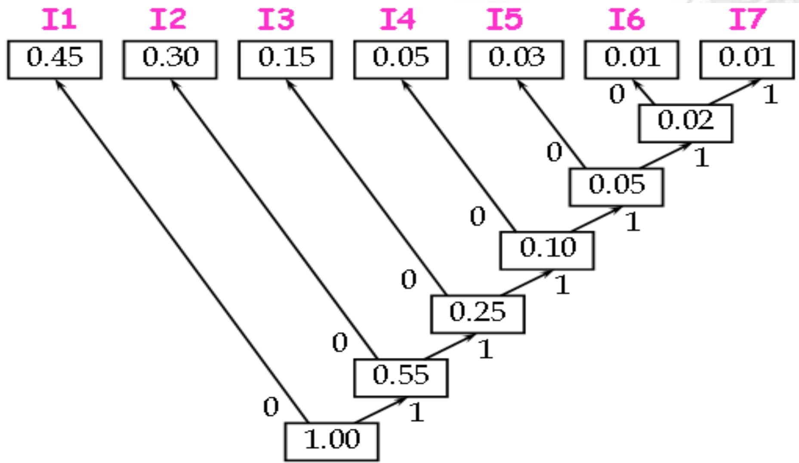

<details>
<summary>flowchart</summary>

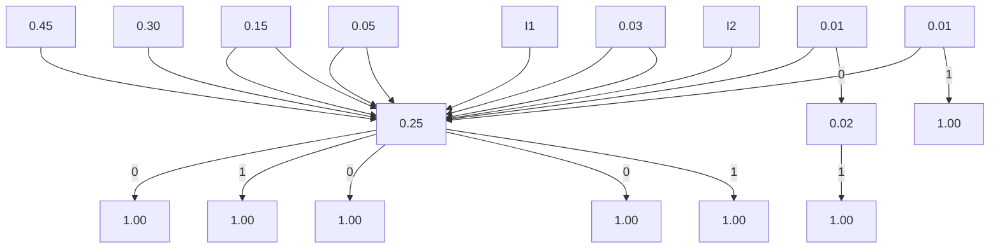
</details>

Huffman编码树生成过程

# 指令编码

编码结果:

<table><tr><td>指令序号</td><td>概率</td><td>Huffman编码法</td><td>操作码长度</td></tr><tr><td> $I_1$ </td><td>0.45</td><td>0</td><td>1位</td></tr><tr><td> $I_2$ </td><td>0.30</td><td>10</td><td>2位</td></tr><tr><td> $I_3$ </td><td>0.15</td><td>110</td><td>3位</td></tr><tr><td> $I_4$ </td><td>0.05</td><td>1110</td><td>4位</td></tr><tr><td> $I_5$ </td><td>0.03</td><td>11110</td><td>5位</td></tr><tr><td> $I_6$ </td><td>0.01</td><td>111110</td><td>6位</td></tr><tr><td> $I_7$ </td><td>0.01</td><td>111111</td><td>6位</td></tr></table>

采用 Huffman 编码法的操作码平均长度:

$$
\begin{array}{l} 0. 4 5 \times 1 + 0. 3 0 \times 2 + 0. 1 5 \times 3 + 0. 0 5 \times 4 + 0. 0 3 \times 5 + 0. 0 1 \times 6 + 0. 0 1 \times 6 \\ = 1. 9 7 (\text {位}) \end{array}
$$

# 指令编码

# Huffman操作码的主要缺点：

1) 操作码长度很不规整，硬件译码困难   
2) 与地址码共同组成固定长的指令比较困难

# 解决方法之一：指令操作码的扩展技术

# 指令编码

# 扩展指令编码：

- 让操作数多的指令opcode更短，  
- 操作数少的指令opcode最长

# 指令编码

原则：短码不能是长码的前缀。

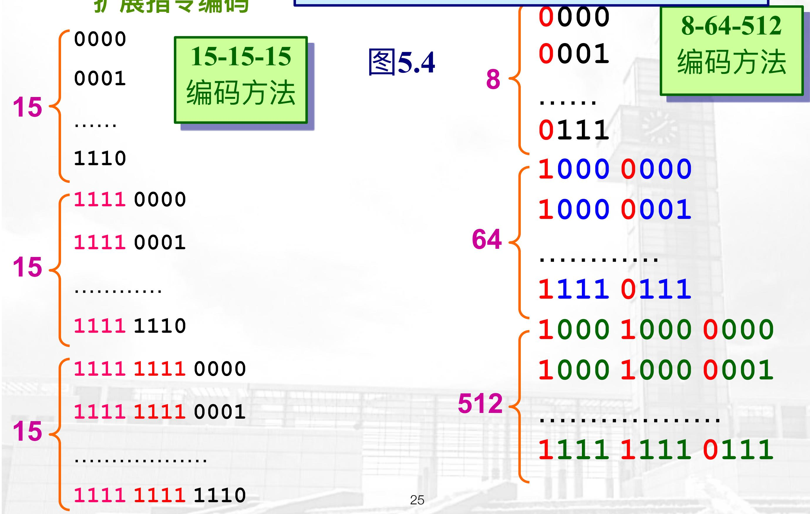

<details>
<summary>tree</summary>

| 编码方法 | 编号 | 数值 |
| -------- | ---- | ---- |
| 15-15-15 编码方法 | 0000 | 0000 |
| 15-15-15 编码方法 | 0001 | 0001 |
| 15-15-15 编码方法 | ...... | ... |
| 15-15-15 编码方法 | 1110 | 1110 |
| 8-64-512 编码方法 | 8    | 8    |
| 8-64-512 编码方法 | 0000 | 0000 |
| 8-64-512 编码方法 | 0001 | 0001 |
| 8-64-512 编码方法 | ...... | ... |
| 8-64-512 编码方法 | 0111 | 0111 |
| 8-64-512 编码方法 | 1000 | 1000 |
| 8-64-512 编码方法 | 0000 | 0000 |
| 8-64-512 编码方法 | 1000 | 1000 |
| 8-64-512 编码方法 | 0001 | 0001 |
| 8-64-512 编码方法 | ...... | ... |
| 8-64-512 编码方法 | 1111 | 1111 |
| 8-64-512 编码方法 | 0111 | 0111 |
| 8-64-512 编码方法 | 1000 | 1000 |
| 8-64-512 编码方法 | 0000 | 0000 |
| 8-64-512 编码方法 | 1111 | 1111 |
| 8-64-512 编码方法 | 0111 | 0111 |
| 8-64-512 编码方法 | 512 | 512 |
| 8-64-512 编码方法 | ...... | ... |
| 8-64-512 编码方法 | 1111 | 1111 |
| 8-64-512 编码方法 | 1111 | 0111 |
| 8-64-512 编码方法 | 25   | 25   |
</details>

# 指令编码

■ 短的操作码与多种地址码配合  
■ 长的操作码与简单地址码组合  
■ 指令长度一般设计为总线宽度的整数倍  
■ 指令的长度为最小可寻址单位的整数倍   
■ 影响寻址位的因素：

- 寻址方式的个数  
- 操作数数目  
- 寄存器数目  
- 地址范围

\- 地址可寻址最小单元

# 指令编码

例：假设某型号的计算机共有14条指令，各条指令的使用频

率分别为：0.01、0.15、0.12、0.03、0.02、0.04、0.02、

0.04、0.01、0.13、0.15、0.14、0.11、0.03。

试给出定长、只能有两种码长的扩展操作码的两种编码方案，

并计算各种方案的平均码长。

【解】

<table><tr><td>指令</td><td> $I_1$ </td><td> $I_2$ </td><td> $I_3$ </td><td> $I_4$ </td><td> $I_5$ </td><td> $I_6$ </td><td> $I_7$ </td></tr><tr><td>概率</td><td>0.15</td><td>0.15</td><td>0.14</td><td>0.13</td><td>0.12</td><td>0.11</td><td>0.04</td></tr><tr><td>指令</td><td> $I_8$ </td><td> $I_9$ </td><td> $I_{10}$ </td><td> $I_{11}$ </td><td> $I_{12}$ </td><td> $I_{13}$ </td><td> $I_{14}$ </td></tr><tr><td>概率</td><td>0.04</td><td>0.03</td><td>0.03</td><td>0.02</td><td>0.02</td><td>0.01</td><td>0.01</td></tr></table>

# 指令编码

定长编码：

<table><tr><td>指令</td><td> $I_1$ </td><td> $I_2$ </td><td> $I_3$ </td><td> $I_4$ </td><td> $I_5$ </td><td> $I_6$ </td><td> $I_7$ </td></tr><tr><td>概率</td><td>0.15</td><td>0.15</td><td>0.14</td><td>0.13</td><td>0.12</td><td>0.11</td><td>0.04</td></tr><tr><td>扩展编码</td><td>0000</td><td>0001</td><td>0010</td><td>0011</td><td>0100</td><td>0101</td><td>0110</td></tr><tr><td>码长</td><td>4</td><td>4</td><td>4</td><td>4</td><td>4</td><td>4</td><td>4</td></tr><tr><td>指令</td><td> $I_8$ </td><td> $I_9$ </td><td> $I_{10}$ </td><td> $I_{11}$ </td><td> $I_{12}$ </td><td> $I_{13}$ </td><td> $I_{14}$ </td></tr><tr><td>概率</td><td>0.04</td><td>0.03</td><td>0.03</td><td>0.02</td><td>0.02</td><td>0.01</td><td>0.01</td></tr><tr><td>扩展编码</td><td>0111</td><td>1000</td><td>1001</td><td>1010</td><td>1011</td><td>1100</td><td>1101</td></tr><tr><td>码长</td><td>4</td><td>4</td><td>4</td><td>4</td><td>4</td><td>4</td><td>4</td></tr></table>

其操作码的平均码长: $\mathrm{H} = 4$ (位)。

# 指令编码

两种码长的扩展操作码：（方法一）

<table><tr><td>指令</td><td> $I_1$ </td><td> $I_2$ </td><td> $I_3$ </td><td> $I_4$ </td><td> $I_5$ </td><td> $I_6$ </td><td> $I_7$ </td></tr><tr><td>概率</td><td>0.15</td><td>0.15</td><td>0.14</td><td>0.13</td><td>0.12</td><td>0.11</td><td>0.04</td></tr><tr><td>扩展编码</td><td>000</td><td>001</td><td>010</td><td>011</td><td>100</td><td>101</td><td>110</td></tr><tr><td>码长</td><td>3</td><td>3</td><td>3</td><td>3</td><td>3</td><td>3</td><td>3</td></tr><tr><td>指令</td><td> $I_8$ </td><td> $I_9$ </td><td> $I_{10}$ </td><td> $I_{11}$ </td><td> $I_{12}$ </td><td> $I_{13}$ </td><td> $I_{14}$ </td></tr><tr><td>概率</td><td>0.04</td><td>0.03</td><td>0.03</td><td>0.02</td><td>0.02</td><td>0.01</td><td>0.01</td></tr><tr><td>扩展编码</td><td>111000</td><td>111001</td><td>111010</td><td>111011</td><td>111100</td><td>111101</td><td>111110</td></tr><tr><td>码长</td><td>6</td><td>6</td><td>6</td><td>6</td><td>6</td><td>6</td><td>6</td></tr></table>

其操作码平均码长为： $\mathbf{H} = \sum_{i=1}^{n} p_i l_i$

$$
\mathrm{H} = (0. 1 5 + 0. 1 5 + 0. 1 4 + 0. 1 3 + 0. 1 2 + 0. 1 1 + 0. 0 4) \times 3 +
$$

$$
(0. 0 4 + 0. 0 3 + 0. 0 3 + 0. 0 2 + 0. 0 2 + 0. 0 1 + 0. 0 1) \times 6
$$

$$
= 0. 8 4 \times 3 + 0. 1 6 \times 6 = 3. 4 8 (\text {位})
$$

# 指令编码

大概率

<table><tr><td>指令</td><td> $I_1$ </td><td> $I_2$ </td><td> $I_3$ </td><td> $I_4$ </td><td> $I_5$ </td><td> $I_6$ </td><td> $I_7$ </td></tr><tr><td>概率</td><td>0.15</td><td>0.15</td><td>0.14</td><td>0.13</td><td>0.12</td><td>0.11</td><td>0.04</td></tr><tr><td>扩展编码</td><td></td><td></td><td></td><td></td><td></td><td></td><td></td></tr><tr><td>码长</td><td></td><td></td><td></td><td></td><td></td><td></td><td></td></tr><tr><td>指令</td><td> $I_8$ </td><td> $I_9$ </td><td> $I_{10}$ </td><td> $I_{11}$ </td><td> $I_{12}$ </td><td> $I_{13}$ </td><td> $I_{14}$ </td></tr><tr><td>概率</td><td>0.04</td><td>0.03</td><td>0.03</td><td>0.02</td><td>0.02</td><td>0.01</td><td>0.01</td></tr><tr><td>扩展编码</td><td></td><td></td><td></td><td></td><td></td><td></td><td></td></tr><tr><td>码长</td><td></td><td></td><td></td><td></td><td></td><td></td><td></td></tr></table>

小概率

# 指令编码

大概率

两种码长的扩展操作码：（方法二）

<table><tr><td>指令</td><td> $I_1$ </td><td> $I_2$ </td><td> $I_3$ </td><td> $I_4$ </td><td> $I_5$ </td><td> $I_6$ </td><td> $I_7$ </td></tr><tr><td>概率</td><td>0.15</td><td>0.15</td><td>0.14</td><td>0.13</td><td>0.12</td><td>0.11</td><td>0.04</td></tr><tr><td>扩展编</td><td>000</td><td>001</td><td>010</td><td>011</td><td>100</td><td>101</td><td>11000</td></tr><tr><td>码长</td><td>3</td><td>3</td><td>3</td><td>3</td><td>3</td><td>3</td><td>5</td></tr><tr><td>指令</td><td> $I_8$ </td><td> $I_9$ </td><td> $I_{10}$ </td><td> $I_{11}$ </td><td> $I_{12}$ </td><td> $I_{13}$ </td><td> $I_{14}$ </td></tr><tr><td>概率</td><td>0.04</td><td>0.03</td><td>0.03</td><td>0.02</td><td>0.02</td><td>0.01</td><td>0.01</td></tr><tr><td>扩展编</td><td>11001</td><td>11010</td><td>11011</td><td>11100</td><td>11101</td><td>11110</td><td>11111</td></tr><tr><td>码长</td><td>5</td><td>5</td><td>5</td><td>5</td><td>5</td><td>5</td><td>5</td></tr></table>

其操作码平均码长为： $\mathbf{H} = \sum_{i=1}^{n} p_i l_i$

$$
\begin{array}{l} \mathbf {H} = (0. 1 5 + 0. 1 5 + 0. 1 4 + 0. 1 3 + 0. 1 2 + 0. 1 1) \times 3 + \\ (0. 0 4 + 0. 0 4 + 0. 0 3 + 0. 0 3 + 0. 0 2 + 0. 0 2 + 0. 0 1 + 0. 0 1) \times 5 \\ = 0. 8 \times 3 + 0. 2 \times 5 = 3. 4 (\text {位}) \\ \end{array}
$$

小概率

# 指令格式

8086 / 8088指令编码由1～6个字节组成，它包括操作码（第一字节）、寻址方式（第二字节）和操作数（第三到第六字节）三部分组成p

opcode

opcode

Mod字节

opcode

Mod字节

Data/disp

opcode

Mod字节

Data/disp(低)

Data/disp(高)

opcode

Mod字节

disp(低)

disp(高)

Data

opcode

Mod字节

disp(低)

disp(高)

Data(低)

Data(高)

操作码部分

寻址方式部分

操作数部分

# 可执行程序的两个结构

# 可执行程序的两个结构

\- 一个最简单的C代码: 其实一点也不简单...

```txt
int main() {
    printf("Hello world!\n");
} 
```

# 可执行程序的两个结构

\- 一个最简单的C代码： 其实一点也不简单...

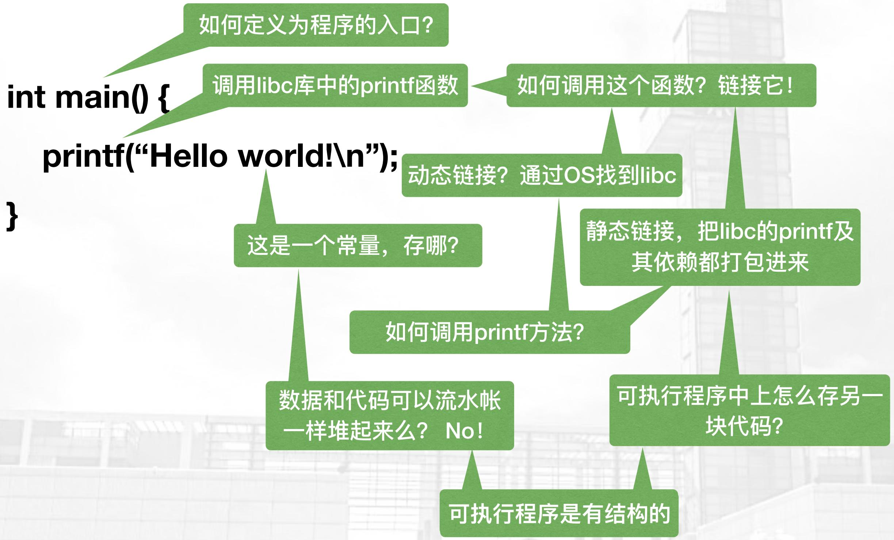

<details>
<summary>flowchart</summary>

```mermaid
graph TD
    A["如何定义为程序的入口?"] --> B{int main() { printf("Hello world!\n"); }} 
    B --> C["调用libc库中的printf函数"]
    C --> D{如何调用这个函数？链接它！}
    D --> E["动态链接？通过OS找到libc"]
    E --> F{这是一个常量，存哪？}
    F --> G["数据和代码可以流水帐一样堆起来么？No!}<br>    D --> H[静态链接，把libc的printf及其依赖都打包进来"]
    H --> I{如何调用printf方法？}
    I --> J{可执行程序中上怎么存另一块代码？}
    J --> K["可执行程序是有结构的"]
```
</details>

# 可执行程序的两个结构

\- 一个最简单的C代码:

```txt
int main() {
    printf("Hello world!\n");
} 
```

经历2个步骤变成可执行程序：

- 编译（把自己的程序逻辑变为机器代码）  
- 链接（链接其它库的函数调用）

\- 可执行程序的静态结构（ELF为例）

- ELF Header   
- Sections

- CODE   
• DATA   
• BSS   
- RODATA   
- HEAP   
- STACK   
● ....

• Section Header Table

# 可执行程序的两个结构

# - 可执行程序的静态结构（ELF为例）

- ELF Header   
- Sections

- CODE/TEXT   
• DATA   
• BSS   
- HEAP   
- STACK   
●
...

• Section Header Table

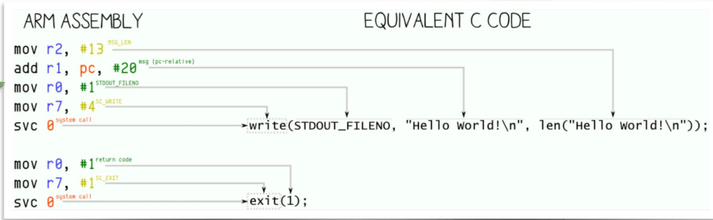

<details>
<summary>flowchart</summary>

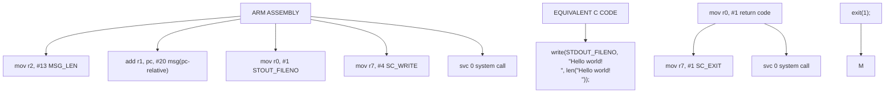
</details>

# STRINGS

"Hello World!\n", 0

# 可执行程序的两个结构

\- 可执行程序的静态结构（ELF为例）

- ELF Header   
- Sections

- CODE/TEXT   
• DATA   
• BSS   
- HEAP   
- STACK   
●
...

• Section Header Table

地址高位  
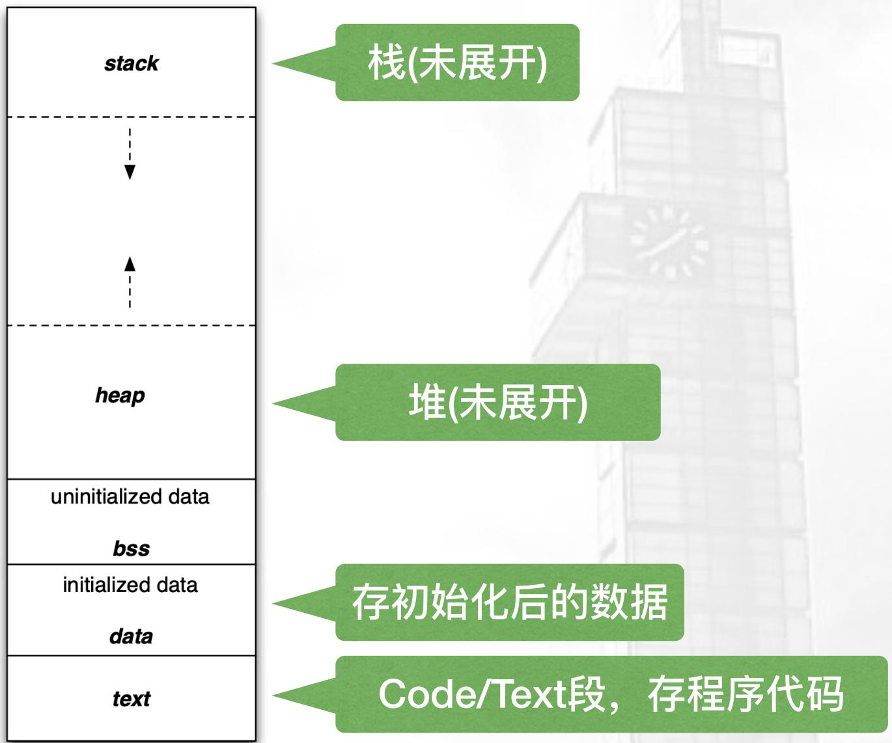

<details>
<summary>flowchart</summary>

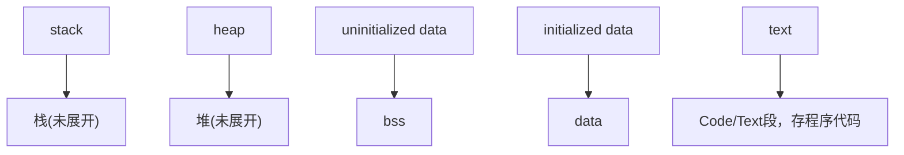
</details>

地址低位

# 地址高位

<table><tr><td>stack</td></tr><tr><td>↓</td></tr><tr><td>↑</td></tr><tr><td>heap</td></tr><tr><td>uninitialized data</td></tr><tr><td>bss</td></tr><tr><td>initialized data</td></tr><tr><td>data</td></tr><tr><td>text</td></tr></table>

# 地址低位

# 可执行程序的两个结构

\- 可执行程序的动态结构—进程!

\- 程序映射到4GB虚拟内存空间

\- 每个线程有自己的Stack/Heap

\- 虚拟地址被OS映射到实际物理地址


<details>
<summary>text_image</summary>

程序映射到4GB虚拟内存空间
每个线程有自己的Stack/Heap
虚拟地址被OS映射到实际物理地址
</details>

<table><tr><td></td><td>code</td><td>plt</td><td>data</td><td>got</td><td>bss</td><td></td><td>heap</td><td></td><td>shared memory</td><td></td><td>shared libraries</td><td></td><td>stack</td></tr></table>

# 可执行程序的内存结构

# - 关于Stack/Heap

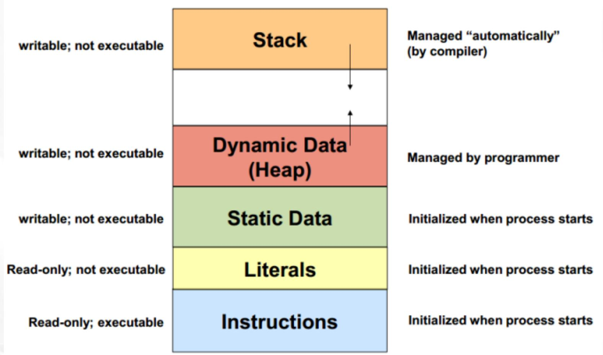

<details>
<summary>flowchart</summary>

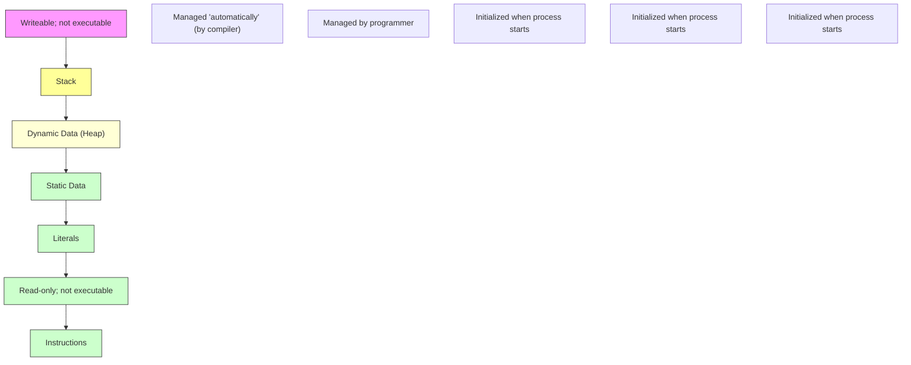
</details>

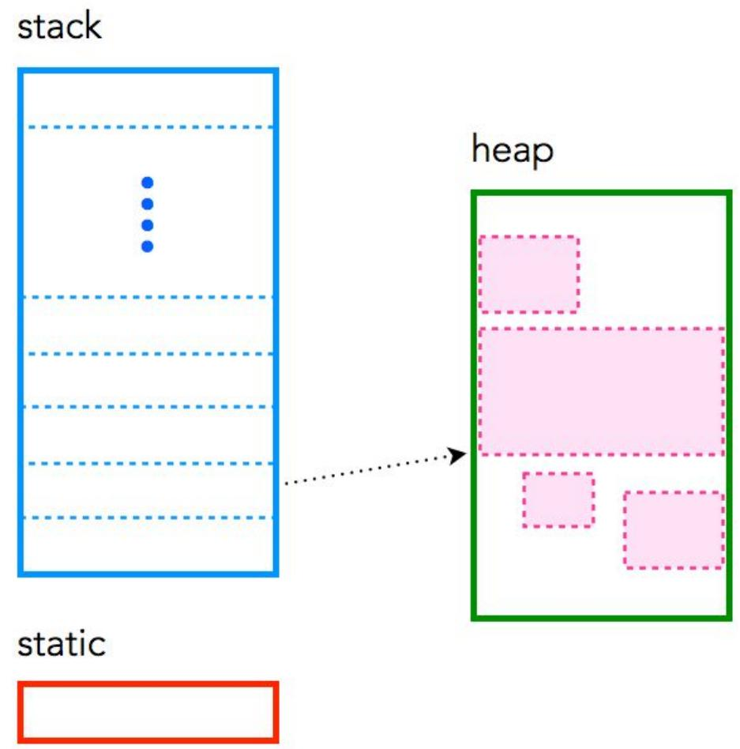

<details>
<summary>flowchart</summary>

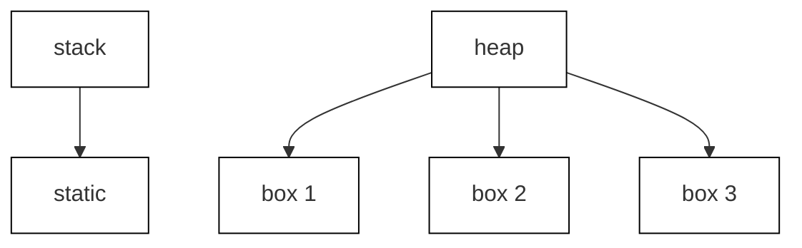
</details>

# 可执行程序的内存结构

- 关于Stack/Heap  
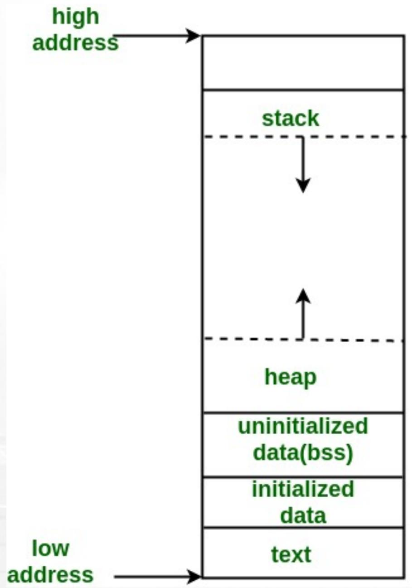

<details>
<summary>flowchart</summary>

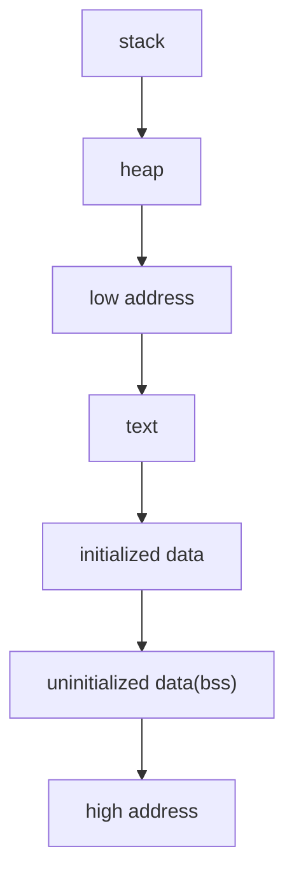
</details>

一个典型的Java程序内存模型  
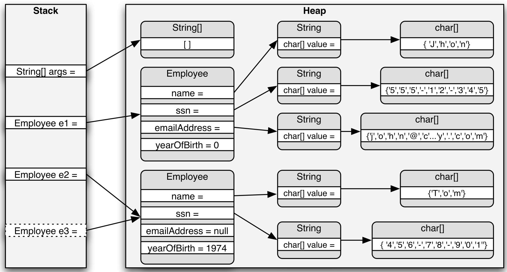

<details>
<summary>flowchart</summary>

```mermaid
graph TD
    A["Stack"] --> B["String["] args =]
    A --> C["Employee e1 ="]
    A --> D["Employee e2 ="]
    A --> E["Employee e3 ="]
    
    F["Heap"] --> G["String["] args =]
    F --> H["String["] char[] value =]
    F --> I["String["] char[] value =]
    F --> J["String["] char[] value =]
    F --> K["String["] char[] value =]
    F --> L["String["] char[] value =]
    
    M["Heap"] --> N["String["] args =]
    M --> O["Employee name ="]
    M --> P["ssn ="]
    M --> Q["emailAddress ="]
    M --> R["yearOfBirth = 0"]
    
    S["Heap"] --> T["String["] args =]
    S --> U["String["] char[] value =]
    S --> V["String["] char[] value =]
    S --> W["String["] char[] value =]
    
    X["Heap"] --> Y[", 'J', 'h', 'o', 'n'"]
    X --> Z[", '5', '5', '5', '-', '1', '2', '-', '3', '4', '5'"]
    X --> AA[", 'j', 'o', 'h', 'n', '@', 'c'...y', 'c', 'o', 'm'"]
    X --> AB[", 'T', 'o', 'm'"]
    X --> AC[", '4', '5', '6', '-', '7', '8', '-', '9', '0', '1'"]
```
</details>

# 可执行程序的内存结构

- 关于Stack/Heap  
- 高性能的Heap分配器可以尽量避免碎片，显著提升性能...  
- 当然对Java来说，GC的影响更大...

- Default Allocator
list<int> b;
// same as:
list<int, allocator<int>> b;   
- Custom Allocator
  #include "MyAlloc.h"
  list<int, MyAlloc<int>> c;

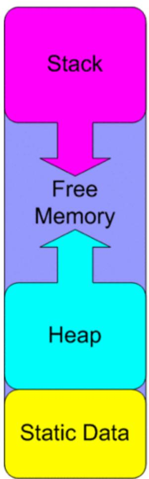

<details>
<summary>flowchart</summary>

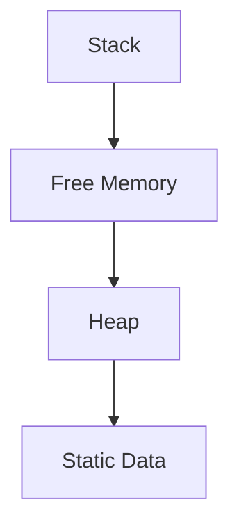
</details>

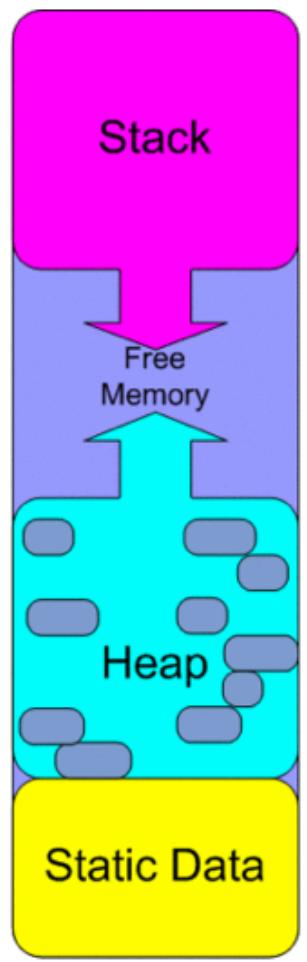

<details>
<summary>flowchart</summary>


</details>

So, 这和指令系统有什么关系?

CPU，是如何定位程序的？

# CPU的内部寄存器

# 8086 CPU的内部寄存器

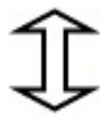

command-line arguments and environment variables

# 存器

行时的

阶段，

址等

<table><tr><td>AH</td><td>AL</td></tr><tr><td>BH</td><td>BL</td></tr><tr><td>CH</td><td>CL</td></tr><tr><td>DH</td><td>DL</td></tr></table>

<table><tr><td>SP</td></tr><tr><td>BP</td></tr><tr><td>SI</td></tr><tr><td>DI</td></tr></table>

AX
BX
CX
DX

数据寄存器

堆栈指针
基数指针
源变址
目的变址

指针寄存器
指针寄存器

通用寄存器


initialized to zero by exec

read from program file by exec

器

<table><tr><td colspan="2">IP</td></tr><tr><td>PSWH</td><td>PSWL</td></tr></table>

<table><tr><td>CS</td></tr><tr><td>DS</td></tr><tr><td>SS</td></tr><tr><td>ES</td></tr></table>

指令指针
状态标志

} 控制寄存器

代码段
数据段
堆栈段
附加段

段寄存器

\- 数据寄存器

# CPU的内部寄存器

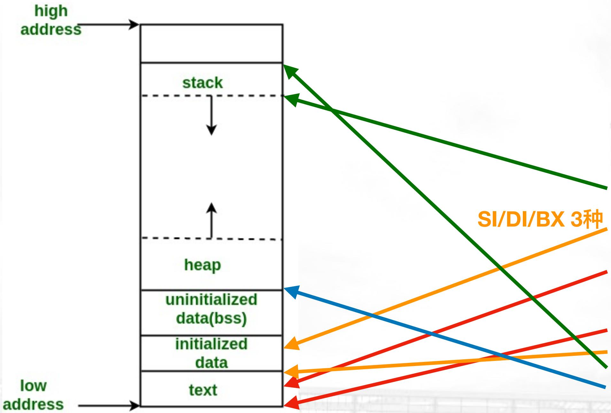

<details>
<summary>flowchart</summary>

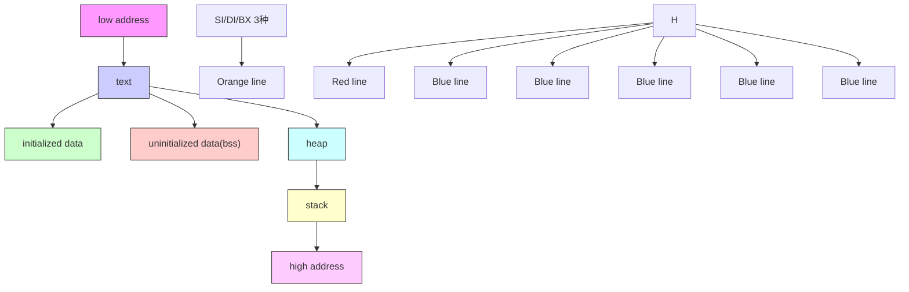
</details>

<table><tr><td>AH</td><td>AL</td></tr><tr><td>BH</td><td>BL</td></tr><tr><td>CH</td><td>CL</td></tr><tr><td>DH</td><td>DL</td></tr></table>

<table><tr><td>SP</td></tr><tr><td>BP</td></tr><tr><td>SI</td></tr><tr><td>DI</td></tr></table>

<table><tr><td colspan="2">IP</td></tr><tr><td>PSWH</td><td>PSWL</td></tr></table>

<table><tr><td>CS</td></tr><tr><td>DS</td></tr><tr><td>SS</td></tr><tr><td>ES</td></tr></table>

AX
BX
CX
DX

堆栈指针
基数指针
源变址
目的变址

指令指针状态标志

代码段
数据段
堆栈段
附加段

# CPU的内部寄存器

物理地址=段寄存器×16 + 偏移地址  
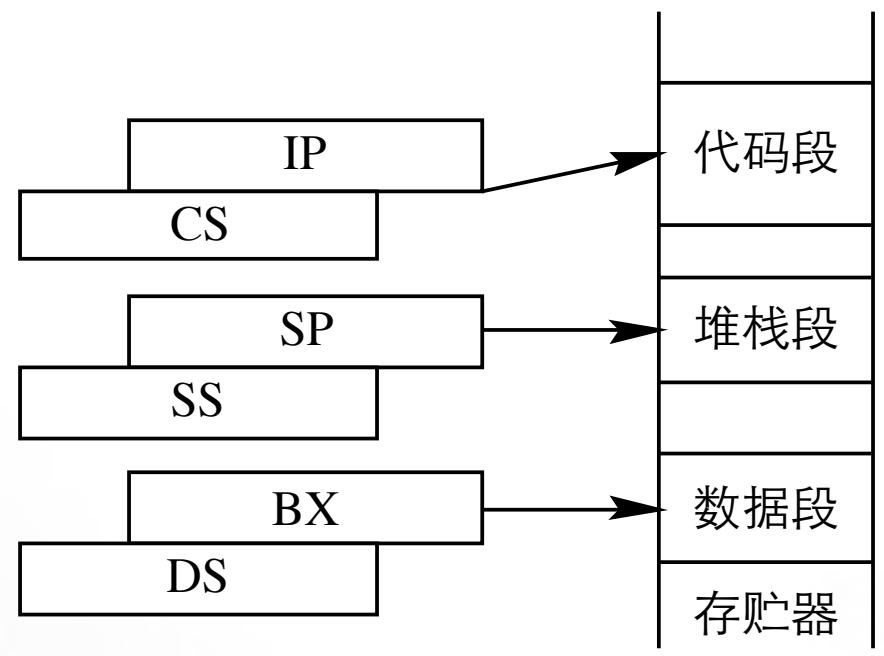

<details>
<summary>flowchart</summary>

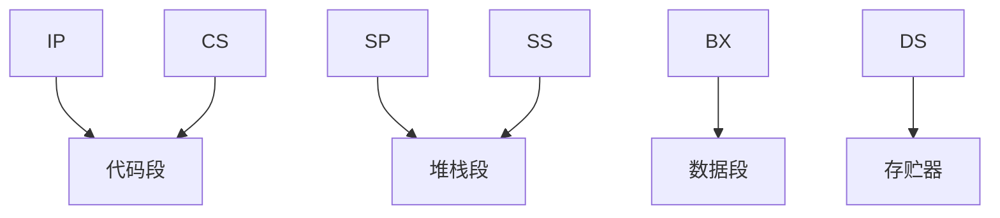
</details>

Then, How ???   
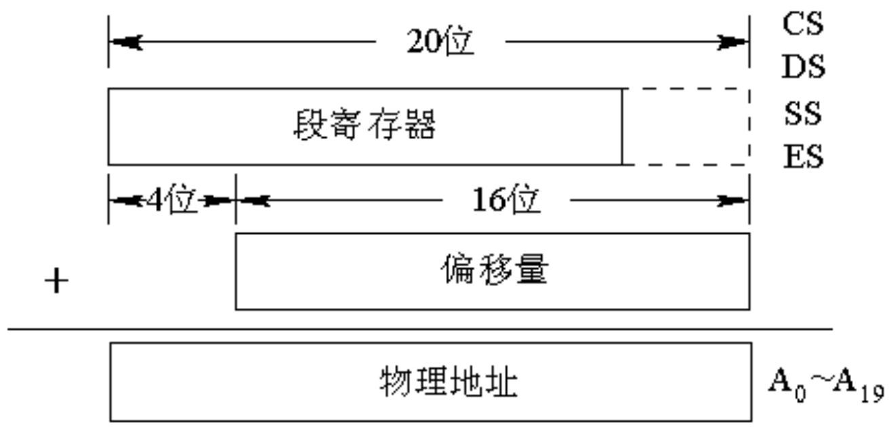

<details>
<summary>text_image</summary>

20位
CS
DS
SS
ES
段寄存器
4位
16位
偏移量
+
物理地址
A₀~A₁₉
</details>

<table><tr><td>AH</td><td>AL</td></tr><tr><td>BH</td><td>BL</td></tr><tr><td>CH</td><td>CL</td></tr><tr><td>DH</td><td>DL</td></tr></table>

AX
BX
CX
DX

数据寄存器

<table><tr><td>SP</td></tr><tr><td>BP</td></tr><tr><td>SI</td></tr><tr><td>DI</td></tr></table>

堆栈指针
基数指针
源变址
目的变址

指针寄存器
指针寄存器

<table><tr><td colspan="2">IP</td></tr><tr><td>PSWH</td><td>PSWL</td></tr></table>

指令指针状态标志

}控制寄存器

<table><tr><td>CS</td></tr><tr><td>DS</td></tr><tr><td>SS</td></tr><tr><td>ES</td></tr></table>

代码段
数据段
堆栈段
附加段

段寄存器

# CPU的内部寄存器

\- 数据寄存器:

- 4个16位长，AX, BX, CX, DX   
- 或8个8位，AH, AL, ...

\- 指针寄存器: SP 和 BP

- BP是基址指针寄存器，通常用于存放基地址，以使8088的寻址更加灵活；  
- SP是堆栈指针寄存器，由它和堆栈段寄存器一起来确定堆栈内数据在内存中的位置；

<table><tr><td>AH</td><td>AL</td></tr><tr><td>BH</td><td>BL</td></tr><tr><td>CH</td><td>CL</td></tr><tr><td>DH</td><td>DL</td></tr></table>

AX
BX
CX
DX


<table><tr><td>SP</td></tr><tr><td>BP</td></tr><tr><td>SI</td></tr><tr><td>DI</td></tr></table>

堆栈指针
基数指针
源变址
目的变址
指令指针
状态标志

<table><tr><td colspan="2">IP</td></tr><tr><td>PSWH</td><td>PSWL</td></tr></table>

代码段
数据段
堆栈段
附加段

<table><tr><td>CS</td></tr><tr><td>DS</td></tr><tr><td>SS</td></tr><tr><td>ES</td></tr></table>

# CPU的内部寄存器

\- 变址寄存器: SI/DI:

\- Source/Destination Index, 源/目的变址，用于变址寻址；

<table><tr><td>AH</td><td>AL</td></tr><tr><td>BH</td><td>BL</td></tr><tr><td>CH</td><td>CL</td></tr><tr><td>DH</td><td>DL</td></tr></table>

AX
BX
CX
DX

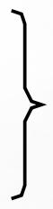

<table><tr><td>SP</td></tr><tr><td>BP</td></tr><tr><td>SI</td></tr><tr><td>DI</td></tr></table>

堆栈指针
基数指针
源变址
目的变址

<table><tr><td colspan="2">IP</td></tr><tr><td>PSWH</td><td>PSWL</td></tr></table>

指令指针状态标志

<table><tr><td>CS</td></tr><tr><td>DS</td></tr><tr><td>SS</td></tr><tr><td>ES</td></tr></table>

代码段
数据段
堆栈段
附加段

# CPU的内部寄存器

# - 控制寄存器: PSW

# - Process State Word处理机状态字

15 0

<table><tr><td></td><td></td><td></td><td></td><td>O</td><td>D</td><td>I</td><td>T</td><td>S</td><td>Z</td><td></td><td>A</td><td></td><td>P</td><td></td><td>C</td></tr></table>

C —进位标志位

A —半加标志位

S —符号标志位

I —中断允许标志位

O — 溢出标志位

P —奇偶标志位

Z — 零标志位

T —陷阱标志位(单步标志位)

D —方向标志位

<table><tr><td>AH</td><td>AL</td></tr><tr><td>BH</td><td>BL</td></tr><tr><td>CH</td><td>CL</td></tr><tr><td>DH</td><td>DL</td></tr></table>

AX
BX
CX
DX


<table><tr><td>SP</td></tr><tr><td>BP</td></tr><tr><td>SI</td></tr><tr><td>DI</td></tr></table>

堆栈指针
基数指针
源变址
目的变址

<table><tr><td colspan="2">IP</td></tr><tr><td>PSWH</td><td>PSWL</td></tr></table>

指令指针状态标志

<table><tr><td>CS</td></tr><tr><td>DS</td></tr><tr><td>SS</td></tr><tr><td>ES</td></tr></table>

代码段
数据段
堆栈段
附加段

# CPU的内部寄存器

\- 那么，2023年的处理呢？

• AMD64 / x86-64

<table><tr><td>64-bit register</td><td>Lower 32 bits</td><td>Lower 16 bits</td><td>Lower 8 bits</td></tr><tr><td>rax</td><td>eax</td><td>ax</td><td>al</td></tr><tr><td>rbx</td><td>ebx</td><td>bx</td><td>bl</td></tr><tr><td>rcx</td><td>ecx</td><td>cx</td><td>cl</td></tr><tr><td>rdx</td><td>edx</td><td>dx</td><td>dl</td></tr><tr><td>rsi</td><td>esi</td><td>si</td><td>sil</td></tr><tr><td>rdi</td><td>edi</td><td>di</td><td>dil</td></tr><tr><td>rbp</td><td>ebp</td><td>bp</td><td>bpl</td></tr><tr><td>rsp</td><td>esp</td><td>sp</td><td>spl</td></tr><tr><td>r8</td><td>r8d</td><td>r8w</td><td>r8b</td></tr><tr><td>r9</td><td>r9d</td><td>r9w</td><td>r9b</td></tr><tr><td>r10</td><td>r10d</td><td>r10w</td><td>r10b</td></tr><tr><td>r11</td><td>r11d</td><td>r11w</td><td>r11b</td></tr><tr><td>r12</td><td>r12d</td><td>r12w</td><td>r12b</td></tr><tr><td>r13</td><td>r13d</td><td>r13w</td><td>r13b</td></tr><tr><td>r14</td><td>r14d</td><td>r14w</td><td>r14b</td></tr><tr><td>r15</td><td>r15d</td><td>r15w</td><td>r15b</td></tr></table>

<table><tr><td>AH</td><td>AL</td></tr><tr><td>BH</td><td>BL</td></tr><tr><td>CH</td><td>CL</td></tr><tr><td>DH</td><td>DL</td></tr></table>

AX
BX
CX
DX

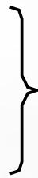

<table><tr><td>SP</td></tr><tr><td>BP</td></tr><tr><td>SI</td></tr><tr><td>DI</td></tr></table>

堆栈指针
基数指针
源变址
目的变址
指令指针
状态标志

<table><tr><td colspan="2">IP</td></tr><tr><td>PSWH</td><td>PSWL</td></tr></table>

代码段
数据段
堆栈段
附加段

<table><tr><td>CS</td></tr><tr><td>DS</td></tr><tr><td>SS</td></tr><tr><td>ES</td></tr></table>

# CPU的内部寄存器

\- 那么，2020年的处理呢？

• ARM AArch64,

Registers across CPU modes 

<table><tr><td>usr</td><td>sys</td><td>svc</td><td>abt</td><td>und</td><td>irq</td><td>fiq</td></tr><tr><td colspan="7">R0</td></tr><tr><td colspan="7">R1</td></tr><tr><td colspan="7">R2</td></tr><tr><td colspan="7">R3</td></tr><tr><td colspan="7">R4</td></tr><tr><td colspan="7">R5</td></tr><tr><td colspan="7">R6</td></tr><tr><td colspan="7">R7</td></tr><tr><td colspan="6">R8</td><td>R8_fiq</td></tr><tr><td colspan="6">R9</td><td>R9_fiq</td></tr><tr><td colspan="6">R10</td><td>R10_fiq</td></tr><tr><td colspan="6">R11</td><td>R11_fiq</td></tr><tr><td colspan="6">R12</td><td>R12_fiq</td></tr><tr><td>R13</td><td>R13_svc</td><td>R13_abt</td><td>R13_und</td><td>R13_irq</td><td>R13_fiq</td><td></td></tr><tr><td>R14</td><td>R14_svc</td><td>R14_abt</td><td>R14_und</td><td>R14_irq</td><td>R14_fiq</td><td></td></tr><tr><td colspan="7">R15</td></tr><tr><td colspan="7">CPSR</td></tr><tr><td></td><td>SPSR_svc</td><td>SPSR_abt</td><td>SPSR_und</td><td>SPSR_irq</td><td>SPSR_fiq</td><td></td></tr></table>

<table><tr><td>AH</td><td>AL</td></tr><tr><td>BH</td><td>BL</td></tr><tr><td>CH</td><td>CL</td></tr><tr><td>DH</td><td>DL</td></tr></table>

AX
BX
CX
DX

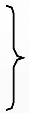

<table><tr><td>SP</td></tr><tr><td>BP</td></tr><tr><td>SI</td></tr><tr><td>DI</td></tr></table>

堆栈指针
基数指针
源变址
目的变址
指令指针
状态标志

<table><tr><td colspan="2">IP</td></tr><tr><td>PSWH</td><td>PSWL</td></tr></table>

代码段
数据段
堆栈段
附加段

<table><tr><td>CS</td></tr><tr><td>DS</td></tr><tr><td>SS</td></tr><tr><td>ES</td></tr></table>

# 寻址方式

运算，

需要数据，

需要取数据，

需要知道用哪种方式去取数据，

还需要知道从哪里取数据，

-- 寻址方式

Addressing Mode !

# 但在此之前，

# 必须仔细学习一个汇编指令...

# - MOV指令

格式: MOV OPRD1, OPRD2
目的 源

功能：（OPRD2）→（OPRD1）

其中：目的操作OPRD1

源操作数 OPRD2

存储器 mem

通用寄存器 r

段寄存器 SEG（除CS）

立即数 im

存储器 mem

通用寄存器 r

段寄存器 SEG（含CS）

但也有4种例外情况：

- 目的操作数不能为立即数，或 CS、IP;  
·内存单元之间不能进行数据直接传送；  
- 立即数不能直接传送到段寄存器中；  
·段寄存器之间的不能进行数据直接传送；

# Done !

# 寻址方式Addressing Mode

- Immediate 立即   
- Direct 直接  
- Register 寄存器  
- Register + Indirect 寄存器间接 (2种)   
- Register + Indexing 寄存器相对  
- Base + Displacement 基址变址 (2种)  
- Base + Displacement + Indexing 基址+变址+相对  
- Implicit 隐式

# 寻址方式 — 立即寻址

- 操作数直接包含在指令中！（跟在操作码后面）  
- 操作数是在代码段！！

例如:

MOV AL, 27H

ADD AL, 35H

MOV AX, 2000H

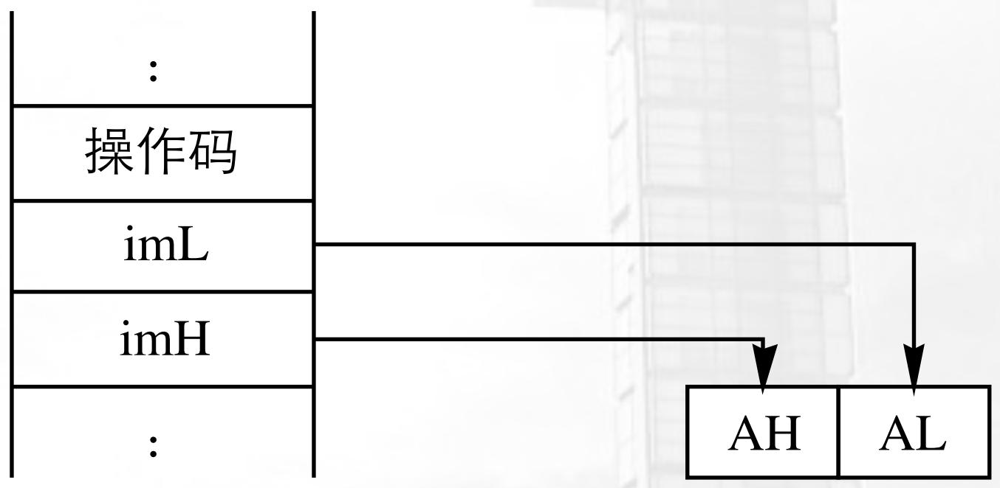

<details>
<summary>flowchart</summary>

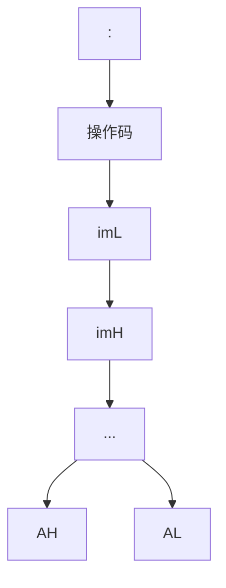
</details>

注意！！ 地址低位去AL，高位去AH !!!!

# 寻址方式 - 直接寻址

\- 操作数的段内偏移地址直接包含在指令中! （跟在

操作码后面)

\- 操作数是在数据段！！

例如:

MOV AX, [2000H ]

设DS=3000H

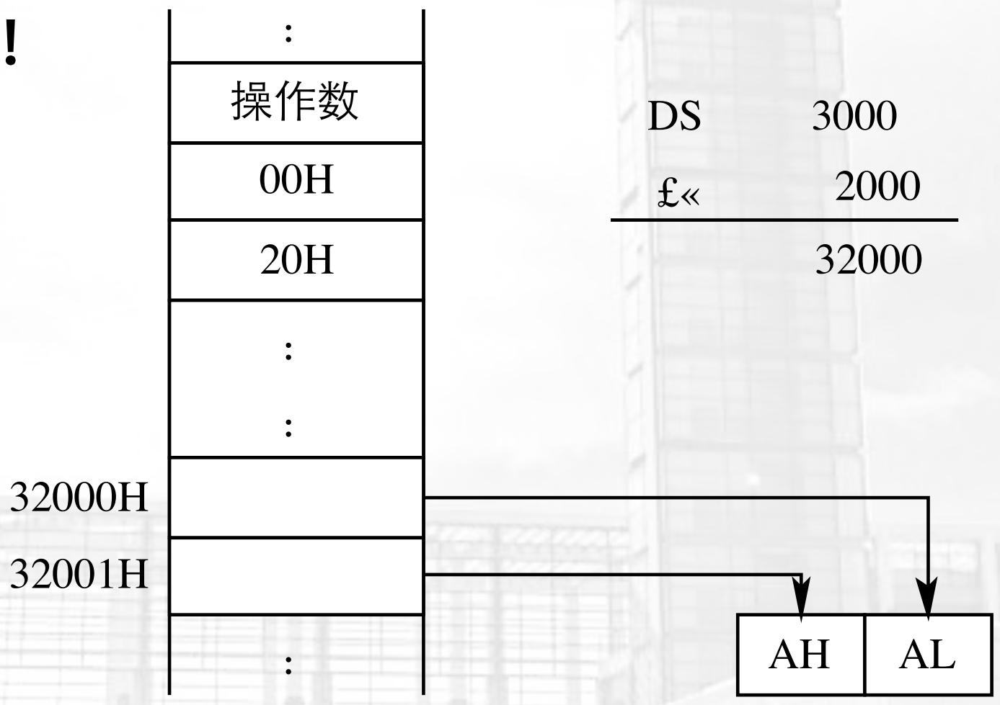

<details>
<summary>flowchart</summary>

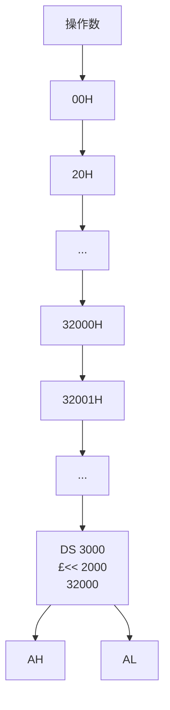
</details>

# 寻址方式 - 寄存器寻址

\- 操作数在某个寄存器中!

例如:

MOV DS, AX

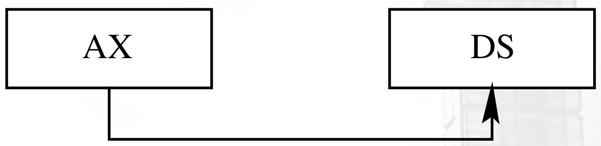

<details>
<summary>flowchart</summary>

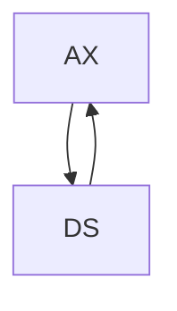
</details>

# 寻址方式 — 寄存器间接寻址

- 操作数的段内偏移地址放在SI/DI/BP/BX其中一  
个寄存器中!

\- 分两种情况:

- 如果是SI/DI/BX < - 搭配DS在数据段找操作数  
- 如果是BP < - 搭配SS在堆栈段找操作数

# 寻址方式 — 寄存器间接寻址

# 例如：

MOV AX, 2000H

MOV DS, AX

MOV SI, 1000H

MOV AX, [SI]

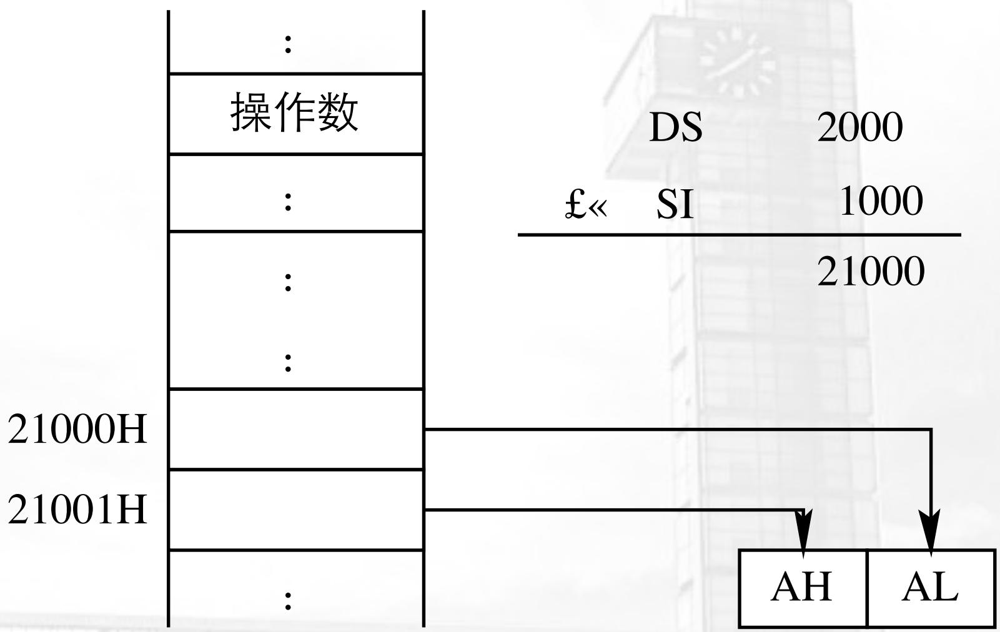

<details>
<summary>flowchart</summary>

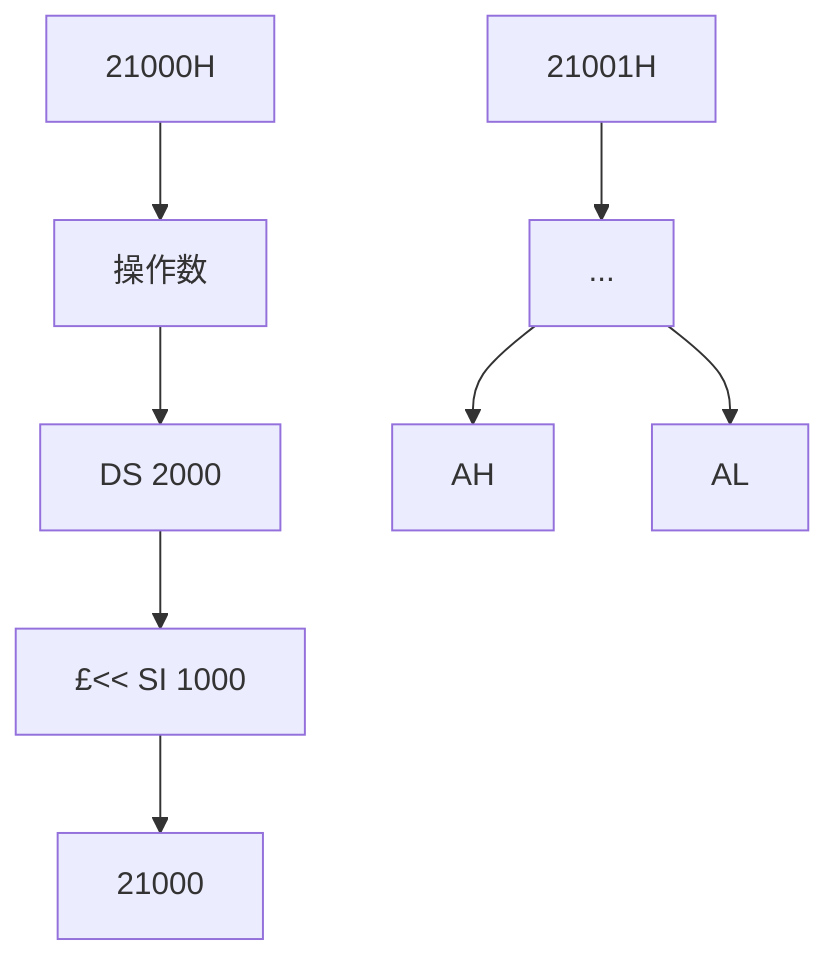
</details>

(a)

# 寻址方式 - 寄存器间接寻址

# 例如：

MOV AX, 3000H

MOV SS, AX

MOV BP, 2000H

MOV AX, [BP]

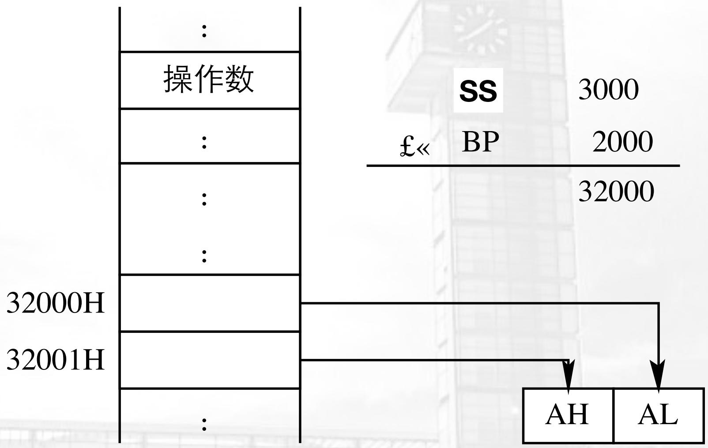

<details>
<summary>flowchart</summary>

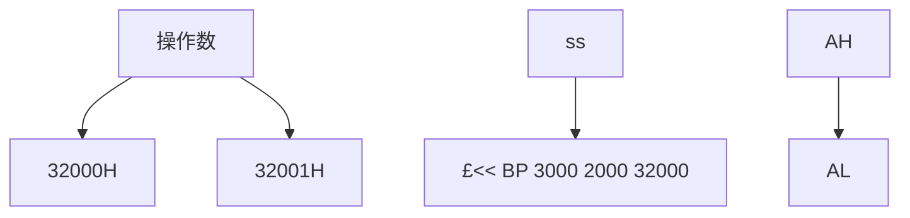
</details>

(b)

# 寻址方式 - 寄存器间接寻址

■ 例:假设有指令: MOV BX,[DI], 在执行时, (DS)=1000H, (DI)=2345H, 存储单元12345H的内容是4354H。问执行指令后, BX的值是什么?  
解：

根据寄存器间接寻址方式的规则，在执行本例指令时，寄存器DI的值不是操作数，而是操作数的地址。该操作数的物理地址(Physical Address, PA)应由DS和DI的值形成，即：

$$
\mathrm{PA} = (\mathrm{DS}) ^ {*} 1 6 + \mathrm{DI} = 1 0 0 0 \mathrm{H} ^ {*} 1 6 + 2 3 4 5 \mathrm{H} = 1 2 3 4 5 \mathrm{H} 。
$$

所以，该指令的执行效果是：把从物理地址为12345H开始的一个字的值传送给BX。

# 寻址方式 - 寄存器间接寻址

■ 例:假设有指令: MOV BX,[DI], 在执行时, (DS)=1000H, (DI)=2345H, 存储单元12345H的内容是4354H。问执行指令后, BX的值是什么?  
解：

根据寄存器间接寻址方式的规则，在执行本例指令时，寄存器DI的值不是操作数，而是操作数的地址。该操作数的物理地址(Physical Address, PA)应由DS和DI的值形成，即：

$$
\mathrm{PA} = (\mathrm{DS}) ^ {*} 1 6 + \mathrm{DI} = 1 0 0 0 \mathrm{H} ^ {*} 1 6 + 2 3 4 5 \mathrm{H} = 1 2 3 4 5 \mathrm{H} 。
$$

所以，该指令的执行效果是：把从物理地址为12345H开始的一个字的值传送给BX。

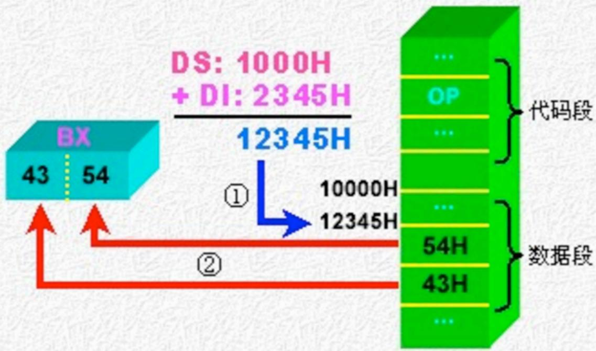

<details>
<summary>flowchart</summary>

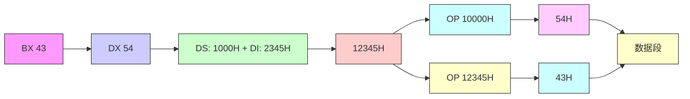
</details>

# 寻址方式 - 寄存器相对寻址

- 本质是寄存器间接 + 相对寻址：在寄存器间接的基础上再加上地址偏移值DISP；  
- DISP跟着操作码后面，在代码段！！！  
- 同样分两种情况:

- 如果是SI/DI/BX < - 搭配DS在数据段找操作数  
- 如果是BP < - 搭配SS在堆栈段找操作数

例: MOV AX, DISP [SI]

# 寻址方式 — 寄存器相对寻址

例：MOV AX, DISP [SI] ; DISP=1000H; DS = 3000H; SI = 2000H

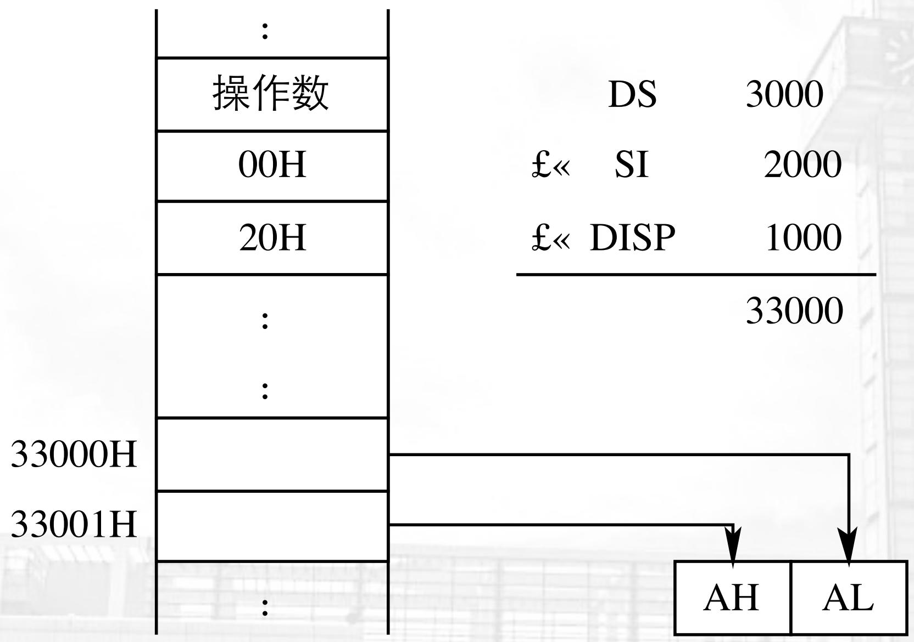

<details>
<summary>bar_stacked</summary>

| Category   | Value |
| ---------- | ----- |
| DS         | 3000  |
| £<< SI     | 2000  |
| £<< DISP   | 1000  |
|          | 33000 |
</details>

# 寻址方式 - 寄存器相对寻址

例: 假设指令: MOV BX, [SI+100H], 在执行它时, (DS)=1000H, (SI)=2345H, 内存单元12445H的内容为2715H, 问该指令执行后, BX的值是什么?

解：根据寄存器相对寻址方式的规则，在执行本例指令时，源操作数的有效地址EA为：

$$
\mathrm{EA} = (\mathrm{SI}) + 1 0 0 \mathrm{H} = 2 3 4 5 \mathrm{H} + 1 0 0 \mathrm{H} = 2 4 4 5 \mathrm{H}
$$

该操作数的物理地址应由DS和EA的值形成，即：

$$
\mathrm{PA} = (\mathrm{DS}) ^ {*} 1 6 + \mathrm{EA} = 1 0 0 0 \mathrm{H} ^ {*} 1 6 + 2 4 4 5 \mathrm{H} = 1 2 4 4 5 \mathrm{H} 。
$$

所以，该指令的执行效果是：把从物理地址为12445H开始的一个字的值传送给BX。

# 寻址方式 — 寄存器相对寻址

例: 假设指令: MOV BX, [SI+100H], 在执行它时, (DS)=1000H, (SI)=2345H, 内存单元12445H的内容为2715H, 问该指令执行后, BX的值是什么?

解：根据寄存器相对寻址方式的规则，在执行本例指令时，源操作数的有效地址EA为：

$$
\mathrm{EA} = (\mathrm{SI}) + 1 0 0 \mathrm{H} = 2 3 4 5 \mathrm{H} + 1 0 0 \mathrm{H} = 2 4 4 5 \mathrm{H}
$$

该操作数的物理地址应由DS和EA的值形成,即:

$$
\mathrm{PA} = (\mathrm{DS}) ^ {*} 1 6 + \mathrm{EA} = 1 0 0 0 \mathrm{H} ^ {*} 1 6 + 2 4 4 5 \mathrm{H} = 1 2 4 4 5 \mathrm{H} 。
$$

所以，该指令的执行效果是：把从物理地址为12445H开始的一个字的值传送给BX。

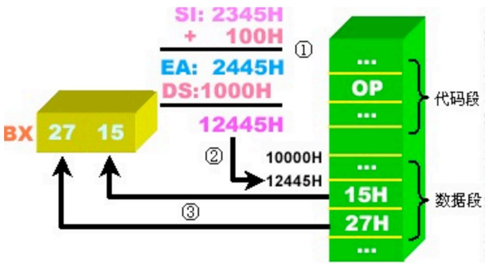

<details>
<summary>flowchart</summary>

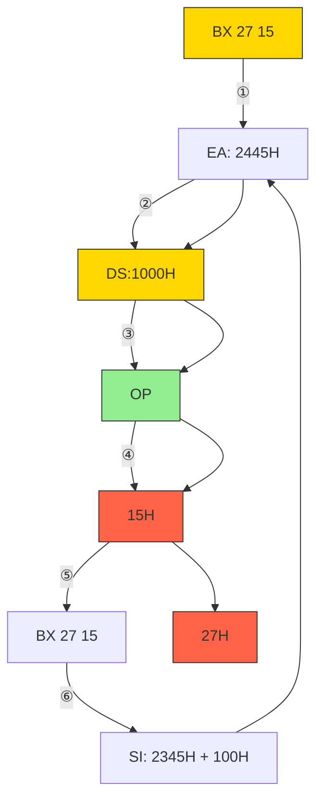
</details>

# 数据寻址方式 — 总结

■ 加起来！！！把右边的地址值全加起来！！！  
- BX找DS! ! ! !   
■ BP找SS！！！  
- “直接” v.s “间接”   
- “相对” v.s “变址”

<table><tr><td>源操作数</td><td>指令的变形</td><td>源操作数的寻址方式</td></tr><tr><td>只有偏移量</td><td>MOV AX, [100H]</td><td>直接寻址方式</td></tr><tr><td>只有一个寄存器</td><td>MOV AX, [BX] 或 MOV AX, [SI]</td><td>寄存器间接寻址方式</td></tr><tr><td>有一个寄存器和偏移量</td><td>MOV AX, [BX+100H] 或 MOV AX, [SI+100H]</td><td>寄存器相对寻址方式</td></tr><tr><td>有二个寄存器</td><td>MOV AX, [BX+SI]</td><td>基址加变址寻址方式</td></tr><tr><td>有二个寄存器和偏移量</td><td>MOV AX, [BX+SI+100H]</td><td>相对基址加变址寻址方式</td></tr></table>