# 计算机组成与结构

# 一指令系统3

李瑞 教授

蒋志平 副教授

计算机科学与技术学院

# 温故 一关于指令系统

- 高级语言、汇编语言、机器指令三者之间的转换关系？  
- CPU执行机器指令的4个步骤？+ 简要描述  
- 指令编码应考虑哪些问题？  
- Huffman方式指令编码的优劣势?  
- 扩展式指令编码的优劣势？  
• 15-15-15、8-64-512两种方式是如何规划字段的？  
- 简述CPU内寄存器分几类，各有什么功能？

# 寻址方式

运算，

需要数据，

需要取数据，

需要知道用哪种方式去取数据，

还需要知道从哪里取数据，

-- 寻址方式

Addressing Mode !

# 但在此之前，

# 必须仔细学习一个汇编指令...

# - MOV指令

格式: MOV OPRD1, OPRD2
目的 源

功能：（OPRD2）→（OPRD1）

其中：目的操作OPRD1

源操作数 OPRD2

存储器 mem

通用寄存器 r

段寄存器 SEG（除CS/IP）

立即数 im

存储器 mem

通用寄存器 r

段寄存器 SEG（含CS）

但也有4种例外情况：

- 目的操作数不能为立即数，或 CS、IP;  
·内存单元之间不能进行数据直接传送；  
- 立即数不能直接传送到段寄存器中；  
·段寄存器之间的不能进行数据直接传送；

# Done !

# 寻址方式Addressing Mode

- Immediate 立即   
- Direct 直接  
- Register 寄存器  
- Register + Indirect 寄存器间接 (2种)   
- Register + Indexing 寄存器相对  
- Base + Displacement 基址变址 (2种)  
- Base + Displacement + Indexing 基址+变址+相对  
- Implicit 隐式

# 寻址方式 — 立即寻址

- 操作数直接包含在指令中！（跟在操作码后面）  
- 操作数是在代码段！！

例如:

MOV AL, 27H

ADD AL, 35H

MOV AX, 2000H

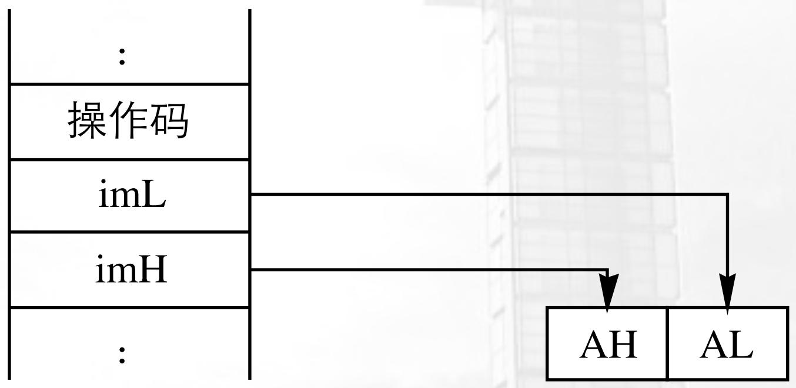

flowchart

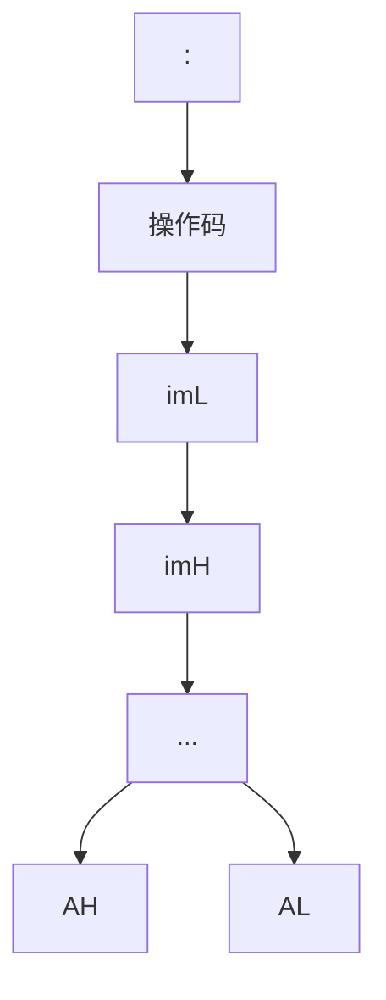

注意！！ 地址低位去AL，高位去AH !!!!

# 寻址方式 - 直接寻址

\- 操作数的段内偏移地址直接包含在指令中! （跟在

操作码后面)

\- 操作数是在数据段！！

例如:

MOV AX, [2000H]

设DS=3000H

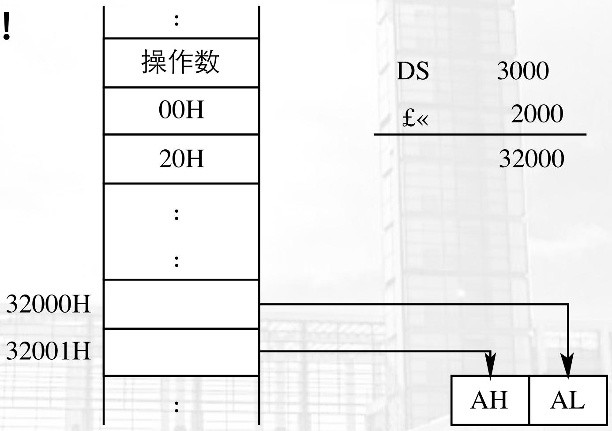

flowchart

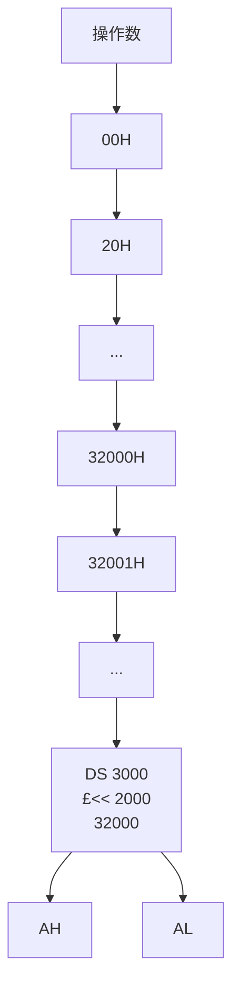

# 寻址方式 - 寄存器寻址

\- 操作数在某个寄存器中!

例如:

MOV DS, AX

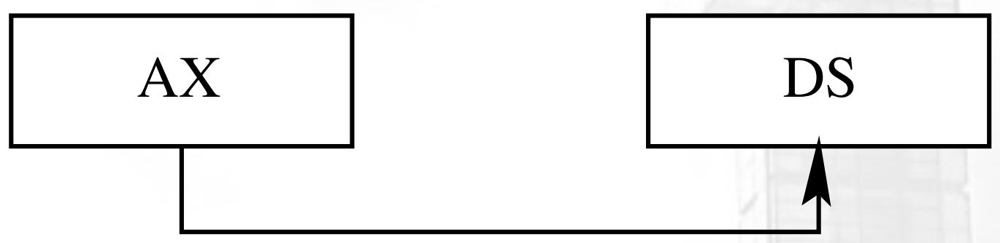

flowchart

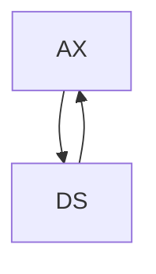

# 寻址方式 — 寄存器间接寻址

- 操作数的段内偏移地址放在SI/DI/BP/BX其中一  
个寄存器中!

\- 分两种情况:

- 如果是SI/DI/BX < - 搭配DS在数据段找操作数  
- 如果是BP < - 搭配SS在堆栈段找操作数

# 寻址方式 — 寄存器间接寻址

# 例如：

MOV AX, 2000H

MOV DS, AX

MOV SI, 1000H

MOV AX, [SI]

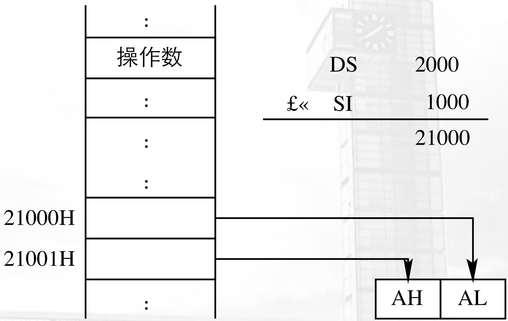

flowchart

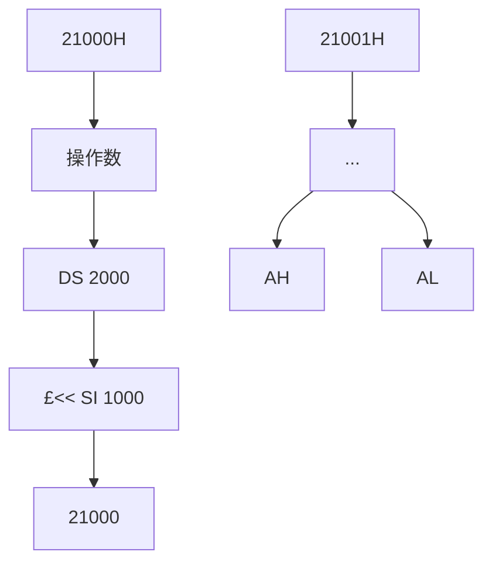

(a)

# 寻址方式 — 寄存器间接寻址

# 例如：

MOV AX, 3000H

MOV SS, AX

MOV BP, 2000H

MOV AX, [BP]

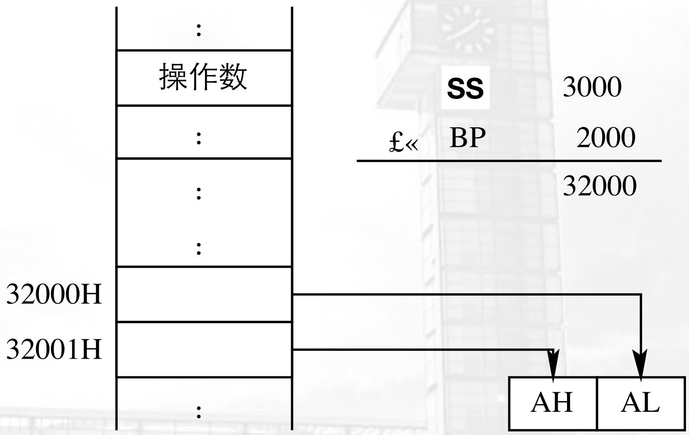

flowchart

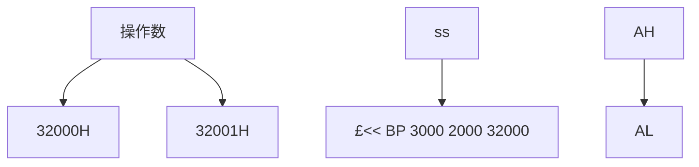

(b)

# 寻址方式 - 寄存器间接寻址

■ 例:假设有指令: MOV BX,[DI], 在执行时, (DS)=1000H, (DI)=2345H, 存储单元12345H的内容是4354H。问执行指令后, BX的值是什么?  
解：

根据寄存器间接寻址方式的规则，在执行本例指令时，寄存器DI的值不是操作数，而是操作数的地址。该操作数的物理地址(Physical Address, PA)应由DS和DI的值形成，即：

$$
\mathrm{PA} = (\mathrm{DS}) ^ {*} 1 6 + \mathrm{DI} = 1 0 0 0 \mathrm{H} ^ {*} 1 6 + 2 3 4 5 \mathrm{H} = 1 2 3 4 5 \mathrm{H} 。
$$

所以，该指令的执行效果是：把从物理地址为12345H开始的一个字的值传送给BX。

# 寻址方式 - 寄存器间接寻址

■ 例:假设有指令: MOV BX,[DI], 在执行时, (DS)=1000H, (DI)=2345H, 存储单元12345H的内容是4354H。问执行指令后, BX的值是什么?  
解：

根据寄存器间接寻址方式的规则，在执行本例指令时，寄存器DI的值不是操作数，而是操作数的地址。该操作数的物理地址(Physical Address, PA)应由DS和DI的值形成，即：

$$
\mathrm{PA} = (\mathrm{DS}) ^ {*} 1 6 + \mathrm{DI} = 1 0 0 0 \mathrm{H} ^ {*} 1 6 + 2 3 4 5 \mathrm{H} = 1 2 3 4 5 \mathrm{H} 。
$$

所以，该指令的执行效果是：把从物理地址为12345H开始的一个字的值传送给BX。

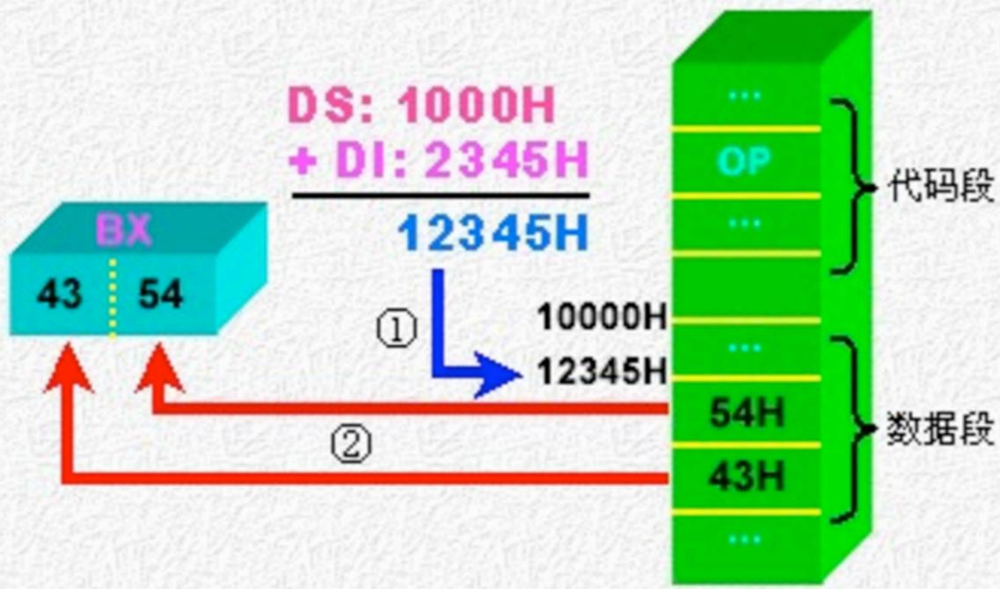

flowchart

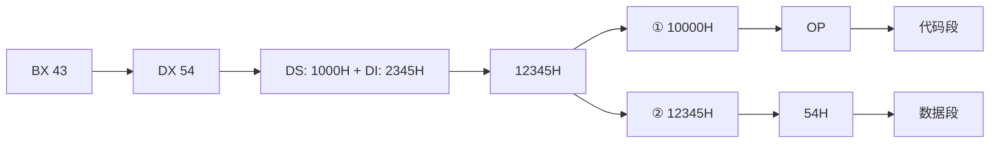

# 寻址方式 — 寄存器相对寻址

- 本质是寄存器间接 + 相对寻址：在寄存器间接的基础上再加上地址偏移值DISP；  
- DISP跟着操作码后面，在代码段！！！  
- 同样分两种情况:

- 如果是SI/DI/BX < - 搭配DS在数据段找操作数  
- 如果是BP < - 搭配SS在堆栈段找操作数

例: MOV AX, DISP [SI]

# 寻址方式 — 寄存器相对寻址

例：MOV AX, DISP [SI] ; DISP=1000H; DS = 3000H; SI = 2000H

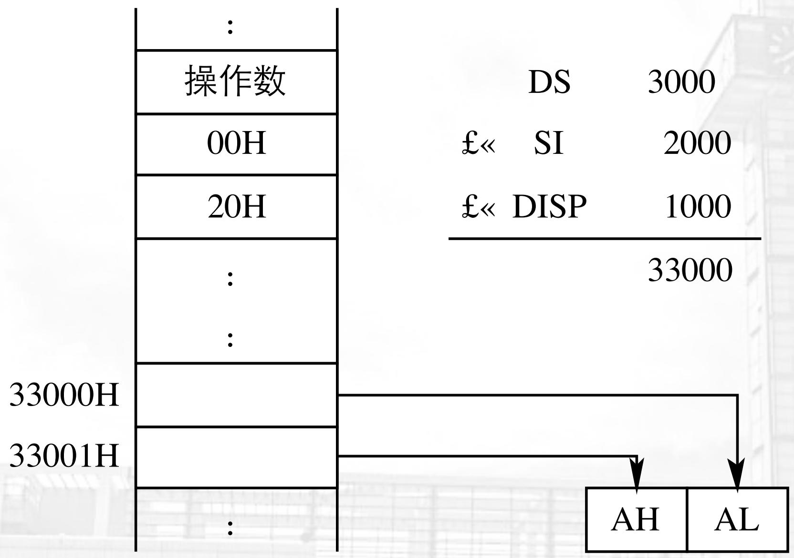

bar_stacked

| Category   | Value |
| ---------- | ----- |
| DS         | 3000  |
| £<< SI     | 2000  |
| £<< DISP   | 1000  |
|          | 33000 |

# 寻址方式 — 寄存器相对寻址

例: 假设指令: MOV BX, [SI+100H], 在执行它时, (DS)=1000H, (SI)=2345H, 内存单元12445H的内容为2715H, 问该指令执行后, BX的值是什么?

解：根据寄存器相对寻址方式的规则，在执行本例指令时，源操作数的有效地址EA为：

$$
\mathrm{EA} = (\mathrm{SI}) + 1 0 0 \mathrm{H} = 2 3 4 5 \mathrm{H} + 1 0 0 \mathrm{H} = 2 4 4 5 \mathrm{H}
$$

该操作数的物理地址应由DS和EA的值形成，即：

$$
\mathrm{PA} = (\mathrm{DS}) ^ {*} 1 6 + \mathrm{EA} = 1 0 0 0 \mathrm{H} ^ {*} 1 6 + 2 4 4 5 \mathrm{H} = 1 2 4 4 5 \mathrm{H} 。
$$

所以，该指令的执行效果是：把从物理地址为12445H开始的一个字的值传送给BX。

# 寻址方式 — 寄存器相对寻址

例: 假设指令: MOV BX, [SI+100H], 在执行它时, (DS)=1000H, (SI)=2345H, 内存单元12445H的内容为2715H, 问该指令执行后, BX的值是什么?

解：根据寄存器相对寻址方式的规则，在执行本例指令时，源操作数的有效地址EA为：

$$
\mathrm{EA} = (\mathrm{SI}) + 1 0 0 \mathrm{H} = 2 3 4 5 \mathrm{H} + 1 0 0 \mathrm{H} = 2 4 4 5 \mathrm{H}
$$

该操作数的物理地址应由DS和EA的值形成,即:

$$
\mathrm{PA} = (\mathrm{DS}) ^ {*} 1 6 + \mathrm{EA} = 1 0 0 0 \mathrm{H} ^ {*} 1 6 + 2 4 4 5 \mathrm{H} = 1 2 4 4 5 \mathrm{H} 。
$$

所以，该指令的执行效果是：把从物理地址为12445H开始的一个字的值传送给BX。

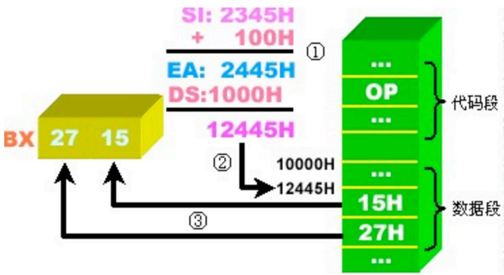

flowchart

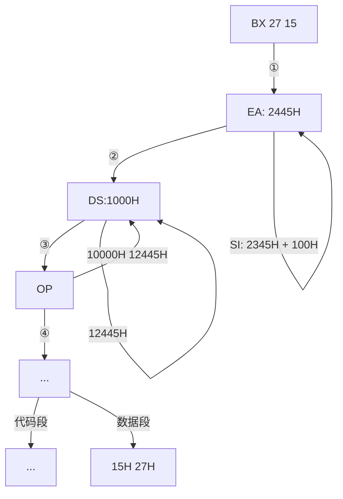

# 数据寻址方式 — 总结

■ 加起来！！！把右边的地址值全加起来！！！  
■ SI/DI/BX找DS! ! ! !   
■ BP找SS！！！  
- “直接” v.s “间接”   
- “相对” v.s “变址”

<table><tr><td>源操作数</td><td>指令的变形</td><td>源操作数的寻址方式</td></tr><tr><td>只有偏移量</td><td>MOV AX, [100H]</td><td>直接寻址方式</td></tr><tr><td>只有一个寄存器</td><td>MOV AX, [BX] 或 MOV AX, [SI]</td><td>寄存器间接寻址方式</td></tr><tr><td>有一个寄存器和偏移量</td><td>MOV AX, [BX+100H] 或 MOV AX, [SI+100H]</td><td>寄存器相对寻址方式</td></tr><tr><td>有二个寄存器</td><td>MOV AX, [BX+SI]</td><td>基址加变址寻址方式</td></tr><tr><td>有二个寄存器和偏移量</td><td>MOV AX, [BX+SI+100H]</td><td>相对基址加变址寻址方式</td></tr></table>

# 地址，

# 除了数据，

# 还有指令本身

# 指令寻址

- 默认寻址  
- 段内转移   
- 段内间接转移   
- 段间转移   
- 段间间接转移

# 指令寻址

1. 默认寻址：顺序执行指令时，PC(IP)寄存器总是指向下一条指令的地址

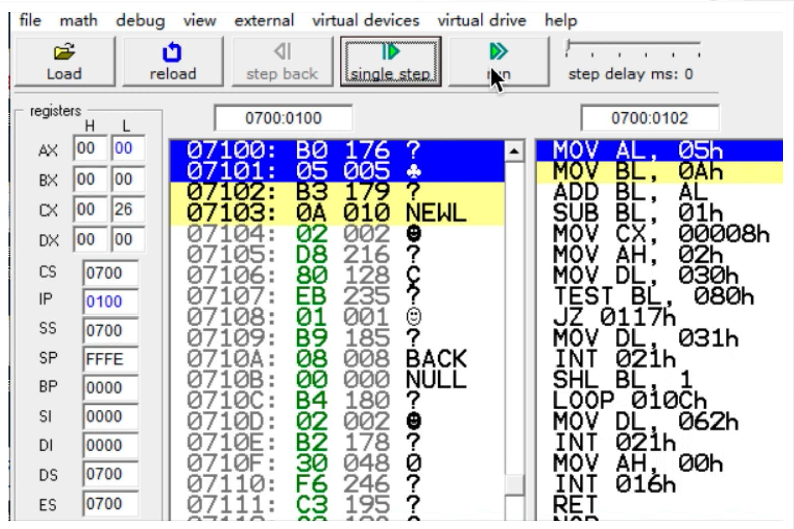

bar

| Register | Mode | Value |
| :--- | :--- | :--- |
| 07100 | B0 | 176 |
| 07101 | 05 | 005 |
| 07102 | B3 | 179 |
| 07103 | 0A | 010 |
| 07104 | 02 | 002 |
| 07105 | D8 | 216 |
| 07106 | 80 | 128 |
| 07107 | EB | 235 |
| 07108 | 01 | 001 |
| 07109 | B9 | 185 |
| 0710A | 08 | 008 |
| 0710B | 00 | 000 |
| 0710C | B4 | 180 |
| 0710D | 02 | 002 |
| 0710E | B2 | 178 |
| 0710F | 30 | 048 |
| 07110 | F6 | 246 |
| 07111 | C3 | 195 |
MOV AL, 05h
MOV BL, 0Ah
ADD BL, AL
SUB BL, 01h
MOV CX, 00008h
MOV AH, 02h
MOV DL, 030h
TEST BL, 080h
JZ 0117h
MOV DL, 031h
INT 021h
SHL BL, 1
LOOP 010Ch
MOV DL, 062h
INT 021h
MOV AH, 00h
INT 016h
RET
NOR

# 指令寻址

段内，指哪个段？

数据寻址时，“直接”指什么？

2. 段内直接寻址：转向的有效地址是当前IP内容和指令指定的8位或16位位移量之和。

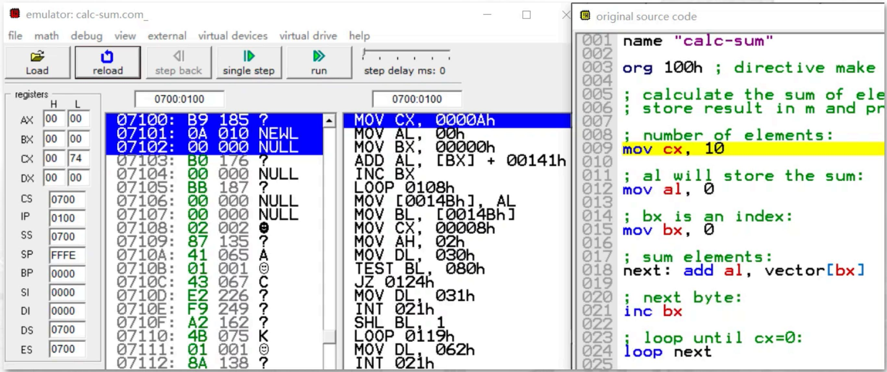

text_image

emulator: calc-sum.com_
file math debug view external virtual devices virtual drive help
Load reload step back single step run step delay ms: 0
registers H L
AX 00 00
BX 00 00
CX 00 74
DX 00 00
CS 0700
IP 0100
SS 0700
SP FFFE
BP 0000
SI 0000
DI 0000
DS 0700
ES 0700
07100: B9 185 ?
07101: 0A 010 NEWL
07102: 00 000 NULL
07103: B0 176 ?
07104: 00 000 NULL
07105: BB 187 ?
07106: 00 000 NULL
07107: 00 000 NULL
07108: 02 002 ?
07109: 87 135 ?
0710A: 41 065 A
0710B: 01 001 ?
0710C: 43 067 C
0710D: E2 226 ?
0710E: F9 249 ?
0710F: A2 162 ?
07110: 4B 075 K
07111: 01 001 ?
07112: 8A 138 ?
MOV CX, 0000Ah
MOV AL, 00h
MOV BX, 0000h
ADD AL, [BX] + 00141h
INC BX
LOOP 0108h
MOV [0014Bh], AL
MOV BL, [0014Bh]
MOV CX, 00008h
MOV AH, 02h
MOV DL, 030h
TEST BL, 08Oh
JZ 0124h
MOV DL, 031h
INT 021h
SHL BL, 1
LOOP 0119h
MOV DL, 062h
INT 021h
original source code
name "calc-sum"
org 10Oh ; directive make
; calculate the sum of ele
; store result in m and pr
; number of elements:
mov cx, 10
; al will store the sum:
mov al, 0
; bx is an index:
mov bx, 0
; sum elements:
next: add al, vector[bx]
; next byte:
inc bx
; loop until cx=O:
loop next

# 指令寻址

段内，指哪个段？

数据寻址时，“间接”指什么？

# 2. 段内间接寻址方式

- 段内间接寻址方式：用寄存器或存储单元中的内容修改IP  
- 例如：JMP BX

JMP WORDPTR[SI + 2000H]

# 指令寻址

数据寻址时，“直接”指什么？

# 3. 段间直接寻址方式

■段间直接寻址方式: 直接给出了转向的段基址和偏移地址,  
16位的段基址用来更新CS，16位的偏移地址用来更新IP  
■如 JMP FAR PTR DS:0x00001234

# 指令寻址

数据寻址时，“间接”指什么？

# 4. 段间间接寻址方式

\- 段间间接寻址方式：低位字单元取代IP的内容，高位字单元取代CS，从而实现段间程序转移。

• 例: JMP DWORD PTR DS:[EBX], 当DS=0x440, EBX=0x00006200, DS:0x00006200=0x00005300

\- JMP DWORD PTR DS:[EBX] => JMP 0x440:0x00003500