# 课件-指令系统4-Spring-2024

## 来源

- 分类：`课件`
- 原始文件：`指令系统4--Spring.2024.pdf`
- 原始相对路径：`资料/课件/指令系统4--Spring.2024.pdf`
- 原始绝对路径：`D:\wzb\计算机组成原理\资料\课件\指令系统4--Spring.2024.pdf`

## 后续处理建议

- 从本整理稿中提取稳定知识点
- 检查公式、表格、结构图的提取效果
- 必要时补单独图像解读稿
- 如发现资料错误，转入勘误或分歧

## 内容导读（基于整理稿归纳）

本讲继续讲寻址方式，但重点开始从“数据寻址”总结转向“指令寻址”，是把寄存器配合关系和跳转类问题真正落地的一讲。

## 关键知识点

- `CS:IP`、`DS`、`SS` 与 `SI/DI/BX/BP` 等寄存器之间的典型配合关系。
- 立即数、直接、寄存器、寄存器间接、相对、变址等数据寻址方式。
- 指令寻址与顺序执行、跳转执行之间的关系。

## 典型例题 / 思考题

- 说明不同寄存器默认与哪个段寄存器配合。
- 解释各种数据寻址方式的含义与差异。
- 说明指令寻址与程序跳转的基本机制。

## 例题理解层（基于课件整理）

### 题目簇 1：寻址方式总览

- 原题/原问：
  - CPU执行机器指令的4个步骤？+ 简要描述
  - IP指针与哪个段配合?
  - SI/DI/BX指针与哪个段配合?
  - BP指针与哪个段配合？
  - 简述立即数寻址方式
  - 简述直接寻址
  - 简述寄存器寻址
  - 简述寄存器间接寻址
  - 简述寄存器相对
  - 简述变址寻址和变址相对寻址
- 题意：系统梳理8086的所有数据寻址方式（立即数、直接、寄存器、寄存器间接、寄存器相对、变址、变址相对、基址变址），以及段寄存器的默认配合规则。
- 所考知识点：
  - 立即数寻址：操作数在指令中直接编码，不访存
  - 直接寻址：偏移地址在指令中，需一次访存
  - 寄存器寻址：操作数在寄存器中，速度最快
  - 寄存器间接寻址：偏移地址在寄存器（BX/SI/DI/BP）中
  - 寄存器相对寻址：偏移地址 = 寄存器值 + 偏移量
  - 变址寻址：偏移地址 = 变址寄存器(SI/DI) + 偏移量
  - 基址变址寻址：偏移地址 = 基址寄存器(BX/BP) + 变址寄存器(SI/DI)
  - 段默认规则：IP→CS，BX/SI/DI→DS，BP→SS
- 解题关注点：
  - 寻址方式决定操作数来源和访存次数
  - 每种寻址方式的偏移地址计算公式
  - 段前缀覆盖可改变默认段寄存器
  - 寄存器相对和基址变址是数组/结构体访问的基础
- 题型归类建议：概念辨析题 + 指令分析题
- 备注：信息完整，是寻址方式最全面的汇总

### 题目簇 2：段寻址与直接/间接寻址对比

- 原题/原问：
  - 段内，指哪个段？
  - 数据寻址时，"直接"指什么？
  - 数据寻址时，"间接"指什么？
- 题意：区分"段内寻址"中"段"的含义，以及直接寻址与间接寻址的本质区别。
- 所考知识点：
  - "段内"指当前操作数所在段（由默认段寄存器决定）
  - 直接寻址：EA = 指令中的偏移量（一次访存）
  - 间接寻址：EA = 寄存器/内存中的值（两次访存）
  - 物理地址 = 段基址×16 + EA
- 解题关注点：
  - "段内"不是固定的CS或DS，取决于操作数类型和使用的寄存器
  - 直接寻址和间接寻址的区别在于EA的来源
  - 间接寻址支持动态地址计算（如数组遍历）
- 题型归类建议：概念辨析题
- 备注：信息完整，适合理解寻址方式分类逻辑

## 提取结果

# 计算机组成与结构

# 指令系统4

李瑞 教授

蒋志平 副教授

计算机科学与技术学院

# 温故 — 关于指令系统

- CPU执行机器指令的4个步骤？+ 简要描述
- IP指针与哪个段配合?
- SI/DI/BX指针与哪个段配合?
- BP指针与哪个段配合？
- 简述立即数寻址方式
- 简述直接寻址
- 简述寄存器寻址
- 简述寄存器间接寻址
- 简述寄存器相对
- 简述变址寻址和变址相对寻址

# 数据寻址方式 — 总结

■ 加起来！！！把右边的地址值全加起来！！！
■ SI/DI/BX找DS! ! ! !
■ BP找SS！！！
- “直接” v.s “间接”
- “相对” v.s “变址”

<table><tr><td>源操作数</td><td>指令的变形</td><td>源操作数的寻址方式</td></tr><tr><td>只有偏移量</td><td>MOV AX, [100H]</td><td>直接寻址方式</td></tr><tr><td>只有一个寄存器</td><td>MOV AX, [BX] 或 MOV AX, [SI]</td><td>寄存器间接寻址方式</td></tr><tr><td>有一个寄存器和偏移量</td><td>MOV AX, [BX+100H] 或 MOV AX, [SI+100H]</td><td>寄存器相对寻址方式</td></tr><tr><td>有二个寄存器</td><td>MOV AX, [BX+SI]</td><td>基址加变址寻址方式</td></tr><tr><td>有二个寄存器和偏移量</td><td>MOV AX, [BX+SI+100H]</td><td>相对基址加变址寻址方式</td></tr></table>

地址，

除了数据，

还有指令本身

# 指令寻址

- 默认寻址
- 段内转移
- 段内间接转移
- 段间转移
- 段间间接转移

# 指令寻址

1. 默认寻址：顺序执行指令时，PC(IP)寄存器总是指向下一条指令的地址

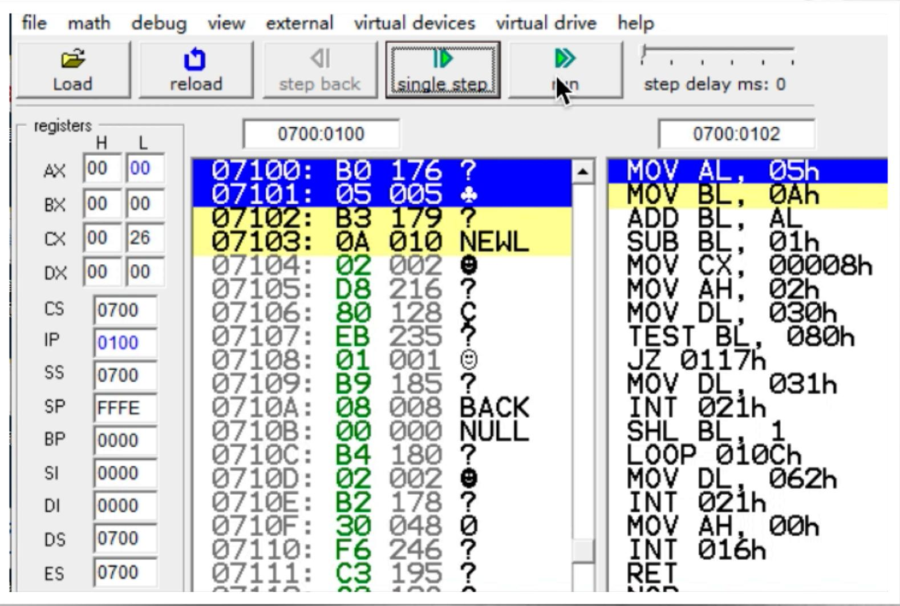

bar

| Register | Value |
| :--- | :--- |
| 07100 | B0 176 ? |
| 07101 | 05 005 ♣ |
| 07102 | B3 179 ? |
| 07103 | 0A 010 NEWL |
| 07104 | 02 002 ● |
| 07105 | D8 216 ? |
| 07106 | 80 128 C |
| 07107 | EB 235 ? |
| 07108 | 01 001 ⚙ |
| 07109 | B9 185 ? |
| 0710A | 08 008 BACK |
| 0710B | 00 000 NULL |
| 0710C | B4 180 ? |
| 0710D | 02 002 ● |
| 0710E | B2 178 ? |
| 0710F | 30 048 0 |
| 07110 | F6 246 ? |
| 07111 | C3 195 ? |
| MOV AL, 05h
MOV BL, 0Ah
ADD BL, AL
SUB BL, 01h
MOV CX, 00008h
MOV AH, 02h
MOV DL, 030h
TEST BL, 080h
JZ 0117h
MOV DL, 031h
INT 021h
SHL BL, 1
LOOP 010Ch
MOV DL, 062h
INT 021h
MOV AH, 00h
INT 016h
RET

# 指令寻址

段内，指哪个段？

数据寻址时，“直接”指什么？

2. 段内直接寻址：转向的有效地址是当前IP内容和指令指定的8位或16位位移量之和。

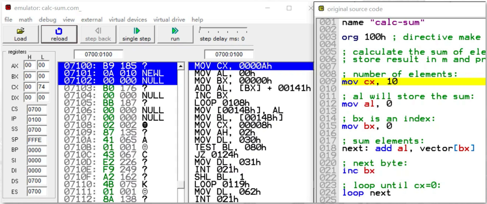

text_image

emulator: calc-sum.com_
file math debug view external virtual devices virtual drive help
Load reload step back single step run step delay ms: 0
registers H L
AX 00 00
BX 00 00
CX 00 74
DX 00 00
CS 0700
IP 0100
SS 0700
SP FFFE
BP 0000
SI 0000
DI 0000
DS 0700
ES 0700
07100: B9 185 ?
07101: 0A 010 NEWL
07102: 00 000 NULL
07103: B0 176 ?
07104: 00 000 NULL
07105: BB 187 ?
07106: 00 000 NULL
07107: 00 000 NULL
07108: 02 002 ?
07109: 87 135 ?
0710A: 41 065 A
0710B: 01 001 ?
0710C: 43 067 C
0710D: E2 226 ?
0710E: F9 249 ?
0710F: A2 162 ?
07110: 4B 075 K
07111: 01 001 ?
07112: 8A 138 ?
MOV CX, 0000Ah
MOV AL, 00h
MOV BX, 0000h
ADD AL, [BX] + 00141h
INC BX
LOOP 0108h
MOV [0014Bh], AL
MOV BL, [0014Bh]
MOV CX, 00008h
MOV AH, 02h
MOV DL, 030h
TEST BL, 08Oh
JZ 0124h
MOV DL, 031h
INT 021h
SHL BL, 1
LOOP 0119h
MOV DL, 062h
INT 021h
original source code
name "calc-sum"
org 10Oh ; directive make
; calculate the sum of ele
; store result in m and pr
; number of elements:
mov cx, 10
; al will store the sum:
mov al, 0
; bx is an index:
mov bx, 0
; sum elements:
next: add al, vector[bx]
; next byte:
inc bx
; loop until cx=O:
loop next

# 指令寻址

段内，指哪个段？

数据寻址时，“间接”指什么？

# 2. 段内间接寻址方式

- 段内间接寻址方式：用寄存器或存储单元中的内容修改IP
- 例如：JMP BX

JMP WORDPTR[SI + 2000H]

# 指令寻址

数据寻址时，“直接”指什么？

# 3. 段间直接寻址方式

■段间直接寻址方式: 直接给出了转向的段基址和偏移地址,
16位的段基址用来更新CS，16位的偏移地址用来更新IP
■如 JMP FAR PTR DS:0x00001234

# 指令寻址

数据寻址时，“间接”指什么？

# 4. 段间间接寻址方式

- 段间间接寻址方式：低位字单元取代IP的内容，高位字单元取代CS，从而实现段间程序转移。

- 例: JMP DWORD PTR DS:[EBX], 当DS=0x440, EBX=0x00006200, DS:0x00006200=0x00005300

- JMP DWORD PTR DS:[EBX] => JMP 0x440:0x00003500

# 4.3 8086的指令系统

# 8086的指令系统

数据传送指令
算术运算指令
- 程序控制指令
- 逻辑运算和移位循环指令
串操作指令
处理器控制指令
输入/输出指令

# 数据传送指令

# MOV指令

格式: MOV OPRD1, OPRD2
目的 源

功能：（OPRD2）→（OPRD1）

其中：目的操作OPRD1

源操作数 OPRD2

存储器 mem

通用寄存器 r

段寄存器 SEG（除CS）

立即数 im

存储器 mem

通用寄存器 r

段寄存器 SEG（含CS）

但也有4种例外情况：

# 数据传送指令

- 目的操作数不能为立即数，或 CS、IP;
·内存单元之间不能进行数据直接传送；
- 立即数不能直接传送到段寄存器中；
·段寄存器之间的不能进行数据直接传送；

# 数据传送指令

■ 在CPU各内部寄存器间传送数据

MOV AL, BL

MOV AX, DX

■ 立即数传送至CPU的内部通用寄存器，给寄存器赋值

MOV CL, 4

MOV AX, 03FFH

■ CPU内部寄存器与存储器间的数据传送

- 在CPU的通用寄存器与存储器之间传送数据。

MOV AL, BUFFER

MOV AX, [SI]

# 数据传送指令

- 在CPU寄存器与存储器之间的传送数据

MOV DS, DATA[SI+BX]

MOV DEST[BP+DI], ES

MOV指令不能在两个存储器单元之间进行数据直接传送。为了实现两个存储器单元之间的数据传送，必须用内容寄存器作为中介。

MOV AL, AREA1

MOV AREA2, AL

# 数据传送指令

# 2. 交换指令

格式: XCHG OPRD1, OPRD2

目的 源

功能: (OPRD2) $\longleftrightarrow$ (OPRD1)

其中：这种交换能在通用寄存器与累加器之间、通用寄存器之间、通用寄存器与存储器之间进行。

# 3. 地址传送指令

格式: LEA OPRD1, OPRD2

目的 源

功能: OPRD2→(OPRD1)

其中：OPRD1为16位通用寄存器，OPRD2为内存操作数。

LEA BX, BUFR

# 数据传送指令

# 4. 堆栈指令

格式: PUSH OPRD ; r、mem、SEG (含CS)

POP OPRD ; r、mem、SEG (除CS)

MOV AX, 8000H

MOV SS, AX

MOV SP, 2000H

MOV DX, 3E4AH

PUSH DX

PUSH AX

POP ax

# 数据传送指令

# 5.字节、字转换指令

CBW指令，将字节转换成一个字。

CWD指令，将字转换成双字。

# 6.标志寄存器传送指令

LAHF，将标志寄存器的低字节传送到AH中。

(Load Flags into AH)

SAHF，将AH的内容传送到标志寄存器的低字节中。

(Store AH into Flags)

PUSHF，将标志寄存器的内容压入堆栈。

POPF，由堆栈弹出一个字放入标志寄存器。

# 算术运算指令

■ 加、减、乘、除
■ 定点有符号整数、浮点数、压缩十进制数
■ 单操作数指令

- 有符号数的绝对值 (Absolute)
- 求操作数的相反数（Negate）
- 递增操作数 (Increment)
- 递减操作数 (Decrement)

# 由ALU完成

# 算术运算指令

# 4.3.2 算术运算指令

# 1. 加法指令

ADD OPRD1, OPRD2 ;(add)

功能: (OPRD1) + (OPRD2) → (OPRD1)

ADC OPRD1, OPRD2 ;(add with carry)

功能: (OPRD1) + (OPRD2) + CF → (OPRD1)

INC OPRD ;(increment)

功能: (OPRD) +1 → (OPRD)

- 影响标志位AF、CF、OF、PF、SF、ZF（INC不影响CF）。

# 算术运算指令

# 运算结果标志位

1、进位标志CF(Carry Flag)
2、奇偶标志PF(Parity Flag)
3、辅助进位标志AF(Auxiliary Carry Flag)
4、零标志ZF(Zero Flag)
5、符号标志SF(Sign Flag)
6、溢出标志OF(Overflow Flag)

# 状态控制标志位

1、追踪标志TF(Trap Flag)
2、中断允许标志IF(Interrupt-enable Flag)
3、方向标志DF(Direction Flag)

# 算术运算指令

# ■ 例:

ADD AL, 30

ADD BX, 3000H

ADD AX, SI

ADD DX, DATA[BX + SI]

ADD [SI], 100

ADD [BX], AX

# 例：

INC常用于在循环程序中修改地址指针和循环次数等。

INC AL

INC [SI]

# 算术运算指令

■ 例：ADC指令用于多字节运算

(DX、AX) = 0002, F365H

\+ (BX、CX) = 0005, E024H

双精度加法

ADD AX, CX

ADC DX, BX

第一条指令， F365 + E024

$\swarrow 1,\ D389$

CF=1 结果（AX）= D389H，CF=1，SF=1，ZF=0，OF=0

# 算术运算指令

# 2. 减法指令

SUB OPRD1, OPRD2 ;(减！)

功能: (OPRD1) - (OPRD2) → (OPRD1)

SBB OPRD1, OPRD2 ;(借位减！)

功能: (OPRD1) - (OPRD2) - CF → (OPRD1)

DEC OPRD ;(自减！)

功能: (OPRD) -1 → (OPRD)

NEG OPRD ;(negate) 取补指令

功能： FFFFH - (OPRD) +1 → (OPRD)

CMP OPRD1, OPRD2 ;(compare) 比较指令

功能: (OPRD1) - (OPRD2)

■影响标志位AF、CF、OF、PF、SF、ZF（DEC不影响CF）。

# 算术运算指令

# 3. 乘法指令

(1) 无符号数乘法指令MUL

MUL OPRD ;(unsigned multiple)

功能：若OPRD为字节，（AL）\*（OPRD）→（AX）

若OPRD为字，（AX）\*（OPRD）→（DX、AX）

(2) 带符号数乘法指令IMUL

IMUL OPRD ;(signed multiple)

功能: 若OPRD为字节, (AL) \* (OPRD) → (AX)

若OPRD为字，（AX）\*（OPRD）→（DX、AX）

# 算术运算指令

# 4. 除法指令

(1) 无符号数除法指令DIV

DIV OPRD ;(unsigned divide)

功能：若OPRD为字节，（AX）÷（OPRD）商 → （AL）

余数 $\rightarrow$ (AH)

若OPRD为字，（DX，AX）÷（OPRD）商 →（AX）

余数 → (DX)

(2) 带符号除法指令IDIV

IDIV OPRD ;(signed divide)

功能：若OPRD为字节，（AX）÷（OPRD）商 → （AL）

余数 → (AH)

若OPRD为字，（DX，AX）÷（OPRD）商 → （AX）

余数 $\rightarrow$ (DX)

■采用MUL或IMUL，DIV或IDIV由运算数的格式决定。

# 逻辑运算与移位

# 1. 逻辑运算

NOT OPRD

功能: NOT (OPRD) → (OPRD); 按位取反

AND OPRD1, OPRD2

功能: (OPRD1) AND (OPRD2) → (OPRD1); 按位与

OR OPRD1, OPRD2

功能: (OPRD1) OR (OPRD2) → (OPRD1); 按位或

XOR OPRD1, OPRD2

功能: (OPRD1) XOR (OPRD2) → (OPRD1); 按位异或

TEST OPRD1, OPRD2

功能：（OPRD1）AND（OPRD2）；按位与，结果不保存

# 逻辑运算与移位

# 例：逻辑指令的使用

AND 指令使操作数的某些位不变，其它位为0。

OR 指令使操作数的某些位不变，其它位为1。

XOR 指令使操作数的某些位不变，其它位取反。

TEST指令在不操作数的前提下，用来检测某几位的状态。

<table><tr><td>A</td><td>B</td><td>NOT A</td><td>A AND B</td><td>A OR B</td><td>A XOR B</td><td>A==B</td></tr><tr><td>0</td><td>0</td><td>1</td><td>0</td><td>0</td><td>0</td><td>1</td></tr><tr><td>0</td><td>1</td><td>1</td><td>0</td><td>1</td><td>1</td><td>0</td></tr><tr><td>1</td><td>0</td><td>0</td><td>0</td><td>1</td><td>1</td><td>0</td></tr><tr><td>1</td><td>1</td><td>0</td><td>1</td><td>1</td><td>0</td><td>1</td></tr></table>

# 逻辑运算与移位

SAL/SHL OPRD, m. (Shift Arithmetic / Logic Left)

逻辑左移/

算数左移:

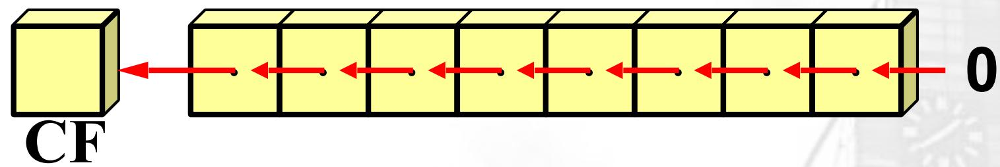

flowchart

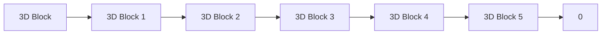

SAR OPRD, m (Shift Arithmetic Right)

算数右移:

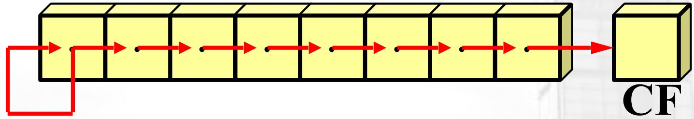

flowchart

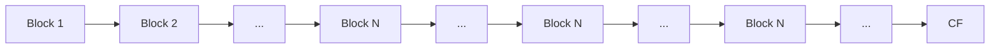

SHR OPRD, m (Shift Logic Right)

逻辑右移:

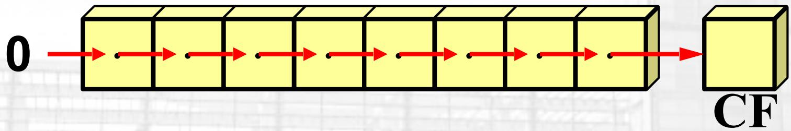

flowchart

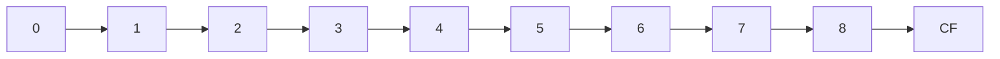

- OPRD为通用寄存器或内存操作数。

M为立即数或CL，决定移位次数。

# 逻辑运算与移位

ROL OPRD, m (Rotate Left)

不带进位循环左移：

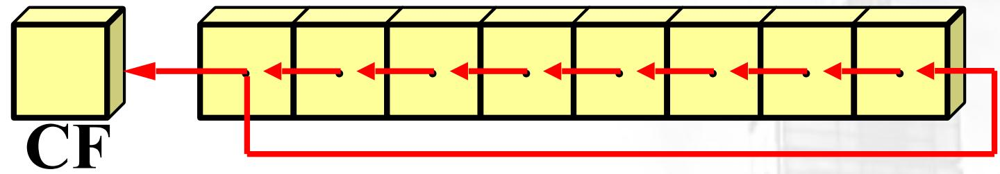

flowchart

ROR OPRD, m (Rotate Right)

不带进位循环右移：

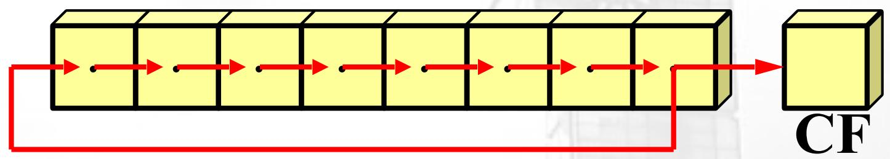

flowchart

RCL OPRD, m (Rotate Left with Carry)

带进位循环左移：

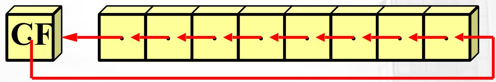

flowchart

```mermaid
graph LR
    A["CF"] --> B
    B --> C
    C --> D
    D --> E
    E --> F
    F --> G
    G --> H
    H --> I
    I --> J
    J --> K
    K --> L
    L --> M
    M --> N
    N --> O
    O --> P
    P --> Q
    Q --> R
    R --> S
    S --> T
    T --> U
    U --> V
    V --> W
    W --> X
    X --> Y
    Y --> Z
```

RCR OPRD, m (Rotate Right with Carry)

带进位循环右移:

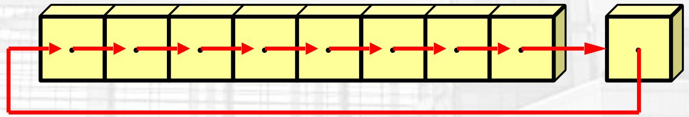

flowchart

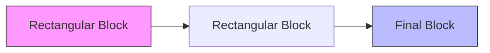

- OPRD为通用寄存器或内存操作数。M为立即数或CL，决定循环移位次数。

# 串操作指令

■ 串操作：某个连续的内存区中存放的一串字或字节，可以是BIN数，也可以是BCD码或ASCII码。若对其中的每个字或字节均作同样的操作，就称为串操作。
■ 串操作指令：完成串操作功能的指令称为字符串操作指令，简称为串操作指令。
■ 串操作指令中的默认寻址：

DS:SI 源串

ES:DI 目的串

CX 计数器

AL/AX 累加器

DF 方向标志，DF=0，正向；DF=1，负向

# 串操作指令

# 1. MOVS、STOS、LODS与REP配合

# ■MOVS 串传送指令

MOVS DST, SRC ; SRC 源串, DST目的串

MOVSB ; 字节传送

MOVSW ; 字传送

功能: (DS: SI) → (ES: DI)

MOVSB

Move byte from string to string

if (DF==0)

$$
\ast (\text { byte } ^ {*}) \text { DI++ } = \ast (\text { byte } ^ {*}) \text { SI++ };
$$

else

$$
\ast (\text { byte } ^ {*}) \text { DI } -- = \ast (\text { byte } ^ {*}) \text { SI } --;
$$

# 串操作指令

# 1. MOVS、STOS、LODS与REP配合

# ■MOVS 串传送指令

MOVS DST, SRC ; SRC 源串, DST目的串

MOVSB ; 字节传送

MOVSW ; 字传送

功能: (DS: SI) → (ES: DI)

MOVSW

Move word from string to string

if (DF==0)

\*(word\*)DI++ = \*(word\*)SI++;

else

\*(word\*)DI-- = \*(word\*)SI--;

# 串操作指令

# ■ STOS 串存贮指令 (store to string)

STOS DST ; DST目的串

STOSB ; 字节操作

STOSW ; 字操作

<table><tr><td>STOSB</td><td>Store byte in string</td><td>if (DF==0) *ES:DI++ = AL; else *ES:DI-- = AL;</td></tr><tr><td>STOSW</td><td>Store word in string</td><td>if (DF==0) *ES:DI++ = AX; else *ES:DI-- = AX;</td></tr></table>

# 串操作指令

# ■ REP 串指令前缀

REP MOVS

REP STOS

REP LODS

功能：重复串指令执行，重复次数为（CX）。过程如下:

1. 若 (CX) =0，则退出，否则执行2；
2. (CX) -1 → (CX);
3.执行串指令；
4. 重复1 - 3。

# 串操作指令

例：1000H：0100H为首地址，长度为1000字节的串，传送到2000H：0000H开始的串。

MOV AX, 1000H

MOV DS, AX

MOV SI, 0100H

MOV AX, 2000H

MOV ES, AX

MOV DI, 0000H

MOV CX, 1000

CLD ; DF=0 (Clear Direction Flag, STD)

REP MOVSB (Repeat MOVSB for 1000 times)

# 程序控制指令

■ 程序控制指令主要是指程序转�