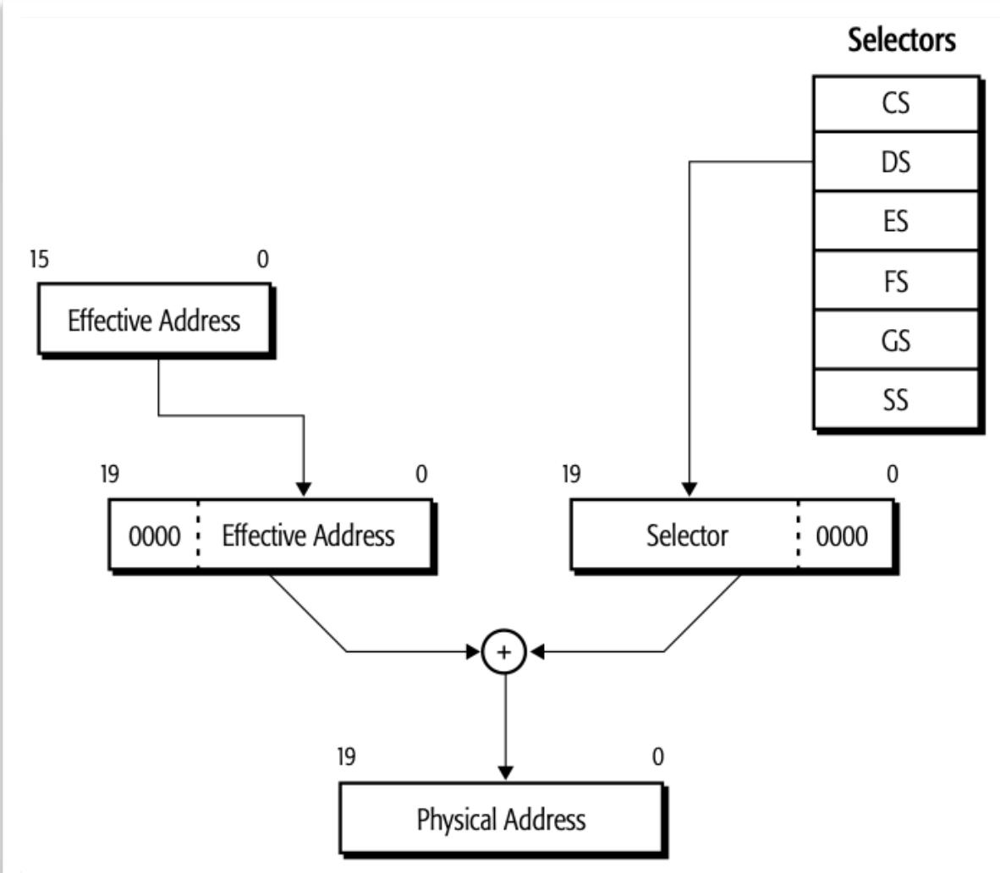
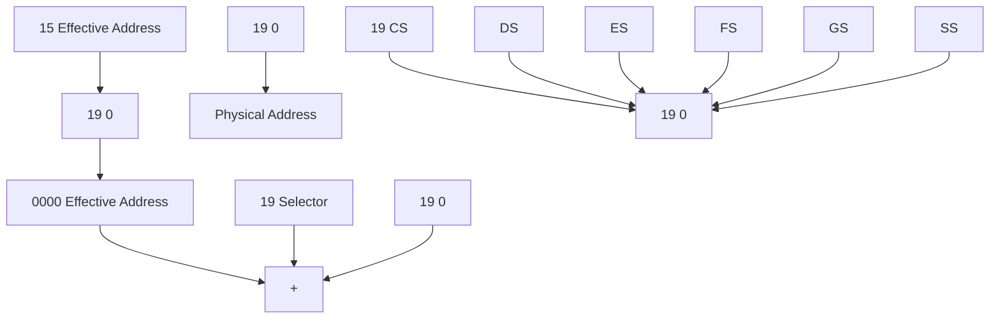
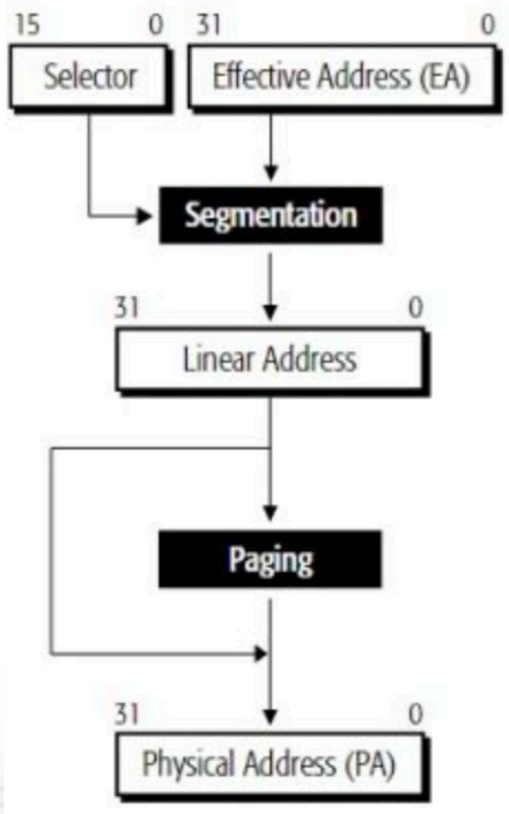
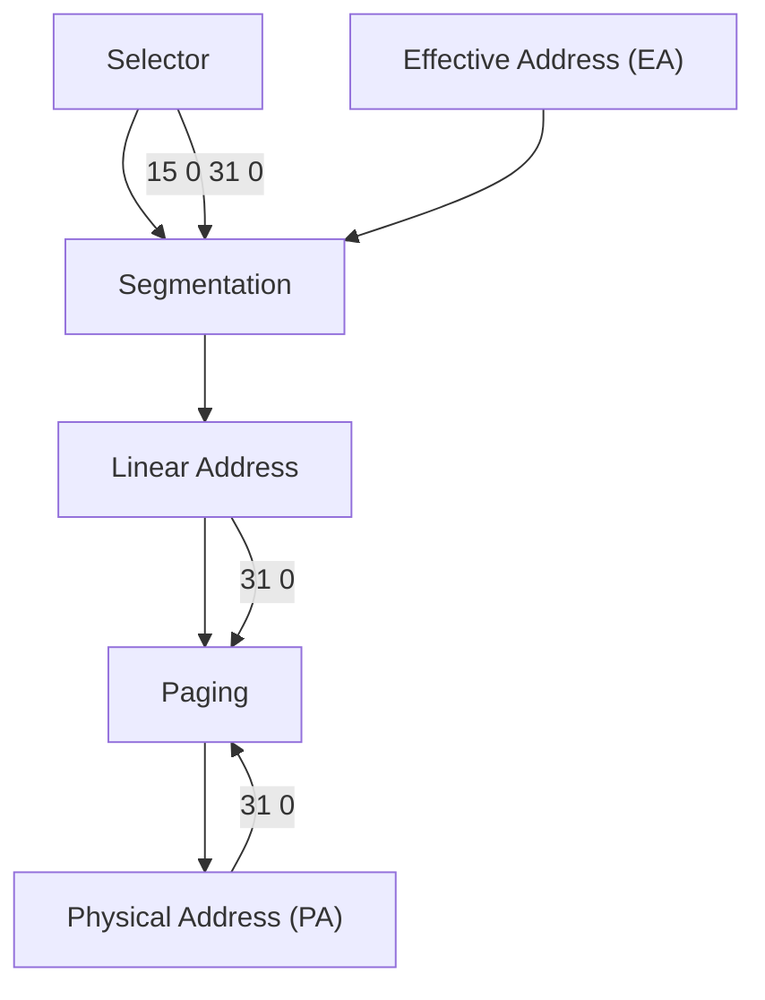

# 计算机组成与结构

# 一指令系统5

李瑞 教授

蒋志平 副教授

计算机科学与技术学院

# 温故 一关于指令系统

- CPU执行机器指令的4个步骤？+ 简要描述  
- IP指针与哪个段配合？  
- SI/DI/BX指针与哪个段配合?   
- BP指针与哪个段配合？  
- 简述立即数寻址方式  
- 简述直接寻址  
- 简述寄存器寻址  
- 简述寄存器间接寻址  
- 简述寄存器相对  
- 简述变址寻址和变址相对寻址

# 串操作指令

■ 串操作：某个连续的内存区中存放的一串字或字节，可以是BIN数，也可以是BCD码或ASCII码。若对其中的每个字或字节均作同样的操作，就称为串操作。  
■ 串操作指令：完成串操作功能的指令称为字符串操作指令，简称为串操作指令。  
■ 串操作指令中的默认寻址：

DS:SI 源串

ES:DI 目的串

CX 计数器

AL/AX 累加器

DF 方向标志，DF=0，正向；DF=1，负向

# 串操作指令

# 1. MOVS、STOS、LODS与REP配合

# ■MOVS 串传送指令

MOVS DST, SRC ; SRC 源串, DST目的串

MOVSB ; 字节传送

MOVSW ; 字传送

功能: (DS: SI) → (ES: DI)

MOVSB

Move byte from string to string

if (DF==0)

$$
\ast (\text { byte } ^ {*}) \text { DI++ } = \ast (\text { byte } ^ {*}) \text { SI++ };
$$

else

$$
\ast (\text { byte } ^ {*}) \text { DI } -- = \ast (\text { byte } ^ {*}) \text { SI } --;
$$

# 串操作指令

# 1. MOVS、STOS、LODS与REP配合

# ■MOVS 串传送指令

MOVS DST, SRC ; SRC 源串, DST目的串

MOVSB ; 字节传送

MOVSW ; 字传送

功能: (DS: SI) → (ES: DI)

MOVSW

Move word from string to string

if (DF==0)

\*(word\*)DI++ = \*(word\*)SI++;

else

\*(word\*)DI-- = \*(word\*)SI--;

# 串操作指令

# ■ STOS 串存贮指令 (store to string)

STOS DST ; DST目的串

STOSB ; 字节操作

STOSW ; 字操作

<table><tr><td>STOSB</td><td>Store byte in string</td><td>if (DF==0) *ES:DI++ = AL; else *ES:DI-- = AL;</td></tr><tr><td>STOSW</td><td>Store word in string</td><td>if (DF==0) *ES:DI++ = AX; else *ES:DI-- = AX;</td></tr></table>

# 串操作指令

# ■ REP 串指令前缀

REP MOVS

REP STOS

REP LODS

功能：重复串指令执行，重复次数为（CX）。过程如下:

1. 若 (CX) =0，则退出，否则执行2；  
2. (CX) -1 → (CX);   
3.执行串指令；  
4. 重复1 - 3。

# 串操作指令

例：1000H：0100H为首地址，长度为1000字节的串，传送到2000H：0000H开始的串。

MOV AX, 1000H

MOV DS, AX

MOV SI, 0100H

MOV AX, 2000H

MOV ES, AX

MOV DI, 0000H

MOV CX, 1000

CLD ; DF=0 (Clear Direction Flag, STD)

REP MOVSB (Repeat MOVSB for 1000 times)

# I/O指令

输入指令的一般格式为：

IN ACC, PORT; 从接口到CPU的输入

输出指令的一般格式为：

OUT PORT, ACC; 从CPU到接口的输出

■指令中，PORT为接口地址

# I/O指令

1. 直接寻址：接口地址用一个字节表示，故可寻址的接口地址只有256个(00H到FFH)。

例如：

IN AL, 35H

OUT 44H, AX

2. 寄存器间接寻址：接口地址为（DX），寻址的接口地址为64 K个（0000H到FFFFH）。

例如：

MOV DX, 03F8H

IN AL,DX

■应注意的是：采用直接寻址仅限于接口地址的前256个（0～FFH），当接口地址≥256时，必须采用DX间接寻址。

# 程序控制指令

■ 程序控制指令主要是指程序转移指令。  
■ 转移类指令通过改变CS与IP的值或仅改变IP的值，以改变指令执行的顺序。

# 1. 无条件转移指令 JMP

该指令分直接转移和间接转移两种。

直接转移又可分短程(SHORT)、近程(NEAR)和远程(FAR) 3种形式。

- 短程转移 JMP SHORT OPRD  
- 近程转移 JMP NEAR OPRD  
- 远程转移 JMP FAR OPRD

# 程序控制指令

# 2. 条件转移指令

条件转移指令将上一条指令所设置的某些标志位的状态作为测试条件，条件满足则转向指令中所指示的目的地址。

条件转移指令只能为短程(SHORT) 1种形式。

(1) 以单个标志位为条件

<table><tr><td>JO</td><td>OPRD</td><td>; 溢出转移 (Overflow)</td></tr><tr><td>JNO</td><td>OPRD</td><td>; 不溢出转移 (Not Overflow)</td></tr><tr><td>JS</td><td>OPRD</td><td>; 结果为负转移 (Sign)</td></tr><tr><td>JNS</td><td>OPRD</td><td>; 结果为正转移 (No Sign)</td></tr><tr><td>JC</td><td>OPRD</td><td>; 进位转移 (Complement)</td></tr><tr><td>JNC</td><td>OPRD</td><td>; 无进位则转移 (Not Complement)</td></tr><tr><td>JE / JZ</td><td>OPRD</td><td>; 等于或为零转移(Equal / Zero)</td></tr><tr><td>JNZ</td><td>OPRD</td><td>; 不为零转移(Not Zero)</td></tr></table>

# 程序控制指令

# (2) 无符号数比较

JA / JNBE OPRD ；高于或不低于等于转移 (Above / Not Below nor Equal)   
JAE / JNB OPRD ; 高于等于或不低于转移 (Above or Equal / Not Below)  
JB / JNAE OPRD ; 低于或不高于等于转移 (Below / Not Above nor Equal)  
JBE / JNA OPRD ; 低于等于或不高于转移 (Below or Equal / Not Above)

# (3) 带符号数比较

JG / JNLE OPRD ; 大于或不小于等于转移 (Greater / Not Less or Equal)  
JGE / JNL OPRD ; 大于等于或不小于转移 (Greater or Equal / Not Less)  
JL / JNGE OPRD ；小于或不大于等于转移 (Less / Not Greater nor Equal)   
JLE / JNG OPRD ; 小于等于或不大于转移 (Less or Equal / Not Greater)

# 3. 循环控制指令 LOOP

LOOP OPRD ; CX-1, if CX≠0循环

# 汇编语言1小时速成!

- coding基于emu8086   
- 速成内容:

- “变量”声明  
- 赋值   
- 程序基本框架

\- DOS .exe模式 / DOS .com模式

- 判断与选择结构  
- 循环结构  
- 过程/宏  
- 基本的输入、输出

# 定义数据/变量

# 1、定义数据伪指令

DB -- 定义字节

DW -- 定义字

DD ——双字

例如：

BUF1 DB 1

BUF2 DB 1, 2, 3

TAB DD ? ; 不指定初始化

BUF3 DW 200 DUP(?)；不指定初始化

BUF4 DW 200 DUP(5)；部分初始化为5

# 2、符号定义伪指令 EQU

例如：

NUM EQU 200；相当于C语言的

#define NUM 200

BUF3 DW NUM DUP(?)

# 取地址/属性(指针)运算符

# 1. 取址运算符SEG和OFFSET

例如：

TAB DW 25

MOV AX, TAB ; 将25这个值放入AX

MOV AX, SEG TAB ; 将TAB这个变量所在的段的段首地址（段寄存器）放入AX

MOV AX, OFFSET TAB ; 将TAB这个变量的段内偏移地址放入
AX LEA严格对等

# 取地址/属性(指针)运算符

# 2. 属性(指针)运算符 PTR

例如：

TAB DW 25

MOV AX, TAB ; AX = \* (uint16\_t \*) TAB

MOV AL, BYTE PTR TAB ; AX = \* (uint8\_t \*) TAB

MOV [BX], 10 ; Error, Byte ? Word ? Double Word ?

MOV [BX], BYTE PTR TAB ; \*BX = \* (uint8\_t \*) TAB

MOV [BX], WORD PTR TAB ; \*BX = \* (uint16\_t \*) TAB

# 关键辨析: MOV / LEA / OFFSET

1. PA 物理地址 v.s EA 有效地址 (段内地址)  
2. MOV v.s LEA v.s MOV OFFSET

设bx=1000h, si = 100h, DS:1105h=5566h; 求以下

三条指令执行后的AX:

$$
\text {MOV AX, [BX + SI + 5]}
$$

$$
\mathrm{LEAAX,[BX+SI+5]}
$$

$$
\text { MOV   AX,OFFSET } [ \text { BX+SI+5 } ]
$$

# 关键辨析: MOV / LEA / OFFSET

1. PA 物理地址 v.s EA 有效地址 (段内地址)  
2. MOV v.s LEA v.s MOV OFFSET

设bx=1000h, si = 100h, DS:1105h=5566h; 求以下

三条指令执行后的AX:

MOV AX, [BX + SI + 5] ; 5566h

LEA AX, [BX + SI + 5] ; 1105h

MOV AX, OFFSET [BX + SI + 5]; 1105h

# 程序基本框架

\- 实模式

\- DOS (.com)

\- 保护模式

- DOS/Windows PE格式 (.exe)  
- Linux ELF格式  
- macOS Mach-O格式

# 程序基本框架

# - CPU实（真地址）模式 (Real Mode)

\- 程序中指定的内存地址真的就是实际的物理地址

\- “真地址模式”，意义着什么？

\- 程序第一个字节必须是指令

\- 可以随便访问内存，覆盖/修改其它程序或OS

\- 难以多任务（不是不可以，只是内存管理/沙箱机制太麻烦）

- 8086处理器，DOS操作系统  
- 即使现代计算机，开机后最开始也是在Real Mode



<details>
<summary>flowchart</summary>


</details>

(演示)

# 程序基本框架

# - CPU保护模式 (Protected Mode)

\- 程序中指定的内存地址是虚拟的，由页表转换为真实地址

\- “地址保护模式”，意义着什么？

\- 程序随便写，OS+硬件负责真实地址映射

\- 可以多任务，内存扩展等...

\- 开机后在Real Mode运行模式切换，转入保护模式



<details>
<summary>flowchart</summary>


</details>

# 程序基本框架

\- .com /.exe <- 都是DOS系统的可执行程序格式

\- .com是程序在内存的“直接镜像”

- 只有一个代码段（流水帐式代码）  
- 不能超过64K  
- .com文件被加入到一个64K内存区域中，直接运行

\- .exe有文件头，有重定向

- 程序可以有多个段  
- 程序大小没有限制  
- 重点学习.exe格式

流水帐式代码有什么不好？

```asm
;value1 db "This is a string$" ; can
mov bx, 15
mov al, [bx] ; can this be ax ?
string db "asdfasdfasdfasfdasfdafd"
lea dx, [value + bx]
mov dx, seg value
mov dx, offset value 
```

猜一下上面程序的执行过程...

# 程序基本框架

# ; 分号后面是注释

# segment/ends 关键字描述段

```txt
; multi-segment executable are template.
data segment
; add your data here!
hello_world_string db "This is a string$"
data ends 
```

# 定义了1个“变量”

```batch
stack segment
dw 2 dup(15)
stack ends 
```

```txt
code segment 
```

```asm
start:
mov ax, data
mov ds, ax
mov es, ax
mov ax, stac
mov ss, ax 
```

```asm
; Happy coding from here!
mov ax, 4c00h ; exit your program
int 21h 
```

```txt
another_start:
mov ax, 4c00h ; exit your program
int 21h
code ends 
```

```txt
end; mark the end of the file and optionally specify 
```

声明一段内存，数据类型为byte，内容为"This ia a string\$”，数据的起始地址命名为hello\_world\_string

相当于C语言里的数组

# 告诉编译器cs/ds/es/ss寄存器指向哪个段

# 程序控制指令

■ 程序控制指令主要是指程序转移指令。  
■ 转移类指令通过改变CS与IP的值或仅改变IP的值，以改变指令执行的顺序。

# 1. 无条件转移指令 JMP

该指令分直接转移和间接转移两种。

直接转移又可分短程(SHORT)、近程(NEAR)和远程(FAR) 3种形式。

- 短程转移 JMP SHORT OPRD  
- 近程转移 JMP NEAR OPRD  
- 远程转移 JMP FAR OPRD

# 程序控制指令

# 2. 条件转移指令

条件转移指令将上一条指令所设置的某些标志位的状态作为测试条件，条件满足则转向指令中所指示的目的地址。

条件转移指令只能为短程(SHORT) 1种形式。

(1) 以单个标志位为条件

<table><tr><td>JO</td><td>OPRD</td><td>; 溢出转移 (Overflow)</td></tr><tr><td>JNO</td><td>OPRD</td><td>; 不溢出转移 (Not Overflow)</td></tr><tr><td>JS</td><td>OPRD</td><td>; 结果为负转移 (Sign)</td></tr><tr><td>JNS</td><td>OPRD</td><td>; 结果为正转移 (No Sign)</td></tr><tr><td>JC</td><td>OPRD</td><td>; 进位转移 (Complement)</td></tr><tr><td>JNC</td><td>OPRD</td><td>; 无进位则转移 (Not Complement)</td></tr><tr><td>JE / JZ</td><td>OPRD</td><td>; 等于或为零转移(Equal / Zero)</td></tr><tr><td>JNZ</td><td>OPRD</td><td>; 不为零转移(Not Zero)</td></tr></table>

# 程序控制指令

# (2) 无符号数比较

JA / JNBE OPRD ；高于或不低于等于转移 (Above / Not Below nor Equal)   
JAE / JNB OPRD ; 高于等于或不低于转移 (Above or Equal / Not Below)  
JB / JNAE OPRD ; 低于或不高于等于转移 (Below / Not Above nor Equal)  
JBE / JNA OPRD ; 低于等于或不高于转移 (Below or Equal / Not Above)

# (3) 带符号数比较

JG / JNLE OPRD ; 大于或不小于等于转移 (Greater / Not Less or Equal)  
JGE / JNL OPRD ; 大于等于或不小于转移 (Greater or Equal / Not Less)  
JL / JNGE OPRD ；小于或不大于等于转移 (Less / Not Greater nor Equal)   
JLE / JNG OPRD ；小于等于或不大于转移 (Less or Equal / Not Greater)

# 3. 循环控制指令 LOOP

LOOP OPRD ; CX-1, if CX≠0循环

演示

# 处理器控制指令

# 1. 标志位操作指令

STC、CLC、CMC

; Set / Clear / Carry Flag

STD、CLD

; Set / Clear Direction Flag

STI、CLI

; Set / Clear Interrupt Flag

# 2. 外部同步指令

暂停指令HLT：用来等待中断产生。

空操作指令NOP：程序的延迟。

等待指令WAIT：处理器和外部设备之间的同步。

# 程序控制指令

例：以1000H：0100H为首地址的10个无符号字节数求和。

MOV AX, 1000H

MOV DS, AX

MOV SI, 0100H

MOV DX, 0

MOV CX, 10

NEXT: MOV AL, [SI]

ADD DL, AL

ADC DH, 0

INC SI

LOOP NEXT ; DEC CX

; JNZ NEXT

HLT

# 程序控制指令

例：以1000H：0100H为首地址的10个无符号字节数，求最大数。

MOV AX, 1000H

MOV DS, AX

MOV SI, 0100H

MOV DL, [SI]

INC SI

MOV CX, 9

AGAIN: CMP DL, [SI]

JAE NEXT ; JNC NEXT

MOV DL, [SI]

NEXT: INC SI

LOOP AGAIN

HLT

# 4.4 汇编语言程序设计

# 汇编如何支持结构化编程？

- 结构化编程?  
- 函数 + 调用!  
- 汇编语言提供了过程Procedure / 宏Marco  
- why Procedure, not function?   
- 因为远达不到函数的目标...  
- 如何传参数？  
- 如何透明处理上下文?

# 4.4 汇编语言设计

# 3、定义过程的伪指令PROC和ENDP

在程序设计中，可将具有一定功能的程序段定义为一个过程。

过程由伪指令PROC和ENDP来定义，其格式为：

过程名 PROC

过程体

RET

过程名 ENDP

过程可以用CALL指令调用或由JMP指令转移到过程。

# 4.4 汇编语言设计

# 3、定义宏的伪指令MARCO和ENDM

在程序设计中，可将短的程序段定义为一个宏，支持参数。

过程由伪指令MARCO和ENDM来定义，其格式为：

宏名 MARCO 参数
| 宏

宏名 ENDM

调用不需要call，调用方法：“宏名 参数”

为什么不需要call？

为什么没有ret？

其实质等效于C语言中的inline函数

# 4.4 汇编语言设计

例如：一个过程可定义如下：

# SOFTDLY PROC

PUSH BX

PUSH CX

MOV BL, 10

DELAY: MOV CX, 2801

WAIT: LOOP WAIT

DEC BL

JNZ DELAY

POP CX

POP BX

RET

SOFTDLY ENDP

# 加法示例

ADD1 DB FEH, 86H, 7CH, 44H, 56H, 1FH

ADD2 DB 56H, 49H, 4EH, 0FH, 9CH, 22H

SUM DB 6 DUP(0)

CONT DB 3

START: MOV AX, DATA

MOV DS, AX ; 初始化数据段寄存器

MOV ES, AX ; 初始化辅助段寄存器

MOV SI, OFFSET ADD1；被加数地址-SI

MOV DI, OFFSET ADD2 ; 加数地址 - DI

MOV BX, OFFSET SUM ; 和地址 - BX

MOV CL, BYTE PTR CONT

MOV CH, 0 ; 初始化相加字长度

CLC

MADDB1: MOV AX, [SI]

ADC AX, [DI] ; 16位相加

INC SI

INC SI ；为什么INC2次？

INC DI

INC DI

MOV [BX], AX ; 相加结果送结果单元

INC BX

INC BX

LOOP MADDB1 ; 执行循环

# 加法示例

ADD1 DW 01H, 02H, 03H, 04H, 05H, 06H, 07H, 08H, 09H, 0AH

SUM DW 2 DUP(0)

START: MOV AX, DATA

MOV DS, AX

MOV SI, OFFSET ADD1 ; LEA SI ADD1

XOR AX, AX

XOR DX, DX ; 这两句是嘛意思？？

MOV CX, 10

CLC

NEXT: MOV BX, [SI]

ADD AX, BX

ADC DX, 0

INC SI

INC SI

LOOP NEXT

MOV SUM, AX ; 在什么时候会执行此指令?

MOV SUM+2, DX

答案\~

# 4.4 汇编语言设计

练习题：两个64bit大数的加法

# 4.4 汇编语言设计

MOV si, offset add1

MOV di, offset add2

MOV bx, OFFSET sum

MOV cx, count

CLC

maddb:

MOV ax, [SI]

ADC ax, [DI]

MOV [bx], AX

INC si

INC si

INC di

INC di

INC bx

INC bx

LOOP maddb

HLT

add1 db 0bch, 09ah, 078h, 056h, 34h, 12h

add2 db 0bch, 09ah, 078h, 056h, 34h, 12h

sum db 8 dup(0)

count dw 3

# 4.4 汇编语言设计

练习题：累加10个数字

# 4.4 汇编语言设计

data segment

values dw 1h, 2h, 3h, 4h, 5h, 6h, 7h, 8h, 9h, 0ah

sum db 4 dup(0)

ends

code segment

mov ax, data

mov ds, ax

mov es, ax

lea si, values

xor ax, ax

xor dx, dx

mov cx, 10

clc ; clear carry

next:

add ax, [si]

adc dx, 0

inc si

inc si

loop next

mov word ptr [sum], ax

mov word ptr[sum+2], dx

hlt

ends

end code; try without code

# 4.4.6 汇编语言程序设计

■ 例：从接口03F0H中取数，若此数>=90，则将00H送接口03F7H；若此数<90，则将FFH送接口03F7H。

思考:

MOV DX, 03F0H

IN AL, DX; 从接口读数

CMP AL, 90;

JNC NEXT1; 大于等于

MOV AL, FFH

JMP NEXT2

NEXT1: MOV AL, 00H

NEXT2: MOV DX, 03F7H

OUT DX, AL

HLT

C语言的If-else分支语句，哪一条分支执行速度更快？

# 4.4.6 汇编语言程序设计

■ 例：从接口03F0H中取数，若此数>=90，则将00H送接口03F7H；若此数<90，则将FFH送接口03F7H。

答案:

MOV DX, 03F0H

IN AL, DX; 从接口读数

CMP AL, 90;

JNC NEXT1; 大于等于

MOV AL, FFH

JMP NEXT2

NEXT1: MOV AL, 00H

NEXT2: MOV DX, 03F7H

OUT DX, AL

HLT

Else分支更快，因为当

if (true)时，会发生指令

跳转，这会打乱原有的

CPU流水线序列。

本质上，C语言的所有

的分支if/else/for/

switch在实现层面都是

用类似goto实现的

# 4.4.6 汇编语言程序设计

■ 例：在DS数据段偏移地址为DATA开始的顺序80个单元中，存放着某班80个同学的微型机原理考试成绩。现预编程统计>=90分，89-70分，69-60分和<60分的人数，并将统计的结果放在当前数据段偏移地址为BUFFER的顺序单元中。

START: MOV DX, 0000H

MOV BX, 0000H

MOV CX, 80

LEA SI, DATA

LEA DI, BUFFER

GOON: MOV AL, [SI]

CMP AL, 90

JC NEXT3; 结果低于90

INC DH; 90分计数+1

JMP STOR

NEXT3: CMP AL, 70

JC NEXT5

INC DL

JMP STOR

NEXT5: CMP AL, 60

JC NEXT7

INC BH

JMP STOR

NEXT7: INC BL

STOR: INC SI

LOOP GOON

MOV [DI], DH

MOV [DI+1], DL

MOV [DI+2], BH

MOV [DI+3], BL

HLT

有没有别的解决方案？

C语言代码，你会怎么写？

编译器会怎么翻译？

# 4.5 精减指令集计算机

# (RISC)

# 4.5 CISC与RISC

■ CISC: Complex Instruction Set Computer, 复杂指令集计算机结构

- 用一条指令代替一串指令  
- 增加新的指令  
- 增强指令功能，设置功能复杂的指令  
- 增加寻址方式  
- 增加数据表示方式

■ RISC: Reduced Instruction Set Computer, 精简指令集计算机结构

- 只保留功能简单的指令  
- 功能较复杂的指令用软件实现  
- 提高流水线效率

# 4.5 CISC与RISC

# CISC指令系统存在的问题:

1979年，美国加州大学伯克利分校的 David Patterson 提出，

■ 20%与80%规律：在CISC中，大约20%的指令占据了80%的处理机执行时间。  
■ VLSI工艺要求规整性：
RISC正好适应了VLSI工艺的要求。  
■ 主存与控存的速度相当：简单指令没有必要用微程序实现，复杂指令用微程序实现与用简单指令组成的子程序实现没有多大区别。  
■ 复杂的指令使指令的执行周期大大加长。

# 4.5 CISC与RISC

# RISC的特点：

# ■ 指令系统简单

- 指令条数少、格式少、长度固定、功能简单  
- 寻址方式少  
- 采用硬布线控制逻辑（不用或少用微程序控制）

# Load/Store结构

- 只有LOAD和STORE指令可以访问存储器  
- 寄存器多  
- 寄存器窗口技术

# ■ 十分重视提高流水线的执行效率

- 大部分指令可以单周期执行完成  
- 延迟转移技术

# ■ 十分强调优化编译技术的作用

# 4.5 CISC与RISC

■ RISC设计中包括某些CISC特色会有好处  
■ CISC设计也应吸纳RISC优点增强自身性能  
■ 兼具RISC和CISC特征的处理器：

- PowerPC：在RISC设计中融入了CISC  
- Pentium处理器：采纳了RISC特征

# 作业

• 第4章作业， 4； 6； 10； 12； 15； 18； 21。