# 课件-数制表示1-Spring-2025

## 来源

- 分类：`课件`
- 原始文件：`数制表示1--Spring.2025.pdf`
- 原始相对路径：`资料/课件/数制表示1--Spring.2025.pdf`
- 原始绝对路径：`D:\wzb\计算机组成原理\资料\课件\数制表示1--Spring.2025.pdf`

## 后续处理建议

- 从本整理稿中提取稳定知识点
- 检查公式、表格、结构图的提取效果
- 必要时补单独图像解读稿
- 如发现资料错误，转入勘误或分歧

## 内容导读（基于整理稿归纳）

本讲是“计算机中的数据表示”开篇，前半段带有绪论式性能复习，后半段开始正式进入数字表示、非数字表示和进制基础，是后续补码、浮点和编码内容的前置层。

## 关键知识点

- 数字表示与非数字表示是两条并行主线。
- 进制表示基础决定后续定点、浮点和编码的书写方式。
- 本讲在复习性能概念的同时，把“为什么需要合适表示法”重新拉回课程主线。

## 典型例题 / 思考题

- 说明不同进制之间的转换思路。
- 解释为什么符号与数值的表示方式会影响计算实现。
- 从 `SISD / SIMD`、`MIPS / FLOPS` 等复习题回到数据表示主题。

## 例题理解层（基于课件整理）

### 题目簇 1：进制转换

- 原题/原问：
  - 10进制转X进制整数部分怎么转?
  - 10进制转X进制小数部分怎么转?
  - 2进制向8/16进制转换的规则是？
  - 如何理解10/2/8/16进制？
- 题意：掌握十进制与任意进制之间的整数部分和小数部分转换方法，以及二进制与八/十六进制之间的快速分组转换。
- 所考知识点：
  - 十进制→X进制：整数部分除X取余（从下到上），小数部分乘X取整（从上到下）
  - 二进制→八进制：每3位一组；二进制→十六进制：每4位一组
  - 各进制的基数和权值
- 解题关注点：
  - 小数部分乘X取整可能无限循环，需注意精度截断
  - 分组转换时位数不足需补零（整数高位补零、小数低位补零）
- 题型归类建议：步骤推导题
- 备注：信息完整

### 题目簇 2：有符号数编码

- 原题/原问：
  - 符号怎么表示?
  - 原码怎么转反码？
  - 反码怎么转补码?
  - 补码怎么转移码？
  - 0.25的补码是多少？（用4位定长纯小数表示）
  - -0.25的补码是多少？
  - 0.5的补码是多少？
  - -0.5的补码是多少？
- 题意：理解原码/反码/补码/移码的定义和相互转换规则，能对给定数值求出各种编码。
- 所考知识点：
  - 原码：最高位符号位，其余为真值绝对值
  - 反码：正数同原码，负数符号位不变、其余取反
  - 补码：正数同原码，负数=反码+1
  - 移码：补码符号位取反
  - 小数补码表示：0.XXXX为正数直接表示，负数按2-X计算
- 解题关注点：
  - 0的补码唯一（0000...0），原码和反码各有+0和-0
  - 补码范围不对称：n位补码范围 -2^(n-1) 到 2^(n-1)-1
  - 小数表示时注意"纯小数"格式（0.XXX或1.XXX）
- 题型归类建议：编码计算题
- 备注：信息完整，是数制表示的核心基础

## 提取结果

# 计算机组成与结构 - 计算机中的数据表示1

李瑞 教授

蒋志平 副教授

计算机科学与技术学院

# 温故一 祭祖传统娱乐节目

- SISD / SIMD ?
- 阿姆达尔定理?
- MIPS / FLOPS 怎么算?
- IPC / CPI ?
- Amdahl原理?
- 加速比如何计算?
- Gustafson原理?

natural_image

Funeral procession with mourners carrying a coffin, no visible text or symbols

# 本章学习要点

# 数字的表示

- 进制编码基础
- 整数及小数进制转换（给人看）
- 整数及小数在计算机里的表示
(给机器看)

- 有符号号的原、反、补、移码

- 浮点表示

- IEEE754

- BCD

# 非数字的表示

- 字符表示
- ASCII
- 汉字
- Unicode

- 校验码

- 奇偶校验
- CRC

# 进制表示基础

“Have you ever tried multiplying roman numerals? It’s incredibly, ridiculously difficult. That’s why, before the 14th century, everyone thought that multiplication was an incredibly difficult concept, and only for the mathematical elite. Then Arabic numerals came along, with their nice place values, and we discovered that even seven-year-olds can handle multiplication just fine. There was nothing difficult about the concept of multiplication—the problem was that numbers, at the time, had a bad user interface.”

# Bret Vector

# 进制表示基础

- 罗马数字，不仅随意，而且用逆天的12进制(Duodecimal)算数学

- 复杂到想哭~
- 会做乘法的都是人类精英~

I II III IV
V VI VII
VIII IX X
XI XII

natural_image

Cartoon illustration of a screaming face with a red mouth and dark eyes (no text or symbols)

- 后来，阿拉伯数字来了，10进制，而且简单

- 7岁小学生都会

- 结论: Numeral system matters!

text_image

间早

# 进制表示基础

- 人使用10进制计算，理解数量问题；优点很多，除了计算机看不懂...
- 计算机，核心是2进制驱动的，2进制是生产力输出；优点很多，除了人看不懂...

- 主力辅助：16进制，和2进制快速转换，小小数字表示大大内容...
- 次辅助，8进制，和2进制快速转换，其实没人用...

# 进制表示基础

- 几种主要的进制表示，例如，对于10进制数值2020.3

- 10进制, Decimal, 表示为(2020.3) $_{10}$ 或(2020.3) $_{D}$
- 2进制，Binary，表示为(11111100100.010011..) $_{2}$ 或

$$
(1 1 1 1 1 1 0 0 1 0 0. 0 1 0 0 1 1..) _ {B}
$$

- 8进制, Octal, 表示为(3744.2314..)\$\_{8}\$或(3744.2314..)\$\_{O}\$
- 16进制，Hexadecimal，表示为(7E4.4CC...) $_{16}$ 或

$$
(7 E 4. 4 C C \dots) _ {H}
$$

怎么算的！？太复杂了吧！？莫慌，下一小节传授~

# 进制表示基础

任何一个 $r$ 进制数 $N_{r}$ ，可表示为多项式之和：

$$
N _ {r} = \sum_ {i = - m} ^ {n - 1} D _ {i} \times r ^ {i}
$$

式中： $r$ 表示进制， $m$ 表示小数位的位数， $n$ 表示整数位的

位数， $D_{i}$ 为第 $i$ 位上的数符， $D_{i}\in [0,r - 1]$

# 进制表示基础

任何一个r进制数 $N_{r}$ ，可表示为多项式之和：

$$
N _ {r} = \sum_ {i = - m} ^ {n - 1} D _ {i} \times r ^ {i}
$$

如何理解10进制？

$$
N _ {D} = \sum_ {i = - m} ^ {n - 1} D _ {i} \times 1 0 ^ {i}
$$

$$
(2 0 2 0. 3) _ {1 0} = 2 \times 1 0 ^ {3} + 2 \times 1 0 + 3 \times 1 0 ^ {- 1}
$$

式中：r表示进制，m表示小数位的位数，n表示整数位的位数， $D_{i}$ 为第i位上的数符，

$$
D _ {i} \in [ 0, r - 1 ]
$$

# 进制表示基础

任何一个r进制数 $N_{r}$ ，可表示为多项式之和：

$$
N _ {r} = \sum_ {i = - m} ^ {n - 1} D _ {i} \times r ^ {i}
$$

式中： $r$ 表示进制， $m$ 表示小数位的位数，n表示整数位的位数， $D_{i}$ 为第i位上的数符，

$$
D _ {i} \in [ 0, r - 1 ]
$$

如何理解2进制？ “逢2进1”=>数符取[0, 1]

$$
N _ {B} = \sum_ {i = - m} ^ {n - 1} B _ {i} \times 2 ^ {i}
$$

$$
(2 0 2 0. 3) _ {1 0} = 2 ^ {1 0} + 2 ^ {9} + 2 ^ {8} + 2 ^ {7} + 2 ^ {6} + 2 ^ {5}
$$

$$
+ 2 ^ {2} + 2 ^ {- 3} + 2 ^ {- 6} + 2 ^ {- 7} + \dots
$$

$$
= (1 1 1 1 1 1 0 0 1 0 0. 0 0 1 0 0 1 1..) _ {B}
$$

# 进制表示基础

任何一个r进制数 $N_{r}$ ，可表示为多项式之和：

如何理解8进制？

“逢8进1”=>数符取[0, 1, ..., 7]

$$
N _ {r} = \sum_ {i = - m} ^ {n - 1} D _ {i} \times r ^ {i}
$$

$$
N _ {O} = \sum_ {i = - m} ^ {n - 1} O _ {i} \times 8 ^ {i}
$$

式中： $r$ 表示进制， $m$ 表示小数

$$
\begin{array}{l} (2 0 2 0. 3) _ {1 0} = 3 \times 8 ^ {3} + 7 \times 8 ^ {2} + 4 \times 8 ^ {1} + 4 \times 8 ^ {0} \\ + 2 \times 8 ^ {- 1} + 2 \times 8 ^ {- 2} + 1 \times 8 ^ {- 3} + \ldots \\ = (3 7 4 4. 2 3 1 \dots) _ {O} \\ \end{array}
$$

位的位数， $n$ 表示整数位的位

数， $D_{i}$ 为第 $i$ 位上的数符，

$$
D _ {i} \in [ 0, r - 1 ]
$$

# 进制表示基础

任何一个r进制数 $N_{r}$ ，可表示为多项式之和：

$$
N _ {r} = \sum_ {i = - m} ^ {n - 1} D _ {i} \times r ^ {i}
$$

式中：r表示进制，m表示小数位的位数，n表示整数位的位数， $D_{i}$ 为第i位上的数符，

$$
D _ {i} \in [ 0, r - 1 ]
$$

如何理解16进制？

“逢16进1” =>数符取[0, 1, … ,

9, A, B, C, D, E, F]

$$
N _ {H} = \sum_ {i = - m} ^ {n - 1} H _ {i} \times 1 6 ^ {i}
$$

$$
\begin{array}{l} (2 0 2 0. 3) _ {1 0} = 7 \times 1 6 ^ {2} + E _ {(1 4)} \times 1 6 ^ {1} + 4 \times 1 6 ^ {0} \\ + 4 \times 1 6 ^ {- 1} + C _ {(1 2)} \times 1 6 ^ {- 2} \\ + C _ {(1 2)} \times 1 6 ^ {- 3} + \dots \\ = (7 E 4. 4 C C \dots) _ {H} \\ \end{array}
$$

# 进制表示基础

<table><tr><td>Decimal</td><td>Binary</td><td>Octal</td><td>Hexadecimal</td></tr><tr><td>0</td><td>0</td><td>0</td><td>0</td></tr><tr><td>1</td><td>1</td><td>1</td><td>1</td></tr><tr><td>2</td><td>10</td><td>2</td><td>2</td></tr><tr><td>3</td><td>11</td><td>3</td><td>3</td></tr><tr><td>4</td><td>100</td><td>4</td><td>4</td></tr><tr><td>5</td><td>101</td><td>5</td><td>5</td></tr><tr><td>6</td><td>110</td><td>6</td><td>6</td></tr><tr><td>7</td><td>111</td><td>7</td><td>7</td></tr><tr><td>8</td><td>1000</td><td>10</td><td>8</td></tr><tr><td>9</td><td>1001</td><td>11</td><td>9</td></tr><tr><td>10</td><td>1010</td><td>12</td><td>A</td></tr></table>

<table><tr><td>Decimal</td><td>Binary</td><td>Octal</td><td>Hexadecimal</td></tr><tr><td>11</td><td>1011</td><td>13</td><td>B</td></tr><tr><td>12</td><td>1100</td><td>14</td><td>C</td></tr><tr><td>13</td><td>1101</td><td>15</td><td>D</td></tr><tr><td>14</td><td>1110</td><td>16</td><td>E</td></tr><tr><td>15</td><td>1111</td><td>17</td><td>F</td></tr><tr><td>16</td><td>10000</td><td>20</td><td>10</td></tr><tr><td>17</td><td>10001</td><td>21</td><td>11</td></tr><tr><td>18</td><td>10010</td><td>22</td><td>12</td></tr><tr><td>19</td><td>10011</td><td>23</td><td>13</td></tr><tr><td>20</td><td>10100</td><td>24</td><td>14</td></tr><tr><td>21</td><td>10101</td><td>25</td><td>15</td></tr></table>

# 进制表示转换

# 进制表示转换

- 数制转换有易有难

- X进制转10进制，easy

- 逐位加权并相加

- 2/8/16进制互转，easy

- 按位合并/展开

- 10进制转X进制，tricky

- 整数部分

- 小数部分

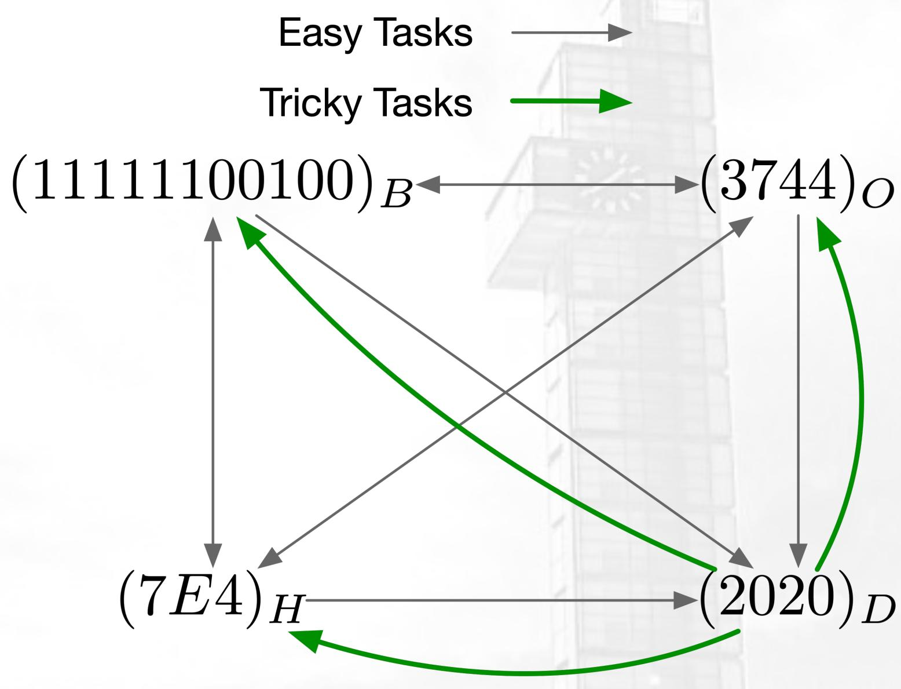

flowchart

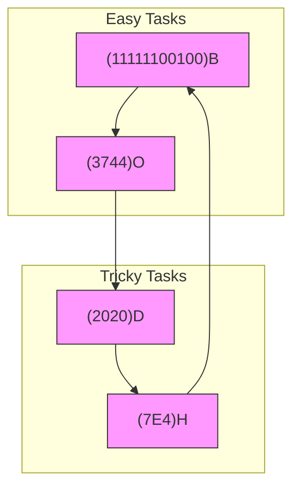

# 进制表示转换

X进制转10进制，方法：逐位加权并相加

【例】将二进制数(11001.01) $_{2}$ 、八进制数(216.3) $_{8}$ 、十六进制数(7A.C) $_{16}$ 转换成十进制数。

【解】“逐位加权，再相加”

$$
(1 1 0 0 1. 0 1) _ {2} = (1 \times 2 ^ {4} + 1 \times 2 ^ {3} + 1 \times 2 ^ {0} + 1 \times 2 ^ {- 2}) _ {1 0} = (2 5. 2 5) _ {1 0}
$$

$$
(2 1 6. 3) _ {8} = (2 \times 8 ^ {2} + 1 \times 8 ^ {1} + 6 \times 8 ^ {0} + 3 \times 8 ^ {- 1}) _ {1 0} = (1 4 2. 3 7 5) _ {1 0}
$$

$$
(7 \mathrm{A.C}) _ {1 6} = (7 \times 1 6 ^ {1} + 1 0 \times 1 6 ^ {0} + 1 2 \times 1 6 ^ {- 1}) _ {1 0} = (1 2 2. 7 5) _ {1 0}
$$

# 进制表示转换

# 10进制转X进制，方法：

- 整数部分，除基取余，先低后高
- 小数部分，乘基取整，先高后低

# 进制表示转换

# 10进制转X进制，方法：

- 整数部分，除基取余，先低后高；小数部分，乘基取整，先高后低

【例】将十进制数730.8125转换成8进制数。

解：整数部分，迭代÷基数并取余，后面是高位

$$
\begin{array}{l} 7 3 0 / 8 = 9 1 - - 2 \\ 9 1 / 8 = 1 1 \quad - - 3 \\ 1 1 / 8 = 1 \quad - - 3 \\ 1 / 8 = 0 \quad - - 1 \\ 0 / 8 = 0 \quad - - 0 \\ = > (7 3 0) _ {1 0} = (1 3 3 2) _ {8} \\ \end{array}
$$

低位

natural_image

Green upward-pointing arrow symbol on white background (no text or labels)

高位

# 进制表示转换

# 10进制转X进制，方法：

- 整数部分，除基取余，先低后高；小数部分，乘基取整，先高后低

【例】将十进制数730.8125转换成8进制数。

解：整数部分，迭代÷基数并取余，后面是高位

$$
\begin{array}{l} 7 3 0 / 8 = 9 1 - - 2 \\ 9 1 / 8 = 1 1 - - 3 \\ 1 1 / 8 = 1 \quad - - 3 \\ 1 / 8 = 0 \quad - - 1 \\ 0 / 8 = 0 \quad - - 0 \\ \begin{array}{c} \text {低位} \\ \text {高位} \end{array} \\ \end{array}
$$

$$
= > (7 3 0) _ {1 0} = (1 3 3 2) _ {8}
$$

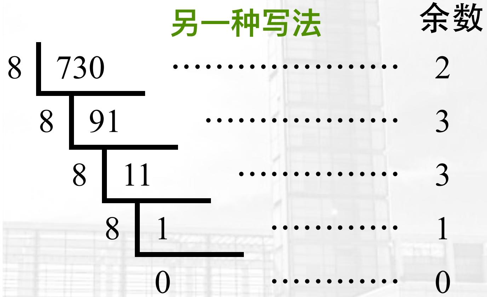

line

| 另一种写法 | 余数 |
| -------- | ---- |
| 730      | 8    |
| 91       | 8    |
| 11       | 8    |
| 1        | 8    |
| 0        | 0    |

# 进制表示转换

# 10进制转X进制，方法：

- 整数部分，除基取余，先低后高；小数部分，乘基取整，先高后低

【例】将十进制数730.8125转换成8进制数。

解：小数部分，小数部分迭代×基数取整，前面是高位

$$
\begin{array}{l} 0. 8 1 2 5 \times 8 = 6. 5 - - 6 \\ 0. 5 \times 8 = 4 - - 4 \\ 0. 0 \times 8 = 0 - - 0 \\ \end{array}
$$

高位

低位

$$
= > (0. 8 1 2 5) _ {1 0} = (0. 6 4) _ {8}
$$

$$
= > (7 3 0. 8 1 2 5) _ {1 0} = (1 3 2 2. 6 4) _ {8}
$$

# 进制表示转换

# 10进制转X进制，方法：

- 整数部分，除基取余，先低后高；小数部分，乘基取整，先高后低

【例】将十进制数730.8125转换成2进制数。

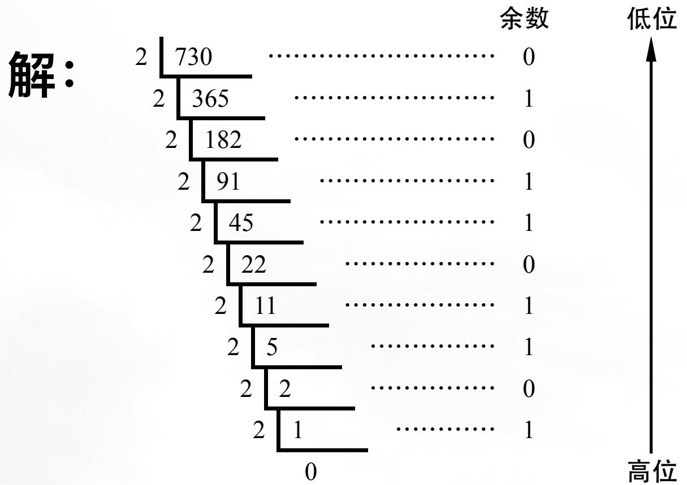

line

| 高位 | 余数 |
| ---- | ---- |
| 0    | 0    |
| 1    | 1    |
| 2    | 0    |
| 3    | 1    |
| 4    | 1    |
| 5    | 1    |
| 6    | 0    |
| 7    | 1    |
| 8    | 1    |
| 9    | 0    |
| 10   | 1    |
| 11   | 1    |
| 12   | 0    |
| 13   | 1    |
| 14   | 1    |
| 15   | 0    |
| 16   | 1    |
| 17   | 1    |
| 18   | 0    |
| 19   | 1    |
| 20   | 1    |
| 21   | 0    |
| 22   | 1    |
| 23   | 1    |
| 24   | 0    |
| 25   | 1    |
| 26   | 1    |
| 27   | 0    |
| 28   | 1    |
| 29   | 1    |
| 30   | 0    |
| 31   | 1    |
| 32   | 1    |
| 33   | 0    |
| 34   | 1    |
| 35   | 1    |
| 36   | 0    |
| 37   | 1    |
| 38   | 1    |
| 39   | 0    |
| 40   | 1    |
| 41   | 1    |
| 42   | 0    |
| 43   | 1    |
| 44   | 1    |
| 45   | 0    |
| 46   | 1    |
| 47   | 1    |
| 48   | 0    |
| 49   | 1    |
| 50   | 1    |
| 51   | 0    |
| 52   | 1    |
| 53   | 1    |
| 54   | 0    |
| 55   | 1    |
| 56   | 1    |
| 57   | 0    |
| 58   | 1    |
| 59   | 1    |
| 60   | 0    |
| 61   | 1    |
| 62   | 1    |
| 63   | 0    |
| 64   | 1    |
| 65   | 1    |
| 66   | 0    |
| 67   | 1    |
| 68   | 1    |
| 69   | 0    |
| 70   | 1    |
| 71   | 1    |
| 72   | 0    |
| 73   | 1    |
| 74   | 1    |
| 75   | 0    |
| 76   | 1    |
| 77   | 1    |
| 78   | 0    |
| 79   | 1    |
| 80   | 1    |
| 81   | 0    |
| 82   | 1    |
| 83   | 1    |
| 84   | 0    |
| 85   | 1    |
| 86   | 1    |
| 87   | 0    |
| 88   | 1    |
| 89   | 1    |
| 90   | 0    |
| 91   | 1    |
| 92   | 1    |
| 93   | 0    |
| 94   | 1    |
| 95   | 1    |
| 96   | 0    |
| 97   | 1    |
| 98   | 1    |
| 99   | 0    |
| A     | ... (approximate from left to right) for the remaining nodes. The values in the right column are estimated based on the number of nodes and the position relative to the left node.

$$
= > (7 3 0) _ {1 0} = (1 0 1 1 0 1 1 0 1 0) _ {2}
$$

# 进制表示转换

# 10进制转X进制，方法：

- 整数部分，除基取余，先低后高；小数部分，乘基取整，先高后低

【例】将十进制数730.8125转换成2进制数。

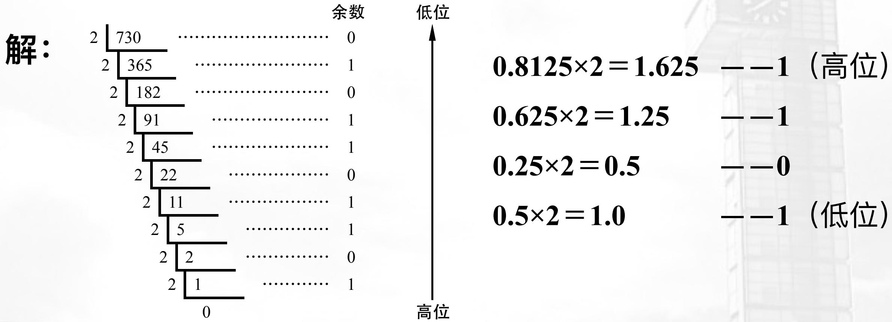

line

| 余数 | 高位 |
| ---- | ---- |
| 730  | 0    |
| 365  | 1    |
| 182  | 0    |
| 91   | 1    |
| 45   | 1    |
| 22   | 0    |
| 11   | 1    |
| 5    | 1    |
| 2    | 0    |
| 1    | 1    |

$$
= > (7 3 0) _ {1 0} = (1 0 1 1 0 1 1 0 1 0) _ {2} \quad (0. 8 1 2 5) _ {1 0} = (0. 1 1 0 1) _ {2}
$$

$$
= > (7 3 0. 8 1 2 5) _ {1 0} = (1 0 1 1 0 1 1 0 1 0. 1 1 0 1) _ {2}
$$

# 进制表示转换

# 10进制转X进制，方法：

- 整数部分，除基取余，先低后高；小数部分，乘基取整，先高后低

【练习/翻车预警】将十进制数234.75和4532.234转换成2进制数。

# 进制表示转换

# 2/8/16进制互转：

- 2转8/16 => 每隔3/4位合并；
- 8/16转2 => 每个数字展开为3/4位;
- 8/16互转 => 先转为2，再互转

# 进制表示转换

例：将(1011011010.1101) $_{2}$ 转为8/16进制

注意：合并时，以小数点为基准向左/向右合并

<table><tr><td>二进制位置</td><td>9</td><td>8</td><td>7</td><td>6</td><td>5</td><td>4</td><td>3</td><td>2</td><td>1</td><td>0</td><td>小数点</td><td>-1</td><td>-2</td><td>-3</td><td>-4</td></tr><tr><td>Binary</td><td>1</td><td>0</td><td>1</td><td>1</td><td>0</td><td>1</td><td>1</td><td>0</td><td>1</td><td>0</td><td>.</td><td>1</td><td>1</td><td>0</td><td>1</td></tr><tr><td>Octal</td><td>1</td><td colspan="3">3</td><td colspan="3">3</td><td colspan="3">2</td><td>.</td><td colspan="3">6</td><td>4</td></tr><tr><td>Hexadecimal</td><td colspan="3">2</td><td colspan="3">D</td><td colspan="4">A</td><td>.</td><td colspan="4">D</td></tr></table>

注意这两位的合并方向

注意这一位的合并方向

# 有符号数的原、反、补、移 四码表示

# 有符号数，有什么问题？

- 符号怎么表示?

$$
\begin{array}{l} \bullet (- 2 0 2 0) _ {1 0} = (\ref {e q : 1 . 5}) _ {2}, \\ (2 0 2 0) _ {1 0} = (\ref {e q : 1 . 2}) _ {2} \\ \end{array}
$$

- 如何方便计算?

- 加、减、乘、除

- 无符号数:
- 有符号数:

- 原码（Signed-Magnitude Representation, SMR）

- 反码 (One's Complement)

- 补码 (Two's Complement)

- 移码 (Offset Binary)

# 简单的原码表示: Sign Magnitude Representation (SMR)

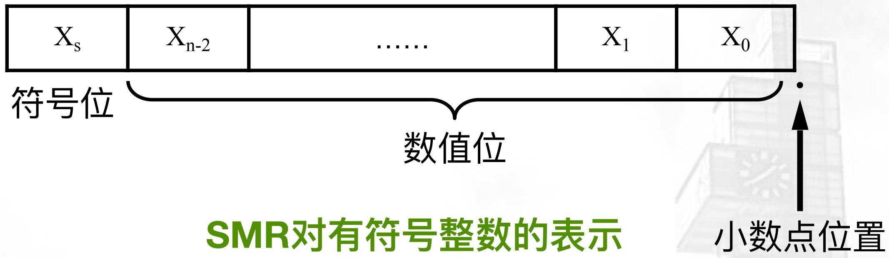

text_image

Xs Xn-2 .... X1 X0
符号位 数值位 小数点位置
SMR对有符号整数的表示

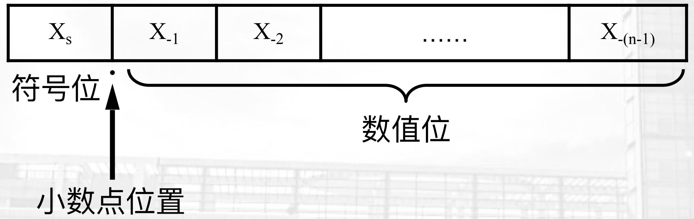

text_image

Xs X-1 X-2 .... X-(n-1)
符号位
小数点位置
数值位

SMR对有符号纯小数的表示

# 简单的原码表示: Sign Magnitude Representation (SMR)

设机器字长为8位，如下整数/纯小数的原码表示如下：

符号位

<table><tr><td>十进制数</td><td>7</td><td>6</td><td>5</td><td>4</td><td>3</td><td>2</td><td>1</td><td>0</td></tr><tr><td>35</td><td>0</td><td>0</td><td>1</td><td>0</td><td>0</td><td>0</td><td>1</td><td>1</td></tr><tr><td>-35</td><td>1</td><td>0</td><td>1</td><td>0</td><td>0</td><td>0</td><td>1</td><td>1</td></tr><tr><td>127</td><td>0</td><td>1</td><td>1</td><td>1</td><td>1</td><td>1</td><td>1</td><td>1</td></tr><tr><td>-127</td><td>1</td><td>1</td><td>1</td><td>1</td><td>1</td><td>1</td><td>1</td><td>1</td></tr><tr><td>+0</td><td>0</td><td>0</td><td>0</td><td>0</td><td>0</td><td>0</td><td>0</td><td>0</td></tr><tr><td>-0</td><td>1</td><td>0</td><td>0</td><td>0</td><td>0</td><td>0</td><td>0</td><td>0</td></tr></table>

符号位

<table><tr><td>十进制数</td><td>7</td><td>6</td><td>5</td><td>4</td><td>3</td><td>2</td><td>1</td><td>0</td></tr><tr><td>0.5</td><td>0</td><td>1</td><td>0</td><td>0</td><td>0</td><td>0</td><td>0</td><td>0</td></tr><tr><td>-0.5</td><td>1</td><td>1</td><td>0</td><td>0</td><td>0</td><td>0</td><td>0</td><td>0</td></tr><tr><td>0.125</td><td>0</td><td>0</td><td>0</td><td>1</td><td>0</td><td>0</td><td>0</td><td>0</td></tr><tr><td>-0.125</td><td>1</td><td>0</td><td>0</td><td>1</td><td>0</td><td>0</td><td>0</td><td>0</td></tr><tr><td>0.3</td><td>0</td><td>0</td><td>1</td><td>0</td><td>0</td><td>1</td><td>1</td><td>0</td></tr><tr><td>-0.3</td><td>1</td><td>0</td><td>1</td><td>0</td><td>0</td><td>1</td><td>1</td><td>0</td></tr></table>

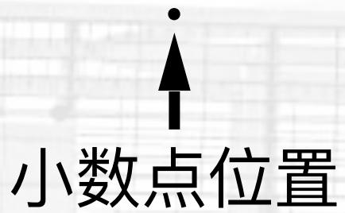

text_image

小数点位置

text_image

小数点位置

# 简单的原码表示: Sign Magnitude Representation (SMR)

# 总结

- 原码比较直观，其表示方法同英文名SMR一致

- 符号位（一位）+ 数值（绝对值，N-1位）位

- 原码表示中，0存在+0和-0两个值
- 机器位数/表示长度决定了表达的

- 整数范围 $\left[-2^{N - 1} + 1,2^{N - 1} - 1\right]$ ，最小表示单位1
- 纯小数范围 $\left[-1 + 2^{-(N - 1)}, 1 - 2^{-(N - 1)}\right]$ ，最小表示单位 $2^{-(N - 1)}$

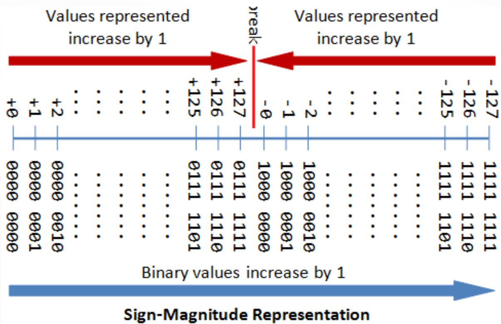

line

| Binary Value | Sign-Magnitude Representation |
| ------------ | ----------------------------- |
| +0           | 0000                          |
| +1           | 0000                          |
| +2           | 0000                          |
| ...          | ...                           |
| +125         | 0111                          |
| +126         | 1101                          |
| +127         | 1110                          |
| -0           | 1000                          |
| -1           | 0000                          |
| -2           | 0010                          |
| -125         | 1101                          |
| -126         | 1110                          |
| -127         | 1111                          |

# 直观的反码表示: One's Complement

# 整数/纯小数的反码变换方法（精华版）如下：

- 正数：就是原码！
- 负数：除了符号位，将原码逐位取反！
- 整数/纯小数，都适用~

# Done!

# 直观的反码表示: One's Complement

整数/纯小数的反码变换方法（精华版）如下：for 正数：就是原码！for 负数：原码，除了符号位，全部取反！

设机器字长为8位，如下整数/纯小数的反码表示如下：

<table><tr><td>十进制数</td><td>7</td><td>6</td><td>5</td><td>4</td><td>3</td><td>2</td><td>1</td><td>0</td></tr><tr><td>35</td><td>0</td><td>0</td><td>1</td><td>0</td><td>0</td><td>0</td><td>1</td><td>1</td></tr><tr><td>-35</td><td>1</td><td>1</td><td>0</td><td>1</td><td>1</td><td>1</td><td>0</td><td>0</td></tr><tr><td>127</td><td>0</td><td>1</td><td>1</td><td>1</td><td>1</td><td>1</td><td>1</td><td>1</td></tr><tr><td>-127</td><td>1</td><td>0</td><td>0</td><td>0</td><td>0</td><td>0</td><td>0</td><td>0</td></tr><tr><td>+0</td><td>0</td><td>0</td><td>0</td><td>0</td><td>0</td><td>0</td><td>0</td><td>0</td></tr><tr><td>-0</td><td>1</td><td>1</td><td>1</td><td>1</td><td>1</td><td>1</td><td>1</td><td>1</td></tr></table>

<table><tr><td>十进制数</td><td>7</td><td>6</td><td>5</td><td>4</td><td>3</td><td>2</td><td>1</td><td>0</td></tr><tr><td>0.5</td><td>0</td><td>1</td><td>0</td><td>0</td><td>0</td><td>0</td><td>0</td><td>0</td></tr><tr><td>-0.5</td><td>1</td><td>0</td><td>1</td><td>1</td><td>1</td><td>1</td><td>1</td><td>1</td></tr><tr><td>0.125</td><td>0</td><td>0</td><td>0</td><td>1</td><td>0</td><td>0</td><td>0</td><td>0</td></tr><tr><td>-0.125</td><td>1</td><td>1</td><td>1</td><td>0</td><td>1</td><td>1</td><td>1</td><td>1</td></tr><tr><td>0.3</td><td>0</td><td>0</td><td>1</td><td>0</td><td>0</td><td>1</td><td>1</td><td>0</td></tr><tr><td>-0.3</td><td>1</td><td>1</td><td>0</td><td>1</td><td>1</td><td>0</td><td>0</td><td>1</td></tr></table>

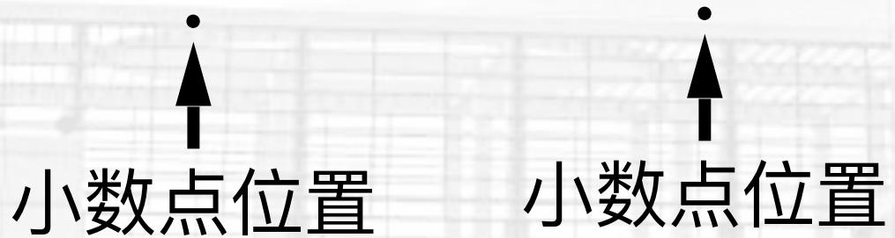

text_image

小数点位置
小数点位置

# 直观的反码表示: One's Complement

# 总结

- 正数的反码即原码，负数的反码为原码除符号位，逐位取反
- 反码表示中，0也存在+0和-0两个值
- 机器位数/表示长度决定了表达的

- 整数范围 $\left[-2^{N - 1} + 1,2^{N - 1} - 1\right]$ ，最小表示单位1

- 纯小数范围 $\left[-1 + 2^{-(N - 1)}, 1 - 2^{-(N - 1)}\right]$ ，最小表示单位 $2^{-(N - 1)}$

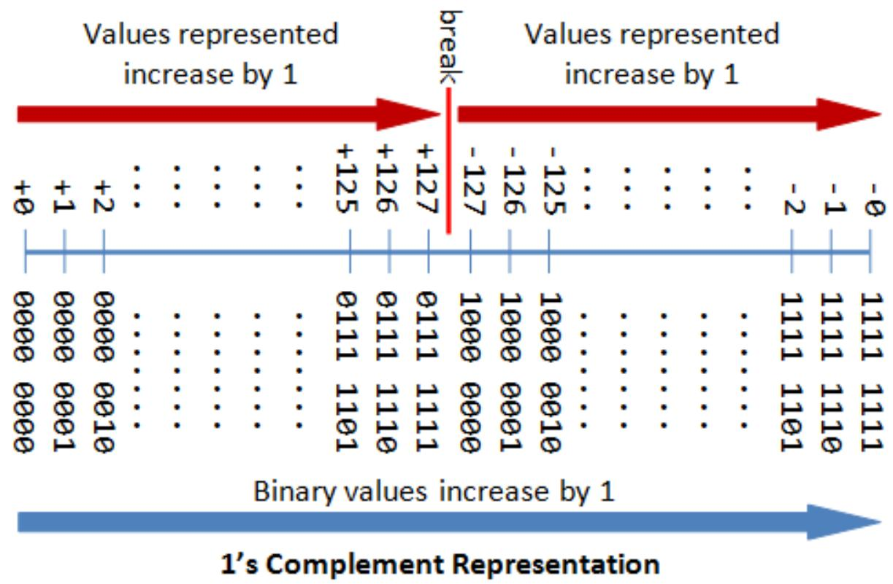

line

| Binary Value | Binary Position | Binary Value |
| ------------ | --------------- | ------------ |
| 0000         | +0              | 0000         |
| 0001         | +1              | 0000         |
| 0002         | +2              | 0000         |
| 0003         | ...             | ...          |
| 0004         | ...             | ...          |
| 0005         | ...             | ...          |
| 0006         | ...             | ...          |
| 0007         | ...             | ...          |
| 0008         | ...             | ...          |
| 0009         | ...             | ...          |
| 0010         | ...             | ...          |
| 0011         | ...             | ...          |
| 0012         | ...             | ...          |
| 0013         | ...             | ...          |
| 0014         | ...             | ...          |
| 0015         | ...             | ...          |
| 0016         | ...             | ...          |
| 0017         | ...             | ...          |
| 0018         | ...             | ...          |
| 0019         | ...             | ...          |
| 0020         | ...             | ...          |
| 0021         | ...             | ...          |
| 0022         | ...             | ...          |
| 0023         | ...             | ...          |
| 0024         | ...             | ...          |
| 0025         | ...             | ...          |
| 0026         | ...             | ...          |
| 0027         | ...             | ...          |
| 0028         | ...             | ...          |
| 0029         | ...             | ...          |
| 0030         | ...             | ...          |
| 0031         | ...             | ...          |
| 0032         | ...             | ...          |
| 0033         | ...             | ...          |
| 0034         | ...             | ...          |
| 0035         | ...             | ...          |
| 0036         | ...             | ...          |
| 0037         | ...             | ...          |
| 0038         | ...             | ...          |
| 0039         | ...             | ...          |
| 0040         | ...             | ...          |
| 0041         | ...             | ...          |
| 0042         | ...             | ...          |
| 0043         | ...             | ...          |
| 0044         | ...             | ...          |
| 0045         | ...             | ...          |
| 0046         | ...             | ...          |
| 0047         | ...             | ...          |
| 0048         | ...             | ...          |
| 0049         | ...             | ...          |
| 0050         | ...             | ...          |
| 0051         | ...             | ...          |
| 0052         | ...             | ...          |
| 0053         | ...             | ...          |
| 0054         | ...             | ...          |
| 0055         | ...             | ...          |
| 0056         | ...             | ...          |
| 0057         | ...             | ...          |
| 0058         | ...             | ...          |
| 0059         | ...             | ...          |
| 0060         | ...             | ...          |
| 0061         | ...             | ...          |
| 0062         | ...             | ...          |
| 0063         | ...             | ...          |
| 0064         | ...             | ...          |
| 0065         | ...             | ...          |
| 0066         | ...             | ...          |
| 0067         | ...             | ...          |
| 0068         | ...             | ...          |
| 0069         | ...             | ...          |
| 0070         | ...             | ...          |
| 0111         | -1              | -2           |
| 1111         | -2              | -1           |
| 1112         | -1              | -1           |
| 1113         | -1              | -1           |
| 1114         | -1              | -1           |
| 1115         | -1              | -1           |
| 1116         | -1              | -1           |
| 1117         | -1              | -1           |
| 1118         | -1              | -1           |
| 1119         | -1              | -1           |
| 1120         | -1              | -1           |
| 1121         | -1              | -1           |
| 1122         | -1              | -1           |
| 1123         | -1              | -1           |
| 1124         | -1              | -1           |
| 1125         | -1              | -1           |
| 1126         | -1              | -1           |
| 1127         | -1              | -1           |
| break        | break            | break        |
The chart displays two values: "Values represented by 1" and "Binary values increase by 1". The data is presented in a grid format with 'break' as the label on the left side.

# 有点复杂的补码表示: Two's Complement

# 整数/纯小数的补码变换方法（精华版）如下：

- 正数：就是原码！
- 负数：先算反码，反码最末位+1
- 整数/纯小数，都适用~

- Done!

# 有点复杂的补码表示: Two's Complement

整数/纯小数的补码变换方法（精华版）如下：for 正数：就是原码！for 负数：反码+1

设机器字长为8位，如下整数/纯小数的反码表示如下：

<table><tr><td>十进制数</td><td>7</td><td>6</td><td>5</td><td>4</td><td>3</td><td>2</td><td>1</td><td>0</td></tr><tr><td>35</td><td>0</td><td>0</td><td>1</td><td>0</td><td>0</td><td>0</td><td>1</td><td>1</td></tr><tr><td>-35</td><td>1</td><td>1</td><td>0</td><td>1</td><td>1</td><td>1</td><td>0</td><td>1</td></tr><tr><td>127</td><td>0</td><td>1</td><td>1</td><td>1</td><td>1</td><td>1</td><td>1</td><td>1</td></tr><tr><td>-127</td><td>1</td><td>0</td><td>0</td><td>0</td><td>0</td><td>0</td><td>0</td><td>1</td></tr><tr><td>+0</td><td>0</td><td>0</td><td>0</td><td>0</td><td>0</td><td>0</td><td>0</td><td>0</td></tr><tr><td>-0</td><td>0</td><td>0</td><td>0</td><td>0</td><td>0</td><td>0</td><td>0</td><td>0</td></tr></table>

<table><tr><td>十进制数</td><td>7</td><td>6</td><td>5</td><td>4</td><td>3</td><td>2</td><td>1</td><td>0</td></tr><tr><td>0.5</td><td>0</td><td>1</td><td>0</td><td>0</td><td>0</td><td>0</td><td>0</td><td>0</td></tr><tr><td>-0.5</td><td>1</td><td>1</td><td>0</td><td>0</td><td>0</td><td>0</td><td>0</td><td>0</td></tr><tr><td>0.125</td><td>0</td><td>0</td><td>0</td><td>1</td><td>0</td><td>0</td><td>0</td><td>0</td></tr><tr><td>-0.125</td><td>1</td><td>1</td><td>1</td><td>1</td><td>0</td><td>0</td><td>0</td><td>0</td></tr><tr><td>0.3</td><td>0</td><td>0</td><td>1</td><td>0</td><td>0</td><td>1</td><td>1</td><td>0</td></tr><tr><td>-0.3</td><td>1</td><td>1</td><td>0</td><td>1</td><td>1</td><td>0</td><td>1</td><td>0</td></tr></table>

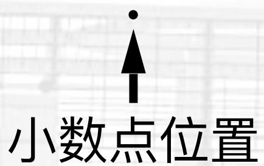

text_image

小数点位置

text_image

小数点位置

# 有点复杂的补码表示: Two's Complement

# 总结

- 正数补码即原码，负数补码为反码+1
- 补码表示中，0是唯一值
- 机器位数/表示长度决定了表达的

- 整数范围 $\left[-2^{N - 1},2^{N - 1} - 1\right]$ ，最小表示单位1
- 纯小数范围 $\left[-1, 1 - 2^{-(N-1)}\right]$ ，最小表示单位 $2^{-(N-1)}$

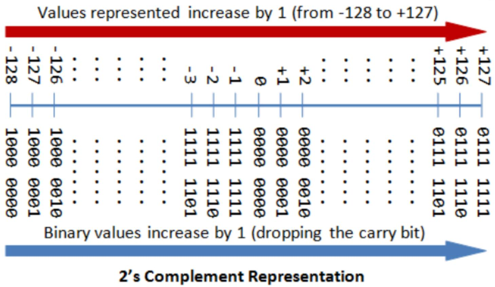

bar

| Binary Value | Value |
| ------------ | ----- |
| 1000         | -128  |
| 0001         | -127  |
| 0010         | -126  |
| ...          | ...   |
| 1101         | ...   |
| ...          | ...   |
| 1110         | ...   |
| ...          | ...   |
| 1111         | ...   |
| ...          | ...   |
| 0000         | ...   |
| 0001         | ...   |
| ...          | ...   |
| 1110         | ...   |
| ...          | ...   |
| 1111         | ...   |
| ...          | ...   |
| 0000         | ...   |
| 0001         | ...   |
| ...          | ...   |
| 1111         | ...   |
| ...          | ...   |
| 1112         | ...   |
| ...          | ...   |
| 0101         | ...   |
| ...          | ...   |
| 1113         | ...   |
| ...          | ...   |
| 0002         | ...   |
| 0003         | ...   |
| ...          | ...   |
| 1114         | ...   |
| ...          | ...   |
| 0004         | ...   |
| 0005         | ...   |
| ...          | ...   |
| 1115         | ...   |
| ...          | ...   |
| 0106         | ...   |
| 0107         | ...   |
| ...          | ...   |
| 1118         | ...   |
| ...          | ...   |
| 0008         | ...   |
| 0009         | ...   |
| ...          | ...   |
| 1120         | ...   |
| ...          | ...   |
| 0010         | ...   |
| ...          | ...   |
| 1121         | ...   |
| ...          | ...   |
| 0111         | ...   |
| 0112         | ...   |
| ...          | ...   |
| 1266         | +125  |
| +127         | +126  |
| +127         | +127  |
The chart displays binary values representing an increase by 1 (from -128 to +127) and decreasing by 1 (dropping the carry bit). The 'Binary values increase by 1 (dropping the carry bit)' is shown on the right.

# 最后的最后，移码表示: Offset Binary

整数/纯小数的移码变换方法（精华版）如下：

- 不论正负数，补码符号位取反！
- 整数/纯小数，都适用~

- Done!

# 最后的最后，移码表示: Offset Binary

整数/纯小数的反码变换方法（精华版）如下：补码符号位取反！

设机器字长为8位，如下整数/纯小数的反码表示如下：

<table><tr><td>十进制数</td><td>7</td><td>6</td><td>5</td><td>4</td><td>3</td><td>2</td><td>1</td><td>0</td></tr><tr><td>35</td><td>1</td><td>0</td><td>1</td><td>0</td><td>0</td><td>0</td><td>1</td><td>1</td></tr><tr><td>-35</td><td>0</td><td>1</td><td>0</td><td>1</td><td>1</td><td>1</td><td>0</td><td>1</td></tr><tr><td>127</td><td>1</td><td>1</td><td>1</td><td>1</td><td>1</td><td>1</td><td>1</td><td>1</td></tr><tr><td>-127</td><td>0</td><td>0</td><td>0</td><td>0</td><td>0</td><td>0</td><td>0</td><td>1</td></tr><tr><td>+0</td><td>1</td><td>0</td><td>0</td><td>0</td><td>0</td><td>0</td><td>0</td><td>0</td></tr><tr><td>-0</td><td>1</td><td>0</td><td>0</td><td>0</td><td>0</td><td>0</td><td>0</td><td>0</td></tr></table>

<table><tr><td>十进制数</td><td>7</td><td>6</td><td>5</td><td>4</td><td>3</td><td>2</td><td>1</td><td>0</td></tr><tr><td>0.5</td><td>1</td><td>1</td><td>0</td><td>0</td><td>0</td><td>0</td><td>0</td><td>0</td></tr><tr><td>-0.5</td><td>0</td><td>1</td><td>0</td><td>0</td><td>0</td><td>0</td><td>0</td><td>0</td></tr><tr><td>0.125</td><td>1</td><td>0</td><td>0</td><td>1</td><td>0</td><td>0</td><td>0</td><td>0</td></tr><tr><td>-0.125</td><td>0</td><td>1</td><td>1</td><td>1</td><td>0</td><td>0</td><td>0</td><td>0</td></tr><tr><td>0.3</td><td>1</td><td>0</td><td>1</td><td>0</td><td>0</td><td>1</td><td>1</td><td>0</td></tr><tr><td>-0.3</td><td>0</td><td>1</td><td>0</td><td>1</td><td>1</td><td>0</td><td>1</td><td>0</td></tr></table>

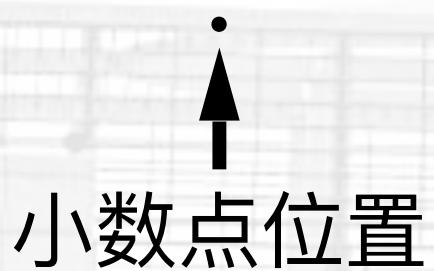

text_image

小数点位置

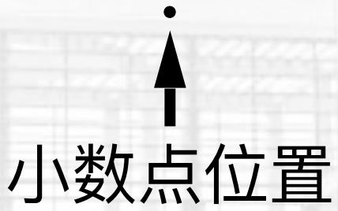

text_image

小数点位置

# 最后的最后，移码表示: Offset Binary

# 总结

- 移码就是补码符号位取反
- 移码表示中，0是唯一值

- 机器位数/表示长度决定了表达的

- 整数范围 $\left[-2^{N - 1},2^{N - 1} - 1\right]$ ，最小表示单位1
- 纯小数范围 $\left[-1, 1 - 2^{-(N-1)}\right]$ ，最小表示单位 $2^{-(N-1)}$

# 四码大PK

字长为4位，整数的四码表示

<table><tr><td>十进制数</td><td>原码</td><td>反码</td><td>补码</td><td>移码</td></tr><tr><td>8</td><td>N/A</td><td>N/A</td><td>N/A</td><td>N/A</td></tr><tr><td>7</td><td>0111</td><td>0111</td><td>0111</td><td>1111</td></tr><tr><td>6</td><td>0110</td><td>0110</td><td>0110</td><td>1110</td></tr><tr><td>5</td><td>0101</td><td>0101</td><td>0101</td><td>1101</td></tr><tr><td>4</td><td>0100</td><td>0100</td><td>0100</td><td>1100</td></tr><tr><td>3</td><td>0011</td><td>0011</td><td>0011</td><td>1011</td></tr><tr><td>2</td><td>0010</td><td>0010</td><td>0010</td><td>1010</td></tr><tr><td>1</td><td>0001</td><td>0001</td><td>0001</td><td>1001</td></tr><tr><td>0</td><td>0000 / 1000</td><td>0000 / 1111</td><td>0000</td><td>1000</td></tr><tr><td>-1</td><td>1001</td><td>1110</td><td>1111</td><td>0111</td></tr><tr><td>-2</td><td>1010</td><td>1101</td><td>1110</td><td>0110</td></tr><tr><td>-3</td><td>1011</td><td>1100</td><td>1101</td><td>0101</td></tr><tr><td>-4</td><td>1100</td><td>1011</td><td>1100</td><td>0100</td></tr><tr><td>-5</td><td>1101</td><td>1010</td><td>1011</td><td>0011</td></tr><tr><td>-6</td><td>1110</td><td>1001</td><td>1010</td><td>0010</td></tr><tr><td>-7</td><td>1111</td><td>1000</td><td>1001</td><td>0001</td></tr><tr><td>-8</td><td>N/A</td><td>N/A</td><td>1000</td><td>0000</td></tr></table>

# 四码大PK

字长为4位，纯小数的四码表示

<table><tr><td>十进制数</td><td>原码</td><td>反码</td><td>补码</td><td>移码</td></tr><tr><td>1</td><td>N/A</td><td>N/A</td><td>N/A</td><td>N/A</td></tr><tr><td>0.875</td><td>0111</td><td>0111</td><td>0111</td><td>1111</td></tr><tr><td>0.750</td><td>0110</td><td>0110</td><td>01