# 计算机组成与结构 - 计算机中的数据表示2

李瑞 教授

蒋志平 副教授

计算机科学与技术学院

# 温故一 祭祖传统娱乐节目

- 10进制转X进制整数部分怎么转?  
- 10进制转X进制小数部分怎么转?  
- 2进制向8/16进制转换的规则是？  
- 原码怎么转反码？  
- 反码怎么转补码?  
- 补码怎么转移码？  
• 0.25的补码是多少？（用4位定长纯小数表示）  
- -0.25的补码是多少？（用4位定长纯小数表示）  
• 0.5的补码是多少？（用4位定长纯小数表示）  
- -0.5的补码是多少？（用4位定长纯小数表示）

# 本章学习要点

# - 数字的表示

- 进制编码基础   
- 整数及小数进制转换（给人看）  
- 整数及小数在计算机里的表示
(给机器看)

\- 有符号号的原、反、补、移码

\- 浮点表示

\- IEEE754

BCD

# - 非数字的表示

- 字符表示  
- ASCII   
- 汉字  
- Unicode

# - 校验码

- 奇偶校验  
- CRC

# 浮点表示基础

# 如何表示典型的实数？

电子的质量 = 9.10938×10 $^{-31}$ 公斤

natural_image

Illustration of a stylized atom with orbiting electrons and a central nucleus (no text or symbols)

natural_image

Close-up of the Sun showing its iconic thermal effect with visible solar flares and dust clouds (no text or symbols)

太阳的质量 = 1.988 92×10 $^{30}$ 公斤

# 如何表示典型的实数？

1世纪=3.155 76×10 $^{9}$ 秒

text_image

Corkwell
19:45-10:30
10:45-11:30
11:45-12:30
13:45-14:30
15:45-16:30
17:45-18:30
19:45-20:30
20:45-21:30
21:45-22:30
22:45-23:30
23:45-24:30
24:45-25:30
25:45-26:30
26:45-27:30
27:45-28:30
28:45-29:30
29:45-30:30
30:45-31:30
31:45-32:30
32:45-33:30
33:45-34:30
34:45-35:30
35:45-36:30
36:45-37:30
37:45-38:30
38:45-39:30
39:45-40:30
40:45-41:30
41:45-42:30
42:45-43:30
43:45-44:30
44:45-45:30
45:45-46:30
46:45-47:30
47:45-48:30
48:45-49:30
49:45-50:30
50:45-51:30
51:45-52:30
52:45-53:30
53:45-54:30
54:45-55:30
55:45-56:30
56:45-57:30
57:45-58:30
58:45-59:30
59:45-60:30
60:45-61:30
61:45-62:30
62:45-63:30
63:45-64:30
64:45-65:30
65:45-66:30
66:45-67:30
67:45-68:30
68:45-69:30
69:45-70:30
70:45-71:30
71:45-72:30
72:45-73:30
73:45-74:30
74:45-75:30
75:45-76:30
76:45-77:30
77:45-78:30
78:45-79:30
79:45-80:30
80:45-81:30
81:45-82:30
82:45-83:30
83:45-84:30
84:45-85:30
85:45-86:30
86:45-87:30
87:45-88:30
88:45-89:30
89:45-90:30
90:45-91:30
91:45-92:30
92:45-93:30
93:45-94:30
94:45-95:30
95:45-96:30
96:45-97:30
97:45-98:30
98:45-99:30
99:46

1纳秒= $1.0\times10^{-9}$ 秒

# 计算机如何表示实数?

\- 计算机里表达实数的方法?

\- 有限位数表示(Fixed Length)

\- 分数法一精确表达有理数（3/1, 22 / 7, 355 / 113, ...)

\- 无理数靠邻近有理数表示 $(\pi \approx \frac{355}{113}, \ldots)$

\- 小数法

\- 定点小数（定长整数位+定长小数位）<-常规小数法

\- 浮点小数（定长阶数位+定长小数位）<-科学计数法

\- 可变位数表示 (Variable Length)

# 计算机如何表示实数?

<table><tr><td>数域</td><td>表示方式</td><td colspan="3">bit位用途</td></tr><tr><td rowspan="3">整数</td><td>无符号整数Unsigned Integer)</td><td colspan="3">整数</td></tr><tr><td>有符号整数(Signed Integer)</td><td>符号</td><td colspan="2">整数</td></tr><tr><td>可变长表示法(Variable Length)</td><td>符号</td><td>位数(可变长)</td><td>数字(可变长)</td></tr><tr><td rowspan="5">实数</td><td>无符号有理数Unsigned Rational)</td><td colspan="2">分子</td><td>分母</td></tr><tr><td>有符号有理数(Signed Rational)</td><td>符号</td><td>分子</td><td>分母</td></tr><tr><td>无符号定点小数Unsigned Fixed-Point)</td><td colspan="2">整数</td><td>小数</td></tr><tr><td>有符号定点小数(Signed Fixed-Point)</td><td>符号</td><td>整数</td><td>小数</td></tr><tr><td>浮点小数(Floating Point)</td><td>符号</td><td>阶数</td><td>尾数</td></tr></table>

# 浮点表示

小数F的浮点表示（科学计数法表示）如下：

$$
F = M \times R ^ {E}
$$

• M, mantissa尾数；R, radix基数；E, exponent 阶数（幂级）  
- M和为有符号小数；E为有符号整数  
• R, 当然是2  
- 数学上，M、R、E可以是任意组合，比如，

$$
\begin{array}{l} (2 0. 3) _ {1 0} = (1 0 1 0 0. 0 1 0 0 1 1..) _ {B} \\ = 1 0 1 0 0. 0 1 0 0 1 1 \times 2 ^ {0} \\ = 1 0 1. 0 0 0 1 0 0 1 1 \times 2 ^ {1 0} \\ = 1. 0 1 0 0 0 1 0 0 1 1 \times 2 ^ {1 0 0} \\ = 0. 0 1 0 1 0 0 0 1 0 0 1 1 \times 2 ^ {1 1 0} \\ \end{array}
$$

● ● ●

# 浮点表示

# 在计算机表达浮点数，有以下问题：

\- 尾数M怎么表示?

\- 总不能把尾数M再用浮点表示吧\~?

\- bit位怎么规定?

\- 几位bit尾数？几位bit阶数？

\- 精度 v.s 范围

\- 阶数与尾数的位置？

- 阶符-阶码-数符-尾数?   
- 数符-阶符-阶码-尾数?   
● ....

• M、E用什么表示方式?

- 原？反？补？移？  
- 这真不一定...

$$
(2 0. 3) _ {1 0} = (1 0 1 0 0. 0 1 0 0 1 1..) _ {B}
$$

$$
= 1 0 1 0 0. 0 1 0 0 1 1 \times 2 ^ {0}
$$

$$
\begin{array}{l} = 1. 0 1 0 0 0 1 0 0 1 1 \times 2 ^ {1 0 0} \\ = 0. 0 1 0 1 0 0 0 1 0 0 1 1 \times 2 ^ {1 1 0} \\ \bullet \quad \bullet \quad \bullet \\ \end{array}
$$

例如: $= 101.00010011 \times 2^{10}$

# 浮点表示一尾数与阶数的表示

针对第一个问题:

\- 尾数M怎么表示?

\- 总不能把尾数M再用浮点表示吧\~?

解决方案：调整E，将尾数M变成纯小数

$$
(2 0. 3) _ {1 0} = (1 0 1 0 0. 0 1 0 0 1 1..) _ {B}
$$

$$
= 1 0 1 0 0. 0 1 0 0 1 1 \times 2 ^ {0}
$$

例如: $= 101.00010011 \times 2^{10}$

$$
= 1. 0 1 0 0 0 1 0 0 1 1 \times 2 ^ {1 0 0}
$$

$$
= 0. 0 1 0 1 0 0 0 1 0 0 1 1 \times 2 ^ {1 1 0}
$$

● ● ●

$$
(2 0. 3) _ {1 0} = (1 0 1 0 0. 0 1 0 0 1 1..) _ {B}
$$

$$
= 1 0 1 0 0. 0 1 0 0 1 1 \times 2 ^ {0}
$$

$$
= 0. 1 0 1 0 0 0 1 0 0 1 1 \times 2 ^ {1 0 1}
$$

$$
= 0. 0 0 1 0 1 0 0 0 1 0 0 1 1 \times 2 ^ {1 1 1}
$$

● ● ●

纯小数尾数:

# 浮点表示一尾数与阶数的表示

# 针对第二个问题:

\- bit位怎么规定?

\- 几位bit尾数？几位bit阶数？

\- 精度 v.s 范围

\- 有限位尾数M，有限位阶数E

\- 但不同的表示方式有不同的精度损失；

解决方案：规格化（Normalization）

# 无限精度尾数

$$
\begin{array}{l} (2 0. 3) _ {1 0} = (1 0 1 0 0. 0 1 0 0 1 1..) _ {B} \\ = 1 0 1 0 0. 0 1 0 0 1 1 \times 2 ^ {0} \\ = 0. 1 0 1 0 0 0 1 0 0 1 1 \times 2 ^ {1 0 1} \\ = 0. 0 0 1 0 1 0 0 0 1 0 0 1 1 \times 2 ^ {1 1 1} \\ \end{array}
$$

● ● ●

# 有限位尾数 + 有限位阶数

$$
\begin{array}{l} (2 0. 3) _ {1 0} = (1 0 1 0 0. 0 1 0 0 1 1 0 0 1 1..) _ {B} \\ = 0. 1 0 1 0 0 0 1 0 0 1 1 \times 2 ^ {0 1 0 1} \\ = (2 0. 2 9 6 8 7 5) _ {D} \\ = 0. 0 1 0 1 0 0 0 1 0 0 1 \times 2 ^ {0 1 1 0} \\ = (2 0. 2 8 1 2 5) _ {D} \\ = 0. 0 0 1 0 1 0 0 0 1 0 0 \times 2 ^ {0 1 1 1} \\ = (2 0. 2 5) _ {D} \\ = 0. 0 0 0 0 0 1 0 1 0 0 0 \times 2 ^ {1 0 1 0} \\ = (2 0. 0) _ {D} \\ \end{array}
$$

...

# 浮点表示一尾数与阶数的表示

# 针对第二个问题:

\- bit位怎么规定？

\- 阶数与尾数的位置？

- 阶符-阶码-数符-尾数?   
- 数符-阶符-阶码-尾数?   
●
...

# 有限位尾数 + 有限位阶数

$$
\begin{array}{l} (2 0. 3) _ {1 0} = (1 0 1 0 0. 0 1 0 0 1 1 0 0 1 1..) _ {B} \\ = 0. 1 0 1 0 0 0 1 0 0 1 1 \times 2 ^ {0 1 0 1} \\ = 0. 0 1 0 1 0 0 0 1 0 0 1 \times 2 ^ {0 1 1 0} \\ = 0. 0 0 1 0 1 0 0 0 1 0 0 \times 2 ^ {0 1 1 1} \\ = 0. 0 0 0 0 0 1 0 1 0 0 0 \times 2 ^ {1 0 1 0} \\ \end{array}
$$

...

解决方案：主要有两种

阶符一阶码一数符一尾数，(不知名格式)

数符一阶符一尾数，(IEEE754格式)

# 浮点表示一尾数与阶数的表示

- IEEE754风格浮点数  
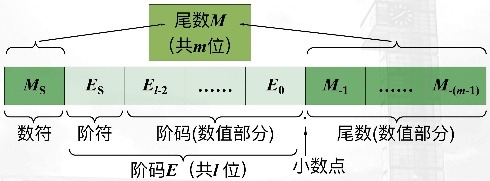

flowchart

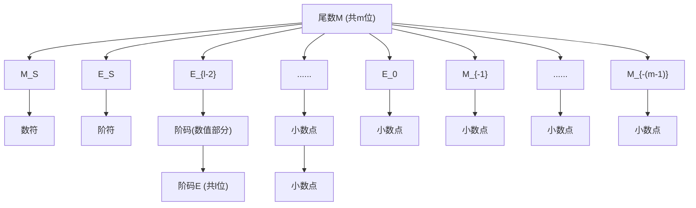

# 浮点表示一尾数与阶数的表示

# 针对第二个问题:

• M、E用什么表示方式?

\- 原？反？补？移？

\- 这真不一定...

# 就两种情况：

- 题目要求怎么来，就怎么来   
- 注意审题哦\~  
- 严格确定的IEEE754格式

# 浮点表示一规格化

# (Normalization)

# 浮点表示一规格化

当采用有限尾数+有限阶数表示时，不同

表示方法的精度损失不同：

$$
(2 0. 3) _ {1 0} = (1 0 1 0 0. 0 1 0 0 1 1 0 0 1 1..) _ {B}
$$

$$
= 0. 1 0 1 0 0 0 1 0 0 1 1 \times 2 ^ {0 1 0 1}
$$

$$
= (2 0. 2 9 6 8 7 5) _ {D}
$$

怎样的M与E能最好地保持精度？

$$
= 0. 0 1 0 1 0 0 0 1 0 0 1 \times 2 ^ {0 1 1 0}
$$

$$
= (2 0. 2 8 1 2 5) _ {D}
$$

$$
= 0. 0 0 1 0 1 0 0 0 1 0 0 \times 2 ^ {0 1 1 1}
$$

$$
= (2 0. 2 5) _ {D}
$$

$$
= 0. 0 0 0 0 0 1 0 1 0 0 0 \times 2 ^ {1 0 1 0}
$$

$$
= (2 0. 0) _ {D}
$$

● ● ●

# 浮点表示一规格化

当采用有限尾数+有限阶数表示时，不同

表示方法的精度损失不同：

$$
(2 0. 3) _ {1 0} = (1 0 1 0 0. 0 1 0 0 1 1 0 0 1 1..) _ {B}
$$

$$
= 0. 1 0 1 0 0 0 1 0 0 1 1 \times 2 ^ {0 1 0 1}
$$

$$
= (2 0. 2 9 6 8 7 5) _ {D}
$$

怎样的M与E能最好地保持精度？

$$
= 0. 0 1 0 1 0 0 0 1 0 0 1 \times 2 ^ {0 1 1 0}
$$

$$
= (2 0. 2 8 1 2 5) _ {D}
$$

$$
= 0. 0 0 1 0 1 0 0 0 1 0 0 \times 2 ^ {0 1 1 1}
$$

$$
= (2 0. 2 5) _ {D}
$$

$$
= 0. 0 0 0 0 0 1 0 1 0 0 0 \times 2 ^ {1 0 1 0}
$$

$$
= (2 0. 0) _ {D}
$$

最优规则：

\- 尾数头部没有不必要的0——规格化

=> 尾数M满足，0.5 ≤ ||M|| ≤ 1

$$
0. 1 0 1 0 0 0 1 0 0 1 1 \times 2 ^ {0 1 0 1} = (2 0. 2 9 6 8 7 5) _ {D}
$$

● ● ●

# 浮点表示一规格化

浮点数规格化，Floating Point Normalization,就是调整M和E，让M头部没有不必要的0，最优地保持精度...

# 浮点表示一规格化

浮点数规格化，Floating Point Normalization,就是调整M和E，让M头部没有不必要的0，最优地保持精度...

嘛时候，M头部有0，而且还是最优精度保持\~?

# 浮点表示一规格化

当尾数M用补码表示时，M应符合，

$0.5 \leq \| M\| \leq 1$ ，得：

\- 当 $M > 0$ 且 $0.5 \leq \| M\| < 1$ 时，

\- 当 $[M]_{\text{原}} = 0.1XXX$ 时， $[M]_{\text{补}} = 0.1XXX$

# 浮点表示一规格化

# 0.5是个例外

当尾数M用补码表示时，M应符合，

$0.5 \leq ||M|| \leq 1$ ，得：

\- 当 $M > 0$ 且 $0.5 \leq \| M\| < 1$ 时，

\- 当 $[M]_{\text{原}} = 0.1XXX$ 时， $[M]_{\text{补}} = 0.1XXX$

\- 当 $M < 0$ 且 $0.5 < \| M\| \leq 1$ 时，

\- 当 $[M]_{\text{原}} = 1.1XXX$ 时， $[M]_{\text{补}} = 1.0XXX$

$$
[ - 0. 1 0 0 0 ] _ {\mathrm{补}} = 1. 1 0 0 0
$$

$$
[ - 0. 1 0 0 1 ] _ {\text {补}} = 1. 0 1 1 1
$$

$$
[ - 0. 1 0 1 0 ] _ {\mathrm{补}} = 1. 0 1 1 0
$$

$$
[ - 0. 1 0 1 1 ] _ {\text {补}} = 1. 0 1 0 1
$$

$$
[ - 0. 1 1 0 0 ] _ {\text {补}} = 1. 0 1 0 0
$$

$$
[ - 0. 1 1 0 1 ] _ {\mathrm{补}} = 1. 0 0 1 1
$$

$$
[ - 0. 1 1 1 0 ] _ {\mathrm{补}} = 1. 0 0 1 0
$$

$$
[ - 0. 1 1 1 1 ] _ {\mathrm{补}} = 1. 0 0 0 1
$$

$$
[ - 1. 0 0 0 0 ] _ {\mathrm{补}} = 1. 0 0 0 0
$$

# 浮点表示一规格化

0.5是个例外

所以，当尾数M用补码表示时，规格化的M应符合，

- 当 $M > 0$ 时，M符合0.1XXXXX形式  
- 当 $M < 0$ 时，M符合1.0XXXXXX形式

\- M=-0.5不是规格化

\- M=-1.0是规格化

\- 当M=-0.5时，把M放大到-1.0

$$
[ - 0. 1 0 0 0 ] _ {\mathrm{补}} = 1. 1 0 0 0
$$

$$
[ - 0. 1 0 0 1 ] _ {\text {补}} = 1. 0 1 1 1
$$

$$
[ - 0. 1 0 1 0 ] _ {\text {补}} = 1. 0 1 1 0
$$

$$
[ - 0. 1 0 1 1 ] _ {\mathrm{补}} = 1. 0 1 0 1
$$

$$
[ - 0. 1 1 0 0 ] _ {\text {补}} = 1. 0 1 0 0
$$

$$
[ - 0. 1 1 0 1 ] _ {\mathrm{补}} = 1. 0 0 1 1
$$

$$
[ - 0. 1 1 1 0 ] _ {\text {补}} = 1. 0 0 1 0
$$

$$
[ - 0. 1 1 1 1 ] _ {\mathrm{补}} = 1. 0 0 0 1
$$

$$
[ - 1. 0 0 0 0 ] _ {\text {补}} = 1. 0 0 0 0
$$

# 浮点表示一规格化

如何得到规格化浮点表示数?

1. 得到基本浮点表示（注意M、E的表示法）

2. 若M使用原码表示：M左/右移n
位使符合0.5 ≤ ||M|| < 1，注意
E是否溢出

3. 若M使用补码表示:

\- 当M>0时，参考原码方案；

\- 若M用补码表示且M<0时，建议解决方案如下：

\- 把M按原码调整至

$$
0. 5 <   | | M | | \leq 1 \text {范围}
$$

\- M转为补码

# 浮点表示一规格化

【例1】将十进制数173507转换为下述IBM370的短浮点数格式（32位）

<table><tr><td colspan="3">31 30 24 23 0</td></tr><tr><td>S</td><td>指数(阶码E)</td><td>尾数M</td></tr><tr><td>1位</td><td>7位</td><td>24位</td></tr></table>

尾数M: 6位十六进制原码表示; 尾数的基B = 16, 阶码加1 (或减1) 相当于尾数右移 (或左移) 4位。

阶码E：7位移码表示

数符S

# 浮点表示一规格化

【例1】将十进制数173507转换为下述IBM370的短浮点数格式（32位）

31 30 24 23 0

<table><tr><td>S</td><td>指数(阶码E)</td><td>尾数M</td></tr><tr><td>1位</td><td>7位</td><td>24位</td></tr></table>

【解】 $(173507)_{10} = (2A5C3)_{16} = (0.2A5C30)_{16}\times 16^{5}$

所以数符S=0，阶码 $E=(64+5)_{10}=(1000101)_{2}$

因此(173507) $_{2}$ 的IBM370的短浮点数格式为：

31 30 24 23 0

<table><tr><td>S</td><td>1000101</td><td>0010 1010 0101 1100 0011 0000</td></tr><tr><td>1位</td><td>7位</td><td>24位</td></tr></table>

# 浮点表示一规格化

【例2】将十进制数173507转换为下述典型的32位浮点数格式。

31 30 23 22 0

<table><tr><td>S</td><td>指数(阶码E)</td><td>尾数M</td></tr><tr><td>1位</td><td>8位</td><td>23位</td></tr></table>

尾数M: 24位二进制原码表示; 规格化尾数的第一位总是1, 无需保存 (用23位尾数表示24位数据);

尾数的基数B=2。

阶码E：8位移码表示，偏置常数为(10000000)2。

数符S

# 浮点表示一规格化

【例2】将十进制数173507转换为下述典型的32位浮点数格式。

31 30 23 22 0

<table><tr><td>S</td><td>指数(阶码E)</td><td>尾数M</td></tr><tr><td>1位</td><td>8位</td><td>23位</td></tr></table>

【解】 $(173507)_{10}=(2A5C3)_{16}$

$$
= (0 0 1 0 1 0 1 0 0 1 0 1 1 1 0 0 0 0 1 1) _ {2}
$$

$$
= (0. 1 0 1 0 1 0 0 1 0 1 1 1 0 0 0 0 1 1 0 0 0 0 0 0) _ {2} \times 2 ^ {1 7}
$$

∴数符S=0，阶码 $E=(128+17)_{10}=(10010001)_{2}$

因此(173507) $_{2}$ 的该32位浮点数格式为：

31 30 23 22 0

<table><tr><td>0</td><td>10010001</td><td>010 1001 0111 0000 1100 0000</td></tr><tr><td>1位</td><td>8位</td><td>23位</td></tr></table>

# 浮点表示——关于表示范围

以2为底，阶码l位（含一位阶符），用移码表示；尾数m位（含一位数符），用规格化/非规格化的补码表示，则浮点数能表示的：最大正数、最小正数、最大负数、最小负数？

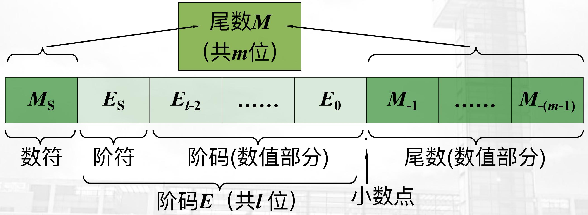

flowchart

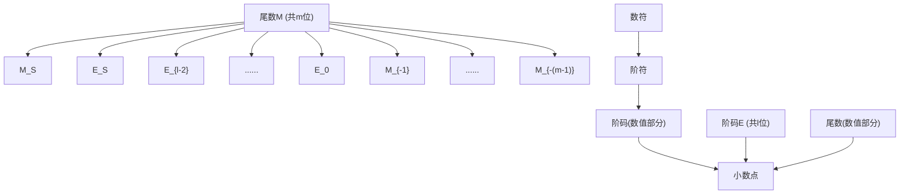

# 浮点表示——关于表示范围

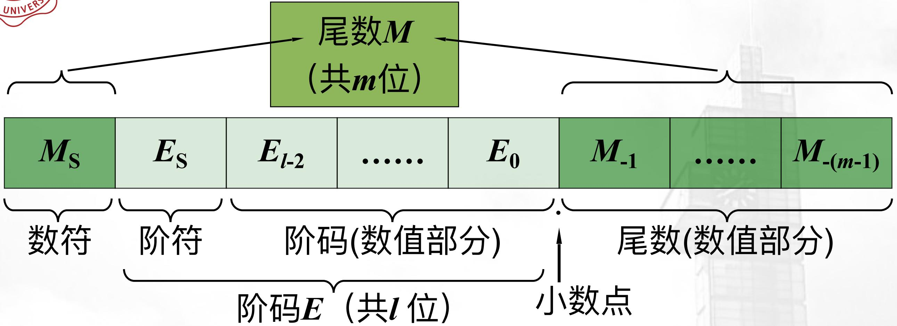

flowchart

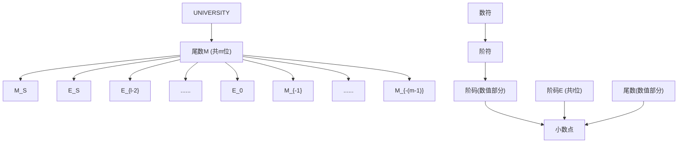

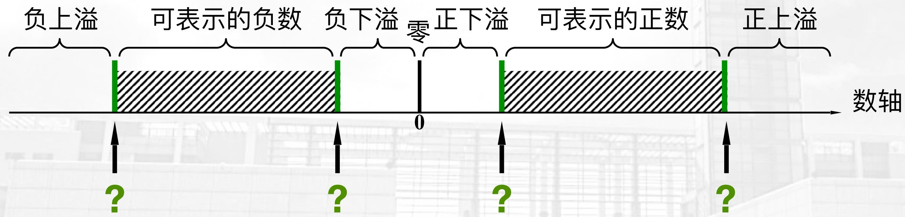

text_image

负上溢
可表示的负数 负下溢 零 正下溢 可表示的正数 正上溢
0
数轴
?
?

# 浮点表示——关于表示范围

非规格化版本：分别考察M和E的最大、最小值，最大正、最大负值并组合他们

<table><tr><td></td><td>M (m位补)</td><td>E (I位移)</td><td>M真值</td><td>E真值</td></tr><tr><td>最大正值</td><td></td><td></td><td></td><td></td></tr><tr><td>最小正值</td><td></td><td></td><td></td><td></td></tr><tr><td>最大负值</td><td></td><td></td><td></td><td></td></tr><tr><td>最小负值</td><td></td><td></td><td></td><td></td></tr></table>

# 浮点表示——关于表示范围

非规格化版本：分别考察M和E的最大、最小值，最大正、最大负值并组合他们

<table><tr><td></td><td>M (n位补)</td><td>E (I位移)</td><td>M真值</td><td>E真值</td></tr><tr><td>最大正值</td><td>0.111...1111</td><td>1111...1111</td><td> $1 - 2^{1-n}$ </td><td> $2^{l-1} - 1$ </td></tr><tr><td>最小正值</td><td>0.000...0001</td><td>0000...0000</td><td> $2^{1-n}$ </td><td> $-2^{l-1}$ </td></tr><tr><td>最大负值</td><td>1.111...1111</td><td>0000...0000</td><td> $-2^{1-n}$ </td><td> $-2^{l-1}$ </td></tr><tr><td>最小负值</td><td>1.000...0000</td><td>1111...1111</td><td>-1</td><td> $2^{l-1} - 1$ </td></tr></table>

# 浮点表示——关于表示范围

尾数M

(共m位)

text_image

M_S	E_S	E_{l-2}......E_0	M_{-1}......M_{-(m-1)}
数符	阶符	阶码(数值部分)	尾数(数值部分)
	阶码E (共l位)	小数点

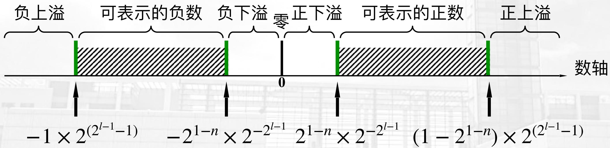

text_image

负上溢
可表示的负数 负下溢 零 正下溢 可表示的正数 正上溢
-1 × 2^(2^{l-1}-1) -2^{1-n} × 2^{-2^{l-1}} 2^{1-n} × 2^{-2^{l-1}} (1 - 2^{1-n}) × 2^{(2^{l-1}-1)}

# 浮点表示——关于表示范围

规格化版本：分别考察M和E的最大、最小值，最大正、最大负值并组合他们

<table><tr><td></td><td>M (n位补)</td><td>E (I位移)</td><td>M真值</td><td>E真值</td></tr><tr><td>最大正值</td><td></td><td></td><td></td><td></td></tr><tr><td>最小正值</td><td></td><td></td><td></td><td></td></tr><tr><td>最大负值</td><td></td><td></td><td></td><td></td></tr><tr><td>最小负值</td><td></td><td></td><td></td><td></td></tr></table>

# 浮点表示——关于表示范围

规格化版本：分别考察M和E的最大、最小值，最大正、最大负值并组合他们

<table><tr><td></td><td>M (n位补)</td><td>E (I位移)</td><td>M真值</td><td>E真值</td></tr><tr><td>最大正值</td><td>0.111...1111</td><td>1111...1111</td><td> $1 - 2^{1-n}$ </td><td> $2^{l-1} - 1$ </td></tr><tr><td>最小正值</td><td>0.100...0000</td><td>0000...0000</td><td> $\frac{1}{2}$ </td><td> $-2^{l-1}$ </td></tr><tr><td>最大负值</td><td>1.011...1111</td><td>0000...0000</td><td> $-(\frac{1}{2} + 2^{1-n})$ </td><td> $-2^{l-1}$ </td></tr><tr><td>最小负值</td><td>1.000...0000</td><td>1111...1111</td><td>-1</td><td> $2^{l-1} - 1$ </td></tr></table>

# 浮点表示——关于表示范围

尾数M

(共m位)

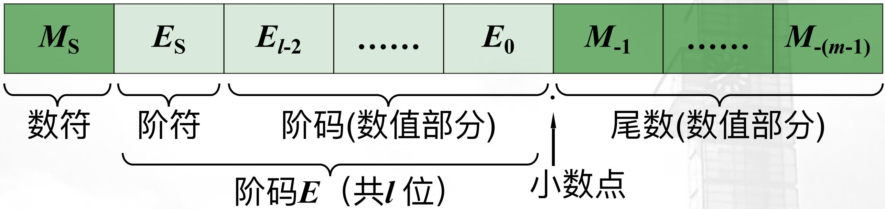

text_image

M_S	E_S	E_{l-2}......E_0	M_{-1}......M_{-(m-1)}
数符	阶符	阶码(数值部分)	尾数(数值部分)
	阶码E (共l位)	小数点

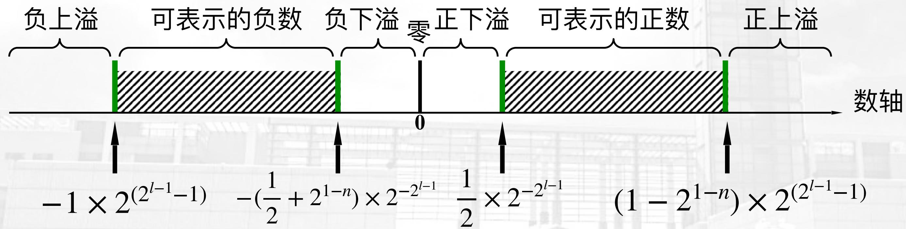

text_image

负上溢
可表示的负数 负下溢 零 正下溢 可表示的正数 正上溢
-1 × 2^(2^{l-1}-1) - (1/2 + 2^{1-n}) × 2^{-2^{l-1}} 1/2 × 2^{-2^{l-1}} (1 - 2^{1-n}) × 2^(2^{l-1}-1)

# 浮点表示一规格化

■ 机器零：当浮点数的尾数为0，阶码为最小值全0(移码表示)时，浮点数代码为00...0(全零)。

- 保证浮点零表示形式的惟一性。  
- 快速判断0   
- 当浮点数的尾数用原码表示时，机器零有“+0”和“-0”之分。

# 浮点表示一两种格式

# ■ 单精度：32位

31 30 23 22 0

<table><tr><td>S</td><td>指数(阶码E)</td><td>尾数M</td></tr><tr><td>1位</td><td>8位</td><td>23位</td></tr></table>

# ■ 双精度：64位

31 30 20 19 0

<table><tr><td>S</td><td>指数(阶码E)</td><td>尾数M</td></tr><tr><td>1位</td><td>8位</td><td>23位</td></tr><tr><td colspan="3">尾数M(续)</td></tr><tr><td colspan="3">32位</td></tr></table>

# 浮点表示一溢出

■ 浮点数的溢出：数的大小超出了浮点数表示范围。原因：指数部分太大，以至于无法用有限的指数字段表示出来。

- 下溢：阶码小于机器能表示的最小阶码。  
一般当作机器零处理，机器继续运行。  
- 上溢：阶码大于机器能表示的最大阶码。

机器必须转入溢出故障的中断处理程序进行相应的处理。

■ 如何降低上溢或下溢发生的可能性？

采用双精度格式。范围、精度

正实数范围：2.78×10-309～9.00×10+307

# IEEE-754浮点格式

# IEEE-754浮点格式

1. 浮点数的表示标准：IEEE-754，1985年由电子与电气工程师协会(IEEE)制定。  
2. 目的:

- 便于程序从一类处理器移植到另一类处理器上。  
- 研制更为复杂的数值运算程序。

3. 规定:

- 尾数用原码表示，小数点前隐含一个“1”。  
- 基值隐含为2。  
- 阶码用移码表示，移码的偏移值有专门约定：n位移码的偏移值为 $2n - 1 - 1$ 。  
- 指数(阶码)的最大值、最小值作为特殊标记预留，用来标记某些异常事件或机器零。  
- 单精度、双精度；单精度扩展、双精度扩展。

# IEEE-754浮点格式

- IEEE-754浮点数表示格式，由IEEE制  
- Never pronounce I-E-E-E, It should be I triple E   
- 是国际标准，ISO/ICE/IEEE FDIS 60559:2010  
- 保证普适性，通用性  
- IEEE-754是一个非常有“特色”的规格化浮点格式！

# IEEE-754浮点格式

\- IEEE-754是一个非常有“特色”的规格化浮点格式！

- 尾数用原码表示，但小数点前隐含一个1  
- 阶码用移码表示，但移码使用非常规的 $+2^{n} - 1$ 格式  
- 在常规的移码计算之后，额外-1

• M、E的一些边界值均有特殊意义，如+/-Inf, NaN, 0等

\- 单精度(float)、双精度（double）、单精度扩展、双精度扩展

# IEEE-754浮点格式

# ■ IEEE-754 浮点数表示方法:

- 000...00 代表 “+0”  
- 100...00 代表“-0”  
- 其它实数: $(-1)^{S} \times (1 + 0. M) \times 2^{E}$ -偏移值

# ■ 如果小数部分的尾数各位从左到右依次用

$m_{1}$ 、 $m_{2}$ 、 $m_{3}$ 、…来表示，则整个浮点数的值为：

$$
(- 1) ^ {\mathtt {S}} \times (1 + (m _ {1} \times 2 ^ {- 1}) + (m _ {2} \times 2 ^ {- 2}) + (m _ {3} \times 2 ^ {- 3}) + (m _ {4} \times 2 ^ {- 4}) + \dots) \times 2 ^ {E - \mathrm{偏移值}}
$$

# ■ 为何如此规定浮点数格式：

- 判断正、负、零;   
- 比较浮点数绝对值的大小。

# IEEE-754浮点格式

IEEE 754 格式参数

<table><tr><td rowspan="2">参数</td><td colspan="4">格式</td></tr><tr><td>单精度</td><td>单精度扩展</td><td>双精度</td><td>双精度扩展</td></tr><tr><td>字宽</td><td>32</td><td>≥43</td><td>64</td><td>≥79</td></tr><tr><td>尾数有效位数p(包含隐含位)</td><td>24</td><td>≥32</td><td>53</td><td>≥64</td></tr><tr><td>指数位数</td><td>8</td><td>≥11</td><td>11</td><td>≥15</td></tr><tr><td>指数偏移值</td><td>+127</td><td>未指定</td><td>+1023</td><td>未指定</td></tr><tr><td>最大指数 $E_{\max}$ </td><td>+127</td><td>≥+1023</td><td>+1023</td><td>≥+16383</td></tr><tr><td>最小指数 $E_{\min}$ </td><td>-126</td><td>≤-1022</td><td>-1022</td><td>≤-16382</td></tr></table>

# IEEE-754浮点格式

IEEE 754单精度浮点数格式

<table><tr><td>单精度格式位模式</td><td></td></tr><tr><td>0&lt;e&lt;255</td><td>(-1)s×2e-127×1.f(规格化数)</td></tr><tr><td>e=0; f≠0 (f中至少有一位不为零)</td><td>(-1)s×2-126×0.f(非规格化数)</td></tr><tr><td>e=0; f=0 (f中所有位均为零)</td><td>(-1)s×0.0(有符号的零)</td></tr><tr><td>s=0; e=255; f=0 (f中所有位均为零)</td><td>+INF(正无穷大)</td></tr><tr><td>s=1; e=255; f=0 (f中所有位均为零)</td><td>-INF(负无穷大)</td></tr><tr><td>s=u; e=255; f≠0 (f中至少有一位不为零)</td><td>NaN(非数)</td></tr></table>

31 30

23 22

0

<table><tr><td>S</td><td>指数(阶码E)</td><td>尾数M</td></tr><tr><td>1位</td><td>8位</td><td>23位</td></tr></table>

# IEEE-754浮点格式

IEEE 754单精度浮点数格式

<table><tr><td>通用名称</td><td>浮点数的 IEEE754编码(二进制)</td><td>十进制真值</td></tr><tr><td>+0</td><td>0 00000000 000...00</td><td>+0.0</td></tr><tr><td>-0</td><td>1 00000000 000...00</td><td>-0.0</td></tr><tr><td>1</td><td>0 01111111 000...00</td><td>1.0</td></tr><tr><td>2</td><td>0 10000000 000...00</td><td>2.0</td></tr><tr><td>最大规格化数</td><td>0 11111110 111...11</td><td> $3.40282347 \times 10^{+38}$ </td></tr><tr><td>最小正规格化数</td><td>0 00000001 000...00</td><td> $1.17549435 \times 10^{-38}$ </td></tr><tr><td>最大非规格化数</td><td>0 00000000 111...11</td><td> $1.17549421 \times 10^{-38}$ </td></tr><tr><td>最小正非规格化数</td><td>0 00000000 000...01</td><td> $1.40129846 \times 10^{-45}$ </td></tr><tr><td>+ $\infty$ </td><td>0 11111111 000...00</td><td>正无穷</td></tr><tr><td>- $\infty$ </td><td>1 11111111 000...00</td><td>负无穷</td></tr><tr><td>非数</td><td>0 11111111 100...00</td><td>NaN(不惟一)</td></tr></table>

# IEEE-754浮点格式

<table><tr><td>双精度格式位模式</td><td>IEEE浮点数的值</td></tr><tr><td>0&lt;-e&lt;2047</td><td>(-1)s×2e-1023×1.f(规格化数)</td></tr><tr><td>e=0; f≠0(f中至少有一位不为零)</td><td>(-1)s×2-1022×0.f(非规格化数)</td></tr><tr><td>e=0; f=0(f中所有位均为零)</td><td>(-1)s×0.0(有符号的零)</td></tr><tr><td>s=0; e=2047; f=0(f中所有位均为零)</td><td>+INF(正无穷大)</td></tr><tr><td>s=1; e=2047; f=0(f中所有位均为零)</td><td>-INF(负无穷大)</td></tr><tr><td>s=u; e=2047; f≠0(f中至少有一位不为零)</td><td>NaN(非数)</td></tr></table>

# IEEE-754浮点格式

IEEE 754双精度格式二进制位与其对应的浮点数真值举例

<table><tr><td>通用名称</td><td>浮点数的IEEE 754编码(十六进制)</td><td>十进制真值</td></tr><tr><td>+0</td><td>00000000 00000000</td><td>+0.0</td></tr><tr><td>-0</td><td>80000000 00000000</td><td>-0.0</td></tr><tr><td>1</td><td>3ff00000 00000000</td><td>1.0</td></tr><tr><td>2</td><td>40000000 00000000</td><td>2.0</td></tr><tr><td>最大规格化数</td><td>7feffff f f f f f f f f</td><td>1.7976931348623157×10+308</td></tr><tr><td>最小正规格化数</td><td>00100000 00000000</td><td>2.2250738585072014×10-308</td></tr><tr><td>最大非规格化数</td><td>000f f f f f f f f f</td><td>2.2250738585072009×10-308</td></tr><tr><td>最小正非规格化数</td><td>00000000 00000001</td><td>4.9406564584124654×10-324</td></tr><tr><td>+∞</td><td>7ff00000 00000000</td><td>正无穷</td></tr><tr><td>-∞</td><td>f f f00000 00000000</td><td>负无穷</td></tr><tr><td>非数</td><td>7ff80000 00000000</td><td>NaN(不惟一)</td></tr></table>

# 2.1.2 数据的定点与浮点表示 3. IEEE 754 标准

【例】若浮点数 $x$ 的 IEEE 754 单精度存储格式为 $(42150000)_{16}$ ，求浮点数 $x$ 的十进制真值。

# 2.1.2 数据的定点与浮点表示 3. IEEE 754 标准

【例】若浮点数 $x$ 的 IEEE 754 单精度存储格式为 $(42150000)_{16}$ ，求浮点数 $x$ 的十进制真值。

【解】将16进制数展开后，可得二进制数格式如下：

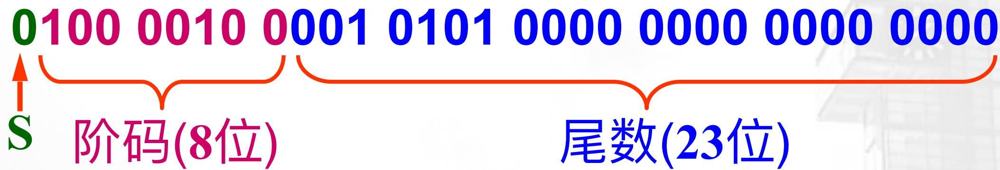

text_image

0100 0010 0001 0101 0000 0000 0000 0000
S 阶码(8位) 尾数(23位)

指数 $=$ 阶码 $e - (127)_{10}$

$$
= (1 0 0 0 0 1 0 0) _ {2} - (0 1 1 1 1 1 1 1) _ {2} = (0 0 0 0 0 1 0 1) _ {2} = (5) _ {1 0}
$$

包括隐含位1的尾数 $= 1.f$

$$
= (1. 0 0 1 0 1 0 1 0 0 0 0 0 0 0 0 0 0 0 0 0 0) _ {2} = (1. 0 0 1 0 1 0 1) _ {2}
$$

因此 $x = (-1)^{\mathrm{s}} \times 2^{\mathrm{e} - 127} \times 1. f$

$$
= + 2 ^ {5} \times (1. 0 0 1 0 1 0 1) _ {2} = (1 0 0 1 0 1. 0 1) _ {2} = (3 7. 2 5) _ {1 0}
$$

# 2.1.2 数据的定点与浮点表示 3. IEEE 754 标准

【例】将数(22.78125) $_{10}$ 转换成 IEEE 754 单精度浮点数的二进制存储格式。

# 2.1.2 数据的定点与浮点表示 3. IEEE 754 标准

【例】将数(22.78125) $_{10}$ 转换成 IEEE 754 单精度浮点数的二进制存储格式。

【解】

$$
\begin{array}{l} (2 2. 7 8 1 2 5) _ {1 0} = (1 0 1 1 0. 1 1 0 0 1) _ {2} \\ = (1. 0 1 1 0 1 1 0 0 1) _ {2} \times 2 ^ {4} \quad \text {尾数} \\ \end{array}
$$

符号位 S=0

阶码 $e =$ 指数 $+ (127)_{10} = (4 + 127)_{10} = (10000011)_2$

尾数 $f = (011011001)_2$

∴ 32位单精度浮点数的二进制存储格式为：

$$
(0 1 0 0 0 0 0 1 1 0 1 1 0 1 1 0 0 1 0 0 0 0 0 0 0 0 0 0 0 0 0) _ {2}
$$

$$
= (4 1 \mathrm{B} 6 4 0 0 0) _ {1 6}
$$