# 计算机组成与结构 - 计算机中的数据表示3

李瑞 教授

蒋志平 副教授

计算机科学与技术学院

# 温故 一关于数制表示

• 8位原码的表达范围？-127，0，127的8位原码是？  
• 8位反码的表达范围？-127，0，127的8位反码是？  
• 8位补码的表达范围？-127，0，127的8位补码是？  
• 8位移码的表达范围？-127，0，127的8位移码是？

\- 计算机中，如何表示实数？

\- 浮点数的规格化是干嘛的？有嘛用？

• 0.001[补]如何规格化?

\- IEEE 754格式？相比一般的规格化浮点，有什么特殊点？

# 本章学习要点

# - 数字的表示

- 进制编码基础   
- 整数及小数进制转换（给人看）  
- 整数及小数在计算机里的表示
(给机器看)

\- 有符号号的原、反、补、移码

\- 浮点表示

\- IEEE754

BCD

# - 非数字的表示

- 字符表示  
• ASCII   
- 汉字  
- Unicode

# - 校验码

- 奇偶校验  
CRC

# BCD编码

# BCD编码

- BCD——Binary Coded Decimal, “用二进制编码的十进制”  
- 它有两大类变形（Variant）：有权(Weighted)、无权(Un-weighted)

<table><tr><td>十进制数</td><td>8421 码</td><td>5421 码</td><td>2421 码</td></tr><tr><td>0</td><td>0000</td><td>0000</td><td>0000</td></tr><tr><td>1</td><td>0001</td><td>0001</td><td>0001</td></tr><tr><td>2</td><td>0010</td><td>0010</td><td>0010</td></tr><tr><td>3</td><td>0011</td><td>0011</td><td>0011</td></tr><tr><td>4</td><td>0100</td><td>0100</td><td>0100</td></tr><tr><td>5</td><td>0101</td><td>1000</td><td>1011</td></tr><tr><td>6</td><td>0110</td><td>1001</td><td>1100</td></tr><tr><td>7</td><td>0111</td><td>1010</td><td>1101</td></tr><tr><td>8</td><td>1000</td><td>1011</td><td>1110</td></tr><tr><td>9</td><td>1001</td><td>1100</td><td>1111</td></tr></table>

<table><tr><td>5211 码</td><td>84-2-1 码</td><td>4311 码</td></tr><tr><td>0000</td><td>0000</td><td>0000</td></tr><tr><td>0001</td><td>0111</td><td>0001</td></tr><tr><td>0011</td><td>0110</td><td>0011</td></tr><tr><td>0101</td><td>0101</td><td>0100</td></tr><tr><td>0111</td><td>0100</td><td>1000</td></tr><tr><td>1000</td><td>1011</td><td>0111</td></tr><tr><td>1010</td><td>1010</td><td>1011</td></tr><tr><td>1100</td><td>1001</td><td>1100</td></tr><tr><td>1110</td><td>1000</td><td>1110</td></tr><tr><td>1111</td><td>1111</td><td>1111</td></tr></table>

# BCD编码

- BCD——Binary Coded Decimal, “用二进制编码的十进制”  
- 它有两大类变形（Variant）：有权(Weighted)、无权(Un-weighted)

<table><tr><td>十进制数</td><td>余3码</td><td>格雷码(1)</td><td>格雷码(2)</td><td>格雷码(3)</td></tr><tr><td>0</td><td>0011</td><td>0000</td><td>0000</td><td>0000</td></tr><tr><td>1</td><td>0100</td><td>0001</td><td>0001</td><td>0100</td></tr><tr><td>2</td><td>0101</td><td>0011</td><td>0011</td><td>0110</td></tr><tr><td>3</td><td>0110</td><td>0010</td><td>0010</td><td>0010</td></tr><tr><td>4</td><td>0111</td><td>0110</td><td>0110</td><td>1010</td></tr><tr><td>5</td><td>1000</td><td>0111</td><td>1110</td><td>1011</td></tr><tr><td>6</td><td>1001</td><td>0101</td><td>1010</td><td>0011</td></tr><tr><td>7</td><td>1010</td><td>0100</td><td>1000</td><td>0001</td></tr><tr><td>8</td><td>1011</td><td>1100</td><td>1100</td><td>1001</td></tr><tr><td>9</td><td>1100</td><td>1000</td><td>0100</td><td>1000</td></tr></table>

# BCD编码

• Why BCD ?

\- 绝对想像不到的历史原因:

\- 最早的计算机，是十进制的！

• ENIAC (1945)   
- IBM 1400系列 (late-1950s)  
- IBM 1620系列（mid-1950s）  
- IBM 7070系列 (early-1960s)

\- IBM System/360系列（1964）之后才转向全面二进制

\- 后期的计算机出于兼容目的保留BCD代码

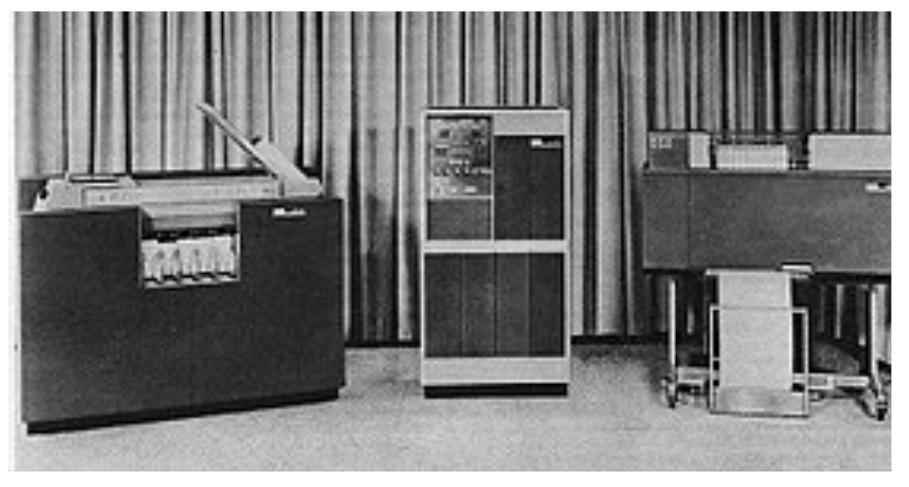

natural_image

Black-and-white photo of vintage computer setup with CRT monitors and desktops in a studio setting (no visible text or labels)

IBM 1401 Data Processing System

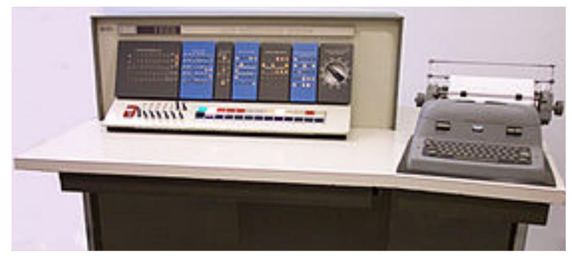

natural_image

Laboratory setup with control panel and typewriter on a desk (no visible text or symbols)

IBM 1602 Industrial Process Control System

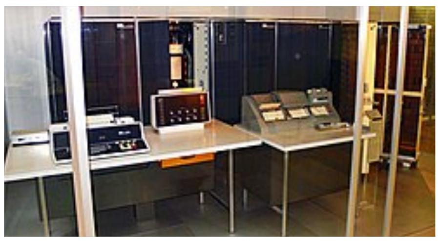

natural_image

Interior view of a vintage computer lab with CRT monitors and control panels (no visible text or labels)

IBM 7070 Series

# BCD编码

\- then, why not BCD now?

- 基于BCD的计算麻烦、慢  
- 算个加法，你就明白了

\- 二进制加法，一步搞定

$$
\begin{array}{l} (9) _ {D} \\ + (8) _ {D} \\ = (1 7) _ {D} \\ (1 0 0 1) _ {B} \\ + (1 0 0 0) _ {B} \\ = (1 0 0 0 1) _ {B} \\ \end{array}
$$

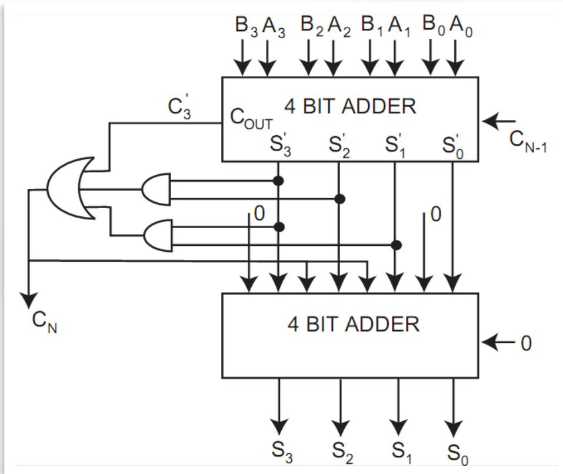

flowchart

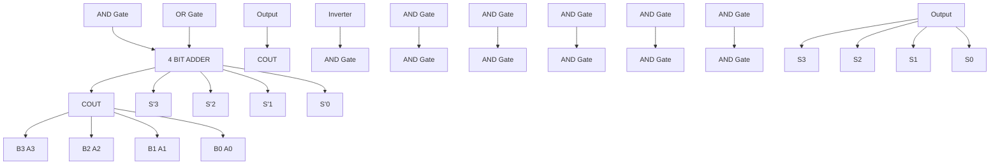

BCD加法器=二进制加法器+额外电路

\- BCD版本加法，还要再+06H

$$
\begin{array}{l l l l l} (1 0 0 0 1) _ {B} & + (0 1 1 0) _ {B} & = (0 0 0 1 0 1 1 1) _ {B} \Rightarrow & 0 0 0 1 & 0 1 1 1 \\ (1 7) _ {D} & + (6) _ {D} & = (2 3) _ {D} \Rightarrow & 1 & 7 \end{array}
$$

# 非数值数据编码

# 非数值数据编码(Non-numeric data representation)

- 文字  
- 声音  
- 图像

\- 视频

# 文字编码与表示

# 文本编码与表示包含三个方面：

\- 输入编码

\- 拼音、五笔、区位

\- 字符编码（内码）

\- ASCII ?

• GB2312? BIG5 ?GB10830?

\- Unicode?

\- UTF8/16/32?

\- 显示

\- 点阵字体?

\- 矢量字体?

\- 宋体?

\- 黑体?

输入码 v.s 字符编码

<table><tr><td></td><td></td><td>计</td><td>算</td><td>机</td><td>组</td><td>成</td><td>与</td><td>结</td><td>构</td></tr><tr><td rowspan="2">输入码</td><td>拼音*</td><td>ji</td><td>sua</td><td>ji</td><td>zuc</td><td>che</td><td>yu</td><td>jie</td><td>gou</td></tr><tr><td>五笔</td><td>yfh</td><td>tha</td><td>sm</td><td>xeg</td><td>dn</td><td>gng</td><td>xfk</td><td>sqc</td></tr><tr><td rowspan="5">编码</td><td>ASCII</td><td>-</td><td>-</td><td>-</td><td>-</td><td>-</td><td>-</td><td>-</td><td>-</td></tr><tr><td>GB2312</td><td>bcc6</td><td>cbe3</td><td>bbfa</td><td>d7e9</td><td>b3c9</td><td>d3eb</td><td>bde1</td><td>b9b9</td></tr><tr><td>BIG5</td><td>-</td><td>bae2</td><td>c9f3</td><td>-</td><td>a6a8</td><td>c94f</td><td>-</td><td>ccdb</td></tr><tr><td>GBK</td><td>bcc6</td><td>cbe3</td><td>bbfa</td><td>d7e9</td><td>b3c9</td><td>d3eb</td><td>bde1</td><td>b9b9</td></tr><tr><td>Unicode</td><td>8ba1</td><td>7b97</td><td>673a</td><td>7ec4</td><td>6210</td><td>4e0e</td><td>7ed3</td><td>6784</td></tr></table>

点阵字体 v.s 矢量字体

<table><tr><td></td><td>计</td><td>算</td><td>机</td><td>组</td><td>成</td><td>与</td><td>结</td><td>构</td></tr><tr><td>黑体像素</td><td>计</td><td>算</td><td>机</td><td>组</td><td>成</td><td>与</td><td>结</td><td>构</td></tr><tr><td>黑体</td><td>计</td><td>算</td><td>机</td><td>组</td><td>成</td><td>与</td><td>结</td><td>构</td></tr><tr><td>仿宋</td><td>计</td><td>算</td><td>机</td><td>组</td><td>成</td><td>与</td><td>结</td><td>构</td></tr><tr><td>微软雅黑</td><td>计</td><td>算</td><td>机</td><td>组</td><td>成</td><td>与</td><td>结</td><td>构</td></tr></table>

# 文字编码与表示－ASCII

ASCII (/ˈæskiː/, ASS-kee), American Standard Code for Information Interchange, 美国信息交换标准代码，1963年发布，对应ISO 646标准。

\- 7bit（存入1Byte），编码128个字符：

\- 32个控制字符

\- 空格(Space)，删除(DEL)

\- 数字0～9，编码为30H加上数字值（0 for 0x30H, 9 for 0x39H）

\- 52个英文字母

\- 大写字母，编码为40H加上字母顺序

\- 小写字母，编码为60H加上字母顺序

\- 32个标点符号

• 共94个可打印符号 (0x21 - 0x7e)

<table><tr><td colspan="2"></td><td>0</td><td>1</td><td>2</td><td>3</td><td>4</td><td>5</td><td>6</td><td>7</td></tr><tr><td></td><td> $b_6b_5b_4$  $b_3b_2b_1b_0$ </td><td>0 0 0</td><td>0 0 1</td><td>0 1 0</td><td>0 1 1</td><td>1 0 0</td><td>1 0 1</td><td>1 1 0</td><td>1 1 1</td></tr><tr><td>0</td><td>0 0 0 0</td><td>NUL</td><td>DLE</td><td>Sp</td><td>0</td><td>@</td><td>P</td><td>`</td><td>p</td></tr><tr><td>1</td><td>0 0 0 1</td><td>SOH</td><td>DC1</td><td>!</td><td>1</td><td>A</td><td>Q</td><td>a</td><td>q</td></tr><tr><td>2</td><td>0 0 1 0</td><td>STX</td><td>DC2</td><td>&quot;</td><td>2</td><td>B</td><td>R</td><td>b</td><td>r</td></tr><tr><td>3</td><td>0 0 1 1</td><td>ETX</td><td>DC3</td><td>#</td><td>3</td><td>C</td><td>S</td><td>c</td><td>s</td></tr><tr><td>4</td><td>0 1 0 0</td><td>EOT</td><td>DC4</td><td>$</td><td>4</td><td>D</td><td>T</td><td>d</td><td>t</td></tr><tr><td>5</td><td>0 1 0 1</td><td>ENQ</td><td>NAK</td><td>%</td><td>5</td><td>E</td><td>U</td><td>e</td><td>u</td></tr><tr><td>6</td><td>0 1 1 0</td><td>ACK</td><td>SYN</td><td>&amp;</td><td>6</td><td>F</td><td>V</td><td>f</td><td>v</td></tr><tr><td>7</td><td>0 1 1 1</td><td>BEL</td><td>ETB</td><td>&#x27;</td><td>7</td><td>G</td><td>W</td><td>g</td><td>w</td></tr><tr><td>8</td><td>1 0 0 0</td><td>BS</td><td>CAN</td><td>(</td><td>8</td><td>H</td><td>X</td><td>h</td><td>x</td></tr><tr><td>9</td><td>1 0 0 1</td><td>HT</td><td>EM</td><td>)</td><td>9</td><td>I</td><td>Y</td><td>i</td><td>y</td></tr><tr><td>A</td><td>1 0 1 0</td><td>LF</td><td>SUB</td><td>*</td><td>:</td><td>J</td><td>Z</td><td>j</td><td>z</td></tr><tr><td>B</td><td>1 0 1 1</td><td>VT</td><td>ESC</td><td>+</td><td>;</td><td>K</td><td>[</td><td>k</td><td>{</td></tr><tr><td>C</td><td>1 1 0 0</td><td>FF</td><td>FS</td><td>,</td><td>&lt;</td><td>L</td><td>\</td><td>l</td><td>|</td></tr><tr><td>D</td><td>1 1 0 1</td><td>CR</td><td>GS</td><td>-</td><td>=</td><td>M</td><td>]</td><td>m</td><td>}</td></tr><tr><td>E</td><td>1 1 1 0</td><td>SO</td><td>RS</td><td>.</td><td>&gt;</td><td>N</td><td>^</td><td>n</td><td>~</td></tr><tr><td>F</td><td>1 1 1 1</td><td>SI</td><td>US</td><td>/</td><td>?</td><td>O</td><td>_</td><td>o</td><td>DEL</td></tr></table>

# 文字编码与表示－Extended ASCII

ISO/IEC 8859-1

- ASCII编码，只覆盖了英语字符（or 英语国家）  
- Extended ASCII, ISO 8895-n标准，覆盖了拉丁语系字符（or 欧洲、部分西亚国家）  
- 将“高”128位用于编码，  
- 但只用0xa0 - 0xff，扩展了96个字符  
- 为什么0x80-0x9f不用？  
- 继承ASCII 7-bit编码\~   
- ISO 8895- $n$ 标准更新过多轮，ISO 8895-1最具代表性，常称为ISO Latin-1（1987）  
- 最新标准是ISO 8895-16，1998年，此后放弃更新，因为unicode来了

<table><tr><td></td><td>_0</td><td>_1</td><td>_2</td><td>_3</td><td>_4</td><td>_5</td><td>_6</td><td>_7</td><td>_8</td><td>_9</td><td>_A</td><td>_B</td><td>_C</td><td>_D</td><td>_E</td><td>_F</td></tr><tr><td>0_0</td><td></td><td></td><td></td><td></td><td></td><td></td><td></td><td></td><td></td><td></td><td></td><td></td><td></td><td></td><td></td><td></td></tr><tr><td>1_16</td><td></td><td></td><td></td><td></td><td></td><td></td><td></td><td></td><td></td><td></td><td></td><td></td><td></td><td></td><td></td><td></td></tr><tr><td>2_32</td><td>SP0020</td><td>!0021</td><td>&quot;0022</td><td>#0023</td><td>$0024</td><td>%0025</td><td>&amp;0026</td><td>&#x27;0027</td><td>(0028</td><td>)0029</td><td>*002A</td><td>+002B</td><td>,002C</td><td>-002D</td><td>.002E</td><td>/002F</td></tr><tr><td>3_48</td><td>0030</td><td>10031</td><td>20032</td><td>30033</td><td>40034</td><td>50035</td><td>60036</td><td>70037</td><td>80038</td><td>90039</td><td>:003A</td><td>;003B</td><td>&lt;003C</td><td>=003D</td><td>&gt;003E</td><td>?003F</td></tr><tr><td>4_64</td><td>@0040</td><td>A0041</td><td>B0042</td><td>C0043</td><td>D0044</td><td>E0045</td><td>F0046</td><td>G0047</td><td>H0048</td><td>I0049</td><td>J004A</td><td>K004B</td><td>L004C</td><td>M004D</td><td>N004E</td><td>O004F</td></tr><tr><td>5_80</td><td>P0050</td><td>Q0051</td><td>R0052</td><td>S0053</td><td>T0054</td><td>U0055</td><td>V0056</td><td>W0057</td><td>X0058</td><td>Y0059</td><td>Z005A</td><td>[005B</td><td>\005C</td><td>]005D</td><td>^005E</td><td>_005F</td></tr><tr><td>6_96</td><td>`0060</td><td>a0061</td><td>b0062</td><td>c0063</td><td>d0064</td><td>e0065</td><td>f0066</td><td>g0067</td><td>h0068</td><td>i0069</td><td>j006A</td><td>k006B</td><td>l006C</td><td>m006D</td><td>n006E</td><td>o006F</td></tr><tr><td>7_112</td><td>p0070</td><td>q0071</td><td>r0072</td><td>s0073</td><td>t0074</td><td>u0075</td><td>v0076</td><td>w0077</td><td>x0078</td><td>y0079</td><td>z007A</td><td>{007B</td><td>|007C</td><td>}007D</td><td>~007E</td><td></td></tr><tr><td>8_128</td><td></td><td></td><td></td><td></td><td></td><td></td><td></td><td></td><td></td><td></td><td></td><td></td><td></td><td></td><td></td><td></td></tr><tr><td>9_144</td><td></td><td></td><td></td><td></td><td></td><td></td><td></td><td></td><td></td><td></td><td></td><td></td><td></td><td></td><td></td><td></td></tr><tr><td>A_160</td><td>NBSP00A0</td><td>i00A1</td><td>¢00A2</td><td>£00A3</td><td>¤00A4</td><td>¥00A5</td><td>¡00A6</td><td>§00A7</td><td>..00A8</td><td>©00A9</td><td>a00AA</td><td>«00AB</td><td>¬00AC</td><td>SHY00AD</td><td>®00AE</td><td>-00AF</td></tr><tr><td>B_176</td><td>°00B0</td><td>±00B1</td><td>200B2</td><td>300B3</td><td>&#x27;00B4</td><td>μ00B5</td><td>¶00B6</td><td>·00B7</td><td>,00B8</td><td>100B9</td><td>o00BA</td><td>»00BB</td><td> $\frac{1}{4}$ 00BC</td><td> $\frac{1}{2}$ 00BD</td><td> $\frac{3}{4}$ 00BE</td><td>¿00BF</td></tr><tr><td>C_192</td><td>À00C0</td><td>Á00C1</td><td>Â00C2</td><td>Ã00C3</td><td>Ä00C4</td><td>Â00C5</td><td>Æ00C6</td><td>Ç00C7</td><td>È00C8</td><td>É00C9</td><td>Ê00CA</td><td>Ë00CB</td><td>Î00CC</td><td>Í00CD</td><td>Î00CE</td><td>Ï00CF</td></tr><tr><td>D_208</td><td>Đ00D0</td><td>Ñ00D1</td><td>Ò00D2</td><td>Ó00D3</td><td>Ô00D4</td><td>Õ00D5</td><td>Ö00D6</td><td>×00D7</td><td>∅00D8</td><td>Ù00D9</td><td>Ú00DA</td><td>Û00DB</td><td>Ü00DC</td><td>Ý00DD</td><td>Þ00DE</td><td>ß00DF</td></tr><tr><td>E_224</td><td>à00E0</td><td>á00E1</td><td>â00E2</td><td>ã00E3</td><td>ä00E4</td><td>å00E5</td><td>æ00E6</td><td>ç00E7</td><td>è00E8</td><td>é00E9</td><td>ê00EA</td><td>ë00EB</td><td>ì00EC</td><td>í00ED</td><td>î00EE</td><td>ï00EF</td></tr><tr><td>F_240</td><td>õ00F0</td><td>ñ00F1</td><td>ò00F2</td><td>ó00F3</td><td>ô00F4</td><td>õ00F5</td><td>ö00F6</td><td>÷00F7</td><td>ø00F8</td><td>ù00F9</td><td>ú00FA</td><td>û00FB</td><td>ü00FC</td><td>ý00FD</td><td>þ00FE</td><td>ÿ00FF</td></tr></table>

- ASCII + Extended ASCII 只有190个可打印字符，太少!  
- EUC是非常重要的进步：可变长，可使用最多4个字节给字符编码！  
- 继承ASCII 7-bit编码，每个字节94个可编码空间：

\- 双字节=> $94^{2}$ = 8836，三字节=> $94^{3}$ ，四字节=> $94^{4}$

\- 足够应付基本的CJK字符集了

• 中国，GB2312-80，6783个汉字，编码格式为EUC-CN，1980年
• GB10830，23940个汉字，修改的EUC-CN (126x191)

\- 日本，JIS X 0208，6879个字符（6355个汉字），编码格式为EUC-JP
- 韩国，KS X 1001，8227个字符（4888个汉字），编码格式为EUC-KR

\- 国际标准ISO 2022

\- 不足的是，不同字符集的编码是重叠的...

# 文字编码与表示－大一统Unicode

- Unicode，给每一个字符一个唯一编码，不论语言、平台、程序...  
- 将字符唯一编号（Unicode Code Point）与传输用编码方式（UTF-8/16）区分  
- 每个字符都有一个32位Code Point，对应一个最长4字节编码  
- Unicode 13.0 包含143924个字符  
- 对应国际标准ISO 10646  
- 大统一

\- 主流平台、主流编程语言的核心编码

- Windows / Linux / macOS   
• Java / .Net / Python 3.x / C++

\- 99% Web内容

<table><tr><td>Character</td><td>Code Point</td><td>UTF-16</td><td>UTF-8</td></tr><tr><td>a</td><td>U+0061</td><td>0061</td><td>61</td></tr><tr><td>ä</td><td>U+00E4</td><td>00E4</td><td>C3 A0</td></tr><tr><td>σ</td><td>U+03C3</td><td>03C3</td><td>CF 83</td></tr><tr><td>κ</td><td>U+05D0</td><td>05D0</td><td>D7 90</td></tr><tr><td>γ</td><td>U+0663</td><td>0663</td><td>D9 A3</td></tr><tr><td>力</td><td>U+30AB</td><td>30AB</td><td>E3 82 AB</td></tr><tr><td>退</td><td>U+9000</td><td>9000</td><td>E9 80 80</td></tr><tr><td>亢</td><td>U+21BC1</td><td>D846 DFC1</td><td>F0 A1 AF 81</td></tr></table>

# 声音的编码与表示

# 声音的编码包含两方面：

- 编码模式  
- PCM / DSD   
- 存储/传输方式

\- 非压缩

\- .wav / .AIFF / raw PCM

\- 压缩

\- 无损

\- .flac / .ape / .wv

\- 有损

\- .mp3 / .ACC

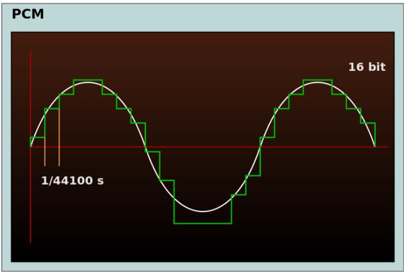

line

| Time (s)     | Value |
| ------------ | ----- |
| 1/44100      | 16 bit |

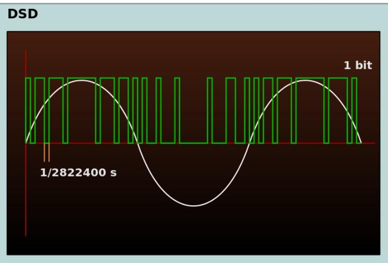

line

| Time (s)        | Value     |
| --------------- | --------- |
| 1/2822400       | 1 bit     |

# 声音的编码与表示

# 声音的编码包含两方面：

\- 编码模式

\- PCM / DSD

\- 存储/传输方式

\- 非压缩

\- .wav / .AIFF / raw PCM

\- 压缩

\- 无损

\- .flac / .ape / .wv

\- 有损

\- .mp3 / .ACC

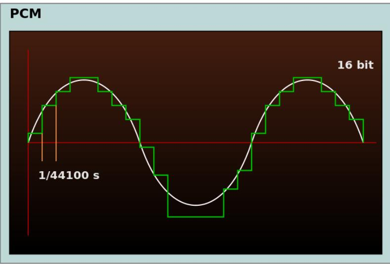

line

| Time (s)     | Value     |
| ------------ | --------- |
| 1/44100      | 16 bit    |

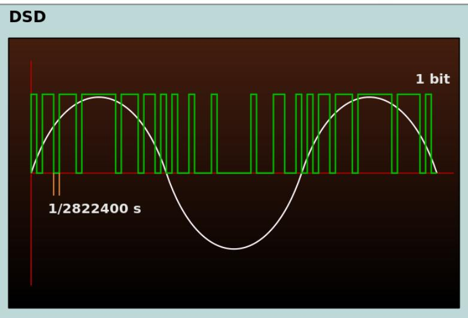

line

| Time (s)        | Value     |
| --------------- | --------- |
| 1/2822400       | 1 bit     |

# 额外唠叨，劝青年莫交Hi-Fi智商税：

\- “煲机”

\- “推力”

\- “声音冷/暖”

\- “前端功放”

\- “胆管”

\- “黑胶唱片”

\- “镀金线”

\- “声场”

\- “频响不能反应耳机的全部特性”

# 图像/视频的编码与表示

# 图像/视频编码包含三个方面：

- 数据类型  
- bitmap / vector   
- 数据模式  
- Mono / RGB / RGB-D   
- 存储格式

• H.265 ( HEVC / HEIF)   
• H.264   
- JPEG / Motion JPEG

text_image

7x Magnification
Vector
er ice
ents
Bitmap
Ice Cream
Disassembled. Product contains red or
not creams. Map contains trace colorings
of cheese. Do not come here.
Ice Cream

位图 v.s 矢量

# 检错与纠错码

# 检错与纠错码

\- 计算机内部是会出错的，网络也是会出错的！

- 元器件故障；  
- 存储介质;   
- 通信过程中的噪声干扰...

\- 如何避免错误:

- 提高硬件或网络可靠性;  
- 采取数据检错和校正措施

\- 使用校验位，发现错误，甚至改错

# 检错与纠错码

其实是通信原理中，非常核心的一部分内容，也是非常庞大的专门

学科: Coding Theory ...

简单介绍以下三种：

\- 检错码(Error Detection):

\- 奇偶校验 (Parity Check)

\- 纠错码(Error Correction):

\- 海（汉）明码（Hamming Code）

\- 循环冗余校验 (CRC)

text_image

高能
预警！
~~!

# 奇偶校验(Parity Check)

\- 最简单的错误检测编码(Error Detection Coding)

\- 只知道错了，不知道哪一位错了

\- 两种具体方法：奇校验和偶校验

\- 编码方法（数据发送端）：

\- 生成校验位：

\- 偶校验：若包含奇数个1则置1，否则0

\- 奇校验：若包含偶数个1则置1，否则0

\- 将校验位插入数据

\- 检测方法（数据接收端）：

• 偶校验: 若数据 (含校验位) 包含偶数个1, 则正确;  
- 奇校验: 若数据 (含校验位) 包含奇数个1, 则正确;  
- 将校验位去除

<table><tr><td rowspan="2">7位数据</td><td rowspan="2">1的个数</td><td colspan="2">8位数据(含校验位)</td></tr><tr><td>偶校验</td><td>奇检验</td></tr><tr><td>0000000</td><td>0</td><td>00000000</td><td>10000000</td></tr><tr><td>1010001</td><td>3</td><td>11010001</td><td>01010001</td></tr><tr><td>1101001</td><td>4</td><td>01101001</td><td>11101001</td></tr><tr><td>1111111</td><td>7</td><td>11111111</td><td>01111111</td></tr></table>

奇/偶检验编码

<table><tr><td>偶校验</td><td>结果</td><td>奇检验</td><td>结果</td></tr><tr><td>00000000</td><td>OK</td><td>10001000</td><td>Error</td></tr><tr><td>11010001</td><td>OK</td><td>01010001</td><td>OK</td></tr><tr><td>01100001</td><td>Error</td><td>11101001</td><td>OK</td></tr><tr><td>11110111</td><td>Error</td><td>01111011</td><td>Error</td></tr></table>

奇/偶检验错误检测

# 小练习

- 用奇/偶校验编码原码2024?   
- 用奇偶校验验证(01010101)b

# 奇偶校验

# ■ 缺点:

- 只能检测奇数个错误  
- 不能纠错

# ■ 优点:

- 开销小  
- 常用于校验1字节长的数据：通常1字节长的数据编码发生错误时，1位出错的概率较大，两位以上同时出错的概率非常小。

# ■ 常用于

- 存储器读写校验   
- 按字节传输过程中的数据校验

# 海明码(Hamming Coding)

- 可以发现一定数量的错误的位置，改错。  
- 由Richard Hamming于1950年提出。  
- 主要用于存储器数据的校验与纠正

- 核心基于奇偶校验   
- 校正能力与额外加入的奇偶校验位的数目线性相关  
- 适用于最有可能发生随机错误的系统。

- 每一位的出错概率相同;  
- 每一位与其它位是否出错没有任何关联。

# 海明码(Hamming Coding)

# 海明码编码过程:

1. 确定校验位数  
2. 确定校验位、数据位位置  
3. 确定每个校验位覆盖的bit位

4. 计算每个检验值

如何确定校验位和数据位位置？

- 校验位放在 $2^{n}, n \in \mathcal{N}$ 的位置  
- 数据位依次顺延排列  
- 如下图所示

<table><tr><td>Bit position</td><td>1</td><td>2</td><td>3</td><td>4</td><td>5</td><td>6</td><td>7</td><td>8</td><td>9</td><td>10</td><td>11</td><td>12</td><td>13</td><td>14</td><td>15</td><td>16</td><td>17</td><td>18</td><td>19</td><td>20</td></tr><tr><td>Encoded data bits</td><td>p1</td><td>p2</td><td>d1</td><td>p4</td><td>d2</td><td>d3</td><td>d4</td><td>p8</td><td>d5</td><td>d6</td><td>d7</td><td>d8</td><td>d9</td><td>d10</td><td>d11</td><td>p16</td><td>d12</td><td>d13</td><td>d14</td><td>d15</td></tr></table>

# 海明码(Hamming Coding)

# 海明码编码过程:

1. 确定校验位数  
2. 确定校验位、数据位位置  
3. 确定每个校验位覆盖的bit位  
4. 计算每个检验值

每个校验位覆盖哪些bit位？

- p1覆盖位置编码为xxxx1的  
- p2覆盖位置编码为xxx1x的  
- p3覆盖位置编码为xx1xx的  
- p4覆盖位置编码为x1xxx的  
- p5覆盖位置编码为1xxxx的  
• ...

如下图中红色覆盖的位置

<table><tr><td colspan="2">Bit position</td><td>1</td><td>2</td><td>3</td><td>4</td><td>5</td><td>6</td><td>7</td><td>8</td><td>9</td><td>10</td><td>11</td><td>12</td><td>13</td><td>14</td><td>15</td><td>16</td><td>17</td><td>18</td><td>19</td><td>20</td></tr><tr><td colspan="2">Encoded data bits</td><td>p1</td><td>p2</td><td>d1</td><td>p4</td><td>d2</td><td>d3</td><td>d4</td><td>p8</td><td>d5</td><td>d6</td><td>d7</td><td>d8</td><td>d9</td><td>d10</td><td>d11</td><td>p16</td><td>d12</td><td>d13</td><td>d14</td><td>d15</td></tr><tr><td rowspan="5">Parity bit coverage</td><td>p1</td><td>✕</td><td></td><td>✕</td><td></td><td>✕</td><td></td><td>✕</td><td></td><td>✕</td><td></td><td>✕</td><td></td><td>✕</td><td></td><td>✕</td><td></td><td>✕</td><td></td><td>✕</td><td></td></tr><tr><td>p2</td><td></td><td>✕</td><td>✕</td><td></td><td></td><td>✕</td><td>✕</td><td></td><td></td><td>✕</td><td>✕</td><td></td><td></td><td>✕</td><td>✕</td><td></td><td></td><td>✕</td><td>✕</td><td></td></tr><tr><td>p4</td><td></td><td></td><td></td><td>✕</td><td>✕</td><td>✕</td><td>✕</td><td></td><td></td><td></td><td></td><td>✕</td><td>✕</td><td>✕</td><td>✕</td><td></td><td></td><td></td><td></td><td>✕</td></tr><tr><td>p8</td><td></td><td></td><td></td><td></td><td></td><td></td><td></td><td>✕</td><td>✕</td><td>✕</td><td>✕</td><td>✕</td><td>✕</td><td>✕</td><td>✕</td><td></td><td></td><td></td><td></td><td></td></tr><tr><td>p16</td><td></td><td></td><td></td><td></td><td></td><td></td><td></td><td></td><td></td><td></td><td></td><td></td><td></td><td></td><td></td><td>✕</td><td>✕</td><td>✕</td><td>✕</td><td>✕</td></tr></table>

# 海明码(Hamming Coding)

【例】利用上述构造海明码的步骤，采用偶校验，对8位ASCII字符“M”进行编码（最高位为0）。人为地引入一个1位错误，说明如何找出这个错误。

【解】字符“M”的ASCII编码为01001101。

1、确定所需校验位的数目

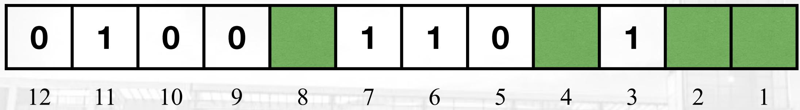

bar

| Position | Value |
|---|---|
| 1 | 12 |
| 2 | 11 |
| 3 | 10 |
| 4 | 9 |
| 5 | 8 |
| 6 | 7 |
| 7 | 6 |
| 8 | 5 |
| 9 | 4 |
| 10 | 3 |
| 11 | 2 |
| 12 | 1 |

# 海明码(Hamming Coding)

【例】利用上述构造海明码的步骤，采用偶校验，对8位ASCII字符“M”进行编码（最高位为0）。人为地引入一个1位错误，说明如何找出这个错误。

【解】字符“M”的ASCII编码为01001101。

2、依次给出校验值，得到最终编码010011100101

<table><tr><td>0</td><td>1</td><td>0</td><td>0</td><td></td><td>1</td><td>1</td><td>0</td><td></td><td>1</td><td></td><td>1</td></tr><tr><td>0</td><td>1</td><td>0</td><td>0</td><td></td><td>1</td><td>1</td><td>0</td><td></td><td>1</td><td>0</td><td>1</td></tr><tr><td>0</td><td>1</td><td>0</td><td>0</td><td></td><td>1</td><td>1</td><td>0</td><td>0</td><td>1</td><td></td><td>1</td></tr><tr><td>0</td><td>1</td><td>0</td><td>0</td><td>1</td><td>1</td><td>1</td><td>0</td><td></td><td>1</td><td></td><td>1</td></tr></table>

# 海明码(Hamming Coding)

# 海明码接收检测过程：

1. 使用与发送端相同的海明码参数  
2. 计算每个校验位p0, p1, p2, p3...   
3. ...p4p3p2p1p0指示了错误位!

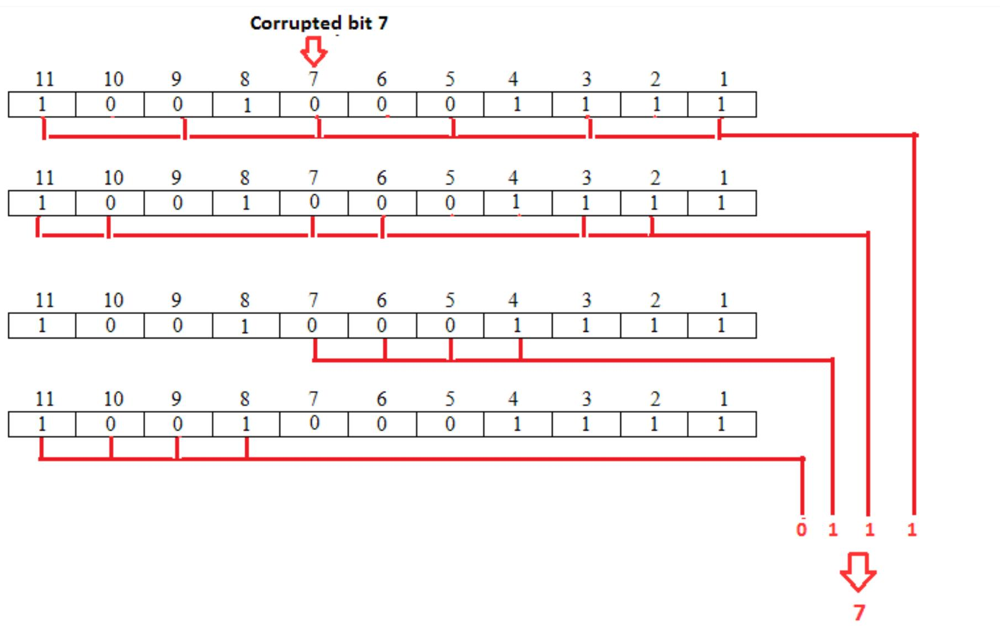

flowchart

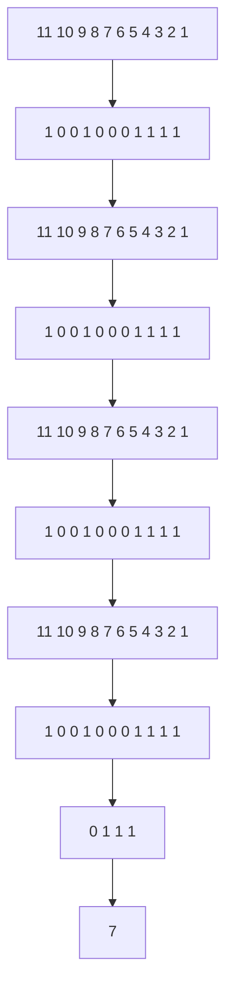

The bit in position 7 is in error

# Hamming Code

【例】利用上述构造海明码的步骤，采用偶校验，对8位ASCII字符“M”进行编码（最高位为0）。人为地引入一个1位错误，说明如何找出这个错误。

【解】

字符“M”的ASCII编码为01001101。假定 $H_{0}\sim H_{3}$ 均为0，计算 $P_{i}$ ：

$$
\mathsf {P} _ {0} = \mathsf {D} _ {6} \oplus \mathsf {D} _ {4} \oplus \mathsf {D} _ {3} \oplus \mathsf {D} _ {1} \oplus \mathsf {D} _ {0} \oplus \mathsf {H} _ {0} = 1 \oplus 0 \oplus 1 \oplus 0 \oplus 1 \oplus 0 = 1 = \mathsf {H} _ {0}
$$

$$
\mathsf {P} _ {1} = \mathsf {D} _ {6} \oplus \mathsf {D} _ {5} \oplus \mathsf {D} _ {3} \oplus \mathsf {D} _ {2} \oplus \mathsf {D} _ {0} \oplus \mathsf {H} _ {1} = 1 \oplus 0 \oplus 1 \oplus 1 \oplus 1 \oplus 0 = 0 = \mathsf {H} _ {1}
$$

$$
\mathsf {P} _ {2} = \mathsf {D} _ {7} \oplus \mathsf {D} _ {3} \oplus \mathsf {D} _ {2} \oplus \mathsf {D} _ {1} \oplus \mathsf {H} _ {2} = 0 \oplus 1 \oplus 1 \oplus 0 \oplus 0 = 0 = \mathsf {H} _ {2}
$$

$$
\mathsf {P} _ {3} = \mathsf {D} _ {7} \oplus \mathsf {D} _ {6} \oplus \mathsf {D} _ {5} \oplus \mathsf {D} _ {4} \oplus \mathsf {H} _ {3} = 0 \oplus 1 \oplus 0 \oplus 0 \oplus 0 = 1 = \mathsf {H} _ {3}
$$

∴ ASCII字符“M”对应的海明码编码字为：

$$
\mathbf {C} = \mathbf {D} _ {7} \mathbf {D} _ {6} \mathbf {D} _ {5} \mathbf {D} _ {4} \mathbf {H} _ {3} \mathbf {D} _ {3} \mathbf {D} _ {2} \mathbf {D} _ {1} \mathbf {H} _ {2} \mathbf {D} _ {0} \mathbf {H} _ {1} \mathbf {H} _ {0} = 0 1 0 0 1 1 1 0 0 1 0 1
$$

# Hamming Code

【例】利用上述构造海明码的步骤，采用偶校

验，对8位ASCII字符“M”进行编码（最高位为0）。人为地引入一个1位错误，说明如何找出这个错误。

【解】在接收端, 根据接收到的编码字求得校验方程 $\mathbf{P}_{\mathrm{i}}$ (i=0\~4), 校验方程的编码值 $\mathbf{P}(\mathbf{P}=\mathbf{P}_{4}\mathbf{P}_{3}\mathbf{P}_{2}\mathbf{P}_{1}\mathbf{P}_{0})$ 可作如下解释:

(1) 如果P各位全是0，则表示接收到的编码字中没有错误。  
(2) 如果P中多位为1，则表示有一个数据位出错，且P的值即出错位在编码字中的位置。纠错时只需将出错位取反即可。  
(3) 如果P中有且仅有一位为1，则表示某一校验位出错，不需要纠正。

# Hamming Code

【例】利用上述构造海明码的步骤，采用偶校验，对8位ASCII字符“M”进行编码（最高位为0）。人为地引入一个1位错误，说明如何找出这个错误。

【解】接收端：如果接收到的编码字没有错误，接收到的编码字 $C' = C =$ 010011100101，则

$$
\mathsf {P} _ {0} = \mathsf {D} _ {6} \oplus \mathsf {D} _ {4} \oplus \mathsf {D} _ {3} \oplus \mathsf {D} _ {1} \oplus \mathsf {D} _ {0} \oplus \mathsf {H} _ {0} = 1 \oplus 0 \oplus 1 \oplus 0 \oplus 1 \oplus 1 = 0
$$

$$
\mathsf {P} _ {1} = \mathsf {D} _ {6} \oplus \mathsf {D} _ {5} \oplus \mathsf {D} _ {3} \oplus \mathsf {D} _ {2} \oplus \mathsf {D} _ {0} \oplus \mathsf {H} _ {1} = 1 \oplus 0 \oplus 1 \oplus 1 \oplus 1 \oplus 0 = 0
$$

$$
\mathsf {P} _ {2} = \mathsf {D} _ {7} \oplus \mathsf {D} _ {3} \oplus \mathsf {D} _ {2} \oplus \mathsf {D} _ {1} \oplus \mathsf {H} _ {2} = 0 \oplus 1 \oplus 1 \oplus 0 \oplus 0 = 0
$$

$$
\mathsf {P} _ {3} = \mathsf {D} _ {7} \oplus \mathsf {D} _ {6} \oplus \mathsf {D} _ {5} \oplus \mathsf {D} _ {4} \oplus \mathsf {H} _ {3} = 0 \oplus 1 \oplus 0 \oplus 0 \oplus 1 = 0
$$

$P=P_{3}P_{2}P_{1}P_{0}=0000$ ，没有错误。

# Hamming Code

【例】利用上述构造海明码的步骤，采用偶校验，对8位ASCII字符“M”进行编码（最高位为0）。人为地引入一个1位错误，说明如何找出这个错误。

【解】接收端：如果接收到的编码字的数据位 $D_{5}$ 出错,接收到的编码字 $C' = 011011100101$ ，则

$$
\mathsf {P} _ {0} = \mathsf {D} _ {6} \oplus \mathsf {D} _ {4} \oplus \mathsf {D} _ {3} \oplus \mathsf {D} _ {1} \oplus \mathsf {D} _ {0} \oplus \mathsf {H} _ {0} = 1 \oplus 0 \oplus 1 \oplus 0 \oplus 1 \oplus 1 = 0
$$

$$
\mathsf {P} _ {1} = \mathsf {D} _ {6} \oplus \mathsf {D} _ {5} \oplus \mathsf {D} _ {3} \oplus \mathsf {D} _ {2} \oplus \mathsf {D} _ {0} \oplus \mathsf {H} _ {1} = 1 \oplus 1 \oplus 1 \oplus 1 \oplus 1 \oplus 0 = 1
$$

$$
\mathbf {P} _ {2} = \mathbf {D} _ {7} \oplus \mathbf {D} _ {3} \oplus \mathbf {D} _ {2} \oplus \mathbf {D} _ {1} \oplus \mathbf {H} _ {2} = \mathbf {0} \oplus \mathbf {1} \oplus \mathbf {1} \oplus \mathbf {0} \oplus \mathbf {0} = \mathbf {0}
$$

$$
\mathsf {P} _ {3} = \mathsf {D} _ {7} \oplus \mathsf {D} _ {6} \oplus \mathsf {D} _ {5} \oplus \mathsf {D} _ {4} \oplus \mathsf {H} _ {3} = 0 \oplus 1 \oplus 1 \oplus 0 \oplus 1 = 1
$$

$$
\mathsf {P} = \mathsf {P} _ {3} \mathsf {P} _ {2} \mathsf {P} _ {1} \mathsf {P} _ {0} = 1 0 1 0,
$$

编码字的第十位(数据位 $D_{5}$ )发生错误，将该位取反即可纠错。

# Hamming Code

【例】利用上述构造海明码的步骤，采用偶校验，对8位ASCII字符“M”进行编码（最高位为0）。人为地引入一个1位错误，说明如何找出这个错误。

【解】接收端：如果接收编码字的校验位 $H_{2}$ 出错，接收到的编码字 $C' = 010011101101$ ，则

$$
\mathbf {P} _ {0} = \mathbf {D} _ {6} \oplus \mathbf {D} _ {4} \oplus \mathbf {D} _ {3} \oplus \mathbf {D} _ {1} \oplus \mathbf {D} _ {0} \oplus \mathbf {H} _ {0} = \mathbf {1} \oplus \mathbf {0} \oplus \mathbf {1} \oplus \mathbf {0} \oplus \mathbf {1} \oplus \mathbf {1} = \mathbf {0}
$$

$$
\mathbf {P} _ {1} = \mathbf {D} _ {6} \oplus \mathbf {D} _ {5} \oplus \mathbf {D} _ {3} \oplus \mathbf {D} _ {2} \oplus \mathbf {D} _ {0} \oplus \mathbf {H} _ {1} = 1 \oplus 0 \oplus 1 \oplus 1 \oplus 1 \oplus 0 = 0
$$

$$
\mathbf {P} _ {2} = \mathbf {D} _ {7} \oplus \mathbf {D} _ {3} \oplus \mathbf {D} _ {2} \oplus \mathbf {D} _ {1} \oplus \mathbf {H} _ {2} = \mathbf {0} \oplus \mathbf {1} \oplus \mathbf {1} \oplus \mathbf {0} \oplus \mathbf {1} = \mathbf {1}
$$

$$
\mathbf {P} _ {3} = \mathbf {D} _ {7} \oplus \mathbf {D} _ {6} \oplus \mathbf {D} _ {5} \oplus \mathbf {D} _ {4} \oplus \mathbf {H} _ {3} = \mathbf {0} \oplus \mathbf {1} \oplus \mathbf {0} \oplus \mathbf {0} \oplus \mathbf {1} = \mathbf {0}
$$

$$
\mathbf {P} = \mathbf {P} _ {3} \mathbf {P} _ {2} \mathbf {P} _ {1} \mathbf {P} _ {0} = 0 1 0 0,
$$

编码字的第四位(校验位 $\mathsf{H}_2$ )发生错误，无需纠错。

# 小练习

假设你有一个 8 位的数据字节为 11001101。使用编码对其进行编码。

# 几个小练习

假设你有一个8位的数据字节为11001101。使用Hamming编码对其进行编码。

步骤：

1. 确定校验位的位置。

在 12 位的 Hamming 编码中，位置 1、2、4、8 是校验位的位置，而位置 3、5、6、7、9、10、11、12 是数据位的位置。

2. 插入数据位。

将数据位插入到对应的位置上，即 1、2、4、8 位保持不变，而第 3 位插入数据位 1，第 5 位插入数据位 1，第 6 位插入数据位 0，第 7 位插入数据位 0，第 9 位插入数据位 1，第 10 位插入数据位 1，第 11 位插入数据位 0，第 12 位插入数据位 1，得到 12 位的编码为 110101001101。

3. 计算校验位。

对校验位进行计算，使其满足奇偶校验规则。计算方式为：

- 校验位 1：对位置 3、5、7、9、11 进行奇偶校验，得到校验位 1 的值为 1。  
- 校验位 2：对位置 3、6、7、10、11 进行奇偶校验，得到校验位 2 的值为 0。  
- 校验位 4：对位置 5、6、7、12 进行奇偶校验，得到校验位 4 的值为 1。  
- 校验位 8：对位置 9、10、11、12 进行奇偶校验，得到校验位 8 的值为 1。

4. 替换校验位。

将计算得到的校验位替换到对应的位置上，得到最终的编码为 110101001101。

所以，对于输入的数据字节 11001101，使用 Hamming 编码后的结果为 110101001101

# Hamming Code

\- 一个问题：Hamming Code的纠错能力上限是什么？

\- 答: 一个coded word只能纠错一位!

\- 如果错了很多怎么搞?

\- 答: 分块Hamming!

\- 所以出现了Hamming(7,4), Hamming(8,4), Hamming(15,11)...之类的分块编码方案!

# Hamming Code

# Hamming(7,4)

Hamming(7,4) 是一种经典的错误纠正码，它属于 Hamming 码的一种类型。这种编码方法可以将 4 位的数据转换成 7 位的编码，其中包含 4 位原始数据和 3 位校验位。Hamming(7,4) 码能够检测并纠正单个位错误。

在 Hamming(7,4) 编码中，假设原始数据位为 $d_{1}, d_{2}, d_{3}, d_{4}$ ，校验位为 $p_{1}, p_{2}, p_{4}$ （注意校验位的编号通常指示它们在编码序列中的位置，即 2 的幂次）。每个校验位都是几个数据位的异或结果，具体如下：

- $p_1$ 检验位 1, 3, 5, 7 $(d_1, d_2, d_3)$ ;  
- $p_{2}$ 检验位 2, 3, 6, 7 $(d_{1}, d_{3}, d_{4})$ ;  
- $p_4$ 检验位 4, 5, 6, 7 $(d_2, d_3, d_4)$ 。

通过这种方式，任何单一位的错误都会影响独特的校验位组合，从而可以被检测并纠正。

# Hamming Code

# Hamming(8,4)

通常，Hamming 码是描述成 $(2^{r}-1,2^{r}-r-1)$ 的形式，其中 r 是校验位的数量。然而，Hamming(8,4) 并不符合这种典型的描述，因为 8 不是形如 $2^{r}-1$ 的数字。因此，Hamming(8,4) 实际上不是一个标准的 Hamming 码。

尽管如此，Hamming(8,4) 可以被理解为一种扩展的 Hamming 码，它可能包含额外的校验位以提供更强的错误检测能力。在这种情况下，一个可能的实现是在标准的 Hamming(7,4) 码基础上添加一个额外的奇偶校验位，使得整个编码块的奇偶性为偶或奇，这样可以增加检测双错误的能力。

例如，如果我们使用标准的 Hamming(7,4) 编码方法得到了一个7位的编码 $c_{1}, c_{2}, c_{3}, c_{4}, c_{5}, c_{6}, c_{7}$ ，那么我们可以增加一个额外的位 $p_{8}$ ，它是所有7位的异或结果：

$$
\bullet p _ {8} = c _ {1} \oplus c _ {2} \oplus c _ {3} \oplus c _ {4} \oplus c _ {5} \oplus c _ {6} \oplus c _ {7}
$$

这样，整个编码块将变为 $c_{1}, c_{2}, c_{3}, c_{4}, c_{5}, c_{6}, c_{7}, p_{8}$ ，共8位。如果在传输过程中发生两个错误，那么根据 $p_{8}$ 的值可能能检测到这种情况，但无法确定具体出错的位置或进行纠正。

# 循环冗余检验(CRC)

■ 循环冗余校验：

Cyclic Redundancy Check，简称 CRC。

■ 通过某种数学运算建立数据和校验位之间的约定关系。  
■ 编码及译码：

\- 发送端:

- 被校验数据除以生成多项式；  
- 被校验数据减去余数，结果作为发送数据。

\- 接收端：接收数据除以生成多项式。

- 可以除尽，编码正确；  
- 除不尽，余数指明出错位所在的位置。

# 循环冗余检验(CRC)

# ■ 采用模2算术运算：

- 通过模2减法实现模2除法；  
- 以模2加法将所得余数拼接在被校验数据的后面，形成能除尽的被校验数据。

# ■ 生成多项式应满足的要求：

- 任何一位发生错误都应使余数不为0;  
- 不同位发生错误应当使余数不同；  
- 应满足余数循环规律。

# ■ 生成多项式的表示：

如，生成多项式 $G = 1011_{2}$ ，表示生成多项式为

$$
\mathsf {G} (\mathsf {X}) = \mathsf {X} ^ {3} + \mathsf {X} + 1
$$

# 循环冗余检验(CRC)

# 【例】

① 假设信息字节为   
② 选取 $G=1011_{2}$ ;   
③ 将F左移l-1位，  
形成 $\mathbf{F}' = 1001010000_{2}$   
④ 用 F' 做被除数、G 做除数，  
进行模2除法。  
忽略商，余数为 $R=111_{2}$ 。

$$
\mathbf {F} = 1 0 0 1 0 1 0 _ {2};
$$

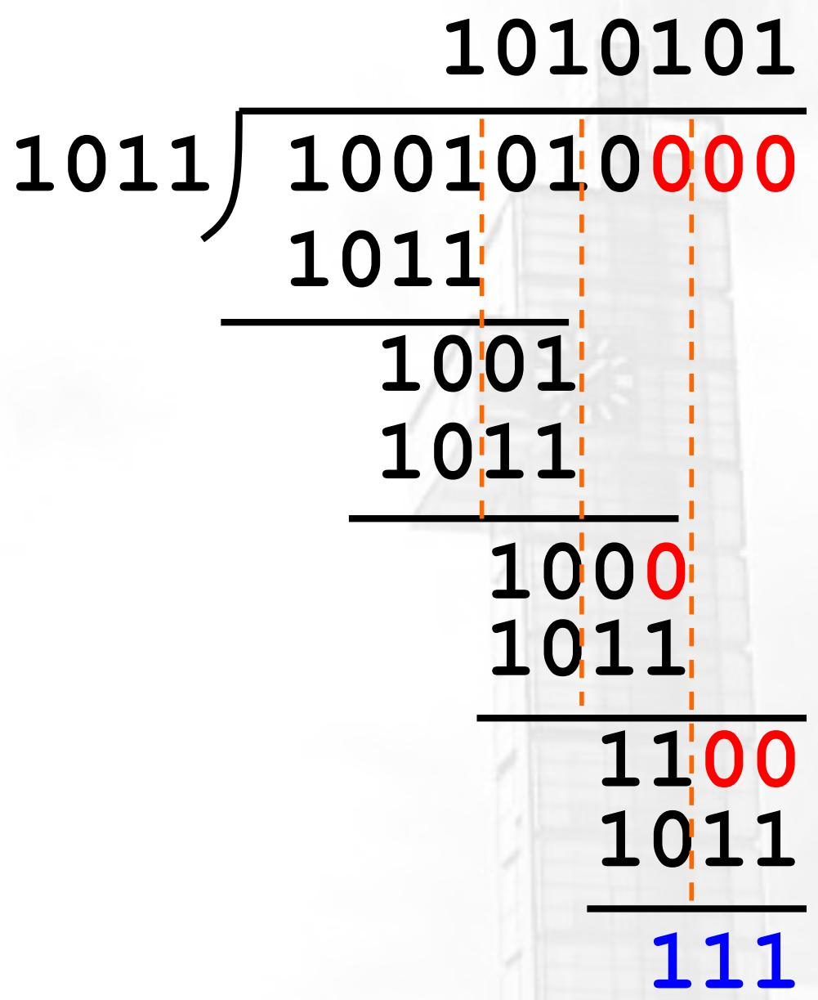

text_image

1010101
1011) 1001010000
1011
-----
    1001
    1011
-----
    1000
    1011
-----
    1100
    1011
-----
    111

⑤ 把余数加到 F' 中，组成要发送的信息 M：1001010000 $_{2}$ + 111 $_{2}$ = 1001010111 $_{2}$ 。  
⑥ 接收器采用相反的过程对接收的信息 M 进行解码和校验。M 应该可以被 G 严格整除。

# 循环冗余检验(CRC)

接收器：解码校验（正确的情况）

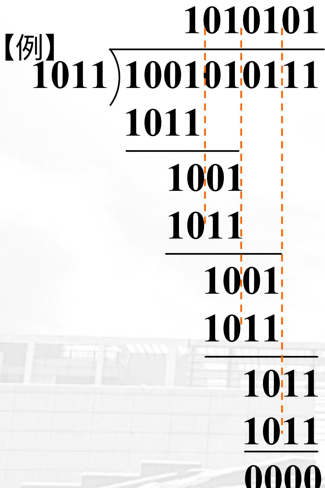

text_image

【例】
1011)1001010111
1011
  1001
  1011
  1001
  1011
    1011
      1011
      1011
      0000

接收器：解码校验
(1位出错的情况)

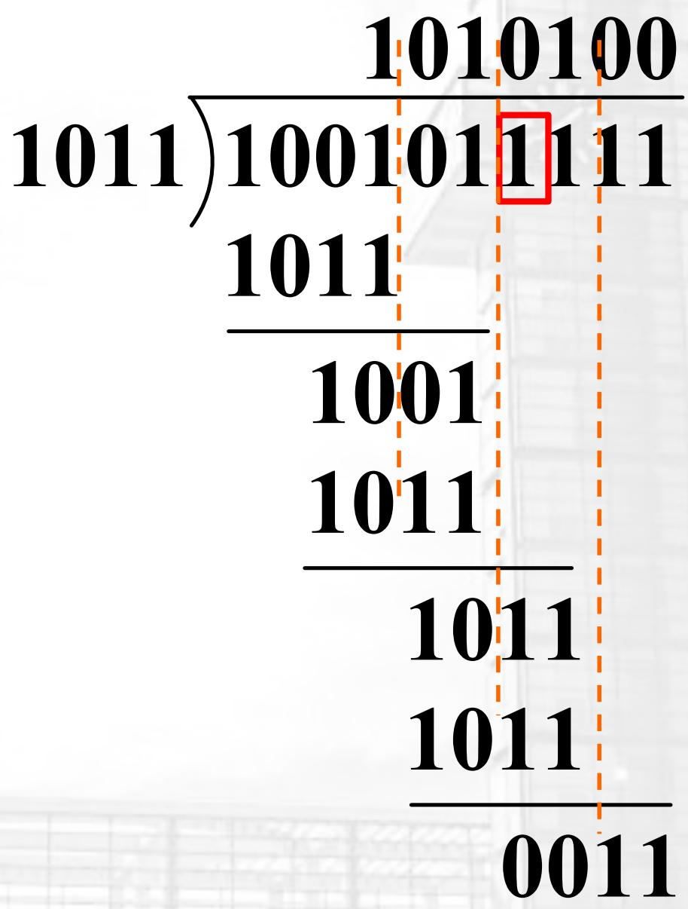

text_image

1010100
1011)1001011111
1011
-----
1001
1011
-----
1011
1011
-----
0011

# 循环冗余检验(CRC)

■ CRC的生成多项式的阶数越高，误判的概率就越小。  
■ 常用的4个标准多项式：

CRC-12:

$$
\mathbf {G} (\mathbf {X}) = \mathbf {X} ^ {1 2} + \mathbf {X} ^ {1 1} + \mathbf {X} ^ {3} + \mathbf {X} ^ {2} + \mathbf {X} + \mathbf {1}
$$

\- CRC-16(ANSI):

$$
\mathbf {G} (\mathbf {X}) = \mathbf {X} ^ {1 6} + \mathbf {X} ^ {1 5} + \mathbf {X} ^ {2} + \mathbf {1}
$$

• CRC-CCITT(ITU-T):

$$
\mathbf {G} (\mathbf {X}) = \mathbf {X} ^ {1 6} + \mathbf {X} ^ {1 2} + \mathbf {X} ^ {5} + \mathbf {1}
$$

CRC-32:

$$
\mathbf {G} (\mathbf {X}) = \mathbf {X} ^ {3 2} + \mathbf {X} ^ {2 6} + \mathbf {X} ^ {2 3} + \mathbf {X} ^ {2 2} + \mathbf {X} ^ {1 6} + \mathbf {X} ^ {1 2} + \mathbf {X} ^ {1 1}
$$

$$
+ X ^ {1 0} + X ^ {8} + X ^ {7} + X ^ {5} + X ^ {4} + X ^ {2} + X + 1
$$

# 几个小练习

• 2025的IEEE 754浮点如何表示?  
- 用奇 and 偶校验编码原码2025?  
- 用海明码编码原码2025?   
- 用CRC(1011)编码原码2025?