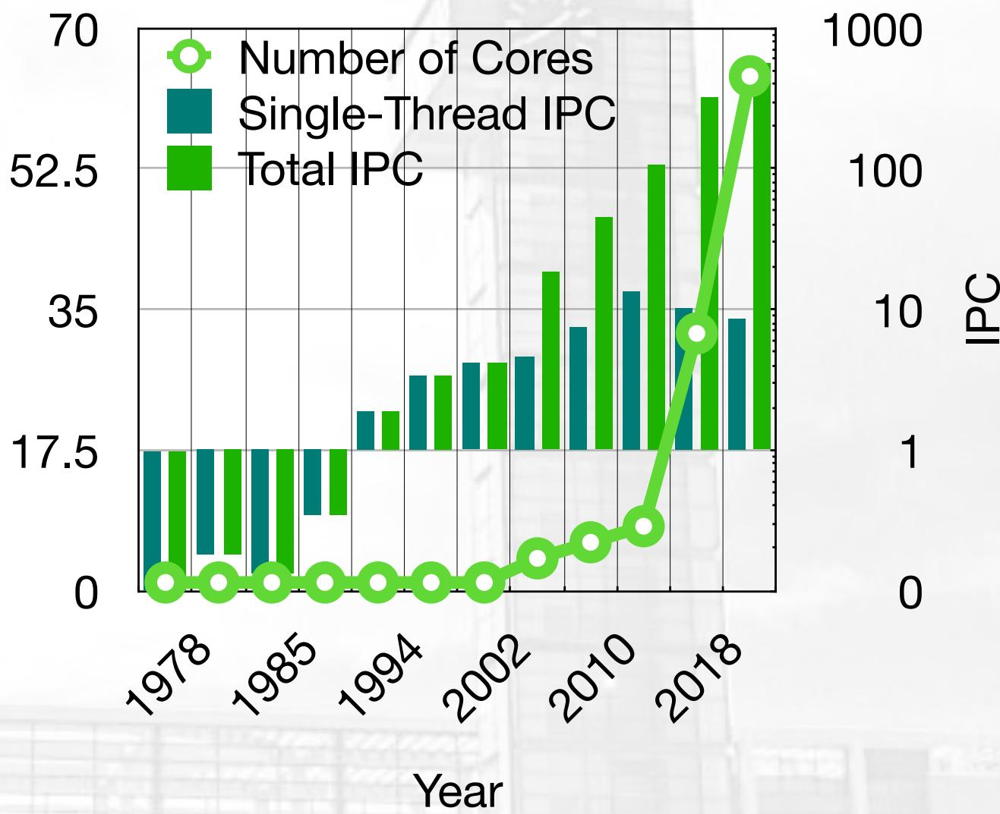
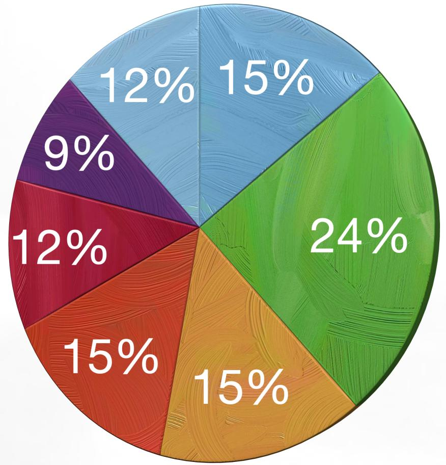
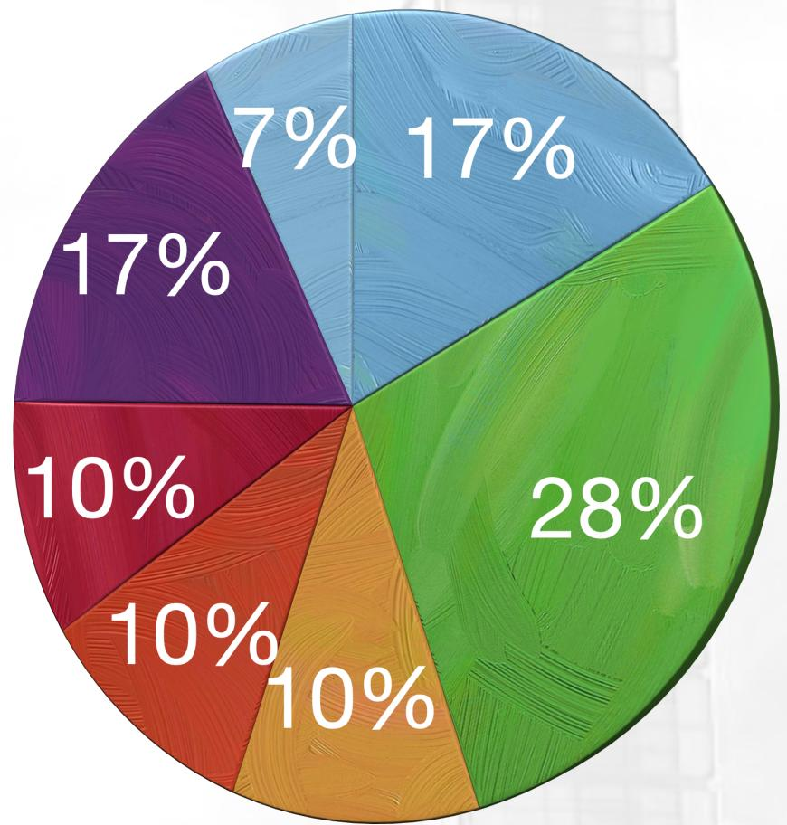
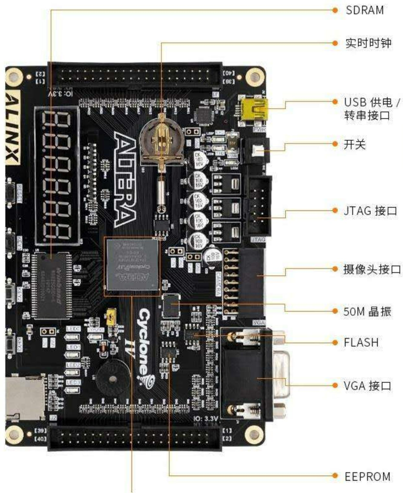
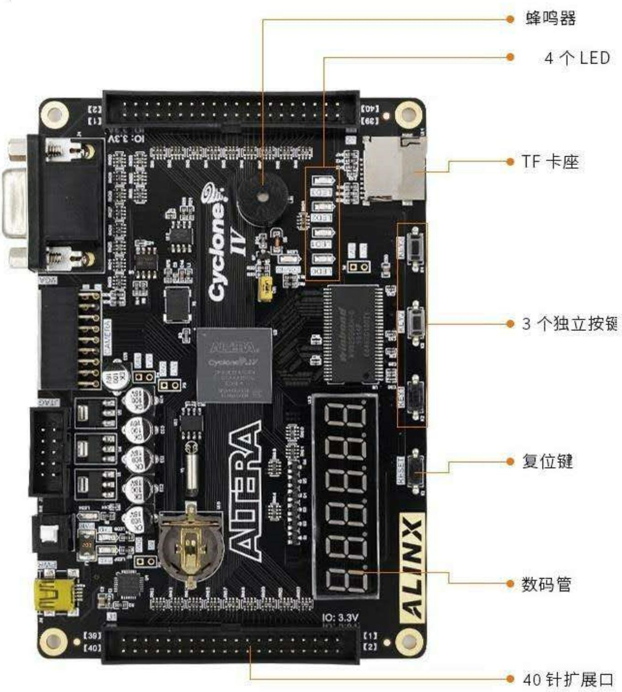

# 计算机组成与设计－绪论2

李瑞 教授

蒋志平 副教授

计算机科学与技术学院

# 理解计算机性能

# 理解计算机性能

- 性能=“电脑跑得快”   
- 主要的量化指标:

• MIPS (Million Instructions Per Second)   
• FLOPS(Float-point Operations Per Second)   
• CPI (Clock Cycles Per Instruction)   
- IPC (Instructions Per Clock Cycle)   
• TOPs (Trillion Operations Per Second) 4 NPU

- 实际的性能影响因素  
- 关于性能评价

# 理解计算机性能

\- MIPS: （宏观）每秒执行几百万条指令

$$
\mathrm{MIPS} = \frac {\text {被执行的指令条数}}{\text {总执行时间(s)} \times 1 0 ^ {6}}
$$

\- MIPS: （微观）核数 x 时钟 x IPC

\- IPC, Instructions per Clock，每时钟执行几条指令

$$
\mathrm{MIPS} = \text {cores} \times \text {clock (MHz)} \times \frac {\text {Instructions}}{\text {clock cycle}} (\text {or IPC})
$$

# 理解计算机性能

\- FLOPS，每秒算多少次浮点计算

\- 在第2章，大家会深刻感受到浮点计算有多麻烦...

• Why FLOPS ?

\- 主要区分在应用场景

- MIPS更能体现整数计算、应用服务的性能  
- FLOPS更能体现科学计算的性能

$$
\mathrm{FLOPS} = \mathrm{cores} \times \mathrm{clock} \times \frac {\mathrm{FLOPs}}{\mathrm{clockcycle}} (\mathrm{orFLOPspercycle})
$$

# 理解计算机性能

GPT-4-Turbo

Poe

# - TOPS又是什么？

\- 评价NPU的新指标

\- 商业Hype成分更大

下面是一个表格，展示了TOPs与TFLOPs的区别以及NPU、CPU和GPU之间的主要区别：

<table><tr><td>特性</td><td>TOPs</td><td>TFLOPs</td><td>NPU</td><td>CPU</td><td>GPU</td></tr><tr><td>定义</td><td>每秒可执行的整数或二进制操作次数</td><td>每秒可执行的浮点操作次数</td><td>神经网络处理单元,专为AI任务设计</td><td>通用处理单元,适用于广泛任务</td><td>主要用于图形处理,适合大规模并行处理</td></tr><tr><td>优化点</td><td>整数或定点数操作</td><td>浮点运算</td><td>深度学习和神经网络计算优化</td><td>广泛应用的灵活性和适应性</td><td>AI工作负载的并行处理能力</td></tr><tr><td>精度</td><td>低精度(如8-bit或16-bit)</td><td>高精度(如32-bit或更高)</td><td>通常采用低至中等精度</td><td>高精度处理能力</td><td>高精度处理能力</td></tr><tr><td>能效</td><td>高(针对特定任务)</td><td>适中至高</td><td>高(针对AI任务)</td><td>适中</td><td>中等至高(取决于模型和配置)</td></tr><tr><td>应用范围</td><td>AI加速器和专用设备</td><td>广泛的科学和工程计算</td><td>AI模型执行优化</td><td>广泛的业务和计算应用</td><td>图形渲染和AI训练/推理</td></tr></table>

这个表格提供了一个清晰的视角来理解不同计算指标和处理单元的设计优势、主要应用以及它们在处理特定类型任务时的表现差异。

# 理解计算机性能

# • CPI v.s IPC

- Cycles Per Instruction (CPI)   
- Instructions Per Cycle (IPC)

\- 为什么是两个指标？

\- 早期CPI > 1，后期IPC > 1

# 理解计算机性能

\- IPC、MIPS、FLOPS不是一个确定的值！

- 不同指令的IPC不一样（指令功能不同，CPU构架不同）  
- 不同指令的执行次数(权重)不同（上层应用功能不同）

\- 平均CPI计算

\- 设某CPU提供n条指令，第i条指令的CPI为 $CPI_{i}$ ，频率权重为 $\frac{IC_{i}}{IC}$ ，则该CPU的平均CPI为：

$$
\bar {C P I} = \sum_ {i = 1} ^ {n} \left(C P I _ {i} \times \frac {I C _ {i}}{I C}\right)
$$

# 理解计算机性能

• 例: CPU主频为20 MHz, 设指令集平均CPI为6, 求: 1.该CPU的时钟周期, 2. 该CPU的MIPS

$$
\begin{array}{r l} \text {时钟周期} & = \frac {1}{\text {时钟频率}} = \frac {1}{2 0 \mathrm{MHz}} \\ & = 0. 0 5 \times 1 0 ^ {6} \mathrm{S} \end{array}
$$

平均速度 = $\frac{1}{指令执行时间}$ (s)

$$
= \frac {1}{0 . 0 5 \times 1 0 ^ {- 6} \times 6} = 3. 3 3 \text { MIPS }
$$

# 计算机性能

• 例：某400 MHz计算机，执行标准测试程序，程序中的指令类型、数量及指令执行的平均周期如下表，求CPI，MIPS及程序执行时间。

<table><tr><td>指令类型</td><td>指令数量</td><td>指令执行周期</td></tr><tr><td>整数</td><td>45000</td><td>1</td></tr><tr><td>数据传送</td><td>32000</td><td>2</td></tr><tr><td>浮点</td><td>15000</td><td>2</td></tr><tr><td>控制传送</td><td>8000</td><td>2</td></tr></table>

$$
C P I = \frac {4 5 0 0 0 \times 1 + 3 2 0 0 0 \times 2 + 1 5 0 0 0 \times 2 + 8 0 0 0 \times 2}{1 0 0 0 0 0} = \frac {1 5 5 0 0 0}{1 0 0 0 0 0} = 1. 5 5
$$

$$
\mathbf {M I P S} = \frac {\mathbf {C l o c k (M H z)}}{C P I} = \frac {4 0 0}{1 . 5 5} = 2 5 8 \mathbf {M I P S}
$$

$$
\mathrm{执行时间} \mathbf {t} = \frac {C P I \times 1 0 0 0 0 0}{C l o c k} = \frac {1 . 5 5 \times 1 0 0 0 0 0}{4 0 0 \times 1 0 0 0 0 0 0} = \frac {1 . 5 5}{4 0 0 0} = 0. 0 0 0 3 8 s = 0. 3 8 7 5 m s
$$

# 理解计算机性能

# - MIPS角度来看，现代CPU的单核IPC已大于10!

CPU MIPS性能提升 

<table><tr><td>年代</td><td>型号</td><td>主频 (MHz)</td><td>核心数量</td><td>MIPS</td><td>总IPC</td><td>单核IPC</td></tr><tr><td>1978</td><td>Intel 8086</td><td>5</td><td>1</td><td>0.33</td><td>0.07</td><td>0.07</td></tr><tr><td>1982</td><td>Motorola 68K</td><td>12.5</td><td>1</td><td>2.188</td><td>0.18</td><td>0.18</td></tr><tr><td>1985</td><td>Intel i386DX</td><td>16</td><td>1</td><td>2.15</td><td>0.13</td><td>0.13</td></tr><tr><td>1990</td><td>Intel i486DX</td><td>25</td><td>1</td><td>8.7</td><td>0.35</td><td>0.35</td></tr><tr><td>1994</td><td>Intel Pentium</td><td>100</td><td>1</td><td>188</td><td>1.88</td><td>1.88</td></tr><tr><td>1999</td><td>Intel Pentium III</td><td>600</td><td>1</td><td>2054</td><td>3.42</td><td>3.42</td></tr><tr><td>2002</td><td>AMD Athlon XP 2500+</td><td>1830</td><td>1</td><td>7527</td><td>4.11</td><td>4.11</td></tr><tr><td>2006</td><td>Intel Core 2 QX6700</td><td>2660</td><td>4</td><td>49161</td><td>18.48</td><td>4.62</td></tr><tr><td>2010</td><td>Intel Core i7 980X</td><td>3300</td><td>6</td><td>147600</td><td>44.73</td><td>7.45</td></tr><tr><td>2014</td><td>Intel Core i7 5960X</td><td>3000</td><td>8</td><td>317900</td><td>105.97</td><td>13.25</td></tr><tr><td>2018</td><td>AMD 2990WX</td><td>4200</td><td>32</td><td>1361770</td><td>324.23</td><td>10.13</td></tr><tr><td>2020</td><td>AMD 3990X</td><td>4340</td><td>64</td><td>2394930</td><td>551.83</td><td>8.62</td></tr></table>

Number of Cores

bar_line

| Year | Number of Cores | Single-Thread IPC | Total IPC |
|------|-----------------|-------------------|---------|
| 1978 | 0               | 17.5              | 1       |
| 1985 | 0               | 17.5              | 1       |
| 1994 | 0               | 17.5              | 1       |
| 2002 | 0               | 17.5              | 1       |
| 2010 | 0               | 17.5              | 1       |
| 2018 | 10              | 35                | 100     |
| 2020 | 100             | 35                | 1000    |

# 理解计算机性能

\- FLOPS角度来看，

\- CPU单周期FLOPs高

\- AVX-256/512, SSE3/4的功劳

\- GPU FLOPs低，所以慢？？

• Sometimes Naive!

\- GPU核心数量碾压!

• AMD 3990x, 1.5TFLOPS, 64C/128T   
• Nvidia Titan RTX, 130TFLOPS, 4608 + 576(Tensor)

64/32/16bit浮点计算

CPU FLOPs / Cycle / Core 

<table><tr><td>型号</td><td>FP64</td><td>FP32</td><td>FP16</td></tr><tr><td>Intel Skylake</td><td>16</td><td>32</td><td>0</td></tr><tr><td>Intel Xeon Phi</td><td>32</td><td>64</td><td>0</td></tr><tr><td>AMD Zen2</td><td>16</td><td>32</td><td>0</td></tr><tr><td>ARM Cortex-A77</td><td>8</td><td>16</td><td>0</td></tr></table>

GPU FLOPs / Cycle / Core 

<table><tr><td>型号</td><td>FP64</td><td>FP32</td><td>FP16</td></tr><tr><td>Nvidia Fermi</td><td>1/8</td><td>2</td><td>0</td></tr><tr><td>Nvidia Mexwell</td><td>1/16</td><td>2</td><td>1/32</td></tr><tr><td>NVidia Pascal</td><td>1</td><td>2</td><td>4</td></tr><tr><td>NVidia Turing</td><td>1/16</td><td>2</td><td>16</td></tr></table>

# 理解计算机性能

主要性能影响因素...  

pie

| Segment | Percentage (%) |
| :--- | :--- |
| Light Blue | 15 |
| Dark Blue | 12 |
| Purple | 9 |
| Red | 12 |
| Orange | 15 |
| Green | 24 |
| Dark Green | 15 |

主频

单核流水性能

I/O及缓存

其它

内核数量

指令级加速水平

热设计上限

- CPU主频对性能的贡献毋庸置疑...   
- 核心数量，参考AMD x3990   
- 单核流水性能

• Pentium 4 NetBurst v.s Pentium Core

\- 指令级加速水平

• AVX, SSE, GPU, TPU, FPGA ...

\- I/O及缓存

- Ryzen 3 CPU集成传统北桥   
- A13/A12暴锤855/865

\- 热设计(Thermal Design Power)

- 极限TDP的提升   
- 制程提升降低CPU热损

\- 其它...

# 理解计算机性能

- 内核数量，参考x3990  
- 主频，参考i3默秒全  
- 单核流水性能，参考Core架构持续挤牙膏能力...  
- I/O及缓存，大缓存秒天下...   
- 指令级加速水平，AVX / NEON  
- 热设计，制程提升

可行的性能提升路径...  

pie

| Segment | Percentage (%) |
| :--- | :--- |
| Light Blue | 17 |
| Dark Blue | 7 |
| Purple | 17 |
| Green | 28 |
| Red | 10 |
| Orange | 10 |
| Dark Red | 10 |

主频  
单核流水性能  
I/O及缓存   
其它  
内核数量  
指令级加速水平  
热设计上限

# 关于性能评价

\- 从性能评测来说，MIPS/FLOPS还是太虚，虚在何处？

\- 影响因素太多:

- 应用本身的计算倾向  
- 主频  
- CPU类型  
- 操作类型  
- 计算过程  
- 内存访问速度  
●
■ ■ ■ ■

# 关于性能评价

\- 计算机是一个巨系统，有时很难猜测其性能...

- i3真打不过i7?   
- 64核默秒全?   
- A13打不过i7?

\- 有时，连“快”的定义都千差
万别：

- web服务响应高?  
- 吃鸡全程60fps?   
- pi算到1000w位比时间?

那么，怎么比较两个机器性能呢？

那就来跑个分吧！

# 典型的性能评价非完整列表...

# 性能评测：比较同一组典型负载的运行时间

• Super Computing

- HPCG   
• LINPACK

This performance does not reflect the overall performance of a given system, as no single number ever can. It does, however, reflect the performance of a dedicated system for solving a dense system of linear equations.

\- Desktop/Laptop

• 3D Mark   
- PCMark   
- GeekBench   
- SiSoftware   
- SPEC   
• Cine Bench   
- PassMark   
- SuperPI   
●
...

\- Mobile

- GeekBench   
• 3D Mark   
• UNIGINE Benchmarks   
- SiSoftware   
- Antutu 😂 😂 😂

# Amdahl's Law

# &

# Gustafson's Law

# Amdahl定律

Amdahl定律内容：计算机系统中某一部件由于采用某种更快的执行方式后，整个系统性能的提高与这种执行方式的使用频率或占总执行时间的比例有关。

人话翻译：把单一部件再怎么优化，也只能提升一点点性能...

# G. M. Amdahl: IBM大型机之父

# G. M. Amdahl (1922 - 2015)

《计算机世界》将他列为“改变世界的25人”之一。

上世纪六十年代由IBM 360系列计算机的主要设计者。

natural_image

Portrait of an older man in a suit and tie standing indoors near a window with blinds (no visible text or symbols)

教育背景：

1948年，获南达科达州立大学工程物理科学学士学位；1952年2月，获威斯康辛大学理论物理博士学位。

# Amdahl定律

计算机系统的加速比 $S_{p}$ 取决于下面两个因素：

\- 可改进部分在原系统总执行时间中的占比，称为可改进比例，用 $f_{e}$ 表示。

\- 例如，程序的总执行时间为100s，可改进的部分是其中的20s，则 $f_{e}=0.2$ 。fe总是小于或等于1。

\- 可改进部分改进后性能提高的程度，用 $r_e$ 表示。

• 例如，某部件执行时间由原来的20s减少到5s，则部件加速比 $r_{e}=20/5=4$ 。re一般大于1。

# Amdahl定律

\- 若假设改进前的系统总执行时间为 $T_{o}$ , 可以得出改进后的系统总执行时间 $T_{n}$ 为:

$$
T _ {n} = T _ {o} \left(1 - f _ {e} + \frac {f _ {e}}{r _ {e}}\right)
$$

\- 若加速比用 $S_{p}$ 表示, 则加速比 $S_{p}$ 可表示为:

$$
S _ {p} = \frac {1}{\left(1 - f _ {e}\right) + \frac {f _ {e}}{r _ {e}}}
$$

\- 当系统可改进的部分 $f_{e}$ 确定后，既使这一部分改进后不再需要时间，即 $r_{e} \rightarrow \infty$ ，则 $\mathrm{Sp} = 1 / (1 - f_{e})$ 。

# Amdahl定律

【例1.1】某计算机系统的某一部件的处理时间为总处理时间的40%，该部件改进后部件加速比为10，试计算改进后系统的加速比 $S_{p}$ 为多少。

解：由上述题意可知， $f_{e}=0.4,\ r_{e}=10$ ，则

$$
S _ {p} = 1 / [ (1 - 0. 4) + 0. 4 / 1 0 ] \approx 1. 5 6
$$

由计算可见，既使某一部件的部件加速比已达10倍，但该部件仅影响到总执行时间的小部分，对整个计算机系统的贡献是有限的。所以，改进后系统的加速比只有1.5倍左右。

# Amdahl定律

【例1.2】若计算机系统有三个部件a、b、c是可改进的，它们的部件加速比分别为30、30、20。它们在总执行时间中所占的比例分别是 $30\%$ 、 $30\%$ 、 $20\%$ 。试计算这三部件同时改进后系统的加速比。

# Amdahl定律

【例1.2】若计算机系统有三个部件a、b、c是可改进的，它们的部件加速比分别为30、30、20。它们在总执行时间中所占的比例分别是 $30\%$ 、 $30\%$ 、 $20\%$ 。试计算这三部件同时改进后系统的加速比。

解：多个部件可同时改进的情况下，Amdahl定律可表示为：

$$
S _ {p} = \frac {1}{\left(1 - \sum f _ {e}\right) + \sum \left(\frac {f _ {e}}{r _ {e}}\right)}
$$

$$
S _ {p} = \frac {1}{(1 - 0 . 3 - 0 . 3 - 0 . 2) + \left(\frac {0 . 3}{3 0} + \frac {0 . 3}{3 0} + \frac {0 . 2}{2 0}\right)} \approx 4. 3 5
$$

# Gustafson定律

Gustafson定律内容：当计算任务可足够并行时，加速比随着计算部件的数目而线性增长。

人话翻译：核心数量越多越爽...

# Gustafson定律

Dr. John L. Gustafson

爱荷华大学教授

前AMD首席产品构架师

曾在Intel, Sun任职

natural_image

Portrait of a smiling man with blonde hair wearing a blue polo shirt (no text or symbols visible)

教育背景：

1977年，获加州理工学院应用数学学士学位；1982年获爱荷华州立大学博士学位。

# Gustafson定律

# Gustafson定律：

总任务中，必须顺序执行的部分为f，在单处理器上顺序执行的时间为t\_s；设有p个并行处理器参与计算，则通过并行化处理，就可以获得接近p的加速比：

$$
S (p) = \frac {f t _ {s} + (1 - f) t _ {s}}{f t _ {s} + (1 - f) t _ {s} / p} = p + (1 - p) f t _ {s}
$$

# Gustafson定律

# Dr. Gustafson在88年写paper “Re-evaluating Amdahl’s

# Law"探讨了并行处理器对Amdahl's Law的补充。相比

# Amdahl's Law, Gustafson's Law更“人本”:

- Gustafson's Law强调的一点是: 通过将计算过程分别为并行的子过程, 就可以接近线性地获得的加速比。  
- Amdahl's Law强调的是：在解决过程并不发生改变的情况下，加速比不可能线性提升。

# 哪个更有启发意义？

\- Gustafson's Law为计算机性能提升给出了关键指导:

- 处理器要多，很多，非常多，非常非常多...  
- I/O要快，很快，非常快，非常非常快...  
- 任务要最大化分解

- 能并行不串行...   
- 能低效并行不高效串行...   
- 小到GPU渲染...  
- 大到超算...

# FPGA科普

- FPGA（Field-Programmable Gate Array）即现场可编程门阵列。  
- 相比专用集成电路（ASIC），FPGA是一种半定制电路，芯片上的管脚可被反复重编程。  
- 通过编程，FPGA可以变成高性能CPU，也可以是最简单的开关电路。

# FPGA科普

- 用硬件描述语言（Verilog或VHDL）编程  
- 程序要经过“综合与布局”（相当于编译）再下载到 FPGA  
- 可编程元件包括基本的逻辑门电路（AND、OR、XOR、NOT）或者一些的专用的性能部件（浮点计算单元，乘法器等）  
- 如果软件编译，是将算法转换为有尺寸的文件；FPGA综合与布局，就是将算法转换为有物理面积的电路及其电路布局；

# FPGA科普

text_image

SDRAM
实时时钟
USB 供电 / 转串接口
开关
JTAG 接口
摄像头接口
50M 晶振
FLASH
VGA 接口
EEPROM

text_image

蜂鸣器
4个LED
TF卡座
3个独立按键
复位键
数码管
40针扩展口
[39]
[40]
Cyclone:
IV
AlERA
IO: 3.3V
[1]
[2]
[39]

# 作业