# 课件-运算方法-乘除专题巩固-Spring-2020

## 来源

- 分类：`课件`
- 原始文件：`运算方法-乘除专题巩固--Spring.2020.pdf`
- 原始相对路径：`资料/课件/运算方法-乘除专题巩固--Spring.2020.pdf`
- 原始绝对路径：`D:\wzb\计算机组成原理\资料\课件\运算方法-乘除专题巩固--Spring.2020.pdf`

## 后续处理建议

- 从本整理稿中提取稳定知识点
- 检查公式、表格、结构图的提取效果
- 必要时补单独图像解读稿
- 如发现资料错误，转入勘误或分歧

## 内容导读（基于整理稿归纳）

这份专题巩固材料不是单纯讲新概念，而是集中用“表格式计算”把乘法、除法的步骤题反复练熟，适合直接服务作业和试卷计算题。

## 关键知识点

- 原码一位/两位乘法的表格化执行过程。
- 补码乘法与除法题中的逐步操作解释。
- “操作说明”列如何对应每一步寄存器/部分积/商位变化。

## 典型例题 / 思考题

- 按表格逐轮填写乘法、除法步骤。
- 解释 `D / Y / Y0 / Y1` 等符号在表格式计算中的作用。
- 对比不同乘除法算法在步骤组织上的区别。

## 例题理解层（基于课件整理）

### 题目簇 1：原码一位乘法计算

- 原题/原问：
  - 例，[X]原=0.1101，[Y]原=1.1011，求积
  - 练习，[X]原=0.100111, [Y]原=1.100111，求积
- 题意：用原码一位乘法的表格式计算求定点小数乘积。
- 所考知识点：
  - 原码一位乘法：符号异或、绝对值逐位乘加右移
  - 表格式计算的书写规范
- 解题关注点：
  - 从最低位开始，每步判断→累加→右移
  - 表格格式是得分关键
  - 最终补符号位
- 题型归类建议：步骤推导题（Booth/乘除法表格题）
- 备注：信息完整

### 题目簇 2：原码二位乘法计算

- 原题/原问：
  - 例，[X]原=0.1001111, [Y]原=1.100111，求积
  - 带大家练习一哈，[X]原=0.100111, [Y]原=1.100111，求积
  - 再来练习一哈，[X]原=0.100111, [Y]原=1.101110，求积
  - 练习，[X]原=0.110110, [Y]原=1.101101，求积
- 题意：用原码二位乘法计算定点小数乘积，每次看乘数两位。
- 所考知识点：
  - 原码二位乘法的四种操作：00→0，01→+X，10→+2X，11→+3X（4X-X法）
  - 欠账位机制
  - 每步右移两位
- 解题关注点：
  - 3X 的 4X-X 替代方案：加 4X 后设欠账位，下步减 X
  - 欠账位的设置/清除时机
  - 步数为 n/2
- 题型归类建议：步骤推导题（Booth/乘除法表格题）
- 备注：信息完整，题目数据明确

### 题目簇 3：Booth 补码乘法

- 原题/原问：
  - 能不能更简化！？
  - 问题来了：如何高效地识别"一串1"的开始和结束？
  - 【例】X=0.1010，Y=-0.1101，利用Booth法求积
  - 练习，[X]原=0.110110, [Y]原=1.101101，求积（Booth法）
- 题意：掌握 Booth 算法原理（从一串1的简化到 y_i - y_{i-1} 判断规则），完成补码乘法表格。
- 所考知识点：
  - Booth 算法的核心推导：一串连续1可转化为首尾两个操作
  - y_i - y_{i-1}：01→+X，10→-X，00/11→不变
  - 附加位 y_{-1}=0
  - 共 n 步，每步算术右移一位
- 解题关注点：
  - 初始状态：部分积=0，附加位=0
  - 每步看乘数当前最低位与附加位的差值
  - 减 X 用补码加法实现
  - 右移时符号位扩展
- 题型归类建议：Booth/除法表格题
- 备注：本专题反复练习 Booth 法，是考前冲刺的核心材料

### 题目簇 4：原码除法——恢复余数法

- 原题/原问：
  - 例，[X]原=0.1101, [Y]原=1.1011，求积（除法上下文）
  - 例，[X]原=0.1011, [Y]原=1.1101，求商/余数
  - 可如何处理商0/1问题?
  - 例，[X]=-0.10001011, [Y]=0.1110，求商及余数，用恢复余数法
  - 例，[X]=0.10101011, [Y]=-0.1110，求商及余数
- 题意：用恢复余数法完成原码除法，理解"试减→判断→恢复"的循环过程。
- 所考知识点：
  - 恢复余数法：试减→余数<0则恢复并商0；余数≥0则商1
  - 商符号 = 被除数符号 ⊕ 除数符号
  - 每步左移一位
- 解题关注点：
  - 恢复操作（加回除数）是效率瓶颈
  - 最终余数符号应与被除数一致
  - 表格需记录恢复操作列
- 题型归类建议：步骤推导题（Booth/除法表格题）
- 备注：信息完整

### 题目簇 5：原码除法——加减交替法（不恢复余数法）

- 原题/原问：
  - 恢复余数法太笨了，如何优化？
  - 例，[X]原=0.1101, [Y]原=1.1011，求商/余数（加减交替法）
  - 例，[X]=-0.10001011, [Y]=0.1110，求商及余数，用不恢复余数法
  - 例，[X]=0.10101011, [Y]=-0.1110，求商及余数（加减交替法）
- 题意：用加减交替法（不恢复余数法）完成原码除法，与恢复余数法对比。
- 所考知识点：
  - 加减交替法：负余数时不恢复，下步操作方向反转
  - 最后一步余数若为负需修正
  - 与恢复余数法结果完全一致
- 解题关注点：
  - 操作方向的反转是核心：减→加、加→减
  - 修正步骤容易遗漏
  - 表格比恢复余数法简洁
- 题型归类建议：步骤推导题（Booth/除法表格题）
- 备注：信息完整，与恢复余数法题目成对出现

### 题目簇 6：补码除法

- 原题/原问：
  - 例，[X]原=-0.1011, [Y]原=0.1101，求商/余数，用补码除法
  - 例，[X]=-0.10001011, [Y]=0.1110，求商及余数（补码交替除法）
  - 例，[X]=-0.10101011, [Y]=0.1110，求商及余数（补码除法）
- 题意：用补码除法（恒置1法）完成补码数的除法运算。
- 所考知识点：
  - 补码除法第一步：同号减、异号加
  - 每步：余数与除数同号→商1→减除数；异号→商0→加除数
  - 恒置1法：末位商恒置1
  - 余数修正：与被除数异号时需加除数
- 解题关注点：
  - 第一步操作方向取决于符号关系
  - 恒置1法简化硬件但略损精度
  - 余数修正是最后一步必做操作
- 题型归类建议：Booth/除法表格题
- 备注：补码除法是最高频除法考点，本专题提供了充足的练习题量

## 提取结果

# 计算机组成与结构 - 运算方法（乘除法专题巩固）

李瑞 副教授

蒋志平 讲师

计算机科学与技术学院

# 乘法的“表格式计算”

# “表格式计算”一乘法

- 以原码一位乘法为例：竖式是直观的，步骤步骤累加是可理解的，表格式是一眼看上去懵逼的...

例，[X]原=0.1101，[Y]原=1.1011，求积

解：符号， $S = 0 \oplus 1 = 1$ ；数值部分如下：

模拟手工乘法
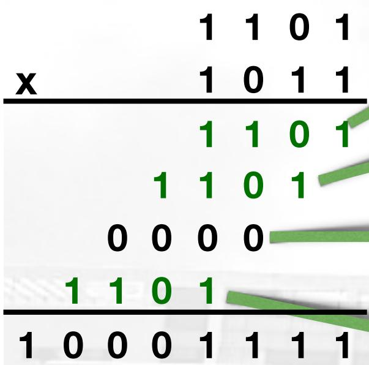

other

| Row | Column | Value |
|---|---|---|
| 1 | 0 | 1 |
| 2 | 0 | 0 |
| 3 | 0 | 1 |
| 4 | 0 | 1 |
| 5 | 1 | 1 |
| 6 | 1 | 0 |
| 7 | 1 | 1 |
| 8 | 1 | 0 |
| 9 | 1 | 1 |
| 10 | 0 | 0 |
| 11 | 0 | 0 |
| 12 | 0 | 0 |
| 13 | 0 | 1 |
| 14 | 1 | 0 |
| 15 | 1 | 1 |
| 16 | 1 | 1 |
| 17 | 1 | 1 |
The image contains a simple diagram with two horizontal lines (green) and two vertical lines (light green), each containing a row of numbers (x). The values inside the lines are explicitly labeled as '1'.

通过部分积D累加逐层结果

<table><tr><td rowspan="3">第一层加1101</td><td rowspan="2">0 0 0 0+ 1 1 0 1</td><td colspan="2">&lt;-部分积D,初值为0</td></tr><tr><td rowspan="2" colspan="2">D = D + X</td></tr><tr><td>1 1 0 1</td></tr><tr><td rowspan="3">第二层加1101</td><td rowspan="2">0 1 1 0 1+ 1 1 0 1 0</td><td colspan="2">D右移</td></tr><tr><td rowspan="2" colspan="2">D = D&gt;&gt;1 + X</td></tr><tr><td>1 0 0 1 1 1</td></tr><tr><td rowspan="2">第三层加0000</td><td>1 0 0 1 1 1+ 0 0 0 0 0 0</td><td rowspan="2" colspan="2">D右移D = D&gt;&gt;1 + X</td></tr><tr><td>1 0 0 1 1 1</td></tr><tr><td rowspan="2">第四层加1101</td><td>0 1 0 0 1 1 1+ 1 1 0 1 0 0 0</td><td rowspan="2" colspan="2">D右移D = D&gt;&gt;1 + X</td></tr><tr><td>1 0 0 0 1 1 1 1</td></tr></table>

<<是左移操作，>>是右移操作

# “表格式计算”一乘法

- 以原码一位乘法为例：竖式是直观的，步骤步骤累加是可理解的，表格式是一眼看上去懵逼的...

通过部分积D累加逐层结果

<table><tr><td rowspan="2">第一层加1101</td><td rowspan="2">0 0 0 0+ 1 1 0 11 1 0 1</td><td colspan="2">&lt;-部分积D,初值为0</td></tr><tr><td colspan="2">D = D + X</td></tr><tr><td rowspan="2">第二层加1101</td><td rowspan="2">0 1 1 0 1+ 1 1 0 1 01 0 0 1 1 1</td><td colspan="2">D右移</td></tr><tr><td colspan="2">D = D&gt;&gt;1 + X</td></tr><tr><td>第三层加0000</td><td>1 0 0 1 1 1+ 0 0 0 0 0 01 0 0 1 1 1</td><td colspan="2">D右移D = D&gt;&gt;1 + X</td></tr><tr><td>第四层加1101</td><td>0 1 0 0 1 1 1+ 1 1 0 1 0 0 01 0 0 0 1 1 1 1</td><td colspan="2">D右移D = D&gt;&gt;1 + X</td></tr></table>

部分积D的符号

(建议至少2位)

部分积D

粗线分隔D和Y

乘数Y

Y总是顶格对齐，D总右移，等效于竖式中X左移

2位符号，防止溢出时右移出现负数

<table><tr><td colspan="2">符号</td><td colspan="4">D</td><td colspan="3">Y</td><td> $Y_0$ </td><td>操作说明</td></tr><tr><td>0</td><td>0</td><td>0</td><td>0</td><td>0</td><td>0</td><td>1</td><td>0</td><td>1</td><td>1</td><td>D/Y初始化</td></tr><tr><td>0</td><td>0</td><td>1</td><td>1</td><td>0</td><td>1</td><td>1</td><td>0</td><td>1</td><td>1</td><td rowspan="2">+ [X] $_{原}$ </td></tr><tr><td>0</td><td>0</td><td>1</td><td>1</td><td>0</td><td>1</td><td>1</td><td>0</td><td>1</td><td>1</td></tr><tr><td>0</td><td>0</td><td>0</td><td>1</td><td>1</td><td>0</td><td>1</td><td>1</td><td>0</td><td>1</td><td>D/Y右移1位</td></tr><tr><td>0</td><td>0</td><td>1</td><td>1</td><td>0</td><td>1</td><td>0</td><td>1</td><td>0</td><td>1</td><td rowspan="2">+ [X] $_{原}$ </td></tr><tr><td>0</td><td>1</td><td>0</td><td>0</td><td>1</td><td>1</td><td>1</td><td>1</td><td>0</td><td>1</td></tr><tr><td>0</td><td>0</td><td>1</td><td>0</td><td>0</td><td>1</td><td>1</td><td>1</td><td>1</td><td>0</td><td>D/Y右移1位</td></tr><tr><td>0</td><td>0</td><td>0</td><td>0</td><td>0</td><td>0</td><td></td><td></td><td>1</td><td>0</td><td rowspan="2">+0</td></tr><tr><td>0</td><td>0</td><td>1</td><td>0</td><td>0</td><td>1</td><td>1</td><td>1</td><td>1</td><td>0</td></tr><tr><td>0</td><td>0</td><td>0</td><td>1</td><td>0</td><td>0</td><td>1</td><td>1</td><td>1</td><td>1</td><td>D/Y右移1位</td></tr><tr><td>0</td><td>0</td><td>1</td><td>1</td><td>0</td><td>1</td><td></td><td></td><td></td><td>1</td><td rowspan="2">+ [X] $_{原}$ </td></tr><tr><td>0</td><td>1</td><td>0</td><td>0</td><td>0</td><td>1</td><td>1</td><td>1</td><td>1</td><td>1</td></tr><tr><td>0</td><td>0</td><td>1</td><td>0</td><td>0</td><td>0</td><td>1</td><td>1</td><td>1</td><td>1</td><td>D/Y右移1位</td></tr></table>

# “表格式计算”一乘法

练习，[X]原=0.100111，[Y]原=1.100111，求积

1. 设一临时变量 $D = 0$
2. 若Y末位为1， $D = D + X$
3. $D$ 右移一位; $Y$ 右移一位
4. 若 $Y$ 有剩余位数，回到第2步
5. 结束

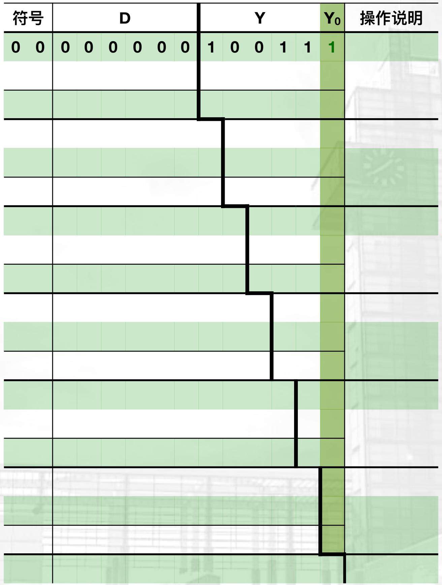

text_image

符号 D Y Y₀ 操作说明
0 0 0 0 0 0 0 0 1 0 0 1 1 1
1

# “表格式计算”一乘法

练习，[X]原=0.100111，[Y]原=1.100111，求积

1. 设一临时变量 $D = 0$
2. 若Y末位为1， $D = D + X$
3. $D$ 右移一位; $Y$ 右移一位
4. 若 $Y$ 有剩余位数，回到第2步
5. 结束

<table><tr><td>符号</td><td>D</td><td colspan="5">Y</td><td> $Y_0$ </td><td>操作说明</td></tr><tr><td>0 0</td><td>0 0 0 0 0 0</td><td>1</td><td>0</td><td>0</td><td>1</td><td>1</td><td>1</td><td>D/Y初始化</td></tr><tr><td>0 0</td><td>| 0 0 | | |</td><td colspan="5"></td><td></td><td rowspan="2">+[X] $_{原}$ </td></tr><tr><td>0 0</td><td>| 0 0 | | |</td><td colspan="5"></td><td></td></tr><tr><td>0 0</td><td>0 1 0 0 1 1</td><td>/</td><td>1</td><td>0</td><td>0</td><td>1</td><td>/</td><td>D/Y右移1位</td></tr><tr><td>0 0</td><td>| 0 0 | | | | 0</td><td colspan="5"></td><td></td><td rowspan="2">+[X] $_{原}$ </td></tr><tr><td>0 0</td><td>| | | | 0 | 0 |</td><td>/</td><td>1</td><td>0</td><td>0</td><td>1</td><td>/</td></tr><tr><td>0 0</td><td>0 | | | | 0 | 0 |</td><td>0</td><td>1</td><td>/</td><td>0</td><td>0</td><td>/</td><td>D/Y右移1位</td></tr><tr><td>0 0</td><td>| 0 0 | | | | 0 0</td><td>/</td><td>0</td><td>0</td><td>1</td><td>0</td><td>/</td><td rowspan="2">+[X] $_{原}$ </td></tr><tr><td>0 |</td><td>0 0 0 | 0 0 0 |</td><td>/</td><td>1</td><td>0</td><td>0</td><td>1</td><td></td></tr><tr><td>0 0</td><td>| 0 0 0 | 0 0 0 |</td><td>/</td><td>1</td><td>0</td><td colspan="3">0</td><td>D/Y右移1位</td></tr><tr><td></td><td></td><td colspan="5"></td><td></td><td rowspan="2">+0</td></tr><tr><td></td><td></td><td colspan="5"></td><td></td></tr><tr><td>0 0</td><td colspan="5">0 | 0 0 0 | 0 0 0 |</td><td>/</td><td>0</td><td>D/Y右移1位</td></tr><tr><td></td><td colspan="5"></td><td></td><td></td><td rowspan="2">+0</td></tr><tr><td></td><td colspan="5"></td><td></td><td></td></tr><tr><td>0 0</td><td colspan="6">0 0 | 0 0 0 | 0 0 0 |</td><td>/</td><td>D/Y右移1位</td></tr><tr><td>0 0</td><td>| 0 0 | | |</td><td colspan="5"></td><td></td><td rowspan="2">+[X] $_{原}$ </td></tr><tr><td>0 0</td><td colspan="6">| 0 | | | | | | 0 0 0 |</td><td>/</td></tr><tr><td>0 0</td><td colspan="6">0 | 0 | | | | | 0 0 0 |</td><td></td><td>D/Y右移1位</td></tr></table>

# 原码两位乘法

# 原码二位乘法

原码二位乘法，

一次乘两位数字？这个在十进制下很反人类啊…，但在二进制下，似乎还好…

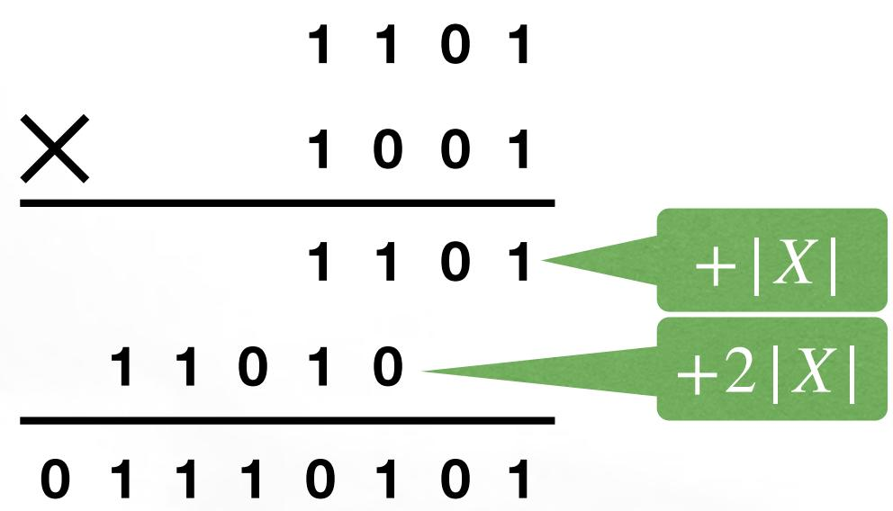

text_image

1 1 0 1
×          1 0 0 1
    1 1 0 1
1 1 0 1 0
0 1 1 1 0 1 0 1
+|X|
+2|X|

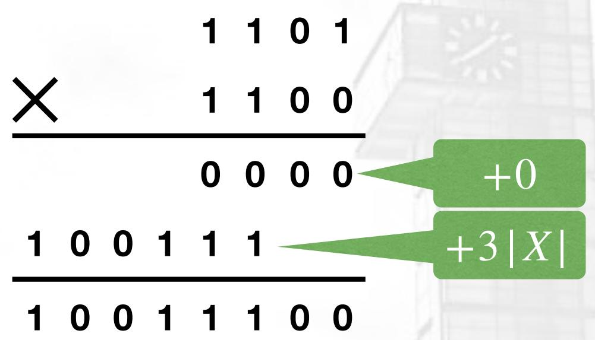

text_image

1 1 0 1
×    1 1 0 0
-----
      0 0 0 0
1 0 0 1 1 1
-----
1 0 0 1 1 1 0 0
+0
+3 |X|

规则似乎很直观：

$$
\left\{ \begin{array}{l} Y _ {i + 1} Y i = 0 0, + 0 \\ Y _ {i + 1} Y i = 0 1, + | X | \\ Y _ {i + 1} Y i = 1 0, + 2 | X | \\ Y _ {i + 1} Y i = 1 1, + 3 | X | \end{array} \right.
$$

规则还可以更进一步优化：

$$
3 | X | = + 4 | X | - | X |
$$

$\Rightarrow$ 先减 $|X|$ ，平移2位后加 $|X|$

怎么做减法？把X和D用补码表示

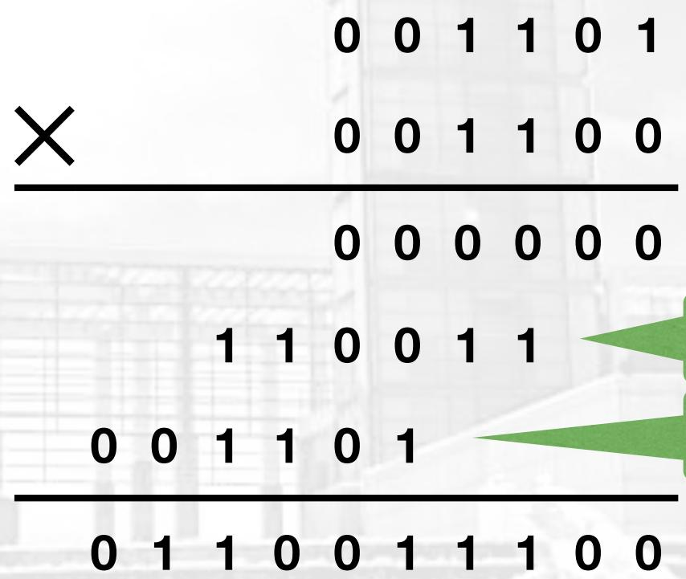

text_image

0 0 1 1 0 1
0 0 1 1 0 0
×
0 0 0 0 0 0
1 1 0 0 1 1
0 0 1 1 0 1
0 1 1 0 0 1 1 1 0 0

# 原码二位乘法

规则还可以更进一步优化：

$$
3 | X | = + 4 | X | - | X |
$$

$\Rightarrow$ 先减 $|X|$ ，平移2位后加 $|X|$

怎么做减法？把X和D用补码表示

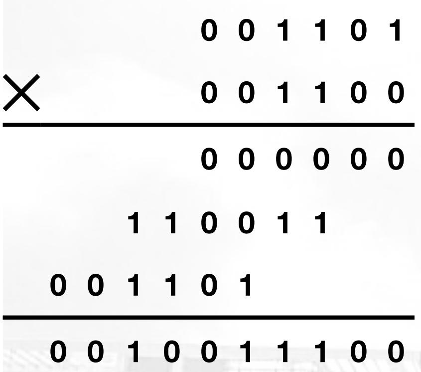

text_image

×
0 0 1 1 0 1
0 0 1 1 0 0
0 0 0 0 0 0
1 1 0 0 1 1
0 0 1 1 0 1
0 0 1 0 0 1 1 1 0 0

然而，还有一些复杂情况，例如...

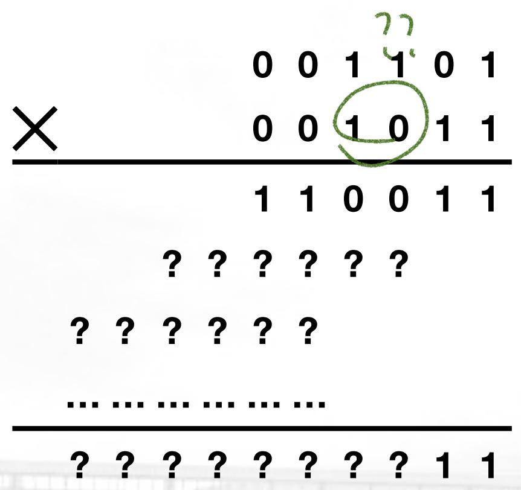

text_image

0 0 1 1 0 1
0 0 1 0 1 1
×
1 1 0 0 1 1
? ? ? ? ?
? ? ? ? ?
......
?
??? ? ? ? ? 1 1

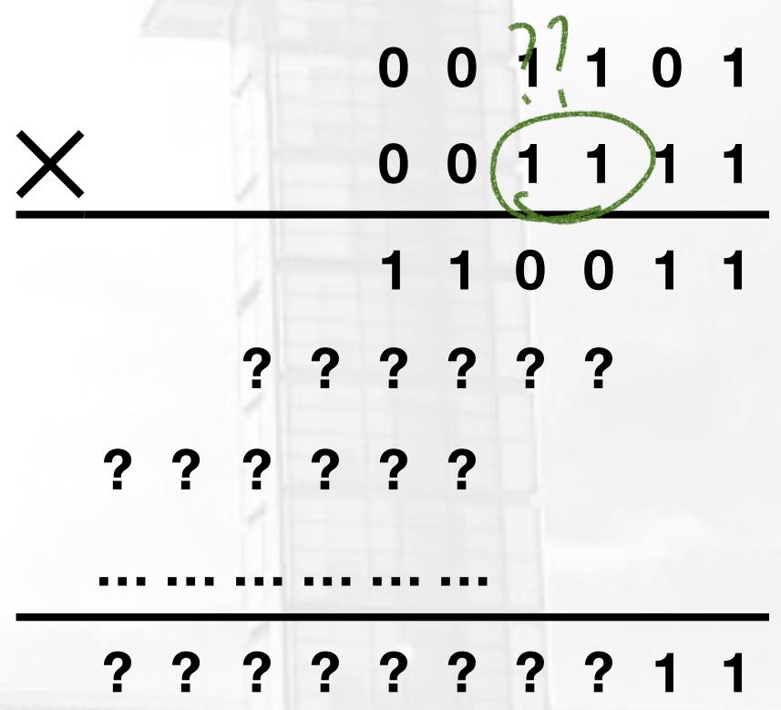

text_image

0 0 1 1 0 1
0 0 1 1 1 1
×
1 1 0 0 1 1
? ? ? ? ?
? ? ? ? ?
......
? ? ? ? ? ? ? 1 1

# 原码二位乘法

规则还可以更进一步优化：

$$
3 | X | = + 4 | X | - | X |
$$

$\Rightarrow$ 先减 $|X|$ ，平移2位后加 $|X|$

怎么做减法？把X和D用补码表示

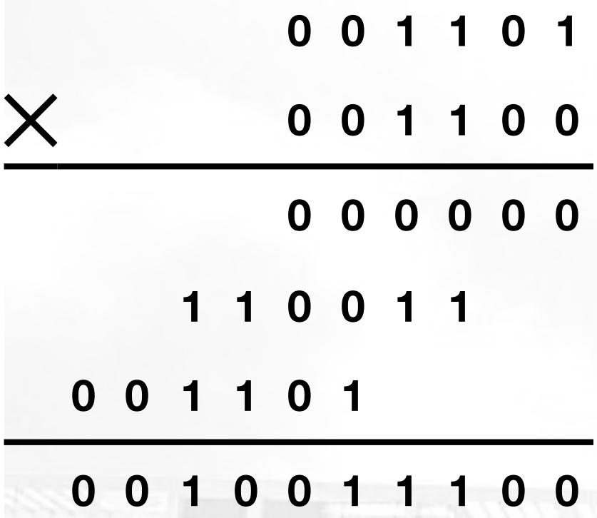

text_image

0 0 1 1 0 1
×    0 0 1 1 0 0
-----
        0 0 0 0 0 0
        1 1 0 0 1 1
0 0 1 1 0 1
-----
0 0 1 0 0 1 1 1 0 0

好在这些复杂情况，还是使用相同的方法 + 进位机制！

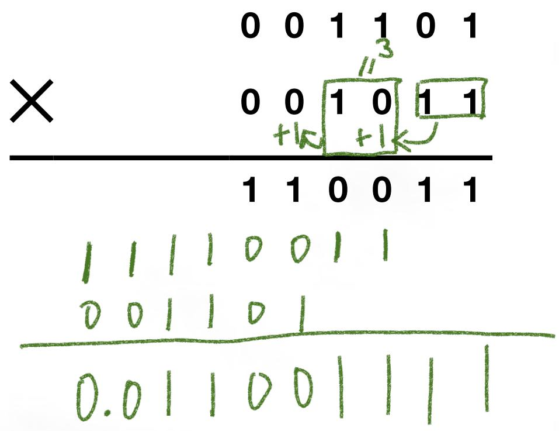

text_image

×
0 0 1 1 0 1
113
0 0 1 0 1 1
+k +l
1 1 0 0 1 1
1 1 1 0 0 1 1
0 0 1 0 1
0.0 1 1 0 0 1 1 1

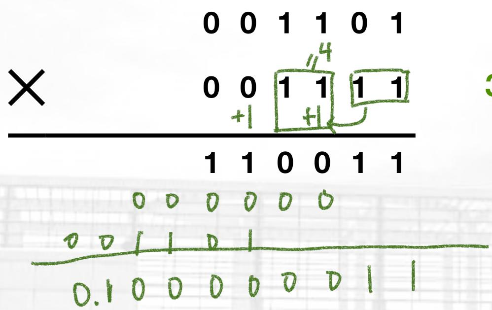

text_image

0 0 1 1 0 1
×
0 0 1 1 1 1
+1 +1
1 1 0 0 1 1
0 0 0 0 0 0
0 0 1 1 0 1
0.1 0 0 0 0 0 0 1 1

补充的规则:

1. 遇到>=3倍情况时，平移2位后加 $|X|$ ，相当于给下一组乘数进位+1；
2. 当=4倍情况时，不减 $|X|$ 直接平移2位，并进位
3. 使用一个标志C指示下一组需要加上进位

# 原码二位乘法

带大家练习一哈，[X]原=0.100111, [Y]原=1.100111，求积

解：[2X]补=01.001110；[-X]补=11.011001

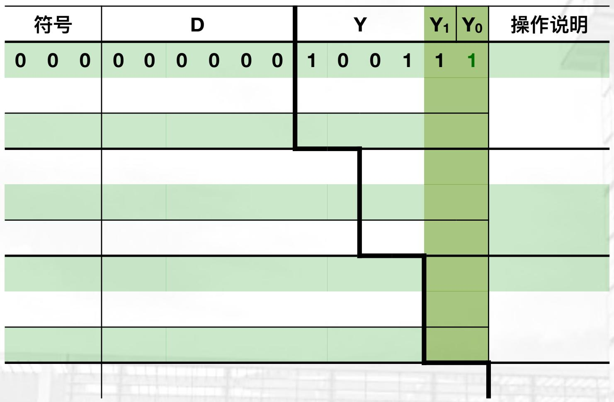

text_image

符号 D Y Y₁ Y₀ 操作说明
0 0 0 0 0 0 0 0 0 1 0 0 1 1 1
操作说明

# 原码二位乘法

带大家练习一哈，[X]原=0.100111, [Y]原=1.100111，求积

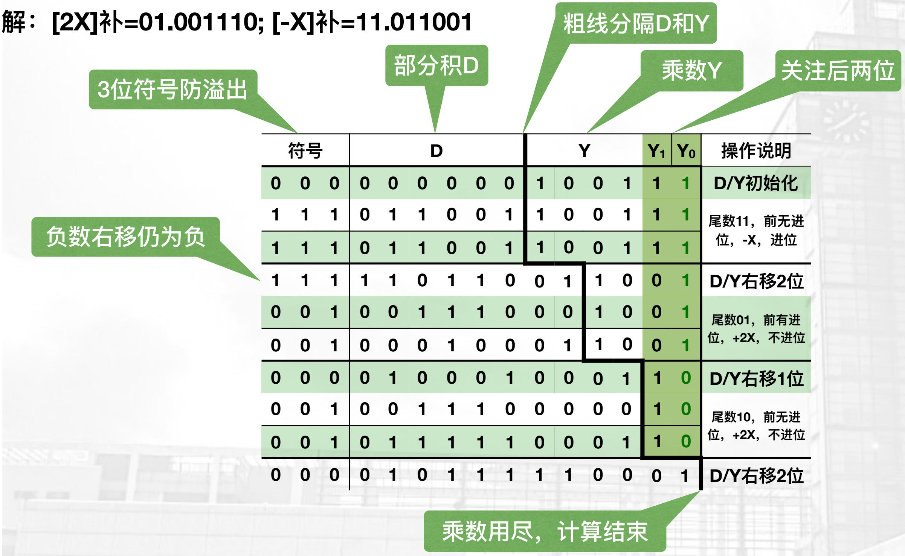

text_image

解：[2X]补=01.001110; [-X]补=11.011001
3位符号防溢出
部分积D
粗线分隔D和Y
乘数Y
关注后两位
负数右移仍为负
符号	D	Y	Y₁	Y₀	操作说明
0	0	0	0	0	0	0	0	1	0	0	1	1	1	D/Y初始化
1	1	1	0	1	1	0	0	1	1	0	0	1	1	1	尾数11, 前无进位, -X, 进位
1	1	1	0	1	1	0	0	1	1	0	0	1	1	1
1	1	1	0	1	1	0	0	1	1	0	0	1	1	1
1	1	1	1	1	0	1	1	0	0	1	1	0	0	1	D/Y右移2位
0	0	1	0	0	1	1	1	0	0	0	1	0	0	1	尾数01, 前有进位, +2X, 不进位
0	0	1	0	0	0	1	0	0	0	1	1	0	0	1
0	0	0	0	1	0	0	0	1	0	0	0	1	1	0	D/Y右移1位
0	0	1	0	0	1	1	1	0	0	0	0	0	1	1	0
0	0	1	0	1	1	1	1	1	0	0	0	0	1	1	0	D/Y右移2位
0	0	0	0	1	0	1	1& 1& 1& 1& 0& 0& 0& 0& 1& 0& 乘数用尽, 计算结束

# 原码二位乘法

再来练习一哈，[X]原=0.100111, [Y]原=1.101110，求积

解：[2X]补=01.001110；[-X]补=11.011001

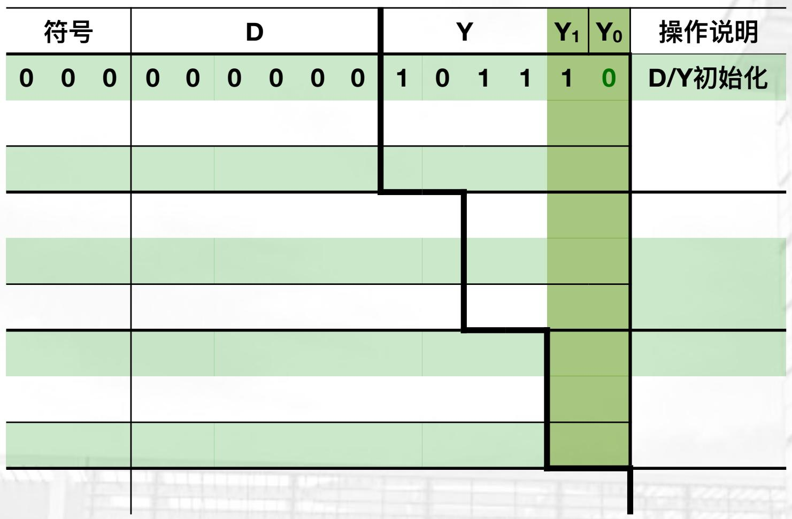

text_image

符号	D	Y	Y₁	Y₀	操作说明
0 0 0	0 0 0 0 0 0	1 0 1 1	1 0	D/Y初始化

# 原码二位乘法

再来练习一哈，[X]原=0.100111, [Y]原=1.101110，求积

解：[2X]补=01.001110；[-X]补=11.011001

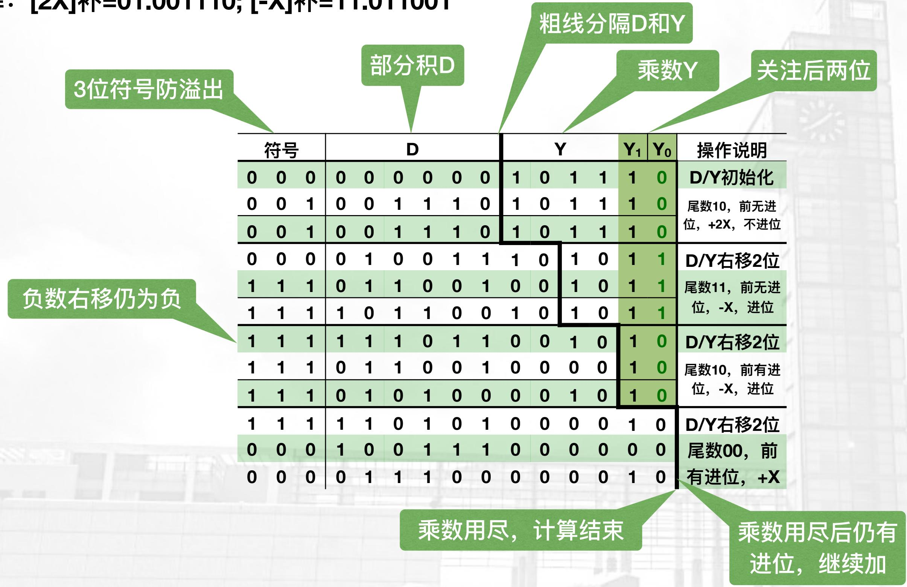

text_image

3位符号防溢出
部分积D
粗线分隔D和Y
乘数Y
关注后两位
负数右移仍为负
乘数用尽，计算结束
乘数用尽后仍有进位，继续加

# Booth乘法 (补码乘法)

# Booth乘法 (补码乘法)

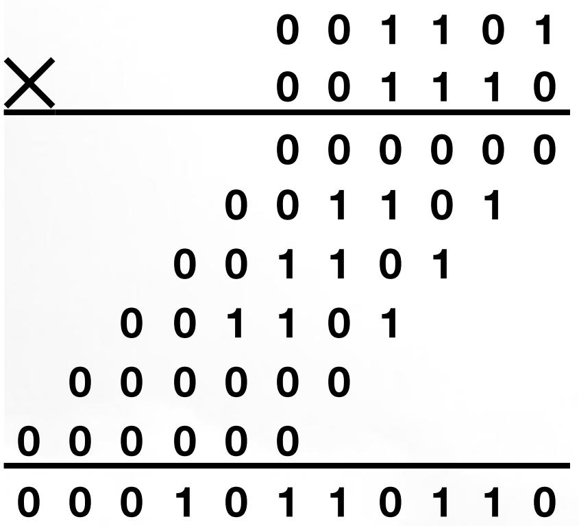

text_image

×
0 0 1 1 0 1
0 0 1 1 1 0
0 0 0 0 0 0
0 0 1 1 0 1
0 0 1 1 0 1
0 0 1 1 0 1
0 0 0 0 0 0
0 0 0 0 0 0
0 0 1 0 1 1 0 1 1 0

<-无脑计算需要6步
v.s

略用心机只需3步一>

能不能更简化！？

先看一个日常使用的技巧:

$$
1 2 3 4 5 \times 1 0 0 1 = 1 2 3 4 5 \times (1 0 0 0 + 1)
$$

$$
2 3 4 2 \times 9 9 9 = 2 3 4 2 \times (1 0 0 0 - 1)
$$

对二进制，也一样！

$$
1 0 1 0 \times 0 1 1 1 = 1 0 1 0 \times (1 0 0 0 - 1)
$$

$$
1 0 1 0 \times 1 1 1 0 = 1 0 1 0 \times (1 0 0 0 0 - 1 0)
$$

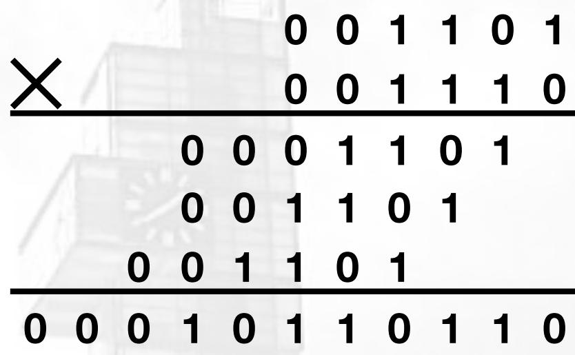

text_image

×
0 0 1 1 0 1
0 0 1 1 1 0
0 0 0 1 1 0 1
0 0 1 1 0 1
0 0 1 1 0 1
0 0 0 1 0 1 1 0 1 1 0

# Booth乘法 (补码乘法)

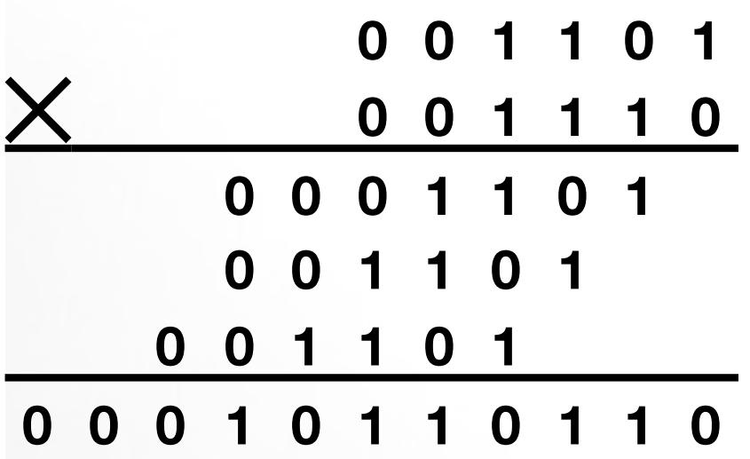

text_image

0 0 1 1 0 1
0 0 1 1 1 0
×
0 0 0 1 1 0 1
0 0 1 1 0 1
0 0 1 1 0 1
0 0 1 1 0 1
0 0 0 1 0 1 1 0 1 1 0

<-略用心机需要3步

v.s

运用技巧只需2步一>

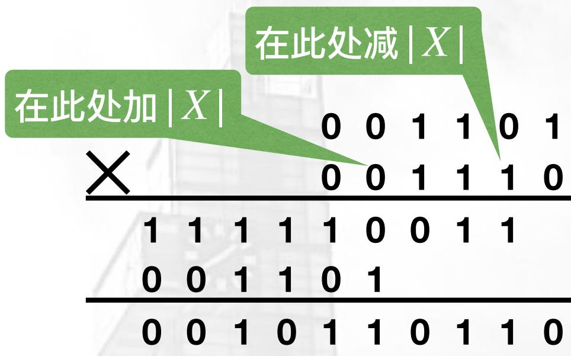

text_image

在此处加 |X|
在此处减 |X|
0 0 1 1 0 1
0 0 1 1 1 0
1 1 1 1 1 0 0 1 1
0 0 1 1 0 1
0 0 1 0 1 1 0 1 1 0

问题来了：如何高效地识别“一串1”的开始和结束？

# Booth算法:

- 从右向左，遇到“10”就是“一串1”的开始，在1的位置减 $|X|$ ；
- 从右向左，遇到“0 1”就是“一串1”的结束，在0的位置加 $|X|$ ；
- 中间的“00”和“11”都不管！

<table><tr><td> $y_i$   $y_{i-1}$ </td><td>操作</td></tr><tr><td>0 0</td><td>部分积+0,右移1位</td></tr><tr><td>0 1</td><td>部分积+[X] $_{补}$ ,右移1</td></tr><tr><td>1 0</td><td>部分积+[-X] $_{补}$ ,右移1</td></tr><tr><td>1 1</td><td>部分积+0,右移1位</td></tr></table>

# Booth乘法 (补码乘法)

# Booth算法:

- 从右向左，遇到“10”就是“一串1”的开始，在1的位置减 $|X|$ ；
- 从右向左，遇到“0 1”就是“一串1”的结束，在0的位置加 $|X|$ ；
- 中间的“00”和“11”都不管！

【例】X=0.1010，Y=-0.1101，利用Booth法求积。

【解】：

$$
[ \mathbf {X} ] _ {\text {补}} = 0 0. 1 0 1 0
$$

$$
[ - X ] _ {\text {补}} = 1 1. 0 1 1 0
$$

$$
[ \mathrm{Y} ] _ {\text {补}} = 1 1. 0 0 1 1
$$

∴ [X·Y]补 = 1.01111110

[Y]补含1位符号

-1位置尾数

<table><tr><td colspan="2">符号</td><td colspan="4">D</td><td colspan="4">Y</td><td> $Y_0$ </td><td> $Y_{-1}$ </td><td>操作说明</td></tr><tr><td>0</td><td>0</td><td>0</td><td>0</td><td>0</td><td>0</td><td>1</td><td>0</td><td>0</td><td>1</td><td>1</td><td>0</td><td>D/Y初始化</td></tr><tr><td>1</td><td>1</td><td>0</td><td>1</td><td>1</td><td>0</td><td>1</td><td>0</td><td>0</td><td>1</td><td>1</td><td>0</td><td rowspan="2">尾数10,“串头”,-X</td></tr><tr><td>1</td><td>1</td><td>0</td><td>1</td><td>1</td><td>0</td><td>1</td><td>0</td><td>0</td><td>1</td><td>1</td><td>0</td></tr><tr><td>1</td><td>1</td><td>1</td><td>0</td><td>1</td><td>1</td><td>0</td><td>1</td><td>0</td><td>0</td><td>1</td><td>1</td><td>尾数11,跳过</td></tr><tr><td>1</td><td>1</td><td>1</td><td>1</td><td>0</td><td>1</td><td>1</td><td>0</td><td>1</td><td>0</td><td>0</td><td>1</td><td>D/Y右移2位</td></tr><tr><td>0</td><td>0</td><td>1</td><td>0</td><td>1</td><td>0</td><td>0</td><td>0</td><td>1</td><td>0</td><td>0</td><td>1</td><td rowspan="2">尾数01,“串尾”,+X</td></tr><tr><td>0</td><td>0</td><td>0</td><td>1</td><td>1</td><td>1</td><td>1</td><td>0</td><td>1</td><td>0</td><td>0</td><td>1</td></tr><tr><td>0</td><td>0</td><td>0</td><td>0</td><td>1</td><td>1</td><td>1</td><td>1</td><td>0</td><td>1</td><td>0</td><td>0</td><td>尾数00,跳过</td></tr><tr><td>0</td><td>0</td><td>0</td><td>0</td><td>0</td><td>1</td><td>1</td><td>1</td><td>1</td><td>0</td><td>1</td><td>0</td><td>D/Y右移2位</td></tr><tr><td>1</td><td>1</td><td>0</td><td>1</td><td>1</td><td>0</td><td>0</td><td>0</td><td>0</td><td>0</td><td>1</td><td>0</td><td rowspan="2">尾数10,“串头”,-X</td></tr><tr><td>1</td><td>1</td><td>0</td><td>1</td><td>1</td><td>1</td><td>1</td><td>1</td><td>1</td><td>0</td><td>1</td><td>0</td></tr><tr><td>1</td><td>1</td><td>1.</td><td>0</td><td>1</td><td>1</td><td>1</td><td>1</td><td>1</td><td>1</td><td>0</td><td>1</td><td>D/Y右移2位</td></tr></table>

结束首位为符号

乘数用尽，计算结束

# Booth乘法 (补码乘法)

练习，[X]原=0.110110, [Y]原

=1.101101，求积

解：[-X]补=1.001010;

[Y]补=1.010011

<table><tr><td colspan="2">符号</td><td colspan="6">D</td><td colspan="6">Y</td><td> $Y_0$ </td><td> $Y_{-1}$ </td><td>操作说明</td></tr><tr><td>0</td><td>0</td><td>0</td><td>0</td><td>0</td><td>0</td><td>0</td><td>0</td><td>1</td><td>0</td><td>1</td><td>0</td><td>0</td><td>1</td><td>1</td><td>0</td><td>D/Y初始化</td></tr><tr><td>1</td><td>1</td><td>0</td><td>0</td><td>1</td><td>0</td><td>1</td><td>0</td><td>1</td><td>0</td><td>1</td><td>0</td><td>0</td><td>1</td><td>1</td><td>0</td><td rowspan="2">尾数10,“串头”,-X</td></tr><tr><td>1</td><td>1</td><td>0</td><td>0</td><td>1</td><td>0</td><td>1</td><td>0</td><td>1</td><td>0</td><td>1</td><td>0</td><td>0</td><td>1</td><td>1</td><td>0</td></tr><tr><td>1</td><td>1</td><td>1</td><td>0</td><td>0</td><td>1</td><td>0</td><td>1</td><td>0</td><td>1</td><td>0</td><td>1</td><td>0</td><td>0</td><td>1</td><td>1</td><td>尾数11,跳过</td></tr><tr><td>1</td><td>1</td><td>1</td><td>1</td><td>0</td><td>0</td><td>1</td><td>0</td><td>1</td><td>0</td><td>1</td><td>0</td><td>1</td><td>0</td><td>0</td><td>1</td><td>D/Y右移2位</td></tr><tr><td>0</td><td>0</td><td>1</td><td>1</td><td>0</td><td>1</td><td>1</td><td>0</td><td>0</td><td>0</td><td>1</td><td>0</td><td>1</td><td>0</td><td>0</td><td>1</td><td rowspan="2">尾数01,“串尾”,+X</td></tr><tr><td>0</td><td>0</td><td>1</td><td>0</td><td>1</td><td>0</td><td>0</td><td>0</td><td>1</td><td>0</td><td>1</td><td>0</td><td>1</td><td>0</td><td>0</td><td>1</td></tr><tr><td>0</td><td>0</td><td>0</td><td>1</td><td>0</td><td>1</td><td>0</td><td>0</td><td>0</td><td>1</td><td>0</td><td>1</td><td>0</td><td>1</td><td>0</td><td>0</td><td>尾数00,跳过</td></tr><tr><td>0</td><td>0</td><td>0</td><td>0</td><td>1</td><td>0</td><td>1</td><td>0</td><td>0</td><td>0</td><td>1</td><td>0</td><td>1</td><td>0</td><td>1</td><td>0</td><td>D/Y右移2位</td></tr><tr><td>1</td><td>1</td><td>0</td><td>0</td><td>1</td><td>0</td><td>1</td><td>0</td><td>0</td><td>0</td><td>0</td><td>0</td><td>1</td><td>0</td><td>1</td><td>0</td><td rowspan="2">尾数10,“串头”,-X</td></tr><tr><td>1</td><td>1</td><td>0</td><td>1</td><td>0</td><td>1</td><td>0</td><td>0</td><td>0</td><td>0</td><td>1</td><td>0</td><td>1</td><td>0</td><td>1</td><td>0</td></tr><tr><td>1</td><td>1</td><td>1</td><td>0</td><td>1</td><td>0</td><td>1</td><td>0</td><td>0</td><td>0</td><td>0</td><td>1</td><td>0</td><td>1</td><td>0</td><td>1</td><td>D/Y右移2位</td></tr><tr><td>0</td><td>0</td><td>1</td><td>1</td><td>0</td><td>1</td><td>1</td><td>0</td><td>0</td><td>0</td><td>0</td><td>0</td><td>0</td><td>1</td><td>0</td><td>1</td><td rowspan="2">尾数10,“串头”,-X</td></tr><tr><td>0</td><td>0</td><td>1</td><td>0</td><td>0</td><td>0</td><td>0</td><td>0</td><td>0</td><td>0</td><td>0</td><td>1</td><td>0</td><td>1</td><td>0</td><td>1</td></tr><tr><td>0</td><td>0</td><td>0</td><td>1</td><td>0</td><td>0</td><td>0</td><td>0</td><td>0</td><td>0</td><td>0</td><td>0</td><td>1</td><td>0</td><td>1</td><td>0</td><td>D/Y右移2位</td></tr><tr><td>1</td><td>1</td><td>0</td><td>0</td><td>1</td><td>0</td><td>1</td><td>0</td><td>0</td><td>0</td><td>0</td><td>0</td><td>0</td><td>0</td><td>1</td><td>0</td><td rowspan="2">尾数10,“串头”,-X</td></tr><tr><td>1</td><td>1</td><td>0</td><td>1</td><td>1</td><td>0</td><td>1</td><td>0</td><td>0</td><td>0</td><td>0</td><td>0</td><td>1</td><td>0</td><td>1</td><td>0</td></tr><tr><td>1</td><td>1</td><td>1.</td><td>0</td><td>1</td><td>1</td><td>0</td><td>1</td><td>0</td><td>0</td><td>0</td><td>0</td><td>0</td><td>1</td><td>0</td><td>1</td><td></td></tr></table>

∴ [X·Y]补 = 1.1011010000010

# 除法的“表格式计算”

# 关于除法的“表格式计算”

按理说，原码一位除法就是模拟手工除法：

- 符号 $S_{m} = S_{A} \oplus S_{b}$ , 数值 $|m| = |A| / |B|$

例，[X]原=0.1011, [Y]原=1.1101，求商/余数

解：符号， $S = 0 \oplus 1 = 1$ ；数值部分如下：

模拟手工除法
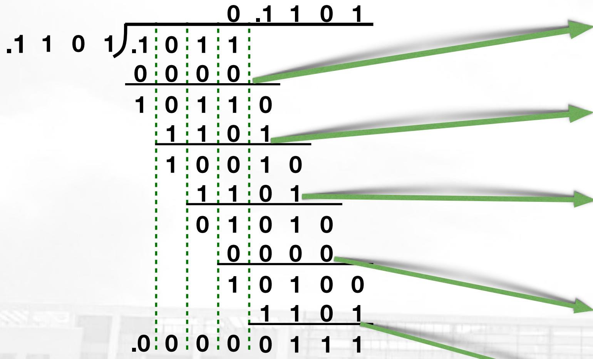

other

| Bit | Value |
| --- | --- |
| 0   | 0   |
| 1   | 0   |
| 2   | 0   |
| 3   | 0   |
| 4   | 0   |
| 5   | 0   |
| 6   | 0   |
| 7   | 0   |
| 8   | 0   |
| 9   | 0   |
| 10  | 0   |
| 11  | 0   |
| 12  | 0   |
| 13  | 0   |
| 14  | 0   |
| 15  | 0   |
| 16  | 0   |
| 17  | 0   |
| 18  | 0   |
| 19  | 0   |
| 20  | 0   |
| 21  | 0   |
| 22  | 0   |
| 23  | 0   |
| 24  | 0   |
| 25  | 0   |
| 26  | 0   |
| 27  | 0   |
| 28  | 0   |
| 29  | 0   |
| 30  | 0   |
| 31  | 0   |
| 32  | 0   |
| 33  | 0   |
| 34  | 0   |
| 35  | 0   |
| 36  | 0   |
| 37  | 0   |
| 38  | 0   |
| 39  | 0   |
| 40  | 0   |
| Note: The actual values in the 'Value' column are not provided in the code. The 'Number' in the 'Bit' column is not explicitly labeled.

$[\mathrm{X}\div \mathrm{Y}]$ 原 $= 1.1001$
余数 $= 1.1101 \times 2 - 4$

<table><tr><td colspan="2">符号</td><td colspan="4">余数(R)</td><td>商</td><td>操作说明</td></tr><tr><td>0</td><td>0</td><td>1</td><td>0</td><td>1</td><td>1</td><td rowspan="3">0</td><td>R初始化</td></tr><tr><td>0</td><td>0</td><td>0</td><td>0</td><td>0</td><td>0</td><td rowspan="2">不够减,商0R=R-0</td></tr><tr><td>0</td><td>0</td><td>1</td><td>0</td><td>1</td><td>1</td></tr><tr><td>0</td><td>1</td><td>0</td><td>1</td><td>1</td><td>0</td><td rowspan="3">1</td><td>R左移1位</td></tr><tr><td>1</td><td>1</td><td>0</td><td>0</td><td>1</td><td>1</td><td rowspan="2">够减,商1R=R-D</td></tr><tr><td>0</td><td>0</td><td>1</td><td>0</td><td>0</td><td>1</td></tr><tr><td>0</td><td>1</td><td>0</td><td>0</td><td>1</td><td>0</td><td rowspan="3">1</td><td>R左移1位</td></tr><tr><td>1</td><td>1</td><td>0</td><td>0</td><td>1</td><td>1</td><td rowspan="2">够减,商1R=R-D</td></tr><tr><td>0</td><td>0</td><td>0</td><td>1</td><td>0</td><td>1</td></tr><tr><td>0</td><td>0</td><td>1</td><td>0</td><td>1</td><td>0</td><td rowspan="3">0</td><td>R左移1位</td></tr><tr><td>0</td><td>0</td><td>0</td><td>0</td><td>0</td><td>0</td><td rowspan="2">不够减,商0R=R-0</td></tr><tr><td>0</td><td>0</td><td>1</td><td>0</td><td>1</td><td>0</td></tr><tr><td>0</td><td>1</td><td>0</td><td>1</td><td>0</td><td>0</td><td rowspan="3">1</td><td>R左移1位</td></tr><tr><td>1</td><td>1</td><td>0</td><td>0</td><td>1</td><td>1</td><td rowspan="2">够减,商1R=R-D</td></tr><tr><td>0</td><td>0</td><td>0</td><td>1</td><td>1</td><td>1</td></tr></table>

# 关于除法的“表格式计算”

解决方案一：无脑直减，减多了原地恢复（恢复余数法）

例，[X]原=0.1011, [Y]原=1.1101，求商/余数

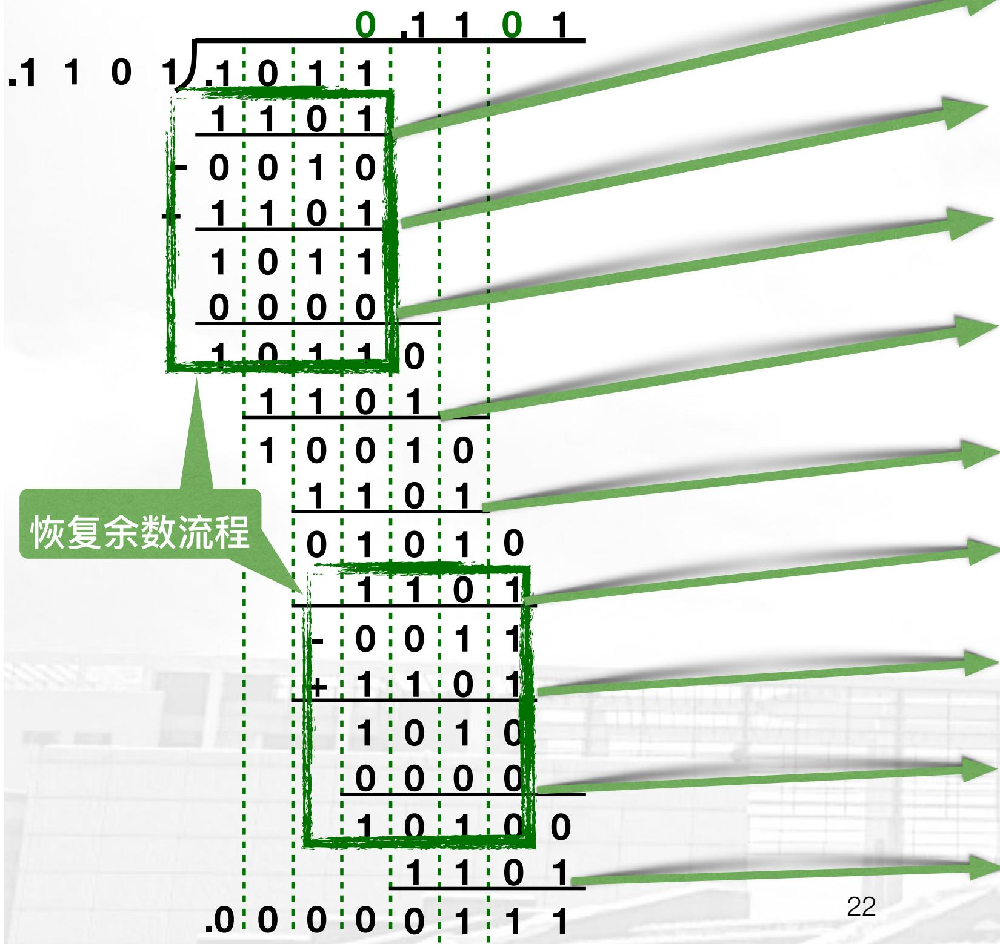

text_image

.1 1 0 1) .1 0 1 1
    1 1 0 1
      0 0 1 0
      1 1 0 1
      1 0 1 1
      0 0 0 0
      1 0 1 1 0
          1 1 0 1
          1 0 0 1 0
            1 1 0 1
            0 1 0 1 0
            1 1 0 1
            - 0 0 1 1
            + 1 1 0 1
            1 0 1 0
            0 0 0 0
            1 0 1 0 0
                1 1 0 1
.0 0 0 0 0 1 1 1
恢复余数流程
22

使用临时变量R逐层累减除数D

<table><tr><td>层次</td><td colspan="5">被除数(余数)R</td><td>商↓</td><td>说明</td><td></td></tr><tr><td rowspan="3">第一层减1101</td><td>0</td><td>1</td><td>0</td><td>1</td><td>1</td><td></td><td rowspan="3">R&gt;0无脑减DR=R-D</td><td></td></tr><tr><td>-</td><td>0</td><td>1</td><td>1</td><td>0</td><td>1</td><td></td></tr><tr><td>-</td><td>0</td><td>0</td><td>0</td><td>1</td><td>0</td><td></td></tr><tr><td rowspan="3">第二层加1101</td><td>-</td><td>0</td><td>0</td><td>0</td><td>1</td><td>0</td><td rowspan="3">R&lt;0+D恢复RR=R+D</td><td></td></tr><tr><td>+</td><td>0</td><td>1</td><td>1</td><td>0</td><td rowspan="2">1</td><td></td></tr><tr><td>0</td><td>1</td><td>0</td><td>1</td><td>1</td><td></td></tr><tr><td rowspan="3">第三层减0</td><td>0</td><td>1</td><td>0</td><td>1</td><td>1</td><td>0</td><td rowspan="3">0不够减、商0R=R-D*0</td><td></td></tr><tr><td>-</td><td>0</td><td>0</td><td>0</td><td>0</td><td rowspan="2">0</td><td></td></tr><tr><td>0</td><td>1</td><td>0</td><td>1</td><td>1</td><td></td></tr><tr><td rowspan="3">第四层减1101</td><td>1</td><td>1</td><td>0</td><td>1</td><td>0</td><td>1</td><td rowspan="3">R&lt;&lt;1够减,商1R=R-D</td><td></td></tr><tr><td>-</td><td>0</td><td>1</td><td>1</td><td>0</td><td rowspan="2">1</td><td></td></tr><tr><td>0</td><td>1</td><td>0</td><td>0</td><td>1</td><td></td></tr><tr><td rowspan="3">第五层减1101</td><td>1</td><td>0</td><td>0</td><td>1</td><td>0</td><td>1</td><td rowspan="3">R&lt;&lt;1够减,商1R=R-D</td><td></td></tr><tr><td>-</td><td>0</td><td>1</td><td>1</td><td>0</td><td rowspan="2">1</td><td></td></tr><tr><td>0</td><td>0</td><td>1</td><td>0</td><td>1</td><td></td></tr><tr><td rowspan="3">第六层减1101</td><td>0</td><td>1</td><td>0</td><td>1</td><td>0</td><td></td><td rowspan="3">R&gt;0无脑减DR=R-D</td><td></td></tr><tr><td>-</td><td>0</td><td>1</td><td>1</td><td>0</td><td>1</td><td></td></tr><tr><td>-</td><td>0</td><td>0</td><td>0</td><td>1</td><td>1</td><td></td></tr><tr><td rowspan="3">第七层加1101</td><td>-</td><td>0</td><td>0</td><td>0</td><td>1</td><td>1</td><td rowspan="3"></td><td rowspan="3">R&lt;0+D恢复RR=R+D</td></tr><tr><td>+</td><td>0</td><td>1</td><td>1</td><td>0</td><td rowspan="2">1</td></tr><tr><td>0</td><td>1</td><td>0</td><td>1</td><td>0</td></tr><tr><td rowspan="3">第八层减0</td><td>0</td><td>1</td><td>0</td><td>1</td><td>0</td><td>0</td><td rowspan="3">0不够减、商0R=R-D*0</td><td rowspan="3"></td></tr><tr><td>-</td><td>0</td><td>0</td><td>0</td><td>0</td><td rowspan="2">0</td></tr><tr><td>0</td><td>1</td><td>0</td><td>1</td><td>0</td></tr><tr><td rowspan="3">第九层减1101</td><td>1</td><td>0</td><td>1</td><td>0</td><td>0</td><td>1</td><td rowspan="3">R&lt;&lt;1够减,商1R=R-D</td><td rowspan="3"></td></tr><tr><td>-</td><td>0</td><td>1</td><td>1</td><td>0</td><td rowspan="2">1</td></tr><tr><td>0</td><td>0</td><td>1</td><td>1</td><td>1</td></tr></table>

# 关于除法的“表格式计算”

解决方案二：无脑直减，减多了原地不恢复（加减交替法）

例，[X]原=0.1011, [Y]原=1.1101，求商/余数

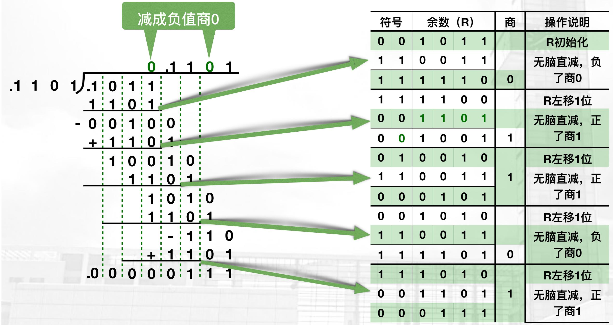

flowchart

```mermaid
graph TD
    A["减成负值商0"] --> B["符号"]
    B --> C["余数 (R)"]
    C --> D["商"]
    D --> E["操作说明"]

    subgraph 减数值示例
        F["0 0 1 0 1 1"] --> G["R初始化"]
        H["1 1 0 0 1 1"] --> I["无脑直减, 负了商0"]
    end

    subgraph 加算过程
        J["1 1 1 1 1 0"] --> K["R左移1位"]
        L["1 1 1 0 0"] --> M["无脑直减, 正了商1"]
    end

    subgraph 加算结果
        N["0 0 1 1 0 1"] --> O["R左移1位"]
        P["0 0 1 0 0 1"] --> Q["无脑直减, 正了商1"]
    end

    subgraph 稳定值示例
        R["0 1 0 0 1 0"] --> S["R左移1位"]
        T["1 1 0 0 1 1"] --> U["无脑直减, 负了商1"]
    end

    subgraph 稳定结果
        V["0 0 0 1 0 1"] --> W["R左移1位"]
        X["0 0 1 0 1"] --> Y["无脑直减, 负了商0"]
    end

    F --> Z[".1 1 0 1"]
    H --> AA["- 0 0 1 0 0"]
    J --> AB["+ 1 1 0 1"]
    N --> AC["1 0 0 1 0"]
    R --> AD[".0 0 0 0 0 1 1"]
    T --> AE[".1 1 0 1"]
    V --> AF[".2 1 - 1 1 0"]
    X --> AG[".3 + 1 1 0 1"]
    Y --> AH[".4 - 1"]
    Z --> AI[".5 - -"]
    AA --> AJ[".6 - -"]
    AB --> AK[".7 - -"]
    AC --> AL[".8 - -"]
    AD --> AM[".9 - -"]
    AE --> AN[".10 - -"]
    AF --> AO[".11 - -"]
    AG --> AP[".12 - -"]
    AH --> AQ[".13 - -"]
    AI --> AR[".14 - -"]
    AJ --> AS[".15 - -"]
    AK --> AT[".16 - -"]
    AL --> AU[".17 - -"]
    AM --> AV[".18 - -"]
    AN --> AW[".19 - -"]
    AO --> AX[".20 - -"]
    AP --> AY[".21 - -"]
    AQ --> AZ[".22 - -"]
    AR --> BA[".23 - -"]
    AS --> BB[".24 - -"]
    AT --> BC[".25 - -"]
    AU --> BD[".26 - -"]
    AV --> BE[".27 - -"]
    AW --> BF[".28 - -"]
    AX --> BG[".29 - -"]
    AY --> BH[".30 - -"]
    AZ --> BI[".31 - -"]
    BA --> BJ[".32 - -"]
    BB --> BK[".33 - -"]
    BC --> BL[".34 - -"]
    BD --> BM[".35 - -"]
    BE --> BN[".36 - -"]
    BF --> BO[".37 - -"]
    BG --> BP[".38 - -"]
    BH --> BQ[".39 - -"]
    BI --> BR[".40 - -"]
    BJ --> BS[".41 - -"]
    BK --> BT[".42 - -"]
    BL --> BU[".43 - -"]
    BM --> BV[".44 - -"]
    BN --> BW[".45 - -"]
    BO --> BX[".46 - -"]
    BP --> BY[".47 - -"]
    BR --> BZ[".48 - -"]
    BI --> CA[".49 - -"]
    BJ --> CB[".50 - -"]
    BK --> CC[".51 - -"]
    BL --> CD[".52 - -"]
    BM --> CE[".53 - -"]
    BN --> CF[".54 - -"]
    BO --> CG[".55 - -"]
    BP --> CH[".56 - -"]
    BR --> CI[".57 - -"]
    BN --> CJ[".58 - -"]
    BO --> CK[".59 - -"]
```

# 关于除法的“表格式计算”

例，[X]=-0.10001011, [Y]=0.1110，求商及余

数，用恢复余数法

【解】

[X]原 = 1.10001011

[Y]原=0.1110

$[-Y]$ 补 $= 1.0010$

商符 $= 1 \oplus 0 = 1$

<table><tr><td>符号</td><td>余数(R)</td><td>商</td><td>操作说明</td></tr><tr><td>0 0</td><td>1 0 0 0 1 0 1 1</td><td rowspan="3"></td><td rowspan="3">R初始化</td></tr><tr><td></td><td></td></tr><tr><td></td><td></td></tr><tr><td></td><td></td><td rowspan="2"></td><td rowspan="2"></td></tr><tr><td></td><td></td></tr><tr><td></td><td></td><td rowspan="4"></td><td rowspan="4"></td></tr><tr><td></td><td></td></tr><tr><td></td><td></td></tr><tr><td></td><td></td></tr><tr><td></td><td></td><td rowspan="2"></td><td rowspan="2"></td></tr><tr><td></td><td></td></tr><tr><td></td><td></td><td></td><td></td></tr><tr><td></td><td></td><td></td><td></td></tr><tr><td></td><td></td><td></td><td></td></tr><tr><td></td><td></td><td></td><td></td></tr><tr><td></td><td></td><td></td><td></td></tr><tr><td></td><td></td><td></td><td></td></tr></table>

# 关于除法的“表格式计算”

例，[X]=-0.10001011, [Y]=0.1110，求商及余

数，用恢复余数法

【解】

[X]原 = 1.10001011

[Y]原=0.1110

$[-Y]$ 补 $= 1.0010$

商符 $= 1 \oplus 0 = 1$

$[\mathrm{X}\div \mathrm{Y}]$ 原 $= 1.1001$

余数 = 1.1101×2-4

<table><tr><td>符号</td><td colspan="8">余数(R)</td><td>商</td><td>操作说明</td></tr><tr><td>0 0</td><td>1</td><td>0</td><td>0</td><td>0</td><td>1</td><td>0</td><td>1</td><td>1</td><td></td><td>R初始化</td></tr><tr><td>1 1</td><td>0</td><td>0</td><td>1</td><td>0</td><td></td><td></td><td></td><td></td><td></td><td rowspan="2">-X,负结果要恢复</td></tr><tr><td>1 1</td><td>1</td><td>0</td><td>1</td><td>0</td><td>1</td><td>0</td><td>1</td><td>1</td><td></td></tr><tr><td>1 1</td><td>1</td><td>0</td><td>1</td><td>0</td><td>1</td><td>0</td><td>1</td><td>1</td><td></td><td>R不移动</td></tr><tr><td>0 0</td><td>1</td><td>1</td><td>1</td><td>0</td><td>0</td><td>0</td><td>0</td><td>0</td><td></td><td rowspan="2">+X,恢复R,商0</td></tr><tr><td>0 0</td><td>1</td><td>0</td><td>0</td><td>0</td><td>1</td><td>0</td><td>1</td><td>1</td><td>0</td></tr><tr><td>0 1</td><td>0</td><td>0</td><td>0</td><td>1</td><td>0</td><td>1</td><td>1</td><td>0</td><td></td><td>R左移1位</td></tr><tr><td>1 1</td><td>0</td><td>0</td><td>1</td><td>0</td><td></td><td></td><td></td><td></td><td></td><td rowspan="2">-X,正了商0</td></tr><tr><td>0 0</td><td>0</td><td>0</td><td>1</td><td>1</td><td>0</td><td>1</td><td>1</td><td>0</td><td>1</td></tr><tr><td>0 0</td><td>0</td><td>1</td><td>1</td><td>0</td><td>1</td><td>1</td><td>0</td><td>0</td><td></td><td>R左移1位</td></tr><tr><td>1 1</td><td>0</td><td>0</td><td>1</td><td>0</td><td></td><td></td><td></td><td></td><td></td><td rowspan="2">-X,负结果要恢复</td></tr><tr><td>1 1</td><td>1</td><td>0</td><td>0</td><td>0</td><td>1</td><td>1</td><td>0</td><td>0</td><td></td></tr><tr><td>1 1</td><td>1</td><td>0</td><td>0</td><td>0</td><td>1</td><td>1</td><td>0</td><td>0</td><td></td><td>R左移1位</td></tr><tr><td>0 0</td><td>1</td><td>1</td><td>1</td><td>0</td><td>0</td><td>0</td><td>0</td><td>0</td><td></td><td rowspan="2">+X,恢复R,商0</td></tr><tr><td>0 0</td><td>0</td><td>1</td><td>1</td><td>0</td><td>1</td><td>1</td><td>0</td><td>0</td><td>0</td></tr><tr><td>0 0</td><td>1</td><td>1</td><td>0</td><td>1</td><td>1</td><td>0</td><td>0</td><td>0</td><td></td><td>R左移1位</td></tr><tr><td>1 1</td><td>0</td><td>0</td><td>1</td><td>0</td><td></td><td></td><td></td><td></td><td></td><td rowspan="2">-X,负结果要恢复</td></tr><tr><td>1 1</td><td>1</td><td>1</td><td>1</td><td>1</td><td>1</td><td>0</td><td>0</td><td>0</td><td></td></tr><tr><td>1 1</td><td>1</td><td>1</td><td>1</td><td>1</td><td>1</td><td>0</td><td>0</td><td>0</td><td></td><td>R左移1位</td></tr><tr><td>0 0</td><td>1</td><td>1</td><td>1</td><td>0</td><td></td><td></td><td></td><td></td><td></td><td rowspan="2">+X,恢复R,商0</td></tr><tr><td>0 0</td><td>1</td><td>1</td><td>0</td><td>1</td><td>1</td><td>0</td><td>0</td><td>0</td><td>0</td></tr><tr><td>0 1</td><td>1</td><td>0</td><td>1</td><td>1</td><td>0</td><td>0</td><td>0</td><td>0</td><td></td><td>R左移1位</td></tr><tr><td>1 1</td><td>0</td><td>0</td><td>1</td><td>0</td><td></td><td></td><td></td><td></td><td></td><td rowspan="2">-X,正了商0</td></tr><tr><td>0 0</td><td>1</td><td>1</td><td>0</td><td>1</td><td></td><td></td><td></td><td></td><td>1</td></tr></table>

# 关于除法的“表格式计算”

例，[X]=-0.10001011, [Y]=0.1110，求商及余

数，用不恢复余数法

【解】

[X]原 = 1.10001011

[Y]原=0.1110

$[-Y]$ 补 $= 1.0010$

商符 $= 1 \oplus 0 = 1$

<table><tr><td>符号</td><td>余数(R)</td><td>商</td><td>操作说明</td></tr><tr><td>0 0</td><td>1 0 0 0 1 0 1 1</td><td rowspan="3"></td><td rowspan="3">R初始化</td></tr><tr><td></td><td></td></tr><tr><td></td><td></td></tr><tr><td></td><td></td><td rowspan="9"></td><td rowspan="9"></td></tr><tr><td></td><td></td></tr><tr><td></td><td></td></tr><tr><td></td><td></td></tr><tr><td></td><td></td></tr><tr><td></td><td></td></tr><tr><td></td><td></td></tr><tr><td></td><td></td></tr><tr><td></td><td></td></tr></table>

# 关于除法的“表格式计算”

例，[X]=-0.10001011, [Y]=0.1110，求商及余

数，用不恢复余数法

【解】

[X]原 = 1.10001011

[Y]原=0.1110

$[-Y]$ 补 $= 1.0010$

商符 $= 1 \oplus 0 = 1$

$[\mathrm{X}\div \mathrm{Y}]$ 原 $= 1.1001$

余数 = 1.1101×2-4

<table><tr><td>符号</td><td colspan="9">余数(R)</td><td>商</td><td>操作说明</td></tr><tr><td>0 0</td><td>1</td><td>0</td><td>0</td><td>0</td><td>1</td><td>0</td><td>1</td><td>1</td><td></td><td>R初始化</td><td></td></tr><tr><td>1 1</td><td>0</td><td>0</td><td>1</td><td>0</td><td></td><td></td><td></td><td></td><td></td><td rowspan="2">-X,负了商0</td><td></td></tr><tr><td>1 1</td><td>1</td><td>0</td><td>1</td><td>0</td><td>1</td><td>0</td><td>1</td><td>1</td><td>0</td><td></td></tr><tr><td>1 1</td><td>0</td><td>1</td><td>0</td><td>1</td><td>0</td><td>1</td><td>1</td><td>0</td><td></td><td>R左移1位</td><td></td></tr><tr><td>0 0</td><td>1</td><td>1</td><td>1</td><td>0</td><td>0</td><td>0</td><td>0</td><td>0</td><td></td><td rowspan="2">+X,正了商1</td><td></td></tr><tr><td>0 0</td><td>0</td><td>0</td><td>1</td><td>1</td><td>0</td><td>1</td><td>1</td><td>0</td><td>1</td><td></td></tr><tr><td>0 0</td><td>0</td><td>1</td><td>1</td><td>0</td><td>1</td><td>1</td><td>0</td><td>0</td><td></td><td>R左移1位</td><td></td></tr><tr><td>1 1</td><td>0</td><td>0</td><td>1</td><td>0</td><td></td><td></td><td></td><td></td><td></td><td rowspan="2">-X,负了商0</td><td></td></tr><tr><td>1 1</td><td>1</td><td>0</td><td>0</td><td>0</td><td>1</td><td>1</td><td>0</td><td>0</td><td>0</td><td></td></tr><tr><td>1 1</td><td>0</td><td>0</td><td>0</td><td>1</td><td>1</td><td>0</td><td>0</td><td>0</td><td></td><td>R左移1位</td><td></td></tr><tr><td>0 0</td><td>1</td><td>1</td><td>1</td><td>0</td><td></td><td></td><td></td><td></td><td></td><td rowspan="2">+,负了商0</td><td></td></tr><tr><td>1 1</td><td>1</td><td>1</td><td>1</td><td>1</td><td>1</td><td>0</td><td>0</td><td>0</td><td>0</td><td></td></tr><tr><td>1 1</td><td>1</td><td>1</td><td>1</td><td>1</td><td>0</td><td>0</td><td>0</td><td>0</td><td></td><td>R左移1位</td><td></td></tr><tr><td>0 0</td><td>1</td><td>1</td><td>1</td><td>0</td><td>0</td><td>0</td><td>0</td><td>0</td><td></td><td rowspan="2">+X,正了商1</td><td></td></tr><tr><td>0 0</td><td>1</td><td>1</td><td>0</td><td>1</td><td>0</td><td>0</td><td>0</td><td>0</td><td>1</td><td></td></tr></table>

# 关于补码除法

# 定点数运算一除法

# 回顾原码加减交替法

只有这个条件，和符号依赖！

# 当余数R<0时：

- 商0;
- 恢复余数：R += D;
- 余数左移: $(R + D) << 1$ ;
- 进行第 $i + 1$ 轮，减D

$$
(R + D) \ll 1 - D = 2 R + D
$$

●
...

# 定点数运算—除法

# 回顾原码加减交替法

# 当余数R<0时：

- 商0;
- 恢复余数: $R + = D$ ;
- 余数左移: $(R + D) << 1$ ;
- 进行第 $i + 1$ 轮，减D

$$
(R + D) \ll 1 - D = 2 R + D
$$

●
...

# 因此，我们得到补码交替除法

# 当余数R与D不同时:

- 商0;
- 恢复余数: R += D;
- 余数左移: $(R + D) << 1$ ;
- 进行第 $i + 1$ 轮，减D

$$
\bullet (R + D) \ll 1 - D = 2 R + D
$$

# 定点数运算一除法

# 补码交替除法完整规则

1. R与D同号，-D
2. R与D异号，+D
3. 当新余数R与D相同时，商1
4. 当新余数R与D不同时，商0;
5. R左移1位，下一轮回到1
6. 除不尽时，商恒置1

此规则与原码交替除法完全兼容，表述上的超集

# 关于除法的“表格式计算”

例，例，[X]原=-0.1011, [Y]原

=0.1101，求商/余数，用补码除法

【解】

[X]补=1.0101

[Y]原=0.1101

[-Y]补=1.0011

<table><tr><td colspan="2">符号</td><td colspan="4">余数(R)</td><td>商</td><td>操作说明</td></tr><tr><td>1</td><td>1</td><td>0</td><td>1</td><td>0</td><td>1</td><td></td><td>R初始化</td></tr><tr><td></td><td></td><td></td><td></td><td></td><td></td><td></td><td></td></tr><tr><td></td><td></td><td></td><td></td><td></td><td></td><td></td><td></td></tr><tr><td></td><td></td><td></td><td></td><td></td><td></td><td></td><td></td></tr><tr><td></td><td></td><td></td><td></td><td></td><td></td><td></td><td></td></tr><tr><td></td><td></td><td></td><td></td><td></td><td></td><td></td><td></td></tr><tr><td></td><td></td><td></td><td></td><td></td><td></td><td></td><td></td></tr><tr><td></td><td></td><td></td><td></td><td></td><td></td><td></td><td></td></tr><tr><td></td><td></td><td></td><td></td><td></td><td></td><td></td><td></td></tr><tr><td></td><td></td><td></td><td></td><td></td><td></td><td></td><td></td></tr><tr><td></td><td></td><td></td><td></td><td></td><td></td><td></td><td></td></tr></table>

# 关于除法的“表格式计算”

例，例，[X]原=-0.1011, [Y]原

=0.1101，求商/余数，用补码除法

【解】

[X]补 = 1.0101

[Y]原=0.1101

[-Y]补=1.0011

1. R与D同号，-D
2. R与D异号，+D
3. 当新余数R与D相同时，商1
4. 当新余数R与D不同时，商0；
5. R左移1位，下一轮回到1
6. 除不尽时，商恒置1

$$
[ X \div Y ] \text {补} = 1. 0 0 1 1
$$

$$
\mathrm{余数} = 0. 0 1 1 0 \times 2 ^ {- 4}
$$

<table><tr><td colspan="2">符号</td><td colspan="4">余数(R)</td><td>商</td><td>操作说明</td></tr><tr><td>1</td><td>1</td><td>0</td><td>1</td><td>0</td><td>1</td><td></td><td>R初始化</td></tr><tr><td>0</td><td>0</td><td>1</td><td>1</td><td>0</td><td>1</td><td></td><td>R与D异号,+D</td></tr><tr><td>0</td><td>0</td><td>0</td><td>0</td><td>1</td><td>0</td><td>1</td><td>R与D同号,商1</td></tr><tr><td>0</td><td>0</td><td>0</td><td>1</td><td>0</td><td>0</td><td></td><td>R左移1位</td></tr><tr><td>1</td><td>1</td><td>0</td><td>0</td><td>1</td><td>1</td><td></td><td>R与D同号,-D</td></tr><tr><td>1</td><td>1</td><td>0</td><td>1</td><td>1</td><td>1</td><td>0</td><td>R与D异号,商0</td></tr><tr><td>1</td><td>0</td><td>1</td><td>1</td><td>1</td><td>0</td><td></td><td>R左移1位</td></tr><tr><td>0</td><td>0</td><td>1</td><td>1</td><td>0</td><td>1</td><td></td><td>R与D异号,+D</td></tr><tr><td>1</td><td>1</td><td>1</td><td>0</td><td>1</td><td>1</td><td>0</td><td>R与D异号,商0</td></tr><tr><td>1</td><td>1</td><td>0</td><td>1</td><td>1</td><td>0</td><td></td><td>R左移1位</td></tr><tr><td>0</td><td>0</td><td>1</td><td>1</td><td>0</td><td>1</td><td></td><td>R与D异号,+D</td></tr><tr><td>0</td><td>0</td><td>0</td><td>0</td><td>1</td><td>1</td><td>1</td><td>R与D同号,商1</td></tr><tr><td>0</td><td>0</td><td>0</td><td>1</td><td>1</td><td>0</td><td></td><td>R左移1位</td></tr><tr><td>0</td><td>0</td><td>0</td><td>1</td><td>1</td><td>0</td><td>1</td><td>末尾恒1</td></tr></table>

# 定点数运算一除法

# 解决方案三：补码交替加减法

例，[X]=-0.10001011, [Y]=0.1110，求

商及余数

【解】

$$
[ X ] \text {补} = 1. 0 1 1 1 0 1 0 1
$$

$$
[ Y ] \text {补} = 0. 1 1 1 0
$$

$$
[ - Y ] \text {补} = 1. 0 0 1 0
$$

1. R与D同号，-D
2. R与D异号，+D
3. 当新余数R与D相同时，商1
4. 当新余数R与D不同时，商0；
5. R左移1位，下一轮回到1
6. 除不尽时，商恒置1

<table><tr><td colspan="2">符号</td><td colspan="8">余数(R)</td><td>商</td><td>操作说明</td></tr><tr><td>1</td><td>1</td><td>0</td><td>1</td><td>1</td><td>1</td><td>0</td><td>1</td><td>0</td><td>1</td><td></td><td>R初始化</td></tr><tr><td></td><td></td><td></td><td></td><td></td><td></td><td></td><td></td><td></td><td></td><td></td><td></td></tr><tr><td></td><td></td><td></td><td></td><td></td><td></td><td></td><td></td><td></td><td></td><td></td><td></td></tr><tr><td></td><td></td><td></td><td></td><td></td><td></td><td></td><td></td><td></td><td></td><td></td><td></td></tr><tr><td></td><td></td><td></td><td></td><td></td><td></td><td></td><td></td><td></td><td></td><td></td><td></td></tr><tr><td></td><td></td><td></td><td></td><td></td><td></td><td></td><td></td><td></td><td></td><td></td><td></td></tr><tr><td></td><td></td><td></td><td></td><td></td><td></td><td></td><td></td><td></td><td></td><td></td><td></td></tr><tr><td></td><td></td><td></td><td></td><td></td><td></td><td></td><td></td><td></td><td></td><td></td><td></td></tr><tr><td></td><td></td><td></td><td></td><td></td><td></td><td></td><td></td><td></td><td></td><td></td><td></td></tr></table>

# 定点数运算一除法

# 解决方案三：补码交替加减法

例，[X]=-0.10001011, [Y]=0.1110，求

商及余数

【解】

$$
[ X ] \text {补} = 1. 0 1 1 1 0 1 0 1
$$

$$
[ Y ] \text {补} = 0. 1 1 1 0
$$

$$
[ - Y ] \text {补} = 1. 0 0 1 0
$$

1. R与D同号，-D
2. R与D异号，+D
3. 当新余数R与D相同时，商1
4. 当新余数R与D不同时，商0；
5. R左移1位，下一轮回到1
6. 除不尽时，商恒置1

$$
[ X \div Y ] \text {补} = 1. 0 1 1 0 1
$$

$$
\mathrm{余数} = 1. 0 0 1 1 \times 2 ^ {- 4}
$$

<table><tr><td colspan="2">符号</td><td colspan="8">余数(R)</td>