# 计算机组成与结构

# - 运算方法1

李瑞 教授

蒋志平 副教授

计算机科学与技术学院

# 温故 一关于数制表示

• 8位原码的表达范围？-127，0，127的8位原码是？  
• 8位反码的表达范围？-127，0，127的8位反码是？  
• 8位补码的表达范围？-127，0，127的8位补码是？  
• 8位移码的表达范围？-127，0，127的8位移码是？

\- 计算机中，如何表示实数？

\- 浮点数的规格化是干嘛的？有嘛用？

• 0.001[补]如何规格化?

\- IEEE 754格式？相比一般的规格化浮点，有什么特殊点？

# 温故 一关于数制表示

- 56的8421格式BCD码是？  
- 简述ASCII码的特性?   
- 简述Unicode的特性?   
- 简单奇偶校验的用途和原理？  
- “1110111”在奇/偶校验编码时，如何设置校验位？  
- 简述海明码的用途和原理？  
- 当海明码校验位输出为0101时，如何解读？  
- 简述CRC的用途和工作原理？

# 本节学习要点

\- 定点数（整数、纯小数）的四则运算

\- 加减法

\- 算数逻辑部分

- 单元电路  
- 算法逻辑单元ALU   
- 运算器的结构

\- 定点数乘法

\- 原码乘法（一位/二位乘法）

# 定点数运算－加减法

# 定点数运算一加减法

\- 无符号加法很简单，只需注意进位...

原码加法， $6 + 7 = 13$

<table><tr><td></td><td>0</td><td>1</td><td>1</td><td>0</td><td>6</td></tr><tr><td>+</td><td>0</td><td>1</td><td>1</td><td>1</td><td>7</td></tr><tr><td></td><td>1</td><td>1</td><td>0</td><td>1</td><td>13</td></tr></table>

原码加法， $13 + 7 = 20$

<table><tr><td></td><td>1</td><td>1</td><td>0</td><td>1</td><td>13</td></tr><tr><td>+</td><td>0</td><td>1</td><td>1</td><td>1</td><td>7</td></tr><tr><td>1</td><td>0</td><td>1</td><td>0</td><td>0</td><td>20</td></tr></table>

溢出

# 定点数运算一加减法

- 无符号加法很简单，只需注意进位...  
- 减法比较麻烦（包括加负数）

原码减法，13-7=6

<table><tr><td>0 1 1 0 1</td><td>13</td></tr><tr><td>- 0 0 1 1 1</td><td>7</td></tr><tr><td>0 0 1 1 0</td><td>6</td></tr></table>

借位机制麻烦

原码减法，-7+13=6

<table><tr><td>1 0 1 1 1</td><td>-7</td></tr><tr><td>+ 0 1 1 0 1</td><td>13</td></tr><tr><td>0 0 1 0 0</td><td>4</td></tr></table>

错误!

# 定点数运算一加减法

- 无符号加法很简单，只需注意进位...  
- 减法比较麻烦（包括加负数）  
- 如何简化减法？

\- 对减数预处理

\- 方案一：反码减法

原码减法，13-7=6

<table><tr><td>0 1 1 0 1</td><td>13</td></tr><tr><td>- 0 0 1 1 1</td><td>7</td></tr><tr><td>0 1 1 0</td><td>6</td></tr></table>

反码减法，13-7=6

<table><tr><td>0 1 1 0 1</td><td>13</td></tr><tr><td>+ 1 1 0 0 0</td><td>8</td></tr><tr><td>0 0 1 0 1</td><td>5</td></tr><tr><td>+ 1</td><td>1</td></tr><tr><td>0 0 1 1 0</td><td>6</td></tr></table>

# 定点数运算一加减法

- 无符号加法很简单，只需注意进位...  
- 减法比较麻烦（包括加负数）  
- 如何简化减法?

\- 对减数预处理

- 方案一：反码减法  
- 方案二：补码减法

原码减法，13-7=6

<table><tr><td>0 1 1 0 1</td><td>13</td></tr><tr><td>- 0 0 1 1 1</td><td>7</td></tr><tr><td>0 1 1 0</td><td>6</td></tr></table>

反码减法，13-7=6

<table><tr><td>0 1 1 0 1</td><td>13</td></tr><tr><td>+ 1 1 0 0 0</td><td>8</td></tr><tr><td>0 0 1 0 1</td><td>5</td></tr><tr><td>+ 1</td><td>1</td></tr><tr><td>0 0 1 1 0</td><td>6</td></tr></table>

补码减法，13-7=6

<table><tr><td>0 1 1 0 1</td><td>13</td></tr><tr><td>+ 1 1 0 0 1</td><td>9</td></tr><tr><td>0 0 1 1 0</td><td>6</td></tr></table>

7的补码

# 定点数运算一加减法

- 无符号加法很简单，只需注意进位...  
- 减法比较麻烦（包括加负数）  
- 如何简化减法？

\- 对减数预处理

- 方案一：反码减法  
- 方案二：补码减法

\- 补码加法统一加减法

• [X + Y]补 = [X]补 + [Y]补   
• [X - Y]补 = [X]补 + [-Y]补

原码减法，13-7=6

<table><tr><td>0 1 1 0 1</td><td>13</td></tr><tr><td>- 0 0 1 1 1</td><td>7</td></tr><tr><td>0 1 1 0</td><td>6</td></tr></table>

反码减法，13-7=6

<table><tr><td>0 1 1 0 1</td><td>13</td></tr><tr><td>+ 1 1 0 0 0</td><td>8</td></tr><tr><td>0 0 1 0 1</td><td>5</td></tr><tr><td>+ 1</td><td>1</td></tr><tr><td>0 0 1 1 0</td><td>6</td></tr></table>

补码减法，13-7=6

<table><tr><td>0 1 1 0 1</td><td>13</td></tr><tr><td>+ 1 1 0 0 1</td><td>9</td></tr><tr><td>0 0 1 1 0</td><td>6</td></tr></table>

7的补码

# 定点数运算一加减法

\- 补码加减法统一运算规则：

- 都用补码表示  
- 减法变成加负数  
- 符号也参与运算

\- 结果就是和/差的补码

\- 例，用补码计算：

• 63 + 35   
-63 + (-35)   
• 63 - 35

- 解:

$$
[ 6 3 ] _ {\text {补}} = 0 0 1 1 1 1 1 1
$$

$$
[ - 6 3 ] _ {\text {补}} = 1 1 0 0 0 0 0 1
$$

$$
[ 3 5 ] _ {\text {补}} = 0 0 1 0 0 0 1 1
$$

$$
[ - 3 5 ] _ {\text {补}} = 1 1 0 1 1 1 0 1
$$

$$
6 3 + 3 5
$$

$$
\begin{array}{r r r r r r r r r} & 0 & 0 & 1 & 1 & 1 & 1 & 1 & 1 \\ + & 0 & 0 & 1 & 0 & 0 & 0 & 1 & 1 \\ \hline & 0 & 1 & 1 & 0 & 0 & 0 & 1 & 0 \end{array} \quad \begin{array}{r r r r r r r r r} & 6 3 \\ & 3 5 \\ \hline & 9 8 \end{array}
$$

$$
- 6 3 + (- 3 5)
$$

$$
\begin{array}{r r r r r r r r r r} & 1 & 1 & 0 & 0 & 0 & 0 & 0 & 1 & - 6 3 \\ + & 1 & 1 & 0 & 1 & 1 & 1 & 0 & 1 & - 3 5 \\ \hline & 1 & 1 & 0 & 0 & 1 & 1 & 1 & 1 & 0 & - 9 8 \end{array}
$$

$$
6 3 - 3 5
$$

$$
\begin{array}{r r r r r r r r r} & 0 & 0 & 1 & 1 & 1 & 1 & 1 & 1 \\ + & 1 & 1 & 0 & 1 & 1 & 1 & 0 & 1 \\ \hline & 1 & 0 & 0 & 1 & 1 & 1 & 0 & 0 \end{array} \quad \begin{array}{r r r r r r r r r} & 6 3 \\ - 3 5 \\ \hline & 2 8 \end{array}
$$

这溢出的1怎么搞?

# 定点数运算－加减法

- 除了补码，移码也能加减  
- 运算规则：

- 都用移码表示  
- 减法变为加负数  
- 符号也参与计算  
- 运算结果符号位取反

\- 结果就是和/差的移码

\- 例，用移码计算：

• 63 + 35   
-63 + (-35)   
• 63 - 35

\- 解:

$$
[ 6 3 ] _ {\text {移}} = 1 0 1 1 1 1 1 1
$$

$$
[ - 6 3 ] _ {\text {移}} = 0 1 0 0 0 0 0 1
$$

$$
[ 3 5 ] _ {\text {移}} = 1 0 1 0 0 0 1 1
$$

$$
[ - 3 5 ] _ {\text {移}} = 0 1 0 1 1 1 0 1
$$

$$
6 3 + 3 5
$$

<table><tr><td></td><td>1</td><td>0</td><td>1</td><td>1</td><td>1</td><td>1</td><td>1</td><td>1</td><td>63</td></tr><tr><td>+</td><td>1</td><td>0</td><td>1</td><td>0</td><td>0</td><td>0</td><td>1</td><td>1</td><td>35</td></tr><tr><td></td><td>1</td><td>0</td><td>1</td><td>1</td><td>0</td><td>0</td><td>0</td><td>1</td><td>0</td></tr><tr><td></td><td>+</td><td>0</td><td>1</td><td>0</td><td>0</td><td>0</td><td>0</td><td>0</td><td>0</td></tr><tr><td></td><td>1</td><td>1</td><td>1</td><td>1</td><td>0</td><td>0</td><td>0</td><td>1</td><td>0</td></tr></table>

$$
- 6 3 + (- 3 5)
$$

<table><tr><td></td><td>0</td><td>1</td><td>0</td><td>0</td><td>0</td><td>0</td><td>0</td><td>1</td><td>-63</td></tr><tr><td>+</td><td>0</td><td>1</td><td>0</td><td>1</td><td>1</td><td>1</td><td>0</td><td>1</td><td>-35</td></tr><tr><td></td><td>1</td><td>0</td><td>0</td><td>1</td><td>1</td><td>1</td><td>1</td><td>0</td><td>30</td></tr><tr><td>+</td><td>1</td><td>0</td><td>0</td><td>0</td><td>0</td><td>0</td><td>0</td><td>0</td><td></td></tr><tr><td></td><td>10</td><td>0</td><td>0</td><td>1</td><td>1</td><td>1</td><td>1</td><td>0</td><td>-98</td></tr></table>

$$
6 3 - 3 5
$$

<table><tr><td></td><td>1</td><td>0</td><td>1</td><td>1</td><td>1</td><td>1</td><td>1</td><td>1</td><td>63</td></tr><tr><td>+</td><td>0</td><td>1</td><td>0</td><td>1</td><td>1</td><td>1</td><td>0</td><td>1</td><td>-35</td></tr><tr><td></td><td>0</td><td>0</td><td>0</td><td>1</td><td>1</td><td>1</td><td>0</td><td>0</td><td>-100</td></tr><tr><td>+</td><td>1</td><td>0</td><td>0</td><td>0</td><td>0</td><td>0</td><td>0</td><td>0</td><td></td></tr><tr><td></td><td>1</td><td>0</td><td>0</td><td>1</td><td>1</td><td>1</td><td>0</td><td>0</td><td>28</td></tr></table>

# 定点数运算一加减法

\- 溢出导致两个问题:

- 数据部分是否越界?  
- 符号如何确定？

\- 粗暴解决方案:

\- 扩大数值位数

\- 实用解决方案:

\- 判断是否溢出

<table><tr><td colspan="9">63 + 85</td></tr><tr><td></td><td>0</td><td>0</td><td>1</td><td>1</td><td>1</td><td>1</td><td>1</td><td>1</td></tr><tr><td>+</td><td>0</td><td>1</td><td>0</td><td>1</td><td>0</td><td>1</td><td>0</td><td>1</td></tr><tr><td></td><td>1</td><td>0</td><td>0</td><td>1</td><td>0</td><td>1</td><td>0</td><td>0</td></tr></table>

<table><tr><td colspan="3">63 + 67</td></tr><tr><td>0</td><td>1 0 0 0 0 0 1</td><td>65</td></tr><tr><td>+ 0</td><td>1 0 0 0 0 1 1</td><td>67</td></tr><tr><td>1</td><td>0 0 0 0 1 0 0</td><td>-124</td></tr></table>

\- 溢出判断方法:

- 双符号位（变形补码）  
- 进位判别法

\- 符号位与进位标志判别法

\- 运算前后对比法

# 定点数运算一加减法

# - 双符号位法

- “一个符号不够，两个来凑”  
- 符号位S变成 $S_{2}S_{1}$

\- 正数->00

\- 负数->11

\- 溢出判断条件: $OF = S_{1} \oplus S_{2}$

$$
\left\{ \begin{array}{l} S _ {1} S _ {2} = 0 0, \text {Non - Overflow} \\ S _ {1} S _ {2} = 0 0, \text {Non - Overflow} \\ S _ {1} S _ {2} = 1 0, \text {Negative Overflow} \\ S _ {1} S _ {2} = 0 1, \text {Positive Overflow} \end{array} \right.
$$

# 双符号位

<table><tr><td colspan="4">65 + 67</td><td colspan="4">65 + 85</td></tr><tr><td>00</td><td>1000001</td><td>65</td><td>00</td><td>0111111</td><td>63</td><td></td><td></td></tr><tr><td>+00</td><td>1000011</td><td>67</td><td>+00</td><td>1010101</td><td>85</td><td></td><td></td></tr><tr><td>01</td><td>0000100</td><td>溢出</td><td>01</td><td>0010100</td><td>溢出</td><td></td><td></td></tr></table>

# 正溢出

<table><tr><td colspan="9">-65 + -67</td><td colspan="9">-65 + -85</td></tr><tr><td>1 1</td><td>0</td><td>1</td><td>1</td><td>1</td><td>1</td><td>1</td><td>1</td><td>-65</td><td>1 1</td><td>0</td><td>1</td><td>1</td><td>1</td><td>1</td><td>1</td><td>1</td><td>-65</td></tr><tr><td>+ 1 1</td><td>0</td><td>1</td><td>1</td><td>1</td><td>1</td><td>0</td><td>1</td><td>-67</td><td>+ 1 1</td><td>0</td><td>1</td><td>0</td><td>1</td><td>0</td><td>1</td><td>1</td><td>-85</td></tr><tr><td>1 0</td><td>0</td><td>1</td><td>1</td><td>1</td><td>1</td><td>0</td><td>0</td><td>溢出</td><td>1 0</td><td>1</td><td>1</td><td>0</td><td>1</td><td>0</td><td>1</td><td>0</td><td>溢出</td></tr></table>

# 负溢出

<table><tr><td colspan="101">65 + 16</td><td></td><td></td><td></td><td></td><td></td><td></td><td></td><td></td><td></td><td></td><td></td><td></td><td></td><td></td><td></td><td></td><td></td><td></td><td></td><td></td><td></td><td></td><td></td><td></td><td></td><td></td><td></td><td></td><td></td><td></td><td></td><td></td><td></td><td></td><td></td><td></td><td></td><td></td><td></td><td></td><td></td><td></td><td></td><td></td><td></td><td></td><td></td><td></td><td></td><td></td><td></td><td></td><td></td><td></td><td></td><td></td><td></td><td></td><td></td><td></td><td></td><td></td><td></td><td></td><td></td><td></td><td></td><td></td><td></td><td></td><td></td><td></td><td></td><td></td><td></td><td></td><td></td><td></td><td></td><td></td><td></td><td></td><td></td><td></td><td></td><td></td><td></td><td></td><td></td><td></td><td></td><td></td><td></td><td></td><td></td><td></td><td></td><td></td><td></td><td></td><td></td><td></td><td></td><td></td><td></td><td></td><td></td><td></td><td></td><td></td><td></td><td></td><td></td><td></td><td></td><td></td><td></td><td></td><td></td><td></td><td></td><td></td><td></td><td></td><td></td><td></td><td></td><td></td><td></td><td></td><td></td><td></td><td></td><td></td><td></td><td></td><td></td><td></td><td></td><td></td><td></td><td></td><td></td><td></td><td></td><td></td><td></td><td></td><td></td><td></td><td></td><td></td><td></td><td></td><td></td><td></td><td></td><td></td><td></td><td></td><td></td><td></td><td></td><td></td><td></td><td></td><td></td><td></td><td></td><td></td><td></td><td></td><td></td><td></td><td></td><td></td><td></td><td></td><td></td><td></td><td></td><td></td><td></td><td></td><td></td><td></td><td></td><td></td><td></td><td></td><td></td><td></td><td></td><td></td><td></td><td></td><td></td><td></td><td></td><td></td><td></td><td></td><td></td><td></td><td></td><td></td><td></td><td></td><td></td><td></td><td></td><td></td><td></td><td></td><td></td><td></td><td></td><td></td><td></td><td></td><td></td><td></td><td></td><td></td><td></td><td></td><td></td><td></td><td></td><td></td><td></td><td></td><td></td><td></td><td></td><td></td><td></td><td></td><td></td><td></td><td></td><td></td><td></td><td></td><td></td><td></td><td></td><td></td><td></td><td></td><td></td><td></td><td></td><td></td><td></td><td></td><td></td><td></td><td></td><td></td><td></td><td></td><td></td><td></td><td></td><td></td><td></td><td></td><td></td><td></td><td></td><td></td><td></td><td></td><td></td><td></td><td></td><td></td><td></td><td></td><td></td><td></td><td></td><td></td><td></td><td></td><td></td><td></td><td></td><td></td><td></td><td></td><td></td><td></td><td></td><td></td><td></td><td></td><td></td><td></td><td></td><td></td><td></td><td></td><td></td></tr><tr><td colspan="2">00</td><td>1</td><td>0</td><td>0</td><td>0</td><td>0</td><td>0</td><td colspan="100">1</td><td rowspan="2" colspan="100">65</td><td rowspan="2"></td><td></td><td></td><td></td><td></td><td></td><td></td><td></td><td></td><td></td><td></td><td></td><td></td><td></td><td></td><td></td><td></td><td></td><td></td><td></td><td></td><td></td><td></td><td></td><td></td><td></td><td></td><td></td><td></td><td></td><td></td><td></td><td></td><td></td><td></td><td></td><td></td><td></td><td></td><td></td><td></td><td></td><td></td><td></td><td></td><td></td><td></td><td></td><td></td><td></td><td></td><td></td><td></td><td></td><td></td><td></td><td></td><td></td><td></td><td></td><td></td><td></td><td></td><td></td><td></td><td></td><td></td><td></td><td></td><td></td><td></td><td></td><td></td><td></td><td></td><td></td><td></td><td></td><td></td><td></td><td></td><td></td><td></td><td></td><td></td><td></td><td></td><td></td><td></td><td></td><td></td><td></td><td></td><td></td><td></td><td></td><td></td><td></td><td></td><td></td><td></td><td></td><td></td><td></td><td></td><td></td><td></td><td></td><td></td><td></td><td></td><td></td><td></td><td></td><td></td><td></td><td></td><td></td><td></td><td></td><td></td><td></td><td></td><td></td><td></td><td></td><td></td><td></td><td></td><td></td><td></td><td></td><td></td><td></td><td></td><td></td><td></td><td></td><td></td><td></td><td></td><td></td><td></td><td></td><td></td><td></td><td></td><td></td><td></td><td></td><td></td><td></td><td></td><td></td><td></td><td></td><td></td><td></td><td></td><td></td><td></td><td></td><td></td><td></td><td></td><td></td><td></td><td></td><td></td><td></td><td></td><td></td><td></td><td></td><td></td><td></td><td></td><td></td><td></td><td></td><td></td><td></td><td></td><td></td><td></td><td></td><td></td><td></td><td></td><td></td><td></td><td></td><td></td><td></td><td></td><td></td><td></td><td></td></tr><tr><td colspan="2">+00</td><td>0</td><td>0</td><td>0</td><td>1</td><td>0</td><td>0</td><td colspan="100">0</td><td colspan="98">16</td><td colspan="99">+11</td></tr></table>

# 无溢出

# 定点数运算一加减法

# - 进位判别法

- “其实就是双符号位法的变形”  
- 设 $C_{n - 1}$ 为最高数值位向符号位的进位, $C_{n}$ 是符号位向更高位的进位, 则溢出判断条件:

$$
O F = C _ {n - 1} \oplus C _ {n}
$$

$$
\left\{ \begin{array}{l} C _ {n - 1} C _ {n} = 0 0, \text {Non - Overflow} \\ C _ {n - 1} C _ {n} = 0 0, \text {Non - Overflow} \\ C _ {n - 1} C _ {n} = 1 0, \text {Negative Overflow} \\ C _ {n - 1} C _ {n} = 0 1, \text {Positive Overflow} \end{array} \right.
$$

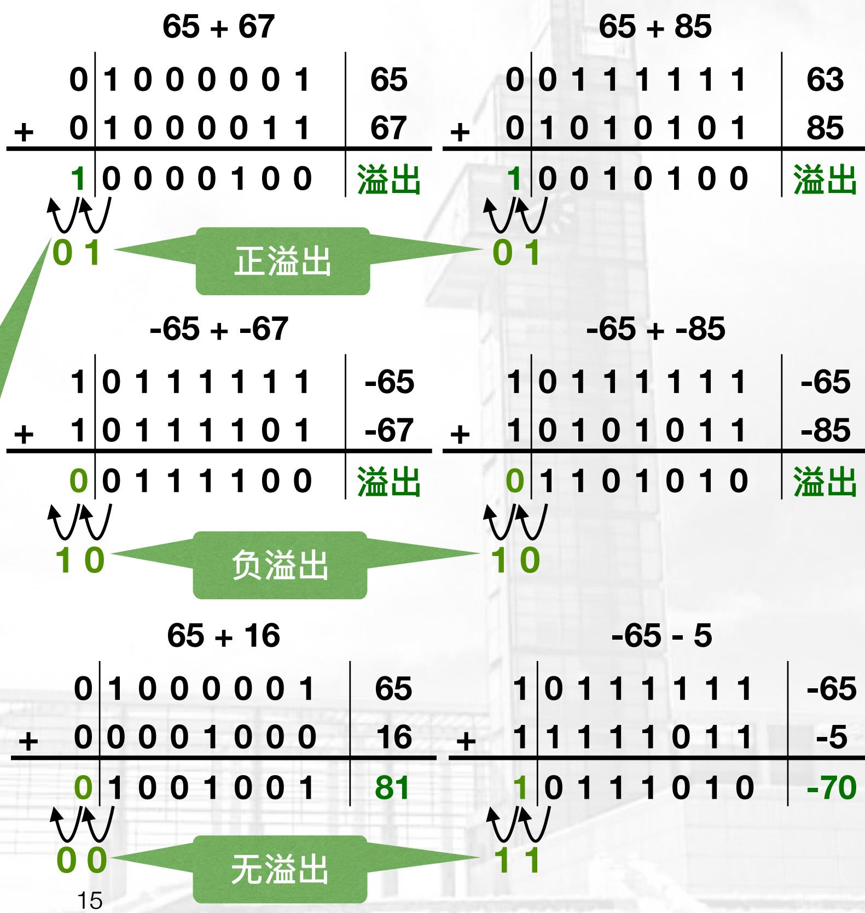  
向更高进位

# 定点数运算一加减法

\- 符号位与进位标志判别法

\- CPU的处理器状态字（Processor State Word, PSW）描述众多运算状态，如溢出标志(Overflow Flag, OF)，进位标志(Carrier Flag, CF)，符号标志(Sign Flag)等...

- 当运算发生进位时，CF置1  
- “把CF，SF纳入计算”   
- 溢出判断条件: $OF = CF \oplus SF$

$$
\left\{ \begin{array}{l} C F S F = 0 0, \text {Non - Overflow} \\ C F S F = 0 0, \text {Non - Overflow} \\ C F S F = 1 0, \text {Negative Overflow} \\ C F S F = 0 1, \text {Positive Overflow} \end{array} \right.
$$

# CPU符号标志SF

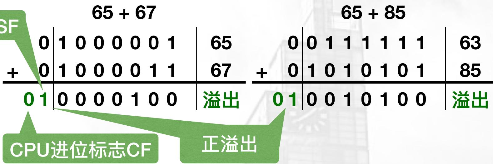

<details>
<summary>text_image</summary>

SF
0 1 0 0 0 0 0 1 | 65 | 0 0 1 1 1 1 1 1 | 63
+ 0 1 0 0 0 0 1 1 | 67 | + 0 1 0 1 0 1 0 1 | 85
0 1 0 0 0 0 1 0 0 | 溢出 | 0 1 0 0 1 0 1 0 0 | 溢出
CPU进位标志CF
正溢出
</details>

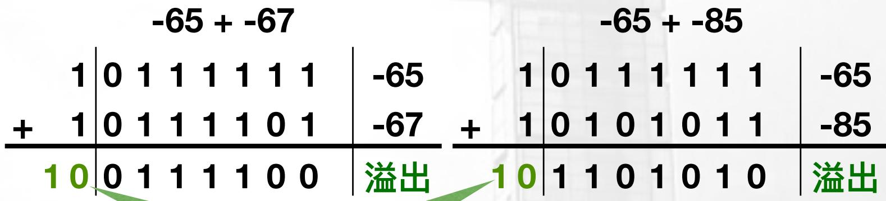

<details>
<summary>text_image</summary>

-65 + -67
1 0 1 1 1 1 1 1
+ 1 0 1 1 1 1 0 1
-65
-67
+ 1
-65 + -85
0 1 1 1 1 1 1
0 1 0 1 0 1 1
10 0 1 1 1 1 0 0
溢出
10
-65
-65
-85
溢出
</details>

# 负溢出

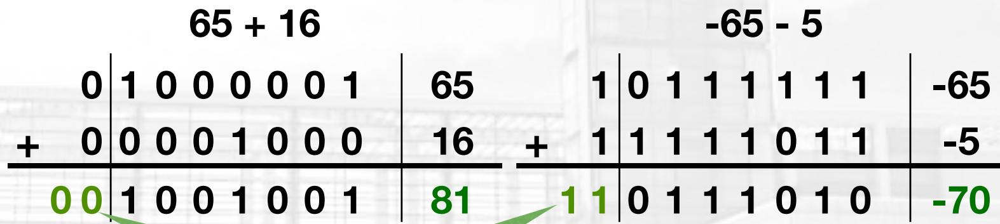

# 无溢出

# 定点数运算一加减法

\- 那么CPU实际是怎么做的？

\- SF和CF输入组合逻辑电路判断出来的\~

\- Then ?

- 溢出标志OF = On   
• [maybe]产生溢出中断

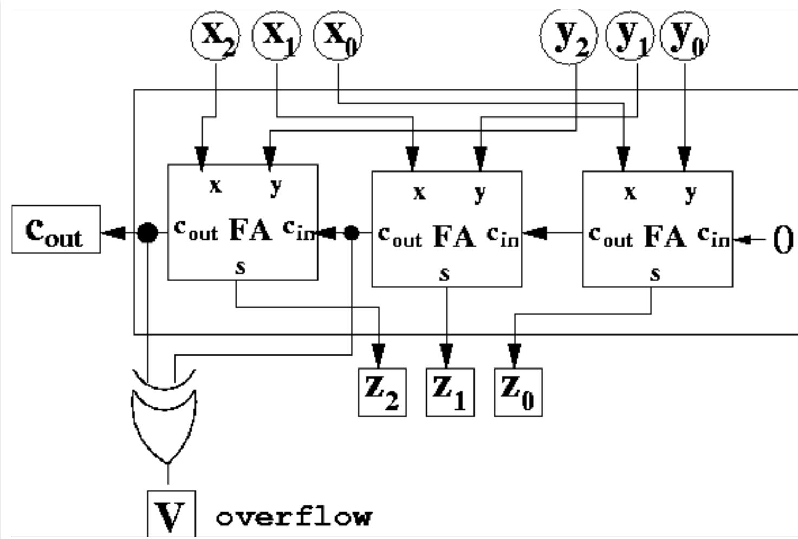

<details>
<summary>flowchart</summary>

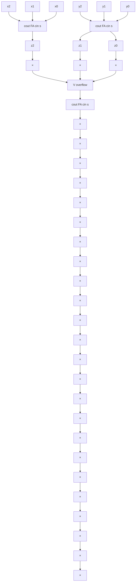
</details>

3个全加器级联

# 加法器逻辑电路

# 加法器逻辑电路

# - 加法器

\- 一位加法器

- 半加器(Half Adder)  
- 全加器(Full Adder)

\- 多位加法器

- 行波加法器（RCA）  
- 先行进位加法器（CLA）

\- BCD加法器

# 加法器逻辑电路

\- 半加器(Half Adder)

- 没有进位输入(Carry In)的加法器  
- $S_{i}$ 为和， $C_{i+1}$ 为进位  
- 电路逻辑为:

$$
S _ {i} = A \oplus B
$$

$$
C _ {i + 1} = A \cdot B
$$

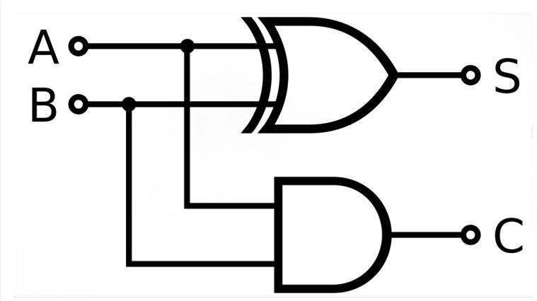

<details>
<summary>text_image</summary>

A
B
S
C
</details>

一位半加器

<table><tr><td colspan="2">Inputs</td><td colspan="2">Outputs</td></tr><tr><td>A</td><td>B</td><td>C</td><td>S</td></tr><tr><td>0</td><td>0</td><td>0</td><td>0</td></tr><tr><td>1</td><td>0</td><td>0</td><td>1</td></tr><tr><td>0</td><td>1</td><td>0</td><td>1</td></tr><tr><td>1</td><td>1</td><td>1</td><td>0</td></tr></table>

半加器真值表

# 加法器逻辑电路

# - 全加器(Full Adder)

- 包含进位输入(Carry In)的加法器  
- 电路逻辑为:

$$
S _ {i} = A \oplus B \oplus C
$$

$$
C _ {i + 1} = A \cdot B + (A \oplus B) \cdot C _ {i n}
$$

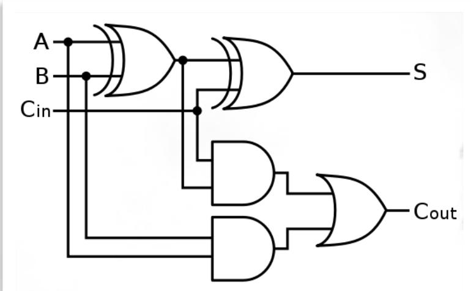

<details>
<summary>flowchart</summary>

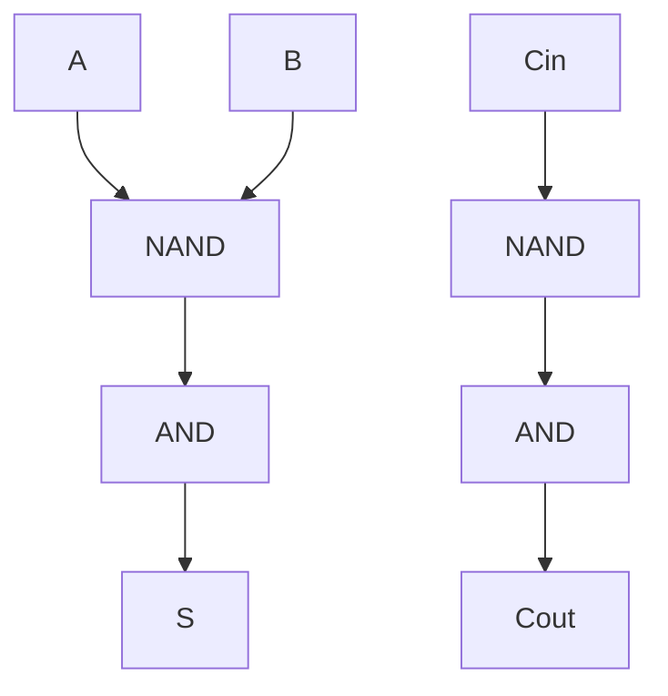
</details>

一位全加器

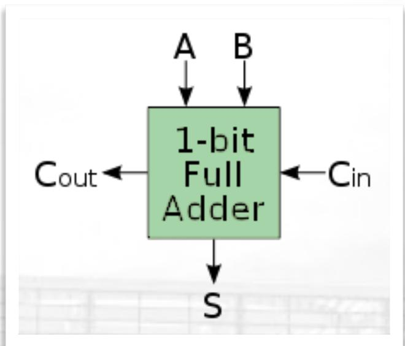

<details>
<summary>flowchart</summary>

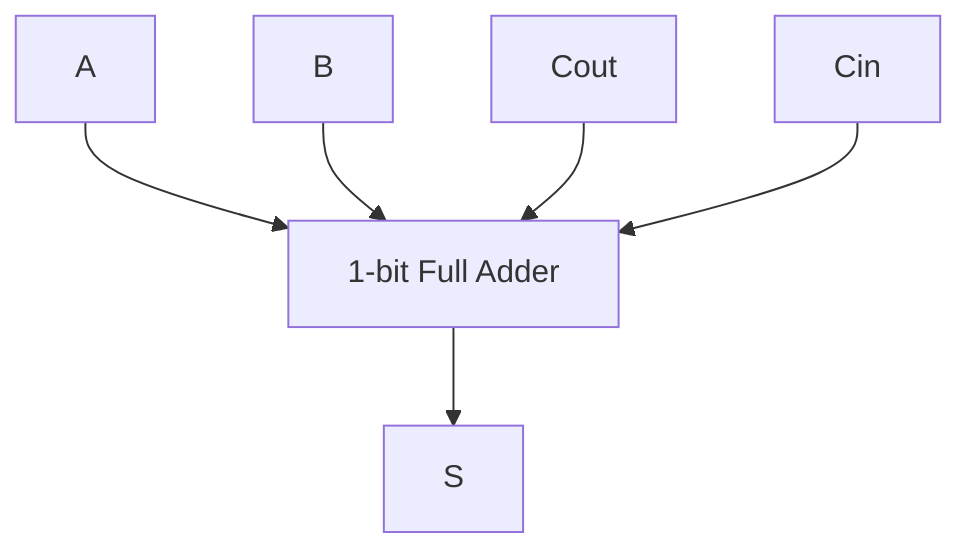
</details>

一位全加器

<table><tr><td colspan="3">Inputs</td><td colspan="2">Outputs</td></tr><tr><td>A</td><td>B</td><td> $C_{in}$ </td><td> $C_{out}$ </td><td>S</td></tr><tr><td>0</td><td>0</td><td>0</td><td>0</td><td>0</td></tr><tr><td>0</td><td>0</td><td>1</td><td>0</td><td>1</td></tr><tr><td>0</td><td>1</td><td>0</td><td>0</td><td>1</td></tr><tr><td>0</td><td>1</td><td>1</td><td>1</td><td>0</td></tr><tr><td>1</td><td>0</td><td>0</td><td>0</td><td>1</td></tr><tr><td>1</td><td>0</td><td>1</td><td>1</td><td>0</td></tr><tr><td>1</td><td>1</td><td>0</td><td>1</td><td>0</td></tr><tr><td>1</td><td>1</td><td>1</td><td>1</td><td>1</td></tr></table>

全加器真值表

# 加法器逻辑电路

# 行波多位加法器(Ripple-Carry Adder, RCA)

\- 自低位向高位，依次计算、进位，计算、进位...

\- so-called “ripple carry”

\- RCA结构简单，但有明显缺点：计算时延大， $n\Delta t$

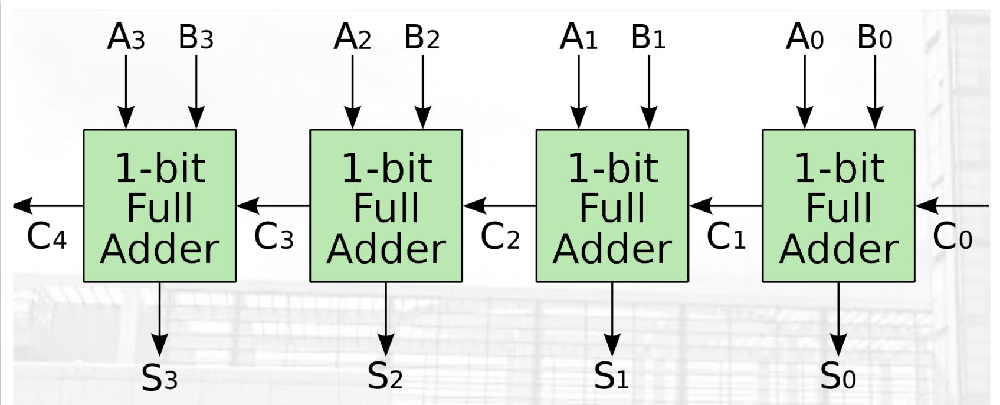

<details>
<summary>flowchart</summary>

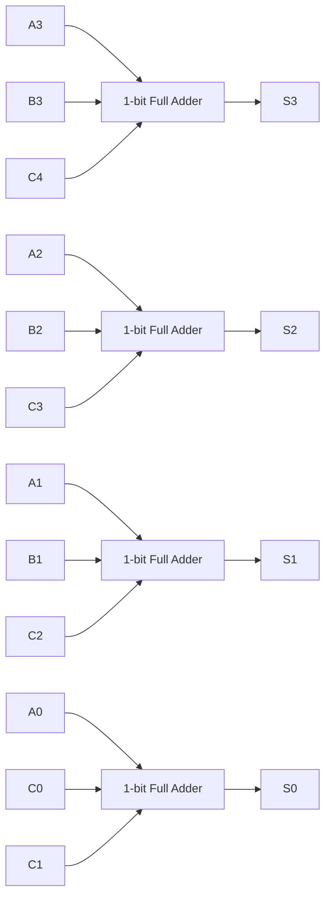
</details>

RCA多位加法器

# 加法器逻辑电路

# 先行进位加法器(Carry-Lookahead Adder, CLA)

\- 回顾一下1位全加器的进位逻辑 $C_{i + 1}$ :

$$
C _ {i + 1} = A \cdot B + (A \oplus B) \cdot C _ {i n}
$$

let $\left\{ \begin{array}{l} P_{i} \equiv A \oplus B \\ G_{i} \equiv A \cdot B \end{array} \right., \Rightarrow C_{i+1} = G_{i} + P_{i} \cdot C_{i}$

$C_i$ 进位根本不care $C_{i-1}$ !

$$
\left\{ \begin{array}{l} C _ {1} = G _ {0} + P _ {0} C _ {i n} \\ C _ {2} = G _ {1} + P _ {1} C _ {1} = G _ {1} + P _ {1} G _ {0} + P _ {1} P _ {0} C _ {i n} \\ C _ {3} = G _ {2} + P _ {2} C _ {2} = G _ {2} + P _ {2} G _ {1} + P _ {2} P _ {1} G _ {0} + P _ {2} P _ {1} P _ {0} C _ {i n} \\ C _ {4} = G _ {3} P _ {3} C _ {3} = G _ {3} + P _ {3} G _ {2} + P _ {3} P _ {2} G _ {1} + P _ {3} P _ {2} P _ {1} G _ {0} + P _ {3} P _ {2} P _ {1} P _ {0} C _ {i n} \end{array} \right.
$$

所有进位 $C$ 可以根据 $P$ 序列和 $G$ 序列直接求得

# 加法器逻辑电路

# 先行进位加法器(Carry-Lookahead Adder, CLA)

\- 回顾一下1位全加器的进位逻辑 $C_{i + 1}$ :

$$
C _ {i + 1} = A \cdot B + (A \oplus B) \cdot C _ {i n}
$$

$$
\mathbf {l e t} \left\{ \begin{array}{l} P _ {i} \equiv A \oplus B \\ G _ {i} \equiv A \cdot B \end{array} , \Rightarrow C _ {i + 1} = G _ {i} + P _ {i} \cdot C _ {i} \right.
$$

$$
\left\{ \begin{array}{l} C _ {1} = G _ {0} + P _ {0} C _ {i n} \\ C _ {2} = G _ {1} + P _ {1} C _ {1} = G _ {1} + P _ {1} G _ {0} + P _ {1} P _ {0} C _ {i n} \\ C _ {3} = G _ {2} + P _ {2} C _ {2} = G _ {2} + P _ {2} G _ {1} + P _ {2} P _ {1} G _ {0} + P _ {2} P _ {1} P _ {0} C _ {i n} \\ C _ {4} = G _ {3} P _ {3} C _ {3} = G _ {3} + P _ {3} G _ {2} + P _ {3} P _ {2} G _ {1} + P _ {3} P _ {2} P _ {1} G _ {0} + P _ {3} P _ {2} P _ {1} P _ {0} C _ {i n} \end{array} \right.
$$

所有进位 $C$ 可以根据 $P$ 序列和 $G$ 序列直接求得

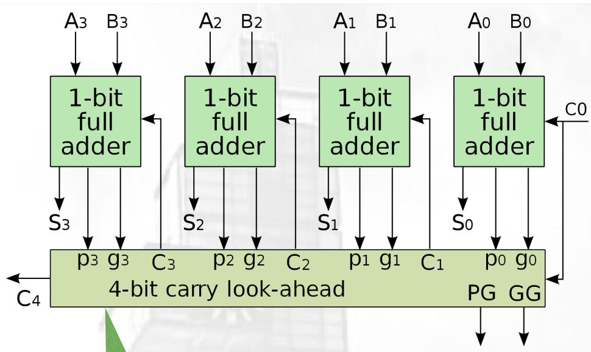

<details>
<summary>flowchart</summary>

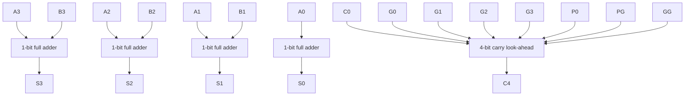
</details>

CLA 4位加法器

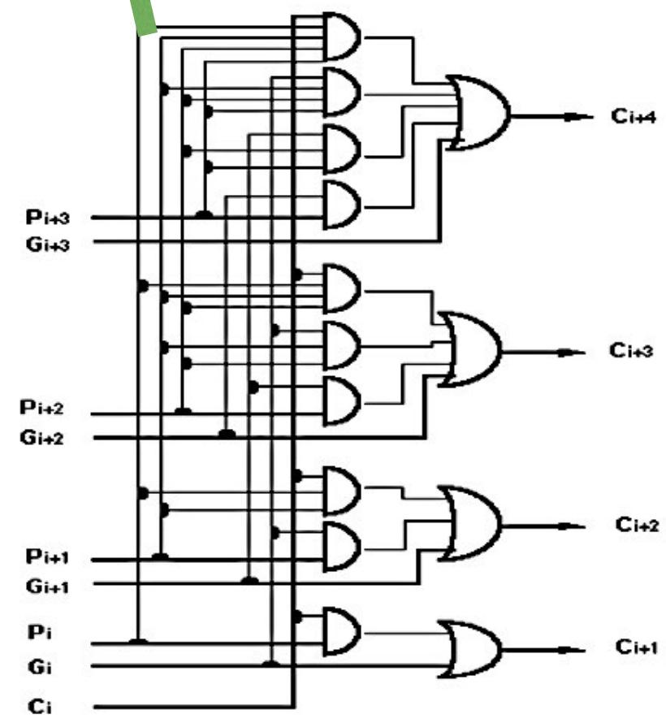

<details>
<summary>flowchart</summary>

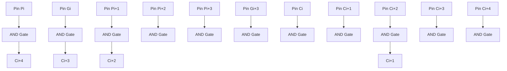
</details>

4bit 进位生成单元

# 加法器逻辑电路

# - BCD加法器

\- 两个4bit加法器构成

- 一个加法器算数值  
- 另一个加法器用来+06H ....

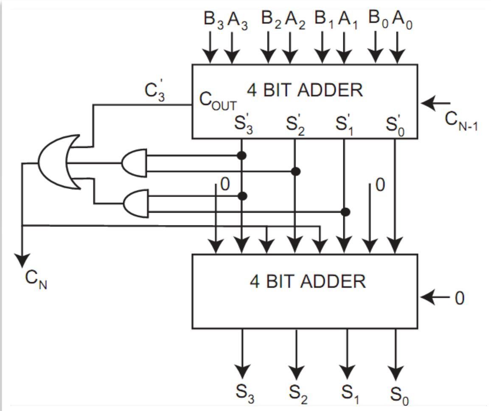

<details>
<summary>flowchart</summary>

```mermaid
graph TD
    subgraph Bit Adder
        B3A3 --> C3'
        B2A2 --> C3'
        B1A1 --> C3'
        B0A0 --> C3'
        C3' --> S3'
        C3' --> S2'
        C3' --> S1'
        C3' --> S0'
        C3' --> CN
        C3' --> AND1
        C3' --> AND2
        C3' --> AND3
        C3' --> AND4
        C3' --> AND5
        C3' --> AND6
        C3' --> AND7
        C3' --> AND8
        C3' --> AND9
        C3' --> AND10
        C3' --> AND11
        C3' --> AND12
        C3' --> AND13
        C3' --> AND14
        C3' --> AND15
        C3' --> AND16
        C3' --> AND17
        C3' --> AND18
        C3' --> AND19
        C3' --> AND20
        C3' --> AND21
        C3' --> AND22
        C3' --> AND23
        C3' --> AND24
        C3' --> AND25
        C3' --> AND26
        C3' --> AND27
        C3' --> AND28
        C3' --> AND29
        C3' --> AND30
        C3' --> AND31
        C3' --> AND32
        C3' --> AND33
        C3' --> AND34
        C3' --> AND35
        C3' --> AND36
        C3' --> AND37
        C3' --> AND38
        C3' --> AND39
        C3' --> AND40
        C3' --> AND41
        C3' --> AND42
        C3' --> AND43
        C3' --> AND44
        C3' --> AND45
        C3' --> AND46
        C3' --> AND47
        C3' --> AND48
        C3' --> AND49
        C3' --> AND50
        C3' --> AND51
        C3' --> AND52
        C3' --> AND53
        C3' --> AND54
        C3' --> AND55
        C3' --> AND56
        C3' --> AND57
        C3' --> AND58
        C3' --> AND59
        C3' --> AND60
        C3' --> AND61
        C3' --> AND62
        C3' --> AND63
        C3' --> AND64
        C3' --> AND65
        C3' --> AND66
        C3' --> AND67
        C3' --> AND68
        C3' --> AND69
        C3' --> AND70
        C3' --> AND71
        C3' --> AND72
        C3' --> AND73
        C3' --> AND74
        C3' --> AND75
        C3' --> AND76
        C3' --> AND77
        C3' --> AND78
        C3' --> AND79
        C3' --> AND80
        C3' --> AND81
        C3' --> AND82
        C3' --> AND83
        C3' --> AND84
        C3' --> AND85
        C3' --> AND86
        C3' --> AND87
        C3' --> AND88
        C3' --> AND89
        C3' --> AND90
        C3' --> AND91
        C3' --> AND92
        C3' --> AND93
        C3' --> AND94
        C3' --> AND95
        C3' --> AND96
        C3' --> AND97
        C3' --> AND98
        C3' --> AND99
    end

    subgraph_Bit_Adder_Output_Output_Output_CN-1["4 BIT ADDER"]
    end

    subgraph_Bit_Adder_Output_Output_Output_S0_0["4 BIT ADDER"]
    end

    subgraph_Bit_Adder_Output_Output_S1_1["4 BIT ADDER"]
    end

    subgraph_Bit_Adder_Output_Output_S2_2["4 BIT ADDER"]
    end

    subgraph_Bit_Adder_Output_Output_S3_3["4 BIT ADDER"]
    end

    subgraph_Bit_Adder_Output_Output_S4_4["4 BIT ADDER"]
    end

    subgraph_Bit_Adder_Output_Output_S5_5["4 BIT ADDER"]
    end

    subgraph_Bit_Adder_Output_Output_S6_6["4 BIT ADDER"]
    end

    subgraph_Bit_Adder_Output_Output_S7_7["4 BIT ADDER"]
    end

    subgraph_Bit_Adder_Output_Output_S8_8["4 BIT ADDER"]
    end

    subgraph_Bit_Adder_Output_Output_S9_9["4 BIT ADDER"]
    end

    subgraph_Bit_Adder_Output_Output_S10_10["4 BIT ADDER"]
    end

    subgraph_Bit_Adder_Output_Output_S11_11["4 BIT ADDER"]
    end

    subgraph_Bit_Adder_Output_Output_S12_12["4 BIT ADDER"]
    end

    subgraph_Bit_Adder_Output_Output_S13_13["4 BIT ADDER"]
    end

    subgraph_Bit_Adder_Output_Output_S14_14["4 BIT ADDER"]
    end

    subgraph_Bit_Adder_Output_Output_S15_15["4 BIT ADDER"]
    end

    subgraph_Bit_Adder_Output_Output_S16_16["4 BIT ADDER"]
    end

    subgraph_Bit_Adder_Output_Output_S17_17["4 BIT ADDER"]
    end

    subgraph_Bit_Adder_Output_Output_S18_18["4 BIT ADDER"]
    end

    subgraph_Bit_Adder_Output_Output_S19_19["4 BIT ADDER"]
    end

    subgraph_Bit_Adder_Output_Output_S20_20["4 BIT ADDER"]
    end

    subgraph_Bit_Adder_Output_Output_S21_21["4 BIT ADDER"]
    end

    subgraph_Bit_Adder_Output_Output_S22_22["4 BIT ADDER"]
    end

    subgraph_Bit_Adder_Output_Output_S23_23["4 BIT ADDER"]
    end

    subgraph_Bit_Adder_Output_Output_S24_24["4 BIT ADDER"]
    end

    subgraph_Bit_Adder_Output_Output_S25_25["4 BIT ADDER"]
    end

    subgraph_Bit_Adder_Output_Output_S26_26["4 BIT ADDER"]
    end

    subgraph_Bit_Adder_Output_Output_S27_27["4 BIT ADDER"]
    end

    subgraph_Bit_Adder_Output_Output_S28_28["4 BIT ADDER"]
    end

    subgraph_Bit_Adder_Output_Output_S29_29["4 BIT ADDER"]
    end

    subgraph_Bit_Adder_Output_Output_S30_30["4 BIT ADDER"]
    end

    subgraph_Bit_Adder_Output_Output_S31_31["4 BIT ADDER"]
    end

    subgraph_Bit_Adder_Output_Output_S32_32["4 BIT ADDER"]
    end

    subgraph_Bit_Adder_Output_Output_S33_33["4 BIT ADDER"]
    end

    subgraph_Bit_Adder_Output_Output_S34_34["4 BIT ADDER"]
    end

    subgraph_Bit_Adder_Output_Output_S35_35["4 BIT ADDER"]
    end

    subgraph_Bit_Adder_Output_Output_S36_36["4 BIT ADDER"]
    end

    subgraph_Bit_Adder_Output_Output_S37_37["4 BIT ADDER"]
    end

    subgraph_Bit_Adder_Output_Output_S38_38["4 BIT ADDER"]
    end

    subgraph_Bit_Adder_Output_Output_S39_39["4 BIT ADDER"]
    end

    subgraph_Bit_Adder_Output_Output_S40_40["4 BIT ADDER"]
    end

    subgraph_Bit_Adder_Output_Output_S41_41["4 BIT ADDER"]
    end

    subgraph_Bit_Adder_Output_Output_S42_42["4 BIT ADDER"]
    end

    subgraph_Bit_Adder_Output_Output_S43_43["4 BIT ADDER"]
    end

    subgraph_Bit_Adder_Output_Output_S44_44["4 BIT ADDER"]
    end

    subgraph_Bit_Adder_Output_Output_S45_45["4 BIT ADDER"]
    end

    subgraph_Bit_Adder_Output_Output_S46_46["4 BIT ADDER"]
    end

    subgraph_Bit_Adder_Output_Output_S47_47["4 BIT ADDER"]
    end

    subgraph_Bit_Adder_Output_Output_S48_48["4 BIT ADDER"]
    end

    subgraph_Bit_Adder_Output_Output_S49_49["4 BIT ADDER"]
    end

    subgraph_Bit_Adder_Output_Output_S50["5 BIT ADDER"]
    end
```
</details>

4bit BCD加法器

# 加法器逻辑电路

# 现代的CPU用啥加法器？

\- 五花八门...

\- 精确加法器

- CLA / RCA   
• Kogge-Stone / Brent-Kung / Han-Carlson (CLA的高级形态)

\- 非精确加法器 Speculative Adder

- Insight: “很少有很长的进位链，所以赌某段无进位，...”   
- 95%正确，比最快的精确加速器快平均1.5x  
- 有额外电路快速检查结果是否正确（只能判断正确）

- 取舍因素？设计过程 / 性能 / 面积 / 延时 / 功耗 ....  
- 区区一个加法器，直到现在，还在不断地发展...

# 定点数运算－乘法

# 定点数运算一乘法

# 原码一位乘法就是模拟手工乘法:

\- 符号 $S_{m} = S_{A}\oplus S_{b}$ ，数值 $\left|m\right| = \left|A\right|\times \left|B\right|$

例，[X]原=0.1101, [Y]原=1.1011，求积

解：符号， $S = 0 \oplus 1 = 1$ ；数值部分如下：

模拟手工乘法

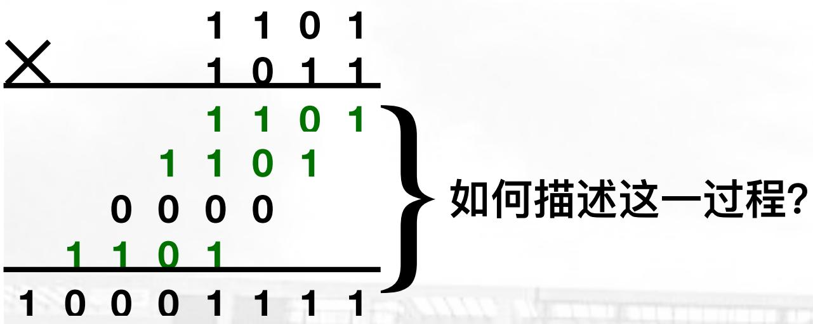

<details>
<summary>text_image</summary>

X
1 1 0 1
1 0 1 1
1 1 0 1
1 1 0 1
0 0 0 0
1 1 0 1
1 0 0 0 1 1 1 1
} 如何描述这一过程?
</details>

# 定点数运算一乘法

# 原码一位乘法就是模拟手工乘法:

\- 符号 $S_{m} = S_{A}\oplus S_{b}$ ，数值 $\left|m\right| = \left|A\right|\times \left|B\right|$

例，[X]原=0.1101, [Y]原=1.1011，求积

解：符号， $S = 0 \oplus 1 = 1$ ；数值部分如下：

模拟手工乘法

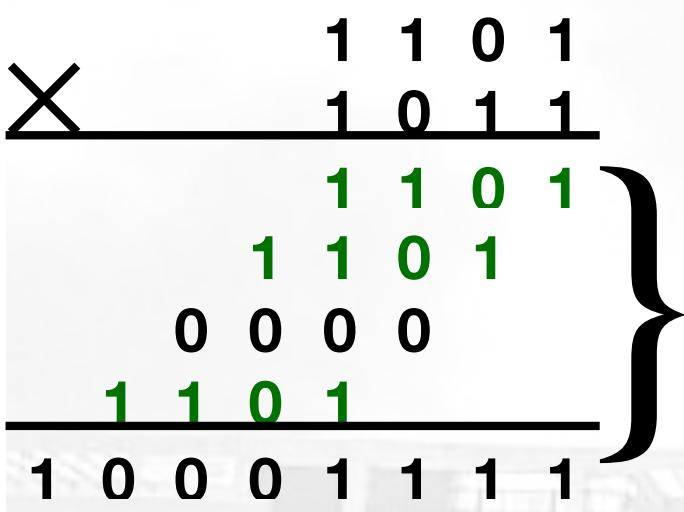

<details>
<summary>text_image</summary>

X
1 1 0 1
1 0 1 1
1 1 0 1
1 1 0 1
0 0 0 0
1 1 0 1
1 0 0 0 1 1 1 1
}
</details>

如何描述这一过程？

1. 设一临时变量 $D = 0$   
2. 若Y末位为1， $D = D + X$   
3. $D$ 右移一位; $Y$ 右移一位  
4. 若 $Y$ 有剩余位数，回到第2步  
5. 结束

# 定点数运算一乘法

# 原码一位乘法就是模拟手工乘法:

\- 符号 $S_{m} = S_{A}\oplus S_{b}$ ，数值 $\left|m\right| = \left|A\right|\times \left|B\right|$

例，[X]原=0.1101, [Y]原=1.1011，求积

解：符号， $S = 0 \oplus 1 = 1$ ；数值部分如下：

模拟手工乘法  
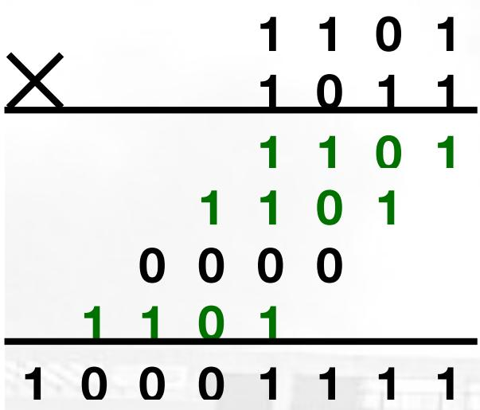

<details>
<summary>text_image</summary>

X
1 1 0 1
1 0 1 1
1 1 0 1
1 1 0 1
0 0 0 0
1 1 0 1
1 1 1 1 1
</details>

1. 设一临时变量 $D = 0$   
2. 若Y末位为1， $D = D + X$   
3. $D$ 右移一位; $Y$ 右移一位  
4. 若 $Y$ 有剩余位数，回到第2步  
5. 结束

<table><tr><td></td><td colspan="4">D</td><td colspan="3">A</td><td> $A_0$ </td><td>操作</td></tr><tr><td>0+0</td><td>01</td><td>01</td><td>00</td><td>01</td><td>1</td><td>0</td><td>1</td><td>1</td><td> $A_0=1, +X$ </td></tr><tr><td rowspan="3">0+0</td><td>1</td><td>1</td><td>0</td><td>1</td><td rowspan="3">1</td><td rowspan="3">1</td><td rowspan="3">0</td><td rowspan="3">1</td><td rowspan="3">→右移一次 $A_0=1, +X$ </td></tr><tr><td>0</td><td>1</td><td>1</td><td>0</td></tr><tr><td>1</td><td>1</td><td>0</td><td>1</td></tr><tr><td rowspan="3">100</td><td>01</td><td>0</td><td>1</td><td>1</td><td rowspan="3">1</td><td rowspan="3">1</td><td rowspan="3">0</td><td rowspan="3">1</td><td rowspan="3">→右移一次 $A_0=0, +0$ </td></tr><tr><td>1</td><td>0</td><td>0</td><td>1</td></tr><tr><td>0</td><td>0</td><td>0</td><td>0</td></tr><tr><td rowspan="3">0+0</td><td>1</td><td>0</td><td>0</td><td>1</td><td>1</td><td>1</td><td>1</td><td>0</td><td rowspan="3">→右移一次 $A_0=1, +X$ </td></tr><tr><td>0</td><td>1</td><td>0</td><td>0</td><td rowspan="2">1</td><td rowspan="2">1</td><td rowspan="2">1</td><td rowspan="2">1</td></tr><tr><td>1</td><td>1</td><td>0</td><td>1</td></tr><tr><td rowspan="2">10</td><td>0</td><td>0</td><td>0</td><td>1</td><td>1</td><td>1</td><td>1</td><td>1</td><td rowspan="2">→右移一次</td></tr><tr><td>1</td><td>0</td><td>0</td><td>0</td><td>1</td><td>1</td><td>1</td><td>1</td></tr></table>

原码一位乘法运算过程

最终结果，[X]原x[Y]原=1.10001111

# 定点数运算一乘法

练习，[X]原=0.100111, [Y]原=1.100111，求积

1. 设一临时变量 $D = 0$   
2. 若Y末位为1， $D = D + X$   
3. $D$ 右移一位; $Y$ 右移一位  
4. 若 $Y$ 有剩余位数，回到第2步  
5. 结束

# 定点数运算一乘法

练习，[X]原=0.101011，[Y]原=1.100101，求积

1. 设一临时变量 $D = 0$   
2. 若Y末位为1， $D = D + X$   
3. $D$ 右移一位; $Y$ 右移一位  
4. 若 $Y$ 有剩余位数，回到第2步  
5. 结束

# 定点数运算一乘法

# 原码二位乘法，

一次乘两位数字？这个在十进制下很反人类啊...，但在二进制下，似乎还好...

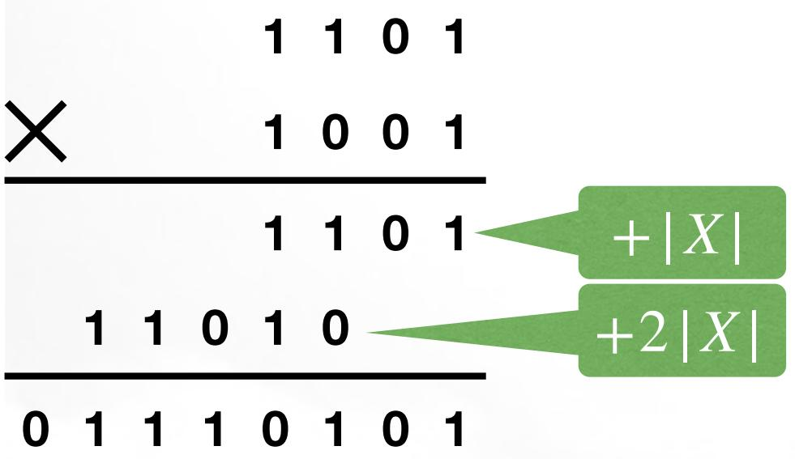

<details>
<summary>text_image</summary>

1 1 0 1
×          1 0 0 1
-----
          1 1 0 1
    1 1 0 1 0
-----
0 1 1 1 0 1 0 1
+ |X|
+2 |X|
</details>

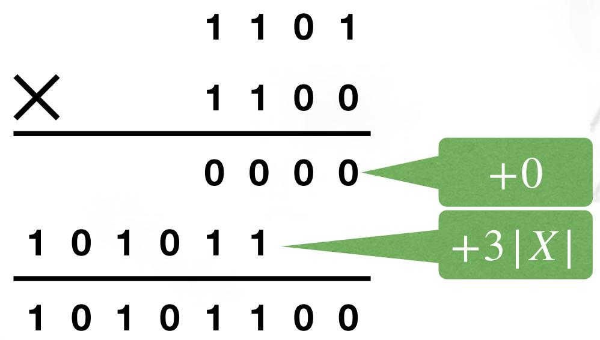

<details>
<summary>text_image</summary>

1 1 0 1
×          1 1 0 0
-----
          0 0 0 0
1 0 1 0 1 1
-----
1 0 1 0 1 1 0 0
+0
+3 |X|
</details>

规则似乎很直观：

$$
\left\{ \begin{array}{l} Y _ {i + 1} Y i = 0 0, + 0 \\ Y _ {i + 1} Y i = 0 1, + | X | \\ Y _ {i + 1} Y i = 1 0, + 2 | X | \\ Y _ {i + 1} Y i = 1 1, + 3 | X | \end{array} \right.
$$

# 定点数运算一乘法

原码二位乘法，

一次乘两位数字？这个在十进制下很反人类啊...，但在二进制下，似乎还好...


<details>
<summary>text_image</summary>

1 1 0 1
×          1 0 0 1
-----
          1 1 0 1
    1 1 0 1 0
-----
0 1 1 1 0 1 0 1
+ |X|
+2 |X|
</details>

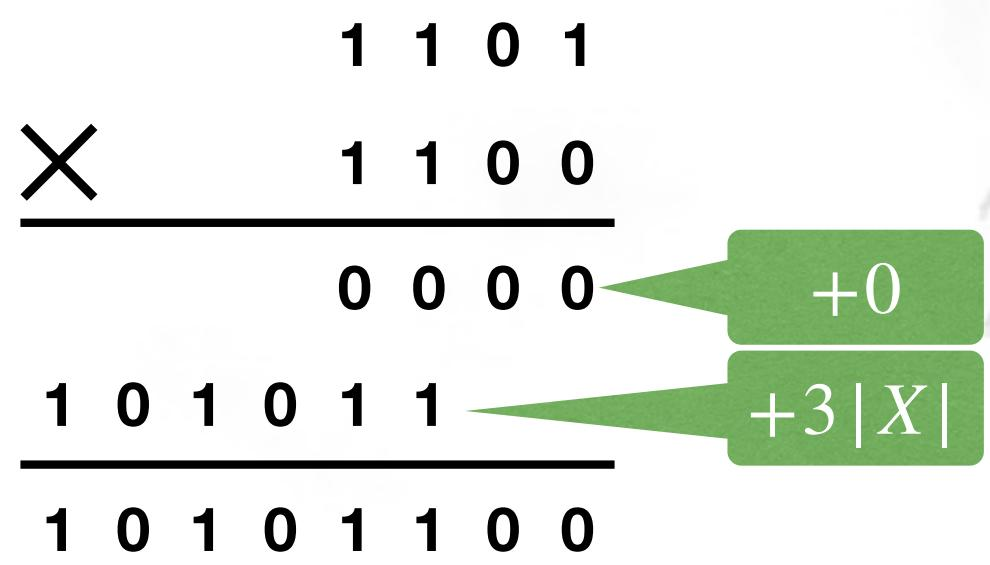

<details>
<summary>text_image</summary>

1 1 0 1
×          1 1 0 0
-----
          0 0 0 0
1 0 1 0 1 1
-----
1 0 1 0 1 1 0 0
+0
+3 |X|
</details>

规则似乎很直观：

$$
\left\{ \begin{array}{l} Y _ {i + 1} Y i = 0 0, + 0 \\ Y _ {i + 1} Y i = 0 1, + | X | \\ Y _ {i + 1} Y i = 1 0, + 2 | X | \\ Y _ {i + 1} Y i = 1 1, + 3 | X | \end{array} \right.
$$

规则还可以更进一步优化：

$$
\begin{array}{l} + 3 | X | = + 4 | X | - | X | \\ = 2 \times + 2 | X | - | X | \\ \Rightarrow \text {先减} | X |, \text {平移2步后} + | X | \\ \end{array}
$$

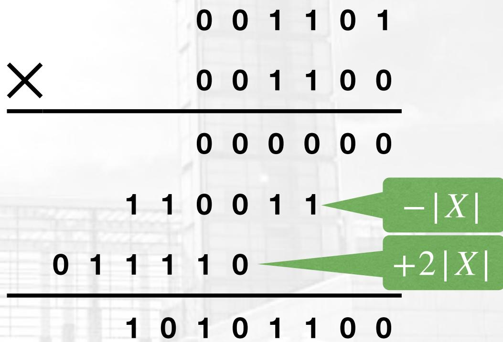

<details>
<summary>text_image</summary>

0 0 1 1 0 1
0 0 1 1 0 0
×
0 0 0 0 0 0
1 1 0 0 1 1
0 1 1 1 1 0
- |X|
+2 |X|
1 0 1 0 1 1 0 0
</details>

# 定点数运算一乘法

# 原码二位乘法

规则还可以更进一步优化：

$$
+ 3 | X | = + 4 | X | - | X |
$$

$$
= 2 \times + 2 | X | - | X |
$$

$\Rightarrow$ 先减 $|X|$ ，平移2步后 $+|X|$


标记是否要+4 | X |

<table><tr><td> $Y_{i+1}$ </td><td> $Y_i$ </td><td>C</td><td>操作</td></tr><tr><td>0</td><td>0</td><td>0</td><td>+0, 右移2次, $C=0$ </td></tr><tr><td>0</td><td>0</td><td>1</td><td>+|X|, 右移2次, $C=0$ </td></tr><tr><td>0</td><td>1</td><td>0</td><td>+|X|, 右移2次, $C=0$ </td></tr><tr><td>0</td><td>1</td><td>1</td><td>+2|X|, 右移2次, $C=0$ </td></tr><tr><td>1</td><td>0</td><td>0</td><td>+2|X|, 右移2次, $C=0$ </td></tr><tr><td>1</td><td>0</td><td>1</td><td>-|X|, 右移2次, $C=1$ </td></tr><tr><td>1</td><td>1</td><td>0</td><td>-|X|, 右移2次, $C=1$ </td></tr><tr><td>1</td><td>1</td><td>1</td><td>+0, 右移2次, $C=1$ </td></tr></table>

# 定点数运算一乘法

# 原码二位乘法

标记是否要+4 |X|

例，[X]原=0.1001111, [Y]原=1.100111，求积

解：[2X]补=01.001110；[-X]补=1.011001

<table><tr><td> $Y_{i+1}$ </td><td> $Y_i$ </td><td>C</td><td>操作</td></tr><tr><td>0</td><td>0</td><td>0</td><td>+0, 右移2次, $C=0$ </td></tr><tr><td>0</td><td>0</td><td>1</td><td>+|X|, 右移2次, $C=0$ </td></tr><tr><td>0</td><td>1</td><td>0</td><td>+|X|, 右移2次, $C=0$ </td></tr><tr><td>0</td><td>1</td><td>1</td><td>+2|X|, 右移2次, $C=0$ </td></tr><tr><td>1</td><td>0</td><td>0</td><td>+2|X|, 右移2次, $C=0$ </td></tr><tr><td>1</td><td>0</td><td>1</td><td>-|X|, 右移2次, $C=1$ </td></tr><tr><td>1</td><td>1</td><td>0</td><td>-|X|, 右移2次, $C=1$ </td></tr><tr><td>1</td><td>1</td><td>1</td><td>+0, 右移2次, $C=1$ </td></tr></table>

<table><tr><td colspan="3">符号位</td><td colspan="6">D</td><td colspan="6">A</td><td>操作</td></tr><tr><td>0</td><td>0</td><td>0</td><td>0</td><td>0</td><td>0</td><td>0</td><td>0</td><td>0</td><td>1</td><td>0</td><td>0</td><td>1</td><td>1</td><td>1</td><td>C=0</td></tr><tr><td>1</td><td>1</td><td>1</td><td>0</td><td>1</td><td>1</td><td>0</td><td>0</td><td>1</td><td></td><td></td><td></td><td></td><td></td><td></td><td>-X</td></tr><tr><td>1</td><td>1</td><td>1</td><td>0</td><td>1</td><td>1</td><td>0</td><td>0</td><td>1</td><td rowspan="3">0</td><td rowspan="3">1</td><td rowspan="3">1</td><td rowspan="3">0</td><td rowspan="3">0</td><td rowspan="3">1</td><td>C=1</td></tr><tr><td>1</td><td>1</td><td>1</td><td>1</td><td>1</td><td>0</td><td>1</td><td>1</td><td>0</td><td>→右移二次</td></tr><tr><td>0</td><td>0</td><td>1</td><td>0</td><td>0</td><td>1</td><td>1</td><td>1</td><td>0</td><td>C=1,+2X</td></tr><tr><td>0</td><td>0</td><td>1</td><td>0</td><td>0</td><td>0</td><td>1</td><td>0</td><td>0</td><td rowspan="3">0</td><td rowspan="3">0</td><td rowspan="3">0</td><td rowspan="3">1</td><td rowspan="3">1</td><td rowspan="3">0</td><td>C=0</td></tr><tr><td>0</td><td>0</td><td>0</td><td>0</td><td>1</td><td>0</td><td>0</td><td>0</td><td>1</td><td>→右移二次</td></tr><tr><td>0</td><td>0</td><td>1</td><td>0</td><td>0</td><td>1</td><td>1</td><td>1</td><td>0</td><td>C=0,+2X</td></tr><tr><td>0</td><td>0</td><td>1</td><td>0</td><td>1</td><td>1</td><td>1</td><td>1</td><td>1</td><td rowspan="2">1</td><td rowspan="2">1</td><td rowspan="2">0</td><td rowspan="2">0</td><td rowspan="2">0</td><td rowspan="2">1</td><td>C=0</td></tr><tr><td>0</td><td>0</td><td>0</td><td>0</td><td>1</td><td>0</td><td>1</td><td>1</td><td>1</td><td>→右移二次</td></tr></table>

图 3-9 例 3-12 的二位乘法的运算过程

原码两位乘法运算过程

最终结果，[X]原x[Y]原=1.010111110001

# 定点数运算一乘法

练习，[X]原=0.110110, [Y]原=1.101101，求积

解：[2X]补=01.101100；[-X]补=1.001010

# 定点数运算一乘法

练习，[X]原=0.101011, [Y]原=1.110111，求积

解：[2X]补=01.010110；[-X]补=1.010101

# 定点数运算一补码乘法

# 定点数运算一补码乘法

# 补码乘法

- 校正法  
- Booth法  
- 两位Booth法

# 定点数运算一补码乘法

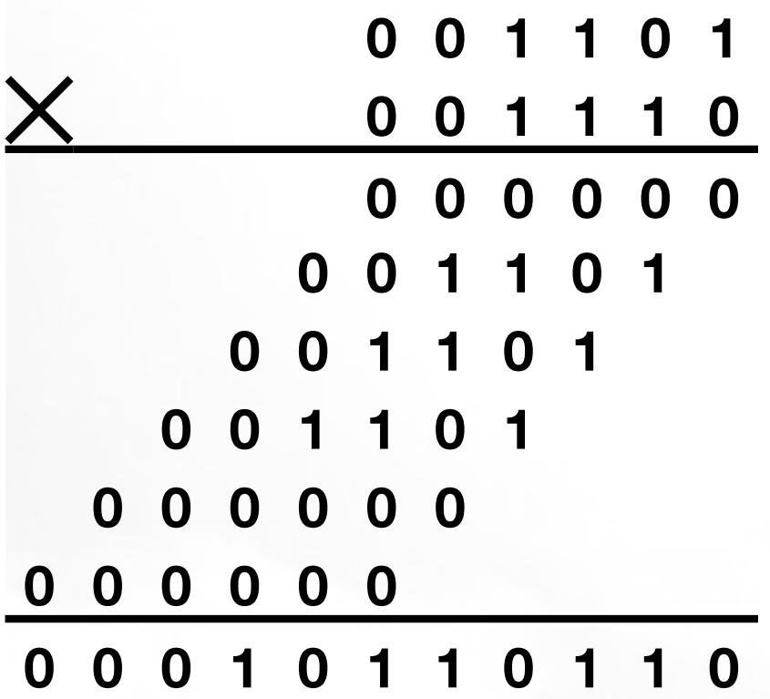

<details>
<summary>text_image</summary>

×
0 0 1 1 0 1
0 0 1 1 1 0
0 0 0 0 0 0
0 0 1 1 0 1
0 0 1 1 0 1
0 0 1 1 0 1
0 0 0 0 0 0
0 0 0 0 0 0
0 0 1 0 1 1 0 1 1 0
</details>

<-无脑计算需要6步
v.s
略用心机只需3步->

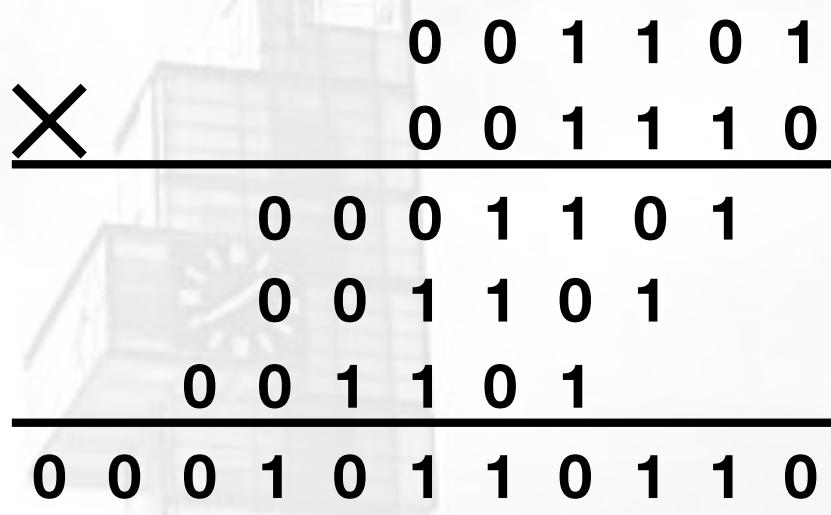

<details>
<summary>text_image</summary>

×
0 0 1 1 0 1
0 0 1 1 1 0
0 0 0 1 1 0 1
0 0 1 1 0 1
0 0 1 1 0 1
0 0 0 1 0 1 1 0 1 1 0
</details>

# 定点数运算一补码乘法


<details>
<summary>text_image</summary>

×
0 0 1 1 0 1
0 0 1 1 1 0
0 0 0 0 0 0
0 0 1 1 0 1
0 0 1 1 0 1
0 0 1 1 0 1
0 0 0 0 0 0
0 0 0 0 0 0
0 0 1 0 1 1 0 1 1 0
</details>

<-无脑计算需要6步
v.s

略用心机只需3步一>

能不能更简化！？


<details>
<summary>text_image</summary>

×
0 0 1 1 0 1
0 0 1 1 1 0
0 0 0 1 1 0 1
0 0 1 1 0 1
0 0 1 1 0 1
0 0 0 1 0 1 1 0 1 1 0
</details>

# 定点数运算一补码乘法


<details>
<summary>text_image</summary>

×
0 0 1 1 0 1
0 0 1 1 1 0
0 0 0 0 0 0
0 0 1 1 0 1
0 0 1 1 0 1
0 0 1 1 0 1
0 0 0 0 0 0
0 0 0 0 0 0
0 0 1 0 1 1 0 1 1 0
</details>

<-无脑计算需要6步
v.s

略用心机只需3步一>

能不能更简化！？

先看一个日常使用的技巧:

$$
1 2 3 4 5 \times 1 0 0 1 = 1 2 3 4 5 \times (1 0 0 0 + 1)
$$

$$
2 3 4 2 \times 9 9 9 = 2 3 4 2 \times (1 0 0 0 - 1)
$$

对二进制，也一样！

$$
1 0 1 0 \times 0 1 1 1 = 1 0 1 0 \times (1 0 0 0 - 1)
$$

$$
1 0 1 0 \times 1 1 1 0 = 1 0 1 0 \times (1 0 0 0 0 - 1 0)
$$


<details>
<summary>text_image</summary>

×
0 0 1 1 0 1
0 0 1 1 1 0
0 0 0 1 1 0 1
0 0 1 1 0 1
0 0 1 1 0 1
0 0 0 1 0 1 1 0 1 1 0
</details>

# 定点数运算一补码乘法

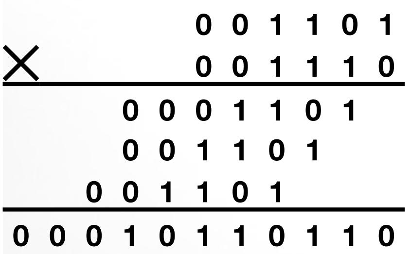

<details>
<summary>text_image</summary>

X
0 0 1 1 0 1
0 0 1 1 1 0
0 0 0 1 1 0 1
0 0 1 1 0 1
0 0 1 1 0 1
0 0 0 1 0 1 1 0 1 1 0
</details>

<-略用心机需要3步

v.s

运用技巧只需2步一>

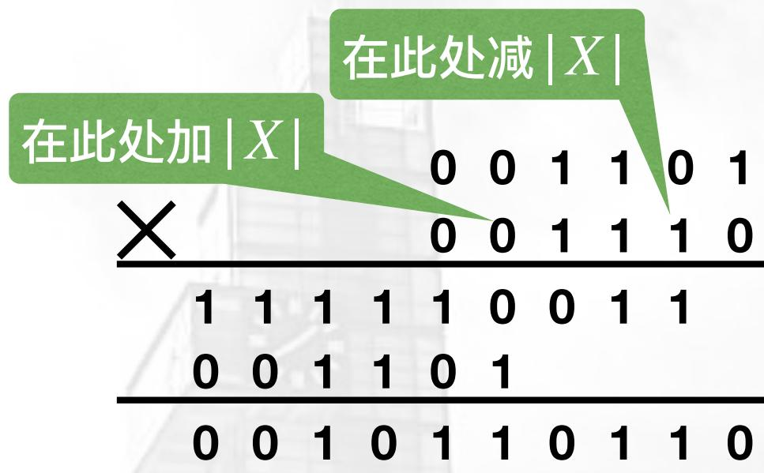

<details>
<summary>text_image</summary>

在此处加 |X|
在此处减 |X|
0 0 1 1 0 1
0 0 1 1 1 0
1 1 1 1 1 0 0 1 1
0 0 1 1 0 1
0 0 1 0 1 1 0 1 1 0
</details>

问题来了：如何高效地识别“一串1”的开始和结束？

# 定点数运算一补码乘法

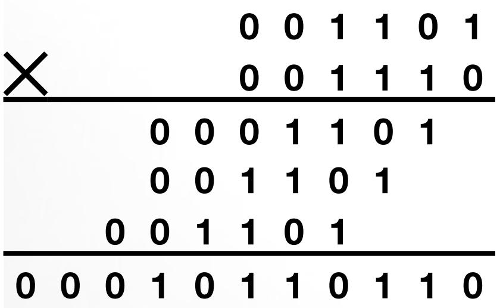

<details>
<summary>text_image</summary>

0 0 1 1 0 1
0 0 1 1 1 0
×
0 0 0 1 1 0 1
0 0 1 1 0 1
0 0 1 1 0 1
0 0 1 1 0 1
0 0 0 1 0 1 1 0 1 1 0
</details>

<-略用心机需要3步

v.s

运用技巧只需2步一>


<details>
<summary>text_image</summary>

在此处加 |X|
0 0 1 1 0 1
0 0 1 1 1 0
1 1 1 1 1 0 0 1 1
0 0 1 1 0 1
0 0 1 0 1 1 0 1 1 0
</details>

问题来了：如何高效地识别“一串1”的开始和结束？

# Booth算法:

- 从右向左，遇到“10”就是“一串1”的开始，在1的位置减 $|X|$ ；  
- 从右向左，遇到“0 1”就是“一串1”的结束，在0的位置加 $|X|$ ；  
- 中间的“00”和“11”都不管！

<table><tr><td> $y_i$   $y_{i-1}$ </td><td>操作</td></tr><tr><td>0 0</td><td>部分积+0,右移1位</td></tr><tr><td>0 1</td><td>部分积+[X] $_{补}$ ,右移1</td></tr><tr><td>1 0</td><td>部分积+[-X] $_{补}$ ,右移1</td></tr><tr><td>1 1</td><td>部分积+0,右移1位</td></tr></table>

# 定点数运算一补码乘法

在此处减 $|X|$

# Booth算法：

- 从右向左，遇到“10”就是“一串1”的开始，在1的位置减 $|X|$ ；  
• 从右向左，遇到“0 1”就是“一串1”的结束，在0的位置加 $|X|$ ；  
- 中间的“00”和“11”都不管！

【例】X=0.1010，Y=-0.1101，利用Booth法求积。

【解】：

$$
[ \mathrm{X} ] _ {\text {补}} = 0 0. 1 0 1 0
$$

$$
[ - X ] _ {\text {补}} = 1 1. 0 1 1 0
$$

$$
[ \mathrm{Y} ] _ {\text {补}} = 1 1. 0 0 1 1
$$

<table><tr><td>符号</td><td>D</td><td>A</td><td> $A_{-1}$ </td><td>操作说明</td></tr><tr><td>0 0</td><td>0 0 0 0</td><td>1 0 0 1 1</td><td>0</td><td></td></tr><tr><td>1 1</td><td>0 1 1 0</td><td></td><td></td><td> $+[-X]_{补}$ </td></tr><tr><td>1 1</td><td>0 1 1 0</td><td></td><td></td><td></td></tr><tr><td>1 1</td><td>1 0 1 1</td><td>0 1 0 0 1</td><td>1</td><td>右移1位</td></tr><tr><td>0 0</td><td>0 0 0 0</td><td></td><td></td><td>+0</td></tr><tr><td>1 1</td><td>1 0 1 1</td><td></td><td></td><td></td></tr><tr><td>1 1</td><td>1 1 0 1</td><td>1 0 1 0 0</td><td>1</td><td>右移1位</td></tr><tr><td>0 0</td><td>1 0 1 0</td><td></td><td></td><td> $+[X]_{补}$ </td></tr><tr><td>0 0</td><td>0 1 1 1</td><td></td><td></td><td>在此处</td></tr><tr><td>0 0</td><td>0 0 1 1</td><td>1 1 0 1 0</td><td>0</td><td>右移1位</td></tr><tr><td>0 0</td><td>0 0 0 0</td><td></td><td></td><td>+0</td></tr><tr><td>0 0</td><td>0 0 1 1</td><td></td><td></td><td></td></tr><tr><td>0 0</td><td>0 0 0 1</td><td>1 1 1 0 1</td><td>0</td><td>右移1位</td></tr><tr><td>1 1</td><td>0 1 1 0</td><td></td><td></td><td> $+[-X]_{补}$ </td></tr><tr><td>1 1</td><td>0 1 1 1</td><td>1 1 1 0 1</td><td>0</td><td>不移位</td></tr></table>

∴ [X·Y]补 = 1.01111110

# 定点数运算一乘法

练习，[X]原=0.110110, [Y]原=1.101101，求积

解：[2X]补=01.101100；[-X]补=1.001010

# 定点数运算一乘法

练习，[X]原=0.101011, [Y]原=1.110111，求积

解：[2X]补=01.010110；[-X]补=1.010101