# 计算机组成与结构

# - 运算方法2

李瑞 教授

蒋志平 副教授

计算机科学与技术学院

# 温故 一关于数制表示

- IEEE 754格式？相比一般的规格化浮点，有什么特殊点？  
- 56的8421格式BCD码是？  
- 简述ASCII码的特性?   
- 简述Unicode的特性?   
- 简单奇偶校验的用途和原理？  
- “1110111”在奇/偶校验编码时，如何设置校验位？  
- 简述海明码的用途和原理？  
- 当海明码校验位输出为0101时，如何解读？  
- 简述CRC的用途和工作原理？  
- 简述先行进位加法器？  
- 简述原码一位乘法原理？  
- 简述“表格式乘法”的书写/组织规则？  
- 简述原码两位乘法原理？

# 乘法的“表格式计算”

# “表格式计算”一乘法

\- 以原码一位乘法为例：竖式是直观的，步骤步骤累加是可理解的，表格式是一眼看上去懵逼的...

例，[X]原=0.1101，[Y]原=1.1011，求积

解：符号， $S = 0 \oplus 1 = 1$ ；数值部分如下：

模拟手工乘法  
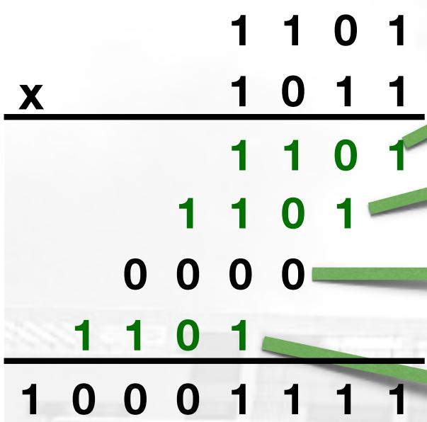

<details>
<summary>other</summary>

| Row | Column | Value |
|---|---|---|
| 1 | 0 | 1 |
| 2 | 0 | 0 |
| 3 | 0 | 1 |
| 4 | 0 | 1 |
| 5 | 1 | 1 |
| 6 | 1 | 0 |
| 7 | 1 | 1 |
| 8 | 1 | 0 |
| 9 | 1 | 1 |
| 10 | 0 | 1 |
| 11 | 0 | 0 |
| 12 | 0 | 0 |
| 13 | 0 | 0 |
| 14 | 0 | 0 |
| 15 | 1 | 1 |
| 16 | 1 | 0 |
| 17 | 1 | 1 |
| 18 | 1 | 1 |
| 19 | 1 | 1 |
The image contains a simple diagram with two horizontal lines (one solid, one dashed) and three vertical lines (one solid, one dashed). The values above the lines are explicitly labeled as '1', while the values below are '0'. The text 'x' is applied at the top left of the chart.
</details>

通过部分积D累加逐层结果

<table><tr><td rowspan="3">第一层加1101</td><td rowspan="2">0 0 0 0+ 1 1 0 1</td><td colspan="2">&lt;-部分积D,初值为0</td></tr><tr><td rowspan="2" colspan="2">D = D + X</td></tr><tr><td>1 1 0 1</td></tr><tr><td rowspan="3">第二层加1101</td><td rowspan="2">0 1 1 0 1+ 1 1 0 1 0</td><td colspan="2">D右移</td></tr><tr><td rowspan="2" colspan="2">D = D&gt;&gt;1 + X</td></tr><tr><td>1 0 0 1 1 1</td></tr><tr><td rowspan="2">第三层加0000</td><td>1 0 0 1 1 1+ 0 0 0 0 0 0</td><td rowspan="2" colspan="2">D右移D = D&gt;&gt;1 + X</td></tr><tr><td>1 0 0 1 1 1</td></tr><tr><td rowspan="2">第四层加1101</td><td>0 1 0 0 1 1 1+ 1 1 0 1 0 0 0</td><td rowspan="2" colspan="2">D右移D = D&gt;&gt;1 + X</td></tr><tr><td>1 0 0 0 1 1 1 1</td></tr></table>

<<是左移操作，>>是右移操作

# “表格式计算”一乘法

\- 以原码一位乘法为例：竖式是直观的，步骤步骤累加是可理解的，表格式是一眼看上去懵逼的...

通过部分积D累加逐层结果

<table><tr><td rowspan="2">第一层加1101</td><td rowspan="2">0 0 0 0+ 1 1 0 11 1 0 1</td><td colspan="2">&lt;-部分积D,初值为0</td></tr><tr><td colspan="2">D = D + X</td></tr><tr><td rowspan="2">第二层加1101</td><td rowspan="2">0 1 1 0 1+ 1 1 0 1 01 0 0 1 1 1</td><td colspan="2">D右移</td></tr><tr><td colspan="2">D = D&gt;&gt;1 + X</td></tr><tr><td>第三层加0000</td><td>1 0 0 1 1 1+ 0 0 0 0 0 01 0 0 1 1 1</td><td colspan="2">D右移D = D&gt;&gt;1 + X</td></tr><tr><td>第四层加1101</td><td>0 1 0 0 1 1 1+ 1 1 0 1 0 0 01 0 0 0 1 1 1 1</td><td colspan="2">D右移D = D&gt;&gt;1 + X</td></tr></table>

部分积D的符号

(建议至少2位)

部分积D

粗线分隔D和Y

乘数Y

Y总是顶格对齐，D总右移，等效于竖式中X左移

2位符号，防止溢出时右移出现负数

<table><tr><td colspan="2">符号</td><td colspan="4">D</td><td colspan="3">Y</td><td> $Y_0$ </td><td>操作说明</td></tr><tr><td>0</td><td>0</td><td>0</td><td>0</td><td>0</td><td>0</td><td>1</td><td>0</td><td>1</td><td>1</td><td>D/Y初始化</td></tr><tr><td>0</td><td>0</td><td>1</td><td>1</td><td>0</td><td>1</td><td>1</td><td>0</td><td>1</td><td>1</td><td rowspan="2">+ [X] $_{原}$ </td></tr><tr><td>0</td><td>0</td><td>1</td><td>1</td><td>0</td><td>1</td><td>1</td><td>0</td><td>1</td><td>1</td></tr><tr><td>0</td><td>0</td><td>0</td><td>1</td><td>1</td><td>0</td><td>1</td><td>1</td><td>0</td><td>1</td><td>D/Y右移1位</td></tr><tr><td>0</td><td>0</td><td>1</td><td>1</td><td>0</td><td>1</td><td>0</td><td>1</td><td>0</td><td>1</td><td rowspan="2">+ [X] $_{原}$ </td></tr><tr><td>0</td><td>1</td><td>0</td><td>0</td><td>1</td><td>1</td><td>1</td><td>1</td><td>0</td><td>1</td></tr><tr><td>0</td><td>0</td><td>1</td><td>0</td><td>0</td><td>1</td><td>1</td><td>1</td><td>1</td><td>0</td><td>D/Y右移1位</td></tr><tr><td>0</td><td>0</td><td>0</td><td>0</td><td>0</td><td>0</td><td></td><td></td><td>1</td><td>0</td><td rowspan="2">+0</td></tr><tr><td>0</td><td>0</td><td>1</td><td>0</td><td>0</td><td>1</td><td>1</td><td>1</td><td>1</td><td>0</td></tr><tr><td>0</td><td>0</td><td>0</td><td>1</td><td>0</td><td>0</td><td>1</td><td>1</td><td>1</td><td>1</td><td>D/Y右移1位</td></tr><tr><td>0</td><td>0</td><td>1</td><td>1</td><td>0</td><td>1</td><td></td><td></td><td></td><td>1</td><td rowspan="2">+ [X] $_{原}$ </td></tr><tr><td>0</td><td>1</td><td>0</td><td>0</td><td>0</td><td>1</td><td>1</td><td>1</td><td>1</td><td>1</td></tr><tr><td>0</td><td>0</td><td>1</td><td>0</td><td>0</td><td>0</td><td>1</td><td>1</td><td>1</td><td>1</td><td>D/Y右移1位</td></tr></table>

# “表格式计算”一乘法

练习，[X]原=0.100111, [Y]原=1.100111，求积

1. 设一临时变量 $D = 0$   
2. 若Y末位为1， $D = D + X$   
3. $D$ 右移一位; $Y$ 右移一位  
4. 若 $Y$ 有剩余位数，回到第2步  
5. 结束

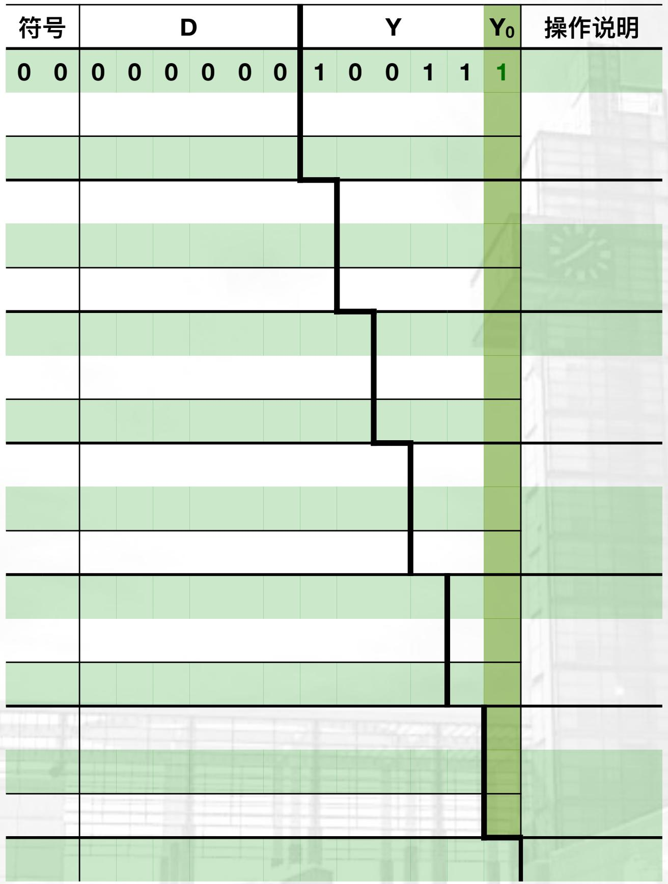

<details>
<summary>text_image</summary>

符号 D Y Y₀ 操作说明
0 0 0 0 0 0 0 0 0 1 0 0 1 1 1
1
</details>

# “表格式计算”一乘法

练习，[X]原=0.100111, [Y]原=1.100111，求积

1. 设一临时变量 $D = 0$   
2. 若Y末位为1， $D = D + X$   
3. $D$ 右移一位; $Y$ 右移一位  
4. 若 $Y$ 有剩余位数，回到第2步  
5. 结束

<table><tr><td>符号</td><td>D</td><td colspan="5">Y</td><td> $Y_0$ </td><td>操作说明</td></tr><tr><td>0 0</td><td>0 0 0 0 0 0</td><td>1</td><td>0</td><td>0</td><td>1</td><td>1</td><td>1</td><td>D/Y初始化</td></tr><tr><td>0 0</td><td>| 0 0 | | |</td><td colspan="5"></td><td></td><td rowspan="2">+[X] $_{原}$ </td></tr><tr><td>0 0</td><td>| 0 0 | | |</td><td colspan="5"></td><td></td></tr><tr><td>0 0</td><td>0 1 0 0 1 1</td><td>/</td><td>1</td><td>0</td><td>0</td><td>1</td><td>/</td><td>D/Y右移1位</td></tr><tr><td>0 0</td><td>| 0 0 | | | | 0</td><td colspan="5"></td><td></td><td rowspan="2">+[X] $_{原}$ </td></tr><tr><td>0 0</td><td>| | | 1 0 1 0 |</td><td>/</td><td>1</td><td>0</td><td>0</td><td>1</td><td>/</td></tr><tr><td>0 0</td><td>0 | | | | 0 | 0 |</td><td>/</td><td>1</td><td>0</td><td>0</td><td>1</td><td>/</td><td>D/Y右移1位</td></tr><tr><td>0 0</td><td>| 0 0 | | | | 0 0 |</td><td>/</td><td>1</td><td>0</td><td>0</td><td>1</td><td></td><td rowspan="2">+[X] $_{原}$ </td></tr><tr><td>0 1</td><td>0 0 0 | 0 0 0 |</td><td>/</td><td>1</td><td>0</td><td>0</td><td>1</td><td></td></tr><tr><td>0 0</td><td>| 0 0 0 | 0 0 0 |</td><td>/</td><td>1</td><td>0</td><td colspan="3">0</td><td>D/Y右移1位</td></tr><tr><td></td><td></td><td colspan="5"></td><td></td><td rowspan="2">+0</td></tr><tr><td></td><td></td><td colspan="5"></td><td></td></tr><tr><td>0 0</td><td colspan="5">0 | 0 0 0 | 0 0 0 |</td><td>/</td><td>0</td><td>D/Y右移1位</td></tr><tr><td></td><td colspan="5"></td><td></td><td></td><td rowspan="2">+0</td></tr><tr><td></td><td colspan="5"></td><td></td><td></td></tr><tr><td>0 0</td><td colspan="6">0 0 | 0 0 0 | 0 0 0 |</td><td>/</td><td>D/Y右移1位</td></tr><tr><td>0 0</td><td>| 0 0 | | |</td><td colspan="5"></td><td></td><td rowspan="2">+[X] $_{原}$ </td></tr><tr><td>0 0</td><td colspan="6">| 0 | | | | | | 0 0 0 |</td><td>/</td></tr><tr><td>0 0</td><td colspan="6">0 | 0 | | | | | 0 0 0 |</td><td></td><td>D/Y右移1位</td></tr></table>

# 定点数运算一乘法

# 原码二位乘法，

一次乘两位数字？这个在十进制下很反人类啊...，但在二进制下，似乎还好...


<details>
<summary>text_image</summary>

1 1 0 1
×          1 0 0 1
-----
          1 1 0 1
    1 1 0 1 0
-----
0 1 1 1 0 1 0 1
+ |X|
+2 |X|
</details>

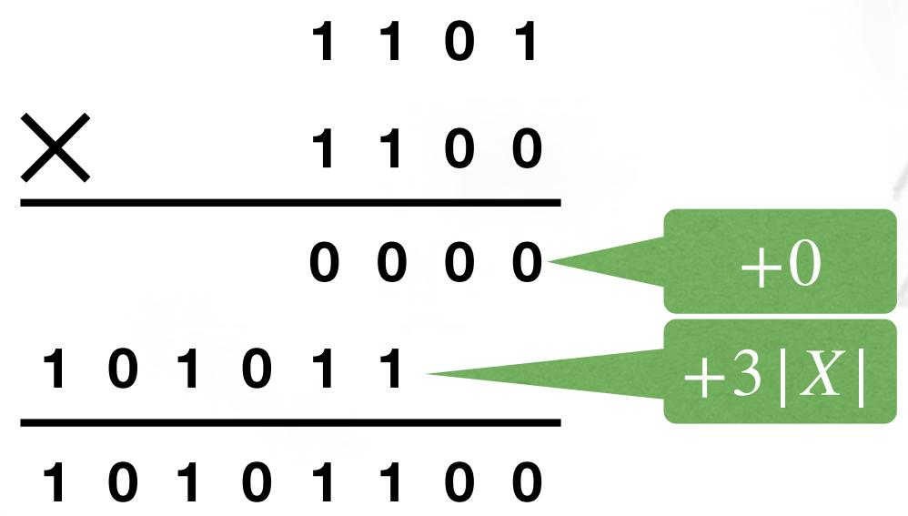

<details>
<summary>text_image</summary>

1 1 0 1
×          1 1 0 0
-----
          0 0 0 0
1 0 1 0 1 1
-----
1 0 1 0 1 1 0 0
+0
+3 |X|
</details>

规则似乎很直观：

$$
\left\{ \begin{array}{l} Y _ {i + 1} Y i = 0 0, + 0 \\ Y _ {i + 1} Y i = 0 1, + | X | \\ Y _ {i + 1} Y i = 1 0, + 2 | X | \\ Y _ {i + 1} Y i = 1 1, + 3 | X | \end{array} \right.
$$

# 定点数运算一乘法

原码二位乘法，

一次乘两位数字？这个在十进制下很反人类啊...，但在二进制下，似乎还好...

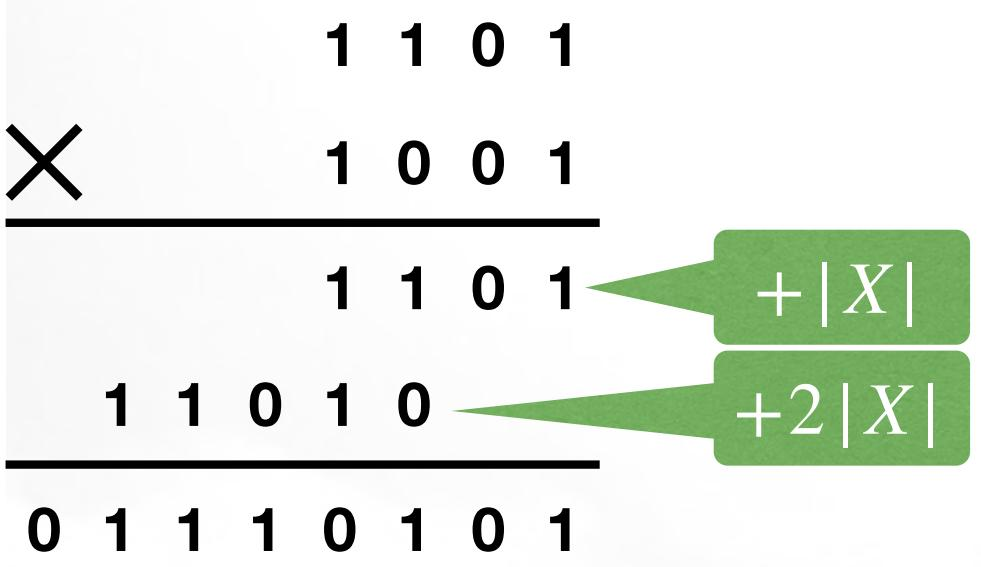

<details>
<summary>text_image</summary>

1 1 0 1
×          1 0 0 1
-----
          1 1 0 1
    1 1 0 1 0
-----
0 1 1 1 0 1 0 1
+ |X|
+2 |X|
</details>

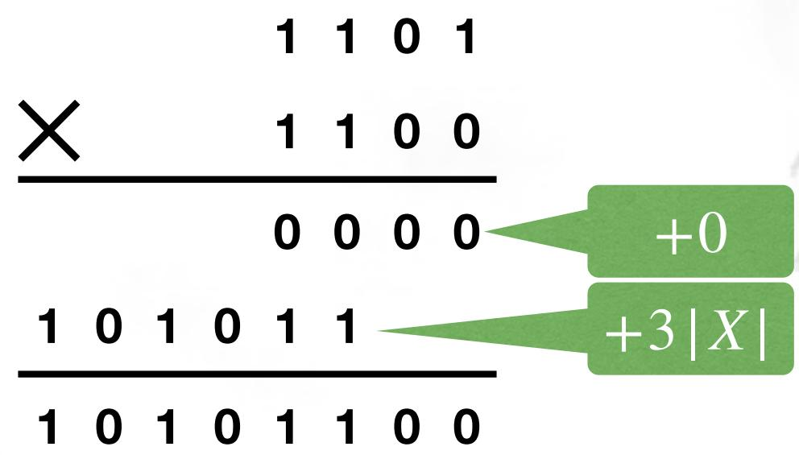

<details>
<summary>text_image</summary>

1 1 0 1
×          1 1 0 0
-----
          0 0 0 0
1 0 1 0 1 1
-----
1 0 1 0 1 1 0 0
+0
+3 |X|
</details>

规则似乎很直观：

$$
\left\{ \begin{array}{l} Y _ {i + 1} Y i = 0 0, + 0 \\ Y _ {i + 1} Y i = 0 1, + | X | \\ Y _ {i + 1} Y i = 1 0, + 2 | X | \\ Y _ {i + 1} Y i = 1 1, + 3 | X | \end{array} \right.
$$

规则还可以更进一步优化：

$$
+ 3 | X | = + 4 | X | - | X |
$$

$\Rightarrow$ 先减 $|X|$ ，平移2步后 $+ |X|$

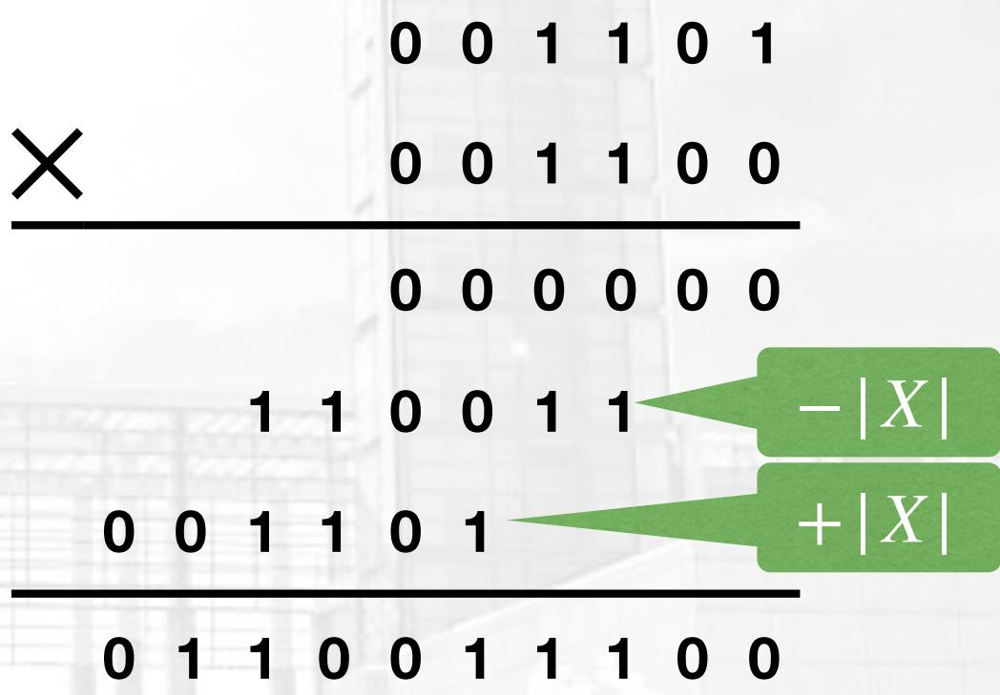

<details>
<summary>text_image</summary>

0 0 1 1 0 1
0 0 1 1 0 0
×
0 0 0 0 0 0
1 1 0 0 1 1
0 0 1 1 0 1
- |X|
+ |X|
0 1 1 0 0 1 1 1 0 0
</details>

# 定点数运算一乘法

# 原码二位乘法

规则还可以更进一步优化：

$$
+ 3 | X | = + 4 | X | - | X |
$$

$$
\Rightarrow \mathrm{先减} | X |, \mathrm{平移} 2 \mathrm{步后} + | X |
$$


标记是否要+4 | X |

<table><tr><td> $Y_{i+1}$ </td><td> $Y_i$ </td><td>C</td><td>操作</td></tr><tr><td>0</td><td>0</td><td>0</td><td>+0, 右移2次, $C=0$ </td></tr><tr><td>0</td><td>0</td><td>1</td><td>+|X|, 右移2次, $C=0$ </td></tr><tr><td>0</td><td>1</td><td>0</td><td>+|X|, 右移2次, $C=0$ </td></tr><tr><td>0</td><td>1</td><td>1</td><td>+2|X|, 右移2次, $C=0$ </td></tr><tr><td>1</td><td>0</td><td>0</td><td>+2|X|, 右移2次, $C=0$ </td></tr><tr><td>1</td><td>0</td><td>1</td><td>-|X|, 右移2次, $C=1$ </td></tr><tr><td>1</td><td>1</td><td>0</td><td>-|X|, 右移2次, $C=1$ </td></tr><tr><td>1</td><td>1</td><td>1</td><td>+0, 右移2次, $C=1$ </td></tr></table>

# 定点数运算一乘法

原码二位乘法

<table><tr><td> $Y_{i+1}$ </td><td> $Y_i$ </td><td>C</td><td>操作</td></tr><tr><td>0</td><td>0</td><td>0</td><td>+0, 右移2次, $C=0$ </td></tr><tr><td>0</td><td>0</td><td>1</td><td>+|X|, 右移2次, $C=0$ </td></tr><tr><td>0</td><td>1</td><td>0</td><td>+|X|, 右移2次, $C=0$ </td></tr><tr><td>0</td><td>1</td><td>1</td><td>+2|X|, 右移2次, $C=0$ </td></tr><tr><td>1</td><td>0</td><td>0</td><td>+2|X|, 右移2次, $C=0$ </td></tr><tr><td>1</td><td>0</td><td>1</td><td>-|X|, 右移2次, $C=1$ </td></tr><tr><td>1</td><td>1</td><td>0</td><td>-|X|, 右移2次, $C=1$ </td></tr><tr><td>1</td><td>1</td><td>1</td><td>+0, 右移2次, $C=1$ </td></tr></table>

规则还可以更进一步优化：

$$
+ 3 | X | = + 4 | X | - | X |
$$

$$
\Rightarrow \mathrm{先减} | X |, \mathrm{平移} 2 \mathrm{步后} + | X |
$$

例，[X]原=0.1001111, [Y]原=1.100111，求积

解：[2X]补=01.001110; [-X]补=1.011001

<table><tr><td colspan="3">符号位</td><td colspan="6">D</td><td colspan="6">A</td><td>操作</td></tr><tr><td>0</td><td>0</td><td>0</td><td>0</td><td>0</td><td>0</td><td>0</td><td>0</td><td>0</td><td rowspan="2">1</td><td rowspan="2">0</td><td rowspan="2">0</td><td rowspan="2">1</td><td rowspan="2">1 1</td><td rowspan="2"></td><td>C=0</td></tr><tr><td>1</td><td>1</td><td>1</td><td>0</td><td>1</td><td>1</td><td>0</td><td>0</td><td>1</td><td>-X</td></tr><tr><td>1</td><td>1</td><td>1</td><td>0</td><td>1</td><td>1</td><td>0</td><td>0</td><td>1</td><td rowspan="3">0</td><td rowspan="3">1</td><td rowspan="3">1</td><td rowspan="3">0</td><td rowspan="3">0 1</td><td rowspan="3"></td><td>C=1</td></tr><tr><td>1</td><td>1</td><td>1</td><td>1</td><td>1</td><td>0</td><td>1</td><td>1</td><td>0</td><td>→右移二次</td></tr><tr><td>0</td><td>0</td><td>1</td><td>0</td><td>0</td><td>1</td><td>1</td><td>1</td><td>0</td><td>C=1,+2X</td></tr><tr><td>0</td><td>0</td><td>1</td><td>0</td><td>0</td><td>0</td><td>1</td><td>0</td><td>0</td><td rowspan="3">0</td><td rowspan="3">0</td><td rowspan="3">0</td><td rowspan="3">1</td><td rowspan="3">1 0</td><td rowspan="3"></td><td>C=0</td></tr><tr><td>0</td><td>0</td><td>0</td><td>0</td><td>1</td><td>0</td><td>0</td><td>0</td><td>1</td><td>→右移二次</td></tr><tr><td>0</td><td>0</td><td>1</td><td>0</td><td>0</td><td>1</td><td>1</td><td>1</td><td>0</td><td>C=0,+2X</td></tr><tr><td>0</td><td>0</td><td>1</td><td>0</td><td>1</td><td>1</td><td>1</td><td>1</td><td>1</td><td>1 1 1 1 1 1 1 1 1 1 1 1 1 1 1 1 1 1 1 1 1 1 1 1 1 1 1 1 1 1 1 1 1 1 1 1 1 1 1 1 1 1 1 1 1 1 1 1 1 1 1</td><td></td><td></td><td></td><td></td><td></td><td></td></tr></table>

图 3-9 例 3-12 的二位乘法的运算过程

原码两位乘法运算过程

最终结果，[X]原x[Y]原=1.010111110001

# 原码二位乘法

原码二位乘法，

一次乘两位数字？这个在十进制下很反人类啊...，但在二进制下，似乎还好...

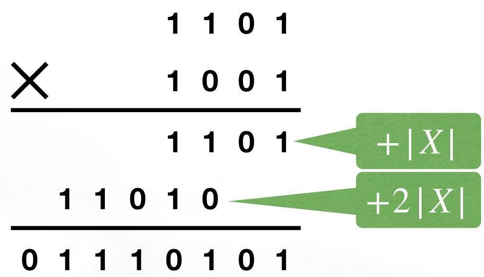

<details>
<summary>text_image</summary>

1 1 0 1
×          1 0 0 1
    1 1 0 1
1 1 0 1 0
0 1 1 1 0 1 0 1
+|X|
+2|X|
</details>

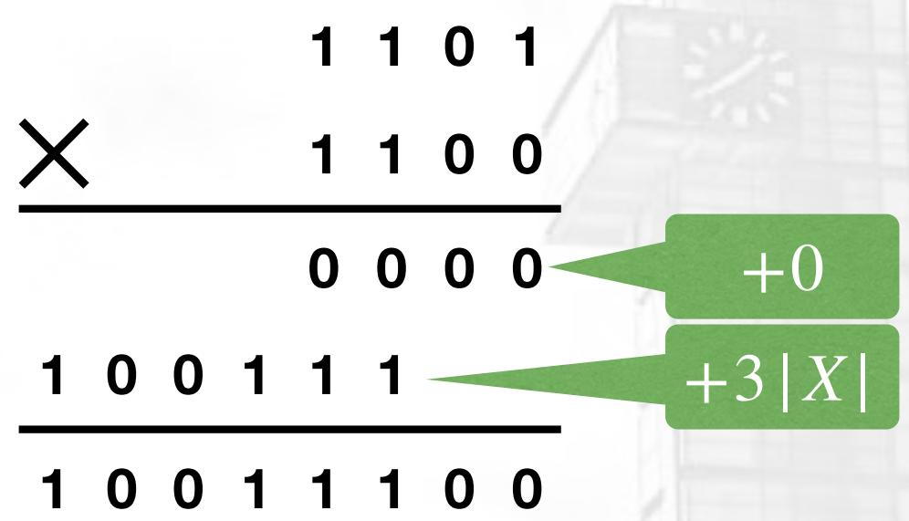

<details>
<summary>text_image</summary>

1 1 0 1
×    1 1 0 0
-----
      0 0 0 0
1 0 0 1 1 1
-----
1 0 0 1 1 1 0 0
+0
+3 |X|
</details>

规则似乎很直观：

$$
\left\{ \begin{array}{l} Y _ {i + 1} Y i = 0 0, + 0 \\ Y _ {i + 1} Y i = 0 1, + | X | \\ Y _ {i + 1} Y i = 1 0, + 2 | X | \\ Y _ {i + 1} Y i = 1 1, + 3 | X | \end{array} \right.
$$

规则还可以更进一步优化：

$$
3 | X | = + 4 | X | - | X |
$$

$\Rightarrow$ 先减 $|X|$ ，平移2位后加 $|X|$

怎么做减法？把X和D用补码表示

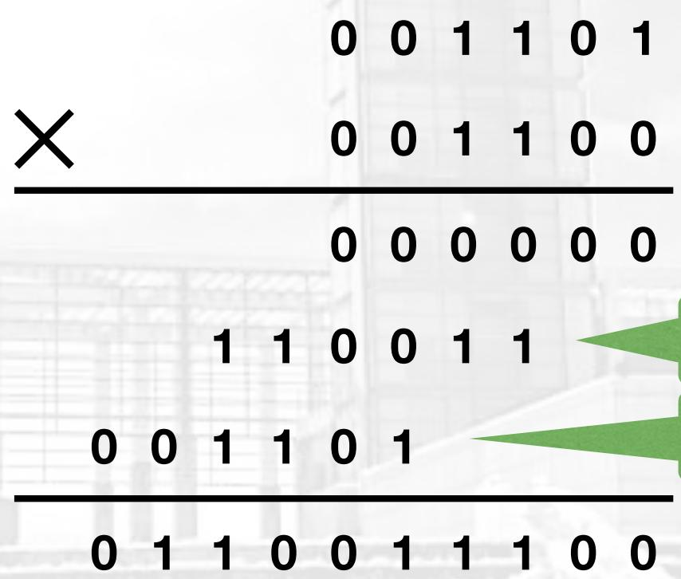

<details>
<summary>text_image</summary>

0 0 1 1 0 1
0 0 1 1 0 0
×
0 0 0 0 0 0
1 1 0 0 1 1
0 0 1 1 0 1
0 1 1 0 0 1 1 1 0 0
</details>

\- |X|

+|X|

# 原码二位乘法

规则还可以更进一步优化：

$$
3 | X | = + 4 | X | - | X |
$$

$\Rightarrow$ 先减 $|X|$ ，平移2位后加 $|X|$

怎么做减法？把X和D用补码表示

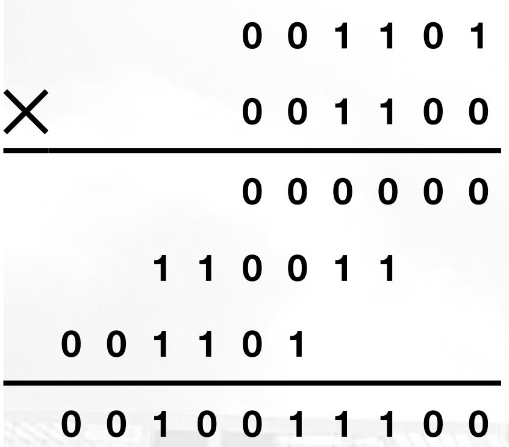

<details>
<summary>text_image</summary>

0 0 1 1 0 1
×          0 0 1 1 0 0
-----
          0 0 0 0 0 0
           1 1 0 0 1 1
0 0 1 1 0 1
-----
0 0 1 0 0 1 1 1 0 0
</details>

然而，还有一些复杂情况，例如...

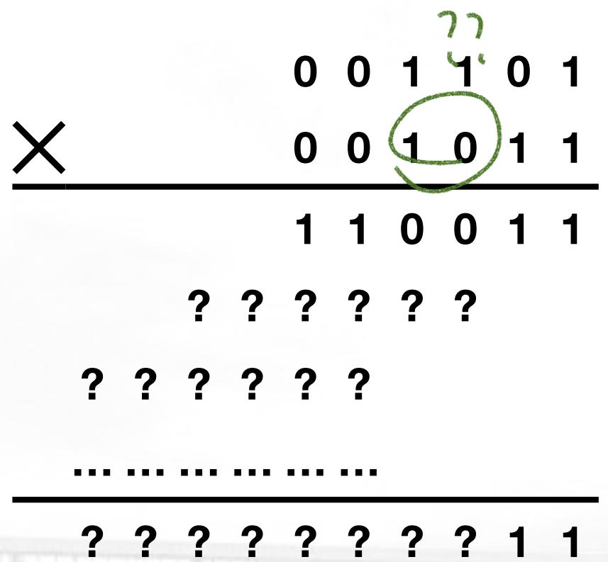

<details>
<summary>text_image</summary>

0 0 1 1 0 1
0 0 1 0 1 1
×
-----
    1 1 0 0 1 1
? ? ? ? ?
? ? ? ? ?
......
-----
? ? ? ? ? ? ? ? 1 1
</details>

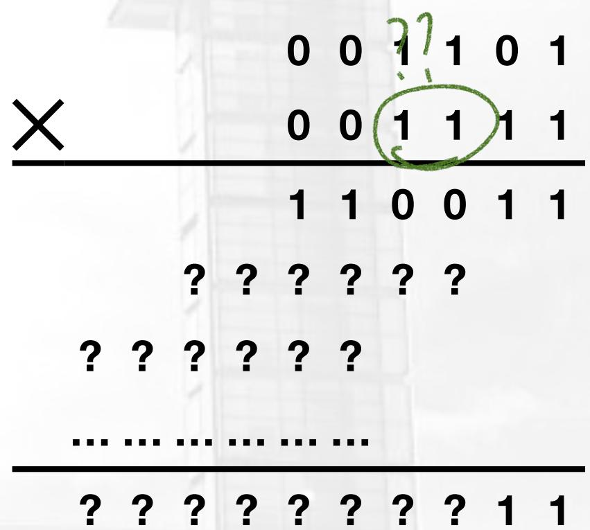

<details>
<summary>text_image</summary>

0 0 ?1 1 0 1
0 0 1 1 1 1
×
-----
    1 1 0 0 1 1
? ? ? ? ?
? ? ? ? ?
......
-----
? ? ? ? ? ? ? ? 1 1
</details>

# 原码二位乘法

规则还可以更进一步优化：

$$
3 | X | = + 4 | X | - | X |
$$

$\Rightarrow$ 先减 $|X|$ ，平移2位后加 $|X|$

怎么做减法？把X和D用补码表示

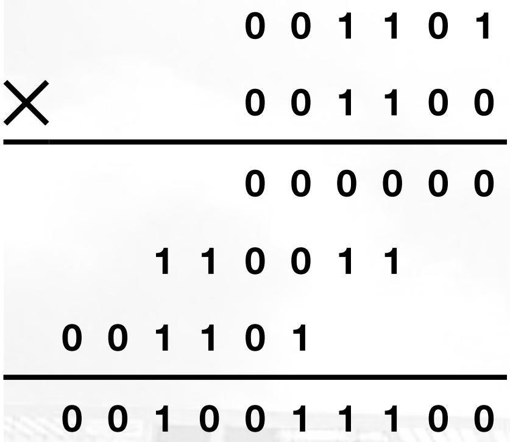

<details>
<summary>text_image</summary>

0 0 1 1 0 1
×    0 0 1 1 0 0
-----
        0 0 0 0 0 0
        1 1 0 0 1 1
0 0 1 1 0 1
-----
0 0 1 0 0 1 1 1 0 0
</details>

好在这些复杂情况，还是使用相同的方法 + 进位机制！

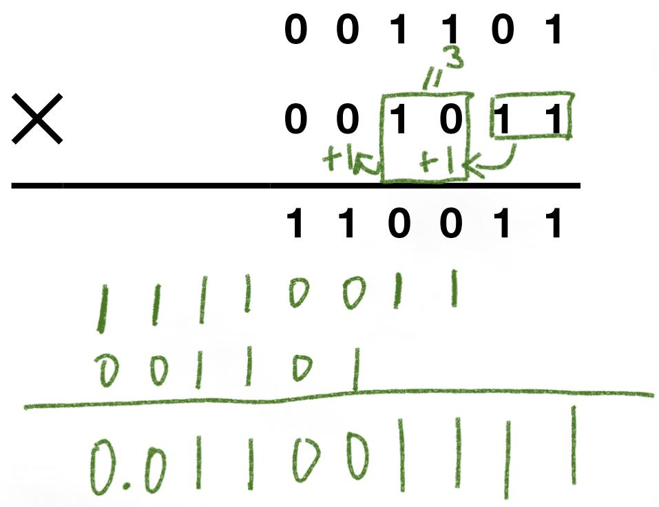

<details>
<summary>text_image</summary>

0 0 1 1 0 1
×
0 0 1 0 1 1
+k +l
1 1 0 0 1 1
1 1 1 0 0 1 1
0 0 1 0 1
0.0 1 1 0 0 1 1 1
</details>

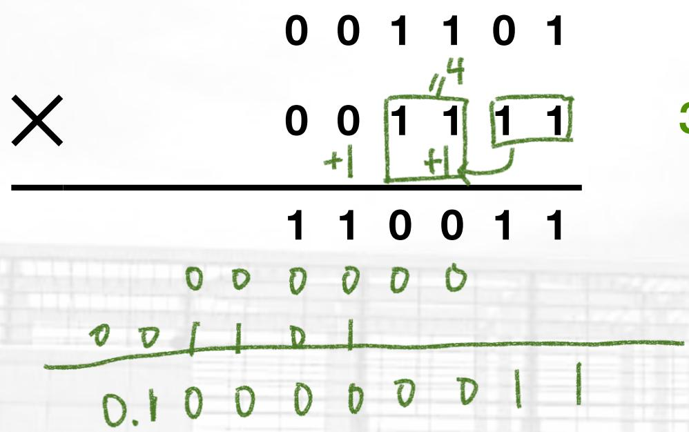

<details>
<summary>text_image</summary>

0 0 1 1 0 1
×
0 0 1 1 1 1
+1 +1
1 1 0 0 1 1
0 0 0 0 0 0
0 0 1 1 0 1
0.1 0 0 0 0 0 0 1 1
</details>

补充的规则：

1. 遇到>=3倍情况时，平移2位后加 $|X|$ ，相当于给下一组乘数进位+1；  
2. 当=4倍情况时，不减 $|X|$ 直接平移2位，并进位  
3. 使用一个标志C指示下一组需要加上进位

# 原码二位乘法

带大家练习一哈，[X]原=0.100111, [Y]原=1.100111，求积

解：[2X]补=01.001110；[-X]补=11.011001

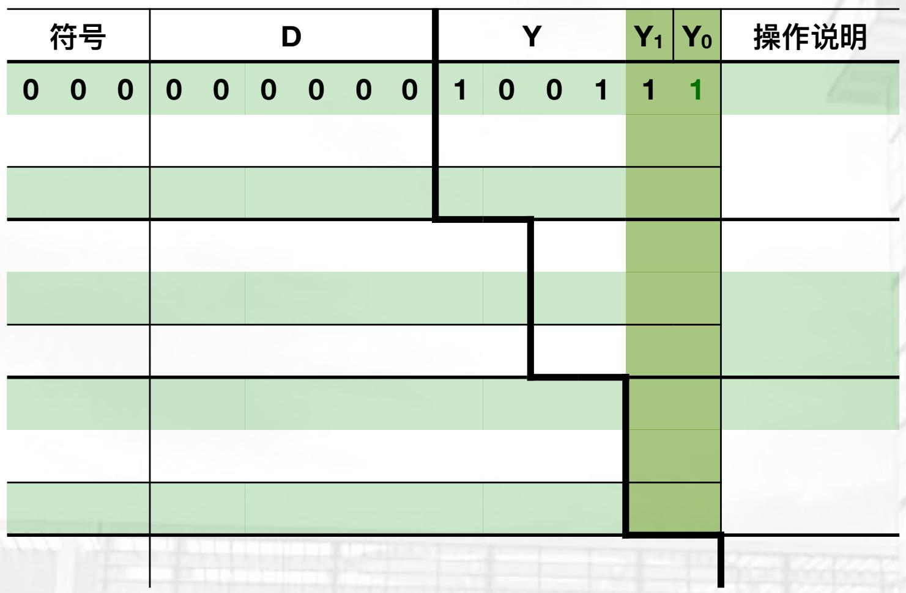

<details>
<summary>text_image</summary>

符号 D Y Y₁ Y₀ 操作说明
0 0 0 0 0 0 0 0 0 1 0 0 1 1 1
操作说明
</details>

# 原码二位乘法

带大家练习一哈，[X]原=0.100111, [Y]原=1.100111，求积

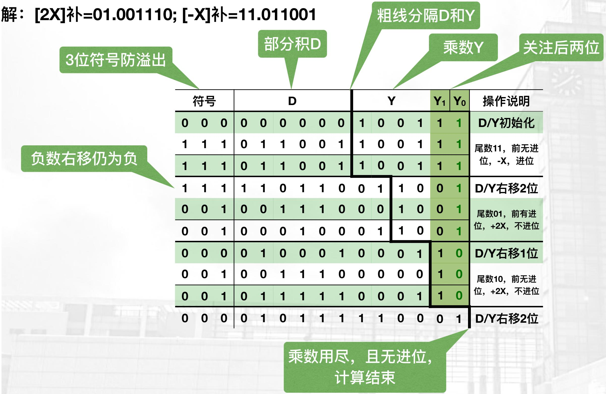

<details>
<summary>text_image</summary>

解：[2X]补=01.001110; [-X]补=11.011001
3位符号防溢出
部分积D
粗线分隔D和Y
乘数Y
关注后两位
负数右移仍为负
符号	D	Y	Y₁	Y₀	操作说明
0	0	0	0	0	0	0	0	0	1	0	0	1	1	1	D/Y初始化
1	1	1	0	1	1	0	0	1	1	0	0	1	1	1	尾数11,前无进位,-X,进位
1	1	1	0	1	1	0	0	1	1	0	0	1	1	1
1	1	1	1	1	0	1	1	0	0	1	1	0	0	1	1	D/Y右移2位
0	0	1	0	0	1	1	1	0	0	0	1	0	0	1	尾数01,前有进位,+2X,不进位
0	0	1	0	0	0	1	0	0	0	1	1	0	0	1
0	0	0	0	1	0	0	0	1	0	0	0	1	1	0	D/Y右移1位
0	0	1	0	0	1	1	1	0	0	0	0	0	1	1	0	尾数10,前无进位,+2X,不进位
0	0	1	0	1	1	1	1	1	0	0	0	1	1	0	D/Y右移2位
0	0	0	0	1	0	1	1	1	1	1	1	1	0	0	0	0	1
乘数用尽,且无进位,计算结束
</details>

# 原码二位乘法

再来练习一哈，[X]原=0.100111, [Y]原=1.101110，求积

解：[2X]补=01.001110；[-X]补=11.011001

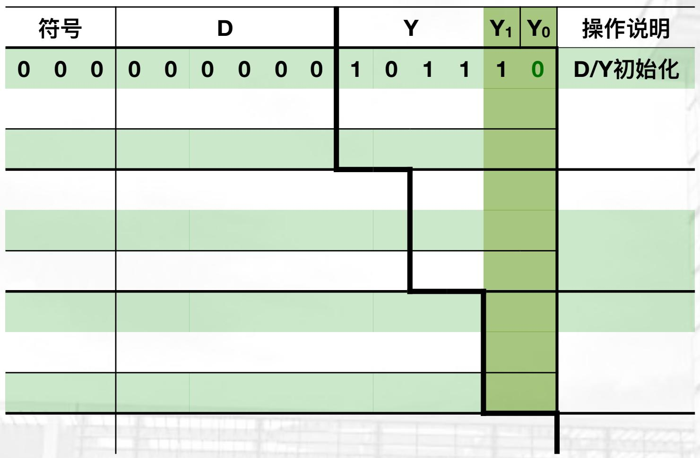

<details>
<summary>text_image</summary>

符号	D	Y	Y₁	Y₀	操作说明
0 0 0	0 0 0 0 0 0	1 0 1 1	1 0	D/Y初始化
</details>

# 原码二位乘法

再来练习一哈，[X]原=0.100111, [Y]原=1.101110，求积

解：[2X]补=01.001110；[-X]补=11.011001

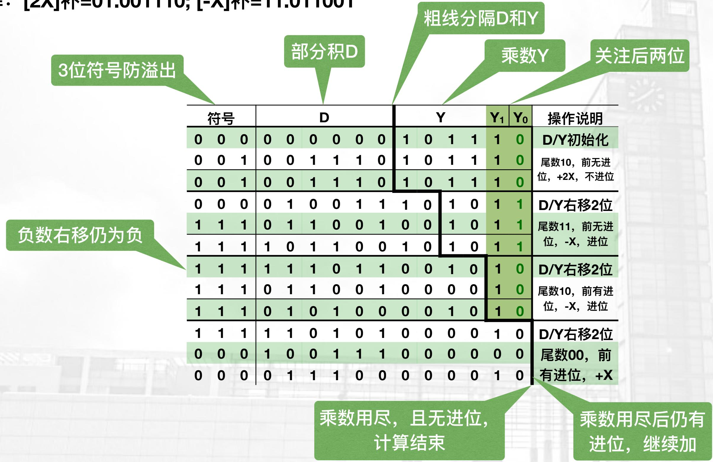

<details>
<summary>text_image</summary>

3位符号防溢出
部分积D
粗线分隔D和Y
乘数Y
关注后两位
负数右移仍为负
乘数用尽，且无进位，
计算结束
乘数用尽后仍有
进位，继续加
</details>

# 定点数运算一乘法

练习，[X]原=0.110110, [Y]原=1.101101，求积

解：[2X]补=01.101100；[-X]补=1.001010

# 定点数运算一补码乘法

# 定点数运算一补码乘法

# 补码乘法

- 校正法  
- Booth法

\- 两位Booth法

# 定点数运算一补码乘法

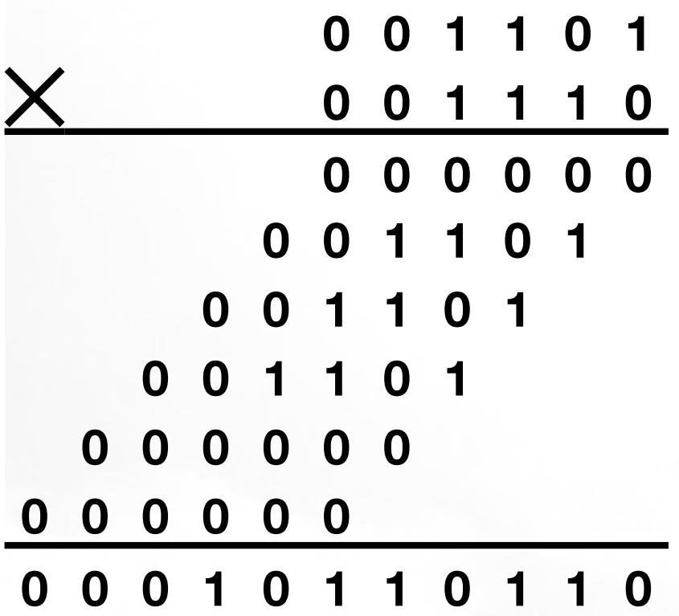

<details>
<summary>text_image</summary>

×
0 0 1 1 0 1
0 0 1 1 1 0
0 0 0 0 0 0
0 0 1 1 0 1
0 0 1 1 0 1
0 0 1 1 0 1
0 0 0 0 0 0
0 0 0 0 0 0
0 0 1 0 1 1 0 1 1 0
</details>

<-无脑计算需要6步
v.s
略用心机只需3步->

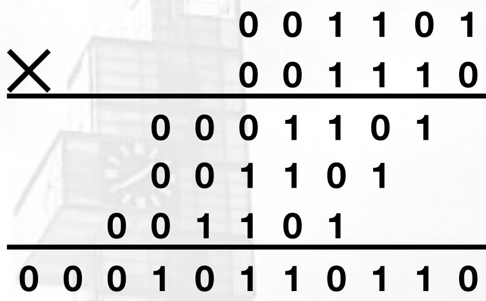

<details>
<summary>text_image</summary>

×
0 0 1 1 0 1
0 0 1 1 1 0
0 0 0 1 1 0 1
0 0 1 1 0 1
0 0 1 1 0 1
0 0 0 1 0 1 1 0 1 1 0
</details>

# 定点数运算一补码乘法


<details>
<summary>text_image</summary>

×
0 0 1 1 0 1
0 0 1 1 1 0
0 0 0 0 0 0
0 0 1 1 0 1
0 0 1 1 0 1
0 0 1 1 0 1
0 0 0 0 0 0
0 0 0 0 0 0
0 0 1 0 1 1 0 1 1 0
</details>

<-无脑计算需要6步
v.s

略用心机只需3步一>

能不能更简化！？


<details>
<summary>text_image</summary>

×
0 0 1 1 0 1
0 0 1 1 1 0
0 0 0 1 1 0 1
0 0 1 1 0 1
0 0 1 1 0 1
0 0 0 1 0 1 1 0 1 1 0
</details>

# 定点数运算—补码乘法

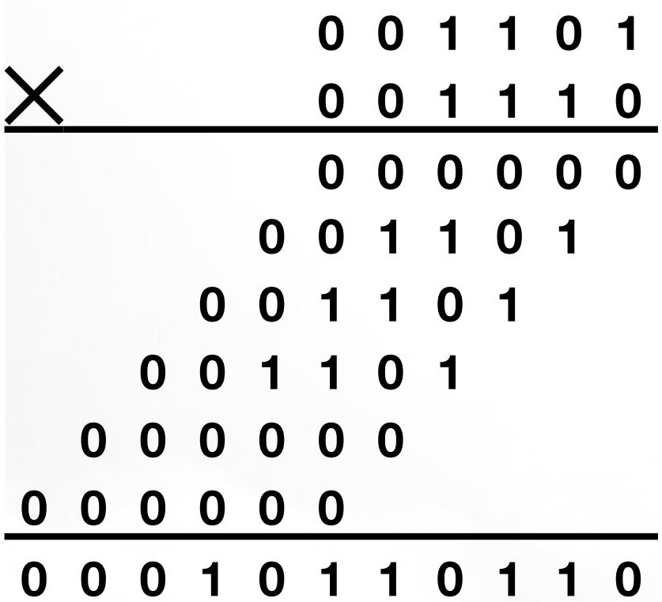

<details>
<summary>text_image</summary>

×
0 0 1 1 0 1
0 0 1 1 1 0
0 0 0 0 0 0
0 0 1 1 0 1
0 0 1 1 0 1
0 0 1 1 0 1
0 0 0 0 0 0
0 0 0 0 0 0
0 0 1 0 1 1 0 1 1 0
</details>

<-无脑计算需要6步
v.s

略用心机只需3步一>

能不能更简化！？

先看一个日常使用的技巧：

$$
1 2 3 4 5 \times 1 0 0 1 = 1 2 3 4 5 \times (1 0 0 0 + 1)
$$

$$
2 3 4 2 \times 9 9 9 = 2 3 4 2 \times (1 0 0 0 - 1)
$$

对二进制，也一样！

$$
1 0 1 0 \times 0 1 1 1 = 1 0 1 0 \times (1 0 0 0 - 1)
$$

$$
1 0 1 0 \times 1 1 1 0 = 1 0 1 0 \times (1 0 0 0 0 - 1 0)
$$


<details>
<summary>text_image</summary>

×
0 0 1 1 0 1
0 0 1 1 1 0
0 0 0 1 1 0 1
0 0 1 1 0 1
0 0 1 1 0 1
0 0 0 1 0 1 1 0 1 1 0
</details>

# 定点数运算一补码乘法

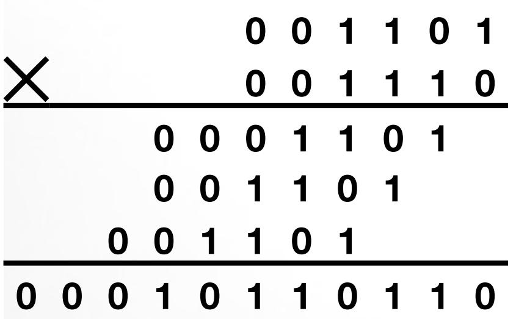

<details>
<summary>text_image</summary>

X
0 0 1 1 0 1
0 0 1 1 1 0
0 0 0 1 1 0 1
0 0 1 1 0 1
0 0 1 1 0 1
0 0 0 1 0 1 1 0 1 1 0
</details>

<-略用心机需要3步

v.s

运用技巧只需2步一>

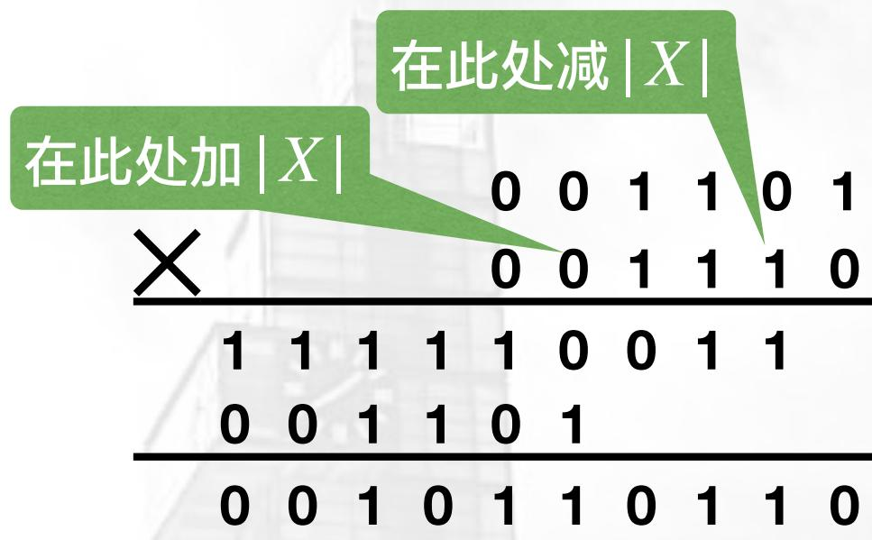

<details>
<summary>text_image</summary>

在此处加 |X|
在此处减 |X|
0 0 1 1 0 1
0 0 1 1 1 0
1 1 1 1 1 0 0 1 1
0 0 1 1 0 1
0 0 1 0 1 1 0 1 1 0
</details>

问题来了：如何高效地识别“一串1”的开始和结束？

# 定点数运算一补码乘法

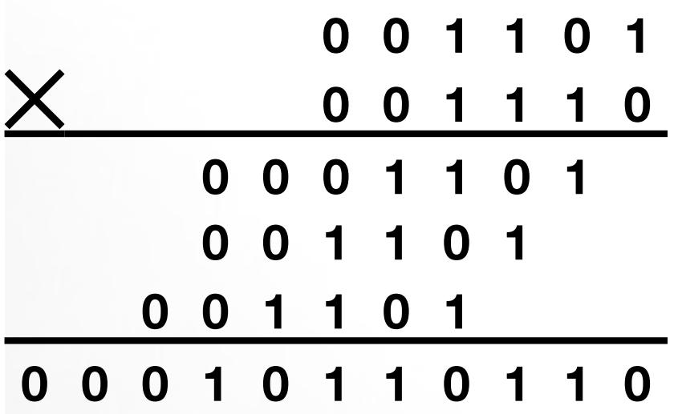

<details>
<summary>text_image</summary>

0 0 1 1 0 1
0 0 1 1 1 0
×
0 0 0 1 1 0 1
0 0 1 1 0 1
0 0 1 1 0 1
0 0 1 1 0 1
0 0 0 1 0 1 1 0 1 1 0
</details>

<-略用心机需要3步

v.s

运用技巧只需2步一>


<details>
<summary>text_image</summary>

在此处加 |X|
在此处减 |X|
0 0 1 1 0 1
0 0 1 1 1 0
1 1 1 1 1 0 0 1 1
0 0 1 1 0 1
0 0 1 0 1 1 0 1 1 0
</details>

问题来了：如何高效地识别“一串1”的开始和结束？

# Booth算法:

- 从右向左，遇到“10”就是“一串1”的开始，在1的位置减 $|X|$ ；  
- 从右向左，遇到“0 1”就是“一串1”的结束，在0的位置加 $|X|$ ；  
- 中间的“00”和“11”都不管！

<table><tr><td> $y_i$   $y_{i-1}$ </td><td>操作</td></tr><tr><td>0 0</td><td>部分积+0,右移1位</td></tr><tr><td>0 1</td><td>部分积+[X] $_{补}$ ,右移1</td></tr><tr><td>1 0</td><td>部分积+[-X] $_{补}$ ,右移1</td></tr><tr><td>1 1</td><td>部分积+0,右移1位</td></tr></table>

# Booth乘法 (补码乘法)

# Booth算法:

- 从右向左，遇到“10”就是“一串1”的开始，在1的位置减 $|X|$ ；  
- 从右向左，遇到“0 1”就是“一串1”的结束，在0的位置加 $|X|$ ；  
- 中间的“00”和“11”都不管！

【例】X=0.1010，Y=-0.1101，利用Booth法求积。

【解】：

$$
[ \mathbf {X} ] _ {\text {补}} = 0 0. 1 0 1 0
$$

$$
[ - X ] _ {\text {补}} = 1 1. 0 1 1 0
$$

$$
[ \mathrm{Y} ] _ {\text {补}} = 1 1. 0 0 1 1
$$

$$
\therefore [ X \cdot Y ] \text {补} = 1. 0 1 1 1 1 1 1 0
$$

[Y]补含1位符号

-1位置尾数

<table><tr><td colspan="2">符号</td><td colspan="4">D</td><td colspan="4">Y</td><td> $Y_0$ </td><td> $Y_{-1}$ </td><td>操作说明</td></tr><tr><td>0</td><td>0</td><td>0</td><td>0</td><td>0</td><td>0</td><td>1</td><td>0</td><td>0</td><td>1</td><td>1</td><td>0</td><td>D/Y初始化</td></tr><tr><td>1</td><td>1</td><td>0</td><td>1</td><td>1</td><td>0</td><td>1</td><td>0</td><td>0</td><td>1</td><td>1</td><td>0</td><td rowspan="2">尾数10,“串头”,-X</td></tr><tr><td>1</td><td>1</td><td>0</td><td>1</td><td>1</td><td>0</td><td>1</td><td>0</td><td>0</td><td>1</td><td>1</td><td>0</td></tr><tr><td>1</td><td>1</td><td>1</td><td>0</td><td>1</td><td>1</td><td>0</td><td>1</td><td>0</td><td>0</td><td>1</td><td>1</td><td>尾数11,跳过</td></tr><tr><td>1</td><td>1</td><td>1</td><td>1</td><td>0</td><td>1</td><td>1</td><td>0</td><td>1</td><td>0</td><td>0</td><td>1</td><td>D/Y右移2位</td></tr><tr><td>0</td><td>0</td><td>1</td><td>0</td><td>1</td><td>0</td><td>0</td><td>0</td><td>1</td><td>0</td><td>0</td><td>1</td><td rowspan="2">尾数01,“串尾”,+X</td></tr><tr><td>0</td><td>0</td><td>0</td><td>1</td><td>1</td><td>1</td><td>1</td><td>0</td><td>1</td><td>0</td><td>0</td><td>1</td></tr><tr><td>0</td><td>0</td><td>0</td><td>0</td><td>1</td><td>1</td><td>1</td><td>1</td><td>0</td><td>1</td><td>0</td><td>0</td><td>尾数00,跳过</td></tr><tr><td>0</td><td>0</td><td>0</td><td>0</td><td>0</td><td>1</td><td>1</td><td>1</td><td>1</td><td>0</td><td>1</td><td>0</td><td>D/Y右移2位</td></tr><tr><td>1</td><td>1</td><td>0</td><td>1</td><td>1</td><td>0</td><td>0</td><td>0</td><td>0</td><td>0</td><td>1</td><td>0</td><td rowspan="2">尾数10,“串头”,-X</td></tr><tr><td>1</td><td>1</td><td>0</td><td>1</td><td>1</td><td>1</td><td>1</td><td>1</td><td>1</td><td>0</td><td>1</td><td>0</td></tr><tr><td>1</td><td>1</td><td>1.</td><td>0</td><td>1</td><td>1</td><td>1</td><td>1</td><td>1</td><td>1</td><td>0</td><td>1</td><td>D/Y右移2位</td></tr></table>

结束首位为符号

乘数用尽，且无进位，计算结束

# Booth乘法 (补码乘法)

练习，[X]原=0.110110, [Y]原

=1.101101，求积

解：[-X]补=1.001010;

[Y]补=1.010011

<table><tr><td colspan="2">符号</td><td colspan="6">D</td><td colspan="6">Y</td><td> $Y_0$ </td><td> $Y_{-1}$ </td><td>操作说明</td></tr><tr><td>0</td><td>0</td><td>0</td><td>0</td><td>0</td><td>0</td><td>0</td><td>0</td><td>1</td><td>0</td><td>1</td><td>0</td><td>0</td><td>1</td><td>1</td><td>0</td><td>D/Y初始化</td></tr><tr><td>1</td><td>1</td><td>0</td><td>0</td><td>1</td><td>0</td><td>1</td><td>0</td><td>1</td><td>0</td><td>1</td><td>0</td><td>0</td><td>1</td><td>1</td><td>0</td><td rowspan="2">尾数10,“串头”,-X</td></tr><tr><td>1</td><td>1</td><td>0</td><td>0</td><td>1</td><td>0</td><td>1</td><td>0</td><td>1</td><td>0</td><td>1</td><td>0</td><td>0</td><td>1</td><td>1</td><td>0</td></tr><tr><td>1</td><td>1</td><td>1</td><td>0</td><td>0</td><td>1</td><td>0</td><td>1</td><td>0</td><td>1</td><td>0</td><td>1</td><td>0</td><td>0</td><td>1</td><td>1</td><td>尾数11,跳过</td></tr><tr><td>1</td><td>1</td><td>1</td><td>1</td><td>0</td><td>0</td><td>1</td><td>0</td><td>1</td><td>0</td><td>1</td><td>0</td><td>1</td><td>0</td><td>0</td><td>1</td><td>D/Y右移2位</td></tr><tr><td>0</td><td>0</td><td>1</td><td>1</td><td>0</td><td>1</td><td>1</td><td>0</td><td>0</td><td>0</td><td>1</td><td>0</td><td>1</td><td>0</td><td>0</td><td>1</td><td rowspan="2">尾数01,“串尾”,+X</td></tr><tr><td>0</td><td>0</td><td>1</td><td>0</td><td>1</td><td>0</td><td>0</td><td>0</td><td>1</td><td>0</td><td>1</td><td>0</td><td>1</td><td>0</td><td>0</td><td>1</td></tr><tr><td>0</td><td>0</td><td>0</td><td>1</td><td>0</td><td>1</td><td>0</td><td>0</td><td>0</td><td>1</td><td>0</td><td>1</td><td>0</td><td>1</td><td>0</td><td>0</td><td>尾数00,跳过</td></tr><tr><td>0</td><td>0</td><td>0</td><td>0</td><td>1</td><td>0</td><td>1</td><td>0</td><td>0</td><td>0</td><td>1</td><td>0</td><td>1</td><td>0</td><td>1</td><td>0</td><td>D/Y右移2位</td></tr><tr><td>1</td><td>1</td><td>0</td><td>0</td><td>1</td><td>0</td><td>1</td><td>0</td><td>0</td><td>0</td><td>0</td><td>0</td><td>1</td><td>0</td><td>1</td><td>0</td><td rowspan="2">尾数10,“串头”,-X</td></tr><tr><td>1</td><td>1</td><td>0</td><td>1</td><td>0</td><td>1</td><td>0</td><td>0</td><td>0</td><td>0</td><td>1</td><td>0</td><td>1</td><td>0</td><td>1</td><td>0</td></tr><tr><td>1</td><td>1</td><td>1</td><td>0</td><td>1</td><td>0</td><td>1</td><td>0</td><td>0</td><td>0</td><td>0</td><td>1</td><td>0</td><td>1</td><td>0</td><td>1</td><td>D/Y右移2位</td></tr><tr><td>0</td><td>0</td><td>1</td><td>1</td><td>0</td><td>1</td><td>1</td><td>0</td><td>0</td><td>0</td><td>0</td><td>0</td><td>0</td><td>1</td><td>0</td><td>1</td><td rowspan="2">尾数10,“串头”,-X</td></tr><tr><td>0</td><td>0</td><td>1</td><td>0</td><td>0</td><td>0</td><td>0</td><td>0</td><td>0</td><td>0</td><td>0</td><td>1</td><td>0</td><td>1</td><td>0</td><td>1</td></tr><tr><td>0</td><td>0</td><td>0</td><td>1</td><td>0</td><td>0</td><td>0</td><td>0</td><td>0</td><td>0</td><td>0</td><td>0</td><td>1</td><td>0</td><td>1</td><td>0</td><td>D/Y右移2位</td></tr><tr><td>1</td><td>1</td><td>0</td><td>0</td><td>1</td><td>0</td><td>1</td><td>0</td><td>0</td><td>0</td><td>0</td><td>0</td><td>0</td><td>0</td><td>1</td><td>0</td><td rowspan="2">尾数10,“串头”,-X</td></tr><tr><td>1</td><td>1</td><td>0</td><td>1</td><td>1</td><td>0</td><td>1</td><td>0</td><td>0</td><td>0</td><td>0</td><td>0</td><td>1</td><td>0</td><td>1</td><td>0</td></tr><tr><td>1</td><td>1</td><td>1.</td><td>0</td><td>1</td><td>1</td><td>0</td><td>1</td><td>0</td><td>0</td><td>0</td><td>0</td><td>0</td><td>1</td><td>0</td><td>1</td><td></td></tr></table>

∴ [X·Y]补 = 1.1011010000010

# 定点数运算一乘法

练习，[X]原=0.110110, [Y]原=1.101101，求积

解：[2X]补=01.101100；[-X]补=1.001010

# 定点数运算－除法

# 定点数运算一除法

按理说，原码一位除法就是模拟手工除法：

- 符号 $S_{m} = S_{A}\oplus S_{b}$ ，数值 $\mid m\mid = \mid A\mid /|B|$   
- 余数符号与被除数相同

例，[X]原=0.1101, [Y]原=1.1011，求积

解：符号， $S = 0 \oplus 1 = 1$ ；数值部分如下：

模拟手工除法  
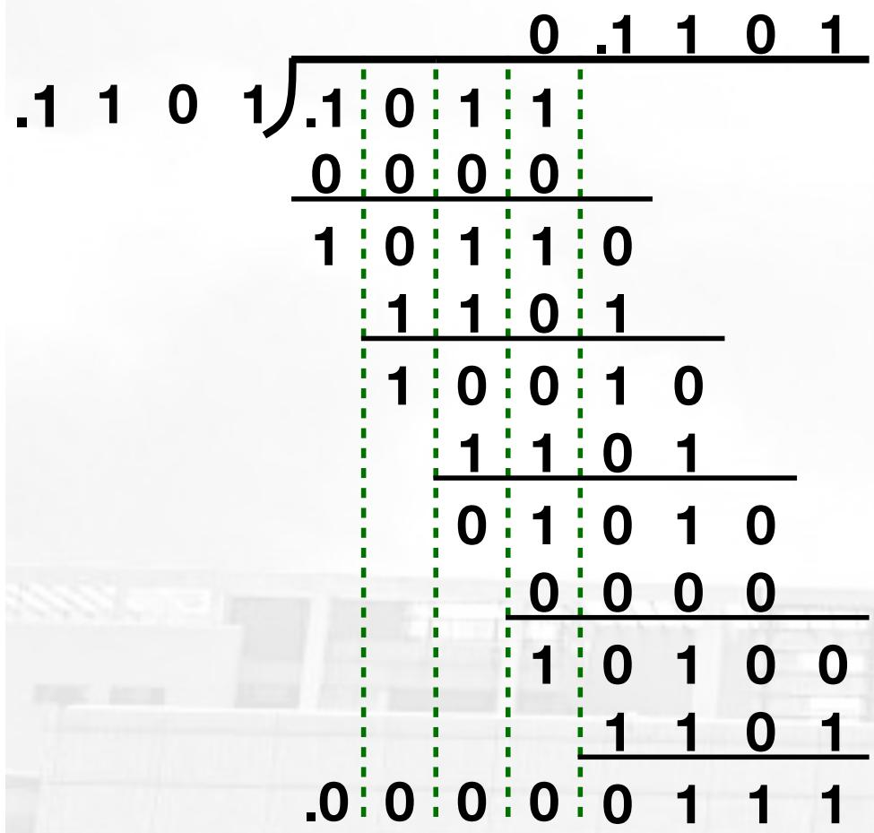

<details>
<summary>tree</summary>

| Row | Value |
|---|---|
| 1 | .1 |
| 2 | 0 |
| 3 | 1 |
| 4 | 1 |
| 5 | 0 |
| 6 | 0 |
| 7 | 0 |
| 8 | 0 |
| 9 | 0 |
| 10 | 0 |
| 11 | 0 |
| 12 | 0 |
| 13 | 0 |
| 14 | 0 |
| 15 | 0 |
| 16 | 0 |
| 17 | 0 |
| 18 | 0 |
| 19 | 0 |
| 20 | 0 |
| 21 | 0 |
| 22 | 0 |
| 23 | 0 |
| 24 | 0 |
| 25 | 0 |
| 26 | 0 |
| 27 | 0 |
| 28 | 0 |
| 29 | 0 |
| 30 | 0 |
| 31 | 0 |
| 32 | 0 |
| 33 | 0 |
| 34 | 0 |
| 35 | 0 |
| 36 | 0 |
| 37 | 0 |
| 38 | 0 |
| 39 | 0 |
| 40 | 0 |
| 41 | 0 |
| 42 | 0 |
| 43 | 0 |
| 44 | 0 |
| 45 | 0 |
| 46 | 0 |
| 47 | 0 |
| 48 | 0 |
| 49 | 0 |
| 50 | 0 |
| 51 | 0 |
| 52 | 0 |
| 53 | 0 |
| 54 | 0 |
| 55 | 0 |
| 56 | 0 |
| 57 | 0 |
| 58 | 0 |
| 59 | 0 |
| 60 | 0 |
| 61 | 0 |
| 62 | 0 |
| 63 | 0 |
| 64 | 0 |
| 65 | 0 |
| 66 | 0 |
| 67 | 0 |
| 68 | 0 |
| 69 | 0 |
| 70 | 0 |
| 71 | 0 |
| 72 | 0 |
| 73 | 0 |
| 74 | 0 |
| 75 | 0 |
| 76 | 0 |
| 77 | 0 |
| 78 | 0 |
| 79 | 0 |
| 80 | 0 |
| 81 | 0 |
| 82 | 0 |
| 83 | 0 |
| 84 | 0 |
| 85 | 0 |
| 86 | 0 |
| 87 | 0 |
| 88 | 0 |
| 89 | 0 |
| 90 | 0 |
| 91 | 0 |
| 92 | 0 |
| 93 | 0 |
| 94 | 0 |
| 95 | 0 |
| 96 | 0 |
| 97 | 0 |
| 98 | 0 |
| 99 | 0 |
| Note: The actual values in the 'Value' column are not explicitly provided in the code. The 'Number' is calculated as the sum of the numbers of the first and second integers.
</details>

# 定点数运算一除法

按理说，原码一位除法就是模拟手工除法：

\- 符号 $S_{m} = S_{A} \oplus S_{b}$ , 数值 $|m| = |A| / |B|$

例，[X]原=0.1011, [Y]原=1.1101，求商/余数

解：符号， $S = 0 \oplus 1 = 1$ ；数值部分如下：

模拟手工除法  
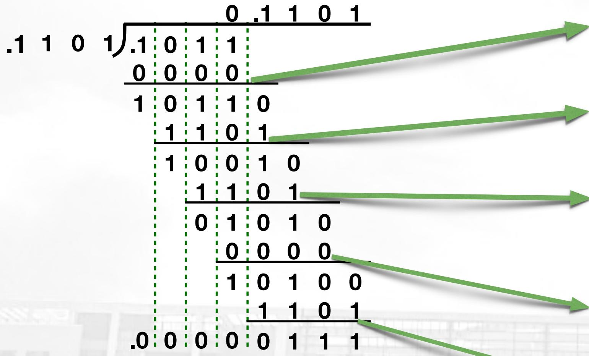

<details>
<summary>other</summary>

| Bit Position | Value |
| ------------ | ----- |
| 0            | 0     |
| 1            | 1     |
| 2            | 0     |
| 3            | 0     |
| 4            | 0     |
| 5            | 0     |
| 6            | 0     |
| 7            | 0     |
| 8            | 0     |
| 9            | 0     |
| 10           | 0     |
| 11           | 0     |
| 12           | 0     |
| 13           | 0     |
| 14           | 0     |
| 15           | 0     |
| 16           | 0     |
| 17           | 0     |
| 18           | 0     |
| 19           | 0     |
| 20           | 0     |
| 21           | 0     |
| 22           | 0     |
| 23           | 0     |
| 24           | 0     |
| 25           | 0     |
| 26           | 0     |
| 27           | 0     |
| 28           | 0     |
| 29           | 0     |
| 30           | 0     |
| 31           | 0     |
| 32           | 0     |
| 33           | 0     |
| 34           | 0     |
| 35           | 0     |
| 36           | 0     |
| 37           | 0     |
| 38           | 0     |
| 39           | 0     |
| 40           | 0     |
| 41           | 0     |
| 42           | 0     |
| 43           | 0     |
| 44           | 0     |
| 45           | 0     |
| 46           | 0     |
| 47           | 0     |
| 48           | 0     |
| 49           | 0     |
| 50           | 0     |
| 51           | 0     |
| 52           | 0     |
| 53           | 0     |
| 54           | 0     |
| 55           | 0     |
| 56           | 0     |
| 57           | 0     |
| 58           | 0     |
| 59           | 0     |
| 60           | 0     |
| Note: The actual values for 'Value' are not provided in the code. The actual values are generated by adding some random factors (e.g., '1') to the actual values. The provided values are just an example from the input array.
</details>

$[\mathrm{X}\div \mathrm{Y}]$ 原 $= 1.1101$   
余数 $= 0.0111 \times 2 - 4$

<table><tr><td colspan="2">符号</td><td colspan="4">余数(R)</td><td>商</td><td>操作说明</td></tr><tr><td>0</td><td>0</td><td>1</td><td>0</td><td>1</td><td>1</td><td rowspan="3">0</td><td>R初始化</td></tr><tr><td>0</td><td>0</td><td>0</td><td>0</td><td>0</td><td>0</td><td rowspan="2">不够减,商0R=R-0</td></tr><tr><td>0</td><td>0</td><td>1</td><td>0</td><td>1</td><td>1</td></tr><tr><td>0</td><td>1</td><td>0</td><td>1</td><td>1</td><td>0</td><td rowspan="3">1</td><td>R左移1位</td></tr><tr><td>1</td><td>1</td><td>0</td><td>0</td><td>1</td><td>1</td><td rowspan="2">够减,商1R=R-D</td></tr><tr><td>0</td><td>0</td><td>1</td><td>0</td><td>0</td><td>1</td></tr><tr><td>0</td><td>1</td><td>0</td><td>0</td><td>1</td><td>0</td><td rowspan="3">1</td><td>R左移1位</td></tr><tr><td>1</td><td>1</td><td>0</td><td>0</td><td>1</td><td>1</td><td rowspan="2">够减,商1R=R-D</td></tr><tr><td>0</td><td>0</td><td>0</td><td>1</td><td>0</td><td>1</td></tr><tr><td>0</td><td>0</td><td>1</td><td>0</td><td>1</td><td>0</td><td rowspan="3">0</td><td>R左移1位</td></tr><tr><td>0</td><td>0</td><td>0</td><td>0</td><td>0</td><td>0</td><td rowspan="2">不够减,商0R=R-0</td></tr><tr><td>0</td><td>0</td><td>1</td><td>0</td><td>1</td><td>0</td></tr><tr><td>0</td><td>1</td><td>0</td><td>1</td><td>0</td><td>0</td><td rowspan="3">1</td><td>R左移1位</td></tr><tr><td>1</td><td>1</td><td>0</td><td>0</td><td>1</td><td>1</td><td rowspan="2">够减,商1R=R-D</td></tr><tr><td>0</td><td>0</td><td>0</td><td>1</td><td>1</td><td>1</td></tr></table>

# 定点数运算一除法

按理说，原码一位除法就是模拟手工除法：

- 符号 $S_{m} = S_{A}\oplus S_{b}$ ，数值 $\mid m\mid = \mid A\mid /|B|$   
- 余数符号与被除数相同

例，[X]原=0.1101, [Y]原=1.1011，求积

解：符号， $S = 0 \oplus 1 = 1$ ；数值部分如下：

模拟手工除法  
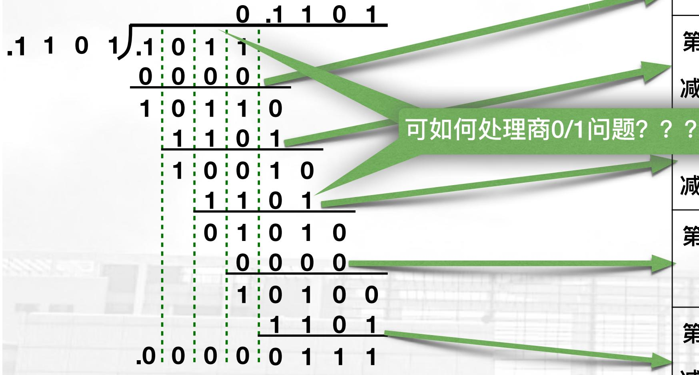

<details>
<summary>flowchart</summary>

```mermaid
graph TD
    A["0.1 1 0 1"] --> B["1 0 1 1"]
    B --> C["0 0 0 0"]
    C --> D["1 0 1 1 0"]
    D --> E["1 1 0 1"]
    E --> F["1 0 0 1 0"]
    F --> G["1 1 0 1"]
    G --> H["0 1 0 1 0"]
    H --> I["0 0 0 0"]
    I --> J["1 0 1 0 0"]
    J --> K["1 1 0 1"]
    K --> L[".0 0 0 0 0 0 1 1 1"]
    style A fill:#f9f,stroke:#333
    style L fill:#f9f,stroke:#333
    note right of A: 可如何处理商0/1问题???
```
</details>

使用临时变量R逐层累减除数D

<table><tr><td>层次</td><td>被除数(余数) R</td><td>商↓</td><td>说明</td></tr><tr><td rowspan="2">第一层减0</td><td>0 1 0 1 1- 0 0 0 0 0</td><td rowspan="2">0</td><td rowspan="2">R不够减、商0R = R - D * 0</td></tr><tr><td>0 1 0 1 1</td></tr><tr><td rowspan="2">第二层减1101</td><td>1 1 0 1 0- 0 1 1 0 1</td><td rowspan="2">1</td><td rowspan="2">R &lt;&lt; 1够减,商1R = R - D</td></tr><tr><td>0 1 0 0 1</td></tr><tr><td rowspan="2">?层减1101</td><td>1 0 0 1 0- 0 1 1 0 1</td><td rowspan="2">1</td><td rowspan="2">R &lt;&lt; 1够减,商1R = R - D</td></tr><tr><td>0 0 1 0 1</td></tr><tr><td rowspan="2">第四层减0</td><td>0 1 0 1 0- 0 0 0 0 0</td><td rowspan="2">0</td><td rowspan="2">R &lt;&lt; 1不够减、商0R = R - D * 0</td></tr><tr><td>0 1 0 1 0</td></tr><tr><td rowspan="2">第五层减1101</td><td>1 0 1 0 0- 0 1 1 0 1</td><td rowspan="2">1</td><td rowspan="2">R &lt;&lt; 1够减,商1R = R - D</td></tr><tr><td>0 0 1 1 1</td></tr></table>

# 定点数运算一除法

解决方案一：无脑直减，减多了原地恢复（恢复余数法）

例，[X]原=0.1101, [Y]原=1.1011，求积

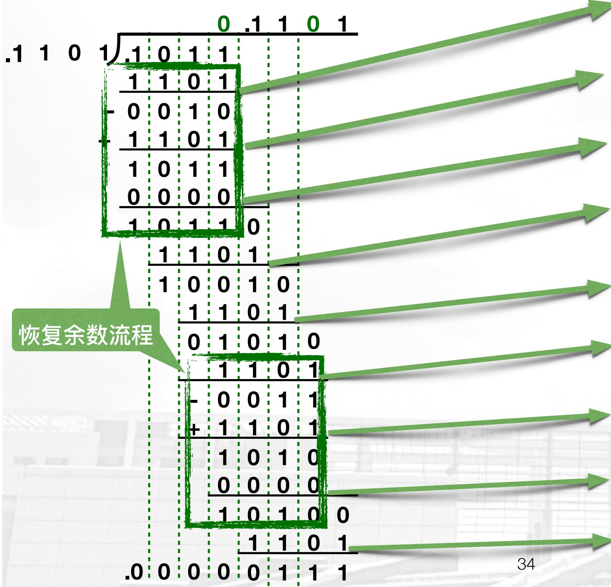

<details>
<summary>text_image</summary>

.1 1 0 1
.1 0 1 1
1 1 0 1
0 0 1 0
1 1 0 1
1 0 1 1
0 0 0 0
1 0 1 1 0
1 1 0 1
1 0 0 1 0
1 1 0 1
0 1 0 1 0
1 1 0 1
- 0 0 1 1
+ 1 1 0 1
1 0 1 0
0 0 0 0
1 0 1 0 0
1 1 0 1
.0 0 0 0 0 1 1 1
34
</details>

使用临时变量R逐层累减除数D

<table><tr><td>层次</td><td colspan="5">被除数(余数) R</td><td>商↓</td><td>说明</td><td></td></tr><tr><td rowspan="3">第一层减1101</td><td>0</td><td>1</td><td>0</td><td>1</td><td>1</td><td></td><td rowspan="3">R&gt;0无脑减DR=R-D</td><td></td></tr><tr><td>-</td><td>0</td><td>1</td><td>1</td><td>0</td><td>1</td><td></td></tr><tr><td>-</td><td>0</td><td>0</td><td>0</td><td>1</td><td>0</td><td></td></tr><tr><td rowspan="3">第二层加1101</td><td>-</td><td>0</td><td>0</td><td>0</td><td>1</td><td>0</td><td rowspan="3">R&lt;0+D恢复RR=R+D</td><td></td></tr><tr><td>+</td><td>0</td><td>1</td><td>1</td><td>0</td><td rowspan="2">1</td><td></td></tr><tr><td>0</td><td>1</td><td>0</td><td>1</td><td>1</td><td></td></tr><tr><td rowspan="3">第三层减0</td><td>0</td><td>1</td><td>0</td><td>1</td><td>1</td><td>0</td><td rowspan="3">0不够减、商0R=R-D*0</td><td></td></tr><tr><td>-</td><td>0</td><td>0</td><td>0</td><td>0</td><td rowspan="2">0</td><td></td></tr><tr><td>0</td><td>1</td><td>0</td><td>1</td><td>1</td><td></td></tr><tr><td rowspan="3">第四层减1101</td><td>1</td><td>1</td><td>0</td><td>1</td><td>0</td><td>1</td><td rowspan="3">R&lt;&lt;1够减,商1R=R-D</td><td></td></tr><tr><td>-</td><td>0</td><td>1</td><td>1</td><td>0</td><td rowspan="2">1</td><td></td></tr><tr><td>0</td><td>1</td><td>0</td><td>0</td><td>1</td><td></td></tr><tr><td rowspan="3">第五层减1101</td><td>1</td><td>0</td><td>0</td><td>1</td><td>0</td><td>1</td><td rowspan="3">R&lt;&lt;1够减,商1R=R-D</td><td></td></tr><tr><td>-</td><td>0</td><td>1</td><td>1</td><td>0</td><td rowspan="2">1</td><td></td></tr><tr><td>0</td><td>0</td><td>1</td><td>0</td><td>1</td><td></td></tr><tr><td rowspan="3">第六层减1101</td><td>0</td><td>1</td><td>0</td><td>1</td><td>0</td><td></td><td rowspan="3">R&gt;0无脑减DR=R-D</td><td></td></tr><tr><td>-</td><td>0</td><td>1</td><td>1</td><td>0</td><td>1</td><td></td></tr><tr><td>-</td><td>0</td><td>0</td><td>0</td><td>1</td><td>1</td><td></td></tr><tr><td rowspan="3">第七层加1101</td><td>-</td><td>0</td><td>0</td><td>0</td><td>1</td><td>1</td><td rowspan="3"></td><td rowspan="3">R&lt;0+D恢复RR=R+D</td></tr><tr><td>+</td><td>0</td><td>1</td><td>1</td><td>0</td><td rowspan="2">1</td></tr><tr><td>0</td><td>1</td><td>0</td><td>1</td><td>0</td></tr><tr><td rowspan="3">第八层减0</td><td>0</td><td>1</td><td>0</td><td>1</td><td>0</td><td>0</td><td rowspan="3">0不够减、商0R=R-D*0</td><td rowspan="3"></td></tr><tr><td>-</td><td>0</td><td>0</td><td>0</td><td>0</td><td rowspan="2">0</td></tr><tr><td>0</td><td>1</td><td>0</td><td>1</td><td>0</td></tr><tr><td rowspan="3">第九层减1101</td><td>1</td><td>0</td><td>1</td><td>0</td><td>0</td><td>1</td><td rowspan="3">R&lt;&lt;1够减,商1R=R-D</td><td rowspan="3"></td></tr><tr><td>-</td><td>0</td><td>1</td><td>1</td><td>0</td><td rowspan="2">1</td></tr><tr><td>0</td><td>0</td><td>1</td><td>1</td><td>1</td></tr></table>

# 定点数运算一除法

# 解决方案一：无脑直减，减多了原地恢复（恢复余数法）

【例 3-15】 若被除数 X = -0.10001011，除数 Y = 0.1110 试利用原码恢复余数法求商及余数。

解：该例满足 $|X| < |Y|$ ，且 $|Y| \neq 0$ 。

写出 $[\mathrm{X}]_{\text{原}} = 1.10001011, [\mathrm{Y}]_{\text{原}} = 0.1110$ 。

商符=1⊕0=1。绝对值除法过程如图3-17所示。

<table><tr><td colspan="2">符号</td><td colspan="8">被除数(余数)</td><td>商</td><td>操作</td></tr><tr><td>0</td><td>0</td><td>1</td><td>0</td><td>0</td><td>0</td><td>1</td><td>0</td><td>1</td><td>1</td><td rowspan="3">0</td><td rowspan="3">左移一位-|Y|</td></tr><tr><td>0</td><td>1</td><td>0</td><td>0</td><td>0</td><td>1</td><td>0</td><td>1</td><td>1</td><td>0</td></tr><tr><td>1</td><td>1</td><td>0</td><td>0</td><td>1</td><td>0</td><td></td><td></td><td></td><td></td></tr><tr><td>0</td><td>0</td><td>0</td><td>0</td><td>1</td><td>1</td><td>0</td><td>1</td><td>1</td><td>0</td><td rowspan="3">1</td><td rowspan="3">够减,商为1左移一位-|Y|</td></tr><tr><td>0</td><td>0</td><td>0</td><td>1</td><td>1</td><td>0</td><td>1</td><td>1</td><td>0</td><td>1</td></tr><tr><td>1</td><td>1</td><td>0</td><td>0</td><td>1</td><td>0</td><td></td><td></td><td></td><td></td></tr><tr><td>1</td><td>1</td><td>1</td><td>0</td><td>0</td><td>0</td><td>1</td><td>1</td><td>0</td><td>1</td><td rowspan="2">0</td><td rowspan="2">不够减,商为0+|Y|</td></tr><tr><td>0</td><td>0</td><td>1</td><td>1</td><td>1</td><td>0</td><td></td><td></td><td></td><td></td></tr><tr><td>0</td><td>0</td><td>0</td><td>1</td><td>1</td><td>0</td><td>1</td><td>1</td><td>0</td><td>1</td><td rowspan="3">0</td><td rowspan="3">恢复余数左移一位-|Y|</td></tr><tr><td>0</td><td>0</td><td>1</td><td>1</td><td>0</td><td>1</td><td>1</td><td>0</td><td>1</td><td>0</td></tr><tr><td>1</td><td>1</td><td>0</td><td>0</td><td>1</td><td>0</td><td></td><td></td><td></td><td></td></tr><tr><td>1</td><td>1</td><td>1</td><td>1</td><td>1</td><td>1</td><td>1</td><td>0</td><td>1</td><td>0</td><td rowspan="2">0</td><td rowspan="2">不够减,商为0+|Y|</td></tr><tr><td>0</td><td>0</td><td>1</td><td>1</td><td>1</td><td>0</td><td></td><td></td><td></td><td></td></tr><tr><td>0</td><td>0</td><td>1</td><td>1</td><td>0</td><td>1</td><td>1</td><td>0</td><td>1</td><td>0</td><td rowspan="3">0</td><td rowspan="3">恢复余数左移一位-|Y|</td></tr><tr><td>0</td><td>1</td><td>1</td><td>0</td><td>1</td><td>1</td><td>0</td><td>1</td><td>0</td><td>0</td></tr><tr><td>1</td><td>1</td><td>0</td><td>0</td><td>1</td><td>0</td><td></td><td></td><td></td><td></td></tr><tr><td>0</td><td>0</td><td>1</td><td>1</td><td>0</td><td>1</td><td>0</td><td>1</td><td>0</td><td>0</td><td>1</td><td>够减,商为1</td></tr></table>

图3-17 例3-15的恢复余数法过程

课本P66

# 关于除法的“表格式计算”

例，[X]=-0.10001011, [Y]=0.1110，求商及余

数，用恢复余数法

【解】

[X]原 = 1.10001011

[Y]原 $= 0.1110$

[-Y]补=1.0010

商符 $= 1 \oplus 0 = 1$

<table><tr><td>符号</td><td>余数(R)</td><td>商</td><td>操作说明</td></tr><tr><td>0 0</td><td>1 0 0 0 1 0 1 1</td><td rowspan="3"></td><td rowspan="3">R初始化</td></tr><tr><td></td><td></td></tr><tr><td></td><td></td></tr><tr><td></td><td></td><td rowspan="2"></td><td rowspan="2"></td></tr><tr><td></td><td></td></tr><tr><td></td><td></td><td rowspan="4"></td><td rowspan="4"></td></tr><tr><td></td><td></td></tr><tr><td></td><td></td></tr><tr><td></td><td></td></tr><tr><td></td><td></td><td rowspan="2"></td><td rowspan="2"></td></tr><tr><td></td><td></td></tr><tr><td></td><td></td><td></td><td></td></tr><tr><td></td><td></td><td></td><td></td></tr><tr><td></td><td></td><td></td><td></td></tr><tr><td></td><td></td><td></td><td></td></tr><tr><td></td><td></td><td></td><td></td></tr><tr><td></td><td></td><td></td><td></td></tr></table>

# 关于除法的“表格式计算”

例，[X]=-0.10001011, [Y]=0.1110，求商及余

数，用恢复余数法

【解】

[X]原 $= 1.10001011$

[Y]原 $= 0.1110$

[-Y]补=1.0010

商符 $= 1 \oplus 0 = 1$

$[\mathrm{X}\div \mathrm{Y}]$ 原 $= 1.1001$

余数 = 1.1101×2-4

<table><tr><td>符号</td><td colspan="8">余数(R)</td><td>商</td><td>操作说明</td></tr><tr><td>0 0</td><td>1</td><td>0</td><td>0</td><td>0</td><td>1</td><td>0</td><td>1</td><td>1</td><td></td><td>R初始化</td></tr><tr><td>1 1</td><td>0</td><td>0</td><td>1</td><td>0</td><td></td><td></td><td></td><td></td><td></td><td rowspan="2">-X,负结果要恢复</td></tr><tr><td>1 1</td><td>1</td><td>0</td><td>1</td><td>0</td><td>1</td><td>0</td><td>1</td><td>1</td><td></td></tr><tr><td>1 1</td><td>1</td><td>0</td><td>1</td><td>0</td><td>1</td><td>0</td><td>1</td><td>1</td><td></td><td>R不移动</td></tr><tr><td>0 0</td><td>1</td><td>1</td><td>1</td><td>0</td><td>0</td><td>0</td><td>0</td><td>0</td><td></td><td rowspan="2">+X,恢复R,商0</td></tr><tr><td>0 0</td><td>1</td><td>0</td><td>0</td><td>0</td><td>1</td><td>0</td><td>1</td><td>1</td><td>0</td></tr><tr><td>0 1</td><td>0</td><td>0</td><td>0</td><td>1</td><td>0</td><td>1</td><td>1</td><td>0</td><td></td><td>R左移1位</td></tr><tr><td>1 1</td><td>0</td><td>0</td><td>1</td><td>0</td><td></td><td></td><td></td><td></td><td></td><td rowspan="2">-X,正了商0</td></tr><tr><td>0 0</td><td>0</td><td>0</td><td>1</td><td>1</td><td>0</td><td>1</td><td>1</td><td>0</td><td>1</td></tr><tr><td>0 0</td><td>0</td><td>1</td><td>1</td><td>0</td><td>1</td><td>1</td><td>0</td><td>0</td><td></td><td>R左移1位</td></tr><tr><td>1 1</td><td>0</td><td>0</td><td>1</td><td>0</td><td></td><td></td><td></td><td></td><td></td><td rowspan="2">-X,负结果要恢复</td></tr><tr><td>1 1</td><td>1</td><td>0</td><td>0</td><td>0</td><td>1</td><td>1</td><td>0</td><td>0</td><td></td></tr><tr><td>1 1</td><td>1</td><td>0</td><td>0</td><td>0</td><td>1</td><td>1</td><td>0</td><td>0</td><td></td><td>R左移1位</td></tr><tr><td>0 0</td><td>1</td><td>1</td><td>1</td><td>0</td><td>0</td><td>0</td><td>0</td><td>0</td><td></td><td rowspan="2">+X,恢复R,商0</td></tr><tr><td>0 0</td><td>0</td><td>1</td><td>1</td><td>0</td><td>1</td><td>1</td><td>0</td><td>0</td><td>0</td></tr><tr><td>0 0</td><td>1</td><td>1</td><td>0</td><td>1</td><td>1</td><td>0</td><td>0</td><td>0</td><td></td><td>R左移1位</td></tr><tr><td>1 1</td><td>0</td><td>0</td><td>1</td><td>0</td><td></td><td></td><td></td><td></td><td></td><td rowspan="2">-X,负结果要恢复</td></tr><tr><td>1 1</td><td>1</td><td>1</td><td>1</td><td>1</td><td>1</td><td>0</td><td>0</td><td>0</td><td></td></tr><tr><td>1 1</td><td>1</td><td>1</td><td>1</td><td>1</td><td>1</td><td>0</td><td>0</td><td>0</td><td></td><td>R左移1位</td></tr><tr><td>0 0</td><td>1</td><td>1</td><td>1</td><td>0</td><td></td><td></td><td></td><td></td><td></td><td rowspan="2">+X,恢复R,商0</td></tr><tr><td>0 0</td><td>1</td><td>1</td><td>0</td><td>1</td><td>1</td><td>0</td><td>0</td><td>0</td><td>0</td></tr><tr><td>0 1</td><td>1</td><td>0</td><td>1</td><td>1</td><td>0</td><td>0</td><td>0</td><td>0</td><td></td><td>R左移1位</td></tr><tr><td>1 1</td><td>0</td><td>0</td><td>1</td><td>0</td><td></td><td></td><td></td><td></td><td></td><td rowspan="2">-X,正了商0</td></tr><tr><td>0 0</td><td>1</td><td>1</td><td>0</td><td>1</td><td></td><td></td><td></td><td></td><td>1</td></tr></table>

# 定点数运算一除法

解决方案一：无脑直减，减多了原地恢复（恢复余数法）

例，[X]=0.10101011, [Y]=-0.1110，求商及余

数

【解】

[X]原 = 0.10101011

[ | Y | ]补=0.1110

[- | Y | ]补 = 1.0010

# 定点数运算一除法

例，[X]原=0.1101, [Y]原=1.1011，求积

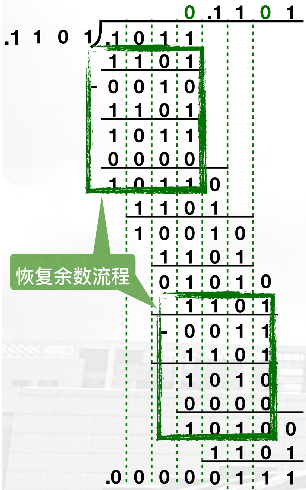

<details>
<summary>text_image</summary>

.1 1 0 1) .1 0 1 1
    1 1 0 1
      /     0 0 1 0
      1 1 0 1
      /     1 0 1 1
      0 0 0 0
      /     1 0 1 1 0
          /     1 1 0 1
          /     1 0 0 1 0
            /     1 1 0 1
            /     0 1 0 1 0
          /     1 1 0 1
          /     - 0 0 1 1
            /     1 1 0 1
            /     1 0 1 0
            /     0 0 0 0
            /     1 0 1 0 0
            /     1   1   0   1
        /     .0 0 0 0 0 0 1 1 1
</details>

# 寻找解决方案二....

恢复余数法太笨了，如何优化？

当余数R<0时：

- 商0;  
- 恢复余数：R += D;   
- 余数左移: $(R + D) << 1$ ;  
- 进行第 $i + 1$ 轮，减D

$$
(R + D) \ll 1 - D = 2 R + D
$$

• ...

$$
(R + D) \ll 1 - D = R \ll 1 + D
$$

R<0的恢复流程，等效于R左移+D！！！

# 定点数运算一除法

解决方案二：无脑直减，减多了原地不恢复（加减交替法）

例，[X]原=0.1101, [Y]原=1.1011，求积


<details>
<summary>text_image</summary>

.1 1 0 1) .1 0 1 1
    1 1 0 1
      /     0 0 1 0
      1 1 0 1
      /     1 0 1 1
      0 0 0 0
      /     1 0 1 1 0
          /     1 1 0 1
          /     1 0 0 1 0
          /     1 1 0 1
          /     0 1 0 1 0
          /     1 1 0 1
          /     - 0 0 1 1
          /     1 1 0 1
          /     1 0 1 0
          /     0 0 0 0
          /     1 0 1 0 0
          /     1   1   0   1
.0 0 0 0 0 1 1 1
</details>

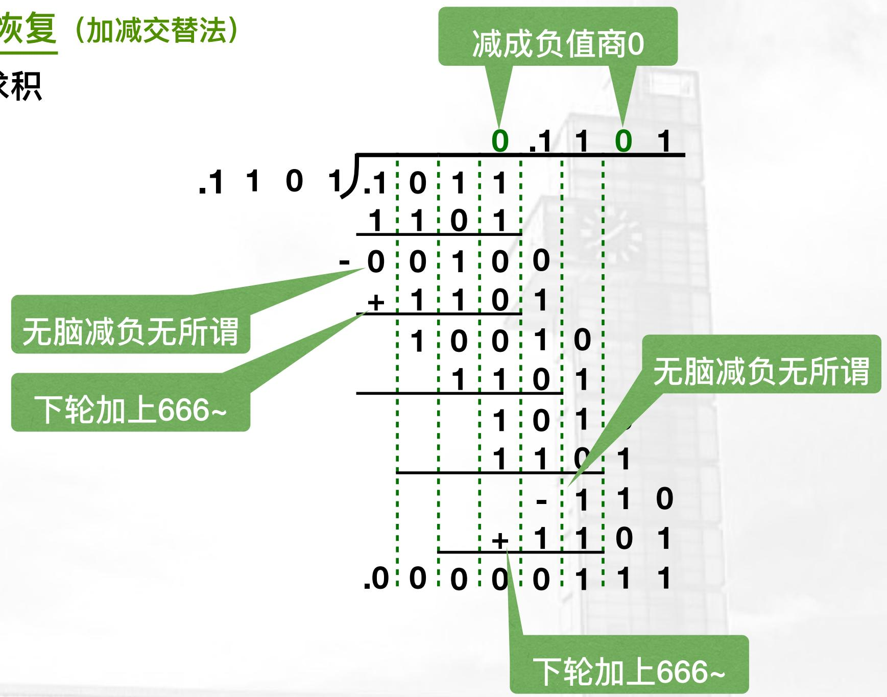

<details>
<summary>other</summary>

| 数值 | 减成负值商0 | 无脑减负无所谓 |
| :--- | :--- | :--- |
| .1 | 0 | 1 |
| 1 | 1 | 0 |
| 0 | 1 | 0 |
| - | 0 | 0 |
| + | 1 | 1 |
| 0 | 1 | 0 |
| 1 | 0 | 0 |
| 1 | 1 | 0 |
| - | 1 | 0 |
| 0 | - | 1 |
| + | 1 | 1 |
| .0 | 0 | 0 |
| 0 | 0 | 0 |
| 0 | 1 | 1 |
| 1 | 1 | 1 |
| 1 | 0 | 0 |
| 1 | - | 1 |
| 1 | - | 0 |
| 1 | - | - |
| 1 | - | - |
| 1 | - | - |
| 1 | - | - |
| 1 | - | - |
| 1 | - | - |
| 1 | - | - |
| 1 | - | - |
| 1 | - | - |
| 1 | - | - |
| 1 | - | - |
| 1 | - | - |
| 1 | - | - |
| 0.1 | 0.1 | 1 |
| 0.1 | 0.1 | 0 |
| 0.1 | 0.1 | - |
| 0.1 | - | - |
| 0.1 | - | - |
| 0.1 | - | - |
| 0.1 | - | - |
| 0.1 | - | - |
| 0.1 | - | - |
| 0.1 | - | - |
| 0.1 | - | - |
| 0.1 | - | - |
| 0.1 | - | - |
| 0.1 | 0.1 | 0 |
| 0.1 | 0.1 | - |
| 0.1 | - | - |
| 0.1 | - | - |
| 0.1 | - | - |
| 0.1 | - | - |
| 0.1 | - | - |
| 0.1 | - | - |
| 0.1 | - | - |
| - | - | - |
| - | - | - |
| - | - | - |
| - | - | - |
| - | - | - |
| - | - | - |
| - | - | - |
| - | - | - |
| - | - | - |
| - | - | - |
| - | - | - |
| - | - | - |
| - | - | - |
| - | - | - |
| - | 0.1 | 0 |
| 0.1 | 0.1 | 0 |
| .1 | .1 | .1 |
| .1 | .1 | .1 |
| .1 | .1 | .1 |
| .1 | .1 | .1 |
| .1 | .1 | .1 |
| .1 | .1 | .1 |
| .1 | .1 | .1 |
| .1 | .1 | .1 |
| .1 | .1 | .1 |
| .1 | .1 | .1 |
| .1 | .1 | .25
</details>

$$
(R + D) \ll 1 - D = R \ll 1 + D
$$

R<0的恢复流程，等效于R左移+D！！！

# 定点数运算一除法

解决方案二：无脑直减，减多了原地不恢复（加减交替法）

例，[X]原=0.1101, [Y]原=1.1011，求积

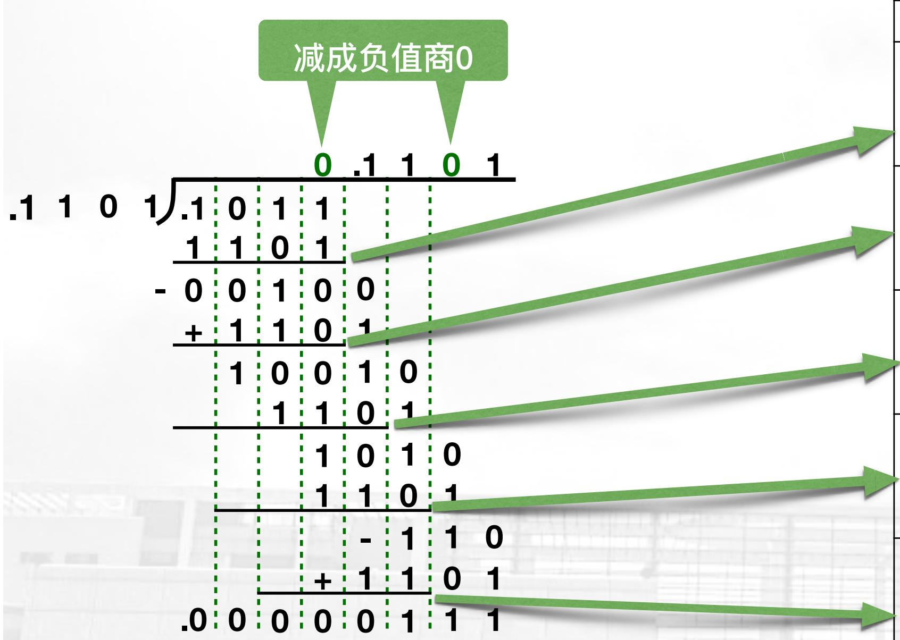

使用临时变量R逐层累减除数D

<table><tr><td>层次</td><td colspan="6">被除数(余数) R</td><td>商</td><td>说明</td></tr><tr><td rowspan="3">第一层减1101</td><td>0</td><td>0</td><td>1</td><td>0</td><td>1</td><td>1</td><td rowspan="3">0</td><td rowspan="3">R&gt;0无脑减DR=R-D*补</td></tr><tr><td>-</td><td>0</td><td>0</td><td>1</td><td>1</td><td>0</td></tr><tr><td>-</td><td>0</td><td>0</td><td>0</td><td>0</td><td>1</td></tr><tr><td rowspan="3">第二层加1101</td><td>-</td><td>0</td><td>0</td><td>0</td><td>1</td><td>0</td><td rowspan="3">0</td><td rowspan="3">R&lt;0, R&lt;&lt;1+DR=R+D</td></tr><tr><td>+</td><td>0</td><td>0</td><td>1</td><td>1</td><td>0</td></tr><tr><td>0</td><td>0</td><td>1</td><td>0</td><td>0</td><td>1</td></tr><tr><td rowspan="3">第三层减1101</td><td>0</td><td>1</td><td>0</td><td>0</td><td>1</td><td>0</td><td rowspan="3">1</td><td rowspan="3">R&gt;0无脑减DR=R-D</td></tr><tr><td>-</td><td>0</td><td>0</td><td>1</td><td>1</td><td>0</td></tr><tr><td>0</td><td>0</td><td>0</td><td>1</td><td>0</td><td>1</td></tr><tr><td rowspan="3">第四层减1101</td><td>0</td><td>0</td><td>1</td><td>0</td><td>1</td><td>0</td><td rowspan="3">0</td><td rowspan="3">R&gt;0无脑减DR=R-D</td></tr><tr><td>-</td><td>0</td><td>0</td><td>1</td><td>1</td><td>0</td></tr><tr><td>-</td><td>0</td><td>0</td><td>0</td><td>0</td><td>1</td></tr><tr><td rowspan="3">第五层加1101</td><td>-</td><td>0</td><td>0</td><td>0</td><td>1</td><td>1</td><td rowspan="3">0</td><td rowspan="3">R&lt;0, R&lt;&lt;1+DR=R+D</td></tr><tr><td>+</td><td>0</td><td>1</td><td>1</td><td>0</td><td>1</td></tr><tr><td>0</td><td>0</td><td>0</td><td>1</td><td>1</td><td>1</td></tr></table>

# 定点数运算一除法

# 解决方案二：无脑直减，减多了原地不恢复（加减交替法）

【例 3-16】 若 X=-0.10001011, Y=0.1110 试利用原码加减交替法求商及余数。

解：写出 $[\mathbf{X}]_{\text{原}} = 1.10001011, [\mathbf{Y}]_{\text{原}} = 0.1110$ 。商符 $= 1 \oplus 0 = 1$ 。

绝对值除的过程如图 3-18 所示。

<table><tr><td colspan="2">符号</td><td colspan="8">被除数(余数)</td><td>商</td><td>操作</td></tr><tr><td>0</td><td>0</td><td>1</td><td>0</td><td>0</td><td>0</td><td>1</td><td>0</td><td>1</td><td>1</td><td rowspan="3">0</td><td rowspan="3">左移一位
-|Y|</td></tr><tr><td>0</td><td>1</td><td>0</td><td>0</td><td>0</td><td>1</td><td>0</td><td>1</td><td>1</td><td>0</td></tr><tr><td>1</td><td>1</td><td>0</td><td>0</td><td>1</td><td>0</td><td></td><td></td><td></td><td></td></tr><tr><td>0</td><td>0</td><td>0</td><td>0</td><td>1</td><td>1</td><td>0</td><td>1</td><td>1</td><td>0</td><td rowspan="3">1</td><td rowspan="3">R≥0, 商为1
左移一位
-|Y|</td></tr><tr><td>0</td><td>0</td><td>0</td><td>1</td><td>1</td><td>0</td><td>1</td><td>1</td><td>0</td><td>1</td></tr><tr><td>1</td><td>1</td><td>0</td><td>0</td><td>1</td><td>0</td><td></td><td></td><td></td><td></td></tr><tr><td>1</td><td>1</td><td>1</td><td>0</td><td>0</td><td>0</td><td>1</td><td>1</td><td>0</td><td>1</td><td rowspan="3">0</td><td rowspan="3">R&lt;0, 商为0
左移一位
+|Y|</td></tr><tr><td>1</td><td>1</td><td>0</td><td>0</td><td>0</td><td>1</td><td>1</td><td>0</td><td>1</td><td>0</td></tr><tr><td>0</td><td>0</td><td>1</td><td>1</td><td>1</td><td>0</td><td></td><td></td><td></td><td></td></tr><tr><td>1</td><td>1</td><td>1</td><td>1</td><td>1</td><td>1</td><td>1</td><td>0</td><td>1</td><td>0</td><td rowspan="4">0</td><td rowspan="4">R&lt;0, 商为0
左移一位
+|Y|</td></tr><tr><td>1</td><td>1</td><td>1</td><td>1</td><td>1</td><td>1</td><td>0</td><td>1</td><td>0</td><td>0</td></tr><tr><td>0</td><td>0</td><td>1</td><td>1</td><td>1</td><td>0</td><td></td><td></td><td></td><td></td></tr><tr><td>0</td><td>0</td><td>1</td><td>1</td><td>0</td><td>1</td><td></td><td></td><td></td><td></td></tr></table>

图3-18 例3-16的加减交替法过程

# 关于除法的“表格式计算”

例，[X]=-0.10001011, [Y]=0.1110，求商及余

数，用不恢复余数法

【解】

[X]原 = 1.10001011

[Y]原 $= 0.1110$

[-Y]补=1.0010

商符 $= 1 \oplus 0 = 1$

<table><tr><td>符号</td><td>余数(R)</td><td>商</td><td>操作说明</td></tr><tr><td>0 0</td><td>1 0 0 0 1 0 1 1</td><td rowspan="3"></td><td rowspan="3">R初始化</td></tr><tr><td></td><td></td></tr><tr><td></td><td></td></tr><tr><td></td><td></td><td rowspan="10"></td><td rowspan="10"></td></tr><tr><td></td><td></td></tr><tr><td></td><td></td></tr><tr><td></td><td></td></tr><tr><td></td><td></td></tr><tr><td></td><td></td></tr><tr><td></td><td></td></tr><tr><td></td><td></td></tr><tr><td></td><td></td></tr><tr><td></td><td></td></tr></table>

# 关于除法的“表格式计算”

例，[X]=-0.10001011, [Y]=0.1110，求商及余

数，用不恢复余数法

【解】

[X]原 = 1.10001011

[Y]原 $= 0.1110$

[-Y]补=1.0010

商符 $= 1 \oplus 0 = 1$

$[\mathrm{X}\div \mathrm{Y}]$ 原 $= 1.1001$

余数 = 1.1101×2-4

<table><tr><td>符号</td><td colspan="9">余数(R)</td><td>商</td><td>操作说明</td></tr><tr><td>0 0</td><td>1</td><td>0</td><td>0</td><td>0</td><td>1</td><td>0</td><td>1</td><td>1</td><td></td><td>R初始化</td><td></td></tr><tr><td>1 1</td><td>0</td><td>0</td><td>1</td><td>0</td><td></td><td></td><td></td><td></td><td></td><td rowspan="2">-X,负了商0</td><td></td></tr><tr><td>1 1</td><td>1</td><td>0</td><td>1</td><td>0</td><td>1</td><td>0</td><td>1</td><td>1</td><td>0</td><td></td></tr><tr><td>1 1</td><td>0</td><td>1</td><td>0</td><td>1</td><td>0</td><td>1</td><td>1</td><td>0</td><td></td><td>R左移1位</td><td></td></tr><tr><td>0 0</td><td>1</td><td>1</td><td>1</td><td>0</td><td>0</td><td>0</td><td>0</td><td>0</td><td></td><td rowspan="2">+X,正了商1</td><td></td></tr><tr><td>0 0</td><td>0</td><td>0</td><td>1</td><td>1</td><td>0</td><td>1</td><td>1</td><td>0</td><td>1</td><td></td></tr><tr><td>0 0</td><td>0</td><td>1</td><td>1</td><td>0</td><td>1</td><td>1</td><td>0</td><td>0</td><td></td><td>R左移1位</td><td></td></tr><tr><td>1 1</td><td>0</td><td>0</td><td>1</td><td>0</td><td></td><td></td><td></td><td></td><td></td><td rowspan="2">-X,负了商0</td><td></td></tr><tr><td>1 1</td><td>1</td><td>0</td><td>0</td><td>0</td><td>1</td><td>1</td><td>0</td><td>0</td><td>0</td><td></td></tr><tr><td>1 1</td><td>0</td><td>0</td><td>0</td><td>1</td><td>1</td><td>0</td><td>0</td><td>0</td><td></td><td>R左移1位</td><td></td></tr><tr><td>0 0</td><td>1</td><td>1</td><td>1</td><td>0</td><td></td><td></td><td></td><td></td><td></td><td rowspan="2">+,负了商0</td><td></td></tr><tr><td>1 1</td><td>1</td><td>1</td><td>1</td><td>1</td><td>1</td><td>0</td><td>0</td><td>0</td><td>0</td><td></td></tr><tr><td>1 1</td><td>1</td><td>1</td><td>1</td><td>1</td><td>0</td><td>0</td><td>0</td><td>0</td><td></td><td>R左移1位</td><td></td></tr><tr><td>0 0</td><td>1</td><td>1</td><td>1</td><td>0</td><td>0</td><td>0</td><td>0</td><td>0</td><td></td><td rowspan="2">+X,正了商1</td><td></td></tr><tr><td>0 0</td><td>1</td><td>1</td><td>0</td><td>1</td><td>0</td><td>0</td><td>0</td><td>0</td><td>1</td><td></td></tr></table>