# 计算机组成与结构

# - 运算方法3

李瑞 教授

蒋志平 副教授

计算机科学与技术学院

# 温故

- 简述海明码原理？  
- 当海明码校验位输出为0101时，如何解读？  
- 补码加减法的过程?   
- 简述双符号法溢出判断方法?   
- 简述行波进位加法器?   
- 简述原码一位乘法原理？  
- 简述原码二位乘法原理？3x怎么解决？  
- 简述Booth乘法原理？结果符号如何解读？   
- 简述原码恢复余数除法原理？

# 温故 一关于数制表示

- 简述先行进位加法器?   
- 简述原码一位乘法原理？  
- 简述原码两位乘法原理？  
- 简述补码(booth)法乘法原理?

# 定点数运算一补码乘法

# 定点数运算一补码乘法

# 补码乘法

- 校正法  
- Booth法  
- 两位Booth法

# 定点数运算一补码乘法

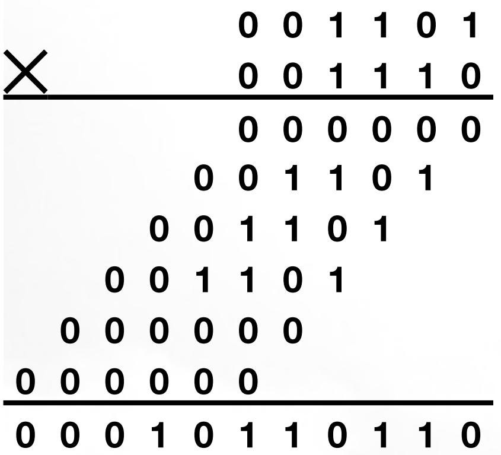

<details>
<summary>text_image</summary>

×
0 0 1 1 0 1
0 0 1 1 1 0
0 0 0 0 0 0
0 0 1 1 0 1
0 0 1 1 0 1
0 0 1 1 0 1
0 0 0 0 0 0
0 0 0 0 0 0
0 0 1 0 1 1 0 1 1 0
</details>

<-无脑计算需要6步
v.s
略用心机只需3步->

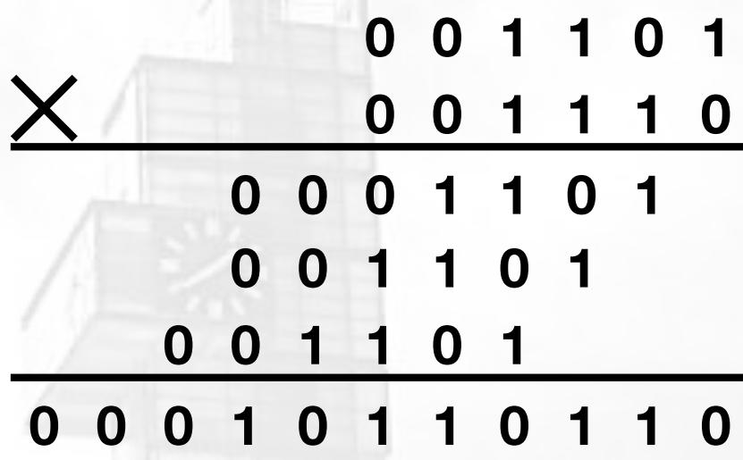

<details>
<summary>text_image</summary>

×
0 0 1 1 0 1
0 0 1 1 1 0
0 0 0 1 1 0 1
0 0 1 1 0 1
0 0 1 1 0 1
0 0 0 1 0 1 1 0 1 1 0
</details>

# 定点数运算一补码乘法


<details>
<summary>text_image</summary>

×
0 0 1 1 0 1
0 0 1 1 1 0
0 0 0 0 0 0
0 0 1 1 0 1
0 0 1 1 0 1
0 0 1 1 0 1
0 0 0 0 0 0
0 0 0 0 0 0
0 0 1 0 1 1 0 1 1 0
</details>

<-无脑计算需要6步
v.s

略用心机只需3步一>

能不能更简化！？


<details>
<summary>text_image</summary>

×
0 0 1 1 0 1
0 0 1 1 1 0
0 0 0 1 1 0 1
0 0 1 1 0 1
0 0 1 1 0 1
0 0 0 1 0 1 1 0 1 1 0
</details>

# 定点数运算一补码乘法

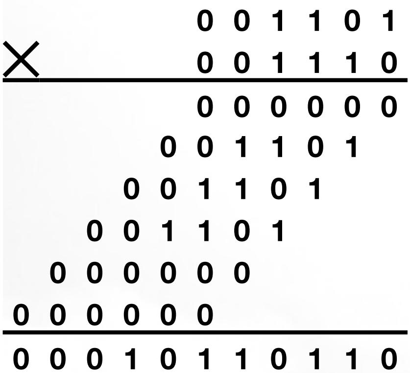

<details>
<summary>text_image</summary>

×
0 0 1 1 0 1
0 0 1 1 1 0
0 0 0 0 0 0
0 0 1 1 0 1
0 0 1 1 0 1
0 0 1 1 0 1
0 0 0 0 0 0
0 0 0 0 0 0
0 0 1 0 1 1 0 1 1 0
</details>

<-无脑计算需要6步
v.s

略用心机只需3步一>

能不能更简化！？

先看一个日常使用的技巧：

$$
1 2 3 4 5 \times 1 0 0 1 = 1 2 3 4 5 \times (1 0 0 0 + 1)
$$

$$
2 3 4 2 \times 9 9 9 = 2 3 4 2 \times (1 0 0 0 - 1)
$$

对二进制，也一样！

$$
1 0 1 0 \times 0 1 1 1 = 1 0 1 0 \times (1 0 0 0 - 1)
$$

$$
1 0 1 0 \times 1 1 1 0 = 1 0 1 0 \times (1 0 0 0 0 - 1 0)
$$


<details>
<summary>text_image</summary>

×
0 0 1 1 0 1
0 0 1 1 1 0
0 0 0 1 1 0 1
0 0 1 1 0 1
0 0 1 1 0 1
0 0 0 1 0 1 1 0 1 1 0
</details>

# 定点数运算一补码乘法


<details>
<summary>text_image</summary>

0 0 1 1 0 1
0 0 1 1 1 0
×
0 0 0 1 1 0 1
0 0 1 1 0 1
0 0 1 1 0 1
0 0 1 1 0 1
0 0 0 1 0 1 1 0 1 1 0
</details>

<-略用心机需要3步

v.s

运用技巧只需2步一>

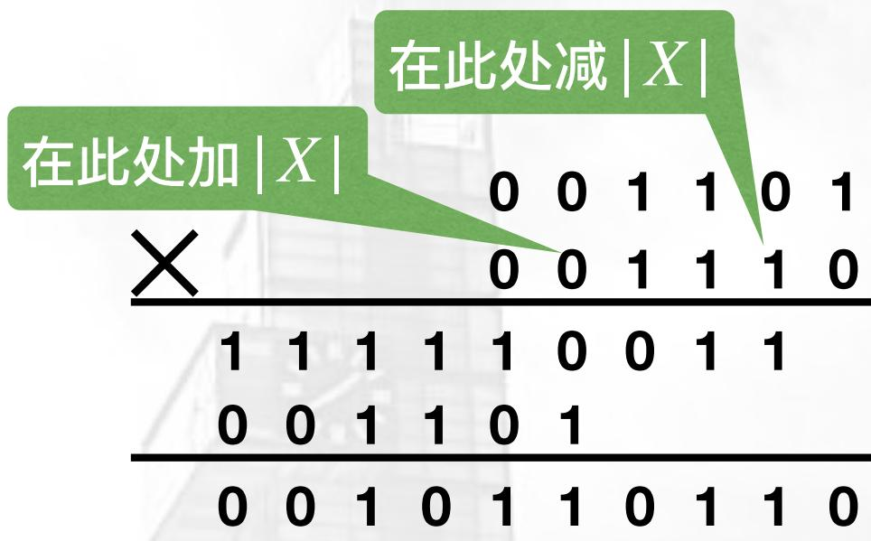

<details>
<summary>text_image</summary>

在此处加 |X|
0 0 1 1 0 1
0 0 1 1 1 0
1 1 1 1 1 0 0 1 1
0 0 1 1 0 1
0 0 1 0 1 1 0 1 1 0
</details>

问题来了：如何高效地识别“一串1”的开始和结束？

# 定点数运算一补码乘法

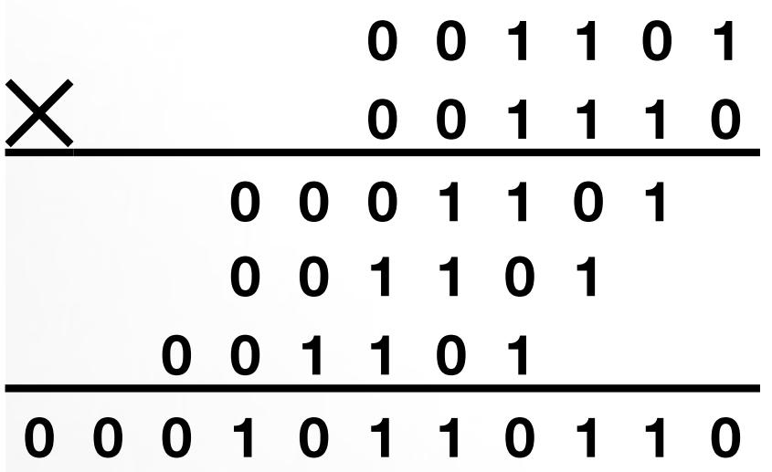

<details>
<summary>text_image</summary>

0 0 1 1 0 1
0 0 1 1 1 0
×
0 0 0 1 1 0 1
0 0 1 1 0 1
0 0 1 1 0 1
0 0 1 1 0 1
0 0 0 1 0 1 1 0 1 1 0
</details>

<-略用心机需要3步

v.s

运用技巧只需2步一>


<details>
<summary>text_image</summary>

在此处加 |X|
在此处减 |X|
0 0 1 1 0 1
0 0 1 1 1 0
1 1 1 1 1 0 0 1 1
0 0 1 1 0 1
0 0 1 0 1 1 0 1 1 0
</details>

问题来了：如何高效地识别“一串1”的开始和结束？

# Booth算法:

- 从右向左，遇到“10”就是“一串1”的开始，在1的位置减 $|X|$ ；  
- 从右向左，遇到“0 1”就是“一串1”的结束，在0的位置加 $|X|$ ；  
- 中间的“00”和“11”都不管！

<table><tr><td> $y_i$   $y_{i-1}$ </td><td>操作</td></tr><tr><td>0 0</td><td>部分积+0,右移1位</td></tr><tr><td>0 1</td><td>部分积+[X] $_{补}$ ,右移1</td></tr><tr><td>1 0</td><td>部分积+[-X] $_{补}$ ,右移1</td></tr><tr><td>1 1</td><td>部分积+0,右移1位</td></tr></table>

# Booth乘法 (补码乘法)

# Booth算法:

- 从右向左，遇到“10”就是“一串1”的开始，在1的位置减 $|X|$ ；  
- 从右向左，遇到“0 1”就是“一串1”的结束，在0的位置加 $|X|$ ；  
- 中间的“00”和“11”都不管！

【例】X=0.1010，Y=-0.1101，利用Booth法求积。

【解】：

$$
[ \mathbf {X} ] _ {\text {补}} = 0 0. 1 0 1 0
$$

$$
[ - X ] _ {\text {补}} = 1 1. 0 1 1 0
$$

$$
[ \mathrm{Y} ] _ {\text {补}} = 1 1. 0 0 1 1
$$

$$
\therefore [ X \cdot Y ] \text {补} = 1. 0 1 1 1 1 1 1 0
$$

[Y]补含1位符号

-1位置尾数

<table><tr><td colspan="2">符号</td><td colspan="4">D</td><td colspan="4">Y</td><td> $Y_0$ </td><td> $Y_{-1}$ </td><td>操作说明</td></tr><tr><td>0</td><td>0</td><td>0</td><td>0</td><td>0</td><td>0</td><td>1</td><td>0</td><td>0</td><td>1</td><td>1</td><td>0</td><td>D/Y初始化</td></tr><tr><td>1</td><td>1</td><td>0</td><td>1</td><td>1</td><td>0</td><td>1</td><td>0</td><td>0</td><td>1</td><td>1</td><td>0</td><td rowspan="2">尾数10,“串头”,-X</td></tr><tr><td>1</td><td>1</td><td>0</td><td>1</td><td>1</td><td>0</td><td>1</td><td>0</td><td>0</td><td>1</td><td>1</td><td>0</td></tr><tr><td>1</td><td>1</td><td>1</td><td>0</td><td>1</td><td>1</td><td>0</td><td>1</td><td>0</td><td>0</td><td>1</td><td>1</td><td>尾数11,跳过</td></tr><tr><td>1</td><td>1</td><td>1</td><td>1</td><td>0</td><td>1</td><td>1</td><td>0</td><td>1</td><td>0</td><td>0</td><td>1</td><td>D/Y右移2位</td></tr><tr><td>0</td><td>0</td><td>1</td><td>0</td><td>1</td><td>0</td><td>0</td><td>0</td><td>1</td><td>0</td><td>0</td><td>1</td><td rowspan="2">尾数01,“串尾”,+X</td></tr><tr><td>0</td><td>0</td><td>0</td><td>1</td><td>1</td><td>1</td><td>1</td><td>0</td><td>1</td><td>0</td><td>0</td><td>1</td></tr><tr><td>0</td><td>0</td><td>0</td><td>0</td><td>1</td><td>1</td><td>1</td><td>1</td><td>0</td><td>1</td><td>0</td><td>0</td><td>尾数00,跳过</td></tr><tr><td>0</td><td>0</td><td>0</td><td>0</td><td>0</td><td>1</td><td>1</td><td>1</td><td>1</td><td>0</td><td>1</td><td>0</td><td>D/Y右移2位</td></tr><tr><td>1</td><td>1</td><td>0</td><td>1</td><td>1</td><td>0</td><td>0</td><td>0</td><td>0</td><td>0</td><td>1</td><td>0</td><td rowspan="2">尾数10,“串头”,-X</td></tr><tr><td>1</td><td>1</td><td>0</td><td>1</td><td>1</td><td>1</td><td>1</td><td>1</td><td>1</td><td>0</td><td>1</td><td>0</td></tr><tr><td>1</td><td>1</td><td>1.</td><td>0</td><td>1</td><td>1</td><td>1</td><td>1</td><td>1</td><td>1</td><td>0</td><td>1</td><td>D/Y右移2位</td></tr></table>

结束首位为符号

乘数用尽，且无进位，计算结束

# Booth乘法 (补码乘法)

练习，[X]原=0.110110, [Y]原

=1.101101，求积

解：[-X]补=1.001010;

[Y]补=1.010011

<table><tr><td colspan="2">符号</td><td colspan="6">D</td><td colspan="6">Y</td><td> $Y_0$ </td><td> $Y_{-1}$ </td><td>操作说明</td></tr><tr><td>0</td><td>0</td><td>0</td><td>0</td><td>0</td><td>0</td><td>0</td><td>0</td><td>1</td><td>0</td><td>1</td><td>0</td><td>0</td><td>1</td><td>1</td><td>0</td><td>D/Y初始化</td></tr><tr><td>1</td><td>1</td><td>0</td><td>0</td><td>1</td><td>0</td><td>1</td><td>0</td><td>1</td><td>0</td><td>1</td><td>0</td><td>0</td><td>1</td><td>1</td><td>0</td><td rowspan="2">尾数10,“串头”,-X</td></tr><tr><td>1</td><td>1</td><td>0</td><td>0</td><td>1</td><td>0</td><td>1</td><td>0</td><td>1</td><td>0</td><td>1</td><td>0</td><td>0</td><td>1</td><td>1</td><td>0</td></tr><tr><td>1</td><td>1</td><td>1</td><td>0</td><td>0</td><td>1</td><td>0</td><td>1</td><td>0</td><td>1</td><td>0</td><td>1</td><td>0</td><td>0</td><td>1</td><td>1</td><td>尾数11,跳过</td></tr><tr><td>1</td><td>1</td><td>1</td><td>1</td><td>0</td><td>0</td><td>1</td><td>0</td><td>1</td><td>0</td><td>1</td><td>0</td><td>1</td><td>0</td><td>0</td><td>1</td><td>D/Y右移2位</td></tr><tr><td>0</td><td>0</td><td>1</td><td>1</td><td>0</td><td>1</td><td>1</td><td>0</td><td>0</td><td>0</td><td>1</td><td>0</td><td>1</td><td>0</td><td>0</td><td>1</td><td rowspan="2">尾数01,“串尾”,+X</td></tr><tr><td>0</td><td>0</td><td>1</td><td>0</td><td>1</td><td>0</td><td>0</td><td>0</td><td>1</td><td>0</td><td>1</td><td>0</td><td>1</td><td>0</td><td>0</td><td>1</td></tr><tr><td>0</td><td>0</td><td>0</td><td>1</td><td>0</td><td>1</td><td>0</td><td>0</td><td>0</td><td>1</td><td>0</td><td>1</td><td>0</td><td>1</td><td>0</td><td>0</td><td>尾数00,跳过</td></tr><tr><td>0</td><td>0</td><td>0</td><td>0</td><td>1</td><td>0</td><td>1</td><td>0</td><td>0</td><td>0</td><td>1</td><td>0</td><td>1</td><td>0</td><td>1</td><td>0</td><td>D/Y右移2位</td></tr><tr><td>1</td><td>1</td><td>0</td><td>0</td><td>1</td><td>0</td><td>1</td><td>0</td><td>0</td><td>0</td><td>0</td><td>0</td><td>1</td><td>0</td><td>1</td><td>0</td><td rowspan="2">尾数10,“串头”,-X</td></tr><tr><td>1</td><td>1</td><td>0</td><td>1</td><td>0</td><td>1</td><td>0</td><td>0</td><td>0</td><td>0</td><td>1</td><td>0</td><td>1</td><td>0</td><td>1</td><td>0</td></tr><tr><td>1</td><td>1</td><td>1</td><td>0</td><td>1</td><td>0</td><td>1</td><td>0</td><td>0</td><td>0</td><td>0</td><td>1</td><td>0</td><td>1</td><td>0</td><td>1</td><td>D/Y右移2位</td></tr><tr><td>0</td><td>0</td><td>1</td><td>1</td><td>0</td><td>1</td><td>1</td><td>0</td><td>0</td><td>0</td><td>0</td><td>0</td><td>0</td><td>1</td><td>0</td><td>1</td><td rowspan="2">尾数10,“串头”,-X</td></tr><tr><td>0</td><td>0</td><td>1</td><td>0</td><td>0</td><td>0</td><td>0</td><td>0</td><td>0</td><td>0</td><td>0</td><td>1</td><td>0</td><td>1</td><td>0</td><td>1</td></tr><tr><td>0</td><td>0</td><td>0</td><td>1</td><td>0</td><td>0</td><td>0</td><td>0</td><td>0</td><td>0</td><td>0</td><td>0</td><td>1</td><td>0</td><td>1</td><td>0</td><td>D/Y右移2位</td></tr><tr><td>1</td><td>1</td><td>0</td><td>0</td><td>1</td><td>0</td><td>1</td><td>0</td><td>0</td><td>0</td><td>0</td><td>0</td><td>0</td><td>0</td><td>1</td><td>0</td><td rowspan="2">尾数10,“串头”,-X</td></tr><tr><td>1</td><td>1</td><td>0</td><td>1</td><td>1</td><td>0</td><td>1</td><td>0</td><td>0</td><td>0</td><td>0</td><td>0</td><td>1</td><td>0</td><td>1</td><td>0</td></tr><tr><td>1</td><td>1</td><td>1.</td><td>0</td><td>1</td><td>1</td><td>0</td><td>1</td><td>0</td><td>0</td><td>0</td><td>0</td><td>0</td><td>1</td><td>0</td><td>1</td><td></td></tr></table>

∴ [X·Y]补 = 1.1011010000010

# 定点数运算一乘法

练习，[X]原=0.110110, [Y]原=1.101101，求积

解：[2X]补=01.101100；[-X]补=1.001010

# 定点数运算－除法

# 定点数运算一除法

按理说，原码一位除法就是模拟手工除法：

- 符号 $S_{m} = S_{A}\oplus S_{b}$ ，数值 $\mid m\mid = \mid A\mid / \mid B\mid$   
- 余数符号与被除数相同

例，[X]原=0.1101, [Y]原=1.1011，求积

解：符号， $S = 0 \oplus 1 = 1$ ；数值部分如下：

模拟手工除法  
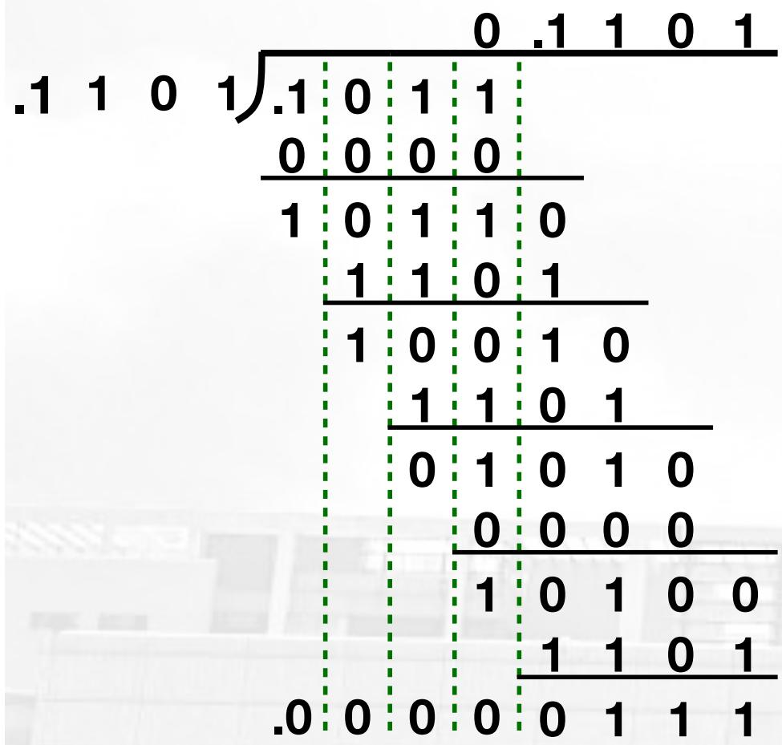

<details>
<summary>tree</summary>

| Row | Value |
|---|---|
| 1 | .1 |
| 2 | 0 |
| 3 | 1 |
| 4 | 1 |
| 5 | 0 |
| 6 | 0 |
| 7 | 0 |
| 8 | 0 |
| 9 | 0 |
| 10 | 0 |
| 11 | 0 |
| 12 | 0 |
| 13 | 0 |
| 14 | 0 |
| 15 | 0 |
| 16 | 0 |
| 17 | 0 |
| 18 | 0 |
| 19 | 0 |
| 20 | 0 |
| 21 | 0 |
| 22 | 0 |
| 23 | 0 |
| 24 | 0 |
| 25 | 0 |
| 26 | 0 |
| 27 | 0 |
| 28 | 0 |
| 29 | 0 |
| 30 | 0 |
| 31 | 0 |
| 32 | 0 |
| 33 | 0 |
| 34 | 0 |
| 35 | 0 |
| 36 | 0 |
| 37 | 0 |
| 38 | 0 |
| 39 | 0 |
| 40 | 0 |
| 41 | 0 |
| 42 | 0 |
| 43 | 0 |
| 44 | 0 |
| 45 | 0 |
| 46 | 0 |
| 47 | 0 |
| 48 | 0 |
| 49 | 0 |
| 50 | 0 |
| 51 | 0 |
| 52 | 0 |
| 53 | 0 |
| 54 | 0 |
| 55 | 0 |
| 56 | 0 |
| 57 | 0 |
| 58 | 0 |
| 59 | 0 |
| 60 | 0 |
| 61 | 0 |
| 62 | 0 |
| 63 | 0 |
| 64 | 0 |
| 65 | 0 |
| 66 | 0 |
| 67 | 0 |
| 68 | 0 |
| 69 | 0 |
| 70 | 0 |
| 71 | 0 |
| 72 | 0 |
| 73 | 0 |
| 74 | 0 |
| 75 | 0 |
| 76 | 0 |
| 77 | 0 |
| 78 | 0 |
| 79 | 0 |
| 80 | 0 |
| 81 | 0 |
| 82 | 0 |
| 83 | 0 |
| 84 | 0 |
| 85 | 0 |
| 86 | 0 |
| 87 | 0 |
| 88 | 0 |
| 89 | 0 |
| 90 | 0 |
| 91 | 0 |
| 92 | 0 |
| 93 | 0 |
| 94 | 0 |
| 95 | 0 |
| 96 | 0 |
| 97 | 0 |
| 98 | 0 |
| 99 | 0 |
| Note: The actual values in the 'Value' column are not explicitly provided in the code. The 'Number' is calculated as the sum of the numbers of the first and second integers.
</details>

# 定点数运算一除法

按理说，原码一位除法就是模拟手工除法：

\- 符号 $S_{m} = S_{A} \oplus S_{b}$ , 数值 $|m| = |A| / |B|$

例，[X]原=0.1011, [Y]原=1.1101，求商/余数

解：符号， $S = 0 \oplus 1 = 1$ ；数值部分如下：

模拟手工除法  
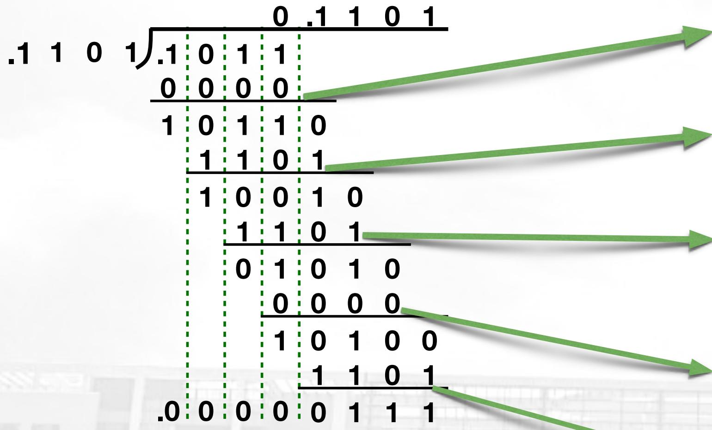

<details>
<summary>other</summary>

| Bit Position | Value |
| ------------ | ----- |
| 0            | 0     |
| 1            | 1     |
| 2            | 0     |
| 3            | 0     |
| 4            | 0     |
| 5            | 0     |
| 6            | 0     |
| 7            | 0     |
| 8            | 0     |
| 9            | 0     |
| 10           | 0     |
| 11           | 0     |
| 12           | 0     |
| 13           | 0     |
| 14           | 0     |
| 15           | 0     |
| 16           | 0     |
| 17           | 0     |
| 18           | 0     |
| 19           | 0     |
| 20           | 0     |
| 21           | 0     |
| 22           | 0     |
| 23           | 0     |
| 24           | 0     |
| 25           | 0     |
| 26           | 0     |
| 27           | 0     |
| 28           | 0     |
| 29           | 0     |
| 30           | 0     |
| 31           | 0     |
| 32           | 0     |
| 33           | 0     |
| 34           | 0     |
| 35           | 0     |
| 36           | 0     |
| 37           | 0     |
| 38           | 0     |
| 39           | 0     |
| 40           | 0     |
| 41           | 0     |
| 42           | 0     |
| 43           | 0     |
| 44           | 0     |
| 45           | 0     |
| 46           | 0     |
| 47           | 0     |
| 48           | 0     |
| 49           | 0     |
| 50           | 0     |
| Note: The actual values in the 'Value' column are not provided in the code. The 'Number' in the 'Bit' column is not explicitly labeled in the image.
</details>

$[\mathrm{X}\div \mathrm{Y}]$ 原 $= 1.1101$   
余数 $= 0.0111 \times 2 - 4$

<table><tr><td colspan="2">符号</td><td colspan="4">余数(R)</td><td>商</td><td>操作说明</td></tr><tr><td>0</td><td>0</td><td>1</td><td>0</td><td>1</td><td>1</td><td rowspan="3">0</td><td>R初始化</td></tr><tr><td>0</td><td>0</td><td>0</td><td>0</td><td>0</td><td>0</td><td rowspan="2">不够减,商0R=R-0</td></tr><tr><td>0</td><td>0</td><td>1</td><td>0</td><td>1</td><td>1</td></tr><tr><td>0</td><td>1</td><td>0</td><td>1</td><td>1</td><td>0</td><td rowspan="3">1</td><td>R左移1位</td></tr><tr><td>1</td><td>1</td><td>0</td><td>0</td><td>1</td><td>1</td><td rowspan="2">够减,商1R=R-D</td></tr><tr><td>0</td><td>0</td><td>1</td><td>0</td><td>0</td><td>1</td></tr><tr><td>0</td><td>1</td><td>0</td><td>0</td><td>1</td><td>0</td><td rowspan="3">1</td><td>R左移1位</td></tr><tr><td>1</td><td>1</td><td>0</td><td>0</td><td>1</td><td>1</td><td rowspan="2">够减,商1R=R-D</td></tr><tr><td>0</td><td>0</td><td>0</td><td>1</td><td>0</td><td>1</td></tr><tr><td>0</td><td>0</td><td>1</td><td>0</td><td>1</td><td>0</td><td rowspan="3">0</td><td>R左移1位</td></tr><tr><td>0</td><td>0</td><td>0</td><td>0</td><td>0</td><td>0</td><td rowspan="2">不够减,商0R=R-0</td></tr><tr><td>0</td><td>0</td><td>1</td><td>0</td><td>1</td><td>0</td></tr><tr><td>0</td><td>1</td><td>0</td><td>1</td><td>0</td><td>0</td><td rowspan="3">1</td><td>R左移1位</td></tr><tr><td>1</td><td>1</td><td>0</td><td>0</td><td>1</td><td>1</td><td rowspan="2">够减,商1R=R-D</td></tr><tr><td>0</td><td>0</td><td>0</td><td>1</td><td>1</td><td>1</td></tr></table>

# 定点数运算一除法

按理说，原码一位除法就是模拟手工除法：

- 符号 $S_{m} = S_{A}\oplus S_{b}$ ，数值 $\mid m\mid = \mid A\mid / \mid B\mid$   
- 余数符号与被除数相同，余数阶数为（-商的位数）

例，[X]原=0.1101, [Y]原=1.1011，求积

解：符号， $S = 0 \oplus 1 = 1$ ；数值部分如下：
模拟手工除法

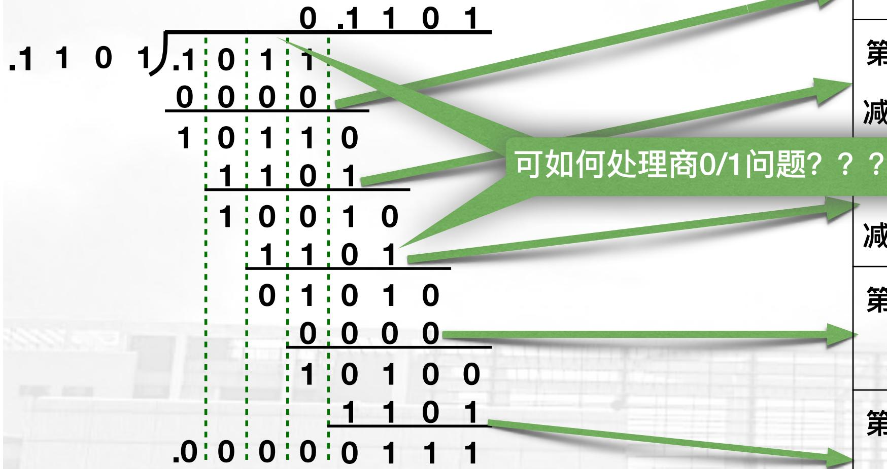

<details>
<summary>flowchart</summary>

```mermaid
graph TD
    A["0.1 1 0 1"] --> B["0 0 0 0"]
    B --> C["1 0 1 1 0"]
    C --> D["1 1 0 1"]
    D --> E["1 0 0 1 0"]
    E --> F["1 1 0 1"]
    F --> G["0 1 0 1 0"]
    G --> H["0 0 0 0"]
    H --> I["1 0 1 0 0"]
    I --> J["1 1 0 1"]
    J --> K[".0 0 0 0 0 1 1 1"]
    style A fill:#f9f,stroke:#333
    style K fill:#f9f,stroke:#333
    note right of A: 可如何处理商0/1问题???
```
</details>

使用临时变量R逐层累减除数D

<table><tr><td>层次</td><td>被除数(余数) R</td><td>商↓</td><td>说明</td></tr><tr><td rowspan="2">第一层减0</td><td>0 1 0 1 1- 0 0 0 0 0</td><td rowspan="2">0</td><td rowspan="2">R不够减、商0R = R - D * 0</td></tr><tr><td>0 1 0 1 1</td></tr><tr><td rowspan="2">第二层减1101</td><td>1 1 0 1 0- 0 1 1 0 1</td><td rowspan="2">1</td><td rowspan="2">R &lt;&lt; 1够减,商1R = R - D</td></tr><tr><td>0 1 0 0 1</td></tr><tr><td rowspan="2">?层减1101</td><td>1 0 0 1 0- 0 1 1 0 1</td><td rowspan="2">1</td><td rowspan="2">R &lt;&lt; 1够减,商1R = R - D</td></tr><tr><td>0 0 1 0 1</td></tr><tr><td rowspan="2">第四层减0</td><td>0 1 0 1 0- 0 0 0 0 0</td><td rowspan="2">0</td><td rowspan="2">R &lt;&lt; 1不够减、商0R = R - D * 0</td></tr><tr><td>0 1 0 1 0</td></tr><tr><td rowspan="2">第五层减1101</td><td>1 0 1 0 0- 0 1 1 0 1</td><td rowspan="2">1</td><td rowspan="2">R &lt;&lt; 1够减,商1R = R - D</td></tr><tr><td>0 0 1 1 1</td></tr></table>

# 定点数运算一除法

解决方案一：无脑直减，减多了原地恢复（恢复余数法）

例，[X]原=0.1101, [Y]原=1.1011，求积

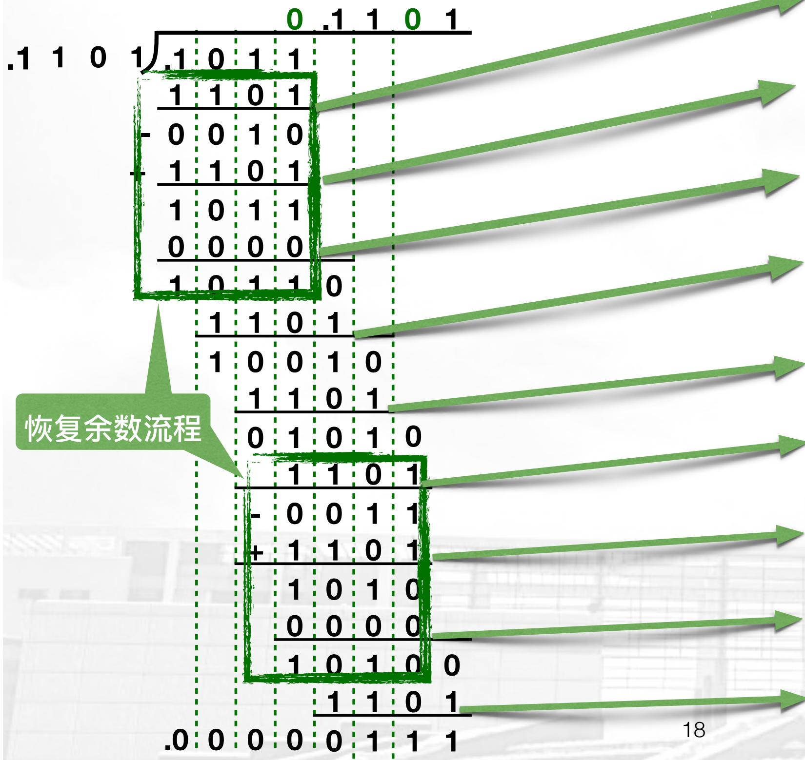

<details>
<summary>text_image</summary>

0.1 1 0 1
.1 0 1 1
1 1 0 1
0 0 1 0
1 1 0 1
1 0 1 1
0 0 0 0
1 0 1 1 0
1 1 0 1
1 0 0 1 0
1 1 0 1
0 1 0 1 0
1 1 0 1
- 0 0 1 1
+ 1 1 0 1
1 0 1 0
0 0 0 0
1 0 1 0 0
1 1 0 1
.0 0 0 0 0 1 1 1
恢复余数流程
18
</details>

使用临时变量R逐层累减除数D

<table><tr><td>层次</td><td colspan="5">被除数(余数) R</td><td>商↓</td><td>说明</td><td></td></tr><tr><td rowspan="3">第一层减1101</td><td>0</td><td>1</td><td>0</td><td>1</td><td>1</td><td></td><td rowspan="3">R&gt;0无脑减DR=R-D</td><td></td></tr><tr><td>-</td><td>0</td><td>1</td><td>1</td><td>0</td><td>1</td><td></td></tr><tr><td>-</td><td>0</td><td>0</td><td>0</td><td>1</td><td>0</td><td></td></tr><tr><td rowspan="3">第二层加1101</td><td>-</td><td>0</td><td>0</td><td>0</td><td>1</td><td>0</td><td rowspan="3">R&lt;0+D恢复RR=R+D</td><td></td></tr><tr><td>+</td><td>0</td><td>1</td><td>1</td><td>0</td><td rowspan="2">1</td><td></td></tr><tr><td>0</td><td>1</td><td>0</td><td>1</td><td>1</td><td></td></tr><tr><td rowspan="3">第三层减0</td><td>0</td><td>1</td><td>0</td><td>1</td><td>1</td><td>0</td><td rowspan="3">0不够减、商0R=R-D*0</td><td></td></tr><tr><td>-</td><td>0</td><td>0</td><td>0</td><td>0</td><td rowspan="2">0</td><td></td></tr><tr><td>0</td><td>1</td><td>0</td><td>1</td><td>1</td><td></td></tr><tr><td rowspan="3">第四层减1101</td><td>1</td><td>1</td><td>0</td><td>1</td><td>0</td><td>1</td><td rowspan="3">R&lt;&lt;1够减,商1R=R-D</td><td></td></tr><tr><td>-</td><td>0</td><td>1</td><td>1</td><td>0</td><td rowspan="2">1</td><td></td></tr><tr><td>0</td><td>1</td><td>0</td><td>0</td><td>1</td><td></td></tr><tr><td rowspan="3">第五层减1101</td><td>1</td><td>0</td><td>0</td><td>1</td><td>0</td><td>1</td><td rowspan="3">R&lt;&lt;1够减,商1R=R-D</td><td></td></tr><tr><td>-</td><td>0</td><td>1</td><td>1</td><td>0</td><td rowspan="2">1</td><td></td></tr><tr><td>0</td><td>0</td><td>1</td><td>0</td><td>1</td><td></td></tr><tr><td rowspan="3">第六层减1101</td><td>0</td><td>1</td><td>0</td><td>1</td><td>0</td><td></td><td rowspan="3">R&gt;0无脑减DR=R-D</td><td></td></tr><tr><td>-</td><td>0</td><td>1</td><td>1</td><td>0</td><td>1</td><td></td></tr><tr><td>-</td><td>0</td><td>0</td><td>0</td><td>1</td><td>1</td><td></td></tr><tr><td rowspan="3">第七层加1101</td><td>-</td><td>0</td><td>0</td><td>0</td><td>1</td><td>1</td><td rowspan="3"></td><td rowspan="3">R&lt;0+D恢复RR=R+D</td></tr><tr><td>+</td><td>0</td><td>1</td><td>1</td><td>0</td><td rowspan="2">1</td></tr><tr><td>0</td><td>1</td><td>0</td><td>1</td><td>0</td></tr><tr><td rowspan="3">第八层减0</td><td>0</td><td>1</td><td>0</td><td>1</td><td>0</td><td>0</td><td rowspan="3">0不够减、商0R=R-D*0</td><td rowspan="3"></td></tr><tr><td>-</td><td>0</td><td>0</td><td>0</td><td>0</td><td rowspan="2">0</td></tr><tr><td>0</td><td>1</td><td>0</td><td>1</td><td>0</td></tr><tr><td rowspan="3">第九层减1101</td><td>1</td><td>0</td><td>1</td><td>0</td><td>0</td><td>1</td><td rowspan="3">R&lt;&lt;1够减,商1R=R-D</td><td rowspan="3"></td></tr><tr><td>-</td><td>0</td><td>1</td><td>1</td><td>0</td><td rowspan="2">1</td></tr><tr><td>0</td><td>0</td><td>1</td><td>1</td><td>1</td></tr></table>

# 定点数运算一除法

# 解决方案一：无脑直减，减多了原地恢复（恢复余数法）

【例 3-15】 若被除数 X = -0.10001011，除数 Y = 0.1110 试利用原码恢复余数法求商及余数。

解：该例满足 $|X| < |Y|$ ，且 $|Y| \neq 0$ 。

写出 $[\mathrm{X}]_{\text{原}} = 1.10001011, [\mathrm{Y}]_{\text{原}} = 0.1110$ 。

商符=1⊕0=1。绝对值除法过程如图3-17所示。

<table><tr><td colspan="2">符号</td><td colspan="8">被除数(余数)</td><td>商</td><td>操作</td></tr><tr><td>0</td><td>0</td><td>1</td><td>0</td><td>0</td><td>0</td><td>1</td><td>0</td><td>1</td><td>1</td><td rowspan="3">0</td><td rowspan="3">左移一位
-|Y|</td></tr><tr><td>0</td><td>1</td><td>0</td><td>0</td><td>0</td><td>1</td><td>0</td><td>1</td><td>1</td><td>0</td></tr><tr><td>1</td><td>1</td><td>0</td><td>0</td><td>1</td><td>0</td><td></td><td></td><td></td><td></td></tr><tr><td>0</td><td>0</td><td>0</td><td>0</td><td>1</td><td>1</td><td>0</td><td>1</td><td>1</td><td>0</td><td rowspan="3">1</td><td rowspan="3">够减，商为1
左移一位
-|Y|</td></tr><tr><td>0</td><td>0</td><td>0</td><td>1</td><td>1</td><td>0</td><td>1</td><td>1</td><td>0</td><td>1</td></tr><tr><td>1</td><td>1</td><td>0</td><td>0</td><td>1</td><td>0</td><td></td><td></td><td></td><td></td></tr><tr><td>1</td><td>1</td><td>1</td><td>0</td><td>0</td><td>0</td><td>1</td><td>1</td><td>0</td><td>1</td><td rowspan="2">0</td><td rowspan="2">不够减，商为0
+|Y|</td></tr><tr><td>0</td><td>0</td><td>1</td><td>1</td><td>1</td><td>0</td><td></td><td></td><td></td><td></td></tr><tr><td>0</td><td>0</td><td>0</td><td>1</td><td>1</td><td>0</td><td>1</td><td>1</td><td>0</td><td>1</td><td rowspan="3">0</td><td rowspan="3">恢复余数
左移一位
-|Y|</td></tr><tr><td>0</td><td>0</td><td>1</td><td>1</td><td>0</td><td>1</td><td>1</td><td>0</td><td>1</td><td>0</td></tr><tr><td>1</td><td>1</td><td>0</td><td>0</td><td>1</td><td>0</td><td></td><td></td><td></td><td></td></tr><tr><td>1</td><td>1</td><td>1</td><td>1</td><td>1</td><td>1</td><td>1</td><td>0</td><td>1</td><td>0</td><td rowspan="2">0</td><td rowspan="2">不够减，商为0
+|Y|</td></tr><tr><td>0</td><td>0</td><td>1</td><td>1</td><td>1</td><td>0</td><td></td><td></td><td></td><td></td></tr><tr><td>0</td><td>0</td><td>1</td><td>1</td><td>0</td><td>1</td><td>1</td><td>0</td><td>1</td><td>0</td><td rowspan="3">0</td><td rowspan="3">恢复余数
左移一位
-|Y|</td></tr><tr><td>0</td><td>1</td><td>1</td><td>0</td><td>1</td><td>1</td><td>0</td><td>1</td><td>0</td><td>0</td></tr><tr><td>1</td><td>1</td><td>0</td><td>0</td><td>1</td><td>0</td><td></td><td></td><td></td><td></td></tr></table>

图3-17 例3-15的恢复余数法过程

课本P66

# 定点数运算一除法

例，[X]=-0.10001011, [Y]=0.1110，求商及余

数，用恢复余数法

【解】

[X]原 = 1.10001011

[Y]原=0.1110

[-Y]补=1.0010

商符 $= 1 \oplus 0 = 1$

按理说，原码一位除法就是模拟手工除法:

- 符号 $S_{m} = S_{A}\oplus S_{b}$ ，数值 $\left|m\right| = \left|A\right| / \left|B\right|$   
- 余数符号与被除数相同，余数阶数为（-商的位数）

<table><tr><td>符号</td><td>余数(R)</td><td>商</td><td>操作说明</td></tr><tr><td>0 0</td><td>1 0 0 0 1 0 1 1</td><td rowspan="3"></td><td rowspan="3">R初始化</td></tr><tr><td></td><td></td></tr><tr><td></td><td></td></tr><tr><td></td><td></td><td rowspan="2"></td><td rowspan="2"></td></tr><tr><td></td><td></td></tr><tr><td></td><td></td><td rowspan="3"></td><td rowspan="3"></td></tr><tr><td></td><td></td></tr><tr><td></td><td></td></tr><tr><td></td><td></td><td rowspan="2"></td><td rowspan="2"></td></tr><tr><td></td><td></td></tr><tr><td></td><td></td><td></td><td></td></tr><tr><td></td><td></td><td></td><td></td></tr><tr><td></td><td></td><td></td><td></td></tr><tr><td></td><td></td><td></td><td></td></tr><tr><td></td><td></td><td></td><td></td></tr><tr><td></td><td></td><td></td><td></td></tr></table>

# 关于除法的“表格式计算”

例，[X]=-0.10001011, [Y]=0.1110，求商及余

数，用恢复余数法

【解】

[X]原 $= 1.10001011$

[Y]原 $= 0.1110$

[-Y]补=1.0010

商符 $= 1 \oplus 0 = 1$

$[\mathrm{X}\div \mathrm{Y}]$ 原 $= 1.1001$

余数 = 1.1101×2-4

<table><tr><td>符号</td><td colspan="8">余数(R)</td><td>商</td><td>操作说明</td></tr><tr><td>0 0</td><td>1</td><td>0</td><td>0</td><td>0</td><td>1</td><td>0</td><td>1</td><td>1</td><td></td><td>R初始化</td></tr><tr><td>1 1</td><td>0</td><td>0</td><td>1</td><td>0</td><td></td><td></td><td></td><td></td><td></td><td rowspan="2">-X,负结果要恢复</td></tr><tr><td>1 1</td><td>1</td><td>0</td><td>1</td><td>0</td><td>1</td><td>0</td><td>1</td><td>1</td><td></td></tr><tr><td>1 1</td><td>1</td><td>0</td><td>1</td><td>0</td><td>1</td><td>0</td><td>1</td><td>1</td><td></td><td>R不移动</td></tr><tr><td>0 0</td><td>1</td><td>1</td><td>1</td><td>0</td><td>0</td><td>0</td><td>0</td><td>0</td><td></td><td rowspan="2">+X,恢复R,商0</td></tr><tr><td>0 0</td><td>1</td><td>0</td><td>0</td><td>0</td><td>1</td><td>0</td><td>1</td><td>1</td><td>0</td></tr><tr><td>0 1</td><td>0</td><td>0</td><td>0</td><td>1</td><td>0</td><td>1</td><td>1</td><td>0</td><td></td><td>R左移1位</td></tr><tr><td>1 1</td><td>0</td><td>0</td><td>1</td><td>0</td><td></td><td></td><td></td><td></td><td></td><td rowspan="2">-X,正了商0</td></tr><tr><td>0 0</td><td>0</td><td>0</td><td>1</td><td>1</td><td>0</td><td>1</td><td>1</td><td>0</td><td>1</td></tr><tr><td>0 0</td><td>0</td><td>1</td><td>1</td><td>0</td><td>1</td><td>1</td><td>0</td><td>0</td><td></td><td>R左移1位</td></tr><tr><td>1 1</td><td>0</td><td>0</td><td>1</td><td>0</td><td></td><td></td><td></td><td></td><td></td><td rowspan="2">-X,负结果要恢复</td></tr><tr><td>1 1</td><td>1</td><td>0</td><td>0</td><td>0</td><td>1</td><td>1</td><td>0</td><td>0</td><td></td></tr><tr><td>1 1</td><td>1</td><td>0</td><td>0</td><td>0</td><td>1</td><td>1</td><td>0</td><td>0</td><td></td><td>R左移1位</td></tr><tr><td>0 0</td><td>1</td><td>1</td><td>1</td><td>0</td><td>0</td><td>0</td><td>0</td><td>0</td><td></td><td rowspan="2">+X,恢复R,商0</td></tr><tr><td>0 0</td><td>0</td><td>1</td><td>1</td><td>0</td><td>1</td><td>1</td><td>0</td><td>0</td><td>0</td></tr><tr><td>0 0</td><td>1</td><td>1</td><td>0</td><td>1</td><td>1</td><td>0</td><td>0</td><td>0</td><td></td><td>R左移1位</td></tr><tr><td>1 1</td><td>0</td><td>0</td><td>1</td><td>0</td><td></td><td></td><td></td><td></td><td></td><td rowspan="2">-X,负结果要恢复</td></tr><tr><td>1 1</td><td>1</td><td>1</td><td>1</td><td>1</td><td>1</td><td>0</td><td>0</td><td>0</td><td></td></tr><tr><td>1 1</td><td>1</td><td>1</td><td>1</td><td>1</td><td>1</td><td>0</td><td>0</td><td>0</td><td></td><td>R左移1位</td></tr><tr><td>0 0</td><td>1</td><td>1</td><td>1</td><td>0</td><td></td><td></td><td></td><td></td><td></td><td rowspan="2">+X,恢复R,商0</td></tr><tr><td>0 0</td><td>1</td><td>1</td><td>0</td><td>1</td><td>1</td><td>0</td><td>0</td><td>0</td><td>0</td></tr><tr><td>0 1</td><td>1</td><td>0</td><td>1</td><td>1</td><td>0</td><td>0</td><td>0</td><td>0</td><td></td><td>R左移1位</td></tr><tr><td>1 1</td><td>0</td><td>0</td><td>1</td><td>0</td><td></td><td></td><td></td><td></td><td></td><td rowspan="2">-X,正了商0</td></tr><tr><td>0 0</td><td>1</td><td>1</td><td>0</td><td>1</td><td></td><td></td><td></td><td></td><td>1</td></tr></table>

# 定点数运算一除法

解决方案一：无脑直减，减多了原地恢复（恢复余数法）

例，[X]=0.10101011, [Y]=-0.1110，求商及余

数

【解】

$$
[ X ] \text {原} = 0. 1 0 1 0 1 0 1 1
$$

$$
[ | Y | ] \text {补} = 0. 1 1 1 0
$$

$$
[ - | Y | ] \text {补} = 1. 0 0 1 0
$$

按理说，原码一位除法就是模拟手工除法：

- 符号 $S_{m} = S_{A}\oplus S_{b}$ ，数值 $\mid m\mid = \mid A\mid /|B|$   
- 余数符号与被除数相同，余数阶数为（-商的位数）

# 定点数运算一除法

例，[X]原=0.1101, [Y]原=1.1011，求积

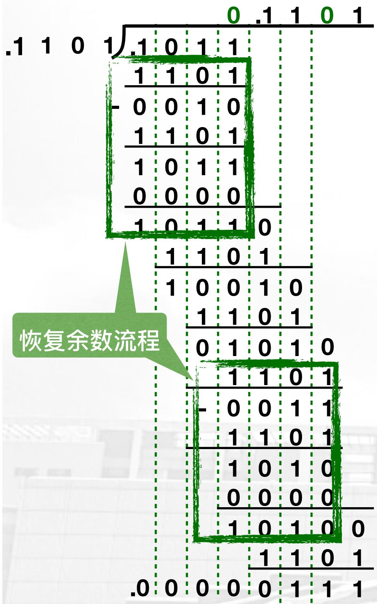

<details>
<summary>text_image</summary>

.1 1 0 1) .1 0 1 1
    1 1 0 1
      - 0 0 1 0
      1 1 0 1
      1 0 1 1
      0 0 0 0
      1 0 1 1 0
          1 1 0 1
          1 0 0 1 0
            1 1 0 1
            0 1 0 1 0
          1 1 0 1
          - 0 0 1 1
          1 1 0 1
          1 0 1 0
          0 0 0 0
          1 0 1 0 0
              .0 0 0 0 0 1 1 1
恢复余数流程
.1 .1 .1 .1 .1
</details>

# 寻找解决方案二....

恢复余数法太笨了，如何优化？

当余数R<0时：

- 商0;  
- 恢复余数：R += D;   
- 余数算术左移: $(R + D) << 1$ ;  
- 进行第 $i + 1$ 轮，减D

$$
(R + D) \ll 1 - D = 2 R + D
$$

• ...

$$
(R + D) \ll 1 - D = R \ll 1 + D
$$

R<0时的恢复流程，等效于R算术左移+D！！！

# 定点数运算一除法

解决方案二：无脑直减，减多了原地不恢复（加减交替法）

例，[X]原=0.1101, [Y]原=1.1011，求积


<details>
<summary>text_image</summary>

.1 1 0 1) .1 0 1 1
    1 1 0 1
      /     0 0 1 0
      1 1 0 1
      /     1 0 1 1
      0 0 0 0
      /     1 0 1 1 0
          /     1 1 0 1
          /     1 0 0 1 0
            /     1 1 0 1
            /     0 1 0 1 0
          /     1 1 0 1
          /     - 0 0 1 1
            /     1 1 0 1
            /     1 0 1 0
            /     0 0 0 0
            /     1 0 1 0 0
            /     1   1   0   1
.0 0 0 0 0 1 1 1
</details>

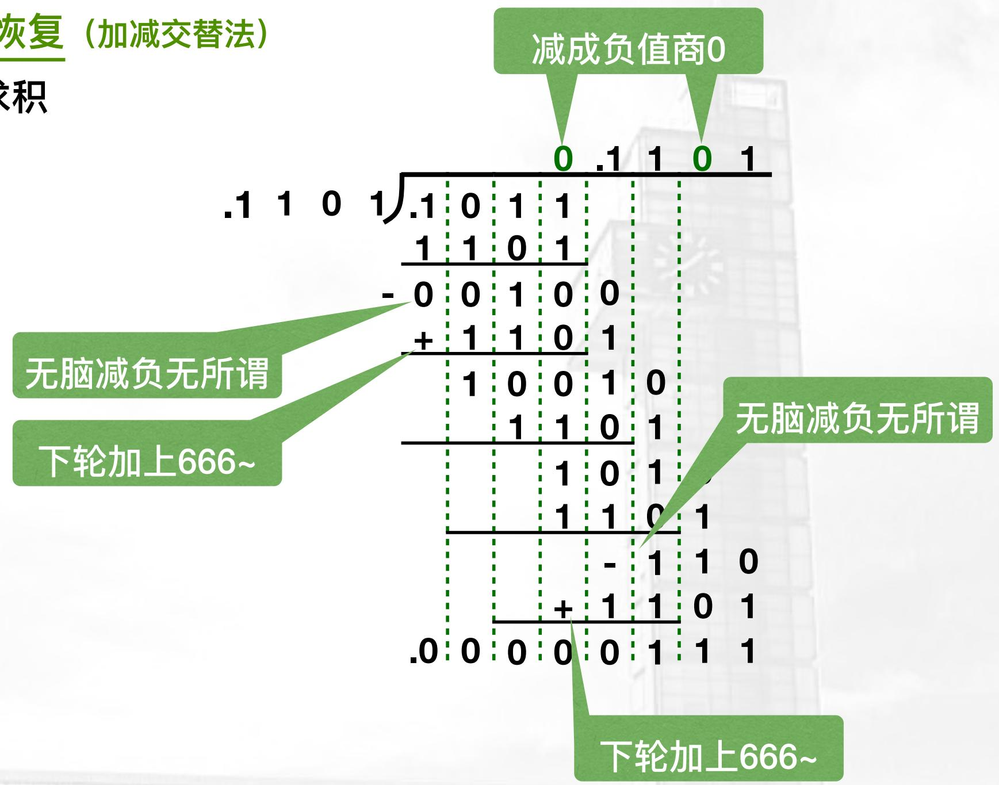

<details>
<summary>other</summary>

| 数值 | 加减交量 |
| :--- | :--- |
| .1 | 0 |
| 1 | 0 |
| 0 | 1 |
| 1 | 1 |
| .1 | 0 |
| 0 | 1 |
| 1 | 1 |
| 0 | 1 |
| - | 0 |
| 0 | 1 |
| 0 | 0 |
| + | 1 |
| 1 | 1 |
| 0 | 1 |
| 1 | 0 |
| 0 | 1 |
| 0 | 0 |
| 1 | 1 |
| 1 | 0 |
| 1 | 1 |
| 1 | 0 |
| 1 | 1 |
| 1 | 0 |
| - | - |
| 1 | 1 |
| 0 | 0 |
| + | 1 |
| 1 | 1 |
| 0 | 1 |
| .0 | 0 |
| 0 | 0 |
| 0 | 0 |
| 0 | 1 |
| 1 | 1 |
| 1 | 0 |
| 1 | 1 |
| 下轮加上666~ | 下轮以上666~
</details>

$$
(R + D) \ll 1 - D = R \ll 1 + D
$$

R<0时的恢复流程，等效于R算术左移+D！！！

# 定点数运算一除法

解决方案二：无脑直减，减多了原地不恢复（加减交替法）

例，[X]原=0.1101, [Y]原=1.1011，求积

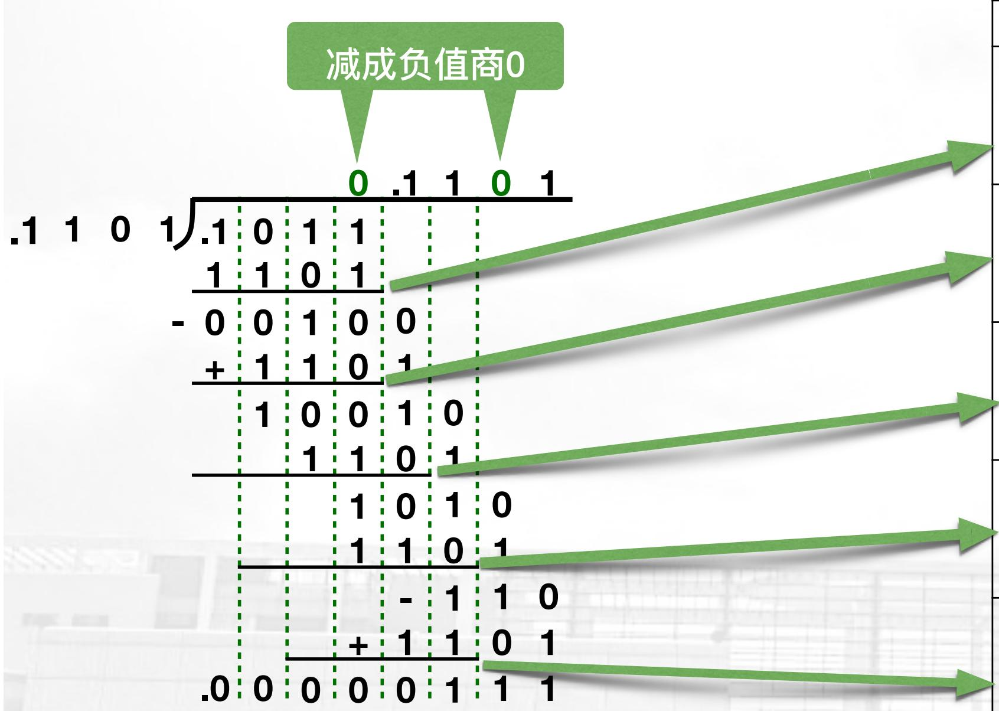

使用临时变量R逐层累减除数D

<table><tr><td>层次</td><td colspan="6">被除数(余数) R</td><td>商</td><td>说明</td></tr><tr><td rowspan="3">第一层减1101</td><td>0</td><td>0</td><td>1</td><td>0</td><td>1</td><td>1</td><td rowspan="3">0</td><td rowspan="3">R&gt;0无脑减DR=R-D*补</td></tr><tr><td>-</td><td>0</td><td>0</td><td>1</td><td>1</td><td>0</td></tr><tr><td>-</td><td>0</td><td>0</td><td>0</td><td>0</td><td>1</td></tr><tr><td rowspan="3">第二层加1101</td><td>-</td><td>0</td><td>0</td><td>0</td><td>1</td><td>0</td><td rowspan="3">0</td><td rowspan="3">R&lt;0, R&lt;&lt;1+DR=R+D</td></tr><tr><td>+</td><td>0</td><td>0</td><td>1</td><td>1</td><td>0</td></tr><tr><td>0</td><td>0</td><td>1</td><td>0</td><td>0</td><td>1</td></tr><tr><td rowspan="3">第三层减1101</td><td>0</td><td>1</td><td>0</td><td>0</td><td>1</td><td>0</td><td rowspan="3">1</td><td rowspan="3">R&gt;0无脑减DR=R-D</td></tr><tr><td>-</td><td>0</td><td>0</td><td>1</td><td>1</td><td>0</td></tr><tr><td>0</td><td>0</td><td>0</td><td>1</td><td>0</td><td>1</td></tr><tr><td rowspan="3">第四层减1101</td><td>0</td><td>0</td><td>1</td><td>0</td><td>1</td><td>0</td><td rowspan="3">0</td><td rowspan="3">R&gt;0无脑减DR=R-D</td></tr><tr><td>-</td><td>0</td><td>0</td><td>1</td><td>1</td><td>0</td></tr><tr><td>-</td><td>0</td><td>0</td><td>0</td><td>0</td><td>1</td></tr><tr><td rowspan="3">第五层加1101</td><td>-</td><td>0</td><td>0</td><td>0</td><td>1</td><td>1</td><td rowspan="3">0</td><td rowspan="3">R&lt;0, R&lt;&lt;1+DR=R+D</td></tr><tr><td>+</td><td>0</td><td>1</td><td>1</td><td>0</td><td>1</td></tr><tr><td>0</td><td>0</td><td>0</td><td>1</td><td>1</td><td>1</td></tr></table>

# 定点数运算一除法

# 解决方案二：无脑直减，减多了原地不恢复（加减交替法）

【例 3-16】 若 X=-0.10001011, Y=0.1110 试利用原码加减交替法求商及余数。

解：写出 $[\mathbf{X}]_{\text{原}} = 1.10001011, [\mathbf{Y}]_{\text{原}} = 0.1110$ 。商符 $= 1 \oplus 0 = 1$ 。

绝对值除的过程如图 3-18 所示。

<table><tr><td colspan="2">符号</td><td colspan="8">被除数(余数)</td><td>商</td><td>操作</td></tr><tr><td>0</td><td>0</td><td>1</td><td>0</td><td>0</td><td>0</td><td>1</td><td>0</td><td>1</td><td>1</td><td rowspan="3">0</td><td rowspan="3">左移一位
-|Y|</td></tr><tr><td>0</td><td>1</td><td>0</td><td>0</td><td>0</td><td>1</td><td>0</td><td>1</td><td>1</td><td>0</td></tr><tr><td>1</td><td>1</td><td>0</td><td>0</td><td>1</td><td>0</td><td></td><td></td><td></td><td></td></tr><tr><td>0</td><td>0</td><td>0</td><td>0</td><td>1</td><td>1</td><td>0</td><td>1</td><td>1</td><td>0</td><td rowspan="3">1</td><td rowspan="3">R≥0, 商为1
左移一位
-|Y|</td></tr><tr><td>0</td><td>0</td><td>0</td><td>1</td><td>1</td><td>0</td><td>1</td><td>1</td><td>0</td><td>1</td></tr><tr><td>1</td><td>1</td><td>0</td><td>0</td><td>1</td><td>0</td><td></td><td></td><td></td><td></td></tr><tr><td>1</td><td>1</td><td>1</td><td>0</td><td>0</td><td>0</td><td>1</td><td>1</td><td>0</td><td>1</td><td rowspan="3">0</td><td rowspan="3">R&lt;0, 商为0
左移一位
+|Y|</td></tr><tr><td>1</td><td>1</td><td>0</td><td>0</td><td>0</td><td>1</td><td>1</td><td>0</td><td>1</td><td>0</td></tr><tr><td>0</td><td>0</td><td>1</td><td>1</td><td>1</td><td>0</td><td></td><td></td><td></td><td></td></tr><tr><td>1</td><td>1</td><td>1</td><td>1</td><td>1</td><td>1</td><td>1</td><td>0</td><td>1</td><td>0</td><td rowspan="4">0</td><td rowspan="4">R&lt;0, 商为0
左移一位
+|Y|</td></tr><tr><td>1</td><td>1</td><td>1</td><td>1</td><td>1</td><td>1</td><td>0</td><td>1</td><td>0</td><td>0</td></tr><tr><td>0</td><td>0</td><td>1</td><td>1</td><td>1</td><td>0</td><td></td><td></td><td></td><td></td></tr><tr><td>0</td><td>0</td><td>1</td><td>1</td><td>0</td><td>1</td><td></td><td></td><td></td><td></td></tr></table>

图3-18 例3-16的加减交替法过程

# 关于除法的“表格式计算”

例，[X]=-0.10001011, [Y]=0.1110，求商及余

数，用不恢复余数法

【解】

[X]原 = 1.10001011

[Y]原=0.1110

[-Y]补=1.0010

商符 $= 1 \oplus 0 = 1$

按理说，原码一位除法就是模拟手工除法：

- 符号 $S_{m} = S_{A}\oplus S_{b}$ ，数值 $\left|m\right| = \left|A\right| / \left|B\right|$   
- 余数符号与被除数相同，余数阶数为（-商的位数）

<table><tr><td>符号</td><td>余数(R)</td><td>商</td><td>操作说明</td></tr><tr><td>0 0</td><td>1 0 0 0 1 0 1 1</td><td rowspan="3"></td><td rowspan="3">R初始化</td></tr><tr><td></td><td></td></tr><tr><td></td><td></td></tr><tr><td></td><td></td><td rowspan="9"></td><td rowspan="9"></td></tr><tr><td></td><td></td></tr><tr><td></td><td></td></tr><tr><td></td><td></td></tr><tr><td></td><td></td></tr><tr><td></td><td></td></tr><tr><td></td><td></td></tr><tr><td></td><td></td></tr><tr><td></td><td></td></tr></table>

# 关于除法的“表格式计算”

例，[X]=-0.10001011, [Y]=0.1110，求商及余

数，用不恢复余数法

【解】

[X]原 = 1.10001011

[Y]原=0.1110

[-Y]补=1.0010

商符 $= 1 \oplus 0 = 1$

按理说，原码一位除法就是模拟手工除法：

- 符号 $S_{m} = S_{A}\oplus S_{b}$ ，数值 $\left|m\right| = \left|A\right| / \left|B\right|$   
- 余数符号与被除数相同，余数阶数为（-商的位数）

<table><tr><td>符号</td><td colspan="9">余数(R)</td><td>商</td><td>操作说明</td></tr><tr><td>0 0</td><td>1</td><td>0</td><td>0</td><td>0</td><td>1</td><td>0</td><td>1</td><td>1</td><td></td><td>R初始化</td><td></td></tr><tr><td>1 1</td><td>0</td><td>0</td><td>1</td><td>0</td><td></td><td></td><td></td><td></td><td></td><td rowspan="2">-X,负了商0</td><td></td></tr><tr><td>1 1</td><td>1</td><td>0</td><td>1</td><td>0</td><td>1</td><td>0</td><td>1</td><td>1</td><td>0</td><td></td></tr><tr><td>1 1</td><td>0</td><td>1</td><td>0</td><td>1</td><td>0</td><td>1</td><td>1</td><td>0</td><td></td><td>R左移1位</td><td></td></tr><tr><td>0 0</td><td>1</td><td>1</td><td>1</td><td>0</td><td>0</td><td>0</td><td>0</td><td>0</td><td></td><td rowspan="2">+X,正了商1</td><td></td></tr><tr><td>0 0</td><td>0</td><td>0</td><td>1</td><td>1</td><td>0</td><td>1</td><td>1</td><td>0</td><td>1</td><td></td></tr><tr><td>0 0</td><td>0</td><td>1</td><td>1</td><td>0</td><td>1</td><td>1</td><td>0</td><td>0</td><td></td><td>R左移1位</td><td></td></tr><tr><td>1 1</td><td>0</td><td>0</td><td>1</td><td>0</td><td></td><td></td><td></td><td></td><td></td><td rowspan="2">-X,负了商0</td><td></td></tr><tr><td>1 1</td><td>1</td><td>0</td><td>0</td><td>0</td><td>1</td><td>1</td><td>0</td><td>0</td><td>0</td><td></td></tr><tr><td>1 1</td><td>0</td><td>0</td><td>0</td><td>1</td><td>1</td><td>0</td><td>0</td><td>0</td><td></td><td>R左移1位</td><td></td></tr><tr><td>0 0</td><td>1</td><td>1</td><td>1</td><td>0</td><td></td><td></td><td></td><td></td><td></td><td rowspan="2">+,负了商0</td><td></td></tr><tr><td>1 1</td><td>1</td><td>1</td><td>1</td><td>1</td><td>1</td><td>0</td><td>0</td><td>0</td><td>0</td><td></td></tr><tr><td>1 1</td><td>1</td><td>1</td><td>1</td><td>1</td><td>0</td><td>0</td><td>0</td><td>0</td><td></td><td>R左移1位</td><td></td></tr><tr><td>0 0</td><td>1</td><td>1</td><td>1</td><td>0</td><td>0</td><td>0</td><td>0</td><td>0</td><td></td><td rowspan="2">+X,正了商1</td><td></td></tr><tr><td>0 0</td><td>1</td><td>1</td><td>0</td><td>1</td><td>0</td><td>0</td><td>0</td><td>0</td><td>1</td><td></td></tr></table>

$[\mathrm{X} \div \mathrm{Y}]$ 原 $= 1.1001$ 余数 $= 1.1101 \times 2 - 4$

# 定点数运算一除法

解决方案二：无脑直减，减多了原地不恢复（加减交替法）

例，[X]=0.10101011, [Y]=-0.1110，求商及余

数

【解】

$$
[ X ] \text {原} = 0. 1 0 1 0 1 0 1 1
$$

$$
[ | Y | ] \text {补} = 0. 1 1 1 0
$$

$$
[ - | Y | ] \text {补} = 1. 0 0 1 0
$$

按理说，原码一位除法就是模拟手工除法：

- 符号 $S_{m} = S_{A}\oplus S_{b}$ ，数值 $\mid m\mid = \mid A\mid /|\bar{B}|$   
- 余数符号与被除数相同，余数阶数为（-商的位数）

# 定点数运算一除法

原码加减交替法，其实已经是用补码在计算...

离补码除法，只一步之遥\~

# 定点数运算一除法

# 回顾原码加减交替法

只有这个条件，是和符号依赖的！依赖于初始R > 0, D > 0

当余数R<0时，R算术左移+D：

- 商0;  
- 恢复余数：R += D;   
- 余数算术左移: $(\mathsf{R} + \mathsf{D}) < < 1$ ;  
- 进行第 $i + 1$ 轮，减D

$$
\bullet (R + D) \ll 1 - D = 2 R + D
$$

●
...

# 定点数运算一除法

# 回顾原码加减交替法

当余数R<0时，R算术左移+D：

- 商0;  
- 恢复余数: R += D;   
- 余数算术左移: $(\mathsf{R} + \mathsf{D}) < < 1$ ;  
- 进行第 $i + 1$ 轮，减D

$$
\bullet (R + D) \ll 1 - D = 2 R + D
$$

●
...

因此，我们得到补码交替除法

当余数R与D符号不同时，R算术左移+D：

- 商0;  
- 恢复余数: R += D;   
- 余数左移: $(\mathsf{R} + \mathsf{D}) < < 1$ ;  
- 进行第 $i + 1$ 轮，减D

$$
(R + D) \ll 1 - D = 2 R + D
$$

当余数R与D符号相同时，商1

# 定点数运算一除法

# 补码交替除法完整规则

1. R与D同号，当前R-D   
2. R与D异号，当前R+D   
3. 如果新余数R与D同号，商1  
4. 如果新余数R与D异号，商0;   
5. R左移1位，下一轮回到S1   
6. 除不尽时，商恒置1

此规则与原码交替除法完全兼容，表述上的超集

# 定点数运算一除法

# 解决方案三：补码交替加减法

例，[X]=-0.10001011, [Y]=0.1110，求

商及余数

【解】

$$
[ X ] \text {补} = 1. 0 1 1 1 0 1 0 1
$$

$$
[ \mathrm{Y} ] \text {补} = 0. 1 1 1 0
$$

$$
[ - \mathrm{Y} ] \text {补} = 1. 0 0 1 0
$$

1. R与D同号，-D   
2. R与D异号，+D   
3. 当新余数R与D相同时，商1  
4. 当新余数R与D不同时，商0；  
5. R左移1位，下一轮回到1  
6. 除不尽时，商恒置1

$$
[ X \div Y ] \text {补} = 1. 0 1 1 1
$$

$$
\mathrm{余数} = 1. 0 0 1 1 \times 2 ^ {- 4}
$$

<table><tr><td colspan="2">符号</td><td colspan="8">余数(R)</td><td>商</td><td>操作说明</td></tr><tr><td>1</td><td>1</td><td>0</td><td>1</td><td>1</td><td>1</td><td>0</td><td>1</td><td>0</td><td>1</td><td></td><td>R初始化</td></tr><tr><td>0</td><td>0</td><td>1</td><td>1</td><td>1</td><td>0</td><td>0</td><td>0</td><td>0</td><td>0</td><td></td><td>R与D异号,+D</td></tr><tr><td>0</td><td>0</td><td>0</td><td>1</td><td>0</td><td>1</td><td>0</td><td>1</td><td>0</td><td>1</td><td>1</td><td>R与D同号,商1</td></tr><tr><td>0</td><td>0</td><td>1</td><td>0</td><td>1</td><td>0</td><td>1</td><td>0</td><td>1</td><td>1</td><td></td><td>R左移1位</td></tr><tr><td>1</td><td>1</td><td>0</td><td>0</td><td>1</td><td>0</td><td>0</td><td>0</td><td>0</td><td>0</td><td></td><td>R与D同号,-D</td></tr><tr><td>1</td><td>1</td><td>1</td><td>1</td><td>0</td><td>0</td><td>1</td><td>0</td><td>1</td><td>1</td><td>0</td><td>R与D异号,商0</td></tr><tr><td>1</td><td>1</td><td>1</td><td>0</td><td>0</td><td>1</td><td>0</td><td>1</td><td>1</td><td>0</td><td></td><td>R左移1位</td></tr><tr><td>0</td><td>0</td><td>1</td><td>1</td><td>1</td><td>0</td><td>0</td><td>0</td><td>0</td><td>0</td><td></td><td>R与D异号,+D</td></tr><tr><td>0</td><td>0</td><td>0</td><td>1</td><td>1</td><td>1</td><td>0</td><td>1</td><td>1</td><td>0</td><td>1</td><td>R与D同号,商1</td></tr><tr><td>0</td><td>0</td><td>1</td><td>1</td><td>1</td><td>0</td><td>1</td><td>1</td><td>0</td><td>1</td><td></td><td>R左移1位</td></tr><tr><td>1</td><td>1</td><td>0</td><td>0</td><td>1</td><td>0</td><td>0</td><td>0</td><td>0</td><td>0</td><td></td><td>R与D同号,-D</td></tr><tr><td>0</td><td>0</td><td>0</td><td>0</td><td>0</td><td>0</td><td>1</td><td>1</td><td>0</td><td>1</td><td>1</td><td>R与D同号,商1</td></tr><tr><td>0</td><td>0</td><td>0</td><td>0</td><td>0</td><td>1</td><td>1</td><td>0</td><td>1</td><td>1</td><td></td><td>R左移1位</td></tr><tr><td>1</td><td>1</td><td>0</td><td>0</td><td>1</td><td>0</td><td>0</td><td>0</td><td>0</td><td>0</td><td></td><td>R与D同号,-D</td></tr><tr><td>1</td><td>1</td><td>0</td><td>0</td><td>1</td><td>1</td><td>1</td><td>0</td><td>1</td><td>1</td><td>0</td><td>R与D异号,商0</td></tr><tr><td>1</td><td>1</td><td>0</td><td>0</td><td>1</td><td>1</td><td>1</td><td>0</td><td>1</td><td>1</td><td>1</td><td>末尾恒1</td></tr></table>

# 定点数运算一除法

例，例，[X]原=-0.1011, [Y]原

=0.1101，求商/余数，用补码除法

【解】

[X]补 = 1.0101

[Y]原=0.1101

[-Y]补=1.0011

1. R与D同号，当前R-D   
2. R与D异号，当前R+D   
3. 如果新余数R与D同号，商1  
4. 如果新余数R与D异号，商0；  
5. R左移1位，下一轮回到S1   
6. 除不尽时，商恒置1

<table><tr><td colspan="2">符号</td><td colspan="4">余数(R)</td><td>商</td><td>操作说明</td></tr><tr><td>1</td><td>1</td><td>0</td><td>1</td><td>0</td><td>1</td><td></td><td>R初始化</td></tr><tr><td></td><td></td><td></td><td></td><td></td><td></td><td></td><td></td></tr><tr><td></td><td></td><td></td><td></td><td></td><td></td><td></td><td></td></tr><tr><td></td><td></td><td></td><td></td><td></td><td></td><td></td><td></td></tr><tr><td></td><td></td><td></td><td></td><td></td><td></td><td></td><td></td></tr><tr><td></td><td></td><td></td><td></td><td></td><td></td><td></td><td></td></tr><tr><td></td><td></td><td></td><td></td><td></td><td></td><td></td><td></td></tr><tr><td></td><td></td><td></td><td></td><td></td><td></td><td></td><td></td></tr><tr><td></td><td></td><td></td><td></td><td></td><td></td><td></td><td></td></tr><tr><td></td><td></td><td></td><td></td><td></td><td></td><td></td><td></td></tr><tr><td></td><td></td><td></td><td></td><td></td><td></td><td></td><td></td></tr></table>

# 定点数运算一除法

例，例，[X]原=-0.1011, [Y]原

=0.1101，求商/余数，用补码除法

【解】

[X]补 = 1.0101

[Y]原=0.1101

[-Y]补=1.0011

1. R与D同号，当前R-D   
2. R与D异号，当前R+D   
3. 如果新余数R与D同号，商1  
4. 如果新余数R与D异号，商0；  
5. R左移1位，下一轮回到S1   
6. 除不尽时，商恒置1

$$
[ X \div Y ] \text {补} = 1. 0 0 1 1
$$

$$
\mathrm{余数} = 0. 0 1 1 0 \times 2 ^ {- 4}
$$

<table><tr><td colspan="2">符号</td><td colspan="4">余数(R)</td><td>商</td><td>操作说明</td></tr><tr><td>1</td><td>1</td><td>0</td><td>1</td><td>0</td><td>1</td><td></td><td>R初始化</td></tr><tr><td>0</td><td>0</td><td>1</td><td>1</td><td>0</td><td>1</td><td></td><td>R与D异号,+D</td></tr><tr><td>0</td><td>0</td><td>0</td><td>0</td><td>1</td><td>0</td><td>1</td><td>R与D同号,商1</td></tr><tr><td>0</td><td>0</td><td>0</td><td>1</td><td>0</td><td>0</td><td></td><td>R左移1位</td></tr><tr><td>1</td><td>1</td><td>0</td><td>0</td><td>1</td><td>1</td><td></td><td>R与D同号,-D</td></tr><tr><td>1</td><td>1</td><td>0</td><td>1</td><td>1</td><td>1</td><td>0</td><td>R与D异号,商0</td></tr><tr><td>1</td><td>0</td><td>1</td><td>1</td><td>1</td><td>0</td><td></td><td>R左移1位</td></tr><tr><td>0</td><td>0</td><td>1</td><td>1</td><td>0</td><td>1</td><td></td><td>R与D异号,+D</td></tr><tr><td>1</td><td>1</td><td>1</td><td>0</td><td>1</td><td>1</td><td>0</td><td>R与D异号,商0</td></tr><tr><td>1</td><td>1</td><td>0</td><td>1</td><td>1</td><td>0</td><td></td><td>R左移1位</td></tr><tr><td>0</td><td>0</td><td>1</td><td>1</td><td>0</td><td>1</td><td></td><td>R与D异号,+D</td></tr><tr><td>0</td><td>0</td><td>0</td><td>0</td><td>1</td><td>1</td><td>1</td><td>R与D同号,商1</td></tr><tr><td>0</td><td>0</td><td>0</td><td>1</td><td>1</td><td>0</td><td></td><td>R左移1位</td></tr><tr><td>0</td><td>0</td><td>0</td><td>1</td><td>1</td><td>0</td><td>1</td><td>末尾恒1</td></tr></table>

# 定点数运算一除法

# 解决方案三：补码交替加减法

例，[X]=-0.10001011, [Y]=0.1110，求

商及余数

【解】

$$
[ X ] \text {补} = 1. 0 1 1 1 0 1 0 1
$$

$$
[ Y ] \text {补} = 0. 1 1 1 0
$$

$$
[ - \mathrm{Y} ] \text {补} = 1. 0 0 1 0
$$

1. R与D同号，当前R-D   
2. R与D异号，当前R+D   
3. 如果新余数R与D同号，商1  
4. 如果新余数R与D异号，商0；  
5. R左移1位，下一轮回到S1   
6. 除不尽时，商恒置1

<table><tr><td colspan="2">符号</td><td colspan="8">余数(R)</td><td>商</td><td>操作说明</td></tr><tr><td>1</td><td>1</td><td>0</td><td>1</td><td>1</td><td>1</td><td>0</td><td>1</td><td>0</td><td>1</td><td></td><td>R初始化</td></tr><tr><td></td><td></td><td></td><td></td><td></td><td></td><td></td><td></td><td></td><td></td><td></td><td></td></tr><tr><td></td><td></td><td></td><td></td><td></td><td></td><td></td><td></td><td></td><td></td><td></td><td></td></tr><tr><td></td><td></td><td></td><td></td><td></td><td></td><td></td><td></td><td></td><td></td><td></td><td></td></tr><tr><td></td><td></td><td></td><td></td><td></td><td></td><td></td><td></td><td></td><td></td><td></td><td></td></tr><tr><td></td><td></td><td></td><td></td><td></td><td></td><td></td><td></td><td></td><td></td><td></td><td></td></tr><tr><td></td><td></td><td></td><td></td><td></td><td></td><td></td><td></td><td></td><td></td><td></td><td></td></tr><tr><td></td><td></td><td></td><td></td><td></td><td></td><td></td><td></td><td></td><td></td><td></td><td></td></tr><tr><td></td><td></td><td></td><td></td><td></td><td></td><td></td><td></td><td></td><td></td><td></td><td></td></tr></table>

# 定点数运算一除法

# 解决方案三：补码交替加减法

例，[X]=-0.10001011, [Y]=0.1110，求

商及余数

【解】

$$
[ X ] \text {补} = 1. 0 1 1 1 0 1 0 1
$$

$$
[ \mathrm{Y} ] \text {补} = 0. 1 1 1 0
$$

$$
[ - \mathrm{Y} ] \text {补} = 1. 0 0 1 0
$$

1. R与D同号，当前R-D   
2. R与D异号，当前R+D   
3. 如果新余数R与D同号，商1  
4. 如果新余数R与D异号，商0；  
5. R左移1位，下一轮回到S1   
6. 除不尽时，商恒置1

$$
[ X \div Y ] \text {补} = 1. 0 1 1 0 1
$$

$$
\mathrm{余数} = 1. 0 0 1 1 \times 2 ^ {- 4}
$$

<table><tr><td colspan="2">符号</td><td colspan="8">余数(R)</td><td>商</td><td>操作说明</td></tr><tr><td>1</td><td>1</td><td>0</td><td>1</td><td>1</td><td>1</td><td>0</td><td>1</td><td>0</td><td>1</td><td></td><td>R初始化</td></tr><tr><td>0</td><td>0</td><td>1</td><td>1</td><td>1</td><td>0</td><td>0</td><td>0</td><td>0</td><td>0</td><td></td><td>R与D异号,+D</td></tr><tr><td>0</td><td>0</td><td>0</td><td>1</td><td>0</td><td>1</td><td>0</td><td>1</td><td>0</td><td>1</td><td>1</td><td>R与D同号,商1</td></tr><tr><td>0</td><td>0</td><td>1</td><td>0</td><td>1</td><td>0</td><td>1</td><td>0</td><td>1</td><td>0</td><td></td><td>R左移1位</td></tr><tr><td>1</td><td>1</td><td>0</td><td>0</td><td>1</td><td>0</td><td>0</td><td>0</td><td>0</td><td>0</td><td></td><td>R与D同号,-D</td></tr><tr><td>1</td><td>1</td><td>1</td><td>1</td><td>0</td><td>0</td><td>1</td><td>0</td><td>1</td><td>0</td><td>0</td><td>R与D异号,商0</td></tr><tr><td>1</td><td>1</td><td>1</td><td>0</td><td>0</td><td>1</td><td>0</td><td>1</td><td>0</td><td>0</td><td></td><td>R左移1位</td></tr><tr><td>0</td><td>0</td><td>1</td><td>1</td><td>1</td><td>0</td><td>0</td><td>0</td><td>0</td><td>0</td><td></td><td>R与D异号,+D</td></tr><tr><td>0</td><td>0</td><td>0</td><td>1</td><td>1</td><td>1</td><td>0</td><td>1</td><td>0</td><td>0</td><td>1</td><td>R与D同号,商1</td></tr><tr><td>0</td><td>0</td><td>1</td><td>1</td><td>1</td><td>0</td><td>1</td><td>0</td><td>0</td><td>0</td><td></td><td>R左移1位</td></tr><tr><td>1</td><td>1</td><td>0</td><td>0</td><td>1</td><td>0</td><td>0</td><td>0</td><td>0</td><td>0</td><td></td><td>R与D同号,-D</td></tr><tr><td>0</td><td>0</td><td>0</td><td>0</td><td>0</td><td>0</td><td>1</td><td>0</td><td>0</td><td>0</td><td>1</td><td>R与D同号,商1</td></tr><tr><td>0</td><td>0</td><td>0</td><td>0</td><td>0</td><td>1</td><td>0</td><td>0</td><td>0</td><td>0</td><td></td><td>R左移1位</td></tr><tr><td>1</td><td>1</td><td>0</td><td>0</td><td>1</td><td>0</td><td>0</td><td>0</td><td>0</td><td>0</td><td></td><td>R与D同号,-D</td></tr><tr><td>1</td><td>1</td><td>0</td><td>0</td><td>1</td><td>1</td><td>0</td><td>0</td><td>0</td><td>0</td><td>0</td><td>R与D异号,商0</td></tr><tr><td>1</td><td>1</td><td>0</td><td>0</td><td>1</td><td>1</td><td>0</td><td>0</td><td>0</td><td>0</td><td>1</td><td>末尾恒1</td></tr></table>

# 定点数运算一除法

例，[X]=-0.10101011, [Y]=0.1110，求商及余

数

【解】

[X]被 = 1.01010101

[ | Y | ]补=0.1110

[- | Y | ]补=1.0010

# 浮点运算－加减法

# 浮点运算－加减法

\- 给定两个10进制科学计数法数字:

• $X = 2.0230321 \times 10^{8}$

• $Y = 2.0230321 \times 10^{6}$

\- 你会如何做 $X \pm Y$ ?

\- 对阶: $X \rightarrow Y$ or $Y \leftarrow X$

\- 加减运算

# 浮点运算－加减法

\- 给定两个10进制科学计数法数字:

• $X = 2.0230321 \times 10^{8}$   
• $Y = 2.0230321 \times 10^{6}$

\- 你会如何做 $X \pm Y$ ?

- 对阶: $X \to Y$ or $Y \leftarrow X$   
- 加减运算

\- 给定两个2进制浮点数:

• $X = 0.101010 \times 2^{111}$   
• $Y = 0.110110 \times 2^{1010}$

\- 你会如何做 $X \pm Y$ ?

- 对阶?  
- 运算?   
- then ?   
- done ?

# 浮点运算－加减法

\- 给定两个2进制浮点数:

• $X = 0.101010 \times 2^{111}$   
• $Y = 0.110110 \times 2^{1010}$

\- 你会如何做 $X \pm Y$ ?

- 对阶？？  
- 运算？？？  
- then? ? ?   
- done ? ? ?

\- 如何对阶？

• $X \rightarrow 0.000101010 \times 2^{1010}$   
• or $Y \rightarrow 110.110 \times 2^{111}$ ???

\- “小阶对大阶”，把小阶码数字对齐到大阶码

\- 因为：浮点表示法中，尾数只能是纯小数

\- 注意：阶码+1，尾数右移

# 浮点运算－加减法

\- 给定两个2进制浮点数:

• $X = 0.101010 \times 2^{111}$   
• $Y = 0.110110 \times 2^{1010}$

\- 你会如何做 $X \pm Y$ ?

- 对阶  
- 运算???   
- then? ? ?   
- done ? ? ?

\- 如何运算（加减法）？

\- 万能解决方案：补码加减法！

\- 搞定了？万事大吉？

- 0.00011010101 $\times 2^{1010}$ , 尾数非规格化  
- 01.01010101101 $\times 2^{1010}$ , 尾数超出范围

\- 怎么办？

\- 规格化！

# 浮点运算－加减法

\- 给定两个2进制浮点数:

• $X = 0.101010 \times 2^{111}$   
• $Y = 0.110110 \times 2^{1010}$

\- 你会如何做 $X \pm Y$ ?

- 对阶  
- 运算   
- 规格化？？？  
- done ? ? ?

- 如何规格化?  
- 00.0xxxx或11.1xxxx类:   
- 尾数左移，直到尾数规格化；  
- 注意阶码是否出现下溢，若下溢，结果等效为0

\- 01.xxxxx或10.xxxxx类：

- 尾数右移，直到尾数规格化；  
- 注意阶码是否出现上溢，若上溢，结果等效为 $\infty$

这就结束了？！？？！

# 浮点运算－加减法

\- 给定两个2进制浮点数:

• $X = 0.101010 \times 2^{111}$   
• $Y = 0.110110 \times 2^{1010}$

\- 你会如何做 $X \pm Y$ ?

\- 对阶

\- 运算

\- 规格化

\- done ? ? ?

- 如何规格化?  
• 00.0xxxx或11.1xxxx类:

\- 尾数左移，直到尾数规格化；

\- 注意阶码是否出现下溢，若下溢，结果等效为0

\- 01.xxxxx或10.xxxxx类：

- 尾数右移，直到尾数规格化；  
- 注意阶码是否出现上溢，若上溢，结果等效为
∞

# 这就结束了？

• 0.1010101101010... × $2^{1000}$ 能存入给定位数浮点?

# 浮点运算－加减法

\- 给定两个2进制浮点数:

• $X = 0.101010 \times 2^{111}$   
• $Y = 0.110110 \times 2^{1010}$

\- 你会如何做 $X \pm Y$ ?

- 对阶  
- 运算   
- 规格化  
- 舍入处理

尾数超限，如何舍弃？

0.1010110001 → ???

- 方案一，粗暴截断：  
- 如0.10101000001 $\rightarrow$ 0.1010100  
- 方案二，尾末置1:  
- 如0.10101000001 $\rightarrow$ 0.1010101  
- 方案三，四舍五入(0舍1入):

\- 如0.10101000001 $\rightarrow$ 0.1010100

\- 如0.10101001001 $\rightarrow$ 0.1010101

\- 如1.10101011001 $\rightarrow$ 1.1010110

\- 如0.11111111001 $\rightarrow$ 1.0000000

不考虑正负，可能有进位！

# 浮点运算－加减法

\- So,浮点加减法4步操作：

- 对阶（低阶对齐到高阶）  
- 运算（补码+/-法）  
- 规格化（左/右移）  
- 舍入处理（截断法/恒置1/四舍五入）

# 浮点运算一加减法

【例】阶码4位补码表示；尾数8位双符号位补码表示的浮点数X和Y，求和、差。

$$
X = 0. 1 1 0 1 0 1 \times 2 ^ {- 0 1 0}; Y = - 0. 1 0 1 0 1 0 \times 2 ^ {- 0 0 1}
$$

【解】

两数可表示为:

$$
[ X ] \text {浮} = 1 1 1 0; 0 0. 1 1 0 1 0 1
$$

$$
[ \mathrm{Y} ] \text {浮} = 1 1 1 1; 1 1. 0 1 0 1 1 0
$$

So,浮点加减法4步操作:

\- 对阶（低阶对齐到高阶）

\- 运算（补码+/-法）

\- 规格化（左/右移）

\- 舍入处理（截断法/恒置1/四舍五入）

# 浮点运算一加减法

[X]浮 $= 1110$ ; 00.110101

[Y]浮=1111; 11.010110

1 对阶

需要显式地求阶差，根据阶差判断大小！

求阶差：

\- So,浮点加减法4步操作:

\- 对阶（低阶对齐到高阶）

\- 运算（补码+/-法）

\- 规格化（左/右移）

\- 舍入处理（截断法/恒置1/四舍五入）

$[\triangle E]$ 补 $= [EX]$ 补 $+[-EY]$ 补 $= 1110 + 0001 = 1111$

X的阶码比Y的阶码小。

X尾数右移一位，使两者阶码相同。这时的X为：

[X]'浮=1111; 00.011010(1)

# 浮点运算一加减法

[X]浮=1111;00.0110101

[Y]浮=1111; 11.010110

2 运算

[-Y]=1111;00.101010

$$
\begin{array}{r} {0 0. 0 1 1 0 1 0 1} \\ {+ \quad 1 1. 0 1 0 1 1 0} \\ \hline {1 1. 1 1 0 0 0 0 1} \end{array}
$$

$$
\begin{array}{r} {0 0. 0 1 1 0 1 0 1} \\ {+ \quad 0 0. 1 0 1 0 1 0} \\ \hline {0 1. 0 0 0 1 0 0 1} \end{array}
$$

So,浮点加减法4步操作:

\- 对阶（低阶对齐到高阶）

\- 运算（补码+/-法）

\- 规格化（左/右移）

\- 舍入处理（截断法/恒置1/四舍五入）

# 浮点运算一加减法

$$
[ \mathrm{X} ] \text {浮} = 1 1 1 1; 0 0. 0 1 1 0 1 0 1
$$

$$
[ \mathrm{Y} ] \text {浮} = 1 1 1 1; 1 1. 0 1 0 1 1 0
$$

# 3 规格化

$$
\begin{array}{r} {0 0. 0 1 1 0 1 0 1} \\ {+ \quad 1 1. 0 1 0 1 1 0} \\ \hline {1 1. 1 1 0 0 0 0 1} \end{array}
$$

$$
\begin{array}{r} {0 0. 0 1 1 0 1 0 1} \\ {+ \quad 0 0. 1 0 1 0 1 0} \\ \hline {0 1. 0 0 0 1 0 0 1} \end{array}
$$

左移，尾数左移2，

阶码减2

$$
[ \mathrm{X} + \mathrm{Y} ] _ {\text {浮}} = 1 1 0 1;
$$

$$
1 1. 0 0 0 0 1 0
$$

右移，尾数右移1，阶

码加1

$$
[ \mathrm{X} + \mathrm{Y} ] _ {\text {浮}} = 0 0 0 0;
$$

$$
0 0. 1 0 0 0 1 0 0 1
$$

\- So,浮点加减法4步操作:

- 对阶（低阶对齐到高阶）  
- 运算（补码+/-法）  
- 规格化（左/右移）

\- 舍入处理（截断法/恒置1/四舍五入）

规格化左/右移目标：

正数目标:0.1xxx..

负数目标:1.0xxx..

舍去

# 浮点运算一加减法

【例】X和Y为浮点数，阶码4位，补码表示；尾数8位，双符号位补码表示，求X+Y和X-Y，舍入用四舍五入法。

X=0110; 00.101101; Y=0111; 00.101100

So,浮点加减法4步操作:

\- 对阶（低阶对齐到高阶）

\- 运算（补码+/-法）

\- 规格化（左/右移）

\- 舍入处理（截断法/恒置1/四舍五入）

# 浮点运算一加减法

【例】X和Y为浮点数，阶码4位，补码表示；尾数8位，双符号位补码表示，求X+Y和X-Y，舍入用四舍五入法。

$$
X = 0 1 1 0; 0 0. 1 0 1 1 0 1; Y = 0 1 1 1; 0 0. 1 0 1 1 0 0
$$

解: $[-Y_{\text{阶}}]_{\text{补}} = 1001 \quad [-Y_{\text{层}}] = 11.010100$

$$
[ X _ {P a} ] _ {2 0} + [ - Y _ {P a} ] _ {2 0} = | | | | <   0
$$

$\Rightarrow$ 将 $X$ 对阶互 $[Y_{\text{阶}}] = 0.111$

$$
\Rightarrow X ^ {*} = 0 | | |; 0 0. 0 | 0 | | 0 |
$$

$x + y :$

$$
0 0. 0 | 0 | | 0 |
$$

$$
0 0. 1 0 1 1 0 0
$$

$$
0 1. 0 0 0 0 1 0 1
$$

$$
\Rightarrow | x ^ {*} + y | \geq 1 = 0. 1 0 0 0 0 1 0 1
$$

$$
\mathrm{右走无,} [ x ^ {*} + y ] = 0 0. 1 0 0 0 0 1 0 1
$$

$$
\mathrm{同名五入,} [ X ^ {*} + Y ] = 0 0. 1 0 0 0 0 1
$$

\- So,浮点加减法4步操作:

\- 对阶（低阶对齐到高阶）

\- 运算（补码+/-法）

\- 规格化（左/右移）

\- 舍入处理（截断法/恒置1/四舍五入）

$$
\begin{array}{l} X - Y: \\ 0 0. 0 | 0 | | 0 | \end{array}
$$

$$
\frac {1 1 . 0 1 0 1 0 0}{1 1 . 1 0 1 0 1 0 1}
$$

$$
\Rightarrow [ x ^ {*} - Y ] _ {2 0} = 1 1. 1 0 | 0 | 0 \frac {1}{1}
$$

左方程： $(x^{n}-xI_{2n})=11.0|0|0|$

无舍入.

$$
\Rightarrow x - y = 1 1. 0 1 0 1 0 1
$$