# 计算机组成与结构

# - 运算方法4

李瑞 教授

蒋志平 副教授

计算机科学与技术学院

# 温故

- 简述先行进位加法器?   
- 简述原码一位乘法原理？  
- 简述原码两位乘法原理？  
- 简述补码(booth)法乘法原理?   
- 原码除法中，商符号怎么定？余数符号怎么定？  
- 简述原码恢复余数除法?   
- 简述加减交替除法，以及它的工作原理。

# 浮点运算－加减法

# 浮点运算－加减法

\- 给定两个10进制科学计数法数字:

• $X = 2.0230321 \times 10^{8}$

• $Y = 2.0230321 \times 10^{6}$

\- 你会如何做 $X \pm Y$ ?

\- 对阶: $X \rightarrow Y$ or $Y \leftarrow X$

\- 加减运算

# 浮点运算－加减法

\- 给定两个10进制科学计数法数字:

• $X = 2.0230321 \times 10^{8}$   
• $Y = 2.0230321 \times 10^{6}$

\- 你会如何做 $X \pm Y$ ?

- 对阶: $X \to Y$ or $Y \leftarrow X$   
- 加减运算

\- 给定两个2进制浮点数:

• $X = 0.101010 \times 2^{111}$   
• $Y = 0.110110 \times 2^{1010}$

\- 你会如何做 $X \pm Y$ ?

- 对阶?  
- 运算?   
- then ?   
- done ?

# 浮点运算－加减法

\- 给定两个2进制浮点数:

• $X = 0.101010 \times 2^{111}$   
• $Y = 0.110110 \times 2^{1010}$

\- 你会如何做 $X \pm Y$ ?

- 对阶？？  
- 运算？？？  
- then? ? ?   
- done ? ? ?

\- 如何对阶？

• $X \rightarrow 0.000101010 \times 2^{1010}$   
• or $Y \rightarrow 110.110 \times 2^{111}$ ???

\- “小阶对大阶”，把小阶码数字对齐到大阶码

\- 因为：浮点表示法中，尾数只能是纯小数

\- 注意：阶码+1，尾数右移

# 浮点运算－加减法

\- 给定两个2进制浮点数:

• $X = 0.101010 \times 2^{111}$   
• $Y = 0.110110 \times 2^{1010}$

\- 你会如何做 $X \pm Y$ ?

- 对阶  
- 运算???   
- then? ? ?   
- done ? ? ?

\- 如何运算（加减法）？

\- 万能解决方案：补码加减法！

\- 搞定了？万事大吉？

- 0.00011010101 $\times 2^{1010}$ , 尾数非规格化  
- 01.01010101101 $\times 2^{1010}$ , 尾数超出范围

\- 怎么办？

\- 规格化！

# 浮点运算－加减法

\- 给定两个2进制浮点数:

• $X = 0.101010 \times 2^{111}$   
• $Y = 0.110110 \times 2^{1010}$

\- 你会如何做 $X \pm Y$ ?

- 对阶  
- 运算   
- 规格化？？？  
- done ? ? ?

- 如何规格化?  
- 00.0xxxx或11.1xxxx类:   
- 尾数左移，直到尾数规格化；  
- 注意阶码是否出现下溢，若下溢，结果等效为0

\- 01.xxxxx或10.xxxxx类：

- 尾数右移，直到尾数规格化；  
- 注意阶码是否出现上溢，若上溢，结果等效为 $\infty$

这就结束了？！？？！

# 浮点运算－加减法

\- 给定两个2进制浮点数:

• $X = 0.101010 \times 2^{111}$   
• $Y = 0.110110 \times 2^{1010}$

\- 你会如何做 $X \pm Y$ ?

\- 对阶

\- 运算

\- 规格化

\- done ? ? ?

- 如何规格化?  
- 00.0xxxx或11.1xxxx类:

\- 尾数左移，直到尾数规格化；

\- 注意阶码是否出现下溢，若下溢，结果等效为0

\- 01.xxxxx或10.xxxxx类：

- 尾数右移，直到尾数规格化；  
- 注意阶码是否出现上溢，若上溢，结果等效为
∞

这就结束了？

• 0.1010101101010... × $2^{1000}$ 能存入给定
位数浮点?

# 浮点运算－加减法

\- 给定两个2进制浮点数:

• $X = 0.101010 \times 2^{111}$   
• $Y = 0.110110 \times 2^{1010}$

\- 你会如何做 $X \pm Y$ ?

- 对阶  
- 运算   
- 规格化  
- 舍入处理

尾数超限，如何舍弃？

0.1010110001 → ???

- 方案一，粗暴截断：  
- 如0.10101000001 $\rightarrow$ 0.1010100  
- 方案二，尾末置1:  
- 如0.10101000001 $\rightarrow$ 0.1010101  
- 方案三，四舍五入(0舍1入):

\- 如0.10101000001 $\rightarrow$ 0.1010100

\- 如0.10101001001 $\rightarrow$ 0.1010101

\- 如1.10101011001 $\rightarrow$ 1.1010110

\- 如0.11111111001 $\rightarrow$ 1.0000000

不考虑正负，可能有进位！

# 浮点运算－加减法

\- So,浮点加减法4步操作：

- 对阶（低阶对齐到高阶）  
- 运算（补码+/-法）  
- 规格化（左/右移）  
- 舍入处理（截断法/恒置1/四舍五入）

# 浮点运算一加减法

【例】阶码4位补码表示；尾数8位双符号位补码表示的浮点数X和Y，求和、差。

$$
X = 0. 1 1 0 1 0 1 \times 2 ^ {- 0 1 0}; Y = - 0. 1 0 1 0 1 0 \times 2 ^ {- 0 0 1}
$$

【解】

两数可表示为:

$$
[ X ] \text {浮} = 1 1 1 0; 0 0. 1 1 0 1 0 1
$$

$$
[ \mathrm{Y} ] \text {浮} = 1 1 1 1; 1 1. 0 1 0 1 1 0
$$

So,浮点加减法4步操作:

\- 对阶（低阶对齐到高阶）

\- 运算（补码+/-法）

\- 规格化（左/右移）

\- 舍入处理（截断法/恒置1/四舍五入）

# 浮点运算一加减法

[X]浮 $= 1110$ ; 00.110101

[Y]浮=1111; 11.010110

1 对阶

需要显式地求阶差，根据阶差判断大小！

求阶差：

\- So,浮点加减法4步操作:

\- 对阶（低阶对齐到高阶）

\- 运算（补码+/-法）

\- 规格化（左/右移）

\- 舍入处理（截断法/恒置1/四舍五入）

$[\triangle E]$ 补 $= [EX]$ 补 $+[-EY]$ 补 $= 1110 + 0001 = 1111$

X的阶码比Y的阶码小。

X尾数右移一位，使两者阶码相同。这时的X为：

[X]'浮=1111; 00.011010(1)

# 浮点运算一加减法

[X]浮=1111;00.0110101

[Y]浮=1111; 11.010110

2 运算

[-Y]=1111;00.101010

$$
\begin{array}{r} {0 0. 0 1 1 0 1 0 1} \\ {+ \quad 1 1. 0 1 0 1 1 0} \\ \hline {1 1. 1 1 0 0 0 0 1} \end{array}
$$

$$
\begin{array}{r} {0 0. 0 1 1 0 1 0 1} \\ {+ \quad 0 0. 1 0 1 0 1 0} \\ \hline {0 1. 0 0 0 1 0 0 1} \end{array}
$$

So,浮点加减法4步操作:

- 对阶（低阶对齐到高阶）  
- 运算（补码+/-法）  
- 规格化（左/右移）  
- 舍入处理（截断法/恒置1/四舍五入）

# 浮点运算一加减法

$$
[ \mathrm{X} ] \text {浮} = 1 1 1 1; 0 0. 0 1 1 0 1 0 1
$$

$$
[ \mathrm{Y} ] \text {浮} = 1 1 1 1; 1 1. 0 1 0 1 1 0
$$

# 3 规格化

$$
\begin{array}{r} {0 0. 0 1 1 0 1 0 1} \\ {+ \quad 1 1. 0 1 0 1 1 0} \\ \hline {1 1. 1 1 0 0 0 0 1} \end{array}
$$

$$
\begin{array}{r} {0 0. 0 1 1 0 1 0 1} \\ {+ \quad 0 0. 1 0 1 0 1 0} \\ \hline {0 1. 0 0 0 1 0 0 1} \end{array}
$$

左移，尾数左移2，

阶码减2

$$
[ \mathrm{X} + \mathrm{Y} ] _ {\text {浮}} = 1 1 0 1;
$$

$$
1 1. 0 0 0 0 1 0
$$

右移，尾数右移1，阶

码加1

$$
[ \mathrm{X} + \mathrm{Y} ] _ {\text {浮}} = 0 0 0 0;
$$

$$
0 0. 1 0 0 0 1 0 0 1
$$

\- So,浮点加减法4步操作:

- 对阶（低阶对齐到高阶）  
- 运算（补码+/-法）  
- 规格化（左/右移）

\- 舍入处理（截断法/恒置1/四舍五入）

规格化左/右移目标：

正数目标:0.1xxx..

负数目标:1.0xxx..

舍去

# 浮点运算一加减法

【例】X和Y为浮点数，阶码4位，补码表示；尾数8位，双符号位补码表示，求X+Y和X-Y，舍入用四舍五入法。

X=0110; 00.101101; Y=0111; 00.101100

So,浮点加减法4步操作:

- 对阶（低阶对齐到高阶）  
- 运算（补码+/-法）  
- 规格化（左/右移）  
- 舍入处理（截断法/恒置1/四舍五入）

# 浮点运算－加减法

【例】X和Y为浮点数，阶码4位，补码表示；尾数8位，双符号位补码表示，求X+Y和X-Y，舍入用四舍五入法。

$$
X = 0 1 1 0; 0 0. 1 0 1 1 0 1; Y = 0 1 1 1; 0 0. 1 0 1 1 0 0
$$

解: $[-Y_{\text{阶}}]_{\text{补}} = 1001 \quad [-Y_{\text{尾}}] = 11.010100$

$$
[ X _ {P a} ] _ {Q F} + [ - Y _ {P a} ] _ {Q F} = | | | | <   0
$$

$\Rightarrow$ 将 $X$ 对阶互 $[Y_{\text{阶}}] = 0.111$

$$
\Rightarrow X ^ {*} = 0 | | |; 0 0. 0 | 0 | | 0 |
$$

$x + y :$

$$
0 0. 0 | 0 | | 0 |
$$

$$
0 0. 1 0 1 1 0 0
$$

$$
0 1. 0 0 0 0 1 0 1
$$

$$
\Rightarrow | x ^ {2} + y | \geq 1 = 0. 1 0 0 0 0 1 0 1
$$

$$
\mathrm{右走无,} [ x ^ {*} + y ] = 0 0. 1 0 0 0 0 1 0 1
$$

$$
\mathrm{同名五入,} [ X ^ {*} + Y ] = 0 0. 1 0 0 0 0 1
$$

\- So,浮点加减法4步操作:

\- 对阶（低阶对齐到高阶）

\- 运算（补码+/-法）

\- 规格化（左/右移）

\- 舍入处理（截断法/恒置1/四舍五入）

$$
\begin{array}{l} X - Y: \\ 0 0. 0 | 0 | | 0 | \end{array}
$$

$$
\frac {1 1 . 0 1 0 1 0 0}{1 1 . 1 0 1 0 1 0 1}
$$

$$
\Rightarrow [ x ^ {*} - Y ] _ {2 0} = 1 1. 1 0 | 0 | 0 \frac {1}{1}
$$

左方程： $(x^{n}-yI_{2n})=11.0|0|0|$

无舍入.

$$
\Rightarrow x - y = 1 1. 0 1 0 1 0 1
$$

# 浮点运算一乘除法

# 浮点运算－乘除法

\- 给定两个10进制科学计数法数字:

• $X = 2.0220322 \times 10^{8}$

• $Y = 2.0220322 \times 10^{6}$

\- 你会如何做 $X \times Y$ 和 $X \div Y$ ?

\- 底数x/÷底数

\- 阶数+/-阶数

# 浮点运算－乘除法

\- 给定两个10进制科学计数法数字:

• $X = 2.0200401 \times 10^{8}$   
• $Y = 2.0200401 \times 10^{6}$

\- 你会如何做 $X \times Y$ 和 $X \div Y$ ?

- 底数 $x / \div$ 底数  
- 阶数+/-阶数

\- 给定两个2进制浮点数:

• $X = 0.101010 \times 2^{111}$   
• $Y = 0.110110 \times 2^{1010}$

\- 你会如何做 $X \times Y$ 和 $X \div Y$ ?

- 尾数x/÷尾数  
- 阶数+/-阶数  
- 规格化  
- 舍入

# 浮点运算一乘除法

【例】X和Y为浮点数，阶码4位，

补码表示；尾数8位，双符号位补码表示，求 $X \times Y$ ，要求使用原码两位乘法

$$
X = 0 1 0 0; \quad 0 0. 1 0 1 1 0 1;
$$

$$
\mathrm{Y=0011;00.101100}
$$

\- So,浮点乘除法4步操作:

\- 尾数x/÷尾数

\- 阶数+/-阶数

\- 规格化

\- 舍入处理

解：[-|X尾|]补=11.010011

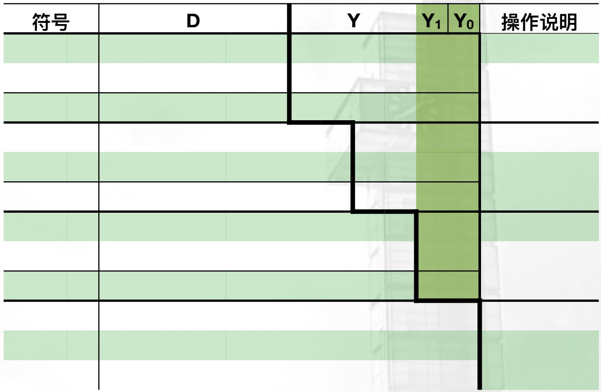

<details>
<summary>text_image</summary>

符号	D	Y	Y₁	Y₀	操作说明
</details>

# 浮点运算一乘除法

【例】X和Y为浮点数，阶码4位，

补码表示；尾数8位，双符号位补码表示，求 $X \times Y$ ，要求使用原码两位乘法

$$
X = 0 1 0 0; \quad 0 0. 1 0 1 1 0 1;
$$

$$
\mathrm{Y=0011;00.101100}
$$

\- So,浮点乘除法4步操作:

- 尾数x/÷尾数  
- 阶数+/-阶数  
- 规格化  
- 舍入处理

解：[-|X尾|]补=11.010011

<table><tr><td colspan="3">符号</td><td colspan="6">D</td><td colspan="4">Y</td><td> $Y_1$ </td><td> $Y_0$ </td><td>操作说明</td></tr><tr><td>0</td><td>0</td><td>0</td><td>0</td><td>0</td><td>0</td><td>0</td><td>0</td><td>0</td><td>1</td><td>0</td><td>1</td><td>1</td><td>0</td><td>0</td><td>D/Y初始化</td></tr><tr><td>0</td><td>0</td><td>0</td><td>0</td><td>0</td><td>0</td><td>0</td><td>0</td><td>0</td><td>0</td><td>0</td><td>0</td><td>0</td><td>0</td><td>0</td><td rowspan="3">尾数00,前无进位,+0,不进位</td></tr><tr><td>0</td><td>0</td><td>0</td><td>0</td><td>0</td><td>0</td><td>0</td><td>0</td><td>0</td><td>0</td><td>0</td><td>0</td><td>0</td><td>0</td><td>0</td></tr><tr><td>0</td><td>0</td><td>0</td><td>0</td><td>0</td><td>0</td><td>0</td><td>0</td><td>0</td><td>0</td><td>0</td><td>0</td><td>0</td><td>0</td><td>0</td></tr><tr><td>0</td><td>0</td><td>0</td><td>0</td><td>0</td><td>0</td><td>0</td><td>0</td><td>0</td><td>0</td><td>0</td><td>1</td><td>0</td><td>1</td><td>1</td><td>D/Y右移2位</td></tr><tr><td>1</td><td>1</td><td>1</td><td>0</td><td>1</td><td>0</td><td>0</td><td>1</td><td>1</td><td></td><td></td><td>1</td><td>0</td><td>1</td><td>1</td><td rowspan="2">尾数11,前无进位,-X,进位</td></tr><tr><td>1</td><td>1</td><td>1</td><td>0</td><td>1</td><td>0</td><td>0</td><td>1</td><td>1</td><td>0</td><td>0</td><td>1</td><td>0</td><td>1</td><td>1</td></tr><tr><td>1</td><td>1</td><td>1</td><td>1</td><td>1</td><td>0</td><td>1</td><td>0</td><td>0</td><td>1</td><td>1</td><td>0</td><td>0</td><td>1</td><td>0</td><td>D/Y右移2位</td></tr><tr><td>1</td><td>1</td><td>1</td><td>0</td><td>1</td><td>0</td><td>0</td><td>1</td><td>1</td><td></td><td></td><td></td><td></td><td>1</td><td>0</td><td rowspan="2">尾数10,前有进位,-X,进位</td></tr><tr><td>0</td><td>0</td><td>0</td><td>0</td><td>0</td><td>0</td><td>1</td><td>1</td><td>1</td><td>1</td><td>1</td><td>0</td><td>0</td><td>1</td><td>0</td></tr><tr><td>0</td><td>0</td><td>0</td><td>0</td><td>0</td><td>0</td><td>0</td><td>0</td><td>1</td><td>1</td><td>1</td><td>1</td><td>1</td><td>0</td><td>0</td><td>D/Y右移2位</td></tr><tr><td>0</td><td>0</td><td>0</td><td>1</td><td>0</td><td>1</td><td>1</td><td>0</td><td>1</td><td></td><td></td><td></td><td></td><td></td><td></td><td rowspan="2">前有进位,+X</td></tr><tr><td>0</td><td>0</td><td>0</td><td>1</td><td>0</td><td>1</td><td>1</td><td>1</td><td>0</td><td>1</td><td>1</td><td>1</td><td>1</td><td>0</td><td>0</td></tr></table>

$\left|X\right|\times \left|Y\right| = 0.101110111100$

符号S = 00 XOR 00 = 00 =>

X尾 x Y尾= [00.1011101111100]原

X阶+Y阶=0100+0011+1=1000，阶码溢出

# 浮点运算一乘除法

【例】X和Y为浮点数，阶码4位，解:

补码表示；尾数8位，双符号位补码

表示，求 $X \div Y$ ，要求使用补码除法

X=0100; 00.101101;

Y=0011; 11.101100

\- So,浮点乘除法4步操作:

\- 尾数x/÷尾数

\- 阶数+/-阶数

\- 规格化

\- 舍入处理

<table><tr><td>符号</td><td>余数(R)</td><td>商</td><td>操作说明</td></tr><tr><td></td><td></td><td></td><td></td></tr><tr><td></td><td></td><td></td><td></td></tr><tr><td></td><td></td><td></td><td></td></tr><tr><td></td><td></td><td></td><td></td></tr><tr><td></td><td></td><td></td><td></td></tr><tr><td></td><td></td><td></td><td></td></tr><tr><td></td><td></td><td></td><td></td></tr><tr><td></td><td></td><td></td><td></td></tr><tr><td></td><td></td><td></td><td></td></tr><tr><td></td><td></td><td></td><td></td></tr><tr><td></td><td></td><td></td><td></td></tr><tr><td></td><td></td><td></td><td></td></tr><tr><td></td><td></td><td></td><td></td></tr></table>

# 浮点运算－乘除法

【例】X和Y为浮点数，阶码4位，补码表示；尾数8位，双符号位补码表示，求 $X \div Y$ ，要求使用补码除法

$$
X = 0 1 0 0; \quad 0 0. 1 0 1 1 0 1;
$$

$$
Y = 0 0 1 1; 1 1. 1 0 1 1 0 0
$$

非规格化！

\- So,浮点乘除法4步操作:

- 尾数x/÷尾数  
- 阶数+/-阶数  
- 规格化  
- 舍入处理

解： $X^{*}=0101;00.0101101;Y^{*}=0010;11.011000;$

[-Y\*尾]补=00.101000;

被除数要小于除数！

<table><tr><td colspan="2">符号</td><td colspan="8">余数(R)</td><td>商</td><td>操作说明</td></tr><tr><td>0</td><td>0</td><td>0</td><td>1</td><td>0</td><td>1</td><td>1</td><td>0</td><td>1</td><td></td><td>R初始化</td><td></td></tr><tr><td>1</td><td>1</td><td>0</td><td>1</td><td>1</td><td>0</td><td>0</td><td>0</td><td></td><td></td><td>R与D异号,+D</td><td></td></tr><tr><td>1</td><td>1</td><td>1</td><td>0</td><td>1</td><td>1</td><td>1</td><td>0</td><td>1</td><td>1</td><td>R与D同号,商1</td><td></td></tr><tr><td>1</td><td>1</td><td>0</td><td>1</td><td>1</td><td>1</td><td>0</td><td>1</td><td>0</td><td></td><td>R左移1位</td><td></td></tr><tr><td>0</td><td>0</td><td>1</td><td>0</td><td>1</td><td>0</td><td>0</td><td>0</td><td></td><td></td><td>R与D同号,-D</td><td></td></tr><tr><td>0</td><td>0</td><td>0</td><td>0</td><td>0</td><td>1</td><td>0</td><td>1</td><td>0</td><td>0</td><td>R与D异号,商0</td><td></td></tr><tr><td>0</td><td>0</td><td>0</td><td>0</td><td>1</td><td>0</td><td>1</td><td>0</td><td>0</td><td></td><td>R左移1位</td><td></td></tr><tr><td>1</td><td>1</td><td>0</td><td>1</td><td>1</td><td>0</td><td>0</td><td>0</td><td></td><td></td><td>R与D异号,+D</td><td></td></tr><tr><td>1</td><td>1</td><td>1</td><td>0</td><td>0</td><td>0</td><td>1</td><td>0</td><td>0</td><td>1</td><td>R与D同号,商1</td><td></td></tr><tr><td>1</td><td>1</td><td>0</td><td>0</td><td>0</td><td>1</td><td>0</td><td>0</td><td>0</td><td></td><td>R左移1位</td><td></td></tr><tr><td>0</td><td>0</td><td>1</td><td>0</td><td>1</td><td>0</td><td>0</td><td>0</td><td></td><td></td><td>R与D同号,-D</td><td></td></tr><tr><td>1</td><td>1</td><td>1</td><td>0</td><td>1</td><td>1</td><td>0</td><td>0</td><td>0</td><td>1</td><td>R与D同号,商1</td><td></td></tr><tr><td>1</td><td>1</td><td>0</td><td>1</td><td>1</td><td>0</td><td>0</td><td>0</td><td>0</td><td></td><td>R左移1位</td><td></td></tr><tr><td>0</td><td>0</td><td>1</td><td>0</td><td>1</td><td>0</td><td>0</td><td>0</td><td></td><td></td><td>R与D同号,-D</td><td></td></tr><tr><td>0</td><td>0</td><td>0</td><td>0</td><td>0</td><td>0</td><td>0</td><td>0</td><td>0</td><td>1</td><td>除尽,末位置1</td><td></td></tr></table>

$$
X \div Y = 0 0 1 1; 1 1. 0 1 1 1 0 0
$$

# 运算的硬件实现 —从运算器、ALU到CPU

# 运算的硬件实现

# - 从运算器、ALU到CPU

# - 运算器

- 加法器（运算方法1中已讲）  
- 乘法器  
- 除法器

# • ALU

# 运算硬件实现——阵列乘法器

设 $X=X_{3}X_{2}X_{1}X_{0},\quad Y=Y_{3}Y_{2}Y_{1}Y_{0},\quad$ 计算 $X\cdot Y=?$

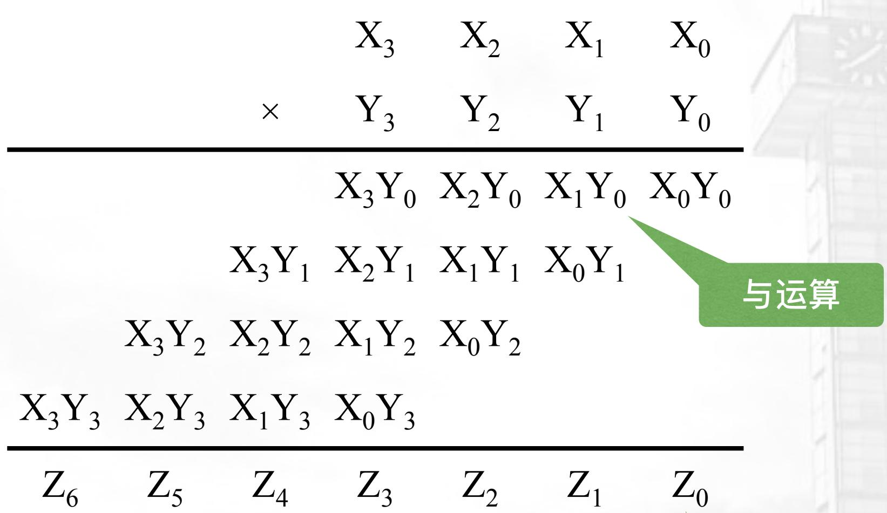

<details>
<summary>text_image</summary>

X₃ X₂ X₁ X₀
× Y₃ Y₂ Y₁ Y₀
X₃Y₀ X₂Y₀ X₁Y₀ X₀Y₀
X₃Y₁ X₂Y₁ X₁Y₁ X₀Y₁
X₃Y₂ X₂Y₂ X₁Y₂ X₀Y₂
X₃Y₃ X₂Y₃ X₁Y₃ X₀Y₃
Z₆ Z₅ Z₄ Z₃ Z₂ Z₁ Z₀
与运算
</details>

求和

# 运算硬件实现——阵列乘法器

设 $X=X_{3}X_{2}X_{1}X_{0},\quad Y=Y_{3}Y_{2}Y_{1}Y_{0},\quad$ 计算 $X\cdot Y=?$

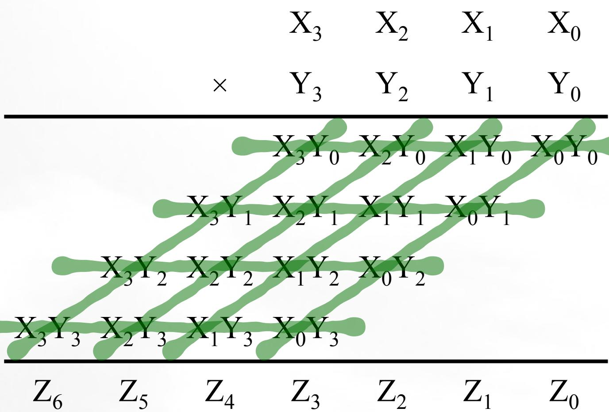

<details>
<summary>flowchart</summary>

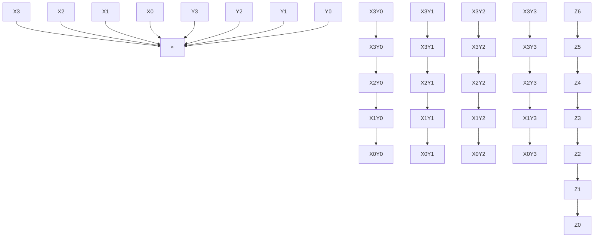
</details>

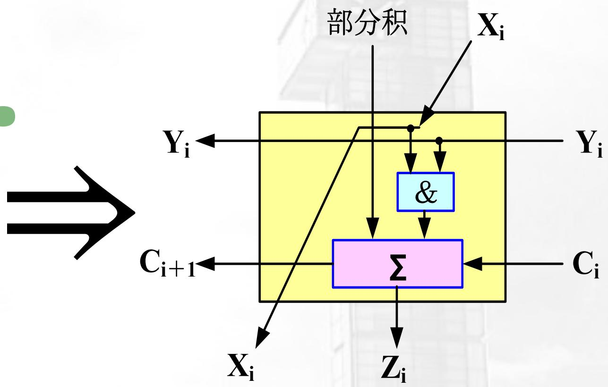

<details>
<summary>flowchart</summary>

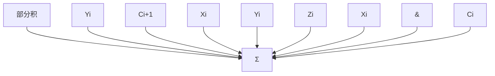
</details>

基本乘加单元框图

# 运算硬件实现——阵列乘法器

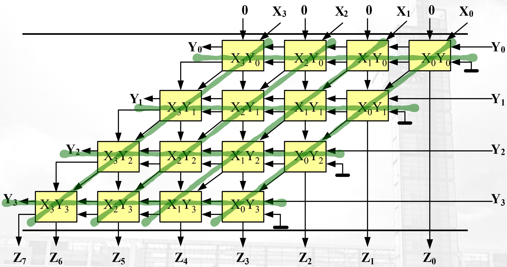

<details>
<summary>flowchart</summary>

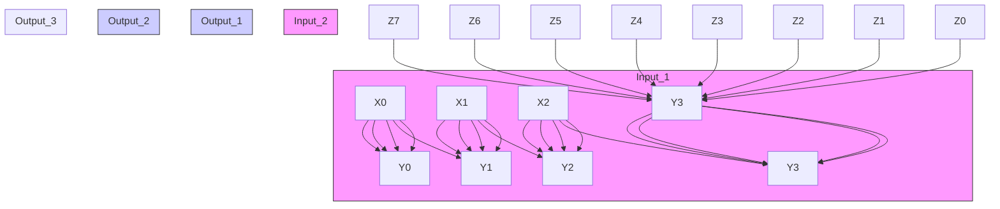
</details>

# 运算硬件实现——阵列乘法器

- 计算性能的神器: Fused Multiply-Add (FMA)操作!   
- FMA可以在一个时钟内算出一个乘法!  
- SSE1/2/3/4, AVX, FMA1/2/3/4等等高级指令级都是基于大规模、并发、流水线化的FMA阵列。

# 运算硬件实现——阵列除法器

设 $X=X_{3}X_{2}X_{1}X_{0},\quad Y=Y_{3}Y_{2}Y_{1}Y_{0},\quad$ 计算X/Y=?

可控加/减单元CAS  
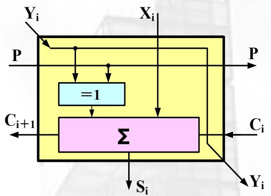

<details>
<summary>flowchart</summary>

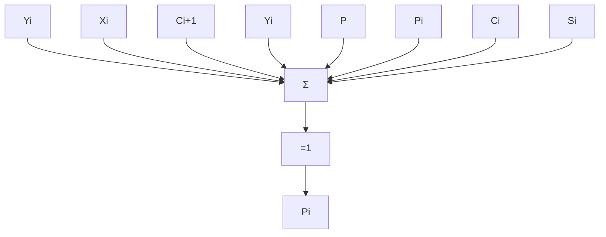
</details>

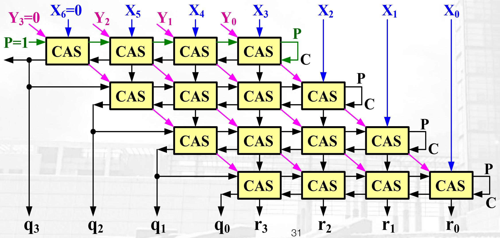

<details>
<summary>flowchart</summary>

```mermaid
graph TD
    subgraph Inputs
        X0["X0"] -->|P| CAS1["CAS"]
        X1["X1"] -->|P| CAS2["CAS"]
        X2["X2"] -->|P| CAS3["CAS"]
        X3["X3"] -->|P| CAS4["CAS"]
        X4["X4"] -->|P| CAS5["CAS"]
        X5["X5"] -->|P| CAS6["CAS"]
        X6["X6"] -->|P| CAS7["CAS"]
    end
    subgraph Outputs
        Q3["q3"] --> CAS1
        Q2["q2"] --> CAS2
        Q1["q1"] --> CAS3
        Q0["q0"] --> CAS4
        Q3_31["31"] --> CAS5
        Q0_31 --> CAS6
        Q1_31 --> CAS7
        Q0_31 --> CAS8
        Q3_31 --> CAS9
        Q0_31 --> CAS10
        Q1_31 --> CAS11
        Q0_31 --> CAS12
        Q3_31 --> CAS13
        Q0_31 --> CAS14
        Q1_31 --> CAS15
        Q0_31 --> CAS16
        Q3_31 --> CAS17
        Q0_31 --> CAS18
        Q1_31 --> CAS19
        Q0_31 --> CAS20
        Q3_31 --> CAS21
        Q0_31 --> CAS22
        Q1_31 --> CAS23
        Q0_31 --> CAS24
        Q3_31 --> CAS25
        Q0_31 --> CAS26
        Q1_31 --> CAS27
        Q0_31 --> CAS28
        Q3_31 --> CAS29
        Q0_31 --> CAS30
        Q1_31 --> CAS31
    end
    X6["X6=0"] -->|Y2| CAS1
    X5["X5"] -->|Y1| CAS2
    X4["X4"] -->|Y0| CAS3
    X3["X3"] -->|P| CAS4
    X2["X2"] -->|P| CAS5
    X1["X1"] -->|P| CAS6
    X0["P=0"] -->|P=1| CAS7
    style Input fill:#f9f,stroke:#333
    style Output fill:#bbf,stroke:#333
```
</details>

# 运算的硬件实现——ALU

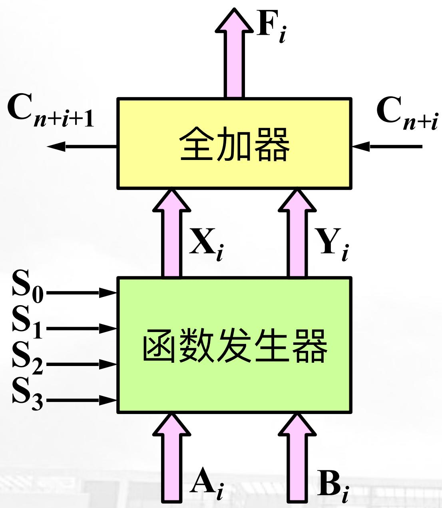

<details>
<summary>flowchart</summary>

```mermaid
graph TD
    A["全加器"] -->|F_i| B["输出"]
    A -->|C_{n+i}| C["输入"]
    A -->|X_i| D["输出"]
    A -->|Y_i| E["输出"]
    F["函数发生器"] -->|A_i| G["输入"]
    F -->|B_i| H["输出"]
    I["S_0"] --> J["输入"]
    I --> K["S_1"] --> L["输入"]
    I --> M["S_2"] --> N["输入"]
    I --> O["S_3"] --> P["输入"]
```
</details>

<table><tr><td rowspan="2" colspan="4">Selection</td><td colspan="3">Active High Data</td></tr><tr><td rowspan="2">M = HLogic Functions</td><td colspan="2">M = L; Arithmetic Operations</td></tr><tr><td>S3</td><td>S2</td><td>S1</td><td>S0</td><td> $C_{n}=H$  (no carry)</td><td> $C_{n}=L$  (with carry)</td></tr><tr><td>L</td><td>L</td><td>L</td><td>L</td><td>F= $\overline{A}$ </td><td>F=A</td><td>F=A Plus 1</td></tr><tr><td>L</td><td>L</td><td>L</td><td>H</td><td>F= $\overline{A+B}$ </td><td>F=A + B</td><td>F=(A + B) Plus 1</td></tr><tr><td>L</td><td>L</td><td>H</td><td>L</td><td>F= $\overline{AB}$ </td><td>F=A +  $\overline{B}$ </td><td>F=(A +  $\overline{B}$ ) Plus 1</td></tr><tr><td>L</td><td>L</td><td>H</td><td>H</td><td>F=0</td><td>F=Minus 1 (2&#x27;s Compl)</td><td>F=Zero</td></tr><tr><td>L</td><td>H</td><td>L</td><td>L</td><td>F= $\overline{AB}$ </td><td>F=A Plus  $AB$ </td><td>F=A Plus  $AB$  Plus 1</td></tr><tr><td>L</td><td>H</td><td>L</td><td>H</td><td>F= $\overline{B}$ </td><td>F=(A + B) Plus  $AB$ </td><td>F=(A + B) Plus  $AB$  Plus 1</td></tr><tr><td>L</td><td>H</td><td>H</td><td>L</td><td>F=A ⊕ B</td><td>F=A Minus B Minus 1</td><td>F=A Minus B</td></tr><tr><td>L</td><td>H</td><td>H</td><td>H</td><td>F= $AB$ </td><td>F= $AB$  Minus 1</td><td>F= $AB$ </td></tr><tr><td>H</td><td>L</td><td>L</td><td>L</td><td>F= $\overline{A}+B$ </td><td>F=A Plus AB</td><td>F=A Plus AB Plus 1</td></tr><tr><td>H</td><td>L</td><td>L</td><td>H</td><td>F= $\overline{A\oplus B}$ </td><td>F=A Plus B</td><td>F=A Plus B Plus 1</td></tr><tr><td>H</td><td>L</td><td>H</td><td>L</td><td>F=B</td><td>F=(A +  $\overline{B}$ ) Plus AB</td><td>F=(A +  $\overline{B}$ ) Plus AB Plus 1</td></tr><tr><td>H</td><td>L</td><td>H</td><td>H</td><td>F=AB</td><td>F=AB Minus 1</td><td>F=AB</td></tr><tr><td>H</td><td>H</td><td>L</td><td>L</td><td>F=1</td><td>F=A Plus A*</td><td>F=A Plus A Plus 1</td></tr><tr><td>H</td><td>H</td><td>L</td><td>H</td><td>F=A +  $\overline{B}$ </td><td>F=(A + B) Plus A</td><td>F=(A + B) Plus A Plus 1</td></tr><tr><td>H</td><td>H</td><td>H</td><td>L</td><td>F=A + B</td><td>F=(A +  $\overline{B}$ ) Plus A</td><td>F=(A +  $\overline{B}$ ) Plus A Plus 1</td></tr><tr><td>H</td><td>H</td><td>H</td><td>H</td><td>F=A</td><td>F=A Minus 1</td><td>F=A</td></tr></table>

\*Each bit is shifted to the next more significant position.

# 运算的硬件实现——ALU

组内先行进位
组间串行进位

级联工作：  
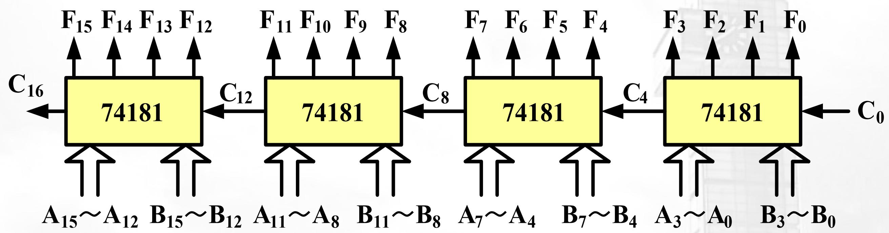

<details>
<summary>flowchart</summary>

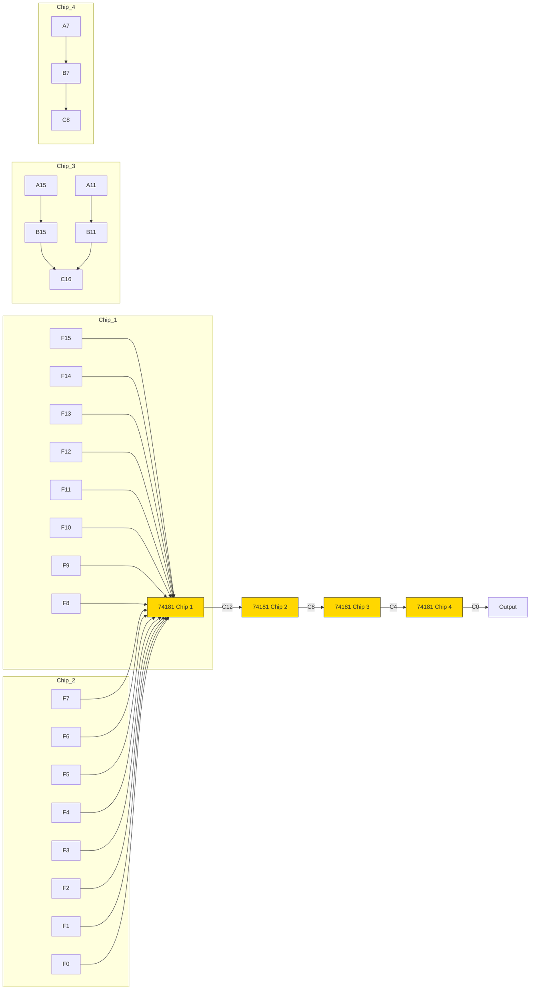
</details>

由74181构成组间串行进位的16位ALU

# 运算的硬件实现——ALU

先行进位部件(CLA): 74LS182

假设4片74LS181的先行进位输出依次为：

$$
P _ {0}, G _ {0}, P _ {1}, G _ {1}, P _ {2}, G _ {2}, P _ {3}, G _ {3}
$$

$$
C _ {n + x} = G _ {0} + P _ {0} C _ {n}
$$

$$
C _ {n + y} = G _ {1} + P _ {1} C _ {n + x} = G _ {1} + G _ {0} P _ {1} + P _ {0} P _ {1} C _ {n}
$$

$$
C _ {n + z} = G _ {2} + P _ {2} C _ {n + y} = G _ {2} + G _ {1} P _ {2} + G _ {0} P _ {1} P _ {2} + P _ {0} P _ {1} P _ {2} C _ {n}
$$

$$
C _ {n + 4} = G _ {3} + P _ {3} C _ {n + z} = \frac {G _ {3} + G _ {2} P _ {3} + G _ {1} P _ {2} P _ {3} + G _ {0} P _ {1} P _ {2} P _ {3}}{G ^ {*}} + \frac {P _ {0} P _ {1} P _ {2} P _ {3}}{P ^ {*}} C _ {n}
$$

$P^{*}=P_{0}P_{1}P_{2}P_{3}$ 成组进位传送输出

$G^{*}=G_{3}+G_{2}P_{3}+G_{1}P_{2}P_{3}+G_{0}P_{1}P_{2}P_{3}$ ……成组进位发生输出

# 运算的硬件实现——ALU

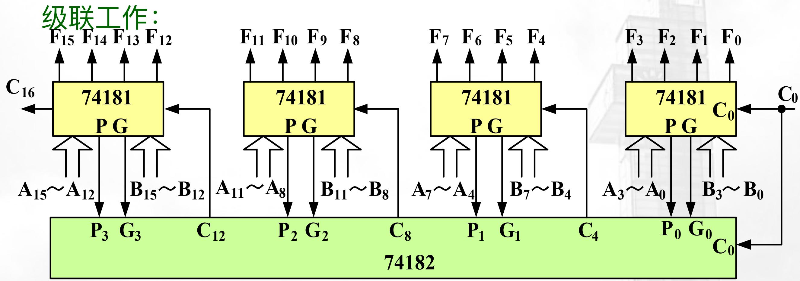

<details>
<summary>flowchart</summary>

```mermaid
graph TD
    subgraph 级联工作
        A["74181 PG"] --> B["74181 PG"]
        C["74181 PG"] --> D["74181 PG"]
        E["74181 PG"] --> F["74181 PG"]
        G["74181 PG"] --> H["74181 PG"]
        I["74181 PG"] --> J["74181 PG"]
        K["74181 PG"] --> L["74181 PG"]
        M["74181 PG"] --> N["74181 PG"]
        O["74181 PG"] --> P["74181 PG"]
        Q["74181 PG"] --> R["74181 PG"]
        S["74181 PG"] --> T["74181 PG"]
        U["74181 PG"] --> V["74181 PG"]
        W["74181 PG"] --> X["74181 PG"]
        Y["74181 PG"] --> Z["74181 PG"]
        AA["74181 PG"] --> AB["74181 PG"]
        AC["74181 PG"] --> AD["74181 PG"]
        AE["74181 PG"] --> AF["74181 PG"]
        AG["74181 PG"] --> AH["74181 PG"]
        AI["74181 PG"] --> AJ["74181 PG"]
        AK["74181 PG"] --> AL["74181 PG"]
        AM["74181 PG"] --> AN["74181 PG"]
        AO["74181 PG"] --> AP["74181 PG"]
        AQ["74181 PG"] --> AR["74181 PG"]
        AS["74182"] --> AT["74182"]
    end
    subgraph 级联工作
        AU["F0"] --> AV["C0"]
        AW["F3"] --> AX["C0"]
        AY["A0"] --> AZ["B0"]
        BA["A3"] --> BB["B0"]
        BC["A5"] --> BD["B0"]
        BE["A7"] --> BF["B0"]
        BG["A9"] --> BH["B0"]
        BI["A10"] --> BJ["B0"]
        BK["A12"] --> BL["B0"]
        BM["A15"] --> BN["B0"]
        BO["A16"] --> BP["B0"]
        BQ["A20"] --> BR["B0"]
        BS["A22"] --> BT["B0"]
        BU["A25"] --> BV["B0"]
        BW["A26"] --> BX["B0"]
        BY["A28"] --> BZ["B0"]
        CA["A30"] --> CB["B0"]
        CC["A32"] --> CD["B0"]
        CE["A35"] --> CF["B0"]
        DG["A36"] --> DH["B0"]
    end
```
</details>

由74181和74182构成组内组间均并行进位的16位ALU

# 运算的硬件实现——ALU

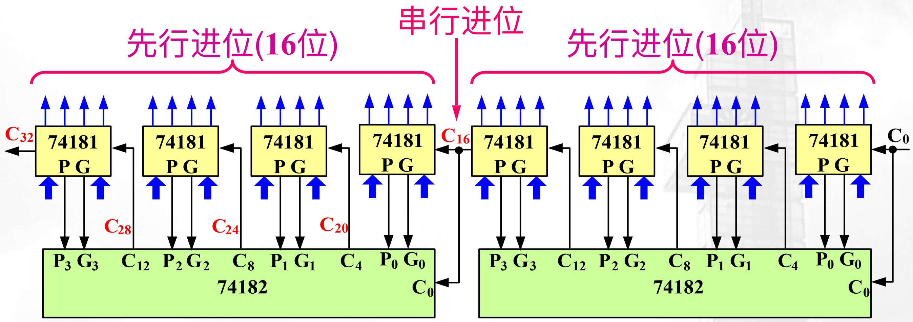

<details>
<summary>flowchart</summary>

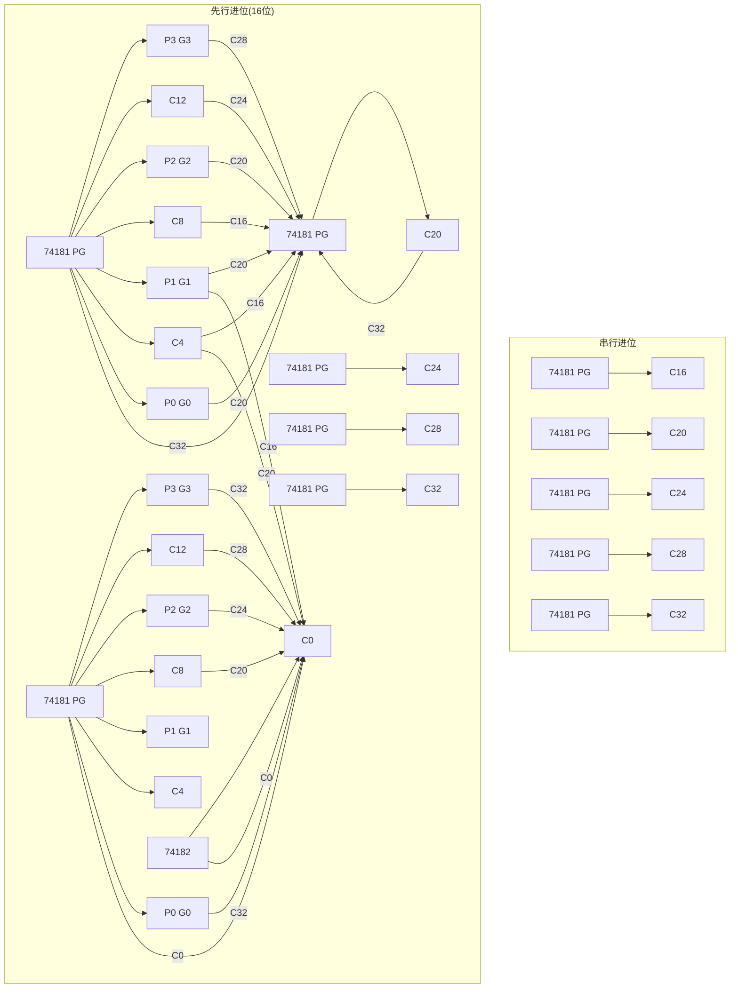
</details>

用两个16位全先行进位逻辑级联组成的32位ALU

# 运算的硬件实现——CPU

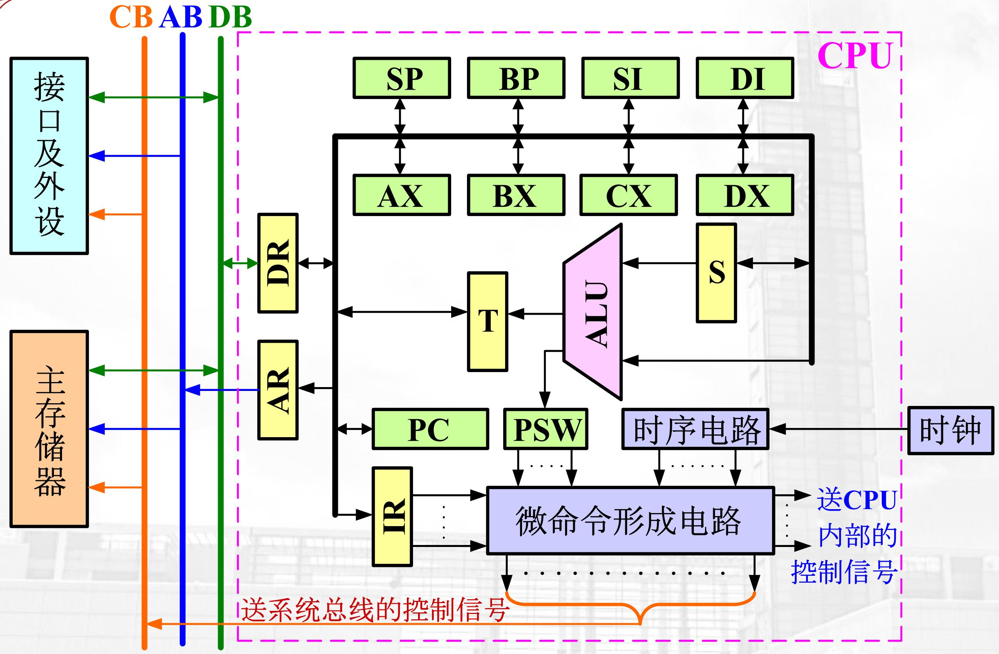

<details>
<summary>flowchart</summary>

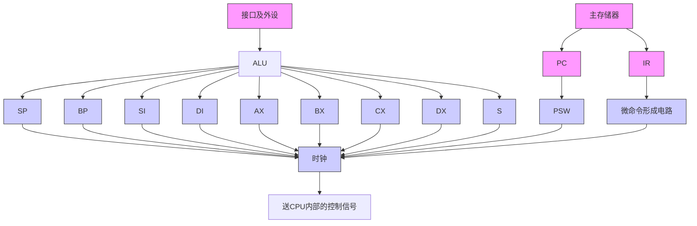
</details>

# Ariane 5 Disaster

\- Ariana 5号火箭，研发10余年，耗资\$7B

\- 96年6月4日，发射，摔了

\- 无人，毁了\$500M货物


<details>
<summary>natural_image</summary>

Close-up of a burning object with visible flame and smoke (no text or symbols)
</details>

# Ariana 5 Disaster

- 软件bug导致!  
- 具体原因:

\- 在惯性导航系统（INS）中，某个关于水平速度的64bit浮点数(double)在代码中被转换为16bit有符号整数(int16\_t/short);

- 在故障时刻，这个double数值已经超过32767，转int16时溢出\~\~\~  
- “Not Enough Space to Reach Space”


<details>
<summary>natural_image</summary>

Close-up of a flame with visible flames and smoke, no text or symbols present
</details>

# 乘除法巩固练习

# 乘除法巩固练习 （随堂小测试）

- 用原码两位乘法和 Booth法计算：-0.11001101 x -0.1101  
- 用原码不恢复法和补码除法计算：-0.10100110 / -0.1101

# 乘除法巩固练习 （随堂小测试）

\- 答案:

- 乘法：0.101001101001  
- 除法: