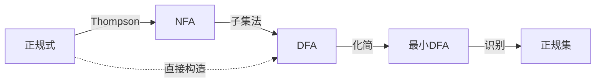

# 词法分析

> **所属章节**：第3章 词法分析
> **核心问题**：正规式、正规文法、有穷自动机的概念及相互转换

---

## 3.1 词法分析程序的任务

词法分析程序（词法分析器/扫描器）的任务：
1. **识别单词**：从左到右扫描源程序字符流，识别出具有独立意义的**单词符号**
2. **返回 token**：将每个单词表示为二元组 `(单词类别, 属性值)`

### 单词分类

| 单词类型 | 示例 | 类别码 |
|---------|------|--------|
| **关键字** | if, while, for | 一字一码（保留字） |
| **标识符** | count, sum | 统一类别码 + 符号表指针 |
| **常数** | 3.14, 100 | 统一类别码 + 常数值 |
| **运算符** | +, -, *, /, := | 可一字一码或统一分组 |
| **界符** | ;, (, ), {, } | 一字一码 |

> [!tip] Token 表示
> 单词以 **(类别码, 属性值)** 二元组形式输出。标识符的属性值通常是指向符号表的指针。

---

## 3.2 正规式（正则表达式）

### 定义

正规式（Regular Expression）是描述正规语言的工具，递归定义：

1. ε 和 ∅ 是正规式
2. 每个 $a \in \Sigma$ 是正规式
3. 若 r、s 是正规式，则 $r|s$（或）、$rs$（连接）、$r^*$（闭包）也是正规式

### 运算优先级

$$\text{闭包}^* > \text{连接} > \text{或}|$$

### 正规式的性质

| 性质 | 表达式 |
|------|--------|
| 交换律 | $r|s = s|r$ |
| 结合律 | $(r|s)|t = r|(s|t)$，$(rs)t = r(st)$ |
| 分配律 | $r(s|t) = rs|rt$ |
| 幂等律 | $r|r = r$ |
| 幺元 | $r\varepsilon = \varepsilon r = r$ |
| 零元 | $r\emptyset = \emptyset r = \emptyset$ |
| 闭包性质 | $r^* = r^*r^* = r^*|\varepsilon$，$r^{**} = r^*$ |

---

## 3.3 正规文法（3型文法）

### 定义

产生式形式：
- **右线性**：$A \to aB$ 或 $A \to a$（$A,B \in V_N, a \in V_T$）
- **左线性**：$A \to Ba$ 或 $A \to a$

### 正规文法 ↔ 正规式的转换

#### 正规文法 → 正规式

设 $A \to \alpha B$，$B \to \beta$，则可将 B 代入得 $A \to \alpha\beta$。

对于递归产生式 $A \to aA | b$，对应正规式 $A = a^*b$。

#### 正规式 → 正规文法

引入非终结符，逐步拆解正规式：

| 正规式 | 正规文法产生式 |
|--------|-------------|
| $r = a^*b$ | $A \to aA \| b$ |
| $r = (a\|b)^*$ | $A \to aA \| bA \| \varepsilon$ |
| $r = ab$ | $A \to aB$，$B \to b$ |

---

## 3.4 有穷自动机 (FA)

### 确定的有穷自动机 (DFA)

$$M = (S, \Sigma, \delta, s_0, F)$$

| 符号 | 含义 |
|------|------|
| $S$ | 有穷**状态集** |
| $\Sigma$ | **输入字母表** |
| $\delta$ | **转换函数** $S \times \Sigma \to S$（单值映射） |
| $s_0$ | **初始状态**（$s_0 \in S$） |
| $F$ | **终止状态集**（$F \subseteq S$） |

### 不确定的有穷自动机 (NFA)

$$M = (S, \Sigma, \delta, S_0, F)$$

与 DFA 的区别：
1. 初始状态可以有**多个**（$S_0 \subseteq S$）
2. $\delta: S \times \Sigma \to 2^S$（值为状态**集合**）
3. 可以有 **ε 转换**

### DFA vs NFA

| 特征 | DFA | NFA |
|------|-----|-----|
| 初始状态 | 唯一 | 可多个 |
| 转换函数 | 单值 | 多值（集合） |
| ε 转换 | 不允许 | 允许 |
| 识别能力 | 等价（都识别正规集） | 等价 |
| 实现难度 | 直接实现 | 需转换为 DFA |

> [!important] 等价性
> DFA 和 NFA **识别能力相同**，都可以识别正规集。任何 NFA 都可以转换为等价的 DFA。

---

## 3.5 NFA → DFA（子集法）

### 算法步骤

1. 计算 ε-closure(s₀) 作为 DFA 的初始状态
2. 对每个状态集合和输入符号，计算 move(T, a) 和 ε-closure(move(T, a))
3. 重复直到没有新状态产生
4. 包含 NFA 终止状态的状态集合标记为 DFA 的终止状态

### 关键概念

- **ε-closure(q)**：从状态 q 出发，仅通过 ε 转换可达的所有状态集合
- **move(T, a)**：从集合 T 中任一状态出发，经输入 a 可达的状态集合

---

## 3.6 DFA 的化简（最小化）

### 算法（分割法）

1. 初始划分：$\Pi = \{F, S-F\}$（终止状态组和非终止状态组）
2. 对每个组，若存在某输入符号使组内不同状态到达不同组，则分割该组
3. 重复直到不能再分割
4. 每组合并为一个状态

---

## 3.7 正规式 ↔ NFA ↔ DFA 的关系



> 三种表示形式等价：**正规式 ⇔ 正规文法 ⇔ 有穷自动机**，都描述**正规语言**。

---

## 3.8 词法分析与语法分析的关系（PPT补充）

### 分离词法分析的优点

1. 使编译程序结构更加**简洁、分析和条理化**
2. 词法分析可使用**正规文法自动构造**
3. 有利于提高**编译效率**（词法分析简单，可多次调用）
4. 可改善**可移植性**（不同输入变成统一内部表示）

### 词法分析器的两种使用方式

| 方式 | 说明 |
|------|------|
| 作为**一遍** | 独立扫描整个源程序，输出单词符号串 |
| 作为**子程序** | 被语法分析器调用，每次返回一个单词符号 |

---

## 3.9 扫描缓冲区（PPT补充）

- 缓冲区大小：**120个字符**
- 采用**两个指示器**：起点指示器、搜索指示器
- 使用**两个互补区**（半区交替使用）
- 预处理子程序负责**删除无用字符**（空白、回车等）

---

## 3.10 单词符号的识别 — 超前搜索（PPT补充）

某些语言的单词识别需要**超前搜索**（lookahead）：

| 场景 | 示例 | 说明 |
|------|------|------|
| 关键字识别 | `DO99K=1,10` vs `DO99K=1.10` | 前者DO是关键字，后者DO是标识符的一部分 |
| 复合运算符 | `++`, `--`, `>=` | 需看下一个字符才能确定 |
| 常数识别 | 实型常数 `123.45` | 需要识别小数点 |

---

## 3.11 状态转换图的程序实现（PPT补充）

### 实现所需的数据结构和过程

| 名称 | 类型 | 功能 |
|------|------|------|
| **CHAR** | 字符变量 | 存放最新读进的源程序字符 |
| **TOKEN** | 字符数组 | 存放构成单词的字符串 |
| **GETCHAR** | 过程 | 将下一输入字符读入CHAR |
| **GETBC** | 过程 | 跳过空白字符 |
| **CONCAT** | 过程 | 把CHAR连接到TOKEN之后 |
| **LETTER** | 布尔函数 | 判断CHAR是否为字母 |
| **DIGIT** | 布尔函数 | 判断CHAR是否为数字 |
| **RESERVE** | 整型函数 | 查保留字表，返回编码或0 |

### 状态结到程序的映射

- **分叉结** → CASE语句 或 IF...THEN...ELSE语句
- **回路结** → WHILE循环
- **终态结** → RETURN(C, VAL)语句

> [!example] 状态1的代码示例
> ```
> state1: C := GETCHAR;
>   if LETTER(C) or DIGIT(C) then goto state1
>   else if DELIMITER(C) then goto state2
>   else FAIL();
> ```

---

## 3.12 正规式 ↔ 正规文法转换示例（PPT补充）

### 正规式 → 正规文法

正规式 `a(a|d)*`（标识符）转换：

```
令 S 是开始符号
S → a(a|d)*
分解为 S → aA, A → (a|d)*
再变换：A → (a|d)B, A → ε, B → (a|d)B, B → ε
最终正规文法：
S → aA | a
A → aB | dB
A → ε
B → aB | dB
B → ε
```

### 正规文法 → 正规式

| 文法产生式 | 正规式 |
|-----------|--------|
| A→xB, B→y | A = xy |
| A→xA\|y | A = x*y |
| A→x, A→y | A = x\|y |

---

## 3.13 FORTRAN语言词法分析实例（PPT补充）

### FORTRAN实型常数的状态转换图

识别规则：数字串.数字串（含可选的指数部分）

状态转换图包含状态：
- 初态 → 读数字 → 小数点前状态
- 遇到`.` → 小数点后状态
- 遇到`E` → 指数状态
- 终态：成功识别实型常数

---

## 典型例题

### 例：正规式转NFA再转DFA

正规式 $(a|b)^*abb$：
1. 构造 NFA（Thompson 构造法）
2. 用子集法转为 DFA
3. 化简为最小 DFA

---

## 关联题目

- [[第三章 词法分析导学案|词法分析导学案]]
- [[分析设计题题库#第11题|正规文法转正规式]]

---

#编译原理 #第3章 #词法分析 #正规式 #有穷自动机